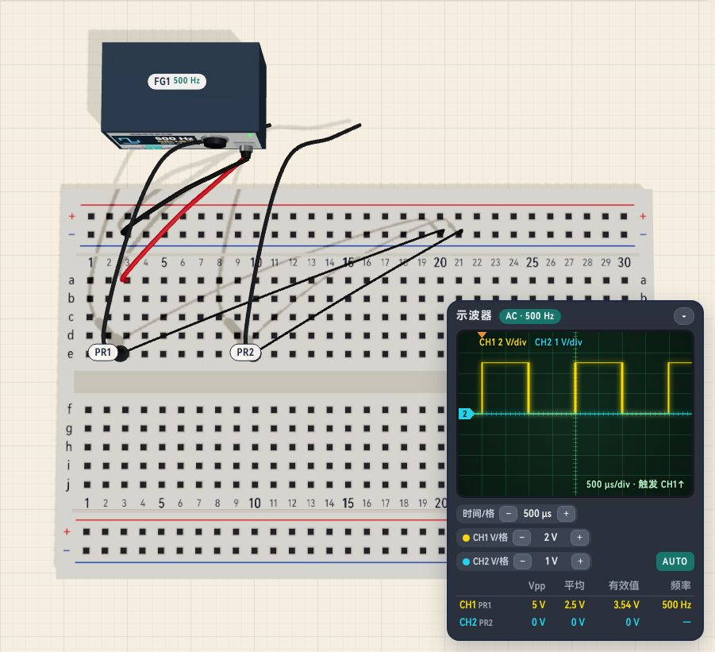
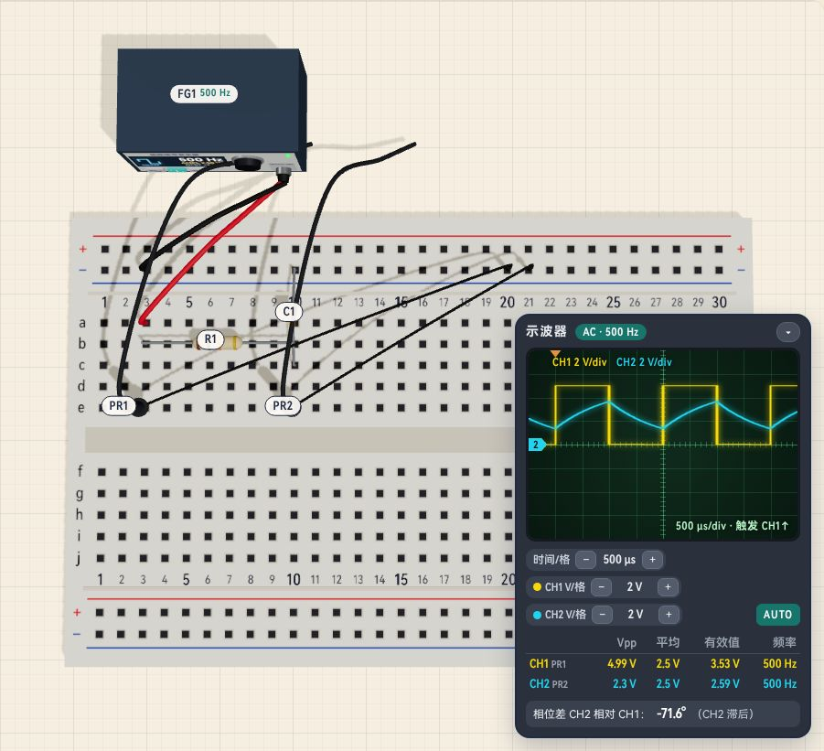
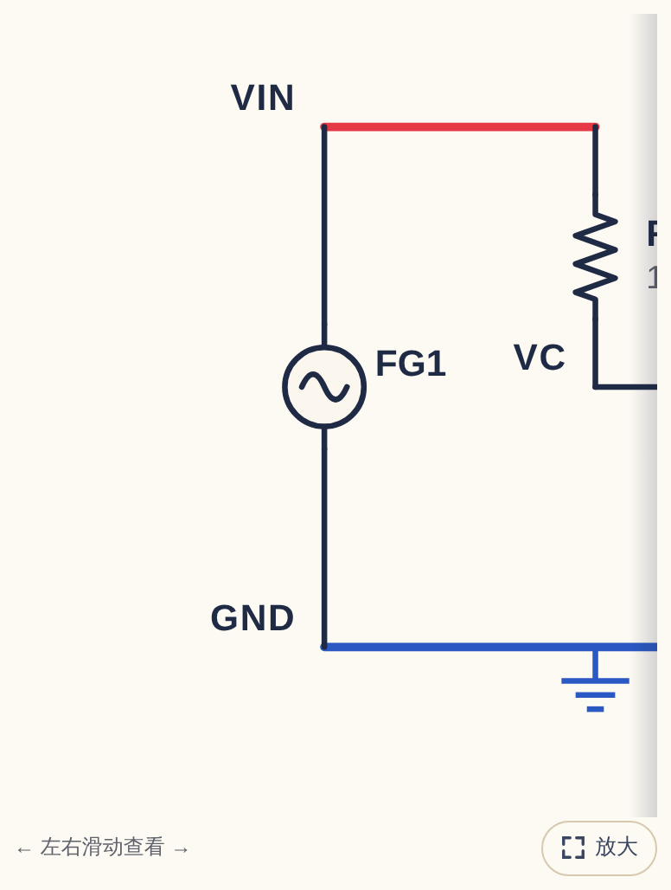
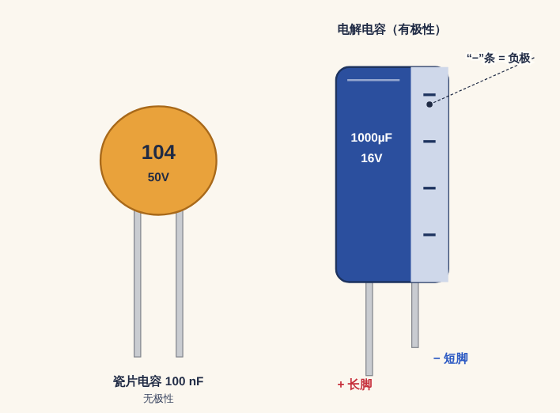
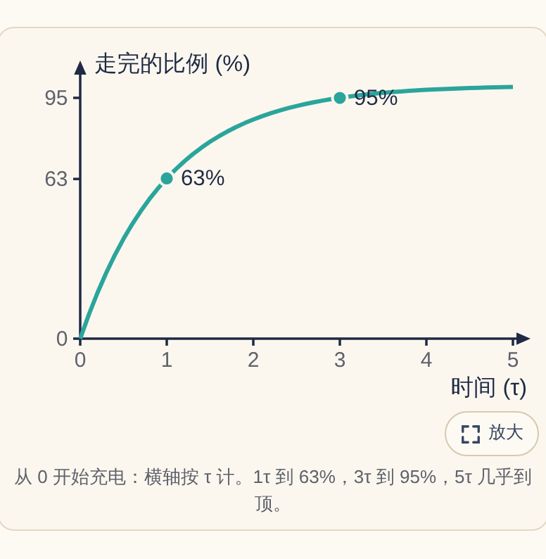
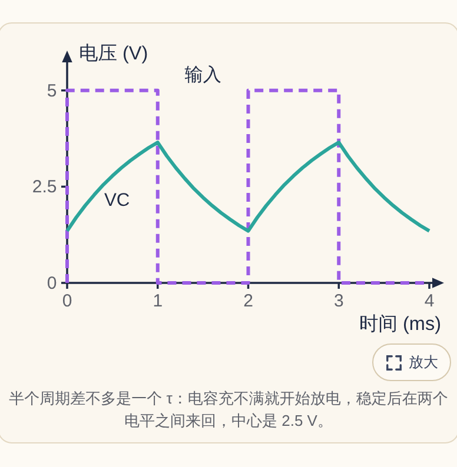

# 4.2 · RC 充放电：用方波看时间常数

| 项目 | 内容 |
|---|---|
| id | `exp3-rc-square-charging` |
| 文件 | `challenges/241-rc-square-charging.json` |
| 类型 | 实验 / 挑战（没有分步，照目标电路图搭） · 难度 2/5 |
| 位置 | World 4 · 储能元件与一阶 / 二阶暂态 → 4.2 RC 时间常数（本节第 1 项） |
| 右侧面板 | 轨道由旧的四张卡片自动生成（还没手工精排） |
| 前后 | 上一项 [4.1 exp3-led-breathing](../w4/4.01-1-exp3-led-breathing.md) · 下一项 [4.2 exp3-rc-thevenin-tau](../w4/4.02-2-exp3-rc-thevenin-tau.md) |
| 先修 | lesson-scope-two-channels |
| 概念 | RC circuit RC 电路、time constant τ = RC 时间常数、charging / discharging 充电 / 放电、rise time 上升时间 |

**一句话概要**：0–5 V 方波经 10 kΩ 给 100 nF 电容充放电：改变频率，看电容电压在半个周期里能走多远，再从曲线读出 τ。

## 1. 左侧工作台（3D 面包板 → 2D 俯视截图）

截图是程序里真实的 3D 面包板换成俯视角拍的；表格是同一块板的文字版（元件、参数、每只脚插在哪个孔）。

### 1.1 起点：打开这一课时板上已经有的

右侧显示的「起点」说明：

> **半成品**：信号发生器（已经设好波形）和两个示波器探头已经接好。**为什么**：仪器的接法第 12、13 课练过，这个实验要看的是电路本身的波形。**你要做**：加上 R1（10kΩ，第 3 列 → 第 10 列）和 C1（100nF，第 10 列 → GND）。

| 元件 | 类型 | 参数 | 引脚 → 孔 |
|---|---|---|---|
| FG1 | function_gen | waveform=square, frequency=500, amplitude=2.5, offset=2.5 | +→a3 -→tn3 |
| PR1 | scope_probe | channel=1 | tip→e3 gnd→tn20 |
| PR2 | scope_probe | channel=2 | tip→e10 gnd→tn21 |

### 1.3 参考答案（「看答案」载入的板子）

| 元件 | 类型 | 参数 | 引脚 → 孔 |
|---|---|---|---|
| FG1 | function_gen | waveform=square, frequency=500, amplitude=2.5, offset=2.5 | +→a3 -→tn3 |
| R1 | resistor | resistance=10000 | 1→b3 2→b10 |
| C1 | capacitor | capacitance=1.0000000000000001e-7 | 1→c10 2→tn10 |
| PR1 | scope_probe | channel=1 | tip→e3 gnd→tn20 |
| PR2 | scope_probe | channel=2 | tip→e10 gnd→tn21 |

### 1.4 目标原理图（右侧「目标原理图」抽屉）

| 元件 | 类型 | 参数 |
|---|---|---|
| FG1 | function_gen |  |
| R1 | resistor | resistance=10000 |
| C1 | capacitor | capacitance=1.0000000000000001e-7 |

连接（每个结点上的引脚）：

- **VIN**：FG1.+、R1.1
- **VC**：R1.2、C1.1
- **GND**：C1.2、FG1.-

## 2. 右侧面板：学生从上往下看到的内容（单轨流）

### 第 1 步 · 🔍 先看一眼：先认识它：电容

**拆解「电容 Capacitor：两块极板夹一层绝缘」第 1 / 7 层：① 外形：瓷片电容和电解电容**

课程里有两种电容：
- 瓷片电容 ceramic capacitor：橙色小圆片，**没有极性**，容量小（pF – 几 µF）。上面印 三位数代码，单位是 **pF**：前两位是有效数字，第三位是 10 的几次方。**104** = 10 × 10⁴ pF = 100 000 pF = **100 nF** = 0.1 µF。102 = 1 nF，103 = 10 nF，105 = 1 µF。
- 电解电容 electrolytic capacitor：铝壳圆柱，容量大（1 µF – 几万 µF），**有极性**：长脚是 +，外壳上 印着一串“−”的白条 那边是 −（短脚）。直接印着容量和耐压，比如 1000 µF 16 V。

两种电容的 **耐压**（rated voltage）都要大于电路里的最高电压，一般留 1.5–2 倍余量：9 V 电路用 16 V 或 25 V 的。

呼吸灯实验（exp3-led-breathing）用的 1000 µF 就是电解电容：长脚（+）接 VC，短脚接 GND。

| 类型 | 标记 | 极性 | 常见范围 | 课程里 |
|---|---|---|---|---|
| 瓷片 / 陶瓷 | 三位代码（pF）：104 = 100 nF | 无 | 1 pF – 10 µF | RC 实验的 100 nF |
| 铝电解 | 直接印 µF 和 V；“−”条 = 负极 | 有：长脚 + | 1 µF – 47 mF | 呼吸灯的 1000 µF |

### 第 2 步 · 🔧 动手搭：让电容一遍遍充满、放空

- 板上已经放好信号发生器和两个探头。加上 **R1 `10 kΩ`**（**`b3`** → **`b10`**）和 **C1 `100 nF`**（**`c10`** → GND 轨）。
- 信号发生器是**方波**，在 0 和 5 V 之间跳：高电平像“合上开关给电容充电”，低电平像“拨到地让它放电”。
- 把频率调到 **`50 Hz`**，看 CH2（电容）的形状；再试 **`5 kHz`**。
电容电压是一下子跳上去的吗？频率高了以后，它还充得满吗？

### 第 3 步 · 💡 想明白：先快后慢：时间常数 τ

- 刚开始充电时电容是空的，电阻两端的电压最大，电流最大，所以升得快。越接近 5 V，电阻上剩下的电压越小，电流越小，升得越慢。
- 快慢只由一个数决定，叫**时间常数**。R 要算上信号发生器的 50 Ω：
$$τ = RC = 10.05 kΩ × 100 nF$$
- 每过一个 τ，离终点的距离就只剩约 37%：1τ 走完 63%，3τ 走完 95%，5τ 几乎走完。

*图 `tau`（plot）：从 0 开始充电：横轴按 τ 计。1τ 到 63%，3τ 到 95%，5τ 几乎到顶。*

- 所以要比的是**半个周期和 τ**：半个周期 ≫ τ，每次都充满、放空；差不多长，充不满就开始放；半个周期 ≪ τ，只走了曲线最开头的一小段，像一个小三角波。

*图 `half`（plot）：半个周期差不多是一个 τ：电容充不满就开始放电，稳定后在两个电平之间来回，中心是 2.5 V。*

（这一步下面列着这节课的计算卡片，点开就地展开：`generator-output`、`vpp-amplitude`、`period-frequency`、`rc-time-constant`、`rc-charging`、`rise-time`、`tau-from-vh-vl`、`square-rc-vpp`，全文见第 6 节）

### 第 4 步 · 🔧 动手搭：从曲线读出 τ

- **`50 Hz`** 时读 CH2 的上升时间：电容电压从 10% 升到 90% 用的时间。
- 指数曲线从 10% 到 90% 正好要 τ × ln 9 ≈ 2.2τ，所以 τ = 上升时间 / ln 9。
- 再调到 **`500 Hz`** 读 CH2 的峰峰值，最后看一眼 **`5 kHz`** 的形状。

### 第 5 步 · 📏 测一测：测一测：读你自己的仪表

**测量题 1 · `tr`**（读数题）

> 50 Hz：CH2 的上升时间 t_r（从 10% 升到 90%）

- 单位 ms · 状态：FG1 设为 信号发生器（方波 50Hz 幅度 2.5V） · 参考答案的读数 **2.204 ms** · 合理范围 [0.0021, 0.0023]

**测量题 2 · `tau`**（计算题（用自己的读数算））

> 由你读的 t_r 算时间常数 τ = t_r / ln 9

- 单位 ms · 先写预测 · 参考答案的读数 **1.003 ms** · 合理范围 [0.00095, 0.00106] · 公式 `tr / ln(9)`

答对后显示：

> 指数曲线从 10% 到 90% 正好要 τ·ln 9 ≈ 2.2τ。τ = (10 kΩ + 50 Ω) × 100 nF ≈ 1.0 ms。

**测量题 3 · `vpp500`**（读数题）

> 500 Hz：CH2（电容电压）的峰峰值

- 单位 V · 先写预测 · 状态：FG1 设为 信号发生器（方波 500Hz 幅度 2.5V） · 参考答案的读数 **2.301 V** · 合理范围 [2.2, 2.4]

答对后显示：

> 半个周期 ≈ τ，电容来不及充满：Vpp = 5 V × tanh(T / 4τ) ≈ 2.3 V。

**测量题 4 · `shape`**（选择题）

> 5 kHz 时，CH2 是什么样子？

- A. 一个很小的三角波，骑在约 2.5 V 上 ✅（正确）
- B. 和输入一样的方波
- C. 一条停在 5 V 的直线

答对后显示：

> 半个周期 0.1 ms 只有 0.1τ：每次只走了曲线开头几乎是直线的一小段。中心是方波的平均值 2.5 V。

### 第 6 步 · 🎒 带走：带走

- **τ = RC**：电阻、电容越大，充放得越慢。信号发生器的 50 Ω 也在 R 里。
- **1τ 63%，3τ 95%，5τ 约 99%**：工程上过了 5τ 就算“充满了”。
- **半个周期 ≫ τ** 时每次充满放空；**≪ τ** 时只剩一个小三角波，骑在平均值上。
- **真实电路里**：瓷片电容的误差常有 ±10%～±20%，量出的 τ 和算的差一两成很正常。反过来，量 τ 就能测出电容的真实值。

趁热练理论题：`first-order`

## 3. 测量题一览

| # | id | 题目 | 类型 | 单位 | 状态 | 参考读数 |
|---|---|---|---|---|---|---|
| 1 | tr | 50 Hz：CH2 的上升时间 t_r（从 10% 升到 90%） | scope | ms | FG1 设为 信号发生器（方波 50Hz 幅度 2.5V） | 2.204 ms |
| 2 | tau | 由你读的 t_r 算时间常数 τ = t_r / ln 9 | formula | ms |  | 1.003 ms |
| 3 | vpp500 | 500 Hz：CH2（电容电压）的峰峰值 | scope | V | FG1 设为 信号发生器（方波 500Hz 幅度 2.5V） | 2.301 V |
| 4 | shape | 5 kHz 时，CH2 是什么样子？ | 选择 |  |  | 正确：A |

### 全部答完后显示的「对比」

**对比**：τ = (10 kΩ + 50 Ω) × 100 nF ≈ **1.0 ms**；上升时间 t_r = τ·ln 9 ≈ **2.2 ms**。
- **50 Hz**：半个周期 10 ms ≈ 10τ。每次几乎充满到 5 V、放空到 0 V。
- **500 Hz**：半个周期 1 ms ≈ τ。稳定后在约 1.35 V 和 3.65 V 之间来回，Vpp = 5 × tanh(T / 4τ) ≈ **2.3 V**。
- **5 kHz**：半个周期 0.1 ms = 0.1τ，只剩一个约 0.25 Vpp 的**三角波**，骑在 2.5 V 上。

tanh 公式的来历：稳态时充电半周期 VH = 5 − (5 − VL)·e^(−T/2τ)，放电半周期 VL = VH·e^(−T/2τ)，两式联立得 VH − VL = 5·tanh(T/4τ)。

### 提示按钮（依次显示）

1. R1 从信号发生器那一列（第 3 列）接到第 10 列；C1 从第 10 列接到 GND 轨。
2. 示波器的上升时间读数就是 10%→90% 的时间。
3. τ = t_r / ln 9；500 Hz 时半个周期大约是一个 τ。

### 功能测试（「检查我的电路」时跑）

- 50 Hz（半个周期 ≫ τ）：电容每次都充满、放空
- 500 Hz（半个周期 ≈ τ）：来不及充满，围绕中心来回
- 5 kHz（半个周期 ≪ τ）：只剩一个小三角波

## 4. 用到的拆解（全部层的文字，供改写参考）

### 拆解 `capacitor`：电容 Capacitor：两块极板夹一层绝缘

*电容储存的是电荷和电场能量。拆开是两块金属极板中间夹一层介质（dielectric）；由此推出 q = Cv、C = εA/d、i = C dv/dt、W = ½CV²，再推出 RC 充电的指数曲线（τ = RC）和“直流断路、高频短路”的容抗。最后看真实电容差在哪：ESR、漏电、极性。*

**拆解「电容 Capacitor：两块极板夹一层绝缘」第 1 / 7 层：① 外形：瓷片电容和电解电容**

课程里有两种电容：
- 瓷片电容 ceramic capacitor：橙色小圆片，**没有极性**，容量小（pF – 几 µF）。上面印 三位数代码，单位是 **pF**：前两位是有效数字，第三位是 10 的几次方。**104** = 10 × 10⁴ pF = 100 000 pF = **100 nF** = 0.1 µF。102 = 1 nF，103 = 10 nF，105 = 1 µF。
- 电解电容 electrolytic capacitor：铝壳圆柱，容量大（1 µF – 几万 µF），**有极性**：长脚是 +，外壳上 印着一串“−”的白条 那边是 −（短脚）。直接印着容量和耐压，比如 1000 µF 16 V。

两种电容的 **耐压**（rated voltage）都要大于电路里的最高电压，一般留 1.5–2 倍余量：9 V 电路用 16 V 或 25 V 的。

呼吸灯实验（exp3-led-breathing）用的 1000 µF 就是电解电容：长脚（+）接 VC，短脚接 GND。

| 类型 | 标记 | 极性 | 常见范围 | 课程里 |
|---|---|---|---|---|
| 瓷片 / 陶瓷 | 三位代码（pF）：104 = 100 nF | 无 | 1 pF – 10 µF | RC 实验的 100 nF |
| 铝电解 | 直接印 µF 和 V；“−”条 = 负极 | 有：长脚 + | 1 µF – 47 mF | 呼吸灯的 1000 µF |

**拆解「电容 Capacitor：两块极板夹一层绝缘」第 2 / 7 层：② 拆开：电极、介质，一层又一层**

每个电容不管长什么样，里面都是同一个结构：**两个互相绝缘的导体（电极 electrode），中间夹一层绝缘体（介质 dielectric）**。工厂做的事情，就是在小体积里把“面积做大、距离做小”。

**陶瓷电容（MLCC，多层陶瓷电容）**：几十到几百层 金属电极 和 陶瓷介质 交替叠在一起，单数层接左边的 端电极，双数层接右边——等于很多个电容 **并联**。陶瓷（钛酸钡）的相对介电常数 $ε_r$ 很大（X7R 约 2000），每层只有几 µm 厚。

**铝电解电容**：一条 阳极铝箔 和一条 阴极铝箔，中间夹 浸了电解液的纸，卷成一卷装进铝壳。真正的介质是阳极箔表面电化学生长出来的一层 氧化铝 Al₂O₃，只有十几 nm 厚；铝箔还被腐蚀得坑坑洼洼，实际表面积是平面的几十倍。所以它能在小体积里做出 1000 µF。

**极性的来源**：氧化层只在阳极箔上，而且只有阳极电压更高时才稳定。电压反过来，电化学反应会把它还原掉（第 ⑦ 层）。

**拆解「电容 Capacitor：两块极板夹一层绝缘」第 3 / 7 层：③ 模型：平行板，q = Cv，C = εA/d**

把电容理想化成两块面积为 A、距离为 d 的 平行金属板。加电压 v：电源从 下板 抽走电子送到上板的反面……结果是上板带 **+q**，下板带 **−q**，两板之间出现 电场。电荷和电压成正比，比例系数就是 **capacitance（电容）C**：
$$q = C·v$$
单位：法拉 F = C/V。1 F 很大，常用 µF（10⁻⁶）、nF（10⁻⁹）、pF（10⁻¹²）。

C 由几何和材料决定：
$$C = \frac{εA}{d},   ε = ε_r ε_0,   ε_0 = 8.85 pF/m$$
- 面积 A 越大 → 能放的电荷越多；
- 距离 d 越小 → 同样电压下电场越强、吸住的电荷越多；
- 介质 被电场 **极化**（polarization）：分子里的正负电荷被拉开，抵消掉一部分电场，于是同样的 v 能多放 $ε_r$ 倍的电荷。

**带数字**：空气、1 cm² 的两块板、相距 1 mm：$C = \frac{8.85×10^{-12} × 10^{-4}}{10^{-3}} ≈ 0.89 pF$——小得可怜。
一层 MLCC：$ε_r = 2000$，A = 2 mm × 1.2 mm，d = 5 µm：$C = \frac{8.85×10^{-12} × 2000 × 2.4×10^{-6}}{5×10^{-6}} ≈ 8.5 nF$；叠 12 层并联 ≈ **100 nF**。

- 公式 `q = C·v`：定义：每伏电压存多少库仑
- 公式 `C = \frac{ε_r ε_0 A}{d}`：平行板；MLCC 再乘层数

**拆解「电容 Capacitor：两块极板夹一层绝缘」第 4 / 7 层：④ i = C dv/dt：电流只看电压变化得多快**

对 $q = Cv$ 两边对时间求导，左边 $\frac{dq}{dt}$ 就是流进极板的电流：
$$i = C\frac{dv}{dt}$$
（关联参考方向：电流从 + 端流入）。这是电容 **唯一** 的 V–I 关系，三个推论都从这里来：

1. 电压不变 → 电流为 0。直流稳态下电容就是 **断路**（open circuit）。
2. 电压匀速上升 → 电流恒定：100 nF 在 1 ms 内从 0 升到 5 V，$i = 100 nF × \frac{5 V}{1 ms} = 0.5 mA$。下降得快一倍（0.5 ms），电流就是 −1 mA（反向流出）。
3. **电容电压不能跳变**：要在 0 秒内改变电压，需要无穷大的电流。所以开关动作的瞬间 $v_C(0^+) = v_C(0^-)$——这是一阶电路“三要素法”的出发点。

**储存的能量**：功率 $p = vi = Cv\frac{dv}{dt}$，从 0 充到 V 积分：
$$W = ∫_{0}^{V} Cv dv = \frac{1}{2}CV^{2}$$
- 100 nF 充到 5 V：$\frac{1}{2} × 10^{-7} × 25 = 1.25 µJ$；
- 1000 µF 充到 9 V：$\frac{1}{2} × 10^{-3} × 81 = 40.5 mJ$——足够让 LED 亮好几秒（呼吸灯实验）。

能量存在两板之间的 **电场** 里，不是“存了电流”。理想电容不消耗能量，只是借进来、再还回去。

- 公式 `i = C\frac{dv}{dt}`：直流稳态：dv/dt = 0 → i = 0（断路）
- 公式 `W = \frac{1}{2}CV^{2}`：1000 µF、9 V：40.5 mJ

**拆解「电容 Capacitor：两块极板夹一层绝缘」第 5 / 7 层：⑤ 通过电阻充电：τ = RC，1τ 走完 63%**

RC 方波实验（exp3-rc-square-charging）：信号发生器（内阻 50 Ω）→ 10 kΩ → 100 nF → GND，方波在 0 和 5 V 之间跳。

**推导**（方波刚跳到 5 V，电容从 0 V 开始）：
1. KVL：$V = Ri + v_C$；
2. 代入 $i = C\frac{dv_C}{dt}$：$RC\frac{dv_C}{dt} + v_C = V$，一阶线性微分方程；
3. 初值 $v_C(0) = 0$（电压不能跳），终值 $v_C(∞) = V$（充满后 i = 0），解是：
$$v_C(t) = V(1 - e^{-t/τ}),   τ = RC$$
4. 电流 $i = \frac{V - v_C}{R} = \frac{V}{R}e^{-t/τ}$：一开始最大（0.5 mA），然后指数衰减。开始瞬间电容像 **短路**，充满后像 **断路**。

**τ（time constant，时间常数）** 的意义：
- t = τ：$1 - e^{-1} = 63%$，到 3.16 V；
- t = 3τ：95%；t = 5τ：99.3%，工程上算“充满”；
- 起点的切线 恰好在 t = τ 时到达终值。

**带数字**：$τ = (10 kΩ + 50 Ω) × 100 nF ≈ 1.0 ms$。500 Hz 方波半周期 1 ms ≈ 1τ，电容只能充到约 63% 就开始放电；50 Hz 半周期 10 ms = 10τ，每次都充满放空，波形是完整的指数曲线；5 kHz 半周期 0.1τ，电容几乎来不及动，输出是一个小三角波。

| t | 已充到 | 5 V 方波时 $v_C$ | 电流 i |
|---|---|---|---|
| 0 | 0% | 0 V | 0.50 mA |
| 1τ = 1 ms | 63% | 3.16 V | 0.18 mA |
| 2τ | 86% | 4.32 V | 0.068 mA |
| 3τ | 95% | 4.75 V | 0.025 mA |
| 5τ | 99.3% | 4.97 V | 0.003 mA |

- 公式 `v_C(t) = V(1 - e^{-t/τ}), τ = RC`：充电；放电时 $v_C$ = V·e^{−t/τ}
- 公式 `τ = (10 kΩ + 50 Ω) × 100 nF ≈ 1.0 ms`

**拆解「电容 Capacitor：两块极板夹一层绝缘」第 6 / 7 层：⑥ 频率：直流断路，高频短路**

接正弦电压 $v = V_m sin ωt$，代入 $i = C\frac{dv}{dt}$：
$$i = ωCV_m cos ωt$$
两点结论：
- 电流的幅值是 $ωCV_m$，所以电压幅值 / 电流幅值 = $\frac{1}{ωC}$，这就是 **capacitive reactance（容抗）**：
$$X_C = \frac{1}{ωC} = \frac{1}{2πfC}$$
- cos 比 sin 早 90°：电容的 **电流超前电压 90°**。用相量写：$Z_C = \frac{1}{jωC}$。

容抗和频率成反比，在双对数坐标上是一条斜率 −1 的直线。对 100 nF：
- 50 Hz：31.8 kΩ；1 kHz：1.59 kΩ；100 kHz：15.9 Ω；
- f → 0（直流）：$X_C → ∞$，**断路**；
- f 很高：$X_C → 0$，接近 **短路**。

这就是电容的两大用途：**隔直流、通交流**（耦合电容 coupling capacitor），以及把高频噪声 **旁路到地**（去耦 / 旁路电容 bypass capacitor，每个芯片电源脚旁边那颗 100 nF）。RC 低通、高通滤波器的截止频率 $f_c = \frac{1}{2πRC}$ 就是 $X_C = R$ 的那个频率：10 kΩ 和 100 nF 时 $f_c ≈ 159 Hz$。

| f | $X_C$（100 nF） | 相当于 |
|---|---|---|
| 0（直流） | ∞ | 断路 |
| 50 Hz | 31.8 kΩ | 大电阻 |
| 159 Hz | 10 kΩ | = R：RC 截止频率 |
| 1 kHz | 1.59 kΩ | — |
| 100 kHz | 15.9 Ω | 接近短路 |

- 公式 `X_C = \frac{1}{2πfC}`：电流超前电压 90°；$Z_C$ = 1/(jωC)
- 公式 `f_c = \frac{1}{2πRC} = \frac{1}{2π × 10 kΩ × 100 nF} ≈ 159 Hz`

**拆解「电容 Capacitor：两块极板夹一层绝缘」第 7 / 7 层：⑦ 真实电容：ESR、ESL、漏电、极性**

真实电容 = 理想 C + 三个寄生元件：
- ESR（equivalent series resistance，等效串联电阻）：引线、电极和电解液的电阻。电解电容约 0.1–1 Ω，陶瓷电容只有几 mΩ。纹波电流流过它会发热：1 A 纹波、0.5 Ω → 0.5 W。
- ESL（equivalent series inductance，等效串联电感）：引线和卷绕带来的几 nH 到几十 nH。频率高到一定程度（**self-resonance 自谐振**，100 nF 陶瓷约 10–20 MHz），电容反而变成电感。所以去耦时大电容和小电容并联使用。
- 漏电电阻 $R_leak$：介质不是完美的绝缘体。电解电容的漏电流约 0.01CV（1000 µF、9 V 时几十 µA），充满的电解电容放几小时电压就掉下去了。

**电解电容接反**：阳极的氧化层被电化学反应还原掉，漏电流变大 → 发热 → 电解液汽化 → 外壳顶部的十字防爆纹 **鼓包、喷液甚至炸开**。几伏的反压就可能开始损坏。

**陶瓷电容的直流偏压效应**：X7R、Y5V 这类高介电常数陶瓷，加的直流电压越高，$ε_r$ 越小，实际容量可能只剩一半。精确的 RC 定时要用 C0G（NP0）陶瓷或薄膜电容。

**仿真器里**：电容是 **理想电容**——没有 ESR、ESL、漏电，也 **不区分电解电容的极性**（接反不会报错）。只有直流电源时它按断路处理；有信号发生器或 PWM 时按时域仿真。真实搭电路时，电解电容一定要按极性插。

| 参数 | 陶瓷 100 nF | 电解 1000 µF | 仿真器 |
|---|---|---|---|
| ESR | 几 mΩ | 0.1–1 Ω | 0 |
| ESL | ≈ 1–5 nH | ≈ 10–20 nH | 0 |
| 漏电 | nA | 几十 µA | 0 |
| 误差 | ±10% | ±20% | 0 |
| 极性 | 无 | 有，接反会坏 | 不检查 |

- 公式 `f_{SRF} = \frac{1}{2π\sqrt{ESL·C}}`：100 nF、1 nH：≈ 16 MHz。高于它电容就成了电感

**一句话记住**：电容 = 两块极板夹一层介质：$q = Cv$，$C = \frac{εA}{d}$。它的全部行为是 $i = C\frac{dv}{dt}$：电压不能跳变，直流稳态断路，储能 $\frac{1}{2}CV^{2}$；经电阻充电按 $τ = RC$ 指数变化（1τ 63%，5τ 充满）；交流下 $X_C = \frac{1}{2πfC}$，频率越高越接近短路。真实电容有 ESR、漏电，电解电容有极性——仿真器都不管，你得管。

## 5. 这一课的计算卡片

**计算卡片 `generator-output`：信号发生器的 50 Ω 输出电阻**

- 公式 `V_{out} = V_{set} \frac{R_L}{50 Ω + R_L}`
- 用途：信号发生器 = 理想波形源串 50 Ω：接上负载以后输出比设定小多少。
- 输入：V_set（设定的幅度（或偏置），V）；R_o（输出电阻，Ω）；R_L（负载（电路的输入电阻），Ω） → V_out（端口上的实际值，V）

1. 发生器内部 = 一个理想波形源 + 串联的 50 Ω（$R_o$）。空载时端口电压就是设定值。
2. 接负载 $R_L$：$R_o$ 和 $R_L$ 分压，$V_{out} = V_{set}\frac{R_L}{R_o + R_L}$。交流部分和直流偏置都被同一个比例缩小。
3. $R_L ≫ 50 Ω$（几 kΩ 以上）时差别不到 1 %；50 Ω 负载正好减半。
4. 负载是 RC、RL 时用阻抗的模：$|V_{out}| = V_{set}\frac{|Z|}{|Z + R_o|}$，而且随频率变——所以滤波实验用端口电压（CH1）做参考。
5. 时间常数里要把 50 Ω 算进 R：$τ = (R + 50)C$。

例子：- 第 12 课：设 1 V，50 Ω 负载：0.5 V 幅度 = 1.0 Vpp；偏置 +1 V 也变成 0.5 V。
- 实验 2-7：反相放大器输入电阻 10 kΩ：$1 × \frac{10000}{10050} ≈ 0.995$，输出 2.19 Vpp 而不是 2.2。
- 实验 4-3：$|Z| = 142.5 Ω$，$|Z + 50| = |151 + j100.5| ≈ 181 Ω$：端口只有 $\frac{142.5}{181} ≈ 0.786 V$ 峰值（1.57 Vpp）。

- ⚠ 很多真实发生器按“接 50 Ω 负载”显示幅度：接高阻电路实际是显示值的两倍（除非设成 High-Z）。
- ⚠ 算 τ、谐振电流、RLC 阻尼时忘了这 50 Ω。

**计算卡片 `vpp-amplitude`：幅度、峰峰值与偏置 Amplitude and Vpp**

- 公式 `V_{pp} = 2A, V_{max} = V_{off} + A, V_{min} = V_{off} - A`
- 用途：信号发生器设的是幅度（峰值）和偏置，示波器读的是 Vpp、最大值、最小值：互相换算。
- 输入：A（幅度（中心线到波峰），V） → V_pp（峰峰值，V）

1. **幅度**（峰值）A：从中心线量到波峰。**峰峰值** Vpp：从波谷量到波峰，所以 $V_{pp} = 2A$。
2. **偏置** $V_{off}$：把整个波形上下平移，就是它的平均值（直流分量）。
3. 最大值 $V_{off} + A$，最小值 $V_{off} - A$。
4. 要一个 0 ↔ 5 V 的方波：$A = \frac{5 - 0}{2} = 2.5 V$，$V_{off} = \frac{5 + 0}{2} = 2.5 V$。
5. 在屏幕上数格：峰到谷的格数 × V/div = Vpp。

例子：实验 3-1：0–5 V 方波 = 幅度 2.5 V + 偏置 2.5 V，Vpp = 5 V。实验 3-5：0 ↔ 9 V = 幅度 4.5 V + 偏置 4.5 V。实验 2-7：幅度 0.5 V → 1 Vpp 输入，×2.2 → 2.2 Vpp 输出。

- ⚠ 把发生器的“幅度”当成 Vpp 设：信号大了一倍。

**计算卡片 `period-frequency`：周期与频率 Period and frequency**

- 公式 `T = \frac{1}{f}, T = n_{div} × t_{div}`
- 用途：频率换周期（反过来也一样），以及从示波器屏幕上数格读周期。
- 输入：f（频率，Hz） → T（周期，s）

1. 频率 f 是每秒重复多少次，周期 T 是重复一次要多久：$T = \frac{1}{f}$。
2. 示波器上：一个周期占的横向格数 × 每格时间（time/div）= T。
3. 半个周期 $\frac{T}{2} = \frac{1}{2f}$ 是方波高（或低）电平持续的时间——一阶电路实验里要拿它和 τ 比。
4. 角频率 $ω = 2πf$（rad/s），算容抗、感抗用它。

例子：第 12 课：1 kHz → 1 ms = 100 µs/div 下正好 10 格。实验 3-1：500 Hz 的半周期 1 ms ≈ τ；5 kHz 的半周期 0.1 ms = 0.1τ。

- ⚠ 拿“半周期”当周期，或把 ω 和 f 混用（差 2π ≈ 6.28 倍）。

**计算卡片 `rc-time-constant`：RC 时间常数 τ = RC**

- 公式 `τ = R C`
- 用途：电容经电阻充放电有多快：过 1τ 走完 63 %，5τ 基本到头。
- 输入：R（电容看到的电阻（含发生器 50 Ω），Ω）；C（电容，F） → τ（时间常数，s）

1. 电容：$i = C\frac{dv_C}{dt}$，电压不能突变。
2. 充电回路的 KVL：$V_s = Ri + v_C = RC\frac{dv_C}{dt} + v_C$。
3. 这个一阶微分方程的解是指数：$v_C = V_s(1 - e^{-t/τ})$，其中 $τ = RC$（Ω × F = s）。
4. 经验值：1τ → 63 %，2τ → 86 %，3τ → 95 %，5τ → 99.3 %。
5. **R 是从电容两端看进去的戴维宁电阻**（电源置零）：要把信号发生器的 50 Ω、并联的电阻都算进去。

例子：- 实验 3-1：$(10k + 50) × 100 nF ≈ 1.0 ms$。
- 实验 3-2：微分 $10k × 10 nF = 0.1 ms$，积分 $10k × 1 µF = 10 ms$。
- 实验 3-5：充电 $1000 µF × 173 Ω ≈ 0.17 s$，放电 $1000 µF × 482 Ω ≈ 0.48 s$。
- 实验 5-14：$10k × 1 µF = 10 ms$；实验 5-16：$2.2k × 200 pF = 440 ns$。

- ⚠ 只用串联的那个 R：电容旁边还并着电阻时，τ 用的是 $R_1 ∥ R_2$（实验 3-7 只有一半）。
- ⚠ 单位：kΩ × µF = ms，kΩ × nF = µs。

**计算卡片 `rc-charging`：一阶电路的三要素法**

- 公式 `v(t) = v(∞) + [v(0_+) - v(∞)] e^{-t/τ}`
- 用途：任何一阶电路的任何电压 / 电流：知道初值、终值、τ，算出任意时刻的值。
- 输入：v_0（初值 v(0+)，V）；v_∞（终值 v(∞)，V）；τ（时间常数，s）；t（经过的时间，s） → v(t)（这一时刻的值，V）

1. 一阶电路里任何量 x 都满足 $τ\frac{dx}{dt} + x = x(∞)$，解就是“从初值指数地走向终值”。
2. **初值 v(0+)**：电容电压、电感电流不能突变，等于开关动作前一刻的值（方波：上半个周期结束时的值）。
3. **终值 v(∞)**：直流稳态，电容当 **开路**、电感当 **短路** 算出来。
4. **时间常数**：$τ = R_{eq}C$ 或 $τ = \frac{L}{R_{eq}}$，$R_eq$ 是从储能元件两端看进去的电阻。
5. 代进公式。反过来求“到某个值要多久”：$t = τ ln\frac{v(0_+) - v(∞)}{v(t) - v(∞)}$。

例子：- 实验 3-1 充电 1τ：$5 + (0 - 5)e^{-1} ≈ 3.16 V$（走完 63 %）。500 Hz 稳态放电：从 3.65 V 走向 0，1 ms 后 $3.65e^{-1} ≈ 1.34 V$。
- 实验 3-7：终值不是 5 V 而是 $5 × \frac{10}{20.05} ≈ 2.49 V$，τ ≈ 0.50 ms。
- 实验 5-14：占空比一变，VDAC 走向新值，4.6τ ≈ 46 ms 后误差小于 1 %。

- ⚠ 只有电容电压和电感电流连续；电阻电压、电容电流在 0+ 时刻可以跳变（微分电路的尖峰就是这样来的）。
- ⚠ 终值要用“电容开路”的电路算，别直接写电源电压。

**计算卡片 `rise-time`：上升时间 10 %→90 % = τ·ln 9**

- 公式 `t_r = τ ln 9 ≈ 2.2 τ`
- 用途：示波器量到的上升时间 tᵣ 反推时间常数 τ（或反过来）。
- 输入：t_r（10 %→90 % 上升时间，s） → τ（时间常数，s）

1. 从 0 充向终值：$\frac{v}{v(∞)} = 1 - e^{-t/τ}$。
2. 到 10 % 的时刻：$t_1 = τ ln\frac{1}{0.9}$；到 90 %：$t_2 = τ ln 10$。
3. 相减：$t_r = t_2 - t_1 = τ ln 9 ≈ 2.197τ$。
4. 所以 $τ = \frac{t_r}{ln 9}$——不用知道终值，也不用从 0 开始量。
5. I²C 规范的 $t_r$ 是 30 %→70 %：$τ ln\frac{7}{3} ≈ 0.847τ$。

例子：实验 3-1（50 Hz）：$t_r ≈ 2.2 ms$ → τ ≈ 1.0 ms。实验 3-3：电流（$v_R$）的 $t_r ≈ 146 µs$ → τ ≈ 66 µs = 10 mH / 151 Ω。实验 5-16：2.2 kΩ + 200 pF 的 $t_r ≈ 0.97 µs$。

- ⚠ 半个周期里没走完（τ 和半周期差不多）时，示波器按实际摆幅算 10 %/90 %，结果会比 2.2τ 小。

**计算卡片 `tau-from-vh-vl`：由 VH、VL 反推 τ**

- 公式 `τ = \frac{T/2}{ln\frac{V_H - v(∞)}{V_L - v(∞)}}`
- 用途：方波驱动、电容在 VH 和 VL 之间来回：用一个半周期的放电段直接算出 τ。
- 输入：T_h（半周期 T/2，s）；V_H（最高值，V）；V_L（最低值，V）；v_∞（放电段的终值（放到 0 V 就填 0），V） → τ（时间常数，s）

1. 稳态时，放电半周期从 $V_H$ 出发，走向终值 $v(∞)$（方波低电平时通常是 0 V）。
2. 三要素法：经过 T/2 正好到 $V_L$：$V_L - v(∞) = [V_H - v(∞)]e^{-T/(2τ)}$。
3. 取对数解出 $τ = \frac{T/2}{ln\frac{V_H - v(∞)}{V_L - v(∞)}}$。
4. 好处：不需要从 0 开始，任何频率都行；再用 $R_{eq} = \frac{τ}{C}$ 就能检查等效电阻（或测出电容的真实值）。

例子：实验 3-7（1 kHz）：$τ = \frac{0.5 ms}{ln(1.82/0.67)} ≈ 0.50 ms$，$R_{eq} = \frac{0.50 ms}{100 nF} ≈ 5.0 kΩ = (10k + 50) ∥ 10k$。2 kHz 时 1.55 V / 0.94 V 也给出 ≈ 0.50 ms。

- ⚠ 用的是半周期 T/2，不是整周期。

**计算卡片 `square-rc-vpp`：方波下的稳态摆幅 ΔV·tanh(T/4τ)**

- 公式 `V_{pp} = ΔV tanh\frac{T}{4τ}`
- 用途：方波反复充放电，一阶电路稳态时来回摆多大（RC 电容电压、RL 电流、PWM 纹波）。
- 输入：ΔV（方波每次跳变的高度，V）；f（方波频率，Hz）；τ（时间常数，s） → V_pp（稳态峰峰值，V）

1. 稳态时电容在 $V_L$ 和 $V_H$ 之间来回（50 % 占空比，以 0 和 ΔV 为例）。
2. 充电半周期：$V_H = ΔV - (ΔV - V_L)e^{-T/(2τ)}$。
3. 放电半周期：$V_L = V_He^{-T/(2τ)}$。
4. 两式联立：$V_H - V_L = ΔV\frac{1 - e^{-T/2τ}}{1 + e^{-T/2τ}} = ΔV tanh\frac{T}{4τ}$。
5. 两头：$T ≫ τ$ 时 tanh → 1，摆满 ΔV；$T ≪ τ$ 时 $tanh x ≈ x$，摆幅 ≈ $\frac{ΔV T}{4τ}$，波形变成三角波（积分）。

例子：- 实验 3-1：500 Hz、τ ≈ 1 ms：$5 tanh(0.5) ≈ 2.3 V$；5 kHz：≈ 0.25 V 三角波。
- 实验 3-2：积分支路 τ = 10 ms、500 Hz：$5 tanh(0.05) ≈ 0.25 V$。
- 实验 3-3：电阻电压的满幅 1.32 V，10 kHz：$1.32 tanh(0.38) ≈ 0.48 V$。
- 实验 5-14：100 Hz、τ = 10 ms、3.3 V：$3.3 tanh(0.25) ≈ 0.81 V$。

- ⚠ ΔV 是一次跳变的高度：±2.5 V 的方波跳 5 V，不是 2.5 V。
- ⚠ 只适用于 50 % 占空比；其它占空比的 PWM 纹波见“PWM + RC 的纹波”。

## 6. English（界面英文版的同一份内容）

展开英文

### Node 1 · 🔍 Look first：Meet it first: Capacitor

**Teardown「The capacitor: two plates and an insulator」layer 1 of 7：① Outside: ceramic and electrolytic**

Two kinds of capacitor appear in this course:
- ceramic capacitor: a small orange disc, **no polarity**, small values (pF – a few µF). It carries a three-digit code in **pF**: two digits and a power of ten. **104** = 10 × 10⁴ pF = 100 000 pF = **100 nF** = 0.1 µF. 102 = 1 nF, 103 = 10 nF, 105 = 1 µF.
- electrolytic capacitor: an aluminium can, large values (1 µF – tens of thousands of µF), **polarised**: the long leg is +, and the side of the sleeve with a white stripe of "−" signs is − (the short leg). Value and voltage are printed in full, e.g. 1000 µF 16 V.

For both, the **rated voltage** must exceed the highest voltage in the circuit, usually with a 1.5–2× margin: use 16 V or 25 V parts in a 9 V circuit.

The 1000 µF in the LED-breathing lab (exp3-led-breathing) is an electrolytic: long leg (+) to VC, short leg to GND.

| Type | Marking | Polarity | Typical range | In this course |
|---|---|---|---|---|
| ceramic | 3-digit code (pF): 104 = 100 nF | none | 1 pF – 10 µF | the 100 nF in the RC labs |
| aluminium electrolytic | µF and V printed; "−" stripe = negative | yes: long leg + | 1 µF – 47 mF | the 1000 µF in the breathing LED |

### Node 2 · 🔧 Build：Fill and empty a capacitor, again and again

- The generator and two probes are already on the board. Add **R1 `10 kΩ`** (**`b3`** → **`b10`**) and **C1 `100 nF`** (**`c10`** → the GND rail).
- The generator gives a **square wave** jumping between 0 and 5 V: the high level is like closing a switch to charge the capacitor, the low level like switching to ground to discharge it.
- Set **`50 Hz`** and look at the shape on CH2 (the capacitor); then try **`5 kHz`**.
Does the capacitor voltage jump straight up? At the higher frequency, does it still fill up?

### Node 3 · 💡 Why：Fast, then slower: the time constant τ

- At the start the capacitor is empty, the resistor has the most voltage across it and the current is largest, so it rises fast. The nearer it gets to 5 V, the less is left across the resistor, the smaller the current, the slower the rise.
- One number sets the pace, the **time constant**. R includes the generator's 50 Ω:
$$τ = RC = 10.05 kΩ × 100 nF$$
- Each τ leaves only about 37 % of the remaining distance: 63 % done after 1τ, 95 % after 3τ, practically all after 5τ.

[figure `tau`]

*Figure `tau`（plot）：从 0 开始充电：横轴按 τ 计。1τ 到 63%，3τ 到 95%，5τ 几乎到顶。*

- So compare **half a period with τ**: much longer, and it fills and empties every time; about equal, and it starts emptying before it is full; much shorter, and it only covers the very start of the curve — a small triangle.

[figure `half`]

*Figure `half`（plot）：半个周期差不多是一个 τ：电容充不满就开始放电，稳定后在两个电平之间来回，中心是 2.5 V。*

(This node lists the lesson’s calculation cards: `generator-output`、`vpp-amplitude`、`period-frequency`、`rc-time-constant`、`rc-charging`、`rise-time`、`tau-from-vh-vl`、`square-rc-vpp`; full text in section 6)

### Node 4 · 🔧 Build：Read τ off the curve

- At **`50 Hz`** read CH2's rise time: how long the capacitor voltage takes from 10 % to 90 %.
- An exponential takes exactly τ × ln 9 ≈ 2.2τ from 10 % to 90 %, so τ = rise time / ln 9.
- Then set **`500 Hz`** and read CH2's peak-to-peak; finally look at the shape at **`5 kHz`**.

### Node 5 · 📏 Measure：Measure: read your own instruments

**Question 1 · `tr`**（reading）

> 50 Hz: CH2's rise time t_r (10 % to 90 %)

- unit ms · state：FG1 is set to Function generator (square 50Hz 2.5V peak) · range [0.0021, 0.0023]

**Question 2 · `tau`**（calculation from own readings）

> From your t_r, the time constant τ = t_r / ln 9

- unit ms · predict first · range [0.00095, 0.00106] · formula `tr / ln(9)`

Shown once right:

> An exponential takes τ·ln 9 ≈ 2.2τ from 10 % to 90 %. τ = (10 kΩ + 50 Ω) × 100 nF ≈ 1.0 ms.

**Question 3 · `vpp500`**（reading）

> 500 Hz: CH2 (capacitor voltage) peak-to-peak

- unit V · predict first · state：FG1 is set to Function generator (square 500Hz 2.5V peak) · range [2.2, 2.4]

Shown once right:

> Half a period ≈ τ, the capacitor can't fill: Vpp = 5 V × tanh(T / 4τ) ≈ 2.3 V.

**Question 4 · `shape`**（multiple choice）

> At 5 kHz, what does CH2 look like?

- A. a very small triangle riding on about 2.5 V ✅ (right)
- B. a square wave like the input
- C. a flat line at 5 V

Shown once right:

> Half a period, 0.1 ms, is only 0.1τ: each half covers just the nearly straight start of the curve. The centre is the square wave's average, 2.5 V.

### Node 6 · 🎒 Take away：Take away

- **τ = RC**: the larger R and C, the slower the charging. The generator's 50 Ω is part of R.
- **1τ 63 %, 3τ 95 %, 5τ about 99 %**: in practice 5τ counts as "full".
- **Half a period ≫ τ**: full charge and discharge every time; **≪ τ**: only a small triangle riding on the average.
- **In a real circuit**: ceramic capacitors are often ±10–20 %, so a measured τ 10–20 % off the calculation is normal. Turned around, measuring τ tells you the capacitor's real value.

Practise：`first-order`

**Compare**

**Compare**: τ = (10 kΩ + 50 Ω) × 100 nF ≈ **1.0 ms**; rise time t_r = τ·ln 9 ≈ **2.2 ms**.
- **50 Hz**: half a period, 10 ms, ≈ 10τ. Nearly full to 5 V and empty to 0 V every time.
- **500 Hz**: half a period, 1 ms, ≈ τ. It settles between about 1.35 V and 3.65 V; Vpp = 5 × tanh(T / 4τ) ≈ **2.3 V**.
- **5 kHz**: half a period, 0.1 ms, = 0.1τ; only a **triangle** of about 0.25 Vpp is left, riding on 2.5 V.

Where the tanh comes from: in steady state the charging half gives VH = 5 − (5 − VL)·e^(−T/2τ) and the discharging half VL = VH·e^(−T/2τ); together VH − VL = 5·tanh(T/4τ).

**Hints**

1. R1 from the generator's column (column 3) to column 10; C1 from column 10 to the GND rail.
2. The scope's rise-time reading is the 10 %→90 % time.
3. τ = t_r / ln 9; at 500 Hz half a period is about one τ.

