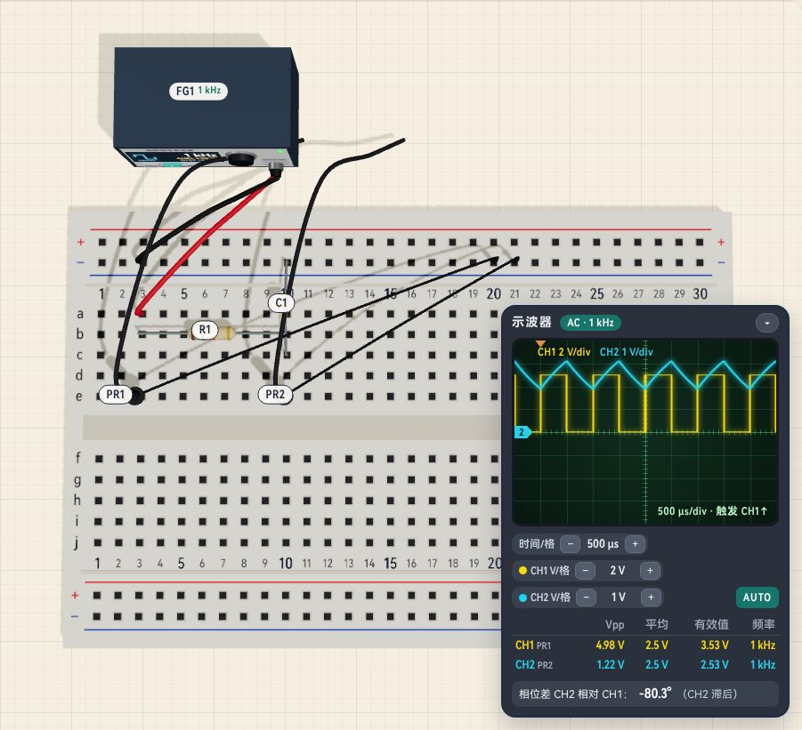
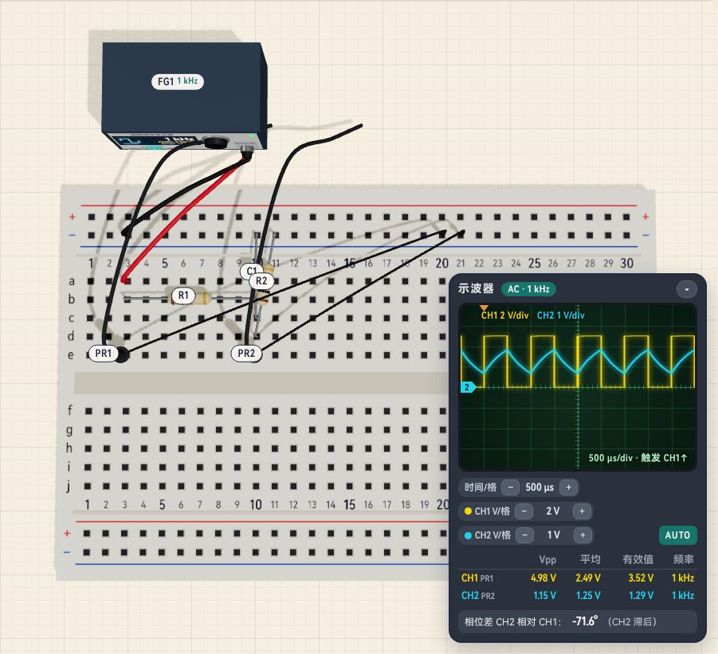
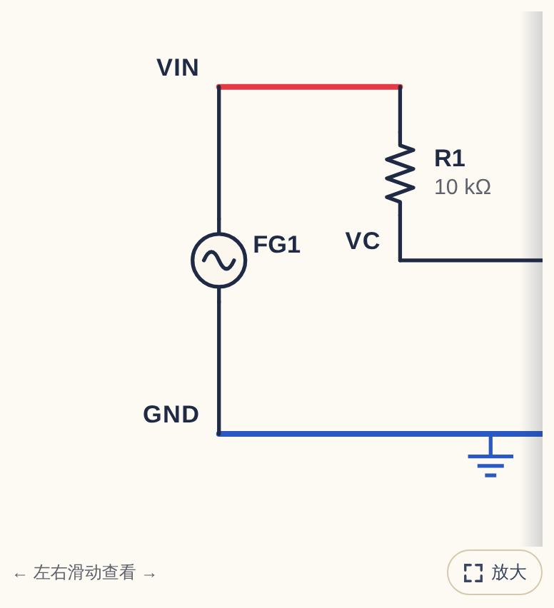
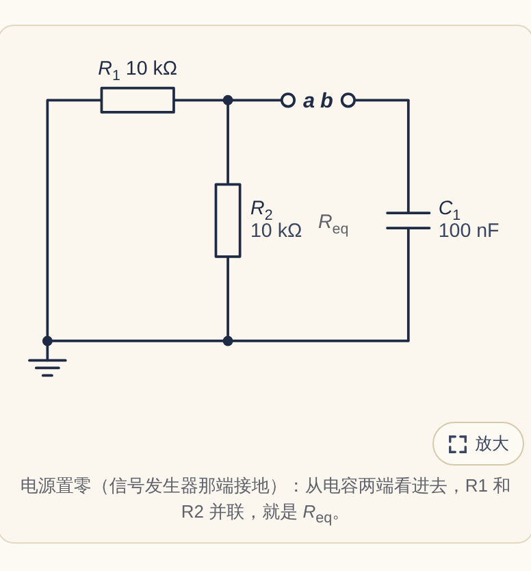
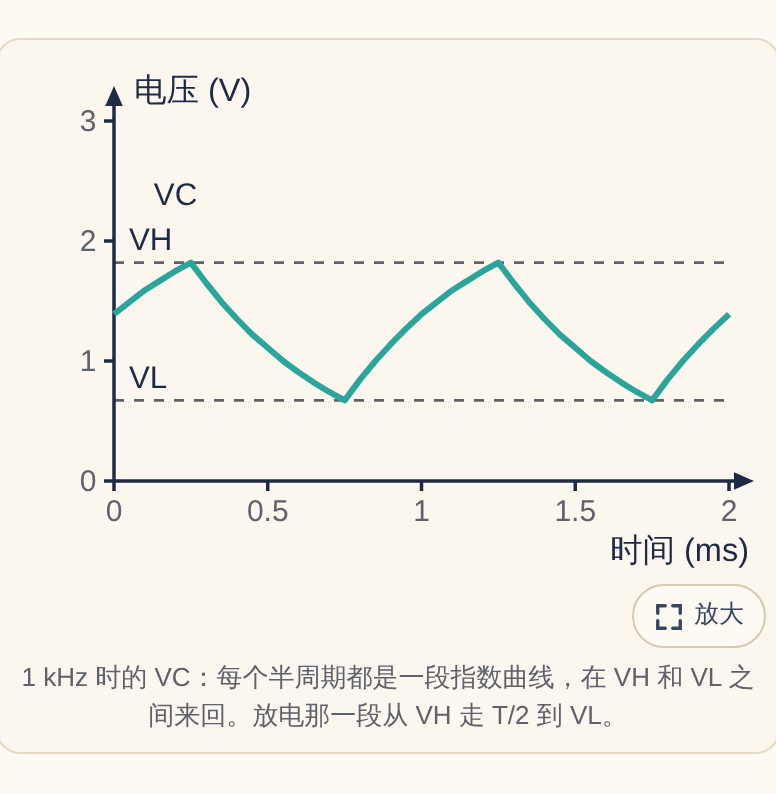

# 4.2 · 电容旁边并一个电阻：戴维宁求 τ

| 项目 | 内容 |
|---|---|
| id | `exp3-rc-thevenin-tau` |
| 文件 | `challenges/247-rc-thevenin-tau.json` |
| 类型 | 实验 / 挑战（没有分步，照目标电路图搭） · 难度 3/5 |
| 位置 | World 4 · 储能元件与一阶 / 二阶暂态 → 4.2 RC 时间常数（本节第 2 项） |
| 右侧面板 | 轨道由旧的四张卡片自动生成（还没手工精排） |
| 前后 | 上一项 [4.2 exp3-rc-square-charging](../w4/4.02-1-exp3-rc-square-charging.md) · 下一项 [4.3 exp3-rc-differentiator-integrator](../w4/4.03-1-exp3-rc-differentiator-integrator.md) |
| 先修 | lesson-scope-two-channels |
| 概念 | Thevenin resistance 戴维宁等效电阻、τ = R_eq·C、three-element method 三要素法、τ from VH / VL 由读数反算 τ |

**一句话概要**：在 RC 电路的电容两端再并一个 10 kΩ：终值和时间常数都变了。用戴维宁等效电阻预测，再用示波器读数反算 τ。

## 1. 左侧工作台（3D 面包板 → 2D 俯视截图）

截图是程序里真实的 3D 面包板换成俯视角拍的；表格是同一块板的文字版（元件、参数、每只脚插在哪个孔）。

### 1.1 起点：打开这一课时板上已经有的

右侧显示的「起点」说明：

> **半成品**：实验 3-1 的 RC 电路（R1 10kΩ + C1 100nF）、信号发生器和探头都已接好。**为什么**：这个实验只改一处——在电容两端再并一个电阻，看终值和 τ 怎么变。**你要做**：加上 R2（10kΩ），从电容上端（第 10 列）接到 GND。

| 元件 | 类型 | 参数 | 引脚 → 孔 |
|---|---|---|---|
| FG1 | function_gen | waveform=square, frequency=1000, amplitude=2.5, offset=2.5 | +→a3 -→tn3 |
| R1 | resistor | resistance=10000 | 1→b3 2→b10 |
| C1 | capacitor | capacitance=1.0000000000000001e-7 | 1→c10 2→tn10 |
| PR1 | scope_probe | channel=1 | tip→e3 gnd→tn20 |
| PR2 | scope_probe | channel=2 | tip→e10 gnd→tn21 |

### 1.3 参考答案（「看答案」载入的板子）

| 元件 | 类型 | 参数 | 引脚 → 孔 |
|---|---|---|---|
| FG1 | function_gen | waveform=square, frequency=1000, amplitude=2.5, offset=2.5 | +→a3 -→tn3 |
| R1 | resistor | resistance=10000 | 1→b3 2→b10 |
| C1 | capacitor | capacitance=1.0000000000000001e-7 | 1→c10 2→tn10 |
| R2 | resistor | resistance=10000 | 1→d10 2→tn11 |
| PR1 | scope_probe | channel=1 | tip→e3 gnd→tn20 |
| PR2 | scope_probe | channel=2 | tip→e10 gnd→tn21 |

### 1.4 目标原理图（右侧「目标原理图」抽屉）

| 元件 | 类型 | 参数 |
|---|---|---|
| FG1 | function_gen |  |
| R1 | resistor | resistance=10000 |
| C1 | capacitor | capacitance=1.0000000000000001e-7 |
| R2 | resistor | resistance=10000 |

连接（每个结点上的引脚）：

- **VIN**：FG1.+、R1.1
- **VC**：R1.2、C1.1、R2.1
- **GND**：C1.2、R2.2、FG1.-

## 2. 右侧面板：学生从上往下看到的内容（单轨流）

### 第 1 步 · 🔧 动手搭：给电容并一个电阻

- 板上已经是上一个 RC 电路。在电容两端再并一个 **R2 `10 kΩ`**：**`d10`** → GND 轨。
- 信号发生器还是 0 ↔ 5 V 方波。先用 **`100 Hz`** 看 CH2 的最高点，再换 **`1 kHz`**。
和没有 R2 时比：电容最后充到哪里？曲线是变快了还是变慢了？

### 第 2 步 · 💡 想明白：从电容往外看：戴维宁

- 电容只“看见”它两端外面的电路。把外面化成**戴维宁等效**（2.4）：一个电压源串一个电阻。
- **终点**：电容充满后不再取电流，R1 和 R2 分压，所以不再是 5 V。
- **快慢**：把电源置零，从电容两端看进去，R1 和 R2 是**并联**的：
$$τ = R_{eq} C = (10.05 kΩ ∥ 10 kΩ) × 100 nF$$

*图 `req`（schematic）：电源置零（信号发生器那端接地）：从电容两端看进去，R1 和 R2 并联，就是 R_eq。*

- 每个半周期仍是一条指数曲线：从上一个半周期结束的位置出发，朝新的终点走，速度由 τ 决定。

*图 `swing`（plot）：1 kHz 时的 VC：每个半周期都是一段指数曲线，在 VH 和 VL 之间来回。放电那一段从 VH 走 T/2 到 VL。*

（这一步下面列着这节课的计算卡片，点开就地展开：`thevenin`、`thevenin-resistance`、`rc-time-constant`、`rc-charging`、`tau-from-vh-vl`、`square-rc-vpp`，全文见第 6 节）

### 第 3 步 · 🔧 动手搭：用两个读数反算 τ

- **`100 Hz`** 时读 VC 的最高值：每半个周期都走到了终点，这就是终值。
- **`1 kHz`** 时读 VC 的最高值 VH 和最低值 VL。
- 放电的半个周期里，VC 从 VH 按指数往 0 走，走了 T/2 正好到 VL：VL = VH·e^(−T/2τ)。所以 τ = (T/2) / ln(VH / VL)。

### 第 4 步 · 📏 测一测：测一测：读你自己的仪表

**测量题 1 · `uinf`**（读数题）

> 100 Hz：CH2（VC）的最高值，也就是终值 v(∞)

- 单位 V · 先写预测 · 状态：FG1 设为 信号发生器（方波 100Hz 幅度 2.5V） · 参考答案的读数 **2.494 V** · 合理范围 [2.37, 2.62]

答对后显示：

> 电容开路，(R1 + 50 Ω) 和 R2 分压：5 × 10 / 20.05 ≈ 2.49 V，不是 5 V。

**测量题 2 · `vh`**（读数题）

> 1 kHz：VC 的最高值 VH

- 单位 V · 先写预测 · 状态：FG1 设为 信号发生器（方波 1kHz 幅度 2.5V） · 参考答案的读数 **1.822 V** · 合理范围 [1.73, 1.91]

**测量题 3 · `vl`**（读数题）

> 1 kHz：VC 的最低值 VL

- 单位 V · 先写预测 · 状态：FG1 设为 信号发生器（方波 1kHz 幅度 2.5V） · 参考答案的读数 **0.6719 V** · 合理范围 [0.638, 0.705]

答对后显示：

> 半个周期 0.5 ms ≈ τ，VC 在 VL 和 VH 之间来回，中心是 v(∞) / 2 ≈ 1.25 V。

**测量题 4 · `tau`**（计算题（用自己的读数算））

> 用你的读数算 τ = (T/2) / ln(VH / VL)（T/2 = 0.5 ms）

- 单位 ms · 先写预测 · 参考答案的读数 **0.5013 ms** · 合理范围 [0.000476, 0.000526] · 公式 `0.0005 / ln(vh / vl)`

答对后显示：

> R_eq = 10.05 kΩ ∥ 10 kΩ ≈ 5.01 kΩ，τ = R_eq·C ≈ 0.50 ms：只有 RC 串联时的一半。

**测量题 5 · `req`**（计算题（用自己的读数算））

> 再用 C = 100 nF 算从电容看进去的等效电阻 R_eq = τ / C

- 单位 kΩ · 参考答案的读数 **5.013 kΩ** · 合理范围 [4760, 5260] · 公式 `tau / 100e-9`

答对后显示：

> ≈ 5.0 kΩ = (R1 + 50 Ω) ∥ R2：电源置零后，R1 和 R2 从电容看过去是并联的。

### 第 5 步 · 🎒 带走：带走

- **三要素**：v(t) = v(∞) + [v(0+) − v(∞)]·e^(−t/τ)。一阶电路的响应都长这样：起点、终点、τ。
- **τ = R_eq·C**：R_eq 是电源置零后，从电容两端看进去的电阻。
- 用 VH、VL 反算 τ 不需要知道终值，任何频率都能用。
- **真实电路里**：电容误差大（±10%～±20%）。用读数反算 τ，再除以 R_eq，就测出了电容的实际值。

趁热练理论题：`first-order`

## 3. 测量题一览

| # | id | 题目 | 类型 | 单位 | 状态 | 参考读数 |
|---|---|---|---|---|---|---|
| 1 | uinf | 100 Hz：CH2（VC）的最高值，也就是终值 v(∞) | scope | V | FG1 设为 信号发生器（方波 100Hz 幅度 2.5V） | 2.494 V |
| 2 | vh | 1 kHz：VC 的最高值 VH | scope | V | FG1 设为 信号发生器（方波 1kHz 幅度 2.5V） | 1.822 V |
| 3 | vl | 1 kHz：VC 的最低值 VL | scope | V | FG1 设为 信号发生器（方波 1kHz 幅度 2.5V） | 0.6719 V |
| 4 | tau | 用你的读数算 τ = (T/2) / ln(VH / VL)（T/2 = 0.5 ms） | formula | ms |  | 0.5013 ms |
| 5 | req | 再用 C = 100 nF 算从电容看进去的等效电阻 R_eq = τ / C | formula | kΩ |  | 5.013 kΩ |

### 全部答完后显示的「对比」

**对比**：
- v(∞) = 5 V × 10 k / (10.05 k + 10 k) ≈ **2.49 V**——不是 5 V！R_eq = 10.05 k ∥ 10 k ≈ 5.01 kΩ，τ ≈ **0.50 ms**，只有 RC 串联时的一半。
- **100 Hz**（半个周期 5 ms ≈ 10τ）：每次都走到终值，VC 在 0 和约 2.49 V 之间。
- **1 kHz**（半个周期 0.5 ms ≈ τ）：VC 在 VL ≈ **0.67 V** 和 VH ≈ **1.82 V** 之间，τ = 0.5 ms / ln(1.82 / 0.67) ≈ 0.50 ms。
- 2 kHz 时 VH ≈ 1.55 V、VL ≈ 0.94 V，算出来还是约 0.50 ms。

### 提示按钮（依次显示）

1. R2 和 C1 并联：两只脚都在 VC（第 10 列）和 GND 轨上。
2. 终值：电容开路后 R1（加 50 Ω）和 R2 分压。
3. τ = R_eq·C，R_eq = (R1 + 50 Ω) ∥ R2；反算 τ = (T/2) / ln(VH / VL)。

### 功能测试（「检查我的电路」时跑）

- 100 Hz：每半周期都走到终值，放电到 ≈ 0
- 1 kHz：VH、VL 合理（τ 由 R1 ∥ R2 决定）
- 2 kHz：摆幅变小，平均值不变

## 5. 这一课的计算卡片

**计算卡片 `thevenin`：戴维宁等效：开路电压 + 短路电流**

- 公式 `R_{eq} = \frac{V_{oc}}{I_{sc}}`
- 用途：测出（或算出）端口的开路电压和短路电流，就得到整个网络的等效电阻。
- 输入：V_oc（开路电压，V）；I_sc（短路电流，A） → R_eq（等效电阻，Ω）

1. 任何含源线性二端网络，对外都等效成一个电压源 $V_{oc}$ 串一个电阻 $R_{eq}$。
2. 端口开路：没有电流流过 $R_{eq}$，它上面没有压降，端口电压就是 $V_{oc}$。
3. 端口短路：$I_{sc} = \frac{V_{oc}}{R_{eq}}$。
4. 两个测量相除：$R_{eq} = \frac{V_{oc}}{I_{sc}}$。（另一条路：把独立源置零，从端口看进去算电阻——见“戴维宁等效电阻”。）
5. 用法：接上负载 $R_L$，$V_L = V_{oc}\frac{R_L}{R_{eq} + R_L}$，一步就出来，不用再解整个网络。

例子：实验 2-2：$V_{oc} = 9 × \frac{2.2}{3.2} ≈ 6.19 V$，$I_{sc} ≈ 5.345 mA$，$R_{eq} ≈ 1158 Ω$ = $470 + 1k ∥ 2.2k$ ✔。实验 1-3 的分压器从 VOUT 看是“4.5 V 串 5 kΩ”：接 1 kΩ，$V = 4.5 × \frac{1}{6} = 0.75 V$。

- ⚠ 短路法只适合短路电流很小的网络——绝不要把电池或电源输出直接短路。
- ⚠ 真实电流表有几欧内阻，“短路”不彻底：$I_sc$ 偏小，算出的 $R_eq$ 偏大约 1 %。

**计算卡片 `thevenin-resistance`：戴维宁等效电阻（置零法）**

- 公式 `R_{eq} = R_3 + R_1 ∥ R_2`
- 用途：电源置零后从端口往里看的电阻——等效电路的内阻，也是电容 / 电感“看到”的电阻。
- 输入：R_1（电源和结点 A 之间的 R₁（含电源内阻），Ω）；R_2（A 到地的 R₂，Ω）；R_3（A 到端口的 R₃（没有就填 0），Ω） → R_eq（从端口看进去的电阻，Ω）

1. 把独立源置零：电压源换成 **导线**，电流源换成 **开路**。
2. 电压源变成导线以后，R₁ 的上端也接到了 GND，所以从 A 往下看，R₁ 和 R₂ **并联**。
3. 再串上 A 到端口的 R₃：$R_{eq} = R_3 + R_1 ∥ R_2$。
4. 开路电压另算：R₃ 里没有电流，$V_{oc} = V_s \frac{R_2}{R_1 + R_2}$。
5. 一阶电路里，电容 / 电感就是“端口”：$τ = R_{eq}C$ 或 $τ = \frac{L}{R_{eq}}$。

例子：- 实验 2-2：$470 + 1k ∥ 2.2k = 470 + 687.5 = 1157.5 Ω$。
- 实验 3-7：电容看到 $(10k + 50) ∥ 10k ≈ 5.01 kΩ$（R₃ = 0），$τ ≈ 0.50 ms$——只有单纯串联 RC 的一半。
- 实验 3-5 充电：$(220 + 50) ∥ (470 + 12) ≈ 173 Ω$，$τ ≈ 0.17 s$。
- 实验 5-4：ADC 看到 $100k ∥ 33k ≈ 24.8 kΩ$。

- ⚠ 信号发生器的 50 Ω 是电源的内阻：电源置零后它还在，串在 R₁ 里。
- ⚠ 电流源置零是开路，不是短路。

**计算卡片 `rc-time-constant`：RC 时间常数 τ = RC**

- 公式 `τ = R C`
- 用途：电容经电阻充放电有多快：过 1τ 走完 63 %，5τ 基本到头。
- 输入：R（电容看到的电阻（含发生器 50 Ω），Ω）；C（电容，F） → τ（时间常数，s）

1. 电容：$i = C\frac{dv_C}{dt}$，电压不能突变。
2. 充电回路的 KVL：$V_s = Ri + v_C = RC\frac{dv_C}{dt} + v_C$。
3. 这个一阶微分方程的解是指数：$v_C = V_s(1 - e^{-t/τ})$，其中 $τ = RC$（Ω × F = s）。
4. 经验值：1τ → 63 %，2τ → 86 %，3τ → 95 %，5τ → 99.3 %。
5. **R 是从电容两端看进去的戴维宁电阻**（电源置零）：要把信号发生器的 50 Ω、并联的电阻都算进去。

例子：- 实验 3-1：$(10k + 50) × 100 nF ≈ 1.0 ms$。
- 实验 3-2：微分 $10k × 10 nF = 0.1 ms$，积分 $10k × 1 µF = 10 ms$。
- 实验 3-5：充电 $1000 µF × 173 Ω ≈ 0.17 s$，放电 $1000 µF × 482 Ω ≈ 0.48 s$。
- 实验 5-14：$10k × 1 µF = 10 ms$；实验 5-16：$2.2k × 200 pF = 440 ns$。

- ⚠ 只用串联的那个 R：电容旁边还并着电阻时，τ 用的是 $R_1 ∥ R_2$（实验 3-7 只有一半）。
- ⚠ 单位：kΩ × µF = ms，kΩ × nF = µs。

**计算卡片 `rc-charging`：一阶电路的三要素法**

- 公式 `v(t) = v(∞) + [v(0_+) - v(∞)] e^{-t/τ}`
- 用途：任何一阶电路的任何电压 / 电流：知道初值、终值、τ，算出任意时刻的值。
- 输入：v_0（初值 v(0+)，V）；v_∞（终值 v(∞)，V）；τ（时间常数，s）；t（经过的时间，s） → v(t)（这一时刻的值，V）

1. 一阶电路里任何量 x 都满足 $τ\frac{dx}{dt} + x = x(∞)$，解就是“从初值指数地走向终值”。
2. **初值 v(0+)**：电容电压、电感电流不能突变，等于开关动作前一刻的值（方波：上半个周期结束时的值）。
3. **终值 v(∞)**：直流稳态，电容当 **开路**、电感当 **短路** 算出来。
4. **时间常数**：$τ = R_{eq}C$ 或 $τ = \frac{L}{R_{eq}}$，$R_eq$ 是从储能元件两端看进去的电阻。
5. 代进公式。反过来求“到某个值要多久”：$t = τ ln\frac{v(0_+) - v(∞)}{v(t) - v(∞)}$。

例子：- 实验 3-1 充电 1τ：$5 + (0 - 5)e^{-1} ≈ 3.16 V$（走完 63 %）。500 Hz 稳态放电：从 3.65 V 走向 0，1 ms 后 $3.65e^{-1} ≈ 1.34 V$。
- 实验 3-7：终值不是 5 V 而是 $5 × \frac{10}{20.05} ≈ 2.49 V$，τ ≈ 0.50 ms。
- 实验 5-14：占空比一变，VDAC 走向新值，4.6τ ≈ 46 ms 后误差小于 1 %。

- ⚠ 只有电容电压和电感电流连续；电阻电压、电容电流在 0+ 时刻可以跳变（微分电路的尖峰就是这样来的）。
- ⚠ 终值要用“电容开路”的电路算，别直接写电源电压。

**计算卡片 `tau-from-vh-vl`：由 VH、VL 反推 τ**

- 公式 `τ = \frac{T/2}{ln\frac{V_H - v(∞)}{V_L - v(∞)}}`
- 用途：方波驱动、电容在 VH 和 VL 之间来回：用一个半周期的放电段直接算出 τ。
- 输入：T_h（半周期 T/2，s）；V_H（最高值，V）；V_L（最低值，V）；v_∞（放电段的终值（放到 0 V 就填 0），V） → τ（时间常数，s）

1. 稳态时，放电半周期从 $V_H$ 出发，走向终值 $v(∞)$（方波低电平时通常是 0 V）。
2. 三要素法：经过 T/2 正好到 $V_L$：$V_L - v(∞) = [V_H - v(∞)]e^{-T/(2τ)}$。
3. 取对数解出 $τ = \frac{T/2}{ln\frac{V_H - v(∞)}{V_L - v(∞)}}$。
4. 好处：不需要从 0 开始，任何频率都行；再用 $R_{eq} = \frac{τ}{C}$ 就能检查等效电阻（或测出电容的真实值）。

例子：实验 3-7（1 kHz）：$τ = \frac{0.5 ms}{ln(1.82/0.67)} ≈ 0.50 ms$，$R_{eq} = \frac{0.50 ms}{100 nF} ≈ 5.0 kΩ = (10k + 50) ∥ 10k$。2 kHz 时 1.55 V / 0.94 V 也给出 ≈ 0.50 ms。

- ⚠ 用的是半周期 T/2，不是整周期。

**计算卡片 `square-rc-vpp`：方波下的稳态摆幅 ΔV·tanh(T/4τ)**

- 公式 `V_{pp} = ΔV tanh\frac{T}{4τ}`
- 用途：方波反复充放电，一阶电路稳态时来回摆多大（RC 电容电压、RL 电流、PWM 纹波）。
- 输入：ΔV（方波每次跳变的高度，V）；f（方波频率，Hz）；τ（时间常数，s） → V_pp（稳态峰峰值，V）

1. 稳态时电容在 $V_L$ 和 $V_H$ 之间来回（50 % 占空比，以 0 和 ΔV 为例）。
2. 充电半周期：$V_H = ΔV - (ΔV - V_L)e^{-T/(2τ)}$。
3. 放电半周期：$V_L = V_He^{-T/(2τ)}$。
4. 两式联立：$V_H - V_L = ΔV\frac{1 - e^{-T/2τ}}{1 + e^{-T/2τ}} = ΔV tanh\frac{T}{4τ}$。
5. 两头：$T ≫ τ$ 时 tanh → 1，摆满 ΔV；$T ≪ τ$ 时 $tanh x ≈ x$，摆幅 ≈ $\frac{ΔV T}{4τ}$，波形变成三角波（积分）。

例子：- 实验 3-1：500 Hz、τ ≈ 1 ms：$5 tanh(0.5) ≈ 2.3 V$；5 kHz：≈ 0.25 V 三角波。
- 实验 3-2：积分支路 τ = 10 ms、500 Hz：$5 tanh(0.05) ≈ 0.25 V$。
- 实验 3-3：电阻电压的满幅 1.32 V，10 kHz：$1.32 tanh(0.38) ≈ 0.48 V$。
- 实验 5-14：100 Hz、τ = 10 ms、3.3 V：$3.3 tanh(0.25) ≈ 0.81 V$。

- ⚠ ΔV 是一次跳变的高度：±2.5 V 的方波跳 5 V，不是 2.5 V。
- ⚠ 只适用于 50 % 占空比；其它占空比的 PWM 纹波见“PWM + RC 的纹波”。

## 6. English（界面英文版的同一份内容）

展开英文

### Node 1 · 🔧 Build：Put a resistor across the capacitor

- The last RC circuit is already on the board. Add **R2 `10 kΩ`** across the capacitor: **`d10`** → the GND rail.
- The generator is still a 0 ↔ 5 V square wave. Look at CH2's top at **`100 Hz`**, then switch to **`1 kHz`**.
Compared with no R2: where does the capacitor end up? Is the curve faster or slower?

### Node 2 · 💡 Why：Looking out from the capacitor: Thevenin

- The capacitor only "sees" the circuit outside its two ends. Reduce that outside to its **Thevenin equivalent** (2.4): a source in series with a resistor.
- **The end point**: once full the capacitor draws no current, R1 and R2 divide the voltage, so it is no longer 5 V.
- **The pace**: set the source to zero and look in from the capacitor's ends: R1 and R2 are **in parallel**:
$$τ = R_{eq} C = (10.05 kΩ ∥ 10 kΩ) × 100 nF$$

[figure `req`]

*Figure `req`（schematic）：电源置零（信号发生器那端接地）：从电容两端看进去，R1 和 R2 并联，就是 R_eq。*

- Every half period is still one exponential: it starts where the last half ended and heads for the new end point, at a pace set by τ.

[figure `swing`]

*Figure `swing`（plot）：1 kHz 时的 VC：每个半周期都是一段指数曲线，在 VH 和 VL 之间来回。放电那一段从 VH 走 T/2 到 VL。*

(This node lists the lesson’s calculation cards: `thevenin`、`thevenin-resistance`、`rc-time-constant`、`rc-charging`、`tau-from-vh-vl`、`square-rc-vpp`; full text in section 6)

### Node 3 · 🔧 Build：Work τ back from two readings

- At **`100 Hz`** read VC's maximum: every half period reaches the end point, so this is the final value.
- At **`1 kHz`** read VC's maximum VH and minimum VL.
- In the discharging half, VC heads from VH towards 0 along an exponential and after T/2 it is exactly at VL: VL = VH·e^(−T/2τ). So τ = (T/2) / ln(VH / VL).

### Node 4 · 📏 Measure：Measure: read your own instruments

**Question 1 · `uinf`**（reading）

> 100 Hz: CH2 (VC) maximum, i.e. the final value v(∞)

- unit V · predict first · state：FG1 is set to Function generator (square 100Hz 2.5V peak) · range [2.37, 2.62]

Shown once right:

> With the capacitor open, (R1 + 50 Ω) and R2 divide: 5 × 10 / 20.05 ≈ 2.49 V, not 5 V.

**Question 2 · `vh`**（reading）

> 1 kHz: VC's maximum VH

- unit V · predict first · state：FG1 is set to Function generator (square 1kHz 2.5V peak) · range [1.73, 1.91]

**Question 3 · `vl`**（reading）

> 1 kHz: VC's minimum VL

- unit V · predict first · state：FG1 is set to Function generator (square 1kHz 2.5V peak) · range [0.638, 0.705]

Shown once right:

> Half a period, 0.5 ms, ≈ τ: VC swings between VL and VH around v(∞) / 2 ≈ 1.25 V.

**Question 4 · `tau`**（calculation from own readings）

> From your readings, τ = (T/2) / ln(VH / VL) (T/2 = 0.5 ms)

- unit ms · predict first · range [0.000476, 0.000526] · formula `0.0005 / ln(vh / vl)`

Shown once right:

> R_eq = 10.05 kΩ ∥ 10 kΩ ≈ 5.01 kΩ, τ = R_eq·C ≈ 0.50 ms: half of the plain series RC.

**Question 5 · `req`**（calculation from own readings）

> Then with C = 100 nF, the resistance seen from the capacitor: R_eq = τ / C

- unit kΩ · range [4760, 5260] · formula `tau / 100e-9`

Shown once right:

> ≈ 5.0 kΩ = (R1 + 50 Ω) ∥ R2: with the source zeroed, R1 and R2 are in parallel as the capacitor sees them.

### Node 5 · 🎒 Take away：Take away

- **Three numbers**: v(t) = v(∞) + [v(0+) − v(∞)]·e^(−t/τ). Every first-order response looks like this: start, end, τ.
- **τ = R_eq·C**: R_eq is the resistance seen from the capacitor's ends with the source set to zero.
- Working τ back from VH and VL needs no final value and works at any frequency.
- **In a real circuit**: capacitors are loose (±10–20 %). Work τ back from readings, divide by R_eq, and you have measured the capacitor's real value.

Practise：`first-order`

**Compare**

**Compare**:
- v(∞) = 5 V × 10 k / (10.05 k + 10 k) ≈ **2.49 V** — not 5 V! R_eq = 10.05 k ∥ 10 k ≈ 5.01 kΩ, τ ≈ **0.50 ms**, half of the plain series RC.
- **100 Hz** (half a period 5 ms ≈ 10τ): it reaches the end every time; VC between 0 and about 2.49 V.
- **1 kHz** (half a period 0.5 ms ≈ τ): VC between VL ≈ **0.67 V** and VH ≈ **1.82 V**; τ = 0.5 ms / ln(1.82 / 0.67) ≈ 0.50 ms.
- At 2 kHz VH ≈ 1.55 V and VL ≈ 0.94 V; the result is still about 0.50 ms.

**Hints**

1. R2 is in parallel with C1: both have their legs in VC (column 10) and on the GND rail.
2. Final value: with the capacitor open, R1 (plus 50 Ω) and R2 form a divider.
3. τ = R_eq·C with R_eq = (R1 + 50 Ω) ∥ R2; worked back, τ = (T/2) / ln(VH / VL).

