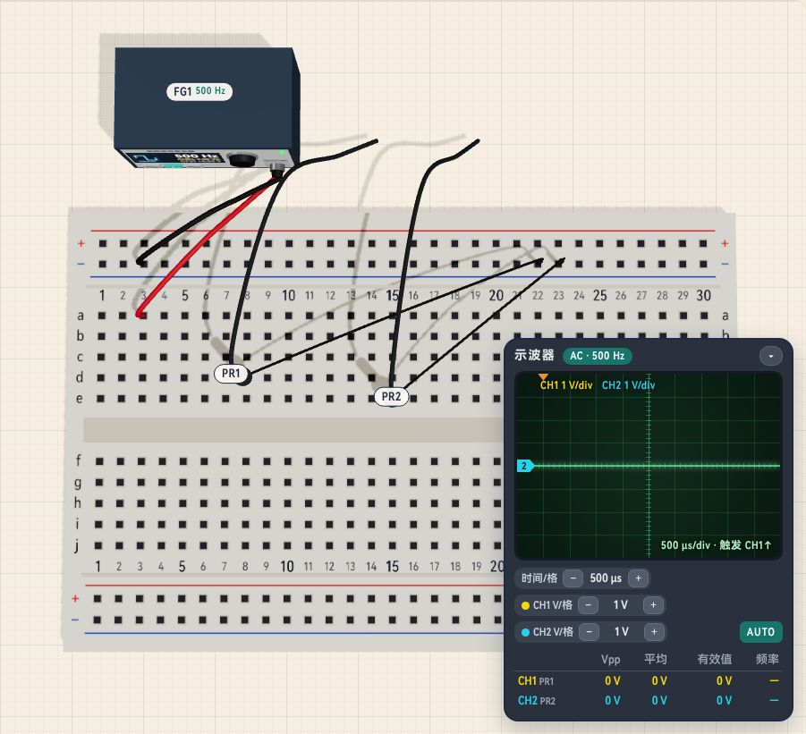
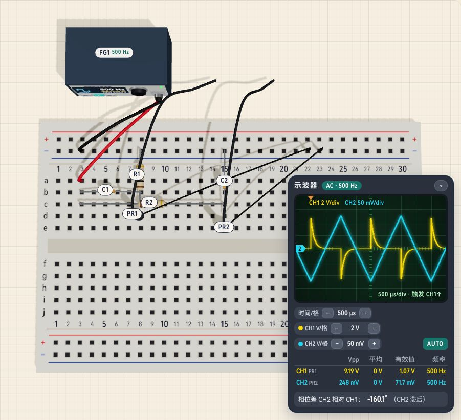
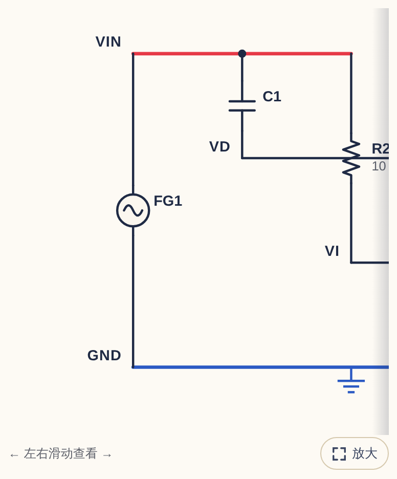
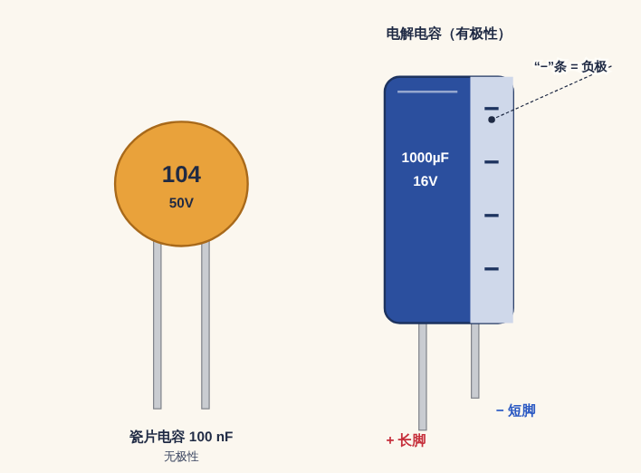
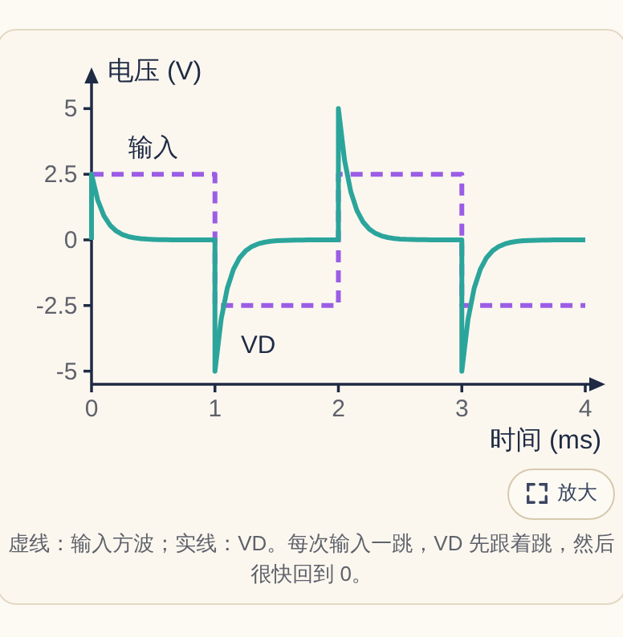
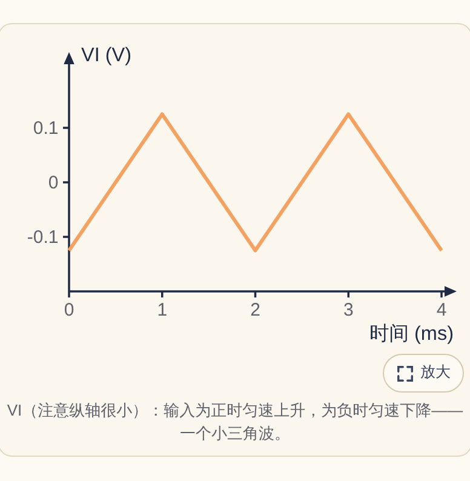

# 4.3 · RC 微分电路与积分电路

| 项目 | 内容 |
|---|---|
| id | `exp3-rc-differentiator-integrator` |
| 文件 | `challenges/242-rc-differentiator-integrator.json` |
| 类型 | 实验 / 挑战（没有分步，照目标电路图搭） · 难度 3/5 |
| 位置 | World 4 · 储能元件与一阶 / 二阶暂态 → 4.3 微分、积分与 op-amp（运算放大器）积分器（本节第 1 项） |
| 右侧面板 | 轨道由旧的四张卡片自动生成（还没手工精排） |
| 前后 | 上一项 [4.2 exp3-rc-thevenin-tau](../w4/4.02-2-exp3-rc-thevenin-tau.md) · 下一项 [4.3 exp3-opamp-integrator](../w4/4.03-2-exp3-opamp-integrator.md) |
| 先修 | lesson-scope-two-channels |
| 概念 | RC differentiator 微分电路、RC integrator 积分电路、τ ≪ T/2 and τ ≫ T/2、slope = v/RC 斜率 |

**一句话概要**：同一个方波喂给两条 RC 支路：取电阻电压得到尖脉冲（微分），取电容电压得到三角波（积分）。

## 1. 左侧工作台（3D 面包板 → 2D 俯视截图）

截图是程序里真实的 3D 面包板换成俯视角拍的；表格是同一块板的文字版（元件、参数、每只脚插在哪个孔）。

### 1.1 起点：打开这一课时板上已经有的

右侧显示的「起点」说明：

> **半成品**：信号发生器（已经设好波形）和两个示波器探头已经接好。**为什么**：仪器的接法第 12、13 课练过，这个实验要看的是电路本身的波形。**你要做**：搭两条 RC 支路：微分（C1 10nF 在前、R1 10kΩ 接地，CH1 看 R1）和积分（R2 10kΩ 在前、C2 1µF 接地，CH2 看 C2）。

| 元件 | 类型 | 参数 | 引脚 → 孔 |
|---|---|---|---|
| FG1 | function_gen | waveform=square, frequency=500, amplitude=2.5, offset=0 | +→a3 -→tn3 |
| PR1 | scope_probe | channel=1 | tip→d8 gnd→tn22 |
| PR2 | scope_probe | channel=2 | tip→e15 gnd→tn23 |

### 1.3 参考答案（「看答案」载入的板子）

| 元件 | 类型 | 参数 | 引脚 → 孔 |
|---|---|---|---|
| FG1 | function_gen | waveform=square, frequency=500, amplitude=2.5, offset=0 | +→a3 -→tn3 |
| C1 | capacitor | capacitance=1e-8 | 1→b3 2→b8 |
| R1 | resistor | resistance=10000 | 1→c8 2→tn8 |
| R2 | resistor | resistance=10000 | 1→c3 2→c15 |
| C2 | capacitor | capacitance=0.000001 | 1→d15 2→tn15 |
| PR1 | scope_probe | channel=1 | tip→d8 gnd→tn22 |
| PR2 | scope_probe | channel=2 | tip→e15 gnd→tn23 |

### 1.4 目标原理图（右侧「目标原理图」抽屉）

| 元件 | 类型 | 参数 |
|---|---|---|
| FG1 | function_gen |  |
| C1 | capacitor | capacitance=1e-8 |
| R1 | resistor | resistance=10000 |
| R2 | resistor | resistance=10000 |
| C2 | capacitor | capacitance=0.000001 |

连接（每个结点上的引脚）：

- **VIN**：FG1.+、C1.1、R2.1
- **VD**：C1.2、R1.1
- **VI**：R2.2、C2.1
- **GND**：R1.2、C2.2、FG1.-

## 2. 右侧面板：学生从上往下看到的内容（单轨流）

### 第 1 步 · 🔍 先看一眼：先认识它：电容

**拆解「电容 Capacitor：两块极板夹一层绝缘」第 1 / 7 层：① 外形：瓷片电容和电解电容**

课程里有两种电容：
- 瓷片电容 ceramic capacitor：橙色小圆片，**没有极性**，容量小（pF – 几 µF）。上面印 三位数代码，单位是 **pF**：前两位是有效数字，第三位是 10 的几次方。**104** = 10 × 10⁴ pF = 100 000 pF = **100 nF** = 0.1 µF。102 = 1 nF，103 = 10 nF，105 = 1 µF。
- 电解电容 electrolytic capacitor：铝壳圆柱，容量大（1 µF – 几万 µF），**有极性**：长脚是 +，外壳上 印着一串“−”的白条 那边是 −（短脚）。直接印着容量和耐压，比如 1000 µF 16 V。

两种电容的 **耐压**（rated voltage）都要大于电路里的最高电压，一般留 1.5–2 倍余量：9 V 电路用 16 V 或 25 V 的。

呼吸灯实验（exp3-led-breathing）用的 1000 µF 就是电解电容：长脚（+）接 VC，短脚接 GND。

| 类型 | 标记 | 极性 | 常见范围 | 课程里 |
|---|---|---|---|---|
| 瓷片 / 陶瓷 | 三位代码（pF）：104 = 100 nF | 无 | 1 pF – 10 µF | RC 实验的 100 nF |
| 铝电解 | 直接印 µF 和 V；“−”条 = 负极 | 有：长脚 + | 1 µF – 47 mF | 呼吸灯的 1000 µF |

### 第 2 步 · 🔧 动手搭：一个方波，两种输出

- **微分支路**：VIN → **C1 `10 nF`** → 结点 **VD** → **R1 `10 kΩ`** → GND。
- **积分支路**：VIN → **R2 `10 kΩ`** → 结点 **VI** → **C2 `1 µF`** → GND。
- 信号发生器：方波、**`500 Hz`**、幅度 **`2.5 V`**、偏置 **`0 V`**。CH1 看 VD，CH2 看 VI。
同一个方波进去，两个输出长得一样吗？各像什么？

### 第 3 步 · 💡 想明白：输出取在谁身上、τ 和半个周期谁长

- 两条支路的区别只有两点：输出取在**电阻**还是**电容**上；τ 比半个周期（1 ms）**短得多**还是**长得多**。
- **微分**（取电阻电压，τd = R1·C1 很短）：电容电压不能突变，方波一跳，跳变全落在电阻上；电容很快充好，电阻电压又回到 0。所以 VD 只在输入**变化**的那一刻出现尖峰。

*图 `diff`（plot）：虚线：输入方波；实线：VD。每次输入一跳，VD 先跟着跳，然后很快回到 0。*

- **积分**（取电容电压，τi = R2·C2 很长）：半个周期里电容只走了指数曲线开头几乎笔直的一段，斜率由输入决定：
$$\frac{dv_C}{dt} ≈ \frac{v_{in}}{R_2 C_2} = \frac{2.5 V}{10 kΩ × 1 µF}$$
- 输入为正时往上爬，为负时往下爬：方波变成三角波。

*图 `int`（plot）：VI（注意纵轴很小）：输入为正时匀速上升，为负时匀速下降——一个小三角波。*

（这一步下面列着这节课的计算卡片，点开就地展开：`period-frequency`、`phase-from-delay`、`rc-time-constant`、`square-rc-vpp`、`capacitive-reactance`、`first-order-phase`，全文见第 6 节）

### 第 4 步 · 🔧 动手搭：量尖峰和三角波

- **`500 Hz`** 时读 VD 尖峰的峰值，和 VI 三角波的峰峰值。
- 把三角波当直线：斜率 = 2.5 V / τi，半个周期 1 ms 走完一个峰峰值。由此反算 τi。
- 最后调到 **`50 Hz`**：半个周期长了十倍，VI 还像三角波吗？

### 第 5 步 · 📏 测一测：测一测：读你自己的仪表

**测量题 1 · `vd`**（读数题）

> 500 Hz：CH1（VD，电阻电压）尖峰的峰值

- 单位 V · 先写预测 · 状态：FG1 设为 信号发生器（方波 500Hz 幅度 2.5V） · 参考答案的读数 **4.593 V** · 合理范围 [4.36, 4.82]

答对后显示：

> 电容电压不能突变，方波一跳 5 V 全落在电阻上，理想峰值约 5 V；尖峰 0.1 ms 就衰减掉 63%，示波器的采样点落不到最顶上，读到约 4.6 V。

**测量题 2 · `vi`**（读数题）

> 500 Hz：CH2（VI，电容电压）三角波的峰峰值

- 单位 V · 先写预测 · 状态：FG1 设为 信号发生器（方波 500Hz 幅度 2.5V） · 参考答案的读数 **0.2483 V** · 合理范围 [0.236, 0.261]

答对后显示：

> 斜率 ≈ 2.5 V / 10 ms = 250 V/s，半个周期 1 ms 走约 0.25 V。

**测量题 3 · `taui`**（计算题（用自己的读数算））

> 用你的峰峰值算 τi = 2.5 V × 1 ms / Vpp

- 单位 ms · 先写预测 · 参考答案的读数 **10.07 ms** · 合理范围 [0.00956, 0.0106] · 公式 `2.5 * 0.001 / vi`

答对后显示：

> τi = R2·C2 = 10 kΩ × 1 µF = 10 ms（算上信号发生器的 50 Ω 是 10.05 ms）。积分电路的输出很小，正是因为 τi ≫ 半个周期。

**测量题 4 · `when`**（选择题）

> VD 什么时候不是 0？

- A. 输入为正的整个半周期
- B. 只在输入跳变之后的一小段时间 ✅（正确）
- C. 一直不是 0

答对后显示：

> τd = 0.1 ms，跳变后约 0.5 ms 就几乎回到 0：电阻电压只反映输入的**变化**。

**测量题 5 · `vi50`**（读数题）

> 调到 50 Hz：VI 的峰峰值

- 单位 V · 先写预测 · 状态：FG1 设为 信号发生器（方波 50Hz 幅度 2.5V） · 参考答案的读数 **2.301 V** · 合理范围 [2.19, 2.42]

答对后显示：

> 半个周期 10 ms ≈ τi，不再满足 τi ≫ 半个周期：5 × tanh(0.5) ≈ 2.3 V，波形变成普通的充放电曲线。

### 第 6 步 · 🎒 带走：带走

- **取电阻电压、τ ≪ 半个周期 → 微分**：只在输入变化时有输出，常用来从方波里取出“边沿”。
- **取电容电压、τ ≫ 半个周期 → 积分**：输出小，形状是三角波。
- **叫不叫微分 / 积分电路，看 τ 和信号周期的比**：同一个积分支路，频率一低就只是普通的充放电。
- **真实电路里**：示波器采样不够快，会漏掉很窄尖峰的最高点，读到的峰值比理想值低一点——这里的仿真示波器也是这样。

趁热练理论题：`first-order`

## 3. 测量题一览

| # | id | 题目 | 类型 | 单位 | 状态 | 参考读数 |
|---|---|---|---|---|---|---|
| 1 | vd | 500 Hz：CH1（VD，电阻电压）尖峰的峰值 | scope | V | FG1 设为 信号发生器（方波 500Hz 幅度 2.5V） | 4.593 V |
| 2 | vi | 500 Hz：CH2（VI，电容电压）三角波的峰峰值 | scope | V | FG1 设为 信号发生器（方波 500Hz 幅度 2.5V） | 0.2483 V |
| 3 | taui | 用你的峰峰值算 τi = 2.5 V × 1 ms / Vpp | formula | ms |  | 10.07 ms |
| 4 | when | VD 什么时候不是 0？ | 选择 |  |  | 正确：B |
| 5 | vi50 | 调到 50 Hz：VI 的峰峰值 | scope | V | FG1 设为 信号发生器（方波 50Hz 幅度 2.5V） | 2.301 V |

### 全部答完后显示的「对比」

**对比**：τd = 10 kΩ × 10 nF ≈ 0.1 ms，τi = 10 kΩ × 1 µF ≈ 10 ms，半个周期 1 ms。
- **微分（τd ≪ 半个周期）**：VD 每次跳到约 ±5 V，再以 τd 衰减，不到半个周期就回到 0；读到的峰值约 **4.6 V**（采样点落不到最顶上）。平均 ≈ 0。
- **积分（τi ≫ 半个周期）**：VI 是三角波，斜率 ≈ 250 V/s，Vpp ≈ **0.25 V**（精确值 5 × tanh(T / 4τi) ≈ 0.25 V）；反算 τi ≈ **10 ms**。
- **50 Hz**：半个周期 10 ms ≈ τi，VI 变成普通的充放电曲线，Vpp ≈ **2.3 V**。

### 提示按钮（依次显示）

1. 微分支路：C1 在前、R1 接地，VD 是它们中间那一点。积分支路：R2 在前、C2 接地，VI 是中间那一点。
2. 两条支路的上端都接在信号发生器的红夹子那一列。
3. 三角波的斜率 ≈ 输入电压 / τi；半个周期走完一个峰峰值。

### 功能测试（「检查我的电路」时跑）

- 500 Hz：VD 是正负尖脉冲，平均 ≈ 0
- 500 Hz：VI 是小三角波
- 50 Hz：积分条件不成立，VI 变大

## 4. 用到的拆解（全部层的文字，供改写参考）

### 拆解 `capacitor`：电容 Capacitor：两块极板夹一层绝缘

*电容储存的是电荷和电场能量。拆开是两块金属极板中间夹一层介质（dielectric）；由此推出 q = Cv、C = εA/d、i = C dv/dt、W = ½CV²，再推出 RC 充电的指数曲线（τ = RC）和“直流断路、高频短路”的容抗。最后看真实电容差在哪：ESR、漏电、极性。*

**拆解「电容 Capacitor：两块极板夹一层绝缘」第 1 / 7 层：① 外形：瓷片电容和电解电容**

课程里有两种电容：
- 瓷片电容 ceramic capacitor：橙色小圆片，**没有极性**，容量小（pF – 几 µF）。上面印 三位数代码，单位是 **pF**：前两位是有效数字，第三位是 10 的几次方。**104** = 10 × 10⁴ pF = 100 000 pF = **100 nF** = 0.1 µF。102 = 1 nF，103 = 10 nF，105 = 1 µF。
- 电解电容 electrolytic capacitor：铝壳圆柱，容量大（1 µF – 几万 µF），**有极性**：长脚是 +，外壳上 印着一串“−”的白条 那边是 −（短脚）。直接印着容量和耐压，比如 1000 µF 16 V。

两种电容的 **耐压**（rated voltage）都要大于电路里的最高电压，一般留 1.5–2 倍余量：9 V 电路用 16 V 或 25 V 的。

呼吸灯实验（exp3-led-breathing）用的 1000 µF 就是电解电容：长脚（+）接 VC，短脚接 GND。

| 类型 | 标记 | 极性 | 常见范围 | 课程里 |
|---|---|---|---|---|
| 瓷片 / 陶瓷 | 三位代码（pF）：104 = 100 nF | 无 | 1 pF – 10 µF | RC 实验的 100 nF |
| 铝电解 | 直接印 µF 和 V；“−”条 = 负极 | 有：长脚 + | 1 µF – 47 mF | 呼吸灯的 1000 µF |

**拆解「电容 Capacitor：两块极板夹一层绝缘」第 2 / 7 层：② 拆开：电极、介质，一层又一层**

每个电容不管长什么样，里面都是同一个结构：**两个互相绝缘的导体（电极 electrode），中间夹一层绝缘体（介质 dielectric）**。工厂做的事情，就是在小体积里把“面积做大、距离做小”。

**陶瓷电容（MLCC，多层陶瓷电容）**：几十到几百层 金属电极 和 陶瓷介质 交替叠在一起，单数层接左边的 端电极，双数层接右边——等于很多个电容 **并联**。陶瓷（钛酸钡）的相对介电常数 $ε_r$ 很大（X7R 约 2000），每层只有几 µm 厚。

**铝电解电容**：一条 阳极铝箔 和一条 阴极铝箔，中间夹 浸了电解液的纸，卷成一卷装进铝壳。真正的介质是阳极箔表面电化学生长出来的一层 氧化铝 Al₂O₃，只有十几 nm 厚；铝箔还被腐蚀得坑坑洼洼，实际表面积是平面的几十倍。所以它能在小体积里做出 1000 µF。

**极性的来源**：氧化层只在阳极箔上，而且只有阳极电压更高时才稳定。电压反过来，电化学反应会把它还原掉（第 ⑦ 层）。

**拆解「电容 Capacitor：两块极板夹一层绝缘」第 3 / 7 层：③ 模型：平行板，q = Cv，C = εA/d**

把电容理想化成两块面积为 A、距离为 d 的 平行金属板。加电压 v：电源从 下板 抽走电子送到上板的反面……结果是上板带 **+q**，下板带 **−q**，两板之间出现 电场。电荷和电压成正比，比例系数就是 **capacitance（电容）C**：
$$q = C·v$$
单位：法拉 F = C/V。1 F 很大，常用 µF（10⁻⁶）、nF（10⁻⁹）、pF（10⁻¹²）。

C 由几何和材料决定：
$$C = \frac{εA}{d},   ε = ε_r ε_0,   ε_0 = 8.85 pF/m$$
- 面积 A 越大 → 能放的电荷越多；
- 距离 d 越小 → 同样电压下电场越强、吸住的电荷越多；
- 介质 被电场 **极化**（polarization）：分子里的正负电荷被拉开，抵消掉一部分电场，于是同样的 v 能多放 $ε_r$ 倍的电荷。

**带数字**：空气、1 cm² 的两块板、相距 1 mm：$C = \frac{8.85×10^{-12} × 10^{-4}}{10^{-3}} ≈ 0.89 pF$——小得可怜。
一层 MLCC：$ε_r = 2000$，A = 2 mm × 1.2 mm，d = 5 µm：$C = \frac{8.85×10^{-12} × 2000 × 2.4×10^{-6}}{5×10^{-6}} ≈ 8.5 nF$；叠 12 层并联 ≈ **100 nF**。

- 公式 `q = C·v`：定义：每伏电压存多少库仑
- 公式 `C = \frac{ε_r ε_0 A}{d}`：平行板；MLCC 再乘层数

**拆解「电容 Capacitor：两块极板夹一层绝缘」第 4 / 7 层：④ i = C dv/dt：电流只看电压变化得多快**

对 $q = Cv$ 两边对时间求导，左边 $\frac{dq}{dt}$ 就是流进极板的电流：
$$i = C\frac{dv}{dt}$$
（关联参考方向：电流从 + 端流入）。这是电容 **唯一** 的 V–I 关系，三个推论都从这里来：

1. 电压不变 → 电流为 0。直流稳态下电容就是 **断路**（open circuit）。
2. 电压匀速上升 → 电流恒定：100 nF 在 1 ms 内从 0 升到 5 V，$i = 100 nF × \frac{5 V}{1 ms} = 0.5 mA$。下降得快一倍（0.5 ms），电流就是 −1 mA（反向流出）。
3. **电容电压不能跳变**：要在 0 秒内改变电压，需要无穷大的电流。所以开关动作的瞬间 $v_C(0^+) = v_C(0^-)$——这是一阶电路“三要素法”的出发点。

**储存的能量**：功率 $p = vi = Cv\frac{dv}{dt}$，从 0 充到 V 积分：
$$W = ∫_{0}^{V} Cv dv = \frac{1}{2}CV^{2}$$
- 100 nF 充到 5 V：$\frac{1}{2} × 10^{-7} × 25 = 1.25 µJ$；
- 1000 µF 充到 9 V：$\frac{1}{2} × 10^{-3} × 81 = 40.5 mJ$——足够让 LED 亮好几秒（呼吸灯实验）。

能量存在两板之间的 **电场** 里，不是“存了电流”。理想电容不消耗能量，只是借进来、再还回去。

- 公式 `i = C\frac{dv}{dt}`：直流稳态：dv/dt = 0 → i = 0（断路）
- 公式 `W = \frac{1}{2}CV^{2}`：1000 µF、9 V：40.5 mJ

**拆解「电容 Capacitor：两块极板夹一层绝缘」第 5 / 7 层：⑤ 通过电阻充电：τ = RC，1τ 走完 63%**

RC 方波实验（exp3-rc-square-charging）：信号发生器（内阻 50 Ω）→ 10 kΩ → 100 nF → GND，方波在 0 和 5 V 之间跳。

**推导**（方波刚跳到 5 V，电容从 0 V 开始）：
1. KVL：$V = Ri + v_C$；
2. 代入 $i = C\frac{dv_C}{dt}$：$RC\frac{dv_C}{dt} + v_C = V$，一阶线性微分方程；
3. 初值 $v_C(0) = 0$（电压不能跳），终值 $v_C(∞) = V$（充满后 i = 0），解是：
$$v_C(t) = V(1 - e^{-t/τ}),   τ = RC$$
4. 电流 $i = \frac{V - v_C}{R} = \frac{V}{R}e^{-t/τ}$：一开始最大（0.5 mA），然后指数衰减。开始瞬间电容像 **短路**，充满后像 **断路**。

**τ（time constant，时间常数）** 的意义：
- t = τ：$1 - e^{-1} = 63%$，到 3.16 V；
- t = 3τ：95%；t = 5τ：99.3%，工程上算“充满”；
- 起点的切线 恰好在 t = τ 时到达终值。

**带数字**：$τ = (10 kΩ + 50 Ω) × 100 nF ≈ 1.0 ms$。500 Hz 方波半周期 1 ms ≈ 1τ，电容只能充到约 63% 就开始放电；50 Hz 半周期 10 ms = 10τ，每次都充满放空，波形是完整的指数曲线；5 kHz 半周期 0.1τ，电容几乎来不及动，输出是一个小三角波。

| t | 已充到 | 5 V 方波时 $v_C$ | 电流 i |
|---|---|---|---|
| 0 | 0% | 0 V | 0.50 mA |
| 1τ = 1 ms | 63% | 3.16 V | 0.18 mA |
| 2τ | 86% | 4.32 V | 0.068 mA |
| 3τ | 95% | 4.75 V | 0.025 mA |
| 5τ | 99.3% | 4.97 V | 0.003 mA |

- 公式 `v_C(t) = V(1 - e^{-t/τ}), τ = RC`：充电；放电时 $v_C$ = V·e^{−t/τ}
- 公式 `τ = (10 kΩ + 50 Ω) × 100 nF ≈ 1.0 ms`

**拆解「电容 Capacitor：两块极板夹一层绝缘」第 6 / 7 层：⑥ 频率：直流断路，高频短路**

接正弦电压 $v = V_m sin ωt$，代入 $i = C\frac{dv}{dt}$：
$$i = ωCV_m cos ωt$$
两点结论：
- 电流的幅值是 $ωCV_m$，所以电压幅值 / 电流幅值 = $\frac{1}{ωC}$，这就是 **capacitive reactance（容抗）**：
$$X_C = \frac{1}{ωC} = \frac{1}{2πfC}$$
- cos 比 sin 早 90°：电容的 **电流超前电压 90°**。用相量写：$Z_C = \frac{1}{jωC}$。

容抗和频率成反比，在双对数坐标上是一条斜率 −1 的直线。对 100 nF：
- 50 Hz：31.8 kΩ；1 kHz：1.59 kΩ；100 kHz：15.9 Ω；
- f → 0（直流）：$X_C → ∞$，**断路**；
- f 很高：$X_C → 0$，接近 **短路**。

这就是电容的两大用途：**隔直流、通交流**（耦合电容 coupling capacitor），以及把高频噪声 **旁路到地**（去耦 / 旁路电容 bypass capacitor，每个芯片电源脚旁边那颗 100 nF）。RC 低通、高通滤波器的截止频率 $f_c = \frac{1}{2πRC}$ 就是 $X_C = R$ 的那个频率：10 kΩ 和 100 nF 时 $f_c ≈ 159 Hz$。

| f | $X_C$（100 nF） | 相当于 |
|---|---|---|
| 0（直流） | ∞ | 断路 |
| 50 Hz | 31.8 kΩ | 大电阻 |
| 159 Hz | 10 kΩ | = R：RC 截止频率 |
| 1 kHz | 1.59 kΩ | — |
| 100 kHz | 15.9 Ω | 接近短路 |

- 公式 `X_C = \frac{1}{2πfC}`：电流超前电压 90°；$Z_C$ = 1/(jωC)
- 公式 `f_c = \frac{1}{2πRC} = \frac{1}{2π × 10 kΩ × 100 nF} ≈ 159 Hz`

**拆解「电容 Capacitor：两块极板夹一层绝缘」第 7 / 7 层：⑦ 真实电容：ESR、ESL、漏电、极性**

真实电容 = 理想 C + 三个寄生元件：
- ESR（equivalent series resistance，等效串联电阻）：引线、电极和电解液的电阻。电解电容约 0.1–1 Ω，陶瓷电容只有几 mΩ。纹波电流流过它会发热：1 A 纹波、0.5 Ω → 0.5 W。
- ESL（equivalent series inductance，等效串联电感）：引线和卷绕带来的几 nH 到几十 nH。频率高到一定程度（**self-resonance 自谐振**，100 nF 陶瓷约 10–20 MHz），电容反而变成电感。所以去耦时大电容和小电容并联使用。
- 漏电电阻 $R_leak$：介质不是完美的绝缘体。电解电容的漏电流约 0.01CV（1000 µF、9 V 时几十 µA），充满的电解电容放几小时电压就掉下去了。

**电解电容接反**：阳极的氧化层被电化学反应还原掉，漏电流变大 → 发热 → 电解液汽化 → 外壳顶部的十字防爆纹 **鼓包、喷液甚至炸开**。几伏的反压就可能开始损坏。

**陶瓷电容的直流偏压效应**：X7R、Y5V 这类高介电常数陶瓷，加的直流电压越高，$ε_r$ 越小，实际容量可能只剩一半。精确的 RC 定时要用 C0G（NP0）陶瓷或薄膜电容。

**仿真器里**：电容是 **理想电容**——没有 ESR、ESL、漏电，也 **不区分电解电容的极性**（接反不会报错）。只有直流电源时它按断路处理；有信号发生器或 PWM 时按时域仿真。真实搭电路时，电解电容一定要按极性插。

| 参数 | 陶瓷 100 nF | 电解 1000 µF | 仿真器 |
|---|---|---|---|
| ESR | 几 mΩ | 0.1–1 Ω | 0 |
| ESL | ≈ 1–5 nH | ≈ 10–20 nH | 0 |
| 漏电 | nA | 几十 µA | 0 |
| 误差 | ±10% | ±20% | 0 |
| 极性 | 无 | 有，接反会坏 | 不检查 |

- 公式 `f_{SRF} = \frac{1}{2π\sqrt{ESL·C}}`：100 nF、1 nH：≈ 16 MHz。高于它电容就成了电感

**一句话记住**：电容 = 两块极板夹一层介质：$q = Cv$，$C = \frac{εA}{d}$。它的全部行为是 $i = C\frac{dv}{dt}$：电压不能跳变，直流稳态断路，储能 $\frac{1}{2}CV^{2}$；经电阻充电按 $τ = RC$ 指数变化（1τ 63%，5τ 充满）；交流下 $X_C = \frac{1}{2πfC}$，频率越高越接近短路。真实电容有 ESR、漏电，电解电容有极性——仿真器都不管，你得管。

## 5. 这一课的计算卡片

**计算卡片 `period-frequency`：周期与频率 Period and frequency**

- 公式 `T = \frac{1}{f}, T = n_{div} × t_{div}`
- 用途：频率换周期（反过来也一样），以及从示波器屏幕上数格读周期。
- 输入：f（频率，Hz） → T（周期，s）

1. 频率 f 是每秒重复多少次，周期 T 是重复一次要多久：$T = \frac{1}{f}$。
2. 示波器上：一个周期占的横向格数 × 每格时间（time/div）= T。
3. 半个周期 $\frac{T}{2} = \frac{1}{2f}$ 是方波高（或低）电平持续的时间——一阶电路实验里要拿它和 τ 比。
4. 角频率 $ω = 2πf$（rad/s），算容抗、感抗用它。

例子：第 12 课：1 kHz → 1 ms = 100 µs/div 下正好 10 格。实验 3-1：500 Hz 的半周期 1 ms ≈ τ；5 kHz 的半周期 0.1 ms = 0.1τ。

- ⚠ 拿“半周期”当周期，或把 ω 和 f 混用（差 2π ≈ 6.28 倍）。

**计算卡片 `phase-from-delay`：由时间差算相位差 Phase from time delay**

- 公式 `φ = -360° × \frac{Δt}{T} = -360° × Δt f`
- 用途：两个同频正弦，CH2 比 CH1 晚 Δt 到峰值：相位差是多少度（落后为负）。
- 输入：Δt（CH2 比 CH1 晚多少，s）；f（频率，Hz） → φ（CH2 相对 CH1 的相位（度），）

1. 一个整周期 T 对应 360°。
2. 晚了 Δt，就是晚了 $\frac{Δt}{T}$ 个周期 = $360° × \frac{Δt}{T}$。
3. 符号约定：CH2 **晚** 到（落后）记为负，**早** 到（超前）记为正。
4. 反过来：$Δt = \frac{|φ|}{360°} × T$。
5. 读 Δt：两个波形的过零点（同一方向）之间的格数 × time/div。

例子：第 13 课：1 kHz、1 kΩ + 100 nF，电容电压落后 $arctan\frac{1000}{1592}$ ≈ 32°，对应 $Δt = \frac{32}{360} × 1 ms ≈ 89 µs$。实验 4-1：在 $f_c$ 处 −45° = 晚八分之一周期。

- ⚠ Δt 超过半个周期时，“晚 Δt”也可以看成“早 T − Δt”：相位通常取 −180° … +180°。
- ⚠ 反相放大器的输出和输入差 180°，看起来像“晚了半个周期”。

**计算卡片 `rc-time-constant`：RC 时间常数 τ = RC**

- 公式 `τ = R C`
- 用途：电容经电阻充放电有多快：过 1τ 走完 63 %，5τ 基本到头。
- 输入：R（电容看到的电阻（含发生器 50 Ω），Ω）；C（电容，F） → τ（时间常数，s）

1. 电容：$i = C\frac{dv_C}{dt}$，电压不能突变。
2. 充电回路的 KVL：$V_s = Ri + v_C = RC\frac{dv_C}{dt} + v_C$。
3. 这个一阶微分方程的解是指数：$v_C = V_s(1 - e^{-t/τ})$，其中 $τ = RC$（Ω × F = s）。
4. 经验值：1τ → 63 %，2τ → 86 %，3τ → 95 %，5τ → 99.3 %。
5. **R 是从电容两端看进去的戴维宁电阻**（电源置零）：要把信号发生器的 50 Ω、并联的电阻都算进去。

例子：- 实验 3-1：$(10k + 50) × 100 nF ≈ 1.0 ms$。
- 实验 3-2：微分 $10k × 10 nF = 0.1 ms$，积分 $10k × 1 µF = 10 ms$。
- 实验 3-5：充电 $1000 µF × 173 Ω ≈ 0.17 s$，放电 $1000 µF × 482 Ω ≈ 0.48 s$。
- 实验 5-14：$10k × 1 µF = 10 ms$；实验 5-16：$2.2k × 200 pF = 440 ns$。

- ⚠ 只用串联的那个 R：电容旁边还并着电阻时，τ 用的是 $R_1 ∥ R_2$（实验 3-7 只有一半）。
- ⚠ 单位：kΩ × µF = ms，kΩ × nF = µs。

**计算卡片 `square-rc-vpp`：方波下的稳态摆幅 ΔV·tanh(T/4τ)**

- 公式 `V_{pp} = ΔV tanh\frac{T}{4τ}`
- 用途：方波反复充放电，一阶电路稳态时来回摆多大（RC 电容电压、RL 电流、PWM 纹波）。
- 输入：ΔV（方波每次跳变的高度，V）；f（方波频率，Hz）；τ（时间常数，s） → V_pp（稳态峰峰值，V）

1. 稳态时电容在 $V_L$ 和 $V_H$ 之间来回（50 % 占空比，以 0 和 ΔV 为例）。
2. 充电半周期：$V_H = ΔV - (ΔV - V_L)e^{-T/(2τ)}$。
3. 放电半周期：$V_L = V_He^{-T/(2τ)}$。
4. 两式联立：$V_H - V_L = ΔV\frac{1 - e^{-T/2τ}}{1 + e^{-T/2τ}} = ΔV tanh\frac{T}{4τ}$。
5. 两头：$T ≫ τ$ 时 tanh → 1，摆满 ΔV；$T ≪ τ$ 时 $tanh x ≈ x$，摆幅 ≈ $\frac{ΔV T}{4τ}$，波形变成三角波（积分）。

例子：- 实验 3-1：500 Hz、τ ≈ 1 ms：$5 tanh(0.5) ≈ 2.3 V$；5 kHz：≈ 0.25 V 三角波。
- 实验 3-2：积分支路 τ = 10 ms、500 Hz：$5 tanh(0.05) ≈ 0.25 V$。
- 实验 3-3：电阻电压的满幅 1.32 V，10 kHz：$1.32 tanh(0.38) ≈ 0.48 V$。
- 实验 5-14：100 Hz、τ = 10 ms、3.3 V：$3.3 tanh(0.25) ≈ 0.81 V$。

- ⚠ ΔV 是一次跳变的高度：±2.5 V 的方波跳 5 V，不是 2.5 V。
- ⚠ 只适用于 50 % 占空比；其它占空比的 PWM 纹波见“PWM + RC 的纹波”。

**计算卡片 `capacitive-reactance`：容抗 Capacitive reactance**

- 公式 `X_C = \frac{1}{2π f C}`
- 用途：电容对某个频率的正弦信号“有多难通过”（单位 Ω）。
- 输入：f（频率，Hz）；C（电容，F） → X_C（容抗，Ω）

1. 电容的电流 $i = C\frac{dv}{dt}$。
2. 加正弦电压 $v = V_m sin(ωt)$，电流 $i = ωCU_m cos(ωt)$：幅度之比 $\frac{V_m}{I_m} = \frac{1}{ωC}$，其中 $ω = 2πf$。
3. 电流比电压 **超前 90°**（cos 比 sin 早四分之一周期）；相量写成 $Z_C = \frac{1}{jωC} = -jX_C$。
4. 频率越高、电容越大，容抗越小：**直流（f = 0）时电容是开路，高频时接近短路**。

例子：第 13 课：100 nF、1 kHz：$X_C = \frac{1}{2π × 1000 × 10^{-7}} ≈ 1.59 kΩ$，和 R₁ = 1 kΩ 差不多大。实验 4-1：100 nF 在 1061 Hz 正好 1.5 kΩ = R。

- ⚠ 用 f 代替 ω（少了 2π）：结果大了 6.28 倍。

**计算卡片 `first-order-phase`：一阶滤波器的相位**

- 公式 `φ_{LP} = -arctan\frac{f}{f_c}, φ_{HP} = 90° - arctan\frac{f}{f_c}`
- 用途：RC / RL 一阶电路的输出比输入超前或落后几度。
- 输入：f（信号频率，Hz）；f_c（截止频率，Hz）；k（类型：0 = 低通（电容电压），1 = 高通（电阻电压），） → φ（输出相对输入的相位（度），）

1. 低通 $H = \frac{1}{1 + jf/f_c}$：分母的角是 $arctan\frac{f}{f_c}$，所以 H 的角是它的负数。
2. 高通多一个分子 $jf/f_c$，多 +90°。
3. 低频：低通 0°、高通 +90°；在 $f_c$：−45° / +45°；高频：−90° / 0°。
4. RL 电路一样：电阻电压（电流）相对输入就是“低通”的相位，$f_c = \frac{R}{2πL}$。
5. 方波驱动的 RC“积分器”对基波落后 $arctan(ωτ)$，接近 −90°；“微分器”超前 $arctan\frac{1}{ωτ}$，接近 +90°。

例子：实验 4-1：106 Hz −5.7°、1061 Hz −45°、10.6 kHz −84.3°。实验 3-2：τ = 10 ms、500 Hz：$-arctan(2π × 500 × 0.01) ≈ -88°$。实验 4-6 的有源低通：反相再加 180°，1061 Hz 处 +135°。

- ⚠ 计算器要用“度”模式，或者把弧度 × 180/π。

## 6. English（界面英文版的同一份内容）

展开英文

### Node 1 · 🔍 Look first：Meet it first: Capacitor

**Teardown「The capacitor: two plates and an insulator」layer 1 of 7：① Outside: ceramic and electrolytic**

Two kinds of capacitor appear in this course:
- ceramic capacitor: a small orange disc, **no polarity**, small values (pF – a few µF). It carries a three-digit code in **pF**: two digits and a power of ten. **104** = 10 × 10⁴ pF = 100 000 pF = **100 nF** = 0.1 µF. 102 = 1 nF, 103 = 10 nF, 105 = 1 µF.
- electrolytic capacitor: an aluminium can, large values (1 µF – tens of thousands of µF), **polarised**: the long leg is +, and the side of the sleeve with a white stripe of "−" signs is − (the short leg). Value and voltage are printed in full, e.g. 1000 µF 16 V.

For both, the **rated voltage** must exceed the highest voltage in the circuit, usually with a 1.5–2× margin: use 16 V or 25 V parts in a 9 V circuit.

The 1000 µF in the LED-breathing lab (exp3-led-breathing) is an electrolytic: long leg (+) to VC, short leg to GND.

| Type | Marking | Polarity | Typical range | In this course |
|---|---|---|---|---|
| ceramic | 3-digit code (pF): 104 = 100 nF | none | 1 pF – 10 µF | the 100 nF in the RC labs |
| aluminium electrolytic | µF and V printed; "−" stripe = negative | yes: long leg + | 1 µF – 47 mF | the 1000 µF in the breathing LED |

### Node 2 · 🔧 Build：One square wave, two outputs

- **Differentiator branch**: VIN → **C1 `10 nF`** → node **VD** → **R1 `10 kΩ`** → GND.
- **Integrator branch**: VIN → **R2 `10 kΩ`** → node **VI** → **C2 `1 µF`** → GND.
- Generator: square, **`500 Hz`**, amplitude **`2.5 V`**, offset **`0 V`**. CH1 on VD, CH2 on VI.
The same square wave goes in. Do the two outputs look alike? What does each look like?

### Node 3 · 💡 Why：Which part you look at, and whether τ or half a period is longer

- The two branches differ in just two ways: the output is across the **resistor** or the **capacitor**; τ is **much shorter** or **much longer** than half a period (1 ms).
- **Differentiator** (output across the resistor, τd = R1·C1 short): the capacitor voltage can't jump, so the whole step lands on the resistor; the capacitor catches up quickly and the resistor voltage falls back to 0. VD shows a spike only at the moment the input **changes**.

[figure `diff`]

*Figure `diff`（plot）：虚线：输入方波；实线：VD。每次输入一跳，VD 先跟着跳，然后很快回到 0。*

- **Integrator** (output across the capacitor, τi = R2·C2 long): in half a period the capacitor covers only the nearly straight start of its curve, with a slope set by the input:
$$\frac{dv_C}{dt} ≈ \frac{v_{in}}{R_2 C_2} = \frac{2.5 V}{10 kΩ × 1 µF}$$
- Positive input, it climbs; negative input, it slides down: the square wave becomes a triangle.

[figure `int`]

*Figure `int`（plot）：VI（注意纵轴很小）：输入为正时匀速上升，为负时匀速下降——一个小三角波。*

(This node lists the lesson’s calculation cards: `period-frequency`、`phase-from-delay`、`rc-time-constant`、`square-rc-vpp`、`capacitive-reactance`、`first-order-phase`; full text in section 6)

### Node 4 · 🔧 Build：Measure the spikes and the triangle

- At **`500 Hz`** read the peak of VD's spikes and the peak-to-peak of VI's triangle.
- Treat the triangle as straight: slope = 2.5 V / τi, and half a period, 1 ms, covers one peak-to-peak. Work τi back from that.
- Finally set **`50 Hz`**: half a period is now ten times longer. Does VI still look like a triangle?

### Node 5 · 📏 Measure：Measure: read your own instruments

**Question 1 · `vd`**（reading）

> 500 Hz: CH1 (VD, resistor voltage) spike peak

- unit V · predict first · state：FG1 is set to Function generator (square 500Hz 2.5V peak) · range [4.36, 4.82]

Shown once right:

> The capacitor voltage can't jump, so the whole 5 V step lands on the resistor: ideally about 5 V. The spike loses 63 % in 0.1 ms and the scope's samples miss the very top, so it reads about 4.6 V.

**Question 2 · `vi`**（reading）

> 500 Hz: CH2 (VI, capacitor voltage) triangle peak-to-peak

- unit V · predict first · state：FG1 is set to Function generator (square 500Hz 2.5V peak) · range [0.236, 0.261]

Shown once right:

> Slope ≈ 2.5 V / 10 ms = 250 V/s; in half a period, 1 ms, it covers about 0.25 V.

**Question 3 · `taui`**（calculation from own readings）

> From your peak-to-peak, τi = 2.5 V × 1 ms / Vpp

- unit ms · predict first · range [0.00956, 0.0106] · formula `2.5 * 0.001 / vi`

Shown once right:

> τi = R2·C2 = 10 kΩ × 1 µF = 10 ms (10.05 ms with the generator's 50 Ω). The integrator's output is small precisely because τi ≫ half a period.

**Question 4 · `when`**（multiple choice）

> When is VD not zero?

- A. during the whole positive half of the input
- B. only for a short time after each step of the input ✅ (right)
- C. always

Shown once right:

> τd = 0.1 ms, so about 0.5 ms after a step it is nearly back at 0: the resistor voltage reflects only the input's **changes**.

**Question 5 · `vi50`**（reading）

> At 50 Hz: VI's peak-to-peak

- unit V · predict first · state：FG1 is set to Function generator (square 50Hz 2.5V peak) · range [2.19, 2.42]

Shown once right:

> Half a period, 10 ms, ≈ τi, no longer τi ≫ half a period: 5 × tanh(0.5) ≈ 2.3 V, an ordinary charge-and-discharge curve.

### Node 6 · 🎒 Take away：Take away

- **Across the resistor, τ ≪ half a period → differentiator**: output only when the input changes; handy for picking the edges out of a square wave.
- **Across the capacitor, τ ≫ half a period → integrator**: a small output shaped like a triangle.
- **Whether it differentiates or integrates depends on τ against the period**: the same integrator branch is just ordinary charging once the frequency is low.
- **In a real circuit**: a scope that doesn't sample fast enough misses the very top of a narrow spike and reads a slightly low peak — the simulated scope here does the same.

Practise：`first-order`

**Compare**

**Compare**: τd = 10 kΩ × 10 nF ≈ 0.1 ms, τi = 10 kΩ × 1 µF ≈ 10 ms, half a period 1 ms.
- **Differentiator (τd ≪ half a period)**: VD jumps to about ±5 V at every step and decays with τd, back to 0 well within half a period; the peak reads about **4.6 V** (the samples miss the very top). Average ≈ 0.
- **Integrator (τi ≫ half a period)**: VI is a triangle with slope ≈ 250 V/s, Vpp ≈ **0.25 V** (exactly 5 × tanh(T / 4τi) ≈ 0.25 V); τi worked back ≈ **10 ms**.
- **50 Hz**: half a period, 10 ms, ≈ τi; VI becomes an ordinary charging curve, Vpp ≈ **2.3 V**.

**Hints**

1. Differentiator: C1 first, R1 to ground, VD in between. Integrator: R2 first, C2 to ground, VI in between.
2. The top of both branches is the generator's red-clip column.
3. The triangle's slope ≈ input voltage / τi; half a period covers one peak-to-peak.

