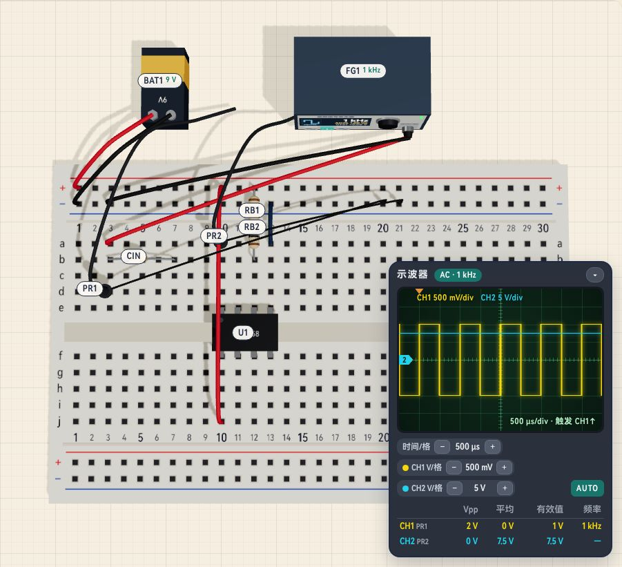
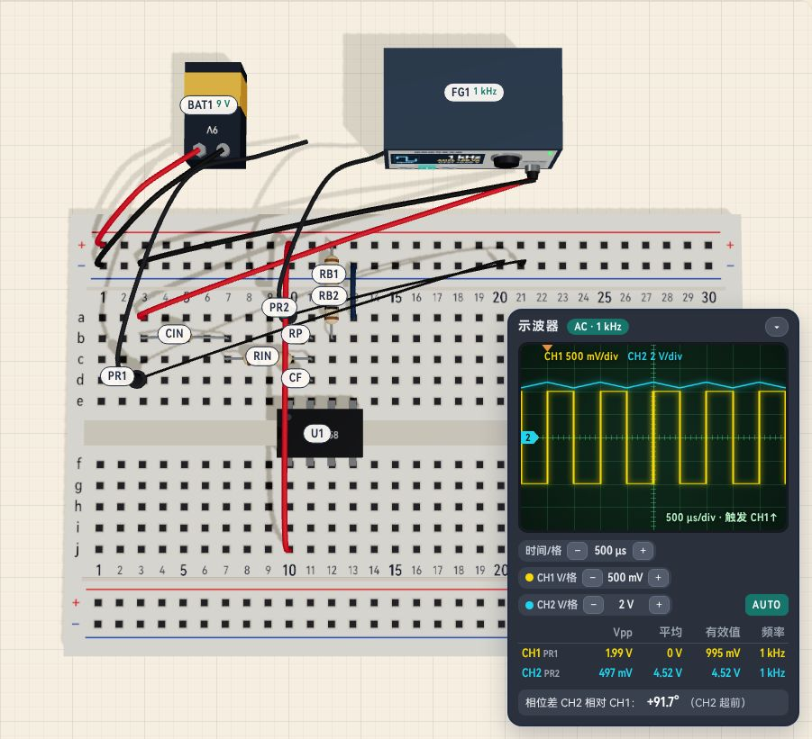
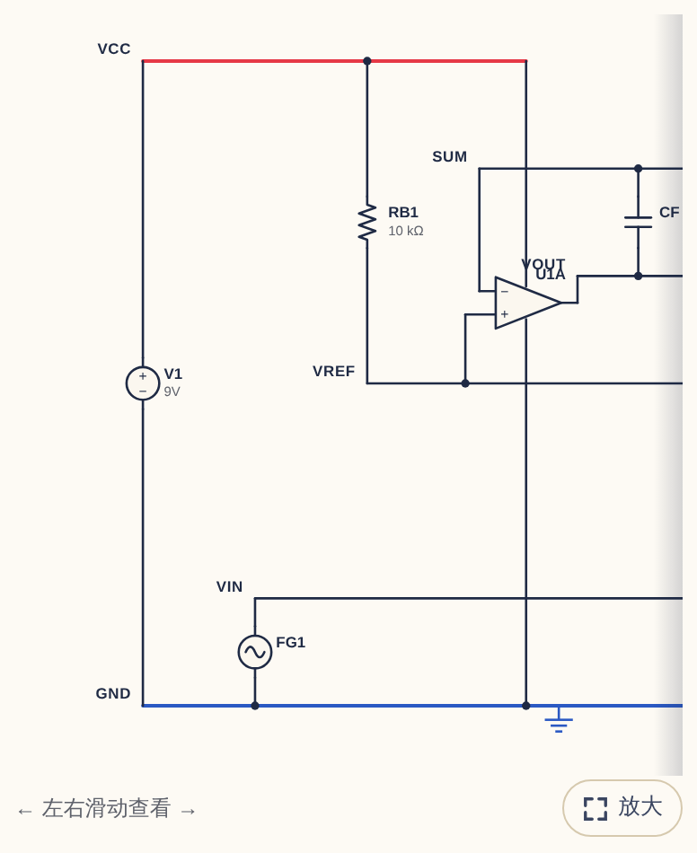
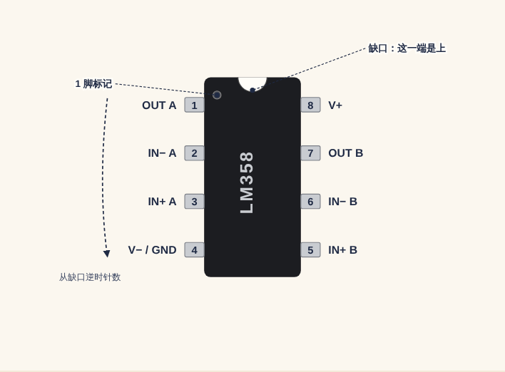
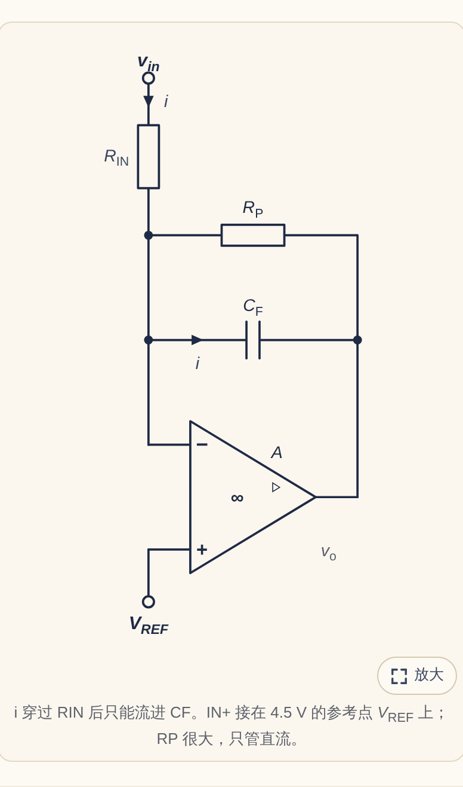
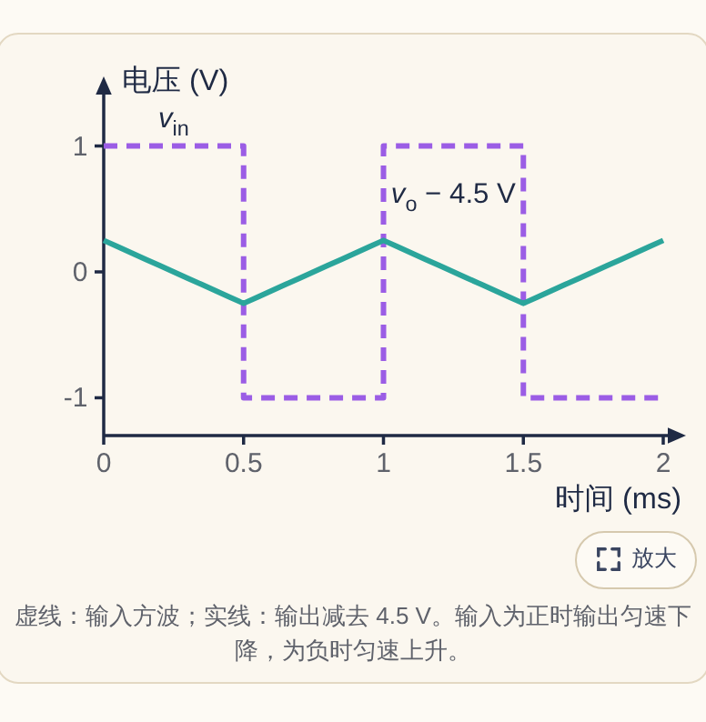

# 4.3 · op-amp积分器：方波变三角波

| 项目 | 内容 |
|---|---|
| id | `exp3-opamp-integrator` |
| 文件 | `challenges/246-opamp-integrator.json` |
| 类型 | 实验 / 挑战（没有分步，照目标电路图搭） · 难度 5/5 |
| 位置 | World 4 · 储能元件与一阶 / 二阶暂态 → 4.3 微分、积分与 op-amp（运算放大器）积分器（本节第 2 项） |
| 右侧面板 | 轨道由旧的四张卡片自动生成（还没手工精排） |
| 前后 | 上一项 [4.3 exp3-rc-differentiator-integrator](../w4/4.03-1-exp3-rc-differentiator-integrator.md) · 下一项 [4.4 exp3-rl-square](../w4/4.04-1-exp3-rl-square.md) |
| 先修 | lesson-lm358、lesson-scope-two-channels |
| 概念 | inverting integrator 反相积分器、dv_o/dt = −v_in/RC、virtual short 虚短、single-supply bias 单电源偏置、DC feedback resistor 直流反馈电阻 |

**一句话概要**：LM358（单电源 9 V）搭反相积分器：方波输入变成三角波输出，由三角波的斜率测出 RC。

## 1. 左侧工作台（3D 面包板 → 2D 俯视截图）

截图是程序里真实的 3D 面包板换成俯视角拍的；表格是同一块板的文字版（元件、参数、每只脚插在哪个孔）。

### 1.1 起点：打开这一课时板上已经有的

右侧显示的「起点」说明：

> **半成品**：电池、LM358 的电源脚、偏置电阻 RB1/RB2（IN+ = 4.5 V）、信号发生器、隔直电容 CIN 和两个探头都已接好。**为什么**：单电源偏置是辅助技巧，下面“为什么需要这些辅助元件”讲了它；积分器本身是 RIN 和 CF。**你要做**：加上 RIN（10kΩ，CIN → 2 脚 IN−）、CF（100nF，2 脚 → 1 脚 OUT）和与 CF 并联的 RP（100kΩ）。

| 元件 | 类型 | 参数 | 引脚 → 孔 |
|---|---|---|---|
| BAT1 | battery | variant=9V | +→tp1 -→tn1 |
| U1 | opamp |  | 1→e10 2→e11 3→e12 4→e13 5→f13 6→f12 7→f11 8→f10 |
| W3 | wire |  | a→tp10 b→j10 |
| W4 | wire |  | a→a13 b→tn13 |
| RB1 | resistor | resistance=10000 | 1→tp12 2→a12 |
| RB2 | resistor | resistance=10000 | 1→b12 2→tn12 |
| FG1 | function_gen | waveform=square, frequency=1000, amplitude=1, offset=0 | +→a3 -→tn3 |
| CIN | capacitor | capacitance=0.000009999999999999999 | 1→b3 2→b7 |
| PR1 | scope_probe | channel=1 | tip→d3 gnd→tn20 |
| PR2 | scope_probe | channel=2 | tip→a10 gnd→tn21 |

### 1.3 参考答案（「看答案」载入的板子）

| 元件 | 类型 | 参数 | 引脚 → 孔 |
|---|---|---|---|
| BAT1 | battery | variant=9V | +→tp1 -→tn1 |
| U1 | opamp |  | 1→e10 2→e11 3→e12 4→e13 5→f13 6→f12 7→f11 8→f10 |
| W3 | wire |  | a→tp10 b→j10 |
| W4 | wire |  | a→a13 b→tn13 |
| RB1 | resistor | resistance=10000 | 1→tp12 2→a12 |
| RB2 | resistor | resistance=10000 | 1→b12 2→tn12 |
| FG1 | function_gen | waveform=square, frequency=1000, amplitude=1, offset=0 | +→a3 -→tn3 |
| CIN | capacitor | capacitance=0.000009999999999999999 | 1→b3 2→b7 |
| RIN | resistor | resistance=10000 | 1→c7 2→c11 |
| CF | capacitor | capacitance=1.0000000000000001e-7 | 1→d11 2→d10 |
| RP | resistor | resistance=100000 | 1→b11 2→b10 |
| PR1 | scope_probe | channel=1 | tip→d3 gnd→tn20 |
| PR2 | scope_probe | channel=2 | tip→a10 gnd→tn21 |

### 1.4 目标原理图（右侧「目标原理图」抽屉）

| 元件 | 类型 | 参数 |
|---|---|---|
| V1 | dc_source | voltage=9 |
| U1 | opamp |  |
| FG1 | function_gen |  |
| RB1 | resistor | resistance=10000 |
| RB2 | resistor | resistance=10000 |
| CIN | capacitor | capacitance=0.000009999999999999999 |
| RIN | resistor | resistance=10000 |
| CF | capacitor | capacitance=1.0000000000000001e-7 |
| RP | resistor | resistance=100000 |

连接（每个结点上的引脚）：

- **VCC**：V1.+、U1.v+、RB1.1
- **GND**：V1.-、U1.v-、RB2.2、FG1.-
- **VREF**：RB1.2、RB2.1、U1.inA+
- **VIN**：FG1.+、CIN.1
- **N1**：CIN.2、RIN.1
- **SUM**：RIN.2、U1.inA-、CF.1、RP.1
- **VOUT**：U1.outA、CF.2、RP.2

## 2. 右侧面板：学生从上往下看到的内容（单轨流）

### 第 1 步 · 🔍 先看一眼：先认识它：LM358 op-amp

**拆解「LM358：一颗芯片里的两个 op-amp」第 1 / 9 层：① 外形：8 只脚的黑色小芯片（DIP-8）**

LM358 装在 **DIP-8** 封装里（Dual In-line Package，两排直插，8 只脚）。怎么找 1 脚：
- 芯片一端有个 半圆缺口 notch，缺口朝上时，左上角有个 小圆点 的就是 **1 脚**；
- 从 1 脚开始 **逆时针** 数：左边一排从上往下 1、2、3、4，再从右边一排从下往上 5、6、7、8。

8 只脚分成三类：**A 号 op-amp 的 3 只脚**、**B 号 op-amp 的 3 只脚**、**两个 op-amp 共用的 2 只电源脚**。把鼠标放到下表每一行上，看它在芯片上的位置。

| 脚 | 名字 | 属于 | 它是什么 | 单电源时接哪 |
|---|---|---|---|---|
| 1 | OUT A | op-amp A | 输出（output） | 负载 / 反馈网络 |
| 2 | IN− A | op-amp A | 反相输入（inverting input） | 反馈回来的信号 |
| 3 | IN+ A | op-amp A | 同相输入（non-inverting input） | 要放大的信号 / 参考电压 |
| 4 | V− (GND) | A、B 共用 | 负电源 | GND |
| 5 | IN+ B | op-amp B | 同相输入 | 不用时接固定电压 |
| 6 | IN− B | op-amp B | 反相输入 | 不用时接 7 脚（跟随器） |
| 7 | OUT B | op-amp B | 输出 | — |
| 8 | V+ | A、B 共用 | 正电源 3–32 V | +5 V / +9 V |

### 第 2 步 · 🔧 动手搭：方波进去，看出来什么

- **电源**：9 V 接 LM358 的 8 脚，GND 接 4 脚。**偏置**：RB1、RB2（都是 **`10 kΩ`**）从 +9 V 到 GND 分压，中点接 **IN+**。
- **输入**：信号发生器 → **CIN `10 µF`** → **RIN `10 kΩ`** → **IN−**。**反馈**：**CF `100 nF`** 接在 IN− 和 OUT 之间，**RP `100 kΩ`** 和 CF 并联。
- 方波、**`1 kHz`**、幅度 **`1 V`**、偏置 **`0 V`**。CH1 看信号发生器，CH2 看 OUT。
输出是什么形状？输入为正的时候，它往哪边走？

### 第 3 步 · 💡 想明白：电流全部流进电容

- 负反馈让 IN− 跟着 IN+ 停在 4.5 V。输入电阻里的电流 i = v_in / RIN 不受输出影响，又进不了 op-amp（运算放大器），只能**全部流进 CF**。
- 恒定的电流给电容充电，电容电压就**匀速**变化（3.3 的 dv/dt = i / C）。输出跟着电容电压走，方向相反：
$$\frac{dv_o}{dt} = -\frac{v_{in}}{R_{IN} C_F} = -\frac{1 V}{10 kΩ × 100 nF}$$

*图 `integ`（schematic）：i 穿过 RIN 后只能流进 CF。IN+ 接在 4.5 V 的参考点 V_REF 上；RP 很大，只管直流。*

- 方波每半个周期输入不变，输出就是一条斜线：方波变成三角波。和 RC 积分电路不同，这里的斜率一直准确，输出也可以做大。

*图 `tri`（plot）：虚线：输入方波；实线：输出减去 4.5 V。输入为正时输出匀速下降，为负时匀速上升。*

（这一步下面列着这节课的计算卡片，点开就地展开：`square-rc-vpp`、`opamp-integrator`，全文见第 6 节）

### 第 4 步 · 🔧 动手搭：量斜率，看辅助元件

- **`1 kHz`** 方波：读 OUT 三角波的峰峰值，算出 RIN·CF；万用表直流档量 OUT 的中心。
- 再试 **`100 Hz`**：半个周期变长，三角波的边开始变弯。
- 三个辅助元件：**RB1、RB2** 把参考点抬到 4.5 V，单电源的输出才能上下摆；**CIN** 挡住信号发生器和 IN− 之间 4.5 V 的直流差；**RP** 给直流一条反馈的路，否则一点点直流误差也会被一直积分，输出撞到电源就不动了。

### 第 5 步 · 📏 测一测：测一测：读你自己的仪表

**测量题 1 · `vpp`**（读数题）

> 1 kHz 方波：CH2（OUT）三角波的峰峰值

- 单位 V · 先写预测 · 状态：FG1 设为 信号发生器（方波 1kHz 幅度 1V） · 参考答案的读数 **0.4975 V** · 合理范围 [0.473, 0.522]

答对后显示：

> 斜率 1 V / (RIN·CF) = 1000 V/s，半个周期 0.5 ms 走 0.5 V。

**测量题 2 · `rc`**（计算题（用自己的读数算））

> 半个周期 0.5 ms 走完一个峰峰值：用你的读数算 RIN·CF = 1 V × 0.5 ms / Vpp

- 单位 ms · 先写预测 · 参考答案的读数 **1.005 ms** · 合理范围 [0.000955, 0.00106] · 公式 `1 * 0.0005 / vpp`

答对后显示：

> 10 kΩ × 100 nF = 1 ms。op-amp（运算放大器）让电阻电流不受输出影响，所以斜率始终是输入 / RC。

**测量题 3 · `vavg`**（读数题）

> 同一状态：万用表直流档测 OUT 对 GND（三角波的中心）

- 单位 V · 先写预测 · 状态：FG1 设为 信号发生器（方波 1kHz 幅度 1V） · 参考答案的读数 **4.522 V** · 合理范围 [4.3, 4.75]

答对后显示：

> IN− 跟着 IN+ = 4.5 V；RP 给直流提供反馈，输入的平均值是 0，所以中心就在 4.5 V。

**测量题 4 · `dir`**（选择题）

> 在示波器上看：输入为正的半个周期里，输出往哪边走？

- A. 下降（反相积分器） ✅（正确）
- B. 上升
- C. 不变

答对后显示：

> 电流 v_in / RIN 从输入流进 IN−，全部流进 CF，把 OUT 那一侧往下拉。

**测量题 5 · `vpp100`**（读数题）

> 100 Hz 方波：OUT 的峰峰值（和“理想积分”的 10 V 比）

- 单位 V · 先写预测 · 状态：FG1 设为 信号发生器（方波 100Hz 幅度 1V） · 参考答案的读数 **4.863 V** · 合理范围 [4.62, 5.11]

答对后显示：

> 半个周期 5 ms 已经和 RP·CF = 10 ms 差不多，RP 的影响出来了：2 × 10 × tanh(T / (4·RP·CF)) ≈ 4.9 V。

### 第 6 步 · 🎒 带走：带走

- **op-amp（运算放大器）积分器**：dv_o/dt = −v_in / (RIN·CF)。方波 → 三角波，正弦 → 余弦。
- **虚短 + 虚断**让电阻电流不受输出影响，所以它在很宽的频率范围里都是真正的积分。
- **RP 不能少**：没有它，直流误差会把输出推到电源轨。代价是频率很低时不再像积分。
- **真实电路里**：10 µF 的 CIN 一般是电解电容，+ 脚朝直流电位高的一侧（这里是 RIN / IN− 那边）。LM358 的输入只到约 V+ − 1.5 V，IN+ 在 4.5 V 没问题。

趁热练理论题：`first-order`

## 3. 测量题一览

| # | id | 题目 | 类型 | 单位 | 状态 | 参考读数 |
|---|---|---|---|---|---|---|
| 1 | vpp | 1 kHz 方波：CH2（OUT）三角波的峰峰值 | scope | V | FG1 设为 信号发生器（方波 1kHz 幅度 1V） | 0.4975 V |
| 2 | rc | 半个周期 0.5 ms 走完一个峰峰值：用你的读数算 RIN·CF = 1 V × 0.5 ms / Vpp | formula | ms |  | 1.005 ms |
| 3 | vavg | 同一状态：万用表直流档测 OUT 对 GND（三角波的中心） | voltage | V | FG1 设为 信号发生器（方波 1kHz 幅度 1V） | 4.522 V |
| 4 | dir | 在示波器上看：输入为正的半个周期里，输出往哪边走？ | 选择 |  |  | 正确：A |
| 5 | vpp100 | 100 Hz 方波：OUT 的峰峰值（和“理想积分”的 10 V 比） | scope | V | FG1 设为 信号发生器（方波 100Hz 幅度 1V） | 4.863 V |

### 全部答完后显示的「对比」

**对比**：方波 ±1 V 时，每半个周期输出以恒定斜率 1 V / (10 kΩ × 100 nF) = 1000 V/s 变化，半个周期 0.5 ms 走 0.5 V：**0.5 Vpp 的三角波，中心 4.5 V**，输入为正时输出下降。如果输出贴在 7.5 V 或 0 V 不动，检查反馈是否接到 IN−、RP 有没有接上。

- 2 kHz 方波：斜率不变，时间减半，Vpp 减半到约 0.25 V。
- 1 kHz 正弦（幅度 1 V）：输出是同频正弦，幅度 1 V / (ωRC) ≈ 0.16 V（约 0.32 Vpp）。
- 100 Hz 方波：半个周期 5 ms 已和 RP·CF = 10 ms 相当，边变成指数曲线，Vpp ≈ **4.9 V**，比理想积分的 10 V 小得多。

### 提示按钮（依次显示）

1. 偏置：RB1 从 +9 V 到 IN+，RB2 从 IN+ 到 GND。
2. 输入：信号发生器 → CIN → RIN → IN−；CF 和 RP 都跨在 IN− 和 OUT 之间。
3. 斜率 = 输入电压 / (RIN·CF)；半个周期走完一个峰峰值。

### 功能测试（「检查我的电路」时跑）

- 1 kHz 方波：三角波，中心在 VREF
- 2 kHz 方波：时间减半，三角波高度减半
- 1 kHz 正弦：正弦的积分还是正弦（余弦）
- 100 Hz 方波：RP 的影响显现，比理想积分小，且不削顶

## 4. 用到的拆解（全部层的文字，供改写参考）

### 拆解 `lm358`：LM358：一颗芯片里的两个 op-amp

*op-amp = operational amplifier（运算放大器）。我们从芯片外形一路拆到教授在黑板上画的那个三角形，再拆到三角形里面的等效电路，最后用它推出每一个放大器公式。*

**拆解「LM358：一颗芯片里的两个 op-amp」第 1 / 9 层：① 外形：8 只脚的黑色小芯片（DIP-8）**

LM358 装在 **DIP-8** 封装里（Dual In-line Package，两排直插，8 只脚）。怎么找 1 脚：
- 芯片一端有个 半圆缺口 notch，缺口朝上时，左上角有个 小圆点 的就是 **1 脚**；
- 从 1 脚开始 **逆时针** 数：左边一排从上往下 1、2、3、4，再从右边一排从下往上 5、6、7、8。

8 只脚分成三类：**A 号 op-amp 的 3 只脚**、**B 号 op-amp 的 3 只脚**、**两个 op-amp 共用的 2 只电源脚**。把鼠标放到下表每一行上，看它在芯片上的位置。

| 脚 | 名字 | 属于 | 它是什么 | 单电源时接哪 |
|---|---|---|---|---|
| 1 | OUT A | op-amp A | 输出（output） | 负载 / 反馈网络 |
| 2 | IN− A | op-amp A | 反相输入（inverting input） | 反馈回来的信号 |
| 3 | IN+ A | op-amp A | 同相输入（non-inverting input） | 要放大的信号 / 参考电压 |
| 4 | V− (GND) | A、B 共用 | 负电源 | GND |
| 5 | IN+ B | op-amp B | 同相输入 | 不用时接固定电压 |
| 6 | IN− B | op-amp B | 反相输入 | 不用时接 7 脚（跟随器） |
| 7 | OUT B | op-amp B | 输出 | — |
| 8 | V+ | A、B 共用 | 正电源 3–32 V | +5 V / +9 V |

**拆解「LM358：一颗芯片里的两个 op-amp」第 2 / 9 层：② X 光：硅片上有两个 op-amp，电源脚共用**

把黑色塑料变透明：中间是一小块 硅片 die，细细的 金线 bond wire 把硅片连到 8 只脚上。硅片上做了两个完全一样、互相独立的放大器：op-amp A 和 op-amp B。

“**Dual**（双）”就是这个意思。它们只共用两样东西：V+（8 脚） 和 V−（4 脚）。所以：
- 只要芯片插上电，A 和 B **都** 通电了，哪怕你只用 A；
- 不用的那一半不能让它的输入悬空——悬空的输入会让它乱跳甚至振荡，干扰另一半。通常把它接成跟随器（7 脚接 6 脚），5 脚接一个固定电压。

**拆解「LM358：一颗芯片里的两个 op-amp」第 3 / 9 层：③ 符号：教授画的那个三角形**

原理图里，一个 op-amp 画成一个 三角形，信号从左往右走：
- IN−（反相输入 inverting input）：标“−”的那只脚，它上面的电压记作 $v₋$；
- IN+（同相输入 non-inverting input）：标“+”的那只脚，电压记作 $v₊$；
- OUT（输出）：三角形的尖，电压 $v_o$；
- V+ 和 V−：电源脚。理论题里常常 **省略不画**，但真实电路里必须接，否则它不工作。

注意：“+”“−”不是电源正负极，而是“这只输入对输出的作用是同向还是反向”。op-amp 只关心两个输入之间的 **差**：
$$v_d = v₊ - v₋$$
v_d 叫 **差模输入电压**（differential input voltage）。

| 端子 | 符号 | LM358 A 的脚 | 作用 |
|---|---|---|---|
| IN+ | $v₊$ | 3 | $v₊$ 升高 → $v_o$ 升高 |
| IN− | $v₋$ | 2 | $v₋$ 升高 → $v_o$ 降低 |
| OUT | $v_o$ | 1 | 输出 $A·v_d$ |
| V+ / V− | — | 8 / 4 | 能量从这里来，也限制 $v_o$ 的范围 |

- 公式 `v_d = v₊ - v₋`：op-amp 唯一“看”的量

**拆解「LM358：一颗芯片里的两个 op-amp」第 4 / 9 层：④ 拆开三角形：三个元件的等效电路**

教授说“把 op-amp 拆成电路”，拆出来就是这三样（这是电路课里 op-amp 的 **线性模型**）：

1. 输入电阻 R_in：接在两个输入之间。LM358 的输入只取约 20 nA 的偏置电流，等效 $R_{in}$ 在 MΩ 以上，计算时可以当成 **开路**——输入端几乎不取电流。
2. 受控电压源 A·v_d：一个电压 **控制** 的电压源（VCVS），它的电压是输入差的 A 倍。A 叫 **开环增益**（open-loop gain），LM358 约 $10^5$（100 dB）。
3. 输出电阻 R_out：受控源到输出脚之间，几十 Ω 量级。

于是不接任何反馈时：
$$v_o = A·v_d = A(v₊ - v₋)$$
这个电路你在第 5 章“含运算放大器的电阻电路”和受控源那一节都能直接用结点法分析。

| 参数 | LM358（典型） | 理想 op-amp | 计算时 |
|---|---|---|---|
| 开环增益 A | ≈ 10⁵ (100 dB) | ∞ | 很大 → 得出“虚短” |
| 输入电阻 R_in | MΩ 以上（偏置 20 nA） | ∞ | 开路 → 得出“虚断” |
| 输出电阻 R_out | 几十 Ω（仿真 10 Ω） | 0 | 反馈后更小，可忽略 |

- 公式 `v_o = A(v₊ - v₋)`：开环（不接反馈），且输出没到电源边界时

**拆解「LM358：一颗芯片里的两个 op-amp」第 5 / 9 层：⑤ 不接反馈会怎样？——输出一下子撞到电源**

用上一层的公式算一下。LM358 接 9 V 单电源，输出最多到约 7.5 V。要让输出在 0–7.5 V 之间（线性区），输入差只能是：
$$0 < v_d < \frac{7.5 V}{10^5} = 75 µV$$
75 微伏！你手一碰导线、电位器动一点点、甚至输入失调电压（LM358 典型 2 mV）都比它大几十倍。所以 **开环** 的 op-amp 几乎永远停在两头：
- $v₊ > v₋$（哪怕多 1 mV）→ 输出 顶到 ≈ V+ − 1.5 V
- $v₊ < v₋$ → 输出 掉到 ≈ 0 V

这叫 **饱和**（saturation）。这样用 op-amp 就成了 **比较器**（comparator）：只回答“哪个输入大”。想让它当放大器，必须加 **负反馈**——下面两层就讲为什么反馈能把 $v_d$ 稳稳地压在 75 µV 以内。

- 公式 `|v_d| < \frac{V_{sat}}{A} = \frac{7.5}{10^{5}} = 75 µV`：线性区有多窄

**拆解「LM358：一颗芯片里的两个 op-amp」第 6 / 9 层：⑥ 理想 op-amp 的两条黄金法则：虚短、虚断**

把等效电路里的三个参数推到极限：$A → ∞$、$R_{in} → ∞$、$R_{out} → 0$。电路课的所有 op-amp 题都用这两条法则：

**法则 1 · 虚断（virtual open）**：$R_{in} → ∞$，所以 两个输入端都不取电流：
$$i_+ = i_- = 0$$
**法则 2 · 虚短（virtual short）**：有负反馈、输出没饱和时，$v_o$ 是有限值（几伏），而 $v_d = \frac{v_o}{A}$，A → ∞，所以 两个输入电压相等：
$$v₊ = v₋$$
“虚”的意思：两个输入 **电压相等，但并没有真的连在一起**（没有电流流过）。

⚠ 虚短 **只在有负反馈时成立**。上一层的开环电路里 $v₊ ≠ v₋$，输出是饱和的。

| 法则 | 式子 | 来自 | 什么时候成立 |
|---|---|---|---|
| 虚断 | $i_+ = i_- = 0$ | $R_{in} → ∞$ | 总是（输入电流 nA 级） |
| 虚短 | $v₊ = v₋$ | $A → ∞$ | 有负反馈且输出未饱和 |

**拆解「LM358：一颗芯片里的两个 op-amp」第 7 / 9 层：⑦ 负反馈第一例：电压跟随器，一步步推**

把 输出直接接回 IN−，信号接 IN+。先 **不用** 黄金法则，用 ④ 的模型硬算（忽略 $R_{out}$）：
1. 接线告诉我们：$v₊ = v_{in}$，$v₋ = v_o$
2. op-amp 的方程：$v_o = A(v₊ - v₋) = A(v_{in} - v_o)$
3. 移项：$v_o(1 + A) = A·v_{in}$
4. 所以 $v_o = \frac{A}{1+A}v_{in}$。代入 $A = 10^5$：$v_o = 0.99999 v_{in}$

再看反馈 **为什么能稳住**：如果 $v_o$ 偏低，$v_d = v_{in} - v_o$ 变大，A 倍放大后把 $v_o$ 往上推；偏高则往下拉。输出一直“追”着输入，$v_d$ 只剩 $\frac{v_o}{A}$——几十 µV。

用黄金法则一行就出来：虚短 $v₋ = v₊$，而 $v₋ = v_o$，所以 $v_o = v_{in}$。两种方法结果一致，这就是黄金法则的来历。

**用处**：输入几乎不取电流（虚断），输出能提供几十 mA——它把“带不动负载的信号”变成“能带负载的信号”，叫 **缓冲器**（buffer）。

- 公式 `v_o = \frac{A}{1+A} v_{in} ≈ v_{in}`：有限 A 的精确结果

**拆解「LM358：一颗芯片里的两个 op-amp」第 8 / 9 层：⑧ 负反馈第二例：同相放大器和反相放大器**

跟随器把 **全部** 输出送回 IN−。如果只送回 **一部分**，就能放大。用 R_f 和 R_1 分压，送回 IN− 的是 βvₒ：
$$β = \frac{R_1}{R_1 + R_f}$$
**同相放大器**（non-inverting），信号接 IN+：
1. 虚断：IN− 不取电流，所以 R_f、R_1 是简单的串联分压：$v₋ = β v_o$
2. 虚短：$v₋ = v₊ = v_{in}$
3. 所以 $β v_o = v_{in}$，$v_o = \frac{1}{β}v_{in} = (1 + \frac{R_f}{R_1})v_{in}$

用有限 A 推（同 ⑦ 的方法）得到 $v_o = \frac{A}{1+Aβ}v_{in}$：只要 $Aβ ≫ 1$，增益就只由 **两个电阻** 决定，和 op-amp 本身的 A 无关——这就是负反馈的价值。

**反相放大器**（inverting）：IN+ 接 GND，信号经 $R_1$ 接 IN−，$R_f$ 从 OUT 接回 IN−。
1. 虚短：$v₋ = v₊ = 0$，IN− 是 **虚地**（virtual ground）
2. 虚断：流进 $R_1$ 的电流全部流过 $R_f$：$\frac{v_{in} - 0}{R_1} = \frac{0 - v_o}{R_f}$
3. 所以 $v_o = -\frac{R_f}{R_1}v_{in}$（负号 = 反相）

| 电路 | 增益 vₒ / v_in | 输入电阻 | 实验 |
|---|---|---|---|
| 跟随器 | 1 | ∞ | 2-5 |
| 同相放大 | $1 + \frac{R_f}{R_1}$ | ∞ | 2-6 |
| 反相放大 | $-\frac{R_f}{R_1}$ | $R_1$ | 2-7 |
| 反相求和 | $-R_f(\frac{v_1}{R_1} + \frac{v_2}{R_2})$ | $R_1$, $R_2$ | 2-8 |

- 公式 `β = \frac{R_1}{R_1 + R_f}`：反馈系数：输出送回 IN− 的比例
- 公式 `v_o = \frac{A}{1 + Aβ} v_{in} ≈ \frac{1}{β} v_{in}`：Aβ ≫ 1 时增益只取决于电阻

**拆解「LM358：一颗芯片里的两个 op-amp」第 9 / 9 层：⑨ 再往里：三级晶体管电路，和它的“缺点”**

三角形里真正的东西是约 20 个晶体管，分三级：
1. 输入级：PNP 差分对——只放大两个输入的 **差**。LM358 用 PNP 管，所以 输入电压可以低到 0 V（GND），这就是它能单电源工作的原因；输入上限约 V+ − 1.5 V。
2. 增益级——提供 $10^5$ 倍的电压增益。里面的 补偿电容 C_c 让高频增益逐渐下降，防止接反馈后振荡，代价是 **带宽**：增益 × 带宽 ≈ 1 MHz（GBW）。
3. 输出级：推挽——一个管子往上推电流、一个往下拉，提供几十 mA。往上推的那一路有两个 $V_{BE}$ 压降，所以 输出到不了 V+，差约 1.5 V；往下拉的那一路能接近 0 V。

这一层解释了你在课里看到的三个“现象”：
- 第 14 课：输入 9 V，输出只有 7.5 V → 输出级的余量；
- 放大倍数做 100 倍时带宽只剩约 10 kHz → $GBW ≈ 1 MHz$；
- 方波边沿变成斜坡，约 0.3 V/µs → **压摆率**（slew rate），由 C_c 的充电电流决定。

| 参数 | LM358 典型值 | 影响什么 |
|---|---|---|
| 电源电压 | 3–32 V（±1.5–±16 V） | 能用的电源 |
| 输出摆幅 | 0 … V+ − 1.5 V | 输出最大值 |
| 共模输入范围 | 0 … V+ − 1.5 V | 输入能接多高 |
| 增益带宽积 GBW | ≈ 1 MHz | $f_{max} ≈ \frac{GBW}{增益}$ |
| 压摆率 SR | ≈ 0.3 V/µs | 大信号的最高频率 |
| 输入失调电压 | ≈ 2 mV | 直流误差 × 增益 |

- 公式 `f_{-3dB} ≈ \frac{GBW}{G}`：G = 闭环增益（同相放大器的 1 + R_f/R_1）
- 公式 `f_{max} = \frac{SR}{2π V_p}`：不失真的最大正弦频率

**一句话记住**：op-amp = 一个只看 $v₊ - v₋$ 的超高增益放大器。开环时它是比较器；加了负反馈，输出会调到让 $v₊ = v₋$（虚短），输入不取电流（虚断）——从这两条就能推出所有放大器公式。

## 5. 这一课的计算卡片

**计算卡片 `square-rc-vpp`：方波下的稳态摆幅 ΔV·tanh(T/4τ)**

- 公式 `V_{pp} = ΔV tanh\frac{T}{4τ}`
- 用途：方波反复充放电，一阶电路稳态时来回摆多大（RC 电容电压、RL 电流、PWM 纹波）。
- 输入：ΔV（方波每次跳变的高度，V）；f（方波频率，Hz）；τ（时间常数，s） → V_pp（稳态峰峰值，V）

1. 稳态时电容在 $V_L$ 和 $V_H$ 之间来回（50 % 占空比，以 0 和 ΔV 为例）。
2. 充电半周期：$V_H = ΔV - (ΔV - V_L)e^{-T/(2τ)}$。
3. 放电半周期：$V_L = V_He^{-T/(2τ)}$。
4. 两式联立：$V_H - V_L = ΔV\frac{1 - e^{-T/2τ}}{1 + e^{-T/2τ}} = ΔV tanh\frac{T}{4τ}$。
5. 两头：$T ≫ τ$ 时 tanh → 1，摆满 ΔV；$T ≪ τ$ 时 $tanh x ≈ x$，摆幅 ≈ $\frac{ΔV T}{4τ}$，波形变成三角波（积分）。

例子：- 实验 3-1：500 Hz、τ ≈ 1 ms：$5 tanh(0.5) ≈ 2.3 V$；5 kHz：≈ 0.25 V 三角波。
- 实验 3-2：积分支路 τ = 10 ms、500 Hz：$5 tanh(0.05) ≈ 0.25 V$。
- 实验 3-3：电阻电压的满幅 1.32 V，10 kHz：$1.32 tanh(0.38) ≈ 0.48 V$。
- 实验 5-14：100 Hz、τ = 10 ms、3.3 V：$3.3 tanh(0.25) ≈ 0.81 V$。

- ⚠ ΔV 是一次跳变的高度：±2.5 V 的方波跳 5 V，不是 2.5 V。
- ⚠ 只适用于 50 % 占空比；其它占空比的 PWM 纹波见“PWM + RC 的纹波”。

**计算卡片 `opamp-integrator`：op-amp 积分器：方波变三角波**

- 公式 `v_o = -\frac{1}{RC}∫v_i dt, V_{pp} = \frac{V_i}{RC} × \frac{T}{2}`
- 用途：反相积分器的输出斜率和三角波的峰峰值。
- 输入：V_i（方波幅度（±Vᵢ），V）；R（输入电阻 R_in，Ω）；C（反馈电容 C_F，F）；f（方波频率，Hz） → V_pp（输出三角波峰峰值，V）

1. 虚短：IN− 和 IN+ 同电位（虚地，单电源时是 4.5 V 参考）。
2. 输入电流 $i = \frac{v_i}{R}$ 与输出无关；虚断：它全部流进 $C_F$。
3. 电容：$i = C\frac{d(v_- - v_o)}{dt}$ ⇒ $\frac{dv_o}{dt} = -\frac{v_i}{RC}$——斜率恒定。
4. 方波 ±$V_i$：每半个周期输出走 $\frac{V_i}{RC} × \frac{T}{2}$，就是三角波的峰峰值。
5. 正弦输入：输出幅度 $\frac{V_i}{ωRC}$，超前 90°（反相 180° + 积分 −90°）。并联的 $R_P$ 给直流反馈（直流增益 $-\frac{R_P}{R}$），否则输出会慢慢漂到电源轨。

例子：实验 3-6：斜率 $\frac{1 V}{10k × 100 nF} = 1000 V/s$，半周期 0.5 ms → 0.5 Vpp 三角波，中心 4.5 V；2 kHz → 0.25 Vpp；1 kHz 正弦 → $\frac{1}{2π × 1000 × 1 ms} ≈ 0.16 V$ 幅度。

- ⚠ 输入为正时输出 **下降**（反相）。
- ⚠ 频率低到半周期和 $R_PC_F$ 差不多时（100 Hz），$R_P$ 起作用，输出远小于理想积分器。

## 6. English（界面英文版的同一份内容）

展开英文

### Node 1 · 🔍 Look first：Meet it first: LM358 op-amp

**Teardown「LM358: two op-amps in one chip」layer 1 of 9：① Package: a small black 8-pin chip (DIP-8)**

The LM358 comes in a **DIP-8** package (Dual In-line Package: two rows, 8 pins). Finding pin 1:
- one end has a half-moon notch; with the notch at the top, the corner with the little dot (top left) is **pin 1**;
- count **anticlockwise** from pin 1: down the left side 1, 2, 3, 4, then up the right side 5, 6, 7, 8.

The 8 pins fall into three groups: **3 pins of op-amp A**, **3 pins of op-amp B**, and **2 power pins shared by both**. Hover each row of the table to see where it is on the chip.

| Pin | Name | Belongs to | What it is | Single supply: connect to |
|---|---|---|---|---|
| 1 | OUT A | op-amp A | output | the load / feedback network |
| 2 | IN− A | op-amp A | inverting input | the feedback signal |
| 3 | IN+ A | op-amp A | non-inverting input | the signal / a reference |
| 4 | V− (GND) | shared | negative supply | GND |
| 5 | IN+ B | op-amp B | non-inverting input | unused: tie to a fixed voltage |
| 6 | IN− B | op-amp B | inverting input | unused: tie to pin 7 (follower) |
| 7 | OUT B | op-amp B | output | — |
| 8 | V+ | shared | positive supply 3–32 V | +5 V / +9 V |

### Node 2 · 🔧 Build：Square wave in — what comes out?

- **Supply**: 9 V to LM358 pin 8, GND to pin 4. **Bias**: RB1 and RB2 (both **`10 kΩ`**) divide +9 V to GND; their midpoint goes to **IN+**.
- **Input**: generator → **CIN `10 µF`** → **RIN `10 kΩ`** → **IN−**. **Feedback**: **CF `100 nF`** between IN− and OUT, with **RP `100 kΩ`** in parallel.
- Square, **`1 kHz`**, amplitude **`1 V`**, offset **`0 V`**. CH1 on the generator, CH2 on OUT.
What shape is the output? Which way does it go while the input is positive?

### Node 3 · 💡 Why：All the current goes into the capacitor

- Negative feedback keeps IN− at IN+'s 4.5 V. The current in the input resistor, i = v_in / RIN, doesn't depend on the output and can't enter the op-amp, so **all of it flows into CF**.
- A steady current charges a capacitor at a **steady rate** (dv/dt = i / C from 3.3). The output follows the capacitor voltage, in the opposite direction:
$$\frac{dv_o}{dt} = -\frac{v_{in}}{R_{IN} C_F} = -\frac{1 V}{10 kΩ × 100 nF}$$

[figure `integ`]

*Figure `integ`（schematic）：i 穿过 RIN 后只能流进 CF。IN+ 接在 4.5 V 的参考点 V_REF 上；RP 很大，只管直流。*

- In each half of the square wave the input is constant, so the output is a straight ramp: the square becomes a triangle. Unlike the RC integrator, the slope stays exact and the output can be large.

[figure `tri`]

*Figure `tri`（plot）：虚线：输入方波；实线：输出减去 4.5 V。输入为正时输出匀速下降，为负时匀速上升。*

(This node lists the lesson’s calculation cards: `square-rc-vpp`、`opamp-integrator`; full text in section 6)

### Node 4 · 🔧 Build：Measure the slope, look at the helpers

- **`1 kHz`** square: read OUT's triangle peak-to-peak and work out RIN·CF; measure OUT's centre on the multimeter's DC range.
- Then try **`100 Hz`**: with longer halves the triangle's sides start to bend.
- Three helpers: **RB1, RB2** lift the reference to 4.5 V so a single-supply output can swing both ways; **CIN** blocks the 4.5 V DC difference between the generator and IN−; **RP** gives DC a feedback path — without it the tiniest DC error is integrated on and on until the output hits a supply rail and stays there.

### Node 5 · 📏 Measure：Measure: read your own instruments

**Question 1 · `vpp`**（reading）

> 1 kHz square: CH2 (OUT) triangle peak-to-peak

- unit V · predict first · state：FG1 is set to Function generator (square 1kHz 1V peak) · range [0.473, 0.522]

Shown once right:

> Slope 1 V / (RIN·CF) = 1000 V/s; half a period, 0.5 ms, covers 0.5 V.

**Question 2 · `rc`**（calculation from own readings）

> Half a period, 0.5 ms, covers one peak-to-peak: from your reading, RIN·CF = 1 V × 0.5 ms / Vpp

- unit ms · predict first · range [0.000955, 0.00106] · formula `1 * 0.0005 / vpp`

Shown once right:

> 10 kΩ × 100 nF = 1 ms. The op-amp keeps the resistor current independent of the output, so the slope is always input / RC.

**Question 3 · `vavg`**（reading）

> Same state: OUT to GND on the multimeter's DC range (the triangle's centre)

- unit V · predict first · state：FG1 is set to Function generator (square 1kHz 1V peak) · range [4.3, 4.75]

Shown once right:

> IN− follows IN+ = 4.5 V; RP gives DC feedback and the input averages 0, so the centre is 4.5 V.

**Question 4 · `dir`**（multiple choice）

> On the scope: during the positive half of the input, which way does the output go?

- A. down (inverting integrator) ✅ (right)
- B. up
- C. unchanged

Shown once right:

> The current v_in / RIN flows into IN− and on into CF, pulling the OUT side down.

**Question 5 · `vpp100`**（reading）

> 100 Hz square: OUT's peak-to-peak (compare with the 10 V of an ideal integral)

- unit V · predict first · state：FG1 is set to Function generator (square 100Hz 1V peak) · range [4.62, 5.11]

Shown once right:

> Half a period, 5 ms, is now comparable with RP·CF = 10 ms, so RP shows: 2 × 10 × tanh(T / (4·RP·CF)) ≈ 4.9 V.

### Node 6 · 🎒 Take away：Take away

- **Op-amp integrator**: dv_o/dt = −v_in / (RIN·CF). Square → triangle, sine → cosine.
- **Virtual short + no input current** keep the resistor current independent of the output, so it integrates properly over a wide range of frequencies.
- **RP is a must**: without it DC errors push the output into a rail. The price: at very low frequencies it stops behaving like an integrator.
- **In a real circuit**: a 10 µF CIN is usually electrolytic; its + leg faces the higher DC potential (here the RIN / IN− side). The LM358's inputs work up to about V+ − 1.5 V, so IN+ at 4.5 V is fine.

Practise：`first-order`

**Compare**

**Compare**: with a ±1 V square, the output ramps at a constant 1 V / (10 kΩ × 100 nF) = 1000 V/s in each half; half a period, 0.5 ms, covers 0.5 V: **a 0.5 Vpp triangle centred on 4.5 V**, falling while the input is positive. If the output sticks at 7.5 V or 0 V, check that the feedback goes to IN− and that RP is in place.

- 2 kHz square: same slope, half the time, so the Vpp halves to about 0.25 V.
- 1 kHz sine (1 V amplitude): the output is a sine of the same frequency, amplitude 1 V / (ωRC) ≈ 0.16 V (about 0.32 Vpp).
- 100 Hz square: half a period, 5 ms, is comparable with RP·CF = 10 ms; the sides turn into exponentials and Vpp ≈ **4.9 V**, far below the 10 V of an ideal integral.

**Hints**

1. Bias: RB1 from +9 V to IN+, RB2 from IN+ to GND.
2. Input: generator → CIN → RIN → IN−; CF and RP both span IN− to OUT.
3. Slope = input voltage / (RIN·CF); half a period covers one peak-to-peak.

