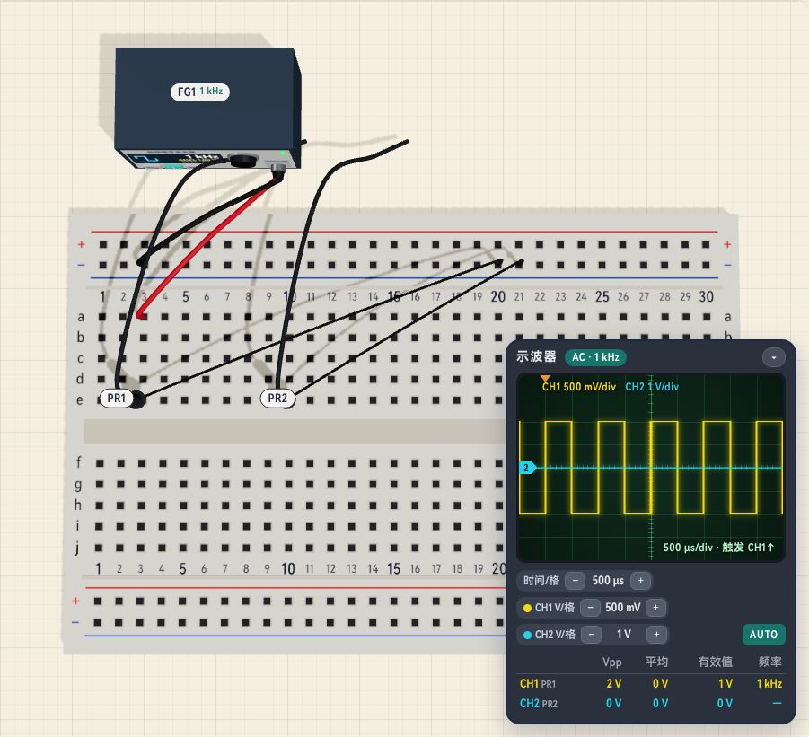
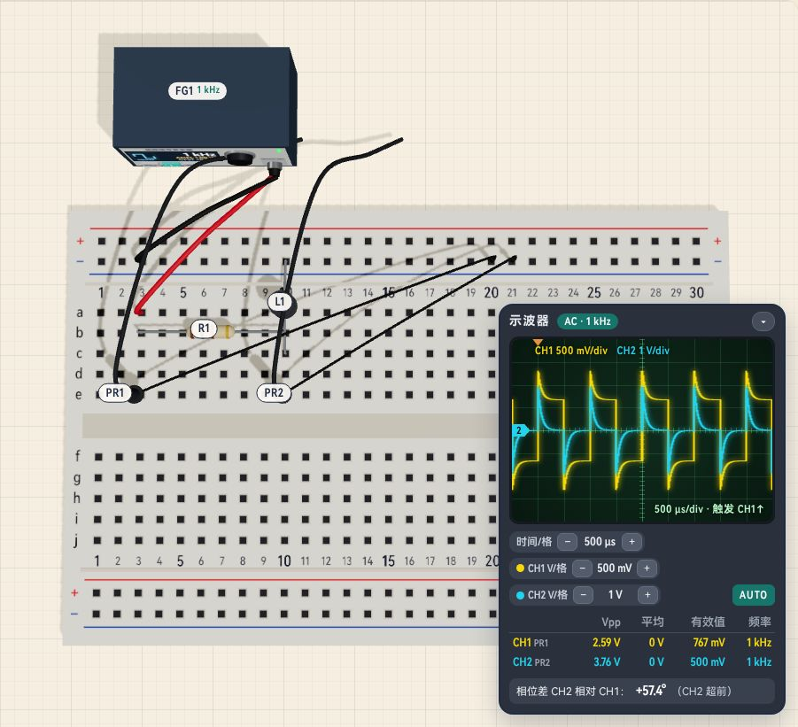
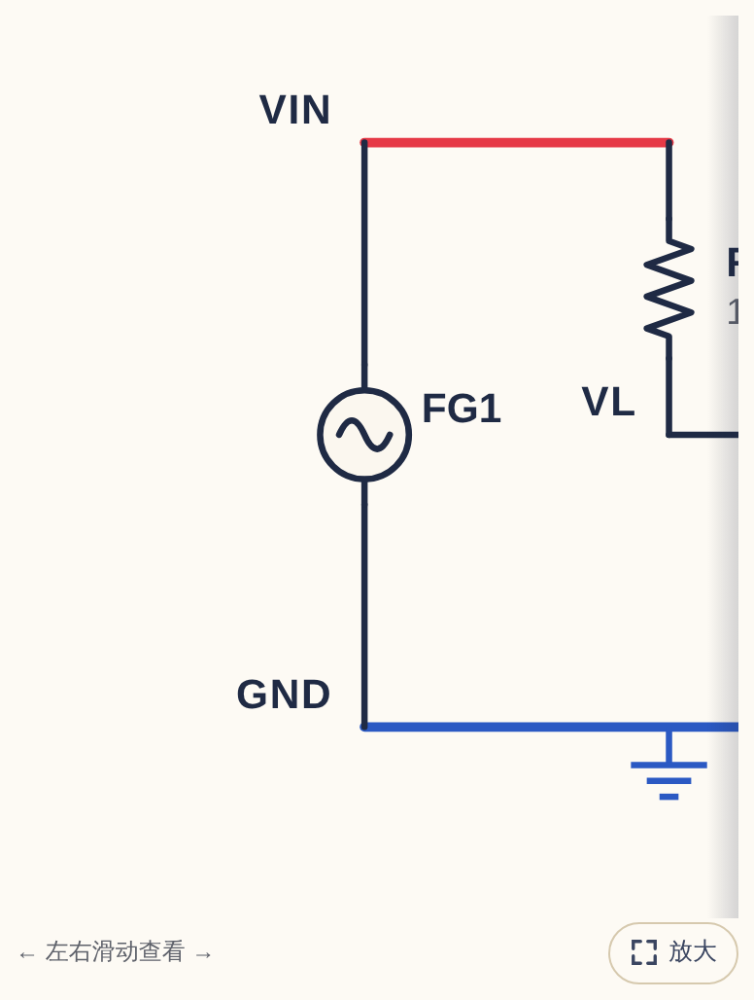
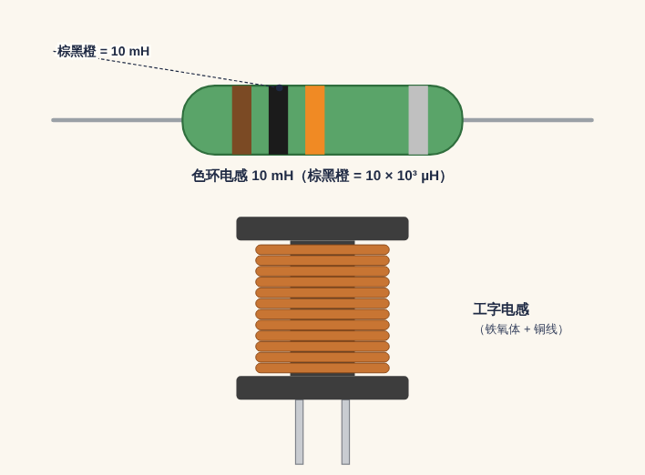
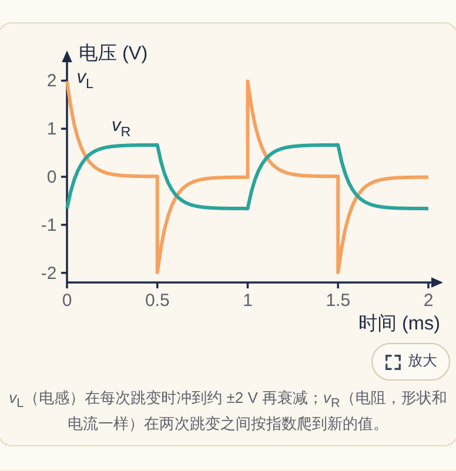
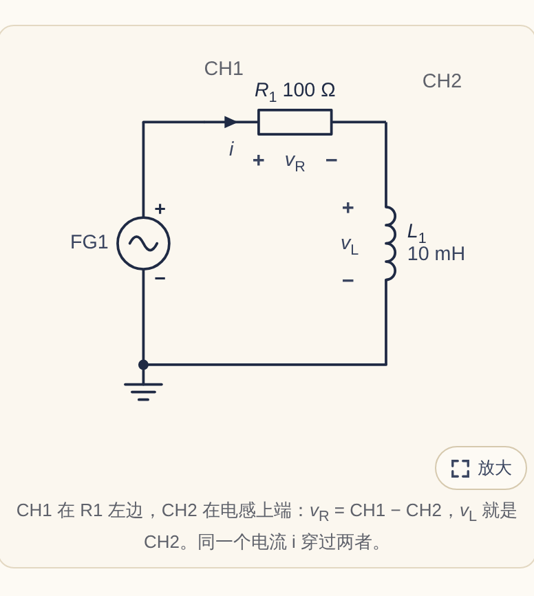

# 4.4 · RL 电路：电感电压的尖峰，电流的斜坡

| 项目 | 内容 |
|---|---|
| id | `exp3-rl-square` |
| 文件 | `challenges/243-rl-square.json` |
| 类型 | 实验 / 挑战（没有分步，照目标电路图搭） · 难度 3/5 |
| 位置 | World 4 · 储能元件与一阶 / 二阶暂态 → 4.4 电感的脾气（本节第 1 项） |
| 右侧面板 | 轨道由旧的四张卡片自动生成（还没手工精排） |
| 前后 | 上一项 [4.3 exp3-opamp-integrator](../w4/4.03-2-exp3-opamp-integrator.md) · 下一项 [4.5 exp3-rlc-ringing](../w4/4.05-1-exp3-rlc-ringing.md) |
| 先修 | lesson-scope-two-channels |
| 概念 | inductor 电感、v_L = L·di/dt、τ = L/R、continuity of inductor current 电感电流不能突变、current via a resistor 用电阻电压看电流 |

**一句话概要**：方波驱动 100 Ω + 10 mH：电感两端是一跳一衰减的尖峰，电阻电压（= 电流 × R）是慢慢爬升的斜坡。

## 1. 左侧工作台（3D 面包板 → 2D 俯视截图）

截图是程序里真实的 3D 面包板换成俯视角拍的；表格是同一块板的文字版（元件、参数、每只脚插在哪个孔）。

### 1.1 起点：打开这一课时板上已经有的

右侧显示的「起点」说明：

> **半成品**：信号发生器（已经设好波形）和两个示波器探头已经接好。**为什么**：仪器的接法第 12、13 课练过，这个实验要看的是电路本身的波形。**你要做**：加上 R1（100Ω，第 3 列 → 第 10 列）和 L1（10mH，第 10 列 → GND）。

| 元件 | 类型 | 参数 | 引脚 → 孔 |
|---|---|---|---|
| FG1 | function_gen | waveform=square, frequency=1000, amplitude=1, offset=0 | +→a3 -→tn3 |
| PR1 | scope_probe | channel=1 | tip→e3 gnd→tn20 |
| PR2 | scope_probe | channel=2 | tip→e10 gnd→tn21 |

### 1.3 参考答案（「看答案」载入的板子）

| 元件 | 类型 | 参数 | 引脚 → 孔 |
|---|---|---|---|
| FG1 | function_gen | waveform=square, frequency=1000, amplitude=1, offset=0 | +→a3 -→tn3 |
| R1 | resistor | resistance=100 | 1→b3 2→b10 |
| L1 | inductor | inductance=0.01 | 1→c10 2→tn10 |
| PR1 | scope_probe | channel=1 | tip→e3 gnd→tn20 |
| PR2 | scope_probe | channel=2 | tip→e10 gnd→tn21 |

### 1.4 目标原理图（右侧「目标原理图」抽屉）

| 元件 | 类型 | 参数 |
|---|---|---|
| FG1 | function_gen |  |
| R1 | resistor | resistance=100 |
| L1 | inductor | inductance=0.01 |

连接（每个结点上的引脚）：

- **VIN**：FG1.+、R1.1
- **VL**：R1.2、L1.1
- **GND**：L1.2、FG1.-

## 2. 右侧面板：学生从上往下看到的内容（单轨流）

### 第 1 步 · 🔍 先看一眼：先认识它：电感

**拆解「电感 Inductor：一卷导线，抗拒电流变化」第 1 / 8 层：① 外形：像电阻的色环电感、工字电感**

课程里的电感有两种常见外形：
- 色环电感 axial inductor：长得像一个胖电阻（常是绿色身体），也用色环标值，但单位是 **µH**：棕 黑 橙 = 10 × 10³ µH = **10 mH**（RL、RLC 实验用的就是这个值）。别把它当成电阻插错！用万用表一量就知道：电阻是 10 kΩ，电感只有几 Ω 到几十 Ω。
- 工字电感 drum-core inductor：一个“工”字形的黑色铁氧体磁芯，上面绕着一层层铜漆包线，两只脚朝下。

**inductance（电感）L** 的单位是亨利 H。常用 mH（10⁻³）、µH（10⁻⁶）。电感 **没有极性**，两只脚可以互换。

课程里会遇到的电感：

| 在哪 | L | 线圈电阻 | 用途 |
|---|---|---|---|
| RL / RLC 实验 | 10 mH | 仿真 1 Ω（真实 10–30 Ω） | 看 τ = L/R、振铃、相量 |
| 继电器线圈 | 150 mH | 70 Ω | 电磁铁吸合触点 |
| 直流电机 | 2 mH | 8 Ω | 线圈产生转矩 |

### 第 2 步 · 🔧 动手搭：把电容换成电感

- 板上已经放好信号发生器和两个探头。加上 **R1 `100 Ω`**（**`b3`** → **`b10`**）和**电感 L1 `10 mH`**（**`c10`** → GND 轨）。电感就是绕成一圈圈的导线。
- 信号发生器：方波、**`1 kHz`**、幅度 **`1 V`**、偏置 **`0 V`**（在 −1 V 和 +1 V 之间跳）。CH1 看输入，CH2 看电感上端。
CH2 是什么样子？和 3.4 里电容上的电压比，像还是不像？

### 第 3 步 · 💡 想明白：电感是一个沉重的飞轮

- 电容不让**电压**突变；电感不让**电流**突变。它像一个沉重的飞轮：转起来要时间，停下来也要时间。
- 方波一跳，电流来不及变，整个跳变只好全落在电感上：CH2 出现一个尖峰。之后电流慢慢跟上，电感上的电压也就消失了。
- 电感的电压和电流**变化的快慢**成正比。比如电流每毫秒变 1 mA：
$$v_L = L\frac{di}{dt} = 10 mH × \frac{1 mA}{1 ms}$$

*图 `rl`（plot）：v_L（电感）在每次跳变时冲到约 ±2 V 再衰减；v_R（电阻，形状和电流一样）在两次跳变之间按指数爬到新的值。*

- 电流看不见，就看电阻：电阻电压 v_R = i × R，形状和电流一模一样。它在 CH1 和 CH2 之间。

*图 `sch`（schematic）：CH1 在 R1 左边，CH2 在电感上端：v_R = CH1 − CH2，v_L 就是 CH2。同一个电流 i 穿过两者。*

（这一步下面列着这节课的计算卡片，点开就地展开：`rc-charging`、`rise-time`、`square-rc-vpp`、`rl-time-constant`、`flyback-spike`，全文见第 6 节）

### 第 4 步 · 🔧 动手搭：量电流的斜坡和电感的尖峰

- v_R 用两个通道相减：**CH1 − CH2**（示波器的 MATH 功能）。不要把接地夹夹到中间去。
- 读 v_R 的峰峰值和上升时间，再读 v_L 尖峰的最高值。
- 电流的时间常数是 τ = L / R总，R总 = 100 Ω + 50 Ω（信号发生器）+ 1 Ω（线圈）。
- 最后调到 **`10 kHz`**：半个周期比 τ 还短，v_R 变成什么样？

### 第 5 步 · 📏 测一测：测一测：读你自己的仪表

**测量题 1 · `urpp`**（读数题）

> 1 kHz：电阻电压 v_R（CH1 − CH2）的峰峰值

- 单位 V · 先写预测 · 状态：FG1 设为 信号发生器（方波 1kHz 幅度 1V） · 参考答案的读数 **1.323 V** · 合理范围 [1.26, 1.39]

答对后显示：

> 稳态电流 I = 1 V / 151 Ω ≈ 6.6 mA，v_R 在 ±0.66 V 之间，约 1.32 Vpp。

**测量题 2 · `ulmax`**（读数题）

> 1 kHz：CH2（电感电压 v_L）尖峰的最高值

- 单位 V · 先写预测 · 状态：FG1 设为 信号发生器（方波 1kHz 幅度 1V） · 参考答案的读数 **1.882 V** · 合理范围 [1.79, 1.98]

答对后显示：

> 跳变瞬间电流来不及变，2 V 的跳变几乎全落在电感上：理想值 1 + 150/151 ≈ 1.99 V；示波器每 3.9 µs 取一个点，读到约 1.9 V。

**测量题 3 · `tr`**（读数题）

> 1 kHz：v_R（也就是电流）从 10% 升到 90% 的上升时间 t_r

- 单位 µs · 状态：FG1 设为 信号发生器（方波 1kHz 幅度 1V） · 参考答案的读数 **145 µs** · 合理范围 [0.000138, 0.000152]

**测量题 4 · `tau`**（计算题（用自己的读数算））

> 由你的 t_r 算时间常数 τ = t_r / ln 9

- 单位 µs · 先写预测 · 参考答案的读数 **66.01 µs** · 合理范围 [0.0000627, 0.0000693] · 公式 `tr / ln(9)`

答对后显示：

> τ = L / R总 = 10 mH / (100 + 50 + 1) Ω ≈ 66 µs。

**测量题 5 · `urpp10`**（读数题）

> 调到 10 kHz：v_R 的峰峰值

- 单位 V · 先写预测 · 状态：FG1 设为 信号发生器（方波 10kHz 幅度 1V） · 参考答案的读数 **0.4775 V** · 合理范围 [0.454, 0.501]

答对后显示：

> 半个周期 50 µs < τ，电流只在中间来回爬：1.32 V × tanh(T / 4τ) ≈ 0.48 V。

### 第 6 步 · 🎒 带走：带走

- **电感电流不能突变**：v_L = L·di/dt。电流一变，电感就“顶”一个电压回去。
- **τ = L / R**：R 越大越快——和 RC 正好相反。
- **和 RC 对照**：电容电压连续、电流可以跳；电感电流连续、电压可以跳。
- **真实电路里**：突然切断电感电流，di/dt 极大，会冒出很高的反向电压，所以继电器线圈旁边要并一个续流二极管（5.4）。真实 10 mH 小电感的线圈电阻常有 10–30 Ω，比仿真的 1 Ω 大得多。

趁热练理论题：`first-order`

## 3. 测量题一览

| # | id | 题目 | 类型 | 单位 | 状态 | 参考读数 |
|---|---|---|---|---|---|---|
| 1 | urpp | 1 kHz：电阻电压 v_R（CH1 − CH2）的峰峰值 | scope | V | FG1 设为 信号发生器（方波 1kHz 幅度 1V） | 1.323 V |
| 2 | ulmax | 1 kHz：CH2（电感电压 v_L）尖峰的最高值 | scope | V | FG1 设为 信号发生器（方波 1kHz 幅度 1V） | 1.882 V |
| 3 | tr | 1 kHz：v_R（也就是电流）从 10% 升到 90% 的上升时间 t_r | scope | µs | FG1 设为 信号发生器（方波 1kHz 幅度 1V） | 145 µs |
| 4 | tau | 由你的 t_r 算时间常数 τ = t_r / ln 9 | formula | µs |  | 66.01 µs |
| 5 | urpp10 | 调到 10 kHz：v_R 的峰峰值 | scope | V | FG1 设为 信号发生器（方波 10kHz 幅度 1V） | 0.4775 V |

### 全部答完后显示的「对比」

**对比**：R总 = 100 + 50 + 1 = 151 Ω，τ = 10 mH / 151 Ω ≈ **66 µs**（上升时间 ≈ 2.2τ ≈ 146 µs）。
- 稳态电流 1 V / 151 Ω ≈ 6.6 mA。半个周期 0.5 ms ≈ 7.5τ，每次都走完：v_R 在 ±0.66 V 之间，约 **1.32 Vpp**。
- 跳变瞬间 2 V 几乎全落在电感上：v_L 理想值约 ±1.99 V，读到约 **1.9 V**，随后衰减到只剩线圈电阻上的几毫伏。
- **10 kHz**：半个周期 50 µs < τ，v_R 变成近似三角波，Vpp ≈ 1.32 × tanh(0.38) ≈ **0.48 V**；电感电压一直很大，因为电流一直在变。

### 提示按钮（依次显示）

1. R1 从第 3 列接到第 10 列；L1 从第 10 列接到 GND 轨。
2. v_R = CH1 − CH2；它除以 100 Ω 就是电流。
3. τ = L / R总，R总里要算上信号发生器的 50 Ω 和线圈的 1 Ω。

### 功能测试（「检查我的电路」时跑）

- 1 kHz：v_L 在跳变处有正负尖峰；v_R 每半个周期都走到稳态
- 10 kHz（半个周期 < τ）：电流来不及走完，v_R 变小

## 4. 用到的拆解（全部层的文字，供改写参考）

### 拆解 `inductor`：电感 Inductor：一卷导线，抗拒电流变化

*电感是电容的“对偶”：电容存电场能、电压不能跳；电感存磁场能、电流不能跳。拆开是绕在磁芯上的一卷铜线；由此推出 L = μN²A/l、v = L di/dt、W = ½LI²，再看关断时的高压尖峰、RL 的时间常数 τ = L/R 和感抗 2πfL。*

**拆解「电感 Inductor：一卷导线，抗拒电流变化」第 1 / 8 层：① 外形：像电阻的色环电感、工字电感**

课程里的电感有两种常见外形：
- 色环电感 axial inductor：长得像一个胖电阻（常是绿色身体），也用色环标值，但单位是 **µH**：棕 黑 橙 = 10 × 10³ µH = **10 mH**（RL、RLC 实验用的就是这个值）。别把它当成电阻插错！用万用表一量就知道：电阻是 10 kΩ，电感只有几 Ω 到几十 Ω。
- 工字电感 drum-core inductor：一个“工”字形的黑色铁氧体磁芯，上面绕着一层层铜漆包线，两只脚朝下。

**inductance（电感）L** 的单位是亨利 H。常用 mH（10⁻³）、µH（10⁻⁶）。电感 **没有极性**，两只脚可以互换。

课程里会遇到的电感：

| 在哪 | L | 线圈电阻 | 用途 |
|---|---|---|---|
| RL / RLC 实验 | 10 mH | 仿真 1 Ω（真实 10–30 Ω） | 看 τ = L/R、振铃、相量 |
| 继电器线圈 | 150 mH | 70 Ω | 电磁铁吸合触点 |
| 直流电机 | 2 mH | 8 Ω | 线圈产生转矩 |

**拆解「电感 Inductor：一卷导线，抗拒电流变化」第 2 / 8 层：② X 光：磁芯上绕着很多圈铜线**

把外皮变透明，两种电感里都只有两样东西：
1. 绕组 winding：一根很长的 **漆包铜线**（表面一层绝缘漆，所以一圈挨一圈也不会短路），绕了 N 圈。10 mH 的小电感有几百圈，线径只有 0.1 mm 左右——所以它的直流电阻并不小（10–30 Ω）。
2. 磁芯 core：一般是 **ferrite（铁氧体）**，一种铁的氧化物陶瓷。它的 **相对磁导率** $μ_r$ 有几百到几千：同样的电流，磁芯里的磁场比空气里强几百倍，于是同样的圈数电感大几百倍（下一层的公式）。

电感 **就是一段导线**：电流不变的时候，它对电流没有任何“阻碍”，只剩导线本身的电阻。它的全部本事都在 **电流变化** 的时候才显出来。

**拆解「电感 Inductor：一卷导线，抗拒电流变化」第 3 / 8 层：③ 电流产生磁场：L = NΦ/i = μN²A/l**

电流流过 线圈，会在线圈里面产生 **magnetic field（磁场）** B，方向由右手定则决定，磁力线 从线圈一端出来、绕回另一端。穿过线圈截面 A 的磁场总量叫 **magnetic flux（磁通）** Φ = B·A。

磁通和电流成正比；N 圈线圈每一圈都被同一个 Φ 穿过，总的 **flux linkage（磁链）** 是 NΦ。定义：
$$L = \frac{NΦ}{i}$$
对一个长螺线管，$B = \frac{μNi}{l}$，代入得
$$L = \frac{μN^{2}A}{l},   μ = μ_r μ_0,   μ_0 = 4π×10^{-7} H/m$$
- **N²**：圈数加倍，磁场加倍，被它穿过的圈数也加倍 → L × 4；
- 磁芯 的 $μ_r$：铁氧体让 L 大几百倍；
- 截面积 A 大、长度 l 短 → L 大。

**带数字**：N = 250，A = 20 mm²，l = 15 mm，有效 $μ_r ≈ 100$：
$$L = \frac{100 × 4π×10^{-7} × 250^{2} × 20×10^{-6}}{0.015} ≈ 10.5 mH$$
同样的线圈不加磁芯（$μ_r = 1$）只有约 0.1 mH。

- 公式 `L = \frac{NΦ}{i} = \frac{μ_r μ_0 N^{2} A}{l}`：L ∝ N²：圈数翻倍，电感 ×4

**拆解「电感 Inductor：一卷导线，抗拒电流变化」第 4 / 8 层：④ v = L di/dt：电压只看电流变化得多快**

**Faraday’s law（法拉第电磁感应定律）**：线圈里的磁链变化时，线圈两端感应出电压 $v = \frac{d(NΦ)}{dt}$。代入 $NΦ = Li$：
$$v = L\frac{di}{dt}$$
（关联参考方向）。感应电压的方向总是 **阻碍电流的变化**（**Lenz’s law 楞次定律**）：电流要增大，它就“顶”回去；电流要减小，它就“推”着电流继续走。

和电容 $i = C\frac{dv}{dt}$ 一一对应（**duality 对偶**：v ↔ i，C ↔ L）：
1. 电流不变 → 电压为 0。直流稳态下理想电感就是 **短路**（一根导线）。
2. 电流匀速上升 → 电压恒定：10 mH 在 1 ms 内从 0 升到 10 mA，$v = 10 mH × \frac{10 mA}{1 ms} = 0.1 V$。在 0.1 ms 内降回 0，电压是 −1 V——变化快 10 倍，电压大 10 倍。
3. **电感电流不能跳变**：$i_L(0^+) = i_L(0^-)$。要在 0 秒内改变电流，需要无穷大的电压。

**储存的能量**：$p = vi = Li\frac{di}{dt}$，从 0 到 I 积分：
$$W = \frac{1}{2}LI^{2}$$
- 10 mH、10 mA：$\frac{1}{2} × 0.01 × 10^{-4} = 0.5 µJ$；
- 继电器线圈 150 mH、71 mA：$\frac{1}{2} × 0.15 × 0.071^{2} ≈ 0.38 mJ$——关断时这些能量必须有地方去（下一层）。

|  | 电容 C | 电感 L |
|---|---|---|
| 基本关系 | $i = C\frac{dv}{dt}$ | $v = L\frac{di}{dt}$ |
| 不能跳变的量 | 电压 $v_C$ | 电流 $i_L$ |
| 直流稳态 | 断路 | 短路 |
| 储能 | $\frac{1}{2}CV^{2}$（电场） | $\frac{1}{2}LI^{2}$（磁场） |
| 时间常数 | τ = RC | τ = L/R |

- 公式 `v = L\frac{di}{dt}`：直流稳态：di/dt = 0 → v = 0（短路）
- 公式 `W = \frac{1}{2}LI^{2}`：150 mH、71 mA：0.38 mJ

**拆解「电感 Inductor：一卷导线，抗拒电流变化」第 5 / 8 层：⑤ 电流不能跳 → 断开电感会产生高压**

继电器实验（exp5-relay-flyback）：+5 V → 继电器线圈 150 mH + 70 Ω → 三极管（开关） → GND。导通时线圈电流 $I = \frac{5}{70} ≈ 71 mA$。

现在开关在约 1 µs 内断开。电感说：“我的电流不能跳。”可是电流已经无路可走——于是 $\frac{di}{dt}$ 非常大，按 $v = L\frac{di}{dt}$：
$$v ≈ 0.15 H × \frac{0.071 A}{1 µs} ≈ 10 000 V$$
这当然达不到——电压会一直升高，直到 **某个东西被击穿、给电流开出一条路**：三极管 C–E 击穿（约 40 V）、开关触点间拉出电弧……仿真里 集电极 的尖峰约 29 V（受仿真步长和三极管关断过程限制），真实电路可能更高。这就是线圈驱动电路里三极管莫名其妙烧掉的原因，也是汽车点火线圈产生上万伏高压的原理。

**解决**：并一个 续流二极管（阴极接 +5 V）。开关断开时，电流改走“线圈 → 二极管 → 线圈”这个小回路，集电极电压被钳在 $5 + 0.7 = 5.7 V$；0.38 mJ 的能量按 $τ = \frac{L}{R} = \frac{150 mH}{70 Ω} ≈ 2.1 ms$ 慢慢消耗在线圈电阻和二极管上。（二极管拆解的第 ⑦ 层有详细说明。）

- 公式 `v = L\frac{di}{dt} ≈ 0.15 × \frac{0.071}{10^{-6}} ≈ 10 kV`：理论值：说明必须给电流留一条路
- 公式 `V_{clamp} = 5 V + 0.7 V = 5.7 V`：有续流二极管时

**拆解「电感 Inductor：一卷导线，抗拒电流变化」第 6 / 8 层：⑥ RL 阶跃：电流按 τ = L/R 慢慢跟上**

RL 方波实验（exp3-rl-square）：信号发生器（50 Ω）→ 100 Ω → 10 mH（线圈电阻 1 Ω） → GND，方波 ±1 V，每次跳 2 V。

**推导**（和 RC 完全对偶）：
1. KVL：$V = R_{tot} i + L\frac{di}{dt}$，$R_{tot} = 100 + 50 + 1 = 151 Ω$；
2. 一阶线性微分方程，时间常数
$$τ = \frac{L}{R_{tot}} = \frac{10 mH}{151 Ω} ≈ 66 µs$$
3. 终值 $I_∞ = \frac{V}{R_{tot}} = \frac{1 V}{151 Ω} ≈ 6.6 mA$。方波从 −1 V 跳到 +1 V：电流从 −6.6 mA 出发，连续地 走向 +6.6 mA：
$$i(t) = I_∞ + (i(0) - I_∞)e^{-t/τ}$$
4. 电感电压 在跳变瞬间跳到约 2 V：因为电流不能跳，电阻上的电压也不能跳，2 V 的跳变全部落在电感上；然后按 $e^{-t/τ}$ 衰减到 0（剩下 1 Ω × 6.6 mA ≈ 7 mV）。

**和 RC 对比**：RC 中电容 **电压** 连续、电流可以跳；RL 中电感 **电流** 连续、电压可以跳。

**带数字**：1 kHz 方波半周期 0.5 ms ≈ 7.6τ，电流每次都走完全程；10 kHz 半周期 50 µs ≈ 0.76τ，电流只走到一半就反向，波形变成三角波。

- 公式 `τ = \frac{L}{R_{tot}} = \frac{10 mH}{151 Ω} ≈ 66 µs`：$R_tot$ 要算上信号发生器 50 Ω 和线圈 1 Ω
- 公式 `i(t) = I_∞ + (i(0) - I_∞)e^{-t/τ}`：三要素法

**拆解「电感 Inductor：一卷导线，抗拒电流变化」第 7 / 8 层：⑦ 频率：直流短路，高频断路**

通正弦电流 $i = I_m sin ωt$，代入 $v = L\frac{di}{dt}$：
$$v = ωLI_m cos ωt$$
- 电压幅值 / 电流幅值 = ωL，这就是 **inductive reactance（感抗）**：
$$X_L = ωL = 2πfL$$
- 电感的 **电流落后电压 90°**（和电容相反）。相量：$Z_L = jωL$。

感抗和频率成正比。对 10 mH：
- 160 Hz：10 Ω；1.6 kHz：100 Ω；16 kHz：1 kΩ；
- 直流：$X_L = 0$，只剩线圈电阻——**短路**；
- 高频：$X_L$ 很大，接近 **断路**。所以电感用来 **通直流、阻交流**：电源滤波、扼流圈（choke）。

RL 相量实验（exp4-rl-phasors）选 1.6 kHz 正是因为这时 $X_L ≈ 100 Ω = R$：总阻抗 $Z = (R + r) + jωL ≈ 101 + j100.5 Ω$，电流落后电压约 45°，$V_R$ 和 $V_L$ 大小差不多。低于约 1 Ω / (2π × 10 mH) ≈ 16 Hz 时，线圈电阻比感抗还大，电感就“看起来像电阻”了。

| f | $X_L$（10 mH） | 相当于 |
|---|---|---|
| 0（直流） | 0（剩 1 Ω 线圈电阻） | 短路 |
| 160 Hz | 10 Ω | 小电阻 |
| 1.6 kHz | 100 Ω | = R：RL 相量实验 |
| 16 kHz | 1 kΩ | 大阻抗 |

- 公式 `X_L = 2πfL`：电流落后电压 90°；$Z_L$ = jωL

**拆解「电感 Inductor：一卷导线，抗拒电流变化」第 8 / 8 层：⑧ 真实电感：线圈电阻、饱和、自谐振**

真实电感 = 理想 L + 几个寄生效应：
- 线圈电阻 $R_w$：几百圈细铜线，真实 10 mH 小电感有 10–30 Ω（**仿真器只算 1 Ω**）。它串在回路里：RL 实验的 $τ = \frac{L}{R}$ 变小、稳态电流变小；RLC 实验的衰减更快；相量实验里电流落后的角度变小。只有直流电源时，仿真器把电感当成 1 Ω 的导线。
- 磁芯饱和 saturation：电流超过 $I_{sat}$ 后，磁芯里的磁畴全部排好了队，$μ_r$ 迅速下降，L 也跟着骤降——电流会突然涨得很快。选电感时除了 L 还要看 **饱和电流** 和 **额定电流**（发热）。
- 匝间电容 $C_p$：相邻两圈导线之间有几 pF 到几十 pF。它和 L 组成并联谐振，频率高于 自谐振频率 $f_{SRF} = \frac{1}{2π\sqrt{LC_p}}$ 时电感反而像电容。10 mH、20 pF：约 360 kHz。
- 磁芯损耗：铁氧体在高频有磁滞和涡流损耗，相当于又多一个随频率增大的电阻。

**仿真器里**：电感是 L 串 1 Ω，没有饱和、匝间电容和磁芯损耗。时域仿真的步长有限，太快的 LC 振荡（每个周期不到 10 步）会被抹平，诊断面板会提示。

| 参数 | 真实 10 mH 小电感 | 仿真器 |
|---|---|---|
| 线圈电阻 | 10–30 Ω | 1 Ω |
| 饱和电流 | 几十 mA | 不饱和 |
| 匝间电容 / 自谐振 | ≈ 20 pF / ≈ 360 kHz | 无 |
| 误差 | ±10% | 0 |

- 公式 `f_{SRF} = \frac{1}{2π\sqrt{L C_p}}`：10 mH、20 pF：≈ 356 kHz

**一句话记住**：电感 = 磁芯上的一卷导线：$L = \frac{μN^{2}A}{l}$。它的全部行为是 $v = L\frac{di}{dt}$：电流不能跳变，直流稳态短路，储能 $\frac{1}{2}LI^{2}$；突然断开会产生高压尖峰，所以线圈要并续流二极管；RL 电路 $τ = \frac{L}{R}$；交流下 $X_L = 2πfL$，频率越高越像断路。真实电感有线圈电阻（仿真 1 Ω，真实 10–30 Ω）、会饱和。

## 5. 这一课的计算卡片

**计算卡片 `rc-charging`：一阶电路的三要素法**

- 公式 `v(t) = v(∞) + [v(0_+) - v(∞)] e^{-t/τ}`
- 用途：任何一阶电路的任何电压 / 电流：知道初值、终值、τ，算出任意时刻的值。
- 输入：v_0（初值 v(0+)，V）；v_∞（终值 v(∞)，V）；τ（时间常数，s）；t（经过的时间，s） → v(t)（这一时刻的值，V）

1. 一阶电路里任何量 x 都满足 $τ\frac{dx}{dt} + x = x(∞)$，解就是“从初值指数地走向终值”。
2. **初值 v(0+)**：电容电压、电感电流不能突变，等于开关动作前一刻的值（方波：上半个周期结束时的值）。
3. **终值 v(∞)**：直流稳态，电容当 **开路**、电感当 **短路** 算出来。
4. **时间常数**：$τ = R_{eq}C$ 或 $τ = \frac{L}{R_{eq}}$，$R_eq$ 是从储能元件两端看进去的电阻。
5. 代进公式。反过来求“到某个值要多久”：$t = τ ln\frac{v(0_+) - v(∞)}{v(t) - v(∞)}$。

例子：- 实验 3-1 充电 1τ：$5 + (0 - 5)e^{-1} ≈ 3.16 V$（走完 63 %）。500 Hz 稳态放电：从 3.65 V 走向 0，1 ms 后 $3.65e^{-1} ≈ 1.34 V$。
- 实验 3-7：终值不是 5 V 而是 $5 × \frac{10}{20.05} ≈ 2.49 V$，τ ≈ 0.50 ms。
- 实验 5-14：占空比一变，VDAC 走向新值，4.6τ ≈ 46 ms 后误差小于 1 %。

- ⚠ 只有电容电压和电感电流连续；电阻电压、电容电流在 0+ 时刻可以跳变（微分电路的尖峰就是这样来的）。
- ⚠ 终值要用“电容开路”的电路算，别直接写电源电压。

**计算卡片 `rise-time`：上升时间 10 %→90 % = τ·ln 9**

- 公式 `t_r = τ ln 9 ≈ 2.2 τ`
- 用途：示波器量到的上升时间 tᵣ 反推时间常数 τ（或反过来）。
- 输入：t_r（10 %→90 % 上升时间，s） → τ（时间常数，s）

1. 从 0 充向终值：$\frac{v}{v(∞)} = 1 - e^{-t/τ}$。
2. 到 10 % 的时刻：$t_1 = τ ln\frac{1}{0.9}$；到 90 %：$t_2 = τ ln 10$。
3. 相减：$t_r = t_2 - t_1 = τ ln 9 ≈ 2.197τ$。
4. 所以 $τ = \frac{t_r}{ln 9}$——不用知道终值，也不用从 0 开始量。
5. I²C 规范的 $t_r$ 是 30 %→70 %：$τ ln\frac{7}{3} ≈ 0.847τ$。

例子：实验 3-1（50 Hz）：$t_r ≈ 2.2 ms$ → τ ≈ 1.0 ms。实验 3-3：电流（$v_R$）的 $t_r ≈ 146 µs$ → τ ≈ 66 µs = 10 mH / 151 Ω。实验 5-16：2.2 kΩ + 200 pF 的 $t_r ≈ 0.97 µs$。

- ⚠ 半个周期里没走完（τ 和半周期差不多）时，示波器按实际摆幅算 10 %/90 %，结果会比 2.2τ 小。

**计算卡片 `square-rc-vpp`：方波下的稳态摆幅 ΔV·tanh(T/4τ)**

- 公式 `V_{pp} = ΔV tanh\frac{T}{4τ}`
- 用途：方波反复充放电，一阶电路稳态时来回摆多大（RC 电容电压、RL 电流、PWM 纹波）。
- 输入：ΔV（方波每次跳变的高度，V）；f（方波频率，Hz）；τ（时间常数，s） → V_pp（稳态峰峰值，V）

1. 稳态时电容在 $V_L$ 和 $V_H$ 之间来回（50 % 占空比，以 0 和 ΔV 为例）。
2. 充电半周期：$V_H = ΔV - (ΔV - V_L)e^{-T/(2τ)}$。
3. 放电半周期：$V_L = V_He^{-T/(2τ)}$。
4. 两式联立：$V_H - V_L = ΔV\frac{1 - e^{-T/2τ}}{1 + e^{-T/2τ}} = ΔV tanh\frac{T}{4τ}$。
5. 两头：$T ≫ τ$ 时 tanh → 1，摆满 ΔV；$T ≪ τ$ 时 $tanh x ≈ x$，摆幅 ≈ $\frac{ΔV T}{4τ}$，波形变成三角波（积分）。

例子：- 实验 3-1：500 Hz、τ ≈ 1 ms：$5 tanh(0.5) ≈ 2.3 V$；5 kHz：≈ 0.25 V 三角波。
- 实验 3-2：积分支路 τ = 10 ms、500 Hz：$5 tanh(0.05) ≈ 0.25 V$。
- 实验 3-3：电阻电压的满幅 1.32 V，10 kHz：$1.32 tanh(0.38) ≈ 0.48 V$。
- 实验 5-14：100 Hz、τ = 10 ms、3.3 V：$3.3 tanh(0.25) ≈ 0.81 V$。

- ⚠ ΔV 是一次跳变的高度：±2.5 V 的方波跳 5 V，不是 2.5 V。
- ⚠ 只适用于 50 % 占空比；其它占空比的 PWM 纹波见“PWM + RC 的纹波”。

**计算卡片 `rl-time-constant`：RL 时间常数 τ = L/R**

- 公式 `τ = \frac{L}{R}`
- 用途：电感电流建立 / 衰减有多快；R 是回路里所有电阻之和。
- 输入：L（电感，H）；R（回路总电阻（含 50 Ω、线圈电阻），Ω） → τ（时间常数，s）

1. 电感：$v_L = L\frac{di}{dt}$，**电流不能突变**（电压可以）。
2. KVL：$V_s = Ri + L\frac{di}{dt}$，和 RC 是同一类方程，$τ = \frac{L}{R}$（H / Ω = s）。
3. 稳态电流 $\frac{V_s}{R}$（电感当短路），从初值指数地走过去。
4. 和 RC 相反：**R 越大，τ 越小**（电流的“终点”变小了，走得更快）。
5. 跳变瞬间电流来不及变，整个跳变电压都落在电感上，然后按 τ 衰减。

例子：- 实验 3-3：$\frac{10 mH}{100 + 50 + 1} ≈ 66 µs$；稳态电流 $\frac{1 V}{151 Ω} ≈ 6.6 mA$。
- 实验 5-15：电机 $\frac{2 mH}{8 Ω} = 0.25 ms$：20 kHz 的 50 µs 周期 ≪ τ，电流几乎是平的。
- 实验 5-9：继电器线圈 $\frac{150 mH}{70 Ω} ≈ 2.1 ms$。

- ⚠ 忘了线圈自己的电阻：真实的小 10 mH 电感常有 10–30 Ω。
- ⚠ 把 RC 的习惯套过来写成 τ = LR。

**计算卡片 `flyback-spike`：电感断电的反冲 v = L·di/dt**

- 公式 `v = L \frac{di}{dt} ≈ L \frac{I}{Δt}`
- 用途：突然切断线圈的电流会产生多高的电压——以及为什么要并续流二极管。
- 输入：L（线圈电感，H）；I（断开前的电流，A）；Δt（开关断开用的时间，s） → v（“想要”的反冲电压，V）

1. 电感电流不能突变：三极管 / MOSFET 断开时，线圈“想”让电流按原方向继续流。
2. 没有路可走，$\frac{di}{dt}$ 极大，$v = L\frac{di}{dt}$ 就极高：集电极（漏极）冲到电源电压以上几十伏，直到三极管击穿或空气放电。
3. **续流二极管**反向并在线圈上：导通时它反偏不起作用；断开时集电极一超过 $V_s + 0.7 V$，它就导通，把电压钳住。
4. 电流改走“线圈 → 二极管 → 线圈”这个小回路，按 $τ = \frac{L}{R}$ 衰减，能量变成线圈电阻和二极管里的热。

例子：实验 5-9：150 mH、63 mA，如果 1 µs 内断开，“需要” $\frac{0.15 × 0.063}{10^{-6}} ≈ 9.5 kV$——实际在三极管 C–E 击穿（约 40 V）时就停住了（模拟器约 29 V）。并上 D1 后集电极最高只有 $4.65 + 0.7 ≈ 5.4 V$，电流按 $\frac{150 mH}{70 Ω} ≈ 2 ms$ 衰减。实验 5-8：电机漏极被钳在 $5 + 1.1 ≈ 6.1 V$。

- ⚠ 二极管接反：导通时它把线圈短路，三极管直接对电源短路。条纹（阴极）朝电源正端。
- ⚠ PWM 驱动电机时 1N4007 太慢，用肖特基（1N5819、SS34）。

## 6. English（界面英文版的同一份内容）

展开英文

### Node 1 · 🔍 Look first：Meet it first: Inductor

**Teardown「The inductor: a coil of wire that resists change in current」layer 1 of 8：① Outside: resistor-like colour bands, and the drum core**

The inductors in this course come in two common shapes:
- axial (colour-band) inductor: looks like a fat resistor (often a green body) and uses colour bands too, but in **µH**: brown black orange = 10 × 10³ µH = **10 mH** (the value in the RL and RLC labs). Do not mistake it for a resistor! A multimeter tells at once: the resistor reads 10 kΩ, the inductor only a few to tens of ohms.
- drum-core inductor: a black ferrite core shaped like a spool, wound with layers of enamelled copper wire, legs pointing down.

**Inductance L** is measured in henries (H); mH (10⁻³) and µH (10⁻⁶) are common. An inductor has **no polarity**; the legs are interchangeable.

The inductors you will meet:

| Where | L | Winding R | Purpose |
|---|---|---|---|
| RL / RLC labs | 10 mH | sim 1 Ω (real 10–30 Ω) | τ = L/R, ringing, phasors |
| relay coil | 150 mH | 70 Ω | electromagnet pulls the contact |
| DC motor | 2 mH | 8 Ω | coils make torque |

### Node 2 · 🔧 Build：Swap the capacitor for an inductor

- The generator and two probes are already on the board. Add **R1 `100 Ω`** (**`b3`** → **`b10`**) and an **inductor L1 `10 mH`** (**`c10`** → the GND rail). An inductor is just wire wound into a coil.
- Generator: square, **`1 kHz`**, amplitude **`1 V`**, offset **`0 V`** (jumping between −1 V and +1 V). CH1 on the input, CH2 on the top of the inductor.
What does CH2 look like? Is it like the capacitor voltage in 3.4, or not?

### Node 3 · 💡 Why：An inductor is a heavy flywheel

- A capacitor won't let its **voltage** jump; an inductor won't let its **current** jump. It is like a heavy flywheel: it takes time to spin up and time to slow down.
- When the square wave steps, the current can't follow at once, so the whole step lands on the inductor: a spike on CH2. Then the current catches up and the inductor's voltage fades away.
- The inductor's voltage is proportional to **how fast its current changes**. For a current changing 1 mA per millisecond:
$$v_L = L\frac{di}{dt} = 10 mH × \frac{1 mA}{1 ms}$$

[figure `rl`]

*Figure `rl`（plot）：v_L（电感）在每次跳变时冲到约 ±2 V 再衰减；v_R（电阻，形状和电流一样）在两次跳变之间按指数爬到新的值。*

- You can't see current, so watch the resistor: v_R = i × R has exactly the current's shape. It sits between CH1 and CH2.

[figure `sch`]

*Figure `sch`（schematic）：CH1 在 R1 左边，CH2 在电感上端：v_R = CH1 − CH2，v_L 就是 CH2。同一个电流 i 穿过两者。*

(This node lists the lesson’s calculation cards: `rc-charging`、`rise-time`、`square-rc-vpp`、`rl-time-constant`、`flyback-spike`; full text in section 6)

### Node 4 · 🔧 Build：Measure the current's ramp and the inductor's spike

- Get v_R by subtracting the channels: **CH1 − CH2** (the scope's MATH function). Don't move a ground clip to the middle.
- Read v_R's peak-to-peak and rise time, then the top of v_L's spike.
- The current's time constant is τ = L / R_total, with R_total = 100 Ω + 50 Ω (generator) + 1 Ω (coil).
- Finally set **`10 kHz`**: half a period is shorter than τ. What does v_R look like now?

### Node 5 · 📏 Measure：Measure: read your own instruments

**Question 1 · `urpp`**（reading）

> 1 kHz: resistor voltage v_R (CH1 − CH2) peak-to-peak

- unit V · predict first · state：FG1 is set to Function generator (square 1kHz 1V peak) · range [1.26, 1.39]

Shown once right:

> Steady current I = 1 V / 151 Ω ≈ 6.6 mA, so v_R swings ±0.66 V, about 1.32 Vpp.

**Question 2 · `ulmax`**（reading）

> 1 kHz: the top of CH2's spike (inductor voltage v_L)

- unit V · predict first · state：FG1 is set to Function generator (square 1kHz 1V peak) · range [1.79, 1.98]

Shown once right:

> At the step the current can't change, so nearly the whole 2 V step lands on the inductor: ideally 1 + 150/151 ≈ 1.99 V; sampling every 3.9 µs the scope reads about 1.9 V.

**Question 3 · `tr`**（reading）

> 1 kHz: the rise time t_r of v_R (i.e. the current), 10 % to 90 %

- unit µs · state：FG1 is set to Function generator (square 1kHz 1V peak) · range [0.000138, 0.000152]

**Question 4 · `tau`**（calculation from own readings）

> From your t_r, the time constant τ = t_r / ln 9

- unit µs · predict first · range [0.0000627, 0.0000693] · formula `tr / ln(9)`

Shown once right:

> τ = L / R_total = 10 mH / (100 + 50 + 1) Ω ≈ 66 µs.

**Question 5 · `urpp10`**（reading）

> At 10 kHz: v_R's peak-to-peak

- unit V · predict first · state：FG1 is set to Function generator (square 10kHz 1V peak) · range [0.454, 0.501]

Shown once right:

> Half a period, 50 µs, < τ: the current only crawls back and forth in the middle: 1.32 V × tanh(T / 4τ) ≈ 0.48 V.

### Node 6 · 🎒 Take away：Take away

- **Inductor current can't jump**: v_L = L·di/dt. Change the current and the inductor pushes back with a voltage.
- **τ = L / R**: the larger R, the faster — the opposite of RC.
- **Next to RC**: a capacitor's voltage is continuous and its current may jump; an inductor's current is continuous and its voltage may jump.
- **In a real circuit**: break an inductor's current suddenly and di/dt is huge, so a high reverse voltage appears — that is why a relay coil gets a flyback diode (5.4). A real small 10 mH inductor often has 10–30 Ω of winding resistance, far more than the simulated 1 Ω.

Practise：`first-order`

**Compare**

**Compare**: R_total = 100 + 50 + 1 = 151 Ω, τ = 10 mH / 151 Ω ≈ **66 µs** (rise time ≈ 2.2τ ≈ 146 µs).
- Steady current 1 V / 151 Ω ≈ 6.6 mA. Half a period, 0.5 ms, ≈ 7.5τ, so it settles every time: v_R between ±0.66 V, about **1.32 Vpp**.
- At each step nearly all of the 2 V lands on the inductor: v_L ideally ±1.99 V, read as about **1.9 V**, then decaying to a few millivolts across the coil resistance.
- **10 kHz**: half a period, 50 µs, < τ; v_R becomes nearly a triangle, Vpp ≈ 1.32 × tanh(0.38) ≈ **0.48 V**; the inductor voltage stays large because the current never stops changing.

**Hints**

1. R1 from column 3 to column 10; L1 from column 10 to the GND rail.
2. v_R = CH1 − CH2; divided by 100 Ω it is the current.
3. τ = L / R_total, and R_total includes the generator's 50 Ω and the coil's 1 Ω.

