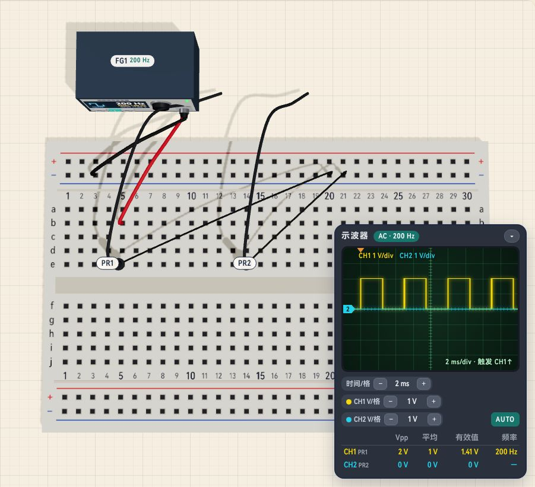
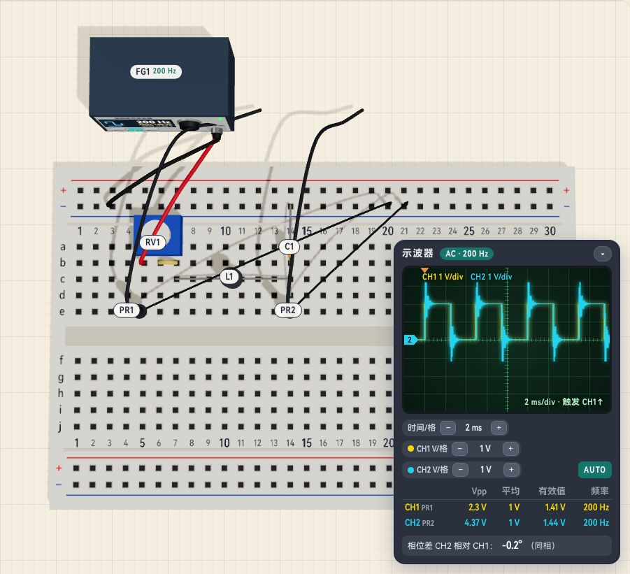
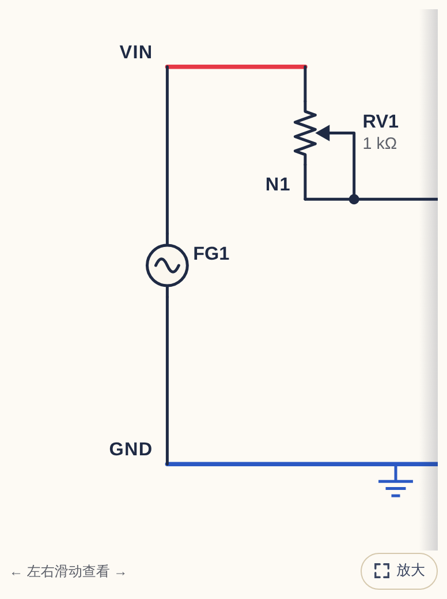
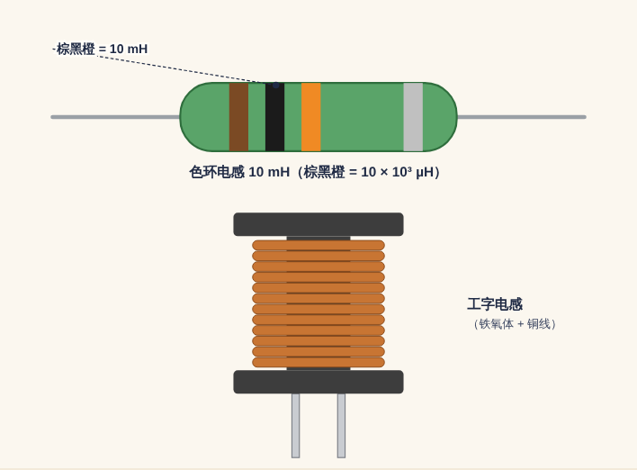
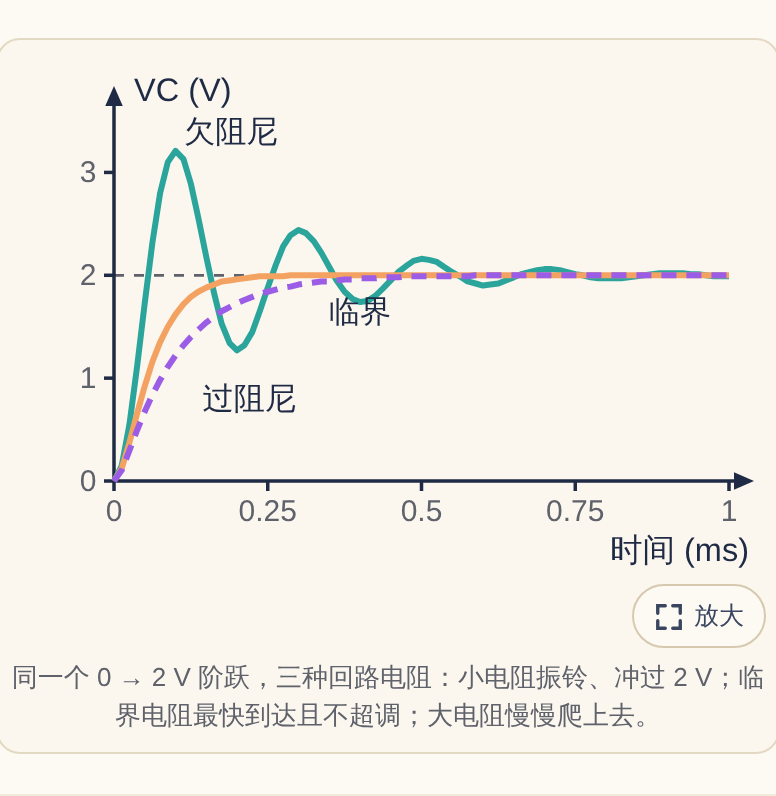
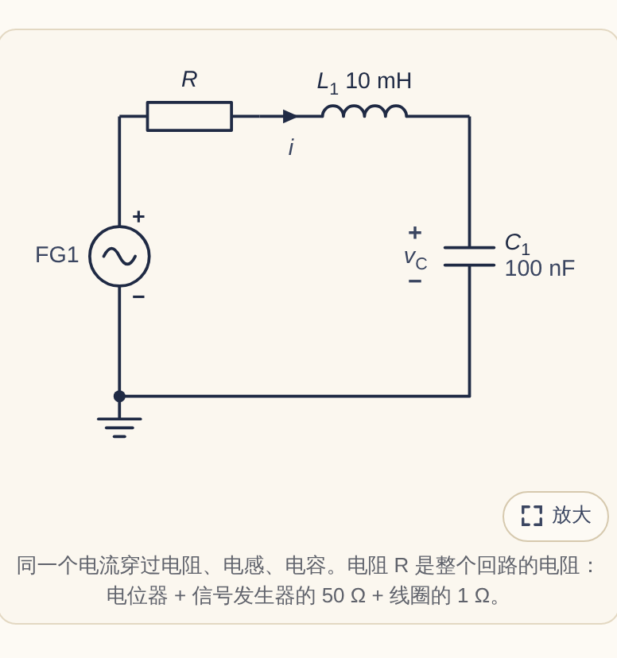

# 4.5 · RLC 振铃：欠阻尼、临界阻尼、过阻尼

| 项目 | 内容 |
|---|---|
| id | `exp3-rlc-ringing` |
| 文件 | `challenges/244-rlc-ringing.json` |
| 类型 | 实验 / 挑战（没有分步，照目标电路图搭） · 难度 4/5 |
| 位置 | World 4 · 储能元件与一阶 / 二阶暂态 → 4.5 二阶 RLC：振铃与阶跃响应（本节第 1 项） |
| 右侧面板 | 轨道由旧的四张卡片自动生成（还没手工精排） |
| 前后 | 上一项 [4.4 exp3-rl-square](../w4/4.04-1-exp3-rl-square.md) · 下一项 [4.5 exp3-rlc-step-response](../w4/4.05-2-exp3-rlc-step-response.md) |
| 先修 | lesson-scope-two-channels |
| 概念 | second-order circuit 二阶电路、f0 = 1/(2π√(LC)) 固有频率、damping 阻尼、critical resistance 2√(L/C) 临界电阻、overshoot 超调 |

**一句话概要**：方波给 RLC 串联电路一次次加阶跃；转动电位器改变电阻，看电容电压从“叮——”地振荡到平稳上升。

## 1. 左侧工作台（3D 面包板 → 2D 俯视截图）

截图是程序里真实的 3D 面包板换成俯视角拍的；表格是同一块板的文字版（元件、参数、每只脚插在哪个孔）。

### 1.1 起点：打开这一课时板上已经有的

右侧显示的「起点」说明：

> **半成品**：信号发生器（已经设好波形）和两个示波器探头已经接好。**为什么**：仪器的接法第 12、13 课练过，这个实验要看的是电路本身的波形。**你要做**：搭 RLC 串联：电位器（当可变电阻，滑动端和一端短接）→ L1（10mH）→ C1（100nF）→ GND，CH2 看电容。

| 元件 | 类型 | 参数 | 引脚 → 孔 |
|---|---|---|---|
| FG1 | function_gen | waveform=square, frequency=200, amplitude=1, offset=1 | +→b5 -→tn3 |
| PR1 | scope_probe | channel=1 | tip→e5 gnd→tn20 |
| PR2 | scope_probe | channel=2 | tip→e14 gnd→tn21 |

### 1.3 参考答案（「看答案」载入的板子）

| 元件 | 类型 | 参数 | 引脚 → 孔 |
|---|---|---|---|
| FG1 | function_gen | waveform=square, frequency=200, amplitude=1, offset=1 | +→b5 -→tn3 |
| RV1 | potentiometer | resistance=1000, wiper=0.05 | 1→a5 2→a6 3→a7 |
| W3 | wire |  | a→b6 b→b7 |
| L1 | inductor | inductance=0.01 | 1→c7 2→c14 |
| C1 | capacitor | capacitance=1.0000000000000001e-7 | 1→d14 2→tn14 |
| PR1 | scope_probe | channel=1 | tip→e5 gnd→tn20 |
| PR2 | scope_probe | channel=2 | tip→e14 gnd→tn21 |

### 1.4 目标原理图（右侧「目标原理图」抽屉）

| 元件 | 类型 | 参数 |
|---|---|---|
| FG1 | function_gen |  |
| RV1 | potentiometer | resistance=1000 |
| L1 | inductor | inductance=0.01 |
| C1 | capacitor | capacitance=1.0000000000000001e-7 |

连接（每个结点上的引脚）：

- **VIN**：FG1.+、RV1.1
- **N1**：RV1.2、RV1.3、L1.1
- **VC**：L1.2、C1.1
- **GND**：C1.2、FG1.-

## 2. 右侧面板：学生从上往下看到的内容（单轨流）

### 第 1 步 · 🔍 先看一眼：先认识它：电感

**拆解「电感 Inductor：一卷导线，抗拒电流变化」第 1 / 8 层：① 外形：像电阻的色环电感、工字电感**

课程里的电感有两种常见外形：
- 色环电感 axial inductor：长得像一个胖电阻（常是绿色身体），也用色环标值，但单位是 **µH**：棕 黑 橙 = 10 × 10³ µH = **10 mH**（RL、RLC 实验用的就是这个值）。别把它当成电阻插错！用万用表一量就知道：电阻是 10 kΩ，电感只有几 Ω 到几十 Ω。
- 工字电感 drum-core inductor：一个“工”字形的黑色铁氧体磁芯，上面绕着一层层铜漆包线，两只脚朝下。

**inductance（电感）L** 的单位是亨利 H。常用 mH（10⁻³）、µH（10⁻⁶）。电感 **没有极性**，两只脚可以互换。

课程里会遇到的电感：

| 在哪 | L | 线圈电阻 | 用途 |
|---|---|---|---|
| RL / RLC 实验 | 10 mH | 仿真 1 Ω（真实 10–30 Ω） | 看 τ = L/R、振铃、相量 |
| 继电器线圈 | 150 mH | 70 Ω | 电磁铁吸合触点 |
| 直流电机 | 2 mH | 8 Ω | 线圈产生转矩 |

### 第 2 步 · 🔧 动手搭：一个阶跃，叮——

- 照目标电路搭：信号发生器 → 电位器 **RV1 `1 kΩ`**（当可变电阻用：1 脚接信号，2 脚和 3 脚连在一起）→ **L1 `10 mH`** → 结点 **VC** → **C1 `100 nF`** → GND。
- 信号发生器：方波、**`200 Hz`**、幅度 **`1 V`**、偏置 **`1 V`**（0 ↔ 2 V）。CH2 看 VC。
- 把电位器转到 **`5%`**。
每个边沿之后，VC 在干什么？再慢慢往大转，它怎么变？

### 第 3 步 · 💡 想明白：能量在电容和电感之间来回

- 电容把能量存成电压，电感把能量存成电流。电容放电，电流流进电感；电感不肯让电流停，又把电容充成反方向……能量就在两者之间来回，像弹簧上挂的重物。
- 来回一次的快慢只由 L 和 C 决定：
$$f_0 = \frac{1}{2π\sqrt{LC}} = \frac{1}{2π\sqrt{10 mH × 100 nF}}$$
- 电阻像空气阻力，每来回一次都吃掉一点能量。电阻小，振好多下才停（**欠阻尼**）；大到正好，一下也不振，最快地停在终点（**临界阻尼**）；再大，就慢吞吞地爬过去（**过阻尼**）。

*图 `three`（plot）：同一个 0 → 2 V 阶跃，三种回路电阻：小电阻振铃、冲过 2 V；临界电阻最快到达且不超调；大电阻慢慢爬上去。*

*图 `rlc`（schematic）：同一个电流穿过电阻、电感、电容。电阻 R 是整个回路的电阻：电位器 + 信号发生器的 50 Ω + 线圈的 1 Ω。*

（这一步下面列着这节课的计算卡片，点开就地展开：`vpp-amplitude`、`period-frequency`、`rlc-damping`、`rlc-overshoot`、`lc-resonance`，全文见第 6 节）

### 第 4 步 · 🔧 动手搭：读振荡，找临界点

- 电位器 **`5%`**：读 VC 振荡的频率（量相邻两个波峰的间隔 T_d，f = 1 / T_d）和第一个峰的最高电压。
- 转到 **`30%`** 再读一次最高电压：超调变小了多少？
- 慢慢往大转，找超调刚好消失的位置。那时回路电阻 ≈ 2√(L/C)，叫**临界电阻**；回路电阻 = 电位器 + 信号发生器 50 Ω + 线圈 1 Ω。

### 第 5 步 · 📏 测一测：测一测：读你自己的仪表

**测量题 1 · `fring`**（读数题）

> 电位器 5%：VC 振荡的频率（量相邻两个波峰的间隔 T_d，f = 1 / T_d）

- 单位 kHz · 先写预测 · 状态：FG1 设为 信号发生器（方波 200Hz 幅度 1V）、把 RV1 旋到 5% · 参考答案的读数 **4.921 kHz** · 合理范围 [4500, 5300]

答对后显示：

> 欠阻尼时振荡频率 f_d = f0·√(1 − ζ²)；这里阻尼很小，只比 f0 ≈ 5.03 kHz 低约 1%。

**测量题 2 · `peak`**（读数题）

> 电位器 5%：VC 的最高电压（第一个峰）

- 单位 V · 先写预测 · 状态：FG1 设为 信号发生器（方波 200Hz 幅度 1V）、把 RV1 旋到 5% · 参考答案的读数 **3.184 V** · 合理范围 [3.05, 3.35]

答对后显示：

> 超调约 60%，峰值 ≈ 2 + 2 × 0.6 ≈ 3.2 V：比信号的 2 V 还高。

**测量题 3 · `peak30`**（读数题）

> 电位器 30%：VC 的最高电压

- 单位 V · 先写预测 · 状态：FG1 设为 信号发生器（方波 200Hz 幅度 1V）、把 RV1 旋到 30% · 参考答案的读数 **2.249 V** · 合理范围 [2.15, 2.35]

答对后显示：

> 回路电阻约 351 Ω，阻尼大了不少：只剩约 12% 的超调，峰值 ≈ 2.25 V。

**测量题 4 · `crit`**（选择题）

> 慢慢转电位器：超调刚好消失（临界阻尼）大约在哪个位置？

- A. 约 60%：回路电阻 ≈ 2√(L/C) ≈ 632 Ω ✅（正确）
- B. 约 30%
- C. 只有转到 100% 才不超调

答对后显示：

> 30% 时还有约 12% 的超调；回路电阻 = 电位器 + 50 Ω + 1 Ω 达到 2√(L/C) ≈ 632 Ω（约 60%）时超调消失，再大就是过阻尼，只会更慢。

### 第 6 步 · 🎒 带走：带走

- **二阶电路**有两个储能元件，能量来回交换，所以会振荡。
- **f0 = 1 / (2π√(LC))** 定快慢；电阻定振几下才停。
- **三种样子**：欠阻尼（振铃、超调）、临界阻尼（最快、不超调）、过阻尼（慢慢爬）。
- **真实电路里**：电容电压可以冲得比电源还高，电源滤波里要当心这种振铃。真实小电感的线圈电阻有 10–30 Ω，振铃会衰减得更快。

趁热练理论题：`second-order`

## 3. 测量题一览

| # | id | 题目 | 类型 | 单位 | 状态 | 参考读数 |
|---|---|---|---|---|---|---|
| 1 | fring | 电位器 5%：VC 振荡的频率（量相邻两个波峰的间隔 T_d，f = 1 / T_d） | scope | kHz | FG1 设为 信号发生器（方波 200Hz 幅度 1V）、把 RV1 旋到 5% | 4.921 kHz |
| 2 | peak | 电位器 5%：VC 的最高电压（第一个峰） | scope | V | FG1 设为 信号发生器（方波 200Hz 幅度 1V）、把 RV1 旋到 5% | 3.184 V |
| 3 | peak30 | 电位器 30%：VC 的最高电压 | scope | V | FG1 设为 信号发生器（方波 200Hz 幅度 1V）、把 RV1 旋到 30% | 2.249 V |
| 4 | crit | 慢慢转电位器：超调刚好消失（临界阻尼）大约在哪个位置？ | 选择 |  |  | 正确：A |

### 全部答完后显示的「对比」

**对比**：f0 = 1 / (2π√(10 mH × 100 nF)) ≈ **5.03 kHz**；临界电阻 2√(10 mH / 100 nF) ≈ **632 Ω**。
- **5%**（回路约 101 Ω，ζ ≈ 0.16，欠阻尼）：振荡频率约 5 kHz，超调约 60%，峰值约 **3.2 V**；下降沿同样会冲到 0 V 以下，最低约 −1.2 V。
- **30%**（约 351 Ω，ζ ≈ 0.56）：超调约 12%，峰值约 **2.25 V**。
- **60%**（约 651 Ω，ζ ≈ 1.03，约等于临界阻尼）：不超调，最快地平稳到达 2 V。
- **100%**（约 1051 Ω，ζ ≈ 1.66，过阻尼）：也不超调，但上升明显更慢。
阻尼比 ζ = (R/2)·√(C/L)，R 是回路总电阻。

### 提示按钮（依次显示）

1. 电位器当可变电阻：1 脚接信号发生器，2 脚（滑动端）和 3 脚用一根线连起来，再接电感。
2. 电感和电容串联：VC 是它们中间那一点，电容另一端接 GND。
3. 临界电阻 2√(L/C)；回路电阻里要算上信号发生器的 50 Ω。

### 功能测试（「检查我的电路」时跑）

- 电位器 5%：强烈振铃
- 电位器 30%：小超调
- 电位器 60%（临界阻尼）：不超调
- 电位器 100%（过阻尼）：不超调

## 4. 用到的拆解（全部层的文字，供改写参考）

### 拆解 `inductor`：电感 Inductor：一卷导线，抗拒电流变化

*电感是电容的“对偶”：电容存电场能、电压不能跳；电感存磁场能、电流不能跳。拆开是绕在磁芯上的一卷铜线；由此推出 L = μN²A/l、v = L di/dt、W = ½LI²，再看关断时的高压尖峰、RL 的时间常数 τ = L/R 和感抗 2πfL。*

**拆解「电感 Inductor：一卷导线，抗拒电流变化」第 1 / 8 层：① 外形：像电阻的色环电感、工字电感**

课程里的电感有两种常见外形：
- 色环电感 axial inductor：长得像一个胖电阻（常是绿色身体），也用色环标值，但单位是 **µH**：棕 黑 橙 = 10 × 10³ µH = **10 mH**（RL、RLC 实验用的就是这个值）。别把它当成电阻插错！用万用表一量就知道：电阻是 10 kΩ，电感只有几 Ω 到几十 Ω。
- 工字电感 drum-core inductor：一个“工”字形的黑色铁氧体磁芯，上面绕着一层层铜漆包线，两只脚朝下。

**inductance（电感）L** 的单位是亨利 H。常用 mH（10⁻³）、µH（10⁻⁶）。电感 **没有极性**，两只脚可以互换。

课程里会遇到的电感：

| 在哪 | L | 线圈电阻 | 用途 |
|---|---|---|---|
| RL / RLC 实验 | 10 mH | 仿真 1 Ω（真实 10–30 Ω） | 看 τ = L/R、振铃、相量 |
| 继电器线圈 | 150 mH | 70 Ω | 电磁铁吸合触点 |
| 直流电机 | 2 mH | 8 Ω | 线圈产生转矩 |

**拆解「电感 Inductor：一卷导线，抗拒电流变化」第 2 / 8 层：② X 光：磁芯上绕着很多圈铜线**

把外皮变透明，两种电感里都只有两样东西：
1. 绕组 winding：一根很长的 **漆包铜线**（表面一层绝缘漆，所以一圈挨一圈也不会短路），绕了 N 圈。10 mH 的小电感有几百圈，线径只有 0.1 mm 左右——所以它的直流电阻并不小（10–30 Ω）。
2. 磁芯 core：一般是 **ferrite（铁氧体）**，一种铁的氧化物陶瓷。它的 **相对磁导率** $μ_r$ 有几百到几千：同样的电流，磁芯里的磁场比空气里强几百倍，于是同样的圈数电感大几百倍（下一层的公式）。

电感 **就是一段导线**：电流不变的时候，它对电流没有任何“阻碍”，只剩导线本身的电阻。它的全部本事都在 **电流变化** 的时候才显出来。

**拆解「电感 Inductor：一卷导线，抗拒电流变化」第 3 / 8 层：③ 电流产生磁场：L = NΦ/i = μN²A/l**

电流流过 线圈，会在线圈里面产生 **magnetic field（磁场）** B，方向由右手定则决定，磁力线 从线圈一端出来、绕回另一端。穿过线圈截面 A 的磁场总量叫 **magnetic flux（磁通）** Φ = B·A。

磁通和电流成正比；N 圈线圈每一圈都被同一个 Φ 穿过，总的 **flux linkage（磁链）** 是 NΦ。定义：
$$L = \frac{NΦ}{i}$$
对一个长螺线管，$B = \frac{μNi}{l}$，代入得
$$L = \frac{μN^{2}A}{l},   μ = μ_r μ_0,   μ_0 = 4π×10^{-7} H/m$$
- **N²**：圈数加倍，磁场加倍，被它穿过的圈数也加倍 → L × 4；
- 磁芯 的 $μ_r$：铁氧体让 L 大几百倍；
- 截面积 A 大、长度 l 短 → L 大。

**带数字**：N = 250，A = 20 mm²，l = 15 mm，有效 $μ_r ≈ 100$：
$$L = \frac{100 × 4π×10^{-7} × 250^{2} × 20×10^{-6}}{0.015} ≈ 10.5 mH$$
同样的线圈不加磁芯（$μ_r = 1$）只有约 0.1 mH。

- 公式 `L = \frac{NΦ}{i} = \frac{μ_r μ_0 N^{2} A}{l}`：L ∝ N²：圈数翻倍，电感 ×4

**拆解「电感 Inductor：一卷导线，抗拒电流变化」第 4 / 8 层：④ v = L di/dt：电压只看电流变化得多快**

**Faraday’s law（法拉第电磁感应定律）**：线圈里的磁链变化时，线圈两端感应出电压 $v = \frac{d(NΦ)}{dt}$。代入 $NΦ = Li$：
$$v = L\frac{di}{dt}$$
（关联参考方向）。感应电压的方向总是 **阻碍电流的变化**（**Lenz’s law 楞次定律**）：电流要增大，它就“顶”回去；电流要减小，它就“推”着电流继续走。

和电容 $i = C\frac{dv}{dt}$ 一一对应（**duality 对偶**：v ↔ i，C ↔ L）：
1. 电流不变 → 电压为 0。直流稳态下理想电感就是 **短路**（一根导线）。
2. 电流匀速上升 → 电压恒定：10 mH 在 1 ms 内从 0 升到 10 mA，$v = 10 mH × \frac{10 mA}{1 ms} = 0.1 V$。在 0.1 ms 内降回 0，电压是 −1 V——变化快 10 倍，电压大 10 倍。
3. **电感电流不能跳变**：$i_L(0^+) = i_L(0^-)$。要在 0 秒内改变电流，需要无穷大的电压。

**储存的能量**：$p = vi = Li\frac{di}{dt}$，从 0 到 I 积分：
$$W = \frac{1}{2}LI^{2}$$
- 10 mH、10 mA：$\frac{1}{2} × 0.01 × 10^{-4} = 0.5 µJ$；
- 继电器线圈 150 mH、71 mA：$\frac{1}{2} × 0.15 × 0.071^{2} ≈ 0.38 mJ$——关断时这些能量必须有地方去（下一层）。

|  | 电容 C | 电感 L |
|---|---|---|
| 基本关系 | $i = C\frac{dv}{dt}$ | $v = L\frac{di}{dt}$ |
| 不能跳变的量 | 电压 $v_C$ | 电流 $i_L$ |
| 直流稳态 | 断路 | 短路 |
| 储能 | $\frac{1}{2}CV^{2}$（电场） | $\frac{1}{2}LI^{2}$（磁场） |
| 时间常数 | τ = RC | τ = L/R |

- 公式 `v = L\frac{di}{dt}`：直流稳态：di/dt = 0 → v = 0（短路）
- 公式 `W = \frac{1}{2}LI^{2}`：150 mH、71 mA：0.38 mJ

**拆解「电感 Inductor：一卷导线，抗拒电流变化」第 5 / 8 层：⑤ 电流不能跳 → 断开电感会产生高压**

继电器实验（exp5-relay-flyback）：+5 V → 继电器线圈 150 mH + 70 Ω → 三极管（开关） → GND。导通时线圈电流 $I = \frac{5}{70} ≈ 71 mA$。

现在开关在约 1 µs 内断开。电感说：“我的电流不能跳。”可是电流已经无路可走——于是 $\frac{di}{dt}$ 非常大，按 $v = L\frac{di}{dt}$：
$$v ≈ 0.15 H × \frac{0.071 A}{1 µs} ≈ 10 000 V$$
这当然达不到——电压会一直升高，直到 **某个东西被击穿、给电流开出一条路**：三极管 C–E 击穿（约 40 V）、开关触点间拉出电弧……仿真里 集电极 的尖峰约 29 V（受仿真步长和三极管关断过程限制），真实电路可能更高。这就是线圈驱动电路里三极管莫名其妙烧掉的原因，也是汽车点火线圈产生上万伏高压的原理。

**解决**：并一个 续流二极管（阴极接 +5 V）。开关断开时，电流改走“线圈 → 二极管 → 线圈”这个小回路，集电极电压被钳在 $5 + 0.7 = 5.7 V$；0.38 mJ 的能量按 $τ = \frac{L}{R} = \frac{150 mH}{70 Ω} ≈ 2.1 ms$ 慢慢消耗在线圈电阻和二极管上。（二极管拆解的第 ⑦ 层有详细说明。）

- 公式 `v = L\frac{di}{dt} ≈ 0.15 × \frac{0.071}{10^{-6}} ≈ 10 kV`：理论值：说明必须给电流留一条路
- 公式 `V_{clamp} = 5 V + 0.7 V = 5.7 V`：有续流二极管时

**拆解「电感 Inductor：一卷导线，抗拒电流变化」第 6 / 8 层：⑥ RL 阶跃：电流按 τ = L/R 慢慢跟上**

RL 方波实验（exp3-rl-square）：信号发生器（50 Ω）→ 100 Ω → 10 mH（线圈电阻 1 Ω） → GND，方波 ±1 V，每次跳 2 V。

**推导**（和 RC 完全对偶）：
1. KVL：$V = R_{tot} i + L\frac{di}{dt}$，$R_{tot} = 100 + 50 + 1 = 151 Ω$；
2. 一阶线性微分方程，时间常数
$$τ = \frac{L}{R_{tot}} = \frac{10 mH}{151 Ω} ≈ 66 µs$$
3. 终值 $I_∞ = \frac{V}{R_{tot}} = \frac{1 V}{151 Ω} ≈ 6.6 mA$。方波从 −1 V 跳到 +1 V：电流从 −6.6 mA 出发，连续地 走向 +6.6 mA：
$$i(t) = I_∞ + (i(0) - I_∞)e^{-t/τ}$$
4. 电感电压 在跳变瞬间跳到约 2 V：因为电流不能跳，电阻上的电压也不能跳，2 V 的跳变全部落在电感上；然后按 $e^{-t/τ}$ 衰减到 0（剩下 1 Ω × 6.6 mA ≈ 7 mV）。

**和 RC 对比**：RC 中电容 **电压** 连续、电流可以跳；RL 中电感 **电流** 连续、电压可以跳。

**带数字**：1 kHz 方波半周期 0.5 ms ≈ 7.6τ，电流每次都走完全程；10 kHz 半周期 50 µs ≈ 0.76τ，电流只走到一半就反向，波形变成三角波。

- 公式 `τ = \frac{L}{R_{tot}} = \frac{10 mH}{151 Ω} ≈ 66 µs`：$R_tot$ 要算上信号发生器 50 Ω 和线圈 1 Ω
- 公式 `i(t) = I_∞ + (i(0) - I_∞)e^{-t/τ}`：三要素法

**拆解「电感 Inductor：一卷导线，抗拒电流变化」第 7 / 8 层：⑦ 频率：直流短路，高频断路**

通正弦电流 $i = I_m sin ωt$，代入 $v = L\frac{di}{dt}$：
$$v = ωLI_m cos ωt$$
- 电压幅值 / 电流幅值 = ωL，这就是 **inductive reactance（感抗）**：
$$X_L = ωL = 2πfL$$
- 电感的 **电流落后电压 90°**（和电容相反）。相量：$Z_L = jωL$。

感抗和频率成正比。对 10 mH：
- 160 Hz：10 Ω；1.6 kHz：100 Ω；16 kHz：1 kΩ；
- 直流：$X_L = 0$，只剩线圈电阻——**短路**；
- 高频：$X_L$ 很大，接近 **断路**。所以电感用来 **通直流、阻交流**：电源滤波、扼流圈（choke）。

RL 相量实验（exp4-rl-phasors）选 1.6 kHz 正是因为这时 $X_L ≈ 100 Ω = R$：总阻抗 $Z = (R + r) + jωL ≈ 101 + j100.5 Ω$，电流落后电压约 45°，$V_R$ 和 $V_L$ 大小差不多。低于约 1 Ω / (2π × 10 mH) ≈ 16 Hz 时，线圈电阻比感抗还大，电感就“看起来像电阻”了。

| f | $X_L$（10 mH） | 相当于 |
|---|---|---|
| 0（直流） | 0（剩 1 Ω 线圈电阻） | 短路 |
| 160 Hz | 10 Ω | 小电阻 |
| 1.6 kHz | 100 Ω | = R：RL 相量实验 |
| 16 kHz | 1 kΩ | 大阻抗 |

- 公式 `X_L = 2πfL`：电流落后电压 90°；$Z_L$ = jωL

**拆解「电感 Inductor：一卷导线，抗拒电流变化」第 8 / 8 层：⑧ 真实电感：线圈电阻、饱和、自谐振**

真实电感 = 理想 L + 几个寄生效应：
- 线圈电阻 $R_w$：几百圈细铜线，真实 10 mH 小电感有 10–30 Ω（**仿真器只算 1 Ω**）。它串在回路里：RL 实验的 $τ = \frac{L}{R}$ 变小、稳态电流变小；RLC 实验的衰减更快；相量实验里电流落后的角度变小。只有直流电源时，仿真器把电感当成 1 Ω 的导线。
- 磁芯饱和 saturation：电流超过 $I_{sat}$ 后，磁芯里的磁畴全部排好了队，$μ_r$ 迅速下降，L 也跟着骤降——电流会突然涨得很快。选电感时除了 L 还要看 **饱和电流** 和 **额定电流**（发热）。
- 匝间电容 $C_p$：相邻两圈导线之间有几 pF 到几十 pF。它和 L 组成并联谐振，频率高于 自谐振频率 $f_{SRF} = \frac{1}{2π\sqrt{LC_p}}$ 时电感反而像电容。10 mH、20 pF：约 360 kHz。
- 磁芯损耗：铁氧体在高频有磁滞和涡流损耗，相当于又多一个随频率增大的电阻。

**仿真器里**：电感是 L 串 1 Ω，没有饱和、匝间电容和磁芯损耗。时域仿真的步长有限，太快的 LC 振荡（每个周期不到 10 步）会被抹平，诊断面板会提示。

| 参数 | 真实 10 mH 小电感 | 仿真器 |
|---|---|---|
| 线圈电阻 | 10–30 Ω | 1 Ω |
| 饱和电流 | 几十 mA | 不饱和 |
| 匝间电容 / 自谐振 | ≈ 20 pF / ≈ 360 kHz | 无 |
| 误差 | ±10% | 0 |

- 公式 `f_{SRF} = \frac{1}{2π\sqrt{L C_p}}`：10 mH、20 pF：≈ 356 kHz

**一句话记住**：电感 = 磁芯上的一卷导线：$L = \frac{μN^{2}A}{l}$。它的全部行为是 $v = L\frac{di}{dt}$：电流不能跳变，直流稳态短路，储能 $\frac{1}{2}LI^{2}$；突然断开会产生高压尖峰，所以线圈要并续流二极管；RL 电路 $τ = \frac{L}{R}$；交流下 $X_L = 2πfL$，频率越高越像断路。真实电感有线圈电阻（仿真 1 Ω，真实 10–30 Ω）、会饱和。

## 5. 这一课的计算卡片

**计算卡片 `vpp-amplitude`：幅度、峰峰值与偏置 Amplitude and Vpp**

- 公式 `V_{pp} = 2A, V_{max} = V_{off} + A, V_{min} = V_{off} - A`
- 用途：信号发生器设的是幅度（峰值）和偏置，示波器读的是 Vpp、最大值、最小值：互相换算。
- 输入：A（幅度（中心线到波峰），V） → V_pp（峰峰值，V）

1. **幅度**（峰值）A：从中心线量到波峰。**峰峰值** Vpp：从波谷量到波峰，所以 $V_{pp} = 2A$。
2. **偏置** $V_{off}$：把整个波形上下平移，就是它的平均值（直流分量）。
3. 最大值 $V_{off} + A$，最小值 $V_{off} - A$。
4. 要一个 0 ↔ 5 V 的方波：$A = \frac{5 - 0}{2} = 2.5 V$，$V_{off} = \frac{5 + 0}{2} = 2.5 V$。
5. 在屏幕上数格：峰到谷的格数 × V/div = Vpp。

例子：实验 3-1：0–5 V 方波 = 幅度 2.5 V + 偏置 2.5 V，Vpp = 5 V。实验 3-5：0 ↔ 9 V = 幅度 4.5 V + 偏置 4.5 V。实验 2-7：幅度 0.5 V → 1 Vpp 输入，×2.2 → 2.2 Vpp 输出。

- ⚠ 把发生器的“幅度”当成 Vpp 设：信号大了一倍。

**计算卡片 `period-frequency`：周期与频率 Period and frequency**

- 公式 `T = \frac{1}{f}, T = n_{div} × t_{div}`
- 用途：频率换周期（反过来也一样），以及从示波器屏幕上数格读周期。
- 输入：f（频率，Hz） → T（周期，s）

1. 频率 f 是每秒重复多少次，周期 T 是重复一次要多久：$T = \frac{1}{f}$。
2. 示波器上：一个周期占的横向格数 × 每格时间（time/div）= T。
3. 半个周期 $\frac{T}{2} = \frac{1}{2f}$ 是方波高（或低）电平持续的时间——一阶电路实验里要拿它和 τ 比。
4. 角频率 $ω = 2πf$（rad/s），算容抗、感抗用它。

例子：第 12 课：1 kHz → 1 ms = 100 µs/div 下正好 10 格。实验 3-1：500 Hz 的半周期 1 ms ≈ τ；5 kHz 的半周期 0.1 ms = 0.1τ。

- ⚠ 拿“半周期”当周期，或把 ω 和 f 混用（差 2π ≈ 6.28 倍）。

**计算卡片 `rlc-damping`：RLC 串联的阻尼比 ζ**

- 公式 `ζ = \frac{α}{ω_0} = \frac{R}{2}\sqrt{\frac{C}{L}}, α = \frac{R}{2L}, ω_0 = \frac{1}{\sqrt{LC}}`
- 用途：RLC 串联的阶跃响应会不会振铃：ζ < 1 欠阻尼、= 1 临界、> 1 过阻尼。
- 输入：R（回路总电阻（电位器 + 50 Ω + 线圈 1 Ω），Ω）；L（电感，H）；C（电容，F） → ζ（阻尼比（< 1 振铃），）

1. KVL：$LC v_C'' + RC v_C' + v_C = v_s$，二阶方程。
2. 特征方程 $s^{2} + \frac{R}{L}s + \frac{1}{LC} = 0$，根 $s = -α ± \sqrt{α^{2} - ω_0^{2}}$，$α = \frac{R}{2L}$（衰减快慢），$ω_0 = \frac{1}{\sqrt{LC}}$（无阻尼振荡频率）。
3. 比一比：$ζ = \frac{α}{ω_0} = \frac{R}{2}\sqrt{\frac{C}{L}}$。
4. ζ < 1：复根，**欠阻尼**，以 $ω_d = ω_0\sqrt{1 - ζ^{2}}$ 振铃，包络 $e^{-αt}$；ζ = 1：**临界阻尼**，最快不超调，$R_c = 2\sqrt{\frac{L}{C}}$；ζ > 1：两个实根，**过阻尼**，慢慢爬上去。

例子：实验 3-4（10 mH、100 nF）：$f_0 = \frac{1}{2π\sqrt{LC}} ≈ 5.03 kHz$，$R_c = 2\sqrt{10^{-2}/10^{-7}} ≈ 632 Ω$。电位器 5 %：R ≈ 101 Ω，ζ ≈ 0.16（振铃）；30 %：351 Ω，ζ ≈ 0.56；60 %：651 Ω，ζ ≈ 1.03（临界附近）；100 %：1051 Ω，ζ ≈ 1.66（过阻尼）。

- ⚠ R 是回路 **总** 电阻：发生器的 50 Ω 和线圈电阻都在里面，电位器转到 0 时 ζ 也只能降到约 0.08。
- ⚠ 并联 RLC 的阻尼比公式不同：$ζ = \frac{1}{2R}\sqrt{\frac{L}{C}}$，R 越大阻尼越小。

**计算卡片 `rlc-overshoot`：欠阻尼的超调量**

- 公式 `M_p = e^{-πζ/\sqrt{1 - ζ^{2}}}`
- 用途：欠阻尼的阶跃响应第一个峰比终值高出多少（占阶跃高度的百分比）。
- 输入：ζ（阻尼比，） → M_p（超调量（ζ ≥ 1 时为 0），%）

1. 欠阻尼阶跃响应：$v_C = V[1 - e^{-αt}(cos ω_dt + \frac{α}{ω_d}sin ω_dt)]$。
2. 第一个峰在半个振荡周期处：$t_p = \frac{π}{ω_d}$。
3. 代进去，超出终值的部分是 $Ue^{-απ/ω_d}$。
4. 用 ζ 写：$\frac{α}{ω_d} = \frac{ζ}{\sqrt{1 - ζ^{2}}}$，所以 $M_p = e^{-πζ/\sqrt{1 - ζ^{2}}}$。
5. 峰值电压 = 终值 + $M_p$ × 阶跃高度。ζ → 0 时接近 100 %（电容电压能到电源的两倍）。

例子：实验 3-4：ζ ≈ 0.16 → 约 60 %，0 → 2 V 的阶跃峰值 ≈ $2 + 2 × 0.6 ≈ 3.2 V$（比信号还高）；ζ ≈ 0.56 → 约 12 %，峰值 ≈ 2.25 V。

- ⚠ 超调乘的是阶跃高度，不是终值的绝对电压（偏置不算）。

**计算卡片 `lc-resonance`：LC 谐振频率 f₀ = 1/(2π√LC)**

- 公式 `f_0 = \frac{1}{2π\sqrt{LC}}`
- 用途：电感和电容的电抗正好相等（互相抵消）的频率——串联、并联 LC 和 RLC 振铃都用它。
- 输入：L（电感，H）；C（电容，F） → f_0（谐振频率，Hz）

1. 串联 RLC：$Z = R + j(ωL - \frac{1}{ωC})$。
2. 两个电抗相等时虚部为 0：$ω_0L = \frac{1}{ω_0C}$ ⇒ $ω_0 = \frac{1}{\sqrt{LC}}$，$f_0 = \frac{1}{2π\sqrt{LC}}$。
3. 串联谐振：|Z| 最小（= R），电流最大，电流和电压 **同相**；低于 f₀ 呈容性（电流超前），高于 f₀ 呈感性（电流落后）。
4. 并联 LC：导纳的虚部抵消，阻抗最大（见“并联谐振阻抗”）。
5. 谐振时每个电抗的大小 $X_0 = \sqrt{\frac{L}{C}}$（特性阻抗）。

例子：实验 3-4、4-4、4-5（10 mH、100 nF）：$f_0 = \frac{1}{2π\sqrt{10^{-9}}} ≈ 5033 Hz$，$X_0 = \sqrt{\frac{0.01}{10^{-7}}} ≈ 316 Ω$。2.5 kHz 电流超前约 78°，10 kHz 落后约 78°。

- ⚠ 把 √ 漏掉，或者把 2π 漏掉——结果差几个数量级或 6.28 倍。

## 6. English（界面英文版的同一份内容）

展开英文

### Node 1 · 🔍 Look first：Meet it first: Inductor

**Teardown「The inductor: a coil of wire that resists change in current」layer 1 of 8：① Outside: resistor-like colour bands, and the drum core**

The inductors in this course come in two common shapes:
- axial (colour-band) inductor: looks like a fat resistor (often a green body) and uses colour bands too, but in **µH**: brown black orange = 10 × 10³ µH = **10 mH** (the value in the RL and RLC labs). Do not mistake it for a resistor! A multimeter tells at once: the resistor reads 10 kΩ, the inductor only a few to tens of ohms.
- drum-core inductor: a black ferrite core shaped like a spool, wound with layers of enamelled copper wire, legs pointing down.

**Inductance L** is measured in henries (H); mH (10⁻³) and µH (10⁻⁶) are common. An inductor has **no polarity**; the legs are interchangeable.

The inductors you will meet:

| Where | L | Winding R | Purpose |
|---|---|---|---|
| RL / RLC labs | 10 mH | sim 1 Ω (real 10–30 Ω) | τ = L/R, ringing, phasors |
| relay coil | 150 mH | 70 Ω | electromagnet pulls the contact |
| DC motor | 2 mH | 8 Ω | coils make torque |

### Node 2 · 🔧 Build：One step, and it rings

- Build the target circuit: generator → pot **RV1 `1 kΩ`** (as a variable resistor: pin 1 to the signal, pins 2 and 3 joined) → **L1 `10 mH`** → node **VC** → **C1 `100 nF`** → GND.
- Generator: square, **`200 Hz`**, amplitude **`1 V`**, offset **`1 V`** (0 ↔ 2 V). CH2 on VC.
- Turn the pot to **`5%`**.
What does VC do after every edge? Turn the pot up slowly — how does it change?

### Node 3 · 💡 Why：Energy swings between C and L

- A capacitor stores energy as voltage, an inductor as current. The capacitor discharges into the inductor; the inductor won't let the current stop and charges the capacitor the other way round… The energy swings between them, like a weight on a spring.
- How fast it swings depends on L and C only:
$$f_0 = \frac{1}{2π\sqrt{LC}} = \frac{1}{2π\sqrt{10 mH × 100 nF}}$$
- The resistance is like air drag, eating some energy on every swing. Small R: many swings before it stops (**underdamped**); just right: no swing at all and the quickest arrival (**critically damped**); larger still: a slow crawl (**overdamped**).

[figure `three`]

*Figure `three`（plot）：同一个 0 → 2 V 阶跃，三种回路电阻：小电阻振铃、冲过 2 V；临界电阻最快到达且不超调；大电阻慢慢爬上去。*

[figure `rlc`]

*Figure `rlc`（schematic）：同一个电流穿过电阻、电感、电容。电阻 R 是整个回路的电阻：电位器 + 信号发生器的 50 Ω + 线圈的 1 Ω。*

(This node lists the lesson’s calculation cards: `vpp-amplitude`、`period-frequency`、`rlc-damping`、`rlc-overshoot`、`lc-resonance`; full text in section 6)

### Node 4 · 🔧 Build：Read the ringing, find the critical point

- Pot at **`5%`**: read the ringing frequency of VC (time two neighbouring peaks, T_d, then f = 1 / T_d) and the top of the first peak.
- At **`30%`** read the top again: how much smaller is the overshoot?
- Turn it up slowly and find where the overshoot just disappears. There the loop resistance ≈ 2√(L/C), the **critical resistance**; the loop resistance = pot + generator 50 Ω + coil 1 Ω.

### Node 5 · 📏 Measure：Measure: read your own instruments

**Question 1 · `fring`**（reading）

> Pot at 5%: VC's ringing frequency (time two neighbouring peaks, T_d; f = 1 / T_d)

- unit kHz · predict first · state：FG1 is set to Function generator (square 200Hz 1V peak) and RV1 is turned to 5% · range [4500, 5300]

Shown once right:

> When underdamped the ringing frequency is f_d = f0·√(1 − ζ²); with this little damping it is only about 1 % below f0 ≈ 5.03 kHz.

**Question 2 · `peak`**（reading）

> Pot at 5%: VC's highest voltage (the first peak)

- unit V · predict first · state：FG1 is set to Function generator (square 200Hz 1V peak) and RV1 is turned to 5% · range [3.05, 3.35]

Shown once right:

> About 60 % overshoot, so the peak ≈ 2 + 2 × 0.6 ≈ 3.2 V — above the signal's 2 V.

**Question 3 · `peak30`**（reading）

> Pot at 30%: VC's highest voltage

- unit V · predict first · state：FG1 is set to Function generator (square 200Hz 1V peak) and RV1 is turned to 30% · range [2.15, 2.35]

Shown once right:

> The loop resistance is about 351 Ω, much more damping: only about 12 % overshoot is left, peak ≈ 2.25 V.

**Question 4 · `crit`**（multiple choice）

> Turning the pot slowly: about where does the overshoot just disappear (critical damping)?

- A. about 60%: loop resistance ≈ 2√(L/C) ≈ 632 Ω ✅ (right)
- B. about 30%
- C. only at 100% is there no overshoot

Shown once right:

> At 30% there is still about 12 % overshoot; when the loop resistance, pot + 50 Ω + 1 Ω, reaches 2√(L/C) ≈ 632 Ω (about 60%) the overshoot goes; beyond that it is overdamped and only slower.

### Node 6 · 🎒 Take away：Take away

- A **second-order circuit** has two energy stores that trade energy back and forth, so it can oscillate.
- **f0 = 1 / (2π√(LC))** sets the pace; the resistance sets how many swings before it stops.
- **Three shapes**: underdamped (ringing, overshoot), critically damped (fastest without overshoot), overdamped (slow crawl).
- **In a real circuit**: the capacitor can overshoot above the supply, so watch out for ringing in power-supply filters. A real small inductor has 10–30 Ω of winding resistance, so the ringing dies faster.

Practise：`second-order`

**Compare**

**Compare**: f0 = 1 / (2π√(10 mH × 100 nF)) ≈ **5.03 kHz**; critical resistance 2√(10 mH / 100 nF) ≈ **632 Ω**.
- **5%** (loop about 101 Ω, ζ ≈ 0.16, underdamped): rings at about 5 kHz, about 60 % overshoot, peak about **3.2 V**; the falling edge likewise undershoots below 0 V to about −1.2 V.
- **30%** (about 351 Ω, ζ ≈ 0.56): about 12 % overshoot, peak about **2.25 V**.
- **60%** (about 651 Ω, ζ ≈ 1.03, about critical): no overshoot, the quickest smooth arrival at 2 V.
- **100%** (about 1051 Ω, ζ ≈ 1.66, overdamped): no overshoot either, but a clearly slower rise.
Damping ratio ζ = (R/2)·√(C/L), with R the total loop resistance.

**Hints**

1. Pot as a variable resistor: pin 1 to the generator, pin 2 (wiper) and pin 3 joined by a wire, then on to the inductor.
2. Inductor and capacitor in series: VC is the point between them, the capacitor's other end on GND.
3. Critical resistance 2√(L/C); the loop resistance includes the generator's 50 Ω.

