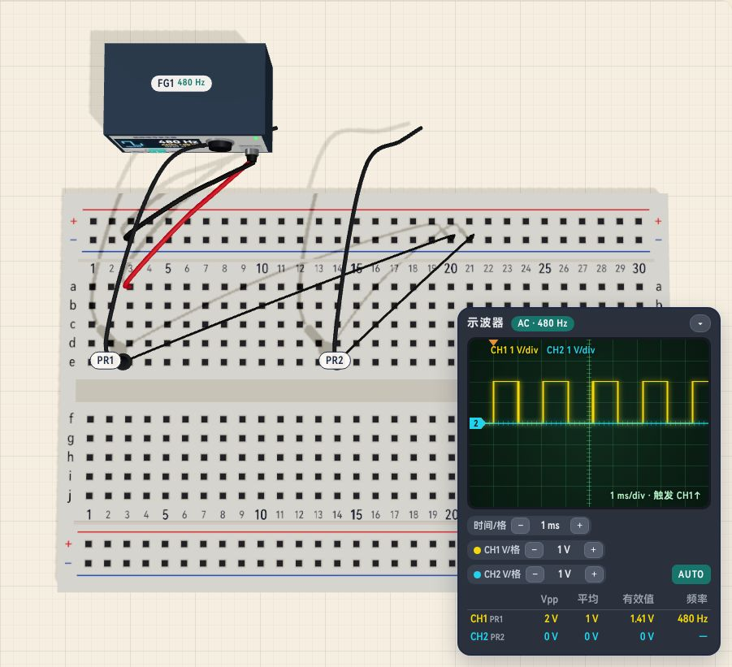
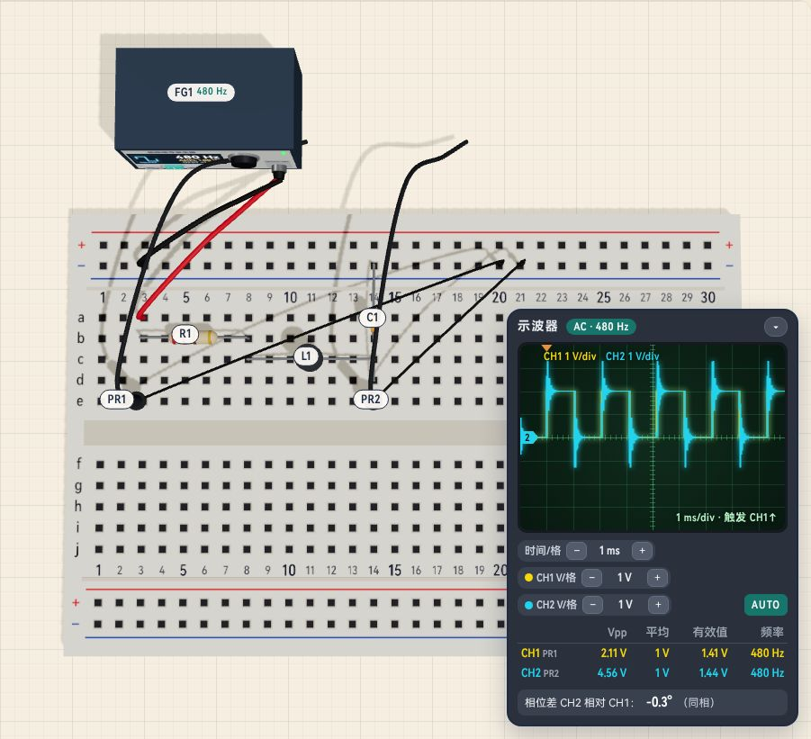
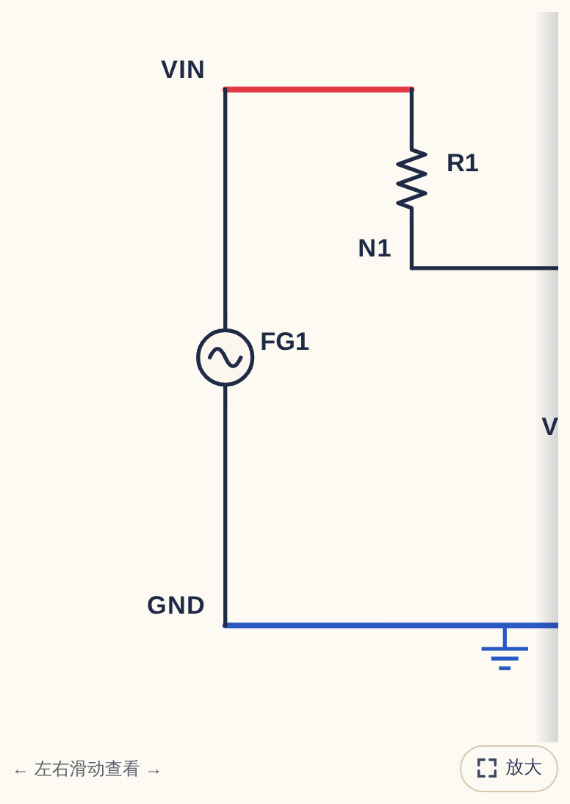

# 4.5 · 实验 3-8 · RLC 串联阶跃响应：先算 α 和 ω0，再从示波器上读回来

| 项目 | 内容 |
|---|---|
| id | `exp3-rlc-step-response` |
| 文件 | `challenges/248-rlc-step-response.json` |
| 类型 | 实验 / 挑战（没有分步，照目标电路图搭） · 难度 4/5 |
| 位置 | World 4 · 储能元件与一阶 / 二阶暂态 → 4.5 二阶 RLC：振铃与阶跃响应（本节第 2 项） |
| 右侧面板 | 旧版面（文件里没有卡片） |
| 前后 | 上一项 [4.5 exp3-rlc-ringing](../w4/4.05-1-exp3-rlc-ringing.md) · 下一项 [5.1 exp4-rl-phasors](../w5/5.01-1-exp4-rl-phasors.md) |
| 先修 | lesson-generator-scope |
| 概念 | 二阶电路 second-order circuit、阻尼系数 α = R/(2L)、无阻尼自然频率 ω0 = 1/√(LC)、阻尼振荡频率 ωd = √(ω0² − α²)、特征根 s = −α ± √(α² − ω0²)、超调量 overshoot |

**一句话概要**：10 mH + 10 nF 串联，R1 依次换成 220 Ω、2 kΩ、10 kΩ。每次先比较 α 和 ω0 判断阻尼情况，再从振铃的频率和第一个峰算出 α 和 ω0。

## 1. 左侧工作台（3D 面包板 → 2D 俯视截图）

截图是程序里真实的 3D 面包板换成俯视角拍的；表格是同一块板的文字版（元件、参数、每只脚插在哪个孔）。

### 1.1 起点：打开这一课时板上已经有的

| 元件 | 类型 | 参数 | 引脚 → 孔 |
|---|---|---|---|
| FG1 | function_gen | waveform=square, frequency=480, amplitude=1, offset=1 | +→a3 -→tn3 |
| PR1 | scope_probe | channel=1 | tip→e3 gnd→tn20 |
| PR2 | scope_probe | channel=2 | tip→e14 gnd→tn21 |

### 1.3 参考答案（「看答案」载入的板子）

| 元件 | 类型 | 参数 | 引脚 → 孔 |
|---|---|---|---|
| FG1 | function_gen | waveform=square, frequency=480, amplitude=1, offset=1 | +→a3 -→tn3 |
| R1 | resistor | resistance=220 | 1→b3 2→b8 |
| L1 | inductor | inductance=0.01 | 1→c8 2→c14 |
| C1 | capacitor | capacitance=1e-8 | 1→d14 2→tn14 |
| PR1 | scope_probe | channel=1 | tip→e3 gnd→tn20 |
| PR2 | scope_probe | channel=2 | tip→e14 gnd→tn21 |

### 1.4 目标原理图（右侧「目标原理图」抽屉）

| 元件 | 类型 | 参数 |
|---|---|---|
| FG1 | function_gen |  |
| R1 | resistor |  |
| L1 | inductor | inductance=0.01 |
| C1 | capacitor | capacitance=1e-8 |

连接（每个结点上的引脚）：

- **VIN**：FG1.+、R1.1
- **N1**：R1.2、L1.1
- **VC**：L1.2、C1.1
- **GND**：C1.2、FG1.-

## 2. 右侧面板：学生从上往下看到的内容（单轨流）

> 这个文件还没有卡片，界面是旧版面：题目说明 + 目标原理图 + 测量题。

### 题目说明

**目标**：用方波给 RLC 串联电路加阶跃。先用 α 和 ω0 判断是过阻尼、临界阻尼还是欠阻尼，再从示波器上的波形把 α 和 ω0 读回来。实验 3-4 用电位器连续地看三种情况；这里换三个固定电阻，每个都先像课本例题一样手算。

**电路**：信号发生器红夹子 → R1 → L1（10 mH）→ 结点 VC → C1（10 nF）→ GND，黑夹子接 GND。R1 先用 220 Ω，后面换成 10 kΩ 和 2 kΩ。

**信号发生器**：方波，幅度 1 V、偏置 1 V（0 ↔ 2 V），频率 480 Hz。每个上升沿是一次 0 → 2 V 的阶跃，每个下降沿是一次 2 V → 0 的阶跃。半个周期约 1 ms，足够让响应完全稳定。

**示波器**：CH1 接 VIN（R1 左端），CH2 接 VC（电容上端），两个接地夹都接 GND。

**两个关键的数**：
- **α = R/(2L)**：阻尼系数（damping factor），单位 1/s。它说明响应衰减得多快：振荡的包络按 e^(−αt) 变小。
- **ω0 = 1/√(LC)**：无阻尼自然频率（undamped natural frequency），单位 rad/s。如果回路里没有电阻，电路就按 ω0 一直振荡下去。
- 对 v_C 列 KVL，得特征方程 s² + 2αs + ω0² = 0，两个根 s = −α ± √(α² − ω0²)。α > ω0：过阻尼，两个负实根，不振荡。α = ω0：临界阻尼，重根，不振荡、最快到达终值。α < ω0：欠阻尼，共轭复根，v_C 按阻尼振荡频率 ωd = √(ω0² − α²) 振荡。
- **R 是回路的总电阻**：R1 + 信号发生器的 50 Ω 输出电阻 + 电感线圈的 1 Ω。

**先预测**：先算 ω0。对三个 R1 分别算 R、α，和 ω0 比，判断是哪种情况。R1 = 220 Ω 时，再算 ωd、振荡频率 fd = ωd/(2π)，以及第一个峰有多高：第一个峰出现在半个振荡周期 Td/2 处，超调量 = e^(−α·Td/2) = e^(−απ/ωd)。R1 = 10 kΩ 时，算出两个根 s1、s2，想一想哪个根决定 v_C 上升有多慢。

**测量**：R1 = 220 Ω 时，读 VC 振荡的频率（相邻两个波峰的间隔是 Td，fd = 1/Td）和第一个峰的电压，再看下降沿之后 VC 往哪边冲。然后用你的两个读数反过来算 α 和 ω0：超调量 OS = (第一个峰 − 2 V) / 2 V = e^(−α·Td/2)，所以 α = −2·fd·ln(OS)；ω0 = √(ωd² + α²)。再把 R1 换成 10 kΩ，读上升沿从 10% 到 90% 的上升时间；最后换成 2 kΩ，看还有没有超调。电路检查通过后，把读数填进下面的「测量」（以你自己的面包板为准）；答完后会显示计算对比。

**想一想**：R1 = 220 Ω 时，如果忘了 50 Ω 和 1 Ω，算出来的 α 会差多少？第一个峰会预测高了还是低了？

**真实电路里**：仿真里电感线圈电阻只有 1 Ω。真实的 10 mH 小电感常有 10 ~ 30 Ω，它也串在回路里：α 更大，振荡衰减更快，第一个峰更低。用示波器量出的 α 比 R1/(2L) 大，多出来的就是信号发生器内阻和线圈电阻。

**测量题 1 · `fring`**（读数题）

> R1 = 220 Ω：每个边沿之后 VC 振荡的频率 fd（量相邻两个波峰的间隔 Td，fd = 1/Td）

- 单位 kHz · 先写预测 · 状态：FG1 设为 信号发生器（方波 480Hz 幅度 1V）、R1 换成 220 Ω · 参考答案的读数 **15.62 kHz** · 合理范围 [14500, 16500]

答对后显示：

> 欠阻尼时按 ωd = √(ω0² − α²) ≈ 99 080 rad/s 振荡，fd ≈ 15.8 kHz，只比 f0 ≈ 15.9 kHz 低约 1%。

**测量题 2 · `peak`**（读数题）

> R1 = 220 Ω：VC 的最高电压（上升沿之后的第一个峰）

- 单位 V · 先写预测 · 状态：FG1 设为 信号发生器（方波 480Hz 幅度 1V）、R1 换成 220 Ω · 参考答案的读数 **3.281 V** · 合理范围 [3.15, 3.4]

答对后显示：

> 超调量 e^(−απ/ωd)，α = 271/(2 × 10 mH) = 13 550 1/s：≈ 0.65，所以峰值 ≈ 2 + 0.65 × 2 ≈ 3.30 V——比信号发生器跳到的 2 V 还高。

**测量题 3 · `alpha`**（计算题（用自己的读数算））

> 用你的两个读数算阻尼系数 α = −2·fd·ln((第一个峰 − 2 V) / 2 V)（单位 1/s，只填数字）

- 先写预测 · 参考答案的读数 **13930** · 合理范围 [12000, 15500] · 公式 `-2 * fring * ln((peak - 2) / 2)`

答对后显示：

> 第一个峰在 t = Td/2，那里的包络是 e^(−α·Td/2)。你的 α 应该接近 R/(2L) = (220 + 50 + 1)/(2 × 10 mH) = 13 550 1/s——只算 220 Ω 会得到 11 000。

**测量题 4 · `w0`**（计算题（用自己的读数算））

> 用你的读数算无阻尼自然频率 ω0 = √((2π·fd)² + α²)

- 单位 rad/s · 先写预测 · 参考答案的读数 **99120 rad/s** · 合理范围 [95000, 105000] · 公式 `sqrt((2 * pi * fring)^2 + alpha^2)`

答对后显示：

> ωd² = ω0² − α²，所以 ω0² = ωd² + α²。结果应该接近 1/√(LC) = 100 000 rad/s，和 R1 是多少无关。

**测量题 5 · `dir`**（选择题）

> R1 = 220 Ω：下降沿（2 V → 0）刚过，VC 往哪边冲？

- A. 向下冲过 0 V（变成负电压），再振荡着回到 0 V ✅（正确）
- B. 直接降到 0 V，不会低于 0 V
- C. 先往上冲到 2 V 以上，再降到 0 V

答对后显示：

> 下降沿是一个 −2 V 的阶跃。欠阻尼电路沿阶跃的方向冲过头，所以 VC 冲过 0 V 到约 −1.3 V——超调量和上升沿一样。

**测量题 6 · `tr10k`**（读数题）

> R1 = 10 kΩ：VC 从 10% 升到 90%（0.2 V → 1.8 V）的上升时间（从时间格读）

- 单位 µs · 先写预测 · 状态：FG1 设为 信号发生器（方波 480Hz 幅度 1V）、R1 换成 10 kΩ · 参考答案的读数 **218.6 µs** · 合理范围 [0.0002, 0.00024]

答对后显示：

> 过阻尼：s1 ≈ −10 050 1/s，s2 ≈ −995 000 1/s。快的根几微秒就衰减完了，VC 像 τ = 1/|s1| ≈ 99.5 µs 的 RC 充电一样上升：上升时间 ≈ τ·ln 9 ≈ 219 µs。

**测量题 7 · `case`**（选择题）

> 比较 α 和 ω0：R1 = 2 kΩ 和 R1 = 10 kΩ 各是哪种情况？

- A. 2 kΩ：α ≈ ω0，临界阻尼；10 kΩ：α > ω0，过阻尼。两种都不超调，2 kΩ 更快到达 2 V ✅（正确）
- B. 2 kΩ：欠阻尼（还在振荡）；10 kΩ：临界阻尼
- C. 两种都是欠阻尼，只是振荡太小看不见

答对后显示：

> 2 kΩ：R = 2051 Ω，α ≈ 102 600 1/s ≈ ω0 = 100 000 rad/s（临界，上升约 35 µs）。10 kΩ：α ≈ 502 600 1/s，是 ω0 的五倍——过阻尼，慢了约六倍。

## 3. 测量题一览

| # | id | 题目 | 类型 | 单位 | 状态 | 参考读数 |
|---|---|---|---|---|---|---|
| 1 | fring | R1 = 220 Ω：每个边沿之后 VC 振荡的频率 fd（量相邻两个波峰的间隔 Td，fd = 1/Td） | scope | kHz | FG1 设为 信号发生器（方波 480Hz 幅度 1V）、R1 换成 220 Ω | 15.62 kHz |
| 2 | peak | R1 = 220 Ω：VC 的最高电压（上升沿之后的第一个峰） | scope | V | FG1 设为 信号发生器（方波 480Hz 幅度 1V）、R1 换成 220 Ω | 3.281 V |
| 3 | alpha | 用你的两个读数算阻尼系数 α = −2·fd·ln((第一个峰 − 2 V) / 2 V)（单位 1/s，只填数字） | formula |  |  | 13930 |
| 4 | w0 | 用你的读数算无阻尼自然频率 ω0 = √((2π·fd)² + α²) | formula | rad/s |  | 99120 rad/s |
| 5 | dir | R1 = 220 Ω：下降沿（2 V → 0）刚过，VC 往哪边冲？ | 选择 |  |  | 正确：A |
| 6 | tr10k | R1 = 10 kΩ：VC 从 10% 升到 90%（0.2 V → 1.8 V）的上升时间（从时间格读） | scope | µs | FG1 设为 信号发生器（方波 480Hz 幅度 1V）、R1 换成 10 kΩ | 218.6 µs |
| 7 | case | 比较 α 和 ω0：R1 = 2 kΩ 和 R1 = 10 kΩ 各是哪种情况？ | 选择 |  |  | 正确：A |

### 全部答完后显示的「对比」

**对比**：ω0 = 1/√(10 mH × 10 nF) = 1/√(10⁻¹⁰) = 100 000 rad/s（f0 = ω0/(2π) ≈ 15.9 kHz）。临界电阻（α = ω0）R = 2L·ω0 = 2√(L/C) = 2 kΩ。这里 α = R/(2 × 10 mH) = 50 × R（α 的单位 1/s，R 的单位 Ω）。
- **R1 = 220 Ω**：R = 220 + 50 + 1 = 271 Ω，α = 13 550 1/s < ω0 → **欠阻尼**。ωd = √(100 000² − 13 550²) ≈ 99 080 rad/s，fd ≈ 15.8 kHz，Td ≈ 63 µs。超调量 e^(−π × 13 550 / 99 080) ≈ 0.65，所以第一个峰 ≈ 2 + 0.65 × 2 ≈ 3.30 V。下降沿是一个向下的阶跃，所以 VC **向下**冲过 0 V，到约 −1.30 V。振荡按时间常数 1/α ≈ 74 µs 衰减。
- 如果忘了那 51 Ω，会算出 α = 11 000 1/s（小了 19%），预测第一个峰 ≈ 3.41 V，偏高。R1 只有 220 Ω 时，信号发生器和线圈占了回路电阻的五分之一。
- **从读数算回 α 和 ω0**：fd ≈ 15.8 kHz、第一个峰 ≈ 3.30 V，得 OS ≈ 0.65，α = −2 × 15 800 × ln 0.65 ≈ 13 600 1/s，ω0 = √((2π × 15 800)² + α²) ≈ 100 000 rad/s。注意 fd 只比 f0 低约 1%：α ≪ ω0 时，振荡频率几乎就是 ω0，要靠衰减（超调量）才能看出 α。
- **仿真读数**：仿真大约读出 fd ≈ 15.6 kHz、第一个峰 ≈ 3.28 V，算出 α ≈ 13 900 1/s、ω0 ≈ 99 100 rad/s，和上面的理论值差 1% ~ 3%。原因是仿真用固定的时间步长（每个振荡周期约 40 步），数值方法让振荡稍慢、衰减稍快。真实实验里的误差来源则是元件容差、线圈电阻和读格子的误差。
- **R1 = 10 kΩ**：R = 10 051 Ω，α ≈ 502 600 1/s ≫ ω0 → **过阻尼**。s1 = −α + √(α² − ω0²) ≈ −10 050 1/s，s2 ≈ −995 000 1/s。s2 那一项几微秒就没了；慢的根 s1 决定上升速度，就像 τ = 1/|s1| ≈ 99.5 µs 的 RC 充电：10% → 90% 上升时间 ≈ τ·ln 9 ≈ 219 µs。没有超调。
- **R1 = 2 kΩ**：R = 2051 Ω，α ≈ 102 600 1/s ≈ ω0（大 2.5%）→ **临界阻尼**（严格说是极轻微的过阻尼）。VC 不超调地到达 2 V，10% → 90% 只要约 3.5/ω0 ≈ 35 µs——三种里不振荡又最快的一种。2√(L/C) = 2 kΩ 是课本上的临界值；多出来的 51 Ω 让它刚刚越过临界，示波器上看不出差别。

### 提示按钮（依次显示）

1. 串联顺序：信号发生器 → R1 → 电感 → 电容 → GND。CH2 看电容电压。
2. α = R/(2L)，ω0 = 1/√(LC)。R 是整个回路的电阻：R1 + 50 Ω（信号发生器）+ 1 Ω（线圈）。
3. α < ω0 时按 ωd = √(ω0² − α²) 振荡；α ≥ ω0 时不振荡。临界电阻是 2√(L/C)。

### 功能测试（「检查我的电路」时跑）

- R1 = 220 Ω：欠阻尼，冲过 2 V 再振荡
- R1 = 2 kΩ：约等于临界阻尼，不超调
- R1 = 10 kΩ：过阻尼，不超调、上升慢

## 4. 用到的拆解（全部层的文字，供改写参考）

### 拆解 `capacitor`：电容 Capacitor：两块极板夹一层绝缘

*电容储存的是电荷和电场能量。拆开是两块金属极板中间夹一层介质（dielectric）；由此推出 q = Cv、C = εA/d、i = C dv/dt、W = ½CV²，再推出 RC 充电的指数曲线（τ = RC）和“直流断路、高频短路”的容抗。最后看真实电容差在哪：ESR、漏电、极性。*

**拆解「电容 Capacitor：两块极板夹一层绝缘」第 1 / 7 层：① 外形：瓷片电容和电解电容**

课程里有两种电容：
- 瓷片电容 ceramic capacitor：橙色小圆片，**没有极性**，容量小（pF – 几 µF）。上面印 三位数代码，单位是 **pF**：前两位是有效数字，第三位是 10 的几次方。**104** = 10 × 10⁴ pF = 100 000 pF = **100 nF** = 0.1 µF。102 = 1 nF，103 = 10 nF，105 = 1 µF。
- 电解电容 electrolytic capacitor：铝壳圆柱，容量大（1 µF – 几万 µF），**有极性**：长脚是 +，外壳上 印着一串“−”的白条 那边是 −（短脚）。直接印着容量和耐压，比如 1000 µF 16 V。

两种电容的 **耐压**（rated voltage）都要大于电路里的最高电压，一般留 1.5–2 倍余量：9 V 电路用 16 V 或 25 V 的。

呼吸灯实验（exp3-led-breathing）用的 1000 µF 就是电解电容：长脚（+）接 VC，短脚接 GND。

| 类型 | 标记 | 极性 | 常见范围 | 课程里 |
|---|---|---|---|---|
| 瓷片 / 陶瓷 | 三位代码（pF）：104 = 100 nF | 无 | 1 pF – 10 µF | RC 实验的 100 nF |
| 铝电解 | 直接印 µF 和 V；“−”条 = 负极 | 有：长脚 + | 1 µF – 47 mF | 呼吸灯的 1000 µF |

**拆解「电容 Capacitor：两块极板夹一层绝缘」第 2 / 7 层：② 拆开：电极、介质，一层又一层**

每个电容不管长什么样，里面都是同一个结构：**两个互相绝缘的导体（电极 electrode），中间夹一层绝缘体（介质 dielectric）**。工厂做的事情，就是在小体积里把“面积做大、距离做小”。

**陶瓷电容（MLCC，多层陶瓷电容）**：几十到几百层 金属电极 和 陶瓷介质 交替叠在一起，单数层接左边的 端电极，双数层接右边——等于很多个电容 **并联**。陶瓷（钛酸钡）的相对介电常数 $ε_r$ 很大（X7R 约 2000），每层只有几 µm 厚。

**铝电解电容**：一条 阳极铝箔 和一条 阴极铝箔，中间夹 浸了电解液的纸，卷成一卷装进铝壳。真正的介质是阳极箔表面电化学生长出来的一层 氧化铝 Al₂O₃，只有十几 nm 厚；铝箔还被腐蚀得坑坑洼洼，实际表面积是平面的几十倍。所以它能在小体积里做出 1000 µF。

**极性的来源**：氧化层只在阳极箔上，而且只有阳极电压更高时才稳定。电压反过来，电化学反应会把它还原掉（第 ⑦ 层）。

**拆解「电容 Capacitor：两块极板夹一层绝缘」第 3 / 7 层：③ 模型：平行板，q = Cv，C = εA/d**

把电容理想化成两块面积为 A、距离为 d 的 平行金属板。加电压 v：电源从 下板 抽走电子送到上板的反面……结果是上板带 **+q**，下板带 **−q**，两板之间出现 电场。电荷和电压成正比，比例系数就是 **capacitance（电容）C**：
$$q = C·v$$
单位：法拉 F = C/V。1 F 很大，常用 µF（10⁻⁶）、nF（10⁻⁹）、pF（10⁻¹²）。

C 由几何和材料决定：
$$C = \frac{εA}{d},   ε = ε_r ε_0,   ε_0 = 8.85 pF/m$$
- 面积 A 越大 → 能放的电荷越多；
- 距离 d 越小 → 同样电压下电场越强、吸住的电荷越多；
- 介质 被电场 **极化**（polarization）：分子里的正负电荷被拉开，抵消掉一部分电场，于是同样的 v 能多放 $ε_r$ 倍的电荷。

**带数字**：空气、1 cm² 的两块板、相距 1 mm：$C = \frac{8.85×10^{-12} × 10^{-4}}{10^{-3}} ≈ 0.89 pF$——小得可怜。
一层 MLCC：$ε_r = 2000$，A = 2 mm × 1.2 mm，d = 5 µm：$C = \frac{8.85×10^{-12} × 2000 × 2.4×10^{-6}}{5×10^{-6}} ≈ 8.5 nF$；叠 12 层并联 ≈ **100 nF**。

- 公式 `q = C·v`：定义：每伏电压存多少库仑
- 公式 `C = \frac{ε_r ε_0 A}{d}`：平行板；MLCC 再乘层数

**拆解「电容 Capacitor：两块极板夹一层绝缘」第 4 / 7 层：④ i = C dv/dt：电流只看电压变化得多快**

对 $q = Cv$ 两边对时间求导，左边 $\frac{dq}{dt}$ 就是流进极板的电流：
$$i = C\frac{dv}{dt}$$
（关联参考方向：电流从 + 端流入）。这是电容 **唯一** 的 V–I 关系，三个推论都从这里来：

1. 电压不变 → 电流为 0。直流稳态下电容就是 **断路**（open circuit）。
2. 电压匀速上升 → 电流恒定：100 nF 在 1 ms 内从 0 升到 5 V，$i = 100 nF × \frac{5 V}{1 ms} = 0.5 mA$。下降得快一倍（0.5 ms），电流就是 −1 mA（反向流出）。
3. **电容电压不能跳变**：要在 0 秒内改变电压，需要无穷大的电流。所以开关动作的瞬间 $v_C(0^+) = v_C(0^-)$——这是一阶电路“三要素法”的出发点。

**储存的能量**：功率 $p = vi = Cv\frac{dv}{dt}$，从 0 充到 V 积分：
$$W = ∫_{0}^{V} Cv dv = \frac{1}{2}CV^{2}$$
- 100 nF 充到 5 V：$\frac{1}{2} × 10^{-7} × 25 = 1.25 µJ$；
- 1000 µF 充到 9 V：$\frac{1}{2} × 10^{-3} × 81 = 40.5 mJ$——足够让 LED 亮好几秒（呼吸灯实验）。

能量存在两板之间的 **电场** 里，不是“存了电流”。理想电容不消耗能量，只是借进来、再还回去。

- 公式 `i = C\frac{dv}{dt}`：直流稳态：dv/dt = 0 → i = 0（断路）
- 公式 `W = \frac{1}{2}CV^{2}`：1000 µF、9 V：40.5 mJ

**拆解「电容 Capacitor：两块极板夹一层绝缘」第 5 / 7 层：⑤ 通过电阻充电：τ = RC，1τ 走完 63%**

RC 方波实验（exp3-rc-square-charging）：信号发生器（内阻 50 Ω）→ 10 kΩ → 100 nF → GND，方波在 0 和 5 V 之间跳。

**推导**（方波刚跳到 5 V，电容从 0 V 开始）：
1. KVL：$V = Ri + v_C$；
2. 代入 $i = C\frac{dv_C}{dt}$：$RC\frac{dv_C}{dt} + v_C = V$，一阶线性微分方程；
3. 初值 $v_C(0) = 0$（电压不能跳），终值 $v_C(∞) = V$（充满后 i = 0），解是：
$$v_C(t) = V(1 - e^{-t/τ}),   τ = RC$$
4. 电流 $i = \frac{V - v_C}{R} = \frac{V}{R}e^{-t/τ}$：一开始最大（0.5 mA），然后指数衰减。开始瞬间电容像 **短路**，充满后像 **断路**。

**τ（time constant，时间常数）** 的意义：
- t = τ：$1 - e^{-1} = 63%$，到 3.16 V；
- t = 3τ：95%；t = 5τ：99.3%，工程上算“充满”；
- 起点的切线 恰好在 t = τ 时到达终值。

**带数字**：$τ = (10 kΩ + 50 Ω) × 100 nF ≈ 1.0 ms$。500 Hz 方波半周期 1 ms ≈ 1τ，电容只能充到约 63% 就开始放电；50 Hz 半周期 10 ms = 10τ，每次都充满放空，波形是完整的指数曲线；5 kHz 半周期 0.1τ，电容几乎来不及动，输出是一个小三角波。

| t | 已充到 | 5 V 方波时 $v_C$ | 电流 i |
|---|---|---|---|
| 0 | 0% | 0 V | 0.50 mA |
| 1τ = 1 ms | 63% | 3.16 V | 0.18 mA |
| 2τ | 86% | 4.32 V | 0.068 mA |
| 3τ | 95% | 4.75 V | 0.025 mA |
| 5τ | 99.3% | 4.97 V | 0.003 mA |

- 公式 `v_C(t) = V(1 - e^{-t/τ}), τ = RC`：充电；放电时 $v_C$ = V·e^{−t/τ}
- 公式 `τ = (10 kΩ + 50 Ω) × 100 nF ≈ 1.0 ms`

**拆解「电容 Capacitor：两块极板夹一层绝缘」第 6 / 7 层：⑥ 频率：直流断路，高频短路**

接正弦电压 $v = V_m sin ωt$，代入 $i = C\frac{dv}{dt}$：
$$i = ωCV_m cos ωt$$
两点结论：
- 电流的幅值是 $ωCV_m$，所以电压幅值 / 电流幅值 = $\frac{1}{ωC}$，这就是 **capacitive reactance（容抗）**：
$$X_C = \frac{1}{ωC} = \frac{1}{2πfC}$$
- cos 比 sin 早 90°：电容的 **电流超前电压 90°**。用相量写：$Z_C = \frac{1}{jωC}$。

容抗和频率成反比，在双对数坐标上是一条斜率 −1 的直线。对 100 nF：
- 50 Hz：31.8 kΩ；1 kHz：1.59 kΩ；100 kHz：15.9 Ω；
- f → 0（直流）：$X_C → ∞$，**断路**；
- f 很高：$X_C → 0$，接近 **短路**。

这就是电容的两大用途：**隔直流、通交流**（耦合电容 coupling capacitor），以及把高频噪声 **旁路到地**（去耦 / 旁路电容 bypass capacitor，每个芯片电源脚旁边那颗 100 nF）。RC 低通、高通滤波器的截止频率 $f_c = \frac{1}{2πRC}$ 就是 $X_C = R$ 的那个频率：10 kΩ 和 100 nF 时 $f_c ≈ 159 Hz$。

| f | $X_C$（100 nF） | 相当于 |
|---|---|---|
| 0（直流） | ∞ | 断路 |
| 50 Hz | 31.8 kΩ | 大电阻 |
| 159 Hz | 10 kΩ | = R：RC 截止频率 |
| 1 kHz | 1.59 kΩ | — |
| 100 kHz | 15.9 Ω | 接近短路 |

- 公式 `X_C = \frac{1}{2πfC}`：电流超前电压 90°；$Z_C$ = 1/(jωC)
- 公式 `f_c = \frac{1}{2πRC} = \frac{1}{2π × 10 kΩ × 100 nF} ≈ 159 Hz`

**拆解「电容 Capacitor：两块极板夹一层绝缘」第 7 / 7 层：⑦ 真实电容：ESR、ESL、漏电、极性**

真实电容 = 理想 C + 三个寄生元件：
- ESR（equivalent series resistance，等效串联电阻）：引线、电极和电解液的电阻。电解电容约 0.1–1 Ω，陶瓷电容只有几 mΩ。纹波电流流过它会发热：1 A 纹波、0.5 Ω → 0.5 W。
- ESL（equivalent series inductance，等效串联电感）：引线和卷绕带来的几 nH 到几十 nH。频率高到一定程度（**self-resonance 自谐振**，100 nF 陶瓷约 10–20 MHz），电容反而变成电感。所以去耦时大电容和小电容并联使用。
- 漏电电阻 $R_leak$：介质不是完美的绝缘体。电解电容的漏电流约 0.01CV（1000 µF、9 V 时几十 µA），充满的电解电容放几小时电压就掉下去了。

**电解电容接反**：阳极的氧化层被电化学反应还原掉，漏电流变大 → 发热 → 电解液汽化 → 外壳顶部的十字防爆纹 **鼓包、喷液甚至炸开**。几伏的反压就可能开始损坏。

**陶瓷电容的直流偏压效应**：X7R、Y5V 这类高介电常数陶瓷，加的直流电压越高，$ε_r$ 越小，实际容量可能只剩一半。精确的 RC 定时要用 C0G（NP0）陶瓷或薄膜电容。

**仿真器里**：电容是 **理想电容**——没有 ESR、ESL、漏电，也 **不区分电解电容的极性**（接反不会报错）。只有直流电源时它按断路处理；有信号发生器或 PWM 时按时域仿真。真实搭电路时，电解电容一定要按极性插。

| 参数 | 陶瓷 100 nF | 电解 1000 µF | 仿真器 |
|---|---|---|---|
| ESR | 几 mΩ | 0.1–1 Ω | 0 |
| ESL | ≈ 1–5 nH | ≈ 10–20 nH | 0 |
| 漏电 | nA | 几十 µA | 0 |
| 误差 | ±10% | ±20% | 0 |
| 极性 | 无 | 有，接反会坏 | 不检查 |

- 公式 `f_{SRF} = \frac{1}{2π\sqrt{ESL·C}}`：100 nF、1 nH：≈ 16 MHz。高于它电容就成了电感

**一句话记住**：电容 = 两块极板夹一层介质：$q = Cv$，$C = \frac{εA}{d}$。它的全部行为是 $i = C\frac{dv}{dt}$：电压不能跳变，直流稳态断路，储能 $\frac{1}{2}CV^{2}$；经电阻充电按 $τ = RC$ 指数变化（1τ 63%，5τ 充满）；交流下 $X_C = \frac{1}{2πfC}$，频率越高越接近短路。真实电容有 ESR、漏电，电解电容有极性——仿真器都不管，你得管。

## 5. 这一课的计算卡片

**计算卡片 `generator-output`：信号发生器的 50 Ω 输出电阻**

- 公式 `V_{out} = V_{set} \frac{R_L}{50 Ω + R_L}`
- 用途：信号发生器 = 理想波形源串 50 Ω：接上负载以后输出比设定小多少。
- 输入：V_set（设定的幅度（或偏置），V）；R_o（输出电阻，Ω）；R_L（负载（电路的输入电阻），Ω） → V_out（端口上的实际值，V）

1. 发生器内部 = 一个理想波形源 + 串联的 50 Ω（$R_o$）。空载时端口电压就是设定值。
2. 接负载 $R_L$：$R_o$ 和 $R_L$ 分压，$V_{out} = V_{set}\frac{R_L}{R_o + R_L}$。交流部分和直流偏置都被同一个比例缩小。
3. $R_L ≫ 50 Ω$（几 kΩ 以上）时差别不到 1 %；50 Ω 负载正好减半。
4. 负载是 RC、RL 时用阻抗的模：$|V_{out}| = V_{set}\frac{|Z|}{|Z + R_o|}$，而且随频率变——所以滤波实验用端口电压（CH1）做参考。
5. 时间常数里要把 50 Ω 算进 R：$τ = (R + 50)C$。

例子：- 第 12 课：设 1 V，50 Ω 负载：0.5 V 幅度 = 1.0 Vpp；偏置 +1 V 也变成 0.5 V。
- 实验 2-7：反相放大器输入电阻 10 kΩ：$1 × \frac{10000}{10050} ≈ 0.995$，输出 2.19 Vpp 而不是 2.2。
- 实验 4-3：$|Z| = 142.5 Ω$，$|Z + 50| = |151 + j100.5| ≈ 181 Ω$：端口只有 $\frac{142.5}{181} ≈ 0.786 V$ 峰值（1.57 Vpp）。

- ⚠ 很多真实发生器按“接 50 Ω 负载”显示幅度：接高阻电路实际是显示值的两倍（除非设成 High-Z）。
- ⚠ 算 τ、谐振电流、RLC 阻尼时忘了这 50 Ω。

**计算卡片 `rise-time`：上升时间 10 %→90 % = τ·ln 9**

- 公式 `t_r = τ ln 9 ≈ 2.2 τ`
- 用途：示波器量到的上升时间 tᵣ 反推时间常数 τ（或反过来）。
- 输入：t_r（10 %→90 % 上升时间，s） → τ（时间常数，s）

1. 从 0 充向终值：$\frac{v}{v(∞)} = 1 - e^{-t/τ}$。
2. 到 10 % 的时刻：$t_1 = τ ln\frac{1}{0.9}$；到 90 %：$t_2 = τ ln 10$。
3. 相减：$t_r = t_2 - t_1 = τ ln 9 ≈ 2.197τ$。
4. 所以 $τ = \frac{t_r}{ln 9}$——不用知道终值，也不用从 0 开始量。
5. I²C 规范的 $t_r$ 是 30 %→70 %：$τ ln\frac{7}{3} ≈ 0.847τ$。

例子：实验 3-1（50 Hz）：$t_r ≈ 2.2 ms$ → τ ≈ 1.0 ms。实验 3-3：电流（$v_R$）的 $t_r ≈ 146 µs$ → τ ≈ 66 µs = 10 mH / 151 Ω。实验 5-16：2.2 kΩ + 200 pF 的 $t_r ≈ 0.97 µs$。

- ⚠ 半个周期里没走完（τ 和半周期差不多）时，示波器按实际摆幅算 10 %/90 %，结果会比 2.2τ 小。

**计算卡片 `rlc-damping`：RLC 串联的阻尼比 ζ**

- 公式 `ζ = \frac{α}{ω_0} = \frac{R}{2}\sqrt{\frac{C}{L}}, α = \frac{R}{2L}, ω_0 = \frac{1}{\sqrt{LC}}`
- 用途：RLC 串联的阶跃响应会不会振铃：ζ < 1 欠阻尼、= 1 临界、> 1 过阻尼。
- 输入：R（回路总电阻（电位器 + 50 Ω + 线圈 1 Ω），Ω）；L（电感，H）；C（电容，F） → ζ（阻尼比（< 1 振铃），）

1. KVL：$LC v_C'' + RC v_C' + v_C = v_s$，二阶方程。
2. 特征方程 $s^{2} + \frac{R}{L}s + \frac{1}{LC} = 0$，根 $s = -α ± \sqrt{α^{2} - ω_0^{2}}$，$α = \frac{R}{2L}$（衰减快慢），$ω_0 = \frac{1}{\sqrt{LC}}$（无阻尼振荡频率）。
3. 比一比：$ζ = \frac{α}{ω_0} = \frac{R}{2}\sqrt{\frac{C}{L}}$。
4. ζ < 1：复根，**欠阻尼**，以 $ω_d = ω_0\sqrt{1 - ζ^{2}}$ 振铃，包络 $e^{-αt}$；ζ = 1：**临界阻尼**，最快不超调，$R_c = 2\sqrt{\frac{L}{C}}$；ζ > 1：两个实根，**过阻尼**，慢慢爬上去。

例子：实验 3-4（10 mH、100 nF）：$f_0 = \frac{1}{2π\sqrt{LC}} ≈ 5.03 kHz$，$R_c = 2\sqrt{10^{-2}/10^{-7}} ≈ 632 Ω$。电位器 5 %：R ≈ 101 Ω，ζ ≈ 0.16（振铃）；30 %：351 Ω，ζ ≈ 0.56；60 %：651 Ω，ζ ≈ 1.03（临界附近）；100 %：1051 Ω，ζ ≈ 1.66（过阻尼）。

- ⚠ R 是回路 **总** 电阻：发生器的 50 Ω 和线圈电阻都在里面，电位器转到 0 时 ζ 也只能降到约 0.08。
- ⚠ 并联 RLC 的阻尼比公式不同：$ζ = \frac{1}{2R}\sqrt{\frac{L}{C}}$，R 越大阻尼越小。

**计算卡片 `rlc-overshoot`：欠阻尼的超调量**

- 公式 `M_p = e^{-πζ/\sqrt{1 - ζ^{2}}}`
- 用途：欠阻尼的阶跃响应第一个峰比终值高出多少（占阶跃高度的百分比）。
- 输入：ζ（阻尼比，） → M_p（超调量（ζ ≥ 1 时为 0），%）

1. 欠阻尼阶跃响应：$v_C = V[1 - e^{-αt}(cos ω_dt + \frac{α}{ω_d}sin ω_dt)]$。
2. 第一个峰在半个振荡周期处：$t_p = \frac{π}{ω_d}$。
3. 代进去，超出终值的部分是 $Ue^{-απ/ω_d}$。
4. 用 ζ 写：$\frac{α}{ω_d} = \frac{ζ}{\sqrt{1 - ζ^{2}}}$，所以 $M_p = e^{-πζ/\sqrt{1 - ζ^{2}}}$。
5. 峰值电压 = 终值 + $M_p$ × 阶跃高度。ζ → 0 时接近 100 %（电容电压能到电源的两倍）。

例子：实验 3-4：ζ ≈ 0.16 → 约 60 %，0 → 2 V 的阶跃峰值 ≈ $2 + 2 × 0.6 ≈ 3.2 V$（比信号还高）；ζ ≈ 0.56 → 约 12 %，峰值 ≈ 2.25 V。

- ⚠ 超调乘的是阶跃高度，不是终值的绝对电压（偏置不算）。

**计算卡片 `rlc-alpha-from-ringing`：从振铃读回 α 和 ω₀**

- 公式 `α = -2 f_d ln OS, ω_0 = \sqrt{(2πf_d)^{2} + α^{2}}`
- 用途：欠阻尼 RLC 的阶跃响应：用示波器上的振铃频率和第一个峰算出衰减系数 α。
- 输入：f_d（振铃频率（两个相邻峰的间隔 T_d 的倒数），Hz）；V_pk（第一个峰的电压，V）；V_f（终值（阶跃的高度），V） → α（衰减系数（1/s），）

1. 欠阻尼时 $v_C$ 以 $ω_d = \sqrt{ω_0^{2} - α^{2}}$ 振荡，包络按 $e^{-αt}$ 缩小。
2. 第一个峰出现在半个振铃周期 $\frac{T_d}{2} = \frac{1}{2f_d}$ 处，超出终值的比例（超调量）$OS = \frac{V_{pk} - V_f}{V_f} = e^{-αT_d/2}$。
3. 取对数：$α = -\frac{2}{T_d} ln OS = -2f_d ln OS$。
4. 再由 $ω_0^{2} = ω_d^{2} + α^{2}$ 得到 $ω_0$；它应接近 $\frac{1}{\sqrt{LC}}$，和 R 无关。
5. α 测出来比 $\frac{R_1}{2L}$ 大：发生器的 50 Ω、线圈电阻都在回路里，$α = \frac{R_{总}}{2L}$。

例子：实验 3-8（10 mH、10 nF、R1 = 220 Ω）：$ω_0 = 10^{5} rad/s$，$α = \frac{271}{0.02} = 13550 /s$，预测峰值 ≈ 3.30 V。读到 $f_d ≈ 15.8 kHz$、峰 3.30 V：OS = 0.65，$α = -2 × 15800 × ln 0.65 ≈ 13600 /s$，$ω_0 = \sqrt{(2π × 15800)^{2} + 13600^{2}} ≈ 100000 rad/s$。R1 = 10 kΩ：过阻尼，慢根 $s_1 ≈ -10050 /s$，上升时间 ≈ $\frac{ln 9}{10050} ≈ 219 µs$；R1 = 2 kΩ：α ≈ ω₀，临界阻尼。

- ⚠ 超调量要除以 **阶跃高度**（2 V），不是除以峰值。
- ⚠ α ≪ ω₀ 时 $f_d$ 几乎就是 f₀：频率告诉你 ω₀，衰减（超调）才告诉你 α。

**计算卡片 `lc-resonance`：LC 谐振频率 f₀ = 1/(2π√LC)**

- 公式 `f_0 = \frac{1}{2π\sqrt{LC}}`
- 用途：电感和电容的电抗正好相等（互相抵消）的频率——串联、并联 LC 和 RLC 振铃都用它。
- 输入：L（电感，H）；C（电容，F） → f_0（谐振频率，Hz）

1. 串联 RLC：$Z = R + j(ωL - \frac{1}{ωC})$。
2. 两个电抗相等时虚部为 0：$ω_0L = \frac{1}{ω_0C}$ ⇒ $ω_0 = \frac{1}{\sqrt{LC}}$，$f_0 = \frac{1}{2π\sqrt{LC}}$。
3. 串联谐振：|Z| 最小（= R），电流最大，电流和电压 **同相**；低于 f₀ 呈容性（电流超前），高于 f₀ 呈感性（电流落后）。
4. 并联 LC：导纳的虚部抵消，阻抗最大（见“并联谐振阻抗”）。
5. 谐振时每个电抗的大小 $X_0 = \sqrt{\frac{L}{C}}$（特性阻抗）。

例子：实验 3-4、4-4、4-5（10 mH、100 nF）：$f_0 = \frac{1}{2π\sqrt{10^{-9}}} ≈ 5033 Hz$，$X_0 = \sqrt{\frac{0.01}{10^{-7}}} ≈ 316 Ω$。2.5 kHz 电流超前约 78°，10 kHz 落后约 78°。

- ⚠ 把 √ 漏掉，或者把 2π 漏掉——结果差几个数量级或 6.28 倍。

## 6. English（界面英文版的同一份内容）

展开英文

**Goal**: apply steps to a series RLC circuit with a square wave. First use α and ω0 to decide whether it is overdamped, critically damped or underdamped, then read α and ω0 back from the waveform on the scope. Experiment 3-4 turns a potentiometer to sweep through the three cases; here you swap in three fixed resistors and work each one out by hand first, like a textbook example.

**Circuit**: generator red clip → R1 → L1 (10 mH) → node VC → C1 (10 nF) → GND; black clip to GND. Start with R1 = 220 Ω; later swap it for 10 kΩ and 2 kΩ.

**Generator**: square wave, amplitude 1 V, offset 1 V (0 ↔ 2 V), 480 Hz. Every rising edge is a 0 → 2 V step and every falling edge a 2 V → 0 step. Half a period is about 1 ms, long enough for the response to settle completely.

**Scope**: CH1 on VIN (left end of R1), CH2 on VC (top of the capacitor), both ground clips on GND.

**The two key numbers**:
- **α = R/(2L)**: the damping factor, in 1/s. It says how fast the response dies out: the envelope of the ringing shrinks as e^(−αt).
- **ω0 = 1/√(LC)**: the undamped natural frequency, in rad/s. With no resistance in the loop, the circuit would ring at ω0 forever.
- KVL for v_C gives the characteristic equation s² + 2αs + ω0² = 0, with roots s = −α ± √(α² − ω0²). α > ω0: overdamped, two negative real roots, no ringing. α = ω0: critically damped, a repeated root, no ringing and the fastest approach to the final value. α < ω0: underdamped, complex roots, and v_C rings at the damped natural frequency ωd = √(ω0² − α²).
- **R is the total loop resistance**: R1 + the generator's 50 Ω output resistance + the inductor's 1 Ω winding.

**Predict first**: work out ω0. For each R1, work out R and α, compare α with ω0 and decide the case. For R1 = 220 Ω also work out ωd, the ringing frequency fd = ωd/(2π), and how high the first peak goes: it comes half a ringing period after the edge, at Td/2, and the overshoot is e^(−α·Td/2) = e^(−απ/ωd). For R1 = 10 kΩ, find the two roots s1 and s2 and think about which one sets how slowly v_C rises.

**Measure**: with R1 = 220 Ω, read the frequency VC rings at (the time between two neighbouring peaks is Td, fd = 1/Td) and the voltage of the first peak, and see which way VC swings after a falling edge. Then work α and ω0 back out of your two readings: the overshoot OS = (first peak − 2 V) / 2 V = e^(−α·Td/2), so α = −2·fd·ln(OS); and ω0 = √(ωd² + α²). Next swap R1 for 10 kΩ and read the 10% → 90% rise time of the rising edge; finally swap in 2 kΩ and see whether any overshoot is left. Once the circuit check passes, type your readings into the Measurements below (whatever your own board shows); the worked comparison appears after you answer.

**Think about it**: with R1 = 220 Ω, how far off would α be if you forgot the 50 Ω and the 1 Ω? Would you predict the first peak too high or too low?

**In a real circuit**: the simulated inductor has only 1 Ω of winding resistance. A real small 10 mH inductor often has 10–30 Ω, also in the loop: α is larger, the ringing dies faster and the first peak is lower. The α you measure on a scope is larger than R1/(2L); the extra is the generator's output resistance and the winding resistance.

**Question 1 · `fring`**（reading）

> R1 = 220 Ω: the frequency fd VC rings at after an edge (measure the time Td between two neighbouring peaks, fd = 1/Td)

- unit kHz · predict first · state：FG1 is set to Function generator (square 480Hz 1V peak) and R1 is 220 Ω · range [14500, 16500]

Shown once right:

> Underdamped, it rings at ωd = √(ω0² − α²) ≈ 99 080 rad/s, fd ≈ 15.8 kHz, only about 1% below f0 ≈ 15.9 kHz.

**Question 2 · `peak`**（reading）

> R1 = 220 Ω: VC's highest voltage (the first peak after the rising edge)

- unit V · predict first · state：FG1 is set to Function generator (square 480Hz 1V peak) and R1 is 220 Ω · range [3.15, 3.4]

Shown once right:

> Overshoot e^(−απ/ωd) with α = 271/(2 × 10 mH) = 13 550 1/s: ≈ 0.65, so the peak ≈ 2 + 0.65 × 2 ≈ 3.30 V — higher than the 2 V the generator jumps to.

**Question 3 · `alpha`**（calculation from own readings）

> From your two readings: the damping factor α = −2·fd·ln((first peak − 2 V) / 2 V) (in 1/s; type just the number)

- predict first · range [12000, 15500] · formula `-2 * fring * ln((peak - 2) / 2)`

Shown once right:

> The first peak comes at t = Td/2, where the envelope is e^(−α·Td/2). Your α should be close to R/(2L) = (220 + 50 + 1)/(2 × 10 mH) = 13 550 1/s — with only 220 Ω you would get 11 000.

**Question 4 · `w0`**（calculation from own readings）

> From your readings: the undamped natural frequency ω0 = √((2π·fd)² + α²)

- unit rad/s · predict first · range [95000, 105000] · formula `sqrt((2 * pi * fring)^2 + alpha^2)`

Shown once right:

> ωd² = ω0² − α², so ω0² = ωd² + α². It should come out close to 1/√(LC) = 100 000 rad/s, whatever R1 is.

**Question 5 · `dir`**（multiple choice）

> R1 = 220 Ω: which way does VC swing right after a falling edge (2 V → 0)?

- A. Down past 0 V (a negative voltage), then it rings and settles at 0 V ✅ (right)
- B. Straight down to 0 V; it never goes below 0 V
- C. Up above 2 V first, then down to 0 V

Shown once right:

> A falling edge is a step of −2 V. An underdamped circuit overshoots in the direction of the step, so VC goes past 0 V to about −1.3 V — the same overshoot fraction as on the rising edge.

**Question 6 · `tr10k`**（reading）

> R1 = 10 kΩ: the rise time of VC from 10% to 90% (0.2 V → 1.8 V), read off the time grid

- unit µs · predict first · state：FG1 is set to Function generator (square 480Hz 1V peak) and R1 is 10 kΩ · range [0.0002, 0.00024]

Shown once right:

> Overdamped: s1 ≈ −10 050 1/s, s2 ≈ −995 000 1/s. The fast root dies out in a few µs, so VC rises like an RC charge with τ = 1/|s1| ≈ 99.5 µs: rise time ≈ τ·ln 9 ≈ 219 µs.

**Question 7 · `case`**（multiple choice）

> Compare α with ω0: what are the cases for R1 = 2 kΩ and R1 = 10 kΩ?

- A. 2 kΩ: α ≈ ω0, critically damped; 10 kΩ: α > ω0, overdamped. Neither overshoots, and 2 kΩ reaches 2 V sooner ✅ (right)
- B. 2 kΩ: underdamped (it still rings); 10 kΩ: critically damped
- C. Both are underdamped; the ringing is just too small to see

Shown once right:

> 2 kΩ: R = 2051 Ω, α ≈ 102 600 1/s ≈ ω0 = 100 000 rad/s (critical, rise ≈ 35 µs). 10 kΩ: α ≈ 502 600 1/s, five times ω0 — overdamped and about six times slower.

**Compare**

**Compare**: ω0 = 1/√(10 mH × 10 nF) = 1/√(10⁻¹⁰) = 100 000 rad/s (f0 = ω0/(2π) ≈ 15.9 kHz). The critical resistance (α = ω0) is R = 2L·ω0 = 2√(L/C) = 2 kΩ. Here α = R/(2 × 10 mH) = 50 × R (α in 1/s, R in Ω).
- **R1 = 220 Ω**: R = 220 + 50 + 1 = 271 Ω, α = 13 550 1/s < ω0 → **underdamped**. ωd = √(100 000² − 13 550²) ≈ 99 080 rad/s, fd ≈ 15.8 kHz, Td ≈ 63 µs. Overshoot e^(−π × 13 550 / 99 080) ≈ 0.65, so the first peak is ≈ 2 + 0.65 × 2 ≈ 3.30 V. A falling edge is a step down, so VC overshoots **downward** to ≈ −1.30 V. The ringing dies away with time constant 1/α ≈ 74 µs.
- Forgetting the 51 Ω would give α = 11 000 1/s (19% too small) and predict a first peak of ≈ 3.41 V, too high. With only 220 Ω in R1, the generator and coil are a fifth of the loop resistance.
- **Reading α and ω0 back**: your fd ≈ 15.8 kHz and peak ≈ 3.30 V give OS ≈ 0.65, α = −2 × 15 800 × ln 0.65 ≈ 13 600 1/s and ω0 = √((2π × 15 800)² + α²) ≈ 100 000 rad/s. Note that fd is only about 1% below f0: when α ≪ ω0, the ringing frequency is almost ω0, and the decay (the overshoot) is what tells you α.
- **Simulator readings**: the simulator reads about fd ≈ 15.6 kHz and a first peak ≈ 3.28 V, giving α ≈ 13 900 1/s and ω0 ≈ 99 100 rad/s — 1% to 3% off the values above. The simulator uses a fixed time step (about 40 steps per ringing period), and the numerical method makes the ringing slightly slower and the decay slightly faster. In a real lab the errors come from part tolerances, winding resistance and reading the grid.
- **R1 = 10 kΩ**: R = 10 051 Ω, α ≈ 502 600 1/s ≫ ω0 → **overdamped**. s1 = −α + √(α² − ω0²) ≈ −10 050 1/s and s2 ≈ −995 000 1/s. The s2 term is gone after a few µs; the slow root s1 sets the rise, like an RC charge with τ = 1/|s1| ≈ 99.5 µs: the 10% → 90% rise time ≈ τ·ln 9 ≈ 219 µs. No overshoot.
- **R1 = 2 kΩ**: R = 2051 Ω, α ≈ 102 600 1/s ≈ ω0 (2.5% above it) → **critically damped** (strictly, very slightly overdamped). VC reaches 2 V with no overshoot, and the 10% → 90% rise takes only about 3.5/ω0 ≈ 35 µs — the fastest of the three without ringing. 2√(L/C) = 2 kΩ is the textbook critical value; the extra 51 Ω tips it just past critical, which you can't see on the scope.

**Hints**

1. Series order: generator → R1 → inductor → capacitor → GND. Watch the capacitor voltage on CH2.
2. α = R/(2L) and ω0 = 1/√(LC). R is the whole loop: R1 + 50 Ω (generator) + 1 Ω (coil).
3. α < ω0 rings at ωd = √(ω0² − α²); α ≥ ω0 does not ring. The critical resistance is 2√(L/C).

