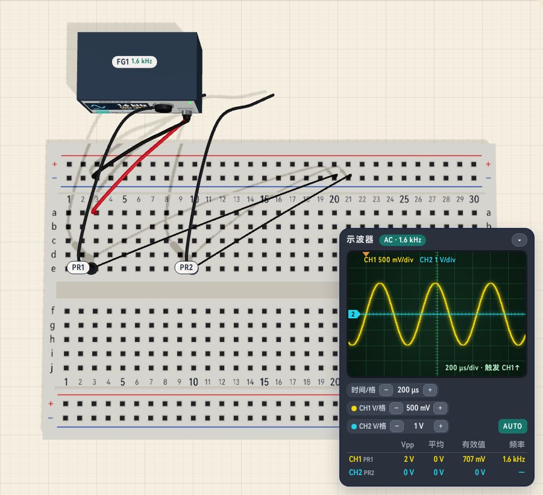
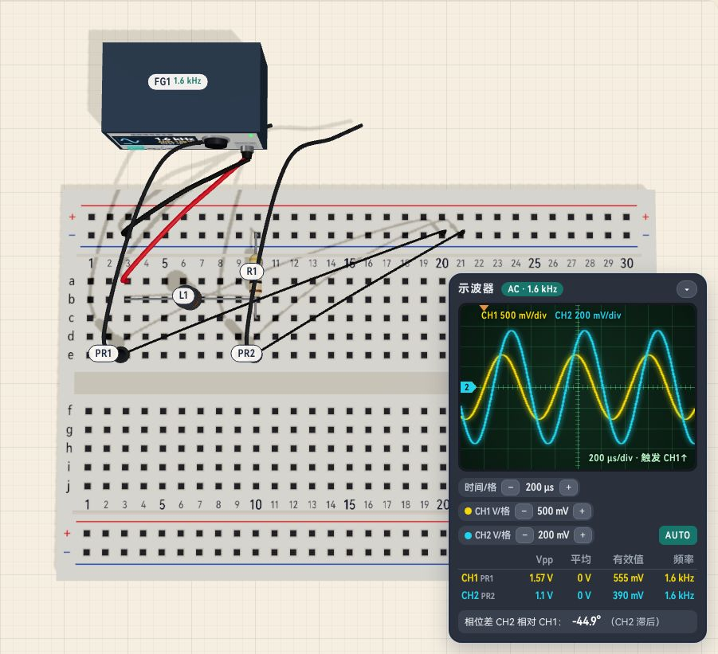
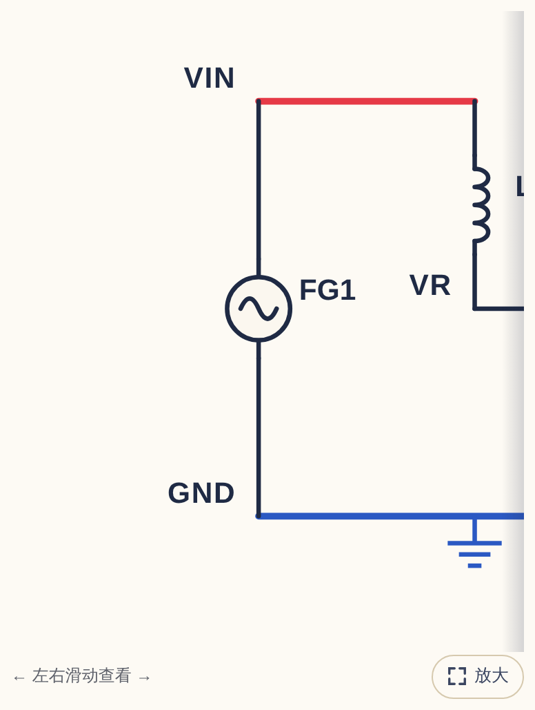
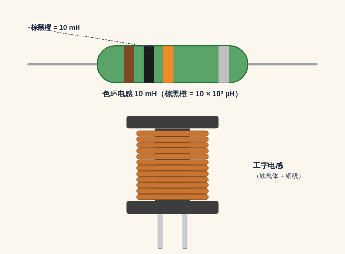
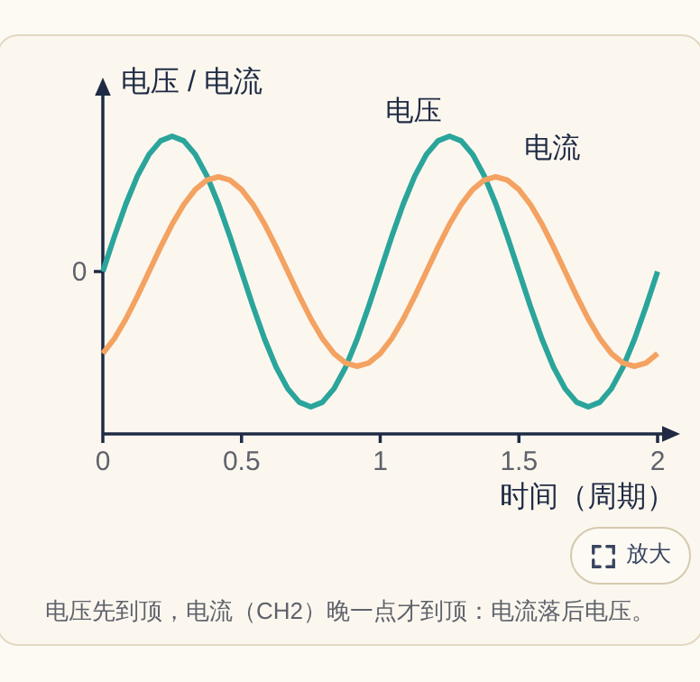
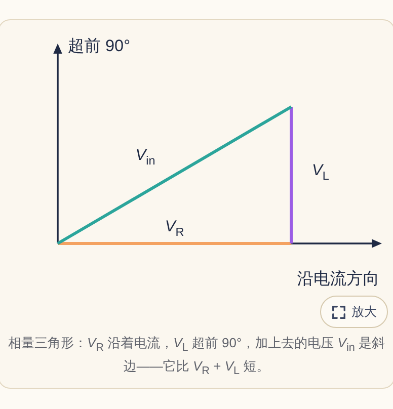

# 5.1 · RL 串联：电流为什么慢半拍

| 项目 | 内容 |
|---|---|
| id | `exp4-rl-phasors` |
| 文件 | `challenges/263-rl-phasors.json` |
| 类型 | 实验 / 挑战（没有分步，照目标电路图搭） · 难度 3/5 |
| 位置 | World 5 · 正弦稳态、相量与交流功率 → 5.1 相量：RL 电路的电压三角形（本节第 1 项） |
| 右侧面板 | 轨道由旧的四张卡片自动生成（还没手工精排） |
| 前后 | 上一项 [4.5 exp3-rlc-step-response](../w4/4.05-2-exp3-rlc-step-response.md) · 下一项 [5.1 exp4-rlc-series-ac](../w5/5.01-2-exp4-rlc-series-ac.md) |
| 先修 | lesson-scope-two-channels |
| 概念 | 感抗 X_L = ωL、阻抗 Z = R + jωL、电流落后电压 current lags voltage、相量图 / 电压三角形 phasor diagram、用电阻电压看电流 sense resistor |

**一句话概要**：电感串电阻接正弦波：用示波器看电流落后电压，再量出三段电压，发现它们不能直接相加。

## 1. 左侧工作台（3D 面包板 → 2D 俯视截图）

截图是程序里真实的 3D 面包板换成俯视角拍的；表格是同一块板的文字版（元件、参数、每只脚插在哪个孔）。

### 1.1 起点：打开这一课时板上已经有的

右侧显示的「起点」说明：

> **半成品**：信号发生器（已经设好波形）和两个示波器探头已经接好。**为什么**：仪器的接法第 12、13 课练过，这个实验要看的是电路本身的波形。**你要做**：加上 L1（10mH，第 3 列 → 第 10 列）和 R1（100Ω，第 10 列 → GND）。

| 元件 | 类型 | 参数 | 引脚 → 孔 |
|---|---|---|---|
| FG1 | function_gen | waveform=sine, frequency=1600, amplitude=1, offset=0 | +→a3 -→tn3 |
| PR1 | scope_probe | channel=1 | tip→e3 gnd→tn20 |
| PR2 | scope_probe | channel=2 | tip→e10 gnd→tn21 |

### 1.3 参考答案（「看答案」载入的板子）

| 元件 | 类型 | 参数 | 引脚 → 孔 |
|---|---|---|---|
| FG1 | function_gen | waveform=sine, frequency=1600, amplitude=1, offset=0 | +→a3 -→tn3 |
| L1 | inductor | inductance=0.01 | 1→b3 2→b10 |
| R1 | resistor | resistance=100 | 1→c10 2→tn10 |
| PR1 | scope_probe | channel=1 | tip→e3 gnd→tn20 |
| PR2 | scope_probe | channel=2 | tip→e10 gnd→tn21 |

### 1.4 目标原理图（右侧「目标原理图」抽屉）

| 元件 | 类型 | 参数 |
|---|---|---|
| FG1 | function_gen |  |
| L1 | inductor | inductance=0.01 |
| R1 | resistor | resistance=100 |

连接（每个结点上的引脚）：

- **VIN**：FG1.+、L1.1
- **VR**：L1.2、R1.1
- **GND**：R1.2、FG1.-

## 2. 右侧面板：学生从上往下看到的内容（单轨流）

### 第 1 步 · 🔍 先看一眼：先认识它：电感

**拆解「电感 Inductor：一卷导线，抗拒电流变化」第 1 / 8 层：① 外形：像电阻的色环电感、工字电感**

课程里的电感有两种常见外形：
- 色环电感 axial inductor：长得像一个胖电阻（常是绿色身体），也用色环标值，但单位是 **µH**：棕 黑 橙 = 10 × 10³ µH = **10 mH**（RL、RLC 实验用的就是这个值）。别把它当成电阻插错！用万用表一量就知道：电阻是 10 kΩ，电感只有几 Ω 到几十 Ω。
- 工字电感 drum-core inductor：一个“工”字形的黑色铁氧体磁芯，上面绕着一层层铜漆包线，两只脚朝下。

**inductance（电感）L** 的单位是亨利 H。常用 mH（10⁻³）、µH（10⁻⁶）。电感 **没有极性**，两只脚可以互换。

课程里会遇到的电感：

| 在哪 | L | 线圈电阻 | 用途 |
|---|---|---|---|
| RL / RLC 实验 | 10 mH | 仿真 1 Ω（真实 10–30 Ω） | 看 τ = L/R、振铃、相量 |
| 继电器线圈 | 150 mH | 70 Ω | 电磁铁吸合触点 |
| 直流电机 | 2 mH | 8 Ω | 线圈产生转矩 |

### 第 2 步 · 🔧 动手搭：两条正弦波，谁先到顶？

信号发生器和两支探头已经在板上了。**电感**（`10 mH`）插 **`b3`**–**`b10`**，**电阻**（`100 Ω`）插 **`c10`**–**`tn10`**。
信号发生器设成 **正弦波、`1.6 kHz`、幅度 `1 V`**。CH1 看加上去的电压；CH2 看电阻上的电压——电阻上的电压和流过它的电流同一个形状。
看两条波形：CH2 的波峰比 CH1 **早**到还是**晚**到？

### 第 3 步 · 💡 想明白：电感讨厌变化

- 电感会顶住电流的**变化**。所以电流跟不上电压，总是**晚一点**才到顶。

*图 `waves`（plot）：电压先到顶，电流（CH2）晚一点才到顶：电流落后电压。*

- 频率越高，变化越快，电感顶得越狠。这种“交流里的电阻”叫**感抗**：
$$X_L = 2π f L$$
1.6 kHz 时 $X_L = 2π × 1600 × 0.01 ≈ 100$ Ω，和 R 差不多大。
- 两段电压不是同时到顶的，所以不能直接相加。把每个电压画成一支箭头（**相量**，长度取有效值）：电阻的箭头沿着电流，电感的箭头**超前四分之一圈**。加上去的电压是三角形的斜边。

*图 `triangle`（plot）：相量三角形：V_R 沿着电流，V_L 超前 90°，加上去的电压 V_in 是斜边——它比 V_R + V_L 短。*

（这一步下面列着这节课的计算卡片，点开就地展开：`generator-output`、`rms-sine`、`phase-from-delay`、`inductive-reactance`、`rl-impedance`、`ac-kvl`、`first-order-phase`，全文见第 6 节）

### 第 4 步 · 🔧 动手搭：量出三角形的三条边

- 先保持 CH2 在电阻上：读 CH1、CH2 的 **Vpp**，再读示波器下面的 **CH2 相对 CH1 的相位差**。
- 再把 **CH2 夹到电感两端**：针尖插 **`d3`**，接地夹插 **`d10`**。这里的探头量的是“针尖减接地夹”，所以 CH2 显示的就是电感电压 v_L。
- 电路检查通过后填测量题。填完可以把频率换成 `160 Hz` 和 `16 kHz`，看落后的角度怎么变。

### 第 5 步 · 📏 测一测：测一测：读你自己的仪表

**测量题 1 · `uin`**（读数题）

> 1.6 kHz：CH1（VIN，信号发生器端子）的 Vpp

- 单位 V · 先写预测 · 状态：FG1 设为 信号发生器（正弦 1.6kHz 幅度 1V） · 参考答案的读数 **1.571 V** · 合理范围 [1.49, 1.65]

答对后显示：

> 1 V 是信号发生器内部的电动势，经过 50 Ω 才到端子：2 × 1 V × 142.5 / |151 + j100.5| ≈ 1.57 Vpp。

**测量题 2 · `ur`**（读数题）

> 1.6 kHz：CH2（v_R，也就是电流的波形）的 Vpp

- 单位 V · 先写预测 · 状态：FG1 设为 信号发生器（正弦 1.6kHz 幅度 1V） · 参考答案的读数 **1.102 V** · 合理范围 [1.05, 1.16]

答对后显示：

> V_R / V_in = R / |Z| ≈ 100 / 142.5 ≈ 0.70，≈ 1.10 Vpp。

**测量题 3 · `ph`**（读数题）

> 1.6 kHz：CH2 在电阻上（电流）相对 CH1 的相位差（落后为负）

- 单位 ° · 先写预测 · 状态：FG1 设为 信号发生器（正弦 1.6kHz 幅度 1V） · 参考答案的读数 **-44.87 °** · 合理范围 [-47.1, -42.6]

答对后显示：

> 电流落后 arctan(X_L/(R + r)) ≈ arctan(100.5/101) ≈ 45°。这个频率就是 RL 低通的截止频率 fc = (R + r)/(2πL)。

**测量题 4 · `ul`**（读数题）

> 1.6 kHz：CH2 夹到电感两端（针尖 d3、接地夹 d10），读电感电压 v_L 的 Vpp

- 单位 V · 先写预测 · 状态：FG1 设为 信号发生器（正弦 1.6kHz 幅度 1V） · 参考答案的读数 **1.109 V** · 合理范围 [1.05, 1.16]

答对后显示：

> X_L = 2π × 1600 × 10 mH ≈ 100.5 Ω ≈ R + r，所以 v_L 和 v_R 差不多大，≈ 1.11 Vpp。

**测量题 5 · `kvl`**（选择题）

> 用你的三个读数检查 KVL：

- A. VIN ≈ √(V_R² + V_L²)：相量相加，两者相差约 90° ✅（正确）
- B. VIN ≈ V_R + V_L：直接相加
- C. VIN ≈ V_L − V_R

答对后显示：

> 1.10 + 1.11 = 2.21 ≠ 1.57，但 √(1.10² + 1.11²) ≈ 1.56。交流 KVL 是相量相加：V̇L 超前 V̇R 约 90°。

### 第 6 步 · 🎒 带走：带走

- 电感里**电流落后电压**。频率越高，$X_L$ 越大，落后得越多。
- 交流电压按**相量**（箭头）相加，不能把读数直接加。本课程的相量一律用**有效值**。
- 坑：真实示波器的接地夹连着市电的地线。把它夹在电感两端，等于把 R1 那头短接到地。真实电路里要用两个通道都对地测，再相减。
- 真实的 10 mH 小电感有几欧到几十欧的线圈电阻（这里按 1 Ω 算），落后的角度会小一些。

趁热练理论题：`phasors`、`ac-analysis`

## 3. 测量题一览

| # | id | 题目 | 类型 | 单位 | 状态 | 参考读数 |
|---|---|---|---|---|---|---|
| 1 | uin | 1.6 kHz：CH1（VIN，信号发生器端子）的 Vpp | scope | V | FG1 设为 信号发生器（正弦 1.6kHz 幅度 1V） | 1.571 V |
| 2 | ur | 1.6 kHz：CH2（v_R，也就是电流的波形）的 Vpp | scope | V | FG1 设为 信号发生器（正弦 1.6kHz 幅度 1V） | 1.102 V |
| 3 | ph | 1.6 kHz：CH2 在电阻上（电流）相对 CH1 的相位差（落后为负） | scope | ° | FG1 设为 信号发生器（正弦 1.6kHz 幅度 1V） | -44.87 ° |
| 4 | ul | 1.6 kHz：CH2 夹到电感两端（针尖 d3、接地夹 d10），读电感电压 v_L 的 Vpp | scope | V | FG1 设为 信号发生器（正弦 1.6kHz 幅度 1V） | 1.109 V |
| 5 | kvl | 用你的三个读数检查 KVL： | 选择 |  |  | 正确：A |

### 全部答完后显示的「对比」

**对比**：
- 在 f = 1.6 kHz：X_L = 2π × 1600 × 10 mH ≈ 100.5 Ω ≈ R + r = 101 Ω。电流 İ = V̇in/Z 落后 V̇in 的角度 = arctan(X_L/(R + r)) ≈ 45°；V_R/V_in = R/|Z| ≈ 100/142.5 ≈ 0.70。
- **电压三角形**：V̇in = V̇R + V̇L（有效值相量），而 V̇L 超前 V̇R 约 90°。示波器上 VIN ≈ 1.57 Vpp（50 Ω 输出电阻分掉了一部分，见下）、v_R ≈ 1.10 Vpp、v_L ≈ 1.11 Vpp：1.10 + 1.11 = 2.21 ≠ 1.57，但 √(1.10² + 1.11²) ≈ 1.56 ≈ 1.57。**交流电路的 KVL 是相量相加，不是有效值 / 峰峰值直接相加**。
- 电流有效值 I = 1 V/√2 / |151 + j100.5| Ω ≈ 3.9 mA（这里要把 50 Ω 算进去，因为 1 V 是信号发生器内部的电动势）。

**为什么 VIN 只有 1.57 Vpp**：信号发生器的 1 V 是它内部理想源的幅度，经过 50 Ω 才到端子。端子电压 = 1 V × |Z| / |Z + 50 Ω| = 142.5 / |151 + j100.5| ≈ 0.786 V 峰值。测滤波器、相位时都拿端子电压（CH1）作参考，这个影响就消掉了。

**换频率**：
- 160 Hz：X_L ≈ 10 Ω ≪ R，几乎是纯电阻电路，电流几乎和电压同相（落后 ≈ 5.7°），v_R/v_in ≈ 0.985（= 100/101 × 0.995，线圈的 1 Ω 分走了 1%）。
- 16 kHz：X_L ≈ 1005 Ω ≫ R，电流很小且落后 ≈ 84°，v_R/v_in ≈ 0.10，几乎全部电压都在电感上。

**想一想**：这个电路取 v_R 作输出，就是一个 **RL 低通滤波器**，截止频率 fc = (R + r)/(2πL) ≈ 1.6 kHz。

### 提示按钮（依次显示）

1. 电感在前（接红夹子那一列），电阻在后接 GND。
2. 电阻上的电压和电流同形状、同相位：CH2 在电阻上，看到的就是电流。
3. X_L = 2πfL，1.6 kHz 时约 100 Ω，和 R 差不多。

### 功能测试（「检查我的电路」时跑）

- 1.6 kHz：电流（v_R）落后 VIN；电流有效值合理
- 1.6 kHz：v_R、v_L、VIN 的峰峰值按相量相加
- 160 Hz：几乎是纯电阻
- 16 kHz：电感为主

## 4. 用到的拆解（全部层的文字，供改写参考）

### 拆解 `inductor`：电感 Inductor：一卷导线，抗拒电流变化

*电感是电容的“对偶”：电容存电场能、电压不能跳；电感存磁场能、电流不能跳。拆开是绕在磁芯上的一卷铜线；由此推出 L = μN²A/l、v = L di/dt、W = ½LI²，再看关断时的高压尖峰、RL 的时间常数 τ = L/R 和感抗 2πfL。*

**拆解「电感 Inductor：一卷导线，抗拒电流变化」第 1 / 8 层：① 外形：像电阻的色环电感、工字电感**

课程里的电感有两种常见外形：
- 色环电感 axial inductor：长得像一个胖电阻（常是绿色身体），也用色环标值，但单位是 **µH**：棕 黑 橙 = 10 × 10³ µH = **10 mH**（RL、RLC 实验用的就是这个值）。别把它当成电阻插错！用万用表一量就知道：电阻是 10 kΩ，电感只有几 Ω 到几十 Ω。
- 工字电感 drum-core inductor：一个“工”字形的黑色铁氧体磁芯，上面绕着一层层铜漆包线，两只脚朝下。

**inductance（电感）L** 的单位是亨利 H。常用 mH（10⁻³）、µH（10⁻⁶）。电感 **没有极性**，两只脚可以互换。

课程里会遇到的电感：

| 在哪 | L | 线圈电阻 | 用途 |
|---|---|---|---|
| RL / RLC 实验 | 10 mH | 仿真 1 Ω（真实 10–30 Ω） | 看 τ = L/R、振铃、相量 |
| 继电器线圈 | 150 mH | 70 Ω | 电磁铁吸合触点 |
| 直流电机 | 2 mH | 8 Ω | 线圈产生转矩 |

**拆解「电感 Inductor：一卷导线，抗拒电流变化」第 2 / 8 层：② X 光：磁芯上绕着很多圈铜线**

把外皮变透明，两种电感里都只有两样东西：
1. 绕组 winding：一根很长的 **漆包铜线**（表面一层绝缘漆，所以一圈挨一圈也不会短路），绕了 N 圈。10 mH 的小电感有几百圈，线径只有 0.1 mm 左右——所以它的直流电阻并不小（10–30 Ω）。
2. 磁芯 core：一般是 **ferrite（铁氧体）**，一种铁的氧化物陶瓷。它的 **相对磁导率** $μ_r$ 有几百到几千：同样的电流，磁芯里的磁场比空气里强几百倍，于是同样的圈数电感大几百倍（下一层的公式）。

电感 **就是一段导线**：电流不变的时候，它对电流没有任何“阻碍”，只剩导线本身的电阻。它的全部本事都在 **电流变化** 的时候才显出来。

**拆解「电感 Inductor：一卷导线，抗拒电流变化」第 3 / 8 层：③ 电流产生磁场：L = NΦ/i = μN²A/l**

电流流过 线圈，会在线圈里面产生 **magnetic field（磁场）** B，方向由右手定则决定，磁力线 从线圈一端出来、绕回另一端。穿过线圈截面 A 的磁场总量叫 **magnetic flux（磁通）** Φ = B·A。

磁通和电流成正比；N 圈线圈每一圈都被同一个 Φ 穿过，总的 **flux linkage（磁链）** 是 NΦ。定义：
$$L = \frac{NΦ}{i}$$
对一个长螺线管，$B = \frac{μNi}{l}$，代入得
$$L = \frac{μN^{2}A}{l},   μ = μ_r μ_0,   μ_0 = 4π×10^{-7} H/m$$
- **N²**：圈数加倍，磁场加倍，被它穿过的圈数也加倍 → L × 4；
- 磁芯 的 $μ_r$：铁氧体让 L 大几百倍；
- 截面积 A 大、长度 l 短 → L 大。

**带数字**：N = 250，A = 20 mm²，l = 15 mm，有效 $μ_r ≈ 100$：
$$L = \frac{100 × 4π×10^{-7} × 250^{2} × 20×10^{-6}}{0.015} ≈ 10.5 mH$$
同样的线圈不加磁芯（$μ_r = 1$）只有约 0.1 mH。

- 公式 `L = \frac{NΦ}{i} = \frac{μ_r μ_0 N^{2} A}{l}`：L ∝ N²：圈数翻倍，电感 ×4

**拆解「电感 Inductor：一卷导线，抗拒电流变化」第 4 / 8 层：④ v = L di/dt：电压只看电流变化得多快**

**Faraday’s law（法拉第电磁感应定律）**：线圈里的磁链变化时，线圈两端感应出电压 $v = \frac{d(NΦ)}{dt}$。代入 $NΦ = Li$：
$$v = L\frac{di}{dt}$$
（关联参考方向）。感应电压的方向总是 **阻碍电流的变化**（**Lenz’s law 楞次定律**）：电流要增大，它就“顶”回去；电流要减小，它就“推”着电流继续走。

和电容 $i = C\frac{dv}{dt}$ 一一对应（**duality 对偶**：v ↔ i，C ↔ L）：
1. 电流不变 → 电压为 0。直流稳态下理想电感就是 **短路**（一根导线）。
2. 电流匀速上升 → 电压恒定：10 mH 在 1 ms 内从 0 升到 10 mA，$v = 10 mH × \frac{10 mA}{1 ms} = 0.1 V$。在 0.1 ms 内降回 0，电压是 −1 V——变化快 10 倍，电压大 10 倍。
3. **电感电流不能跳变**：$i_L(0^+) = i_L(0^-)$。要在 0 秒内改变电流，需要无穷大的电压。

**储存的能量**：$p = vi = Li\frac{di}{dt}$，从 0 到 I 积分：
$$W = \frac{1}{2}LI^{2}$$
- 10 mH、10 mA：$\frac{1}{2} × 0.01 × 10^{-4} = 0.5 µJ$；
- 继电器线圈 150 mH、71 mA：$\frac{1}{2} × 0.15 × 0.071^{2} ≈ 0.38 mJ$——关断时这些能量必须有地方去（下一层）。

|  | 电容 C | 电感 L |
|---|---|---|
| 基本关系 | $i = C\frac{dv}{dt}$ | $v = L\frac{di}{dt}$ |
| 不能跳变的量 | 电压 $v_C$ | 电流 $i_L$ |
| 直流稳态 | 断路 | 短路 |
| 储能 | $\frac{1}{2}CV^{2}$（电场） | $\frac{1}{2}LI^{2}$（磁场） |
| 时间常数 | τ = RC | τ = L/R |

- 公式 `v = L\frac{di}{dt}`：直流稳态：di/dt = 0 → v = 0（短路）
- 公式 `W = \frac{1}{2}LI^{2}`：150 mH、71 mA：0.38 mJ

**拆解「电感 Inductor：一卷导线，抗拒电流变化」第 5 / 8 层：⑤ 电流不能跳 → 断开电感会产生高压**

继电器实验（exp5-relay-flyback）：+5 V → 继电器线圈 150 mH + 70 Ω → 三极管（开关） → GND。导通时线圈电流 $I = \frac{5}{70} ≈ 71 mA$。

现在开关在约 1 µs 内断开。电感说：“我的电流不能跳。”可是电流已经无路可走——于是 $\frac{di}{dt}$ 非常大，按 $v = L\frac{di}{dt}$：
$$v ≈ 0.15 H × \frac{0.071 A}{1 µs} ≈ 10 000 V$$
这当然达不到——电压会一直升高，直到 **某个东西被击穿、给电流开出一条路**：三极管 C–E 击穿（约 40 V）、开关触点间拉出电弧……仿真里 集电极 的尖峰约 29 V（受仿真步长和三极管关断过程限制），真实电路可能更高。这就是线圈驱动电路里三极管莫名其妙烧掉的原因，也是汽车点火线圈产生上万伏高压的原理。

**解决**：并一个 续流二极管（阴极接 +5 V）。开关断开时，电流改走“线圈 → 二极管 → 线圈”这个小回路，集电极电压被钳在 $5 + 0.7 = 5.7 V$；0.38 mJ 的能量按 $τ = \frac{L}{R} = \frac{150 mH}{70 Ω} ≈ 2.1 ms$ 慢慢消耗在线圈电阻和二极管上。（二极管拆解的第 ⑦ 层有详细说明。）

- 公式 `v = L\frac{di}{dt} ≈ 0.15 × \frac{0.071}{10^{-6}} ≈ 10 kV`：理论值：说明必须给电流留一条路
- 公式 `V_{clamp} = 5 V + 0.7 V = 5.7 V`：有续流二极管时

**拆解「电感 Inductor：一卷导线，抗拒电流变化」第 6 / 8 层：⑥ RL 阶跃：电流按 τ = L/R 慢慢跟上**

RL 方波实验（exp3-rl-square）：信号发生器（50 Ω）→ 100 Ω → 10 mH（线圈电阻 1 Ω） → GND，方波 ±1 V，每次跳 2 V。

**推导**（和 RC 完全对偶）：
1. KVL：$V = R_{tot} i + L\frac{di}{dt}$，$R_{tot} = 100 + 50 + 1 = 151 Ω$；
2. 一阶线性微分方程，时间常数
$$τ = \frac{L}{R_{tot}} = \frac{10 mH}{151 Ω} ≈ 66 µs$$
3. 终值 $I_∞ = \frac{V}{R_{tot}} = \frac{1 V}{151 Ω} ≈ 6.6 mA$。方波从 −1 V 跳到 +1 V：电流从 −6.6 mA 出发，连续地 走向 +6.6 mA：
$$i(t) = I_∞ + (i(0) - I_∞)e^{-t/τ}$$
4. 电感电压 在跳变瞬间跳到约 2 V：因为电流不能跳，电阻上的电压也不能跳，2 V 的跳变全部落在电感上；然后按 $e^{-t/τ}$ 衰减到 0（剩下 1 Ω × 6.6 mA ≈ 7 mV）。

**和 RC 对比**：RC 中电容 **电压** 连续、电流可以跳；RL 中电感 **电流** 连续、电压可以跳。

**带数字**：1 kHz 方波半周期 0.5 ms ≈ 7.6τ，电流每次都走完全程；10 kHz 半周期 50 µs ≈ 0.76τ，电流只走到一半就反向，波形变成三角波。

- 公式 `τ = \frac{L}{R_{tot}} = \frac{10 mH}{151 Ω} ≈ 66 µs`：$R_tot$ 要算上信号发生器 50 Ω 和线圈 1 Ω
- 公式 `i(t) = I_∞ + (i(0) - I_∞)e^{-t/τ}`：三要素法

**拆解「电感 Inductor：一卷导线，抗拒电流变化」第 7 / 8 层：⑦ 频率：直流短路，高频断路**

通正弦电流 $i = I_m sin ωt$，代入 $v = L\frac{di}{dt}$：
$$v = ωLI_m cos ωt$$
- 电压幅值 / 电流幅值 = ωL，这就是 **inductive reactance（感抗）**：
$$X_L = ωL = 2πfL$$
- 电感的 **电流落后电压 90°**（和电容相反）。相量：$Z_L = jωL$。

感抗和频率成正比。对 10 mH：
- 160 Hz：10 Ω；1.6 kHz：100 Ω；16 kHz：1 kΩ；
- 直流：$X_L = 0$，只剩线圈电阻——**短路**；
- 高频：$X_L$ 很大，接近 **断路**。所以电感用来 **通直流、阻交流**：电源滤波、扼流圈（choke）。

RL 相量实验（exp4-rl-phasors）选 1.6 kHz 正是因为这时 $X_L ≈ 100 Ω = R$：总阻抗 $Z = (R + r) + jωL ≈ 101 + j100.5 Ω$，电流落后电压约 45°，$V_R$ 和 $V_L$ 大小差不多。低于约 1 Ω / (2π × 10 mH) ≈ 16 Hz 时，线圈电阻比感抗还大，电感就“看起来像电阻”了。

| f | $X_L$（10 mH） | 相当于 |
|---|---|---|
| 0（直流） | 0（剩 1 Ω 线圈电阻） | 短路 |
| 160 Hz | 10 Ω | 小电阻 |
| 1.6 kHz | 100 Ω | = R：RL 相量实验 |
| 16 kHz | 1 kΩ | 大阻抗 |

- 公式 `X_L = 2πfL`：电流落后电压 90°；$Z_L$ = jωL

**拆解「电感 Inductor：一卷导线，抗拒电流变化」第 8 / 8 层：⑧ 真实电感：线圈电阻、饱和、自谐振**

真实电感 = 理想 L + 几个寄生效应：
- 线圈电阻 $R_w$：几百圈细铜线，真实 10 mH 小电感有 10–30 Ω（**仿真器只算 1 Ω**）。它串在回路里：RL 实验的 $τ = \frac{L}{R}$ 变小、稳态电流变小；RLC 实验的衰减更快；相量实验里电流落后的角度变小。只有直流电源时，仿真器把电感当成 1 Ω 的导线。
- 磁芯饱和 saturation：电流超过 $I_{sat}$ 后，磁芯里的磁畴全部排好了队，$μ_r$ 迅速下降，L 也跟着骤降——电流会突然涨得很快。选电感时除了 L 还要看 **饱和电流** 和 **额定电流**（发热）。
- 匝间电容 $C_p$：相邻两圈导线之间有几 pF 到几十 pF。它和 L 组成并联谐振，频率高于 自谐振频率 $f_{SRF} = \frac{1}{2π\sqrt{LC_p}}$ 时电感反而像电容。10 mH、20 pF：约 360 kHz。
- 磁芯损耗：铁氧体在高频有磁滞和涡流损耗，相当于又多一个随频率增大的电阻。

**仿真器里**：电感是 L 串 1 Ω，没有饱和、匝间电容和磁芯损耗。时域仿真的步长有限，太快的 LC 振荡（每个周期不到 10 步）会被抹平，诊断面板会提示。

| 参数 | 真实 10 mH 小电感 | 仿真器 |
|---|---|---|
| 线圈电阻 | 10–30 Ω | 1 Ω |
| 饱和电流 | 几十 mA | 不饱和 |
| 匝间电容 / 自谐振 | ≈ 20 pF / ≈ 360 kHz | 无 |
| 误差 | ±10% | 0 |

- 公式 `f_{SRF} = \frac{1}{2π\sqrt{L C_p}}`：10 mH、20 pF：≈ 356 kHz

**一句话记住**：电感 = 磁芯上的一卷导线：$L = \frac{μN^{2}A}{l}$。它的全部行为是 $v = L\frac{di}{dt}$：电流不能跳变，直流稳态短路，储能 $\frac{1}{2}LI^{2}$；突然断开会产生高压尖峰，所以线圈要并续流二极管；RL 电路 $τ = \frac{L}{R}$；交流下 $X_L = 2πfL$，频率越高越像断路。真实电感有线圈电阻（仿真 1 Ω，真实 10–30 Ω）、会饱和。

## 5. 这一课的计算卡片

**计算卡片 `generator-output`：信号发生器的 50 Ω 输出电阻**

- 公式 `V_{out} = V_{set} \frac{R_L}{50 Ω + R_L}`
- 用途：信号发生器 = 理想波形源串 50 Ω：接上负载以后输出比设定小多少。
- 输入：V_set（设定的幅度（或偏置），V）；R_o（输出电阻，Ω）；R_L（负载（电路的输入电阻），Ω） → V_out（端口上的实际值，V）

1. 发生器内部 = 一个理想波形源 + 串联的 50 Ω（$R_o$）。空载时端口电压就是设定值。
2. 接负载 $R_L$：$R_o$ 和 $R_L$ 分压，$V_{out} = V_{set}\frac{R_L}{R_o + R_L}$。交流部分和直流偏置都被同一个比例缩小。
3. $R_L ≫ 50 Ω$（几 kΩ 以上）时差别不到 1 %；50 Ω 负载正好减半。
4. 负载是 RC、RL 时用阻抗的模：$|V_{out}| = V_{set}\frac{|Z|}{|Z + R_o|}$，而且随频率变——所以滤波实验用端口电压（CH1）做参考。
5. 时间常数里要把 50 Ω 算进 R：$τ = (R + 50)C$。

例子：- 第 12 课：设 1 V，50 Ω 负载：0.5 V 幅度 = 1.0 Vpp；偏置 +1 V 也变成 0.5 V。
- 实验 2-7：反相放大器输入电阻 10 kΩ：$1 × \frac{10000}{10050} ≈ 0.995$，输出 2.19 Vpp 而不是 2.2。
- 实验 4-3：$|Z| = 142.5 Ω$，$|Z + 50| = |151 + j100.5| ≈ 181 Ω$：端口只有 $\frac{142.5}{181} ≈ 0.786 V$ 峰值（1.57 Vpp）。

- ⚠ 很多真实发生器按“接 50 Ω 负载”显示幅度：接高阻电路实际是显示值的两倍（除非设成 High-Z）。
- ⚠ 算 τ、谐振电流、RLC 阻尼时忘了这 50 Ω。

**计算卡片 `rms-sine`：正弦波的有效值 RMS of a sine**

- 公式 `V_{rms} = \frac{V_p}{\sqrt{2}} ≈ 0.707 V_p`
- 用途：正弦信号的有效值：和多大的直流电压在电阻上产生同样的热。
- 输入：V_p（峰值（幅度），V） → V_rms（有效值，V）

1. 有效值的定义：在电阻上产生相同平均功率的直流值，$V_{rms} = \sqrt{\frac{1}{T}∫_{0}^{T} v^{2} dt}$（均方根）。
2. 正弦：$v^{2} = V_p^{2}sin^{2}(ωt) = \frac{V_p^{2}}{2}(1 - cos 2ωt)$，一个周期里 cos 项平均为 0。
3. 所以均方值是 $\frac{V_p^{2}}{2}$，开方得 $\frac{V_p}{\sqrt{2}}$。
4. **只对正弦成立**：方波（±A）的有效值就是 A；占空比 D 的 0/$V_H$ 方波是 $V_H\sqrt{D}$。
5. 直流 + 交流：$V_{rms} = \sqrt{V_{dc}^{2} + V_{ac,rms}^{2}}$。

例子：第 12 课：50 Ω 负载上 0.5 V 峰值 → $\frac{0.5}{1.414} ≈ 0.354 V$。实验 4-4：谐振时有效值电流 $\frac{1/\sqrt{2}}{101 + 50} ≈ 4.7 mA$。

- ⚠ 普通万用表交流档按正弦标定：测方波、PWM 读数不对，要用真有效值表。
- ⚠ 有效值、峰值、峰峰值别混着比：先统一成同一种。

**计算卡片 `phase-from-delay`：由时间差算相位差 Phase from time delay**

- 公式 `φ = -360° × \frac{Δt}{T} = -360° × Δt f`
- 用途：两个同频正弦，CH2 比 CH1 晚 Δt 到峰值：相位差是多少度（落后为负）。
- 输入：Δt（CH2 比 CH1 晚多少，s）；f（频率，Hz） → φ（CH2 相对 CH1 的相位（度），）

1. 一个整周期 T 对应 360°。
2. 晚了 Δt，就是晚了 $\frac{Δt}{T}$ 个周期 = $360° × \frac{Δt}{T}$。
3. 符号约定：CH2 **晚** 到（落后）记为负，**早** 到（超前）记为正。
4. 反过来：$Δt = \frac{|φ|}{360°} × T$。
5. 读 Δt：两个波形的过零点（同一方向）之间的格数 × time/div。

例子：第 13 课：1 kHz、1 kΩ + 100 nF，电容电压落后 $arctan\frac{1000}{1592}$ ≈ 32°，对应 $Δt = \frac{32}{360} × 1 ms ≈ 89 µs$。实验 4-1：在 $f_c$ 处 −45° = 晚八分之一周期。

- ⚠ Δt 超过半个周期时，“晚 Δt”也可以看成“早 T − Δt”：相位通常取 −180° … +180°。
- ⚠ 反相放大器的输出和输入差 180°，看起来像“晚了半个周期”。

**计算卡片 `inductive-reactance`：感抗 Inductive reactance**

- 公式 `X_L = 2π f L`
- 用途：电感对某个频率的正弦信号的阻碍（单位 Ω）：频率越高越大。
- 输入：f（频率，Hz）；L（电感，H） → X_L（感抗，Ω）

1. 电感的电压 $v = L\frac{di}{dt}$。
2. 电流 $i = I_m sin(ωt)$ 时 $v = ωLI_m cos(ωt)$，幅度之比 $\frac{V_m}{I_m} = ωL$。
3. 电压比电流 **超前 90°**（电流落后）；相量 $Z_L = jωL = jX_L$。
4. 和电容相反：**直流时电感是短路**（只剩线圈电阻 r），高频时接近开路。

例子：实验 4-3：$2π × 1600 × 10 mH ≈ 100.5 Ω$，和 R + r = 101 Ω 几乎一样，所以电流落后约 45°。160 Hz 只有约 10 Ω，16 kHz 约 1005 Ω。实验 4-4：谐振 5033 Hz 时 $X_L ≈ 316 Ω$。

- ⚠ 真实电感还有线圈电阻 r：它和 $X_L$ 是相量相加，不是直接相加。

**计算卡片 `rl-impedance`：RL 串联阻抗 Series RL impedance**

- 公式 `|Z| = \sqrt{(R + r)^{2} + (ωL)^{2}}, φ = arctan\frac{ωL}{R + r}`
- 用途：电阻和电感（带线圈电阻 r）串联的阻抗，电流落后电压多少。
- 输入：R（电阻，Ω）；r（线圈电阻，Ω）；L（电感，H）；f（频率，Hz） → |Z|（阻抗的模，Ω）

1. $Z = (R + r) + jωL$：实部是所有电阻，虚部是感抗。
2. 模 $|Z| = \sqrt{(R + r)^{2} + (ωL)^{2}}$，角 $φ = arctan\frac{ωL}{R + r}$：电压超前电流，电流 **落后**。
3. 电阻电压和电流同相，所以示波器上 $v_R$ 就是电流的波形：$\frac{V_R}{V_{in}} = \frac{R}{|Z|}$。
4. 取 $v_R$ 当输出，这是一个 **RL 低通**：$ωL = R + r$ 时 |Z| 是 $\sqrt{2}(R + r)$，相位 45°，截止频率 $f_c = \frac{R + r}{2πL}$。

例子：实验 4-3：1.6 kHz：$|Z| = \sqrt{101^{2} + 100.5^{2}} ≈ 142.5 Ω$，电流落后约 45°，$\frac{V_R}{V_{in}} = \frac{100}{142.5} ≈ 0.70$；$f_c = \frac{101}{2π × 0.01} ≈ 1.6 kHz$。

- ⚠ 算电流用的是 |Z|，但算“发生器内部电动势”时还要加上 50 Ω：$|151 + j100.5|$。

**计算卡片 `ac-kvl`：交流 KVL：相量相加**

- 公式 `V = \sqrt{V_R^{2} + V_X^{2}}`
- 用途：电阻电压和电感（或电容）电压差 90°：总电压是两者的“勾股和”，不是直接相加。
- 输入：V_R（电阻电压（Vpp 或有效值），V）；V_X（电感 / 电容电压（同一种量），V） → V（总电压，V）

1. 任何时刻 KVL 都成立：$v = v_R + v_L$（瞬时值相加）。
2. 但 $v_R$ 和 $v_L$ 的峰值不在同一时刻到达：电感电压比电阻电压超前 90°。
3. 用相量表示：$V̇ = V̇_R + V̇_L$，两个相量互相垂直，构成直角三角形（电压三角形）。
4. 所以幅度（或有效值、峰峰值）满足 $V = \sqrt{V_R^{2} + V_L^{2}}$，夹角 $arctan\frac{V_L}{V_R}$。

例子：实验 4-3：$v_R ≈ 1.10 Vpp$，$v_L ≈ 1.11 Vpp$：直接加是 2.21，但 $\sqrt{1.10^{2} + 1.11^{2}} ≈ 1.56 Vpp$ ≈ VIN 的 1.57 Vpp。实验 4-4 谐振时：$V_L$ 和 $V_C$ 大小相等、方向相反，互相抵消，KVL 仍成立。

- ⚠ 真实线圈有电阻 r，$v_L$ 和 $v_R$ 的夹角略小于 90°，勾股和只是近似。

**计算卡片 `first-order-phase`：一阶滤波器的相位**

- 公式 `φ_{LP} = -arctan\frac{f}{f_c}, φ_{HP} = 90° - arctan\frac{f}{f_c}`
- 用途：RC / RL 一阶电路的输出比输入超前或落后几度。
- 输入：f（信号频率，Hz）；f_c（截止频率，Hz）；k（类型：0 = 低通（电容电压），1 = 高通（电阻电压），） → φ（输出相对输入的相位（度），）

1. 低通 $H = \frac{1}{1 + jf/f_c}$：分母的角是 $arctan\frac{f}{f_c}$，所以 H 的角是它的负数。
2. 高通多一个分子 $jf/f_c$，多 +90°。
3. 低频：低通 0°、高通 +90°；在 $f_c$：−45° / +45°；高频：−90° / 0°。
4. RL 电路一样：电阻电压（电流）相对输入就是“低通”的相位，$f_c = \frac{R}{2πL}$。
5. 方波驱动的 RC“积分器”对基波落后 $arctan(ωτ)$，接近 −90°；“微分器”超前 $arctan\frac{1}{ωτ}$，接近 +90°。

例子：实验 4-1：106 Hz −5.7°、1061 Hz −45°、10.6 kHz −84.3°。实验 3-2：τ = 10 ms、500 Hz：$-arctan(2π × 500 × 0.01) ≈ -88°$。实验 4-6 的有源低通：反相再加 180°，1061 Hz 处 +135°。

- ⚠ 计算器要用“度”模式，或者把弧度 × 180/π。

## 6. English（界面英文版的同一份内容）

展开英文

### Node 1 · 🔍 Look first：Meet it first: Inductor

**Teardown「The inductor: a coil of wire that resists change in current」layer 1 of 8：① Outside: resistor-like colour bands, and the drum core**

The inductors in this course come in two common shapes:
- axial (colour-band) inductor: looks like a fat resistor (often a green body) and uses colour bands too, but in **µH**: brown black orange = 10 × 10³ µH = **10 mH** (the value in the RL and RLC labs). Do not mistake it for a resistor! A multimeter tells at once: the resistor reads 10 kΩ, the inductor only a few to tens of ohms.
- drum-core inductor: a black ferrite core shaped like a spool, wound with layers of enamelled copper wire, legs pointing down.

**Inductance L** is measured in henries (H); mH (10⁻³) and µH (10⁻⁶) are common. An inductor has **no polarity**; the legs are interchangeable.

The inductors you will meet:

| Where | L | Winding R | Purpose |
|---|---|---|---|
| RL / RLC labs | 10 mH | sim 1 Ω (real 10–30 Ω) | τ = L/R, ringing, phasors |
| relay coil | 150 mH | 70 Ω | electromagnet pulls the contact |
| DC motor | 2 mH | 8 Ω | coils make torque |

### Node 2 · 🔧 Build：Two sines: which one peaks first?

The generator and both probes are already on the board. **Inductor** (`10 mH`) into **`b3`**–**`b10`**, **resistor** (`100 Ω`) into **`c10`**–**`tn10`**.
Set the generator to **sine, `1.6 kHz`, amplitude `1 V`**. CH1 shows the voltage you apply; CH2 shows the voltage across the resistor — and a resistor's voltage has the same shape as its current.
Look at the two traces: does CH2 reach its top **before** CH1 or **after** it?

### Node 3 · 💡 Why：An inductor hates change

- An inductor pushes back against any **change** of current. So the current cannot keep up with the voltage: it always peaks a little **later**.

[figure `waves`]

*Figure `waves`（plot）：电压先到顶，电流（CH2）晚一点才到顶：电流落后电压。*

- The higher the frequency, the faster the change and the harder the inductor pushes back. This "AC resistance" is the **inductive reactance**:
$$X_L = 2π f L$$
At 1.6 kHz: $X_L = 2π × 1600 × 0.01 ≈ 100$ Ω, about the same as R.
- The two voltages do not peak at the same moment, so they do not simply add. Draw each one as an arrow (a **phasor**, its length the rms value): the resistor's arrow points along the current, the inductor's is **a quarter turn ahead**. The applied voltage is the long side of the triangle.

[figure `triangle`]

*Figure `triangle`（plot）：相量三角形：V_R 沿着电流，V_L 超前 90°，加上去的电压 V_in 是斜边——它比 V_R + V_L 短。*

(This node lists the lesson’s calculation cards: `generator-output`、`rms-sine`、`phase-from-delay`、`inductive-reactance`、`rl-impedance`、`ac-kvl`、`first-order-phase`; full text in section 6)

### Node 4 · 🔧 Build：Measure the three sides

- Keep CH2 on the resistor first: read the **Vpp** of CH1 and CH2, then the **phase of CH2 vs CH1** under the scope screen.
- Then **clip CH2 across the inductor**: tip into **`d3`**, ground clip into **`d10`**. These probes measure tip minus clip, so CH2 now shows the inductor voltage v_L.
- Once the circuit check passes, fill in the questions. Afterwards try `160 Hz` and `16 kHz` and watch how the lag changes.

### Node 5 · 📏 Measure：Measure: read your own instruments

**Question 1 · `uin`**（reading）

> 1.6 kHz: CH1 (VIN, the generator terminals) Vpp

- unit V · predict first · state：FG1 is set to Function generator (sine 1.6kHz 1V peak) · range [1.49, 1.65]

Shown once right:

> The 1 V is the generator's internal EMF, which reaches the terminals through 50 Ω: 2 × 1 V × 142.5 / |151 + j100.5| ≈ 1.57 Vpp.

**Question 2 · `ur`**（reading）

> 1.6 kHz: CH2 (v_R, the current's waveform) Vpp

- unit V · predict first · state：FG1 is set to Function generator (sine 1.6kHz 1V peak) · range [1.05, 1.16]

Shown once right:

> V_R / V_in = R / |Z| ≈ 100 / 142.5 ≈ 0.70, ≈ 1.10 Vpp.

**Question 3 · `ph`**（reading）

> 1.6 kHz: phase of CH2 on the resistor (the current) relative to CH1 (lagging is negative)

- unit ° · predict first · state：FG1 is set to Function generator (sine 1.6kHz 1V peak) · range [-47.1, -42.6]

Shown once right:

> The current lags by arctan(X_L/(R + r)) ≈ arctan(100.5/101) ≈ 45°. This frequency is the RL low-pass cutoff fc = (R + r)/(2πL).

**Question 4 · `ul`**（reading）

> 1.6 kHz: CH2 across the inductor (tip d3, clip d10), the Vpp of the inductor voltage v_L

- unit V · predict first · state：FG1 is set to Function generator (sine 1.6kHz 1V peak) · range [1.05, 1.16]

Shown once right:

> X_L = 2π × 1600 × 10 mH ≈ 100.5 Ω ≈ R + r, so v_L is about as big as v_R, ≈ 1.11 Vpp.

**Question 5 · `kvl`**（multiple choice）

> Check KVL with your three readings:

- A. VIN ≈ √(V_R² + V_L²): phasors add, about 90° apart ✅ (right)
- B. VIN ≈ V_R + V_L: they simply add
- C. VIN ≈ V_L − V_R

Shown once right:

> 1.10 + 1.11 = 2.21 ≠ 1.57, but √(1.10² + 1.11²) ≈ 1.56. AC KVL adds phasors: V_L leads V_R by about 90°.

### Node 6 · 🎒 Take away：Take away

- In an inductor **the current lags the voltage**. The higher the frequency, the bigger $X_L$ and the bigger the lag.
- AC voltages add as **phasors** (arrows), not as plain readings. Phasors in this course are always **rms** values.
- Pitfall: a real scope's ground clip is tied to mains earth. Clip it across the inductor and you short R1's end to ground. On a real bench, measure both channels to ground and subtract.
- A real 10 mH coil has a few to tens of ohms of winding resistance (this one has 1 Ω), so the lag comes out a little smaller.

Practise：`phasors`、`ac-analysis`

**Compare**

**Compare**:
- At f = 1.6 kHz: X_L = 2π × 1600 × 10 mH ≈ 100.5 Ω ≈ R + r = 101 Ω. The current I = V_in/Z lags V_in by arctan(X_L/(R + r)) ≈ 45°; V_R/V_in = R/|Z| ≈ 100/142.5 ≈ 0.70.
- **Voltage triangle**: V_in = V_R + V_L as (rms) phasors, with V_L about 90° ahead of V_R. On the scope VIN ≈ 1.57 Vpp (the 50 Ω output resistance takes a share, see below), v_R ≈ 1.10 Vpp, v_L ≈ 1.11 Vpp: 1.10 + 1.11 = 2.21 ≠ 1.57, but √(1.10² + 1.11²) ≈ 1.56 ≈ 1.57. **KVL in AC circuits adds phasors, not RMS or peak-to-peak values.**
- RMS current I = (1 V/√2) / |151 + j100.5| Ω ≈ 3.9 mA (count the 50 Ω here, because the 1 V is the generator's internal EMF).

**Why VIN is only 1.57 Vpp**: the generator's 1 V is the amplitude of its internal ideal source, which reaches the terminals through 50 Ω. Terminal voltage = 1 V × |Z| / |Z + 50 Ω| = 142.5 / |151 + j100.5| ≈ 0.786 V peak. Using the terminal voltage (CH1) as the reference for gain and phase removes this effect.

**Other frequencies**:
- 160 Hz: X_L ≈ 10 Ω ≪ R, almost a purely resistive circuit; the current is nearly in phase with the voltage (≈ 5.7° behind), v_R/v_in ≈ 0.985 (= 100/101 × 0.995: the coil's 1 Ω takes 1%).
- 16 kHz: X_L ≈ 1005 Ω ≫ R; the current is small and ≈ 84° behind, v_R/v_in ≈ 0.10, and almost all the voltage is across the inductor.

**Think about it**: taking v_R as the output, this circuit is an **RL low-pass filter** with cutoff fc = (R + r)/(2πL) ≈ 1.6 kHz.

**Hints**

1. Inductor first (in the red clip's column), then the resistor to GND.
2. A resistor's voltage has the shape and phase of its current: CH2 on the resistor shows the current.
3. X_L = 2πfL; at 1.6 kHz that is about 100 Ω, close to R.

