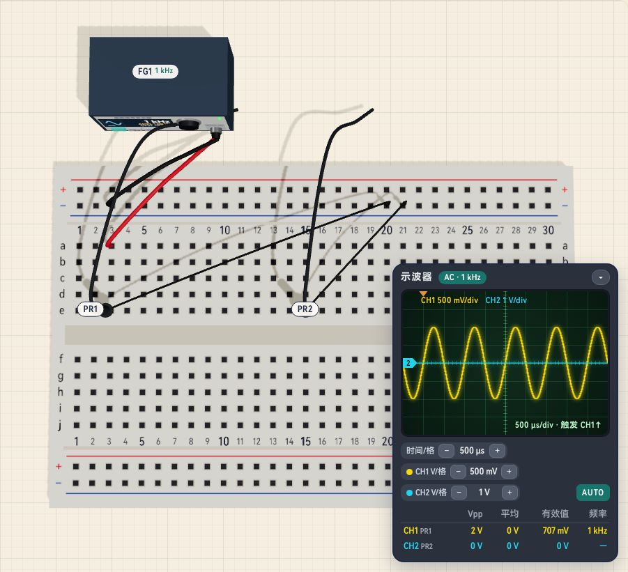
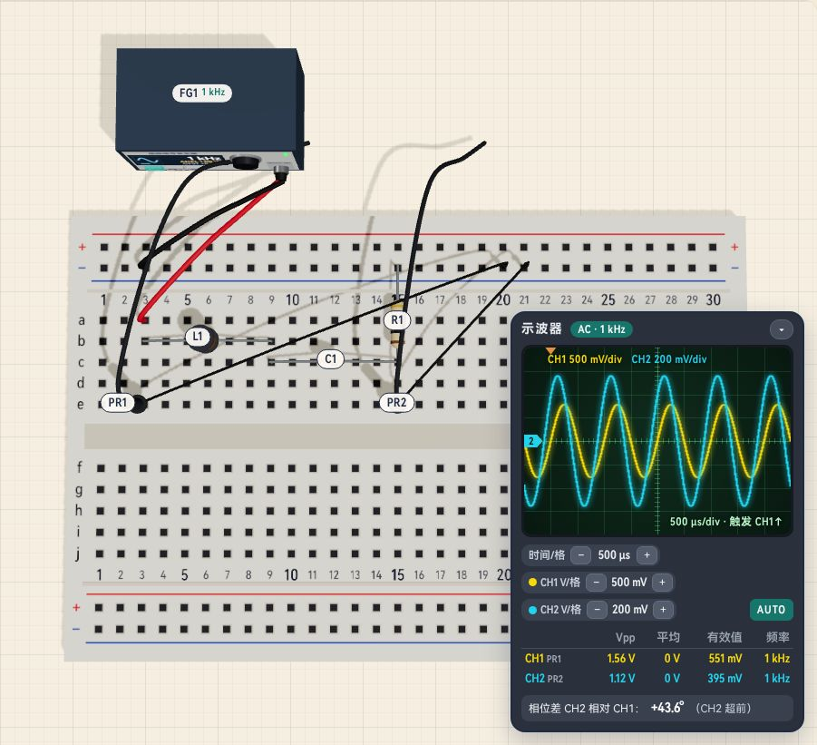
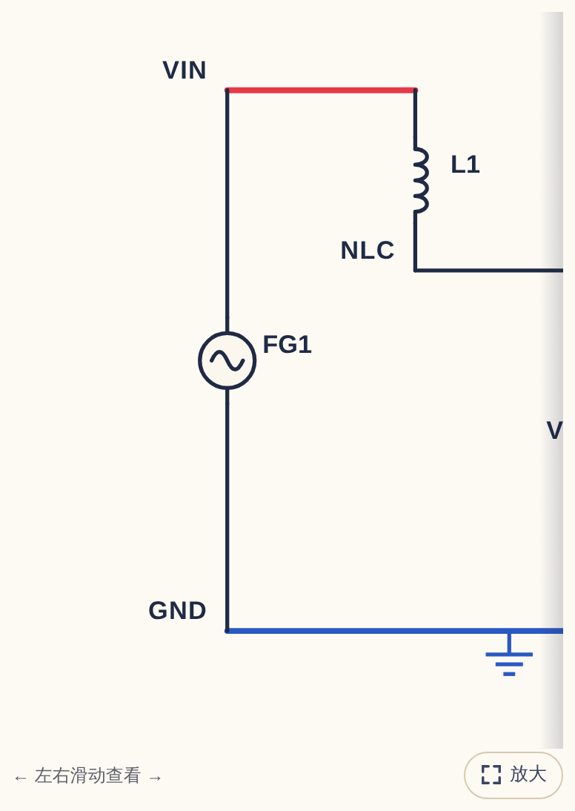

# 5.1 · 实验 4-0 · RLC 串联交流电路：感抗和容抗互相抵消，阻抗三角形

| 项目 | 内容 |
|---|---|
| id | `exp4-rlc-series-ac` |
| 文件 | `challenges/260-rlc-series-ac.json` |
| 类型 | 实验 / 挑战（没有分步，照目标电路图搭） · 难度 3/5 |
| 位置 | World 5 · 正弦稳态、相量与交流功率 → 5.1 相量：RL 电路的电压三角形（本节第 2 项） |
| 右侧面板 | 旧版面（文件里没有卡片） |
| 前后 | 上一项 [5.1 exp4-rl-phasors](../w5/5.01-1-exp4-rl-phasors.md) · 下一项 [5.2 w5-ac-midterm2](../w5/5.02-1-w5-ac-midterm2.md) |
| 先修 | lesson-scope-two-channels |
| 概念 | 感抗 X_L = ωL、容抗 X_C = 1/(ωC)、阻抗 Z = R + j(X_L − X_C)、阻抗三角形 impedance triangle、感性：电流落后 / 容性：电流超前、用电阻电压看电流 sense resistor |

**一句话概要**：100 Ω + 10 mH + 1 µF 串联接正弦信号。用示波器读 V_R、V_L、V_C 和 VIN，算出电流、X_L、X_C 和 |Z|，再看电流超前还是落后。

## 1. 左侧工作台（3D 面包板 → 2D 俯视截图）

截图是程序里真实的 3D 面包板换成俯视角拍的；表格是同一块板的文字版（元件、参数、每只脚插在哪个孔）。

### 1.1 起点：打开这一课时板上已经有的

| 元件 | 类型 | 参数 | 引脚 → 孔 |
|---|---|---|---|
| FG1 | function_gen | waveform=sine, frequency=1000, amplitude=1, offset=0 | +→a3 -→tn3 |
| PR1 | scope_probe | channel=1 | tip→e3 gnd→tn20 |
| PR2 | scope_probe | channel=2 | tip→e15 gnd→tn21 |

### 1.3 参考答案（「看答案」载入的板子）

| 元件 | 类型 | 参数 | 引脚 → 孔 |
|---|---|---|---|
| FG1 | function_gen | waveform=sine, frequency=1000, amplitude=1, offset=0 | +→a3 -→tn3 |
| L1 | inductor | inductance=0.01 | 1→b3 2→b9 |
| C1 | capacitor | capacitance=0.000001 | 1→c9 2→c15 |
| R1 | resistor | resistance=100 | 1→d15 2→tn15 |
| PR1 | scope_probe | channel=1 | tip→e3 gnd→tn20 |
| PR2 | scope_probe | channel=2 | tip→e15 gnd→tn21 |

### 1.4 目标原理图（右侧「目标原理图」抽屉）

| 元件 | 类型 | 参数 |
|---|---|---|
| FG1 | function_gen |  |
| L1 | inductor | inductance=0.01 |
| C1 | capacitor | capacitance=0.000001 |
| R1 | resistor | resistance=100 |

连接（每个结点上的引脚）：

- **VIN**：FG1.+、L1.1
- **NLC**：L1.2、C1.1
- **VR**：C1.2、R1.1
- **GND**：R1.2、FG1.-

## 2. 右侧面板：学生从上往下看到的内容（单轨流）

> 这个文件还没有卡片，界面是旧版面：题目说明 + 目标原理图 + 测量题。

### 题目说明

**目标**：在正弦稳态下测 RLC 串联电路的阻抗。看感抗 X_L 和容抗 X_C 怎样互相抵消一部分，|Z| 怎样由阻抗三角形算出，以及电流什么时候超前、什么时候落后电压。

**电路**：信号发生器红夹子 → L1（10 mH）→ C1（1 µF）→ 结点 VR → R1（100 Ω）→ GND，黑夹子接 GND。电阻放在接地的一端，所以 VR 就是电流的波形：i = v_R / 100 Ω。

**信号发生器**：正弦波，幅度 1 V、偏置 0，频率 1 kHz（之后再试 1.59 kHz 和 2.5 kHz）。

**几个符号**：
- **X_L = ωL = 2πfL**：感抗（inductive reactance），单位 Ω。频率越高，X_L 越大。
- **X_C = 1/(ωC) = 1/(2πfC)**：容抗（capacitive reactance），单位 Ω。频率越高，X_C 越小。
- **Z = R + j(X_L − X_C)**：总阻抗。电感电压超前电流 90°，电容电压落后电流 90°，两者方向相反，所以 X_L 和 X_C 互相抵消一部分，剩下的净电抗是 X = X_L − X_C。
- **阻抗三角形**：|Z| = √(R² + X²)，阻抗角 θ = arctan(X/R)。X > 0 电路呈**感性**，电流落后电压；X < 0 呈**容性**，电流超前电压。这里 R 要算上线圈的 1 Ω。

**先预测**：1 kHz 时 X_L、X_C、X 各是多少？电路是感性还是容性？|Z| 和 θ 是多少？电流超前还是落后、差多少度？2.5 kHz 时又怎样？X_L = X_C 的频率在哪里？

**测量**：两个探头的接地夹都接 GND。1 kHz 时：
- CH2 接 VR，读 V_R 的 Vpp，电流 I_m = (V_R 的 Vpp / 2) / 100 Ω。
- CH1 接 VIN，CH2 接 L1 和 C1 之间的结点，MATH（CH1 − CH2）就是电感电压 V_L。
- CH1 挪到 L1 和 C1 之间的结点，CH2 回到 VR，MATH（CH1 − CH2）就是电容电压 V_C。
- CH1 回到 VIN，读 VIN 的 Vpp，以及 CH2（VR，也就是电流）相对 CH1 的相位差。
- 然后用 X_L = V_L / I、X_C = V_C / I、|Z| = V_in / I 算出三个阻抗（同样用峰值，或同样用 Vpp，比值不变）。最后把频率调到 2.5 kHz 再读一次相位差。

电路检查通过后，把读数填进下面的「测量」（以你自己的面包板为准）；答完后会显示计算对比。

**想一想**：V_C 会不会比 VIN 还大？V_R + V_L + V_C 直接相加等于 VIN 吗？

**真实电路里**：仿真里线圈电阻只有 1 Ω。真实的 10 mH 小电感常有 10 ~ 30 Ω，它和 R1 串联：阻抗三角形的“R 边”变长，|Z| 变大、阻抗角变小；测 V_L 时会发现它超前电流不到 90°。1 µF 的电容常用薄膜电容或陶瓷电容，容差 ±5% ~ ±20%，X_L = X_C 的频率也会跟着移动。

**测量题 1 · `vr`**（读数题）

> 1 kHz：CH2（VR = v_R，也就是电流的波形）的 Vpp

- 单位 V · 先写预测 · 状态：FG1 设为 信号发生器（正弦 1kHz 幅度 1V） · 参考答案的读数 **1.117 V** · 合理范围 [1.07, 1.17]

答对后显示：

> I_m = 1 V / |(100 + 1 + 50) + j(62.8 − 159.2)| ≈ 5.58 mA，所以 V_R ≈ 2 × 5.58 mA × 100 Ω ≈ 1.12 Vpp。

**测量题 2 · `im`**（计算题（用自己的读数算））

> 用你的读数算电流的幅值 I_m = (V_R 的 Vpp / 2) / 100 Ω

- 单位 mA · 先写预测 · 参考答案的读数 **5.584 mA** · 合理范围 [0.0053, 0.0059] · 公式 `vr / 2 / 100`

答对后显示：

> 电阻上的欧姆定律：流过它的电流就是整个串联回路的电流，峰值 ≈ 5.58 mA（有效值 ≈ 3.95 mA）。

**测量题 3 · `vc`**（读数题）

> 1 kHz：电容电压 V_C 的 Vpp（MATH：CH1 接 L1 和 C1 之间的结点，CH2 接 VR）

- 单位 V · 先写预测 · 状态：FG1 设为 信号发生器（正弦 1kHz 幅度 1V） · 参考答案的读数 **1.777 V** · 合理范围 [1.7, 1.86]

答对后显示：

> V_C = I·X_C ≈ 2 × 5.58 mA × 159.2 Ω ≈ 1.78 Vpp——比 VIN 还大！

**测量题 4 · `xc`**（计算题（用自己的读数算））

> 用你的读数算容抗 X_C = (V_C 的 Vpp / 2) / I_m

- 单位 Ω · 先写预测 · 参考答案的读数 **159.1 Ω** · 合理范围 [152, 166] · 公式 `vc / 2 / im`

答对后显示：

> X_C = 1/(2π × 1000 × 1 µF) ≈ 159.2 Ω。

**测量题 5 · `vl`**（读数题）

> 1 kHz：电感电压 V_L 的 Vpp（MATH：CH1 接 VIN，CH2 接 L1 和 C1 之间的结点）

- 单位 V · 先写预测 · 状态：FG1 设为 信号发生器（正弦 1kHz 幅度 1V） · 参考答案的读数 **0.7019 V** · 合理范围 [0.66, 0.74]

答对后显示：

> V_L = I·X_L ≈ 2 × 5.58 mA × 62.8 Ω ≈ 0.70 Vpp。

**测量题 6 · `xl`**（计算题（用自己的读数算））

> 用你的读数算感抗 X_L = (V_L 的 Vpp / 2) / I_m

- 单位 Ω · 先写预测 · 参考答案的读数 **62.85 Ω** · 合理范围 [60, 66] · 公式 `vl / 2 / im`

答对后显示：

> X_L = 2π × 1000 × 10 mH ≈ 62.8 Ω（严格说是 |1 + j62.8| ≈ 62.8 Ω，线圈的 1 Ω 几乎看不出来）。

**测量题 7 · `vin`**（读数题）

> 1 kHz：CH1（VIN，信号发生器端子）的 Vpp

- 单位 V · 先写预测 · 状态：FG1 设为 信号发生器（正弦 1kHz 幅度 1V） · 参考答案的读数 **1.558 V** · 合理范围 [1.5, 1.62]

答对后显示：

> VIN = I·|Z| ≈ 2 × 5.58 mA × 139.6 Ω ≈ 1.56 Vpp；2 Vpp 电动势剩下的部分降在信号发生器的 50 Ω 上。

**测量题 8 · `z`**（计算题（用自己的读数算））

> 用你的读数算阻抗 |Z| = (VIN 的 Vpp / 2) / I_m

- 单位 Ω · 先写预测 · 参考答案的读数 **139.5 Ω** · 合理范围 [134, 145] · 公式 `vin / 2 / im`

答对后显示：

> 阻抗三角形：|Z| = √((R + r)² + (X_L − X_C)²) = √(101² + 96.3²) ≈ 139.6 Ω。X_L 和 X_C 互相抵消了一部分：虽然 X_C 单独就有 159 Ω，净电抗只剩 96.3 Ω。

**测量题 9 · `ph`**（读数题）

> 1 kHz：CH2（VR，电流）相对 CH1（VIN）的相位差（超前为正）

- 单位 ° · 先写预测 · 状态：FG1 设为 信号发生器（正弦 1kHz 幅度 1V） · 参考答案的读数 **43.63 °** · 合理范围 [41, 46.5]

答对后显示：

> X < 0，容性：电流超前 arctan(96.3/101) ≈ 43.6°。

**测量题 10 · `ph25`**（读数题）

> 2.5 kHz：再读 CH2（电流）相对 CH1 的相位差

- 单位 ° · 先写预测 · 状态：FG1 设为 信号发生器（正弦 2.5kHz 幅度 1V） · 参考答案的读数 **-42.78 °** · 合理范围 [-45.5, -40]

答对后显示：

> 这时 X_L ≈ 157.1 Ω > X_C ≈ 63.7 Ω，X ≈ +93.4 Ω：感性，电流落后 arctan(93.4/101) ≈ 42.8°（相位差为负）。

## 3. 测量题一览

| # | id | 题目 | 类型 | 单位 | 状态 | 参考读数 |
|---|---|---|---|---|---|---|
| 1 | vr | 1 kHz：CH2（VR = v_R，也就是电流的波形）的 Vpp | scope | V | FG1 设为 信号发生器（正弦 1kHz 幅度 1V） | 1.117 V |
| 2 | im | 用你的读数算电流的幅值 I_m = (V_R 的 Vpp / 2) / 100 Ω | formula | mA |  | 5.584 mA |
| 3 | vc | 1 kHz：电容电压 V_C 的 Vpp（MATH：CH1 接 L1 和 C1 之间的结点，CH2 接 VR） | scope | V | FG1 设为 信号发生器（正弦 1kHz 幅度 1V） | 1.777 V |
| 4 | xc | 用你的读数算容抗 X_C = (V_C 的 Vpp / 2) / I_m | formula | Ω |  | 159.1 Ω |
| 5 | vl | 1 kHz：电感电压 V_L 的 Vpp（MATH：CH1 接 VIN，CH2 接 L1 和 C1 之间的结点） | scope | V | FG1 设为 信号发生器（正弦 1kHz 幅度 1V） | 0.7019 V |
| 6 | xl | 用你的读数算感抗 X_L = (V_L 的 Vpp / 2) / I_m | formula | Ω |  | 62.85 Ω |
| 7 | vin | 1 kHz：CH1（VIN，信号发生器端子）的 Vpp | scope | V | FG1 设为 信号发生器（正弦 1kHz 幅度 1V） | 1.558 V |
| 8 | z | 用你的读数算阻抗 \|Z\| = (VIN 的 Vpp / 2) / I_m | formula | Ω |  | 139.5 Ω |
| 9 | ph | 1 kHz：CH2（VR，电流）相对 CH1（VIN）的相位差（超前为正） | scope | ° | FG1 设为 信号发生器（正弦 1kHz 幅度 1V） | 43.63 ° |
| 10 | ph25 | 2.5 kHz：再读 CH2（电流）相对 CH1 的相位差 | scope | ° | FG1 设为 信号发生器（正弦 2.5kHz 幅度 1V） | -42.78 ° |

### 全部答完后显示的「对比」

**对比**（f = 1 kHz，ω = 2π × 1000 ≈ 6283 rad/s）：
- X_L = 6283 × 10 mH ≈ 62.8 Ω；X_C = 1/(6283 × 1 µF) ≈ 159.2 Ω。X = X_L − X_C ≈ −96.3 Ω < 0，电路呈**容性**：频率低于 X_L = X_C 的那一点时，电容占上风。
- **阻抗三角形**：R 边 = 100 + 1 = 101 Ω，X 边 = −96.3 Ω。|Z| = √(101² + 96.3²) ≈ 139.6 Ω，θ = arctan(−96.3/101) ≈ −43.6°。所以 Z ≈ 139.6∠−43.6° Ω，电流**超前** VIN 约 43.6°。
- **电流**：信号发生器的 1 V 是它内部的电动势，后面串着 50 Ω，所以 I_m = 1 V / |151 − j96.3| ≈ 1 / 179.1 ≈ 5.58 mA。V_R ≈ 1.12 Vpp，V_L ≈ 2 × 5.58 mA × 62.8 Ω ≈ 0.70 Vpp，V_C ≈ 2 × 5.58 mA × 159.2 Ω ≈ 1.78 Vpp，VIN ≈ 2 × 5.58 mA × 139.6 Ω ≈ 1.56 Vpp。
- **为什么 VIN 不是 2 Vpp**：50 Ω 输出电阻分走了一部分。用端子上的 VIN 算 |Z| = V_in / I、当相位参考，50 Ω 就不影响结果：测到的就是 RLC 电路本身。
- **V_C 比 VIN 大**：电容上 1.78 Vpp，电源只给了 1.56 Vpp。这没有问题：V̇L 和 V̇C 方向相反，互相抵消了一部分。直接相加 1.12 + 0.70 + 1.78 = 3.60 ≠ 1.56；按相量相加 √(1.12² + (0.70 − 1.78)²) ≈ 1.55 ≈ 1.56。

**换频率**：
- **f = 2.5 kHz**：X_L ≈ 157.1 Ω，X_C ≈ 63.7 Ω，X ≈ +93.4 Ω > 0 → **感性**。|Z| ≈ √(101² + 93.4²) ≈ 137.6 Ω，θ ≈ +42.8°：电流**落后**约 42.8°。L 和 C 的角色换过来了。
- **f = 1/(2π√(LC)) ≈ 1.59 kHz**：X_L = X_C = √(L/C) = 100 Ω，X = 0，完全抵消：|Z| = R + r = 101 Ω（最小），θ = 0°，电流和 VIN 同相，而且最大（峰值约 6.6 mA）。这就是串联谐振——抵消的终点；实验 4-4 会扫频经过它。

### 提示按钮（依次显示）

1. 串联顺序：信号发生器 → 电感 → 电容 → 电阻 → GND。电阻上的电压就是电流的样子。
2. 测一个不接地的元件两端的电压：两个探头分别接它的两端（接地夹都接 GND），看 MATH（CH1 − CH2）。
3. X_L = 2πfL 随 f 变大，X_C = 1/(2πfC) 随 f 变小。谁大谁说了算：X_L > X_C 感性（电流落后），X_C > X_L 容性（电流超前）。

### 功能测试（「检查我的电路」时跑）

- 1 kHz：容性，电流超前 VIN
- 1 kHz：V_C 比 VIN 还大，V_L 比 VIN 小
- X_L = X_C：电抗完全抵消，电流和 VIN 同相
- 2.5 kHz：感性，电流落后 VIN

## 4. 用到的拆解（全部层的文字，供改写参考）

### 拆解 `inductor`：电感 Inductor：一卷导线，抗拒电流变化

*电感是电容的“对偶”：电容存电场能、电压不能跳；电感存磁场能、电流不能跳。拆开是绕在磁芯上的一卷铜线；由此推出 L = μN²A/l、v = L di/dt、W = ½LI²，再看关断时的高压尖峰、RL 的时间常数 τ = L/R 和感抗 2πfL。*

**拆解「电感 Inductor：一卷导线，抗拒电流变化」第 1 / 8 层：① 外形：像电阻的色环电感、工字电感**

课程里的电感有两种常见外形：
- 色环电感 axial inductor：长得像一个胖电阻（常是绿色身体），也用色环标值，但单位是 **µH**：棕 黑 橙 = 10 × 10³ µH = **10 mH**（RL、RLC 实验用的就是这个值）。别把它当成电阻插错！用万用表一量就知道：电阻是 10 kΩ，电感只有几 Ω 到几十 Ω。
- 工字电感 drum-core inductor：一个“工”字形的黑色铁氧体磁芯，上面绕着一层层铜漆包线，两只脚朝下。

**inductance（电感）L** 的单位是亨利 H。常用 mH（10⁻³）、µH（10⁻⁶）。电感 **没有极性**，两只脚可以互换。

课程里会遇到的电感：

| 在哪 | L | 线圈电阻 | 用途 |
|---|---|---|---|
| RL / RLC 实验 | 10 mH | 仿真 1 Ω（真实 10–30 Ω） | 看 τ = L/R、振铃、相量 |
| 继电器线圈 | 150 mH | 70 Ω | 电磁铁吸合触点 |
| 直流电机 | 2 mH | 8 Ω | 线圈产生转矩 |

**拆解「电感 Inductor：一卷导线，抗拒电流变化」第 2 / 8 层：② X 光：磁芯上绕着很多圈铜线**

把外皮变透明，两种电感里都只有两样东西：
1. 绕组 winding：一根很长的 **漆包铜线**（表面一层绝缘漆，所以一圈挨一圈也不会短路），绕了 N 圈。10 mH 的小电感有几百圈，线径只有 0.1 mm 左右——所以它的直流电阻并不小（10–30 Ω）。
2. 磁芯 core：一般是 **ferrite（铁氧体）**，一种铁的氧化物陶瓷。它的 **相对磁导率** $μ_r$ 有几百到几千：同样的电流，磁芯里的磁场比空气里强几百倍，于是同样的圈数电感大几百倍（下一层的公式）。

电感 **就是一段导线**：电流不变的时候，它对电流没有任何“阻碍”，只剩导线本身的电阻。它的全部本事都在 **电流变化** 的时候才显出来。

**拆解「电感 Inductor：一卷导线，抗拒电流变化」第 3 / 8 层：③ 电流产生磁场：L = NΦ/i = μN²A/l**

电流流过 线圈，会在线圈里面产生 **magnetic field（磁场）** B，方向由右手定则决定，磁力线 从线圈一端出来、绕回另一端。穿过线圈截面 A 的磁场总量叫 **magnetic flux（磁通）** Φ = B·A。

磁通和电流成正比；N 圈线圈每一圈都被同一个 Φ 穿过，总的 **flux linkage（磁链）** 是 NΦ。定义：
$$L = \frac{NΦ}{i}$$
对一个长螺线管，$B = \frac{μNi}{l}$，代入得
$$L = \frac{μN^{2}A}{l},   μ = μ_r μ_0,   μ_0 = 4π×10^{-7} H/m$$
- **N²**：圈数加倍，磁场加倍，被它穿过的圈数也加倍 → L × 4；
- 磁芯 的 $μ_r$：铁氧体让 L 大几百倍；
- 截面积 A 大、长度 l 短 → L 大。

**带数字**：N = 250，A = 20 mm²，l = 15 mm，有效 $μ_r ≈ 100$：
$$L = \frac{100 × 4π×10^{-7} × 250^{2} × 20×10^{-6}}{0.015} ≈ 10.5 mH$$
同样的线圈不加磁芯（$μ_r = 1$）只有约 0.1 mH。

- 公式 `L = \frac{NΦ}{i} = \frac{μ_r μ_0 N^{2} A}{l}`：L ∝ N²：圈数翻倍，电感 ×4

**拆解「电感 Inductor：一卷导线，抗拒电流变化」第 4 / 8 层：④ v = L di/dt：电压只看电流变化得多快**

**Faraday’s law（法拉第电磁感应定律）**：线圈里的磁链变化时，线圈两端感应出电压 $v = \frac{d(NΦ)}{dt}$。代入 $NΦ = Li$：
$$v = L\frac{di}{dt}$$
（关联参考方向）。感应电压的方向总是 **阻碍电流的变化**（**Lenz’s law 楞次定律**）：电流要增大，它就“顶”回去；电流要减小，它就“推”着电流继续走。

和电容 $i = C\frac{dv}{dt}$ 一一对应（**duality 对偶**：v ↔ i，C ↔ L）：
1. 电流不变 → 电压为 0。直流稳态下理想电感就是 **短路**（一根导线）。
2. 电流匀速上升 → 电压恒定：10 mH 在 1 ms 内从 0 升到 10 mA，$v = 10 mH × \frac{10 mA}{1 ms} = 0.1 V$。在 0.1 ms 内降回 0，电压是 −1 V——变化快 10 倍，电压大 10 倍。
3. **电感电流不能跳变**：$i_L(0^+) = i_L(0^-)$。要在 0 秒内改变电流，需要无穷大的电压。

**储存的能量**：$p = vi = Li\frac{di}{dt}$，从 0 到 I 积分：
$$W = \frac{1}{2}LI^{2}$$
- 10 mH、10 mA：$\frac{1}{2} × 0.01 × 10^{-4} = 0.5 µJ$；
- 继电器线圈 150 mH、71 mA：$\frac{1}{2} × 0.15 × 0.071^{2} ≈ 0.38 mJ$——关断时这些能量必须有地方去（下一层）。

|  | 电容 C | 电感 L |
|---|---|---|
| 基本关系 | $i = C\frac{dv}{dt}$ | $v = L\frac{di}{dt}$ |
| 不能跳变的量 | 电压 $v_C$ | 电流 $i_L$ |
| 直流稳态 | 断路 | 短路 |
| 储能 | $\frac{1}{2}CV^{2}$（电场） | $\frac{1}{2}LI^{2}$（磁场） |
| 时间常数 | τ = RC | τ = L/R |

- 公式 `v = L\frac{di}{dt}`：直流稳态：di/dt = 0 → v = 0（短路）
- 公式 `W = \frac{1}{2}LI^{2}`：150 mH、71 mA：0.38 mJ

**拆解「电感 Inductor：一卷导线，抗拒电流变化」第 5 / 8 层：⑤ 电流不能跳 → 断开电感会产生高压**

继电器实验（exp5-relay-flyback）：+5 V → 继电器线圈 150 mH + 70 Ω → 三极管（开关） → GND。导通时线圈电流 $I = \frac{5}{70} ≈ 71 mA$。

现在开关在约 1 µs 内断开。电感说：“我的电流不能跳。”可是电流已经无路可走——于是 $\frac{di}{dt}$ 非常大，按 $v = L\frac{di}{dt}$：
$$v ≈ 0.15 H × \frac{0.071 A}{1 µs} ≈ 10 000 V$$
这当然达不到——电压会一直升高，直到 **某个东西被击穿、给电流开出一条路**：三极管 C–E 击穿（约 40 V）、开关触点间拉出电弧……仿真里 集电极 的尖峰约 29 V（受仿真步长和三极管关断过程限制），真实电路可能更高。这就是线圈驱动电路里三极管莫名其妙烧掉的原因，也是汽车点火线圈产生上万伏高压的原理。

**解决**：并一个 续流二极管（阴极接 +5 V）。开关断开时，电流改走“线圈 → 二极管 → 线圈”这个小回路，集电极电压被钳在 $5 + 0.7 = 5.7 V$；0.38 mJ 的能量按 $τ = \frac{L}{R} = \frac{150 mH}{70 Ω} ≈ 2.1 ms$ 慢慢消耗在线圈电阻和二极管上。（二极管拆解的第 ⑦ 层有详细说明。）

- 公式 `v = L\frac{di}{dt} ≈ 0.15 × \frac{0.071}{10^{-6}} ≈ 10 kV`：理论值：说明必须给电流留一条路
- 公式 `V_{clamp} = 5 V + 0.7 V = 5.7 V`：有续流二极管时

**拆解「电感 Inductor：一卷导线，抗拒电流变化」第 6 / 8 层：⑥ RL 阶跃：电流按 τ = L/R 慢慢跟上**

RL 方波实验（exp3-rl-square）：信号发生器（50 Ω）→ 100 Ω → 10 mH（线圈电阻 1 Ω） → GND，方波 ±1 V，每次跳 2 V。

**推导**（和 RC 完全对偶）：
1. KVL：$V = R_{tot} i + L\frac{di}{dt}$，$R_{tot} = 100 + 50 + 1 = 151 Ω$；
2. 一阶线性微分方程，时间常数
$$τ = \frac{L}{R_{tot}} = \frac{10 mH}{151 Ω} ≈ 66 µs$$
3. 终值 $I_∞ = \frac{V}{R_{tot}} = \frac{1 V}{151 Ω} ≈ 6.6 mA$。方波从 −1 V 跳到 +1 V：电流从 −6.6 mA 出发，连续地 走向 +6.6 mA：
$$i(t) = I_∞ + (i(0) - I_∞)e^{-t/τ}$$
4. 电感电压 在跳变瞬间跳到约 2 V：因为电流不能跳，电阻上的电压也不能跳，2 V 的跳变全部落在电感上；然后按 $e^{-t/τ}$ 衰减到 0（剩下 1 Ω × 6.6 mA ≈ 7 mV）。

**和 RC 对比**：RC 中电容 **电压** 连续、电流可以跳；RL 中电感 **电流** 连续、电压可以跳。

**带数字**：1 kHz 方波半周期 0.5 ms ≈ 7.6τ，电流每次都走完全程；10 kHz 半周期 50 µs ≈ 0.76τ，电流只走到一半就反向，波形变成三角波。

- 公式 `τ = \frac{L}{R_{tot}} = \frac{10 mH}{151 Ω} ≈ 66 µs`：$R_tot$ 要算上信号发生器 50 Ω 和线圈 1 Ω
- 公式 `i(t) = I_∞ + (i(0) - I_∞)e^{-t/τ}`：三要素法

**拆解「电感 Inductor：一卷导线，抗拒电流变化」第 7 / 8 层：⑦ 频率：直流短路，高频断路**

通正弦电流 $i = I_m sin ωt$，代入 $v = L\frac{di}{dt}$：
$$v = ωLI_m cos ωt$$
- 电压幅值 / 电流幅值 = ωL，这就是 **inductive reactance（感抗）**：
$$X_L = ωL = 2πfL$$
- 电感的 **电流落后电压 90°**（和电容相反）。相量：$Z_L = jωL$。

感抗和频率成正比。对 10 mH：
- 160 Hz：10 Ω；1.6 kHz：100 Ω；16 kHz：1 kΩ；
- 直流：$X_L = 0$，只剩线圈电阻——**短路**；
- 高频：$X_L$ 很大，接近 **断路**。所以电感用来 **通直流、阻交流**：电源滤波、扼流圈（choke）。

RL 相量实验（exp4-rl-phasors）选 1.6 kHz 正是因为这时 $X_L ≈ 100 Ω = R$：总阻抗 $Z = (R + r) + jωL ≈ 101 + j100.5 Ω$，电流落后电压约 45°，$V_R$ 和 $V_L$ 大小差不多。低于约 1 Ω / (2π × 10 mH) ≈ 16 Hz 时，线圈电阻比感抗还大，电感就“看起来像电阻”了。

| f | $X_L$（10 mH） | 相当于 |
|---|---|---|
| 0（直流） | 0（剩 1 Ω 线圈电阻） | 短路 |
| 160 Hz | 10 Ω | 小电阻 |
| 1.6 kHz | 100 Ω | = R：RL 相量实验 |
| 16 kHz | 1 kΩ | 大阻抗 |

- 公式 `X_L = 2πfL`：电流落后电压 90°；$Z_L$ = jωL

**拆解「电感 Inductor：一卷导线，抗拒电流变化」第 8 / 8 层：⑧ 真实电感：线圈电阻、饱和、自谐振**

真实电感 = 理想 L + 几个寄生效应：
- 线圈电阻 $R_w$：几百圈细铜线，真实 10 mH 小电感有 10–30 Ω（**仿真器只算 1 Ω**）。它串在回路里：RL 实验的 $τ = \frac{L}{R}$ 变小、稳态电流变小；RLC 实验的衰减更快；相量实验里电流落后的角度变小。只有直流电源时，仿真器把电感当成 1 Ω 的导线。
- 磁芯饱和 saturation：电流超过 $I_{sat}$ 后，磁芯里的磁畴全部排好了队，$μ_r$ 迅速下降，L 也跟着骤降——电流会突然涨得很快。选电感时除了 L 还要看 **饱和电流** 和 **额定电流**（发热）。
- 匝间电容 $C_p$：相邻两圈导线之间有几 pF 到几十 pF。它和 L 组成并联谐振，频率高于 自谐振频率 $f_{SRF} = \frac{1}{2π\sqrt{LC_p}}$ 时电感反而像电容。10 mH、20 pF：约 360 kHz。
- 磁芯损耗：铁氧体在高频有磁滞和涡流损耗，相当于又多一个随频率增大的电阻。

**仿真器里**：电感是 L 串 1 Ω，没有饱和、匝间电容和磁芯损耗。时域仿真的步长有限，太快的 LC 振荡（每个周期不到 10 步）会被抹平，诊断面板会提示。

| 参数 | 真实 10 mH 小电感 | 仿真器 |
|---|---|---|
| 线圈电阻 | 10–30 Ω | 1 Ω |
| 饱和电流 | 几十 mA | 不饱和 |
| 匝间电容 / 自谐振 | ≈ 20 pF / ≈ 360 kHz | 无 |
| 误差 | ±10% | 0 |

- 公式 `f_{SRF} = \frac{1}{2π\sqrt{L C_p}}`：10 mH、20 pF：≈ 356 kHz

**一句话记住**：电感 = 磁芯上的一卷导线：$L = \frac{μN^{2}A}{l}$。它的全部行为是 $v = L\frac{di}{dt}$：电流不能跳变，直流稳态短路，储能 $\frac{1}{2}LI^{2}$；突然断开会产生高压尖峰，所以线圈要并续流二极管；RL 电路 $τ = \frac{L}{R}$；交流下 $X_L = 2πfL$，频率越高越像断路。真实电感有线圈电阻（仿真 1 Ω，真实 10–30 Ω）、会饱和。

## 5. 这一课的计算卡片

**计算卡片 `generator-output`：信号发生器的 50 Ω 输出电阻**

- 公式 `V_{out} = V_{set} \frac{R_L}{50 Ω + R_L}`
- 用途：信号发生器 = 理想波形源串 50 Ω：接上负载以后输出比设定小多少。
- 输入：V_set（设定的幅度（或偏置），V）；R_o（输出电阻，Ω）；R_L（负载（电路的输入电阻），Ω） → V_out（端口上的实际值，V）

1. 发生器内部 = 一个理想波形源 + 串联的 50 Ω（$R_o$）。空载时端口电压就是设定值。
2. 接负载 $R_L$：$R_o$ 和 $R_L$ 分压，$V_{out} = V_{set}\frac{R_L}{R_o + R_L}$。交流部分和直流偏置都被同一个比例缩小。
3. $R_L ≫ 50 Ω$（几 kΩ 以上）时差别不到 1 %；50 Ω 负载正好减半。
4. 负载是 RC、RL 时用阻抗的模：$|V_{out}| = V_{set}\frac{|Z|}{|Z + R_o|}$，而且随频率变——所以滤波实验用端口电压（CH1）做参考。
5. 时间常数里要把 50 Ω 算进 R：$τ = (R + 50)C$。

例子：- 第 12 课：设 1 V，50 Ω 负载：0.5 V 幅度 = 1.0 Vpp；偏置 +1 V 也变成 0.5 V。
- 实验 2-7：反相放大器输入电阻 10 kΩ：$1 × \frac{10000}{10050} ≈ 0.995$，输出 2.19 Vpp 而不是 2.2。
- 实验 4-3：$|Z| = 142.5 Ω$，$|Z + 50| = |151 + j100.5| ≈ 181 Ω$：端口只有 $\frac{142.5}{181} ≈ 0.786 V$ 峰值（1.57 Vpp）。

- ⚠ 很多真实发生器按“接 50 Ω 负载”显示幅度：接高阻电路实际是显示值的两倍（除非设成 High-Z）。
- ⚠ 算 τ、谐振电流、RLC 阻尼时忘了这 50 Ω。

**计算卡片 `phase-from-delay`：由时间差算相位差 Phase from time delay**

- 公式 `φ = -360° × \frac{Δt}{T} = -360° × Δt f`
- 用途：两个同频正弦，CH2 比 CH1 晚 Δt 到峰值：相位差是多少度（落后为负）。
- 输入：Δt（CH2 比 CH1 晚多少，s）；f（频率，Hz） → φ（CH2 相对 CH1 的相位（度），）

1. 一个整周期 T 对应 360°。
2. 晚了 Δt，就是晚了 $\frac{Δt}{T}$ 个周期 = $360° × \frac{Δt}{T}$。
3. 符号约定：CH2 **晚** 到（落后）记为负，**早** 到（超前）记为正。
4. 反过来：$Δt = \frac{|φ|}{360°} × T$。
5. 读 Δt：两个波形的过零点（同一方向）之间的格数 × time/div。

例子：第 13 课：1 kHz、1 kΩ + 100 nF，电容电压落后 $arctan\frac{1000}{1592}$ ≈ 32°，对应 $Δt = \frac{32}{360} × 1 ms ≈ 89 µs$。实验 4-1：在 $f_c$ 处 −45° = 晚八分之一周期。

- ⚠ Δt 超过半个周期时，“晚 Δt”也可以看成“早 T − Δt”：相位通常取 −180° … +180°。
- ⚠ 反相放大器的输出和输入差 180°，看起来像“晚了半个周期”。

**计算卡片 `capacitive-reactance`：容抗 Capacitive reactance**

- 公式 `X_C = \frac{1}{2π f C}`
- 用途：电容对某个频率的正弦信号“有多难通过”（单位 Ω）。
- 输入：f（频率，Hz）；C（电容，F） → X_C（容抗，Ω）

1. 电容的电流 $i = C\frac{dv}{dt}$。
2. 加正弦电压 $v = V_m sin(ωt)$，电流 $i = ωCU_m cos(ωt)$：幅度之比 $\frac{V_m}{I_m} = \frac{1}{ωC}$，其中 $ω = 2πf$。
3. 电流比电压 **超前 90°**（cos 比 sin 早四分之一周期）；相量写成 $Z_C = \frac{1}{jωC} = -jX_C$。
4. 频率越高、电容越大，容抗越小：**直流（f = 0）时电容是开路，高频时接近短路**。

例子：第 13 课：100 nF、1 kHz：$X_C = \frac{1}{2π × 1000 × 10^{-7}} ≈ 1.59 kΩ$，和 R₁ = 1 kΩ 差不多大。实验 4-1：100 nF 在 1061 Hz 正好 1.5 kΩ = R。

- ⚠ 用 f 代替 ω（少了 2π）：结果大了 6.28 倍。

**计算卡片 `inductive-reactance`：感抗 Inductive reactance**

- 公式 `X_L = 2π f L`
- 用途：电感对某个频率的正弦信号的阻碍（单位 Ω）：频率越高越大。
- 输入：f（频率，Hz）；L（电感，H） → X_L（感抗，Ω）

1. 电感的电压 $v = L\frac{di}{dt}$。
2. 电流 $i = I_m sin(ωt)$ 时 $v = ωLI_m cos(ωt)$，幅度之比 $\frac{V_m}{I_m} = ωL$。
3. 电压比电流 **超前 90°**（电流落后）；相量 $Z_L = jωL = jX_L$。
4. 和电容相反：**直流时电感是短路**（只剩线圈电阻 r），高频时接近开路。

例子：实验 4-3：$2π × 1600 × 10 mH ≈ 100.5 Ω$，和 R + r = 101 Ω 几乎一样，所以电流落后约 45°。160 Hz 只有约 10 Ω，16 kHz 约 1005 Ω。实验 4-4：谐振 5033 Hz 时 $X_L ≈ 316 Ω$。

- ⚠ 真实电感还有线圈电阻 r：它和 $X_L$ 是相量相加，不是直接相加。

**计算卡片 `ac-kvl`：交流 KVL：相量相加**

- 公式 `V = \sqrt{V_R^{2} + V_X^{2}}`
- 用途：电阻电压和电感（或电容）电压差 90°：总电压是两者的“勾股和”，不是直接相加。
- 输入：V_R（电阻电压（Vpp 或有效值），V）；V_X（电感 / 电容电压（同一种量），V） → V（总电压，V）

1. 任何时刻 KVL 都成立：$v = v_R + v_L$（瞬时值相加）。
2. 但 $v_R$ 和 $v_L$ 的峰值不在同一时刻到达：电感电压比电阻电压超前 90°。
3. 用相量表示：$V̇ = V̇_R + V̇_L$，两个相量互相垂直，构成直角三角形（电压三角形）。
4. 所以幅度（或有效值、峰峰值）满足 $V = \sqrt{V_R^{2} + V_L^{2}}$，夹角 $arctan\frac{V_L}{V_R}$。

例子：实验 4-3：$v_R ≈ 1.10 Vpp$，$v_L ≈ 1.11 Vpp$：直接加是 2.21，但 $\sqrt{1.10^{2} + 1.11^{2}} ≈ 1.56 Vpp$ ≈ VIN 的 1.57 Vpp。实验 4-4 谐振时：$V_L$ 和 $V_C$ 大小相等、方向相反，互相抵消，KVL 仍成立。

- ⚠ 真实线圈有电阻 r，$v_L$ 和 $v_R$ 的夹角略小于 90°，勾股和只是近似。

**计算卡片 `lc-resonance`：LC 谐振频率 f₀ = 1/(2π√LC)**

- 公式 `f_0 = \frac{1}{2π\sqrt{LC}}`
- 用途：电感和电容的电抗正好相等（互相抵消）的频率——串联、并联 LC 和 RLC 振铃都用它。
- 输入：L（电感，H）；C（电容，F） → f_0（谐振频率，Hz）

1. 串联 RLC：$Z = R + j(ωL - \frac{1}{ωC})$。
2. 两个电抗相等时虚部为 0：$ω_0L = \frac{1}{ω_0C}$ ⇒ $ω_0 = \frac{1}{\sqrt{LC}}$，$f_0 = \frac{1}{2π\sqrt{LC}}$。
3. 串联谐振：|Z| 最小（= R），电流最大，电流和电压 **同相**；低于 f₀ 呈容性（电流超前），高于 f₀ 呈感性（电流落后）。
4. 并联 LC：导纳的虚部抵消，阻抗最大（见“并联谐振阻抗”）。
5. 谐振时每个电抗的大小 $X_0 = \sqrt{\frac{L}{C}}$（特性阻抗）。

例子：实验 3-4、4-4、4-5（10 mH、100 nF）：$f_0 = \frac{1}{2π\sqrt{10^{-9}}} ≈ 5033 Hz$，$X_0 = \sqrt{\frac{0.01}{10^{-7}}} ≈ 316 Ω$。2.5 kHz 电流超前约 78°，10 kHz 落后约 78°。

- ⚠ 把 √ 漏掉，或者把 2π 漏掉——结果差几个数量级或 6.28 倍。

**计算卡片 `rlc-series-impedance`：RLC 串联阻抗：X_L 和 X_C 互相抵消**

- 公式 `|Z| = \sqrt{R^{2} + (X_L - X_C)^{2}}, θ = arctan\frac{X_L - X_C}{R}`
- 用途：L、C、R 串联：净电抗、阻抗三角形，电流超前还是落后。
- 输入：R（回路电阻（含线圈 1 Ω），Ω）；L（电感，H）；C（电容，F）；f（频率，Hz） → |Z|（阻抗的模，Ω）

1. 串联阻抗相加：$Z = R + jX_L - jX_C = R + jX$，净电抗 $X = X_L - X_C$。
2. 电感电压比电流超前 90°，电容电压落后 90°：两者方向相反，所以互相抵消一部分。
3. 阻抗三角形：$|Z| = \sqrt{R^{2} + X^{2}}$，阻抗角 $θ = arctan\frac{X}{R}$。
4. X > 0：**感性**，电流落后电压 θ；X < 0：**容性**，电流超前；X = 0（$f_0 = \frac{1}{2π\sqrt{LC}}$）：|Z| = R 最小，同相——串联谐振。
5. 电流 $I = \frac{V}{|Z|}$，各元件电压 $IR$、$IX_L$、$IX_C$；$V_C$ 可以比电源电压还大，因为它和 $V_L$ 互相抵消。

例子：实验 4-0（10 mH、1 µF、100 Ω + 1 Ω）：1 kHz：$X_L ≈ 62.8 Ω$，$X_C ≈ 159.2 Ω$，$X ≈ -96.3 Ω$（容性），$|Z| = \sqrt{101^{2} + 96.3^{2}} ≈ 139.6 Ω$，电流超前 ≈ 43.6°。2.5 kHz：X ≈ +93.4 Ω，|Z| ≈ 137.6 Ω，电流落后 ≈ 42.8°。1.59 kHz：X = 0，|Z| = 101 Ω。

- ⚠ 把 R、$X_L$、$X_C$ 直接相加，或者把三个元件电压的峰峰值直接相加（1.12 + 0.70 + 1.78 ≠ 1.56）。
- ⚠ 算电流时，发生器的电动势还要经过它的 50 Ω：$I_m = \frac{1 V}{|151 - j96.3|}$。

## 6. English（界面英文版的同一份内容）

展开英文

**Goal**: measure the impedance of a series RLC circuit in sinusoidal steady state. See how the inductive reactance X_L and the capacitive reactance X_C partly cancel, how |Z| follows from the impedance triangle, and when the current leads or lags the voltage.

**Circuit**: generator red clip → L1 (10 mH) → C1 (1 µF) → node VR → R1 (100 Ω) → GND; black clip to GND. The resistor sits at the grounded end, so VR is the current waveform: i = v_R / 100 Ω.

**Generator**: sine, amplitude 1 V, offset 0, 1 kHz (later also 1.59 kHz and 2.5 kHz).

**The symbols**:
- **X_L = ωL = 2πfL**: the inductive reactance, in Ω. It grows with frequency.
- **X_C = 1/(ωC) = 1/(2πfC)**: the capacitive reactance, in Ω. It shrinks with frequency.
- **Z = R + j(X_L − X_C)**: the total impedance. The inductor voltage leads the current by 90° and the capacitor voltage lags it by 90°; they point opposite ways, so X_L and X_C partly cancel and the net reactance left is X = X_L − X_C.
- **Impedance triangle**: |Z| = √(R² + X²), impedance angle θ = arctan(X/R). X > 0: the circuit is **inductive** and the current lags the voltage; X < 0: **capacitive**, the current leads. R here includes the coil's 1 Ω.

**Predict first**: at 1 kHz, what are X_L, X_C and X? Is the circuit inductive or capacitive? What are |Z| and θ? Does the current lead or lag, and by how many degrees? What about 2.5 kHz? At what frequency is X_L = X_C?

**Measure**: both ground clips on GND. At 1 kHz:
- CH2 on VR: read the Vpp of V_R; the current I_m = (Vpp of V_R / 2) / 100 Ω.
- CH1 on VIN, CH2 on the node between L1 and C1: MATH (CH1 − CH2) is the inductor voltage V_L.
- CH1 moved to the node between L1 and C1, CH2 back on VR: MATH (CH1 − CH2) is the capacitor voltage V_C.
- CH1 back on VIN: read VIN's Vpp, and the phase of CH2 (VR, i.e. the current) relative to CH1.
- Then work out the three impedances X_L = V_L / I, X_C = V_C / I and |Z| = V_in / I (use peaks throughout, or Vpp throughout — the ratio is the same). Finally set the frequency to 2.5 kHz and read the phase again.

Once the circuit check passes, type your readings into the Measurements below (whatever your own board shows); the worked comparison appears after you answer.

**Think about it**: can V_C be larger than VIN? Do V_R + V_L + V_C simply add up to VIN?

**In a real circuit**: the simulated coil has only 1 Ω of winding resistance. A real small 10 mH inductor often has 10–30 Ω, in series with R1: the "R side" of the impedance triangle gets longer, |Z| grows and the impedance angle shrinks, and V_L leads the current by less than 90°. A 1 µF film or ceramic capacitor is often ±5% to ±20%, so the frequency where X_L = X_C moves too.

**Question 1 · `vr`**（reading）

> 1 kHz: CH2 (VR = v_R, the current's waveform) Vpp

- unit V · predict first · state：FG1 is set to Function generator (sine 1kHz 1V peak) · range [1.07, 1.17]

Shown once right:

> I_m = 1 V / |(100 + 1 + 50) + j(62.8 − 159.2)| ≈ 5.58 mA, so V_R ≈ 2 × 5.58 mA × 100 Ω ≈ 1.12 Vpp.

**Question 2 · `im`**（calculation from own readings）

> From your reading: the current amplitude I_m = (V_R Vpp / 2) / 100 Ω

- unit mA · predict first · range [0.0053, 0.0059] · formula `vr / 2 / 100`

Shown once right:

> Ohm's law on the resistor: the current through it is the current of the whole series loop, ≈ 5.58 mA peak (≈ 3.95 mA rms).

**Question 3 · `vc`**（reading）

> 1 kHz: the capacitor voltage V_C Vpp (MATH: CH1 on the node between L1 and C1, CH2 on VR)

- unit V · predict first · state：FG1 is set to Function generator (sine 1kHz 1V peak) · range [1.7, 1.86]

Shown once right:

> V_C = I·X_C ≈ 2 × 5.58 mA × 159.2 Ω ≈ 1.78 Vpp — larger than VIN!

**Question 4 · `xc`**（calculation from own readings）

> From your readings: the capacitive reactance X_C = (V_C Vpp / 2) / I_m

- unit Ω · predict first · range [152, 166] · formula `vc / 2 / im`

Shown once right:

> X_C = 1/(2π × 1000 × 1 µF) ≈ 159.2 Ω.

**Question 5 · `vl`**（reading）

> 1 kHz: the inductor voltage V_L Vpp (MATH: CH1 on VIN, CH2 on the node between L1 and C1)

- unit V · predict first · state：FG1 is set to Function generator (sine 1kHz 1V peak) · range [0.66, 0.74]

Shown once right:

> V_L = I·X_L ≈ 2 × 5.58 mA × 62.8 Ω ≈ 0.70 Vpp.

**Question 6 · `xl`**（calculation from own readings）

> From your readings: the inductive reactance X_L = (V_L Vpp / 2) / I_m

- unit Ω · predict first · range [60, 66] · formula `vl / 2 / im`

Shown once right:

> X_L = 2π × 1000 × 10 mH ≈ 62.8 Ω (strictly |1 + j62.8| ≈ 62.8 Ω: the coil's 1 Ω hardly shows).

**Question 7 · `vin`**（reading）

> 1 kHz: CH1 (VIN, the generator terminals) Vpp

- unit V · predict first · state：FG1 is set to Function generator (sine 1kHz 1V peak) · range [1.5, 1.62]

Shown once right:

> VIN = I·|Z| ≈ 2 × 5.58 mA × 139.6 Ω ≈ 1.56 Vpp; the rest of the 2 Vpp EMF is lost across the generator's 50 Ω.

**Question 8 · `z`**（calculation from own readings）

> From your readings: the impedance |Z| = (VIN Vpp / 2) / I_m

- unit Ω · predict first · range [134, 145] · formula `vin / 2 / im`

Shown once right:

> Impedance triangle: |Z| = √((R + r)² + (X_L − X_C)²) = √(101² + 96.3²) ≈ 139.6 Ω. X_L and X_C partly cancel: the net reactance is only 96.3 Ω, although X_C alone is 159 Ω.

**Question 9 · `ph`**（reading）

> 1 kHz: the phase of CH2 (VR, the current) relative to CH1 (VIN). Leading is positive

- unit ° · predict first · state：FG1 is set to Function generator (sine 1kHz 1V peak) · range [41, 46.5]

Shown once right:

> X < 0, capacitive: the current leads by arctan(96.3/101) ≈ 43.6°.

**Question 10 · `ph25`**（reading）

> 2.5 kHz: the phase of CH2 (the current) relative to CH1 again

- unit ° · predict first · state：FG1 is set to Function generator (sine 2.5kHz 1V peak) · range [-45.5, -40]

Shown once right:

> Now X_L ≈ 157.1 Ω > X_C ≈ 63.7 Ω, X ≈ +93.4 Ω: inductive, the current lags by arctan(93.4/101) ≈ 42.8° (a negative phase).

**Compare**

**Compare** (f = 1 kHz, ω = 2π × 1000 ≈ 6283 rad/s):
- X_L = 6283 × 10 mH ≈ 62.8 Ω; X_C = 1/(6283 × 1 µF) ≈ 159.2 Ω. X = X_L − X_C ≈ −96.3 Ω < 0, so the circuit is **capacitive**: below the frequency where X_L = X_C, the capacitor wins.
- **Impedance triangle**: R side = 100 + 1 = 101 Ω, X side = −96.3 Ω. |Z| = √(101² + 96.3²) ≈ 139.6 Ω, θ = arctan(−96.3/101) ≈ −43.6°. So Z ≈ 139.6∠−43.6° Ω and the current **leads** VIN by ≈ 43.6°.
- **Current**: the generator's 1 V is its internal EMF behind 50 Ω, so I_m = 1 V / |151 − j96.3| ≈ 1 / 179.1 ≈ 5.58 mA. V_R ≈ 1.12 Vpp, V_L ≈ 2 × 5.58 mA × 62.8 Ω ≈ 0.70 Vpp, V_C ≈ 2 × 5.58 mA × 159.2 Ω ≈ 1.78 Vpp, VIN ≈ 2 × 5.58 mA × 139.6 Ω ≈ 1.56 Vpp.
- **Why VIN is not 2 Vpp**: the 50 Ω output resistance takes a share. Using VIN at the terminals for |Z| = V_in / I and as the phase reference removes the 50 Ω from the answer: you measure the RLC circuit alone.
- **V_C > VIN**: 1.78 Vpp across the capacitor while the source gives only 1.56 Vpp. That is fine: V_L and V_C point opposite ways and partly cancel. Added directly, 1.12 + 0.70 + 1.78 = 3.60 ≠ 1.56; as phasors, √(1.12² + (0.70 − 1.78)²) ≈ 1.55 ≈ 1.56.

**Other frequencies**:
- **f = 2.5 kHz**: X_L ≈ 157.1 Ω, X_C ≈ 63.7 Ω, X ≈ +93.4 Ω > 0 → **inductive**. |Z| ≈ √(101² + 93.4²) ≈ 137.6 Ω, θ ≈ +42.8°: the current **lags** by ≈ 42.8°. The roles of L and C swapped.
- **f = 1/(2π√(LC)) ≈ 1.59 kHz**: X_L = X_C = √(L/C) = 100 Ω, X = 0, so they cancel completely: |Z| = R + r = 101 Ω (its minimum), θ = 0°, the current is in phase with VIN and is largest (≈ 6.6 mA peak). This is series resonance — the endpoint of the cancellation; Experiment 4-4 sweeps through it.

**Hints**

1. Series order: generator → inductor → capacitor → resistor → GND. The resistor's voltage shows the current.
2. A voltage across a part that isn't grounded: put the two probes on its two ends (both clips on GND) and look at MATH (CH1 − CH2).
3. X_L = 2πfL grows with f, X_C = 1/(2πfC) shrinks with f. Whichever is larger decides: X_L > X_C inductive (current lags), X_C > X_L capacitive (current leads).

