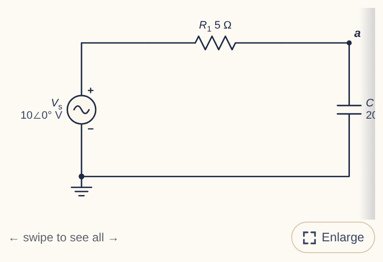

# 5.2 · 单元 5-AC：Midterm 2 交流版：把 R 换成 Z

| 项目 | 内容 |
|---|---|
| id | `w5-ac-midterm2` |
| 文件 | `units/w5-ac-midterm2.json` |
| 类型 | 理论单元（#/unit 页面，从上往下读的长页） |
| 位置 | World 5 · 正弦稳态、相量与交流功率 → 5.2 Midterm 2 交流版（本节第 1 项） |
| 这个单元回答的问题 | 叠加、网孔法、结点法、戴维宁，到了交流电路还能用吗？ |
| 时长 | 15 分钟 |
| 接回 | chapter:methods、chapter:theorems、chapter:phasors |
| 前后 | 上一项 [5.1 exp4-rlc-series-ac](../w5/5.01-2-exp4-rlc-series-ac.md) · 下一项 [5.3 exp4-rc-lowpass-bode](../w5/5.03-1-exp4-rc-lowpass-bode.md) |

## ① 直觉

Midterm 2 的四种方法（叠加、网孔法、结点法、戴维宁）只用到两样东西：欧姆定律 v = Ri，以及 KCL、KVL。

交流稳态里，所有电压、电流都是**同一频率**的正弦波，只是大小和相位不同。**相量**（phasor）把一个正弦波记成一个复数：v(t) = V_m cos(ωt + φ) 记成 V = V_m∠φ。频率 ω 人人一样，所以不用写进去。

每个元件换成**阻抗** Z，也就是复数形式的“电阻”：Z_R = R，Z_L = jωL，Z_C = 1/(jωC)。这样 V = ZI 成立，KCL、KVL 对相量也照样成立。

两条规则都在，四种方法就都在。新的功夫只有一样：复数运算。

| | 直流（Midterm 2） | 交流（ET-140 Week 10） |
|---|---|---|
| 电源 | V_s = 12 V | v_s(t) = 12 cos(1000t) V → V_s = 12∠0° V |
| 元件 | R | Z_R = R，Z_L = jωL，Z_C = 1/(jωC) |
| 欧姆定律 | v = Ri | V = ZI |
| KCL、KVL | 电流、电压的代数和为 0 | 相量的和为 0 |
| 串联 / 并联 | R_1 + R_2，R_1·R_2/(R_1 + R_2) | Z_1 + Z_2，Z_1·Z_2/(Z_1 + Z_2) |
| 答案 | 一个数 | 一个大小加一个角度 |

> **注意** · 有两件事**不能**照搬：
> - 模不能直接相加：|V_1 + V_2| 一般不等于 |V_1| + |V_2|。要按复数相加。
> - 两个源频率不同时，不能把它们的相量相加。要各算各的，回到时域再相加。

## ② 交互推导

*直流时这里是 R_2 = 5 Ω，v_a = 5 V。现在 R_2 换成 C = 200 µF，电源是 ω = 1000 rad/s 的正弦波。*

**分步推导：同一个结点方程：先写 R，再写 Z**（一次揭开一步）

1. **① 直流版。** V_s = 10 V 经 R_1 = 5 Ω 到结点 a，a 经 R_2 = 5 Ω 接地。在 a 列 KCL（流出为正）：(v_a − V_s)/R_1 + v_a/R_2 = 0 → (v_a − 10)/5 + v_a/5 = 0 → v_a = 5 V。
2. **② 换成交流。** 电源改成 v_s(t) = 10 cos(1000t) V，相量 V_s = 10∠0° V。R_2 换成 C，它的阻抗 Z_C = 1/(jωC) = 1/(j × 1000 × 200×10⁻⁶) = 1/(j0.2) = −j5 Ω。
3. **③ 同一个方程，R_2 换成 Z_C。** (V_a − V_s)/R_1 + V_a/Z_C = 0 → (V_a − 10)/5 + V_a/(−j5) = 0。形状和第 ① 步一模一样。
4. **④ 复数运算。** 1/(−j5) = j0.2（除以 −j 就是乘以 j）。方程变成 (0.2 + j0.2)V_a = 2，所以 V_a = 2/(0.2 + j0.2) = 10/(1 + j) = 5 − j5 V = 7.07∠−45° V。
5. **⑤ 回到时域，做合理性检查。** v_a(t) = 7.07 cos(1000t − 45°) V。检查：C 开路时 v_a = 10 V，C 短路时 v_a = 0，7.07 V 在两者之间 ✓。电容让 v_a 落后于 v_s ✓。

**滑块探索：Z = R + jωL 随频率怎么变**

| 参数 | 名称 | 默认 | 范围 | 单位 |
|---|---|---|---|---|
| R | 电阻 R | 10 | 1 … 100 | Ω |
| L | 电感 L | 0.01 | 0.001 … 0.1（对数） | H |
| f | 频率 f | 1000 | 10 … 100000（对数） | Hz |

| 输出 | 公式 | 单位 |
|---|---|---|
| 角频率 ω = 2πf | `2 * pi * f` | rad/s |
| 电抗 X_L = ωL | `w * L` | Ω |
| 阻抗大小 \|Z\| = √(R² + X_L²) | `sqrt(R^2 + XL^2)` | Ω |
| 阻抗角 θ = arctan(X_L/R)，单位 ° | `atand(XL / R)` |  |
| X_L = R 时的频率 | `R / (2 * pi * L)` | Hz |

频率低时 X_L 很小，Z ≈ R，角度接近 0°：电感像一根导线。频率高时 X_L 远大于 R，角度接近 90°：电感像开路。X_L = R 时角度正好是 45°。直流（f = 0）时 Z = R，就回到了 Midterm 2 的电路。

## ⑤ 回链

**预测题**：Z_1 = 3 Ω 和 Z_2 = j4 Ω 串联。总阻抗的大小是多少？

- A. 7 Ω
- B. 5 Ω ✅
- C. 1 Ω

揭晓：

> 串联照样相加：Z = 3 + j4 Ω。大小是 |Z| = √(3² + 4²) = 5 Ω，不是 3 + 4 = 7 Ω。

**预测题**：用叠加定理：第一个源单独作用得 V_a′ = 5∠0° V，第二个源单独作用得 V_a″ = 5∠90° V（同一频率）。|V_a| 是多少？

- A. 10 V
- B. 7.07 V ✅
- C. 0 V

揭晓：

> 相量相加：5 + j5 = 7.07∠45° V。两个分量差 90°，模不能直接相加。

**预测题**：戴维宁等效：V_{Th} = 10∠0° V，Z_{Th} = 2 + j4 Ω，接上负载 R_L = 1 Ω。负载电流的大小 |I_L| 是多少？

- 答案：2 A（误差 0.02）

揭晓：

> 和直流一样：I_L = V_{Th}/(Z_{Th} + R_L) = 10/(3 + j4)。|3 + j4| = 5，所以 |I_L| = 2 A，相位 −53.1°。

**理论题**：四道题依次对应 World 2 的叠加、网孔法、结点法、戴维宁各一道题。电路结构完全一样，只是 R 换成了 Z。

注意记号：练习区的理论题沿用中文教材，电压写 u / U，相量写 U̇（就是这里的 V），戴维宁电压写 U̇_oc、阻抗写 Z_eq。题里的相量是**有效值**相量，比振幅小 √2 倍；解法完全一样。

- `ac-analysis-19-superposition-rl` 叠加定理的交流版：R_2 换成 L（ac-analysis）
- `ac-analysis-20-mesh-two-meshes-ac` 网孔电流法的交流版：两个网孔（ac-analysis）
- `ac-analysis-21-nodal-two-nodes-ac` 结点电压法的交流版：两个结点（ac-analysis）
- `ac-analysis-22-thevenin-rl` 戴维宁等效的交流版：R_3 换成 L（ac-analysis）

## English

展开英文

## ① 直觉

The four Midterm 2 methods (superposition, mesh, nodal, Thévenin) rest on just two things: Ohm's law v = Ri, and KCL and KVL.

In AC steady state every voltage and current is a sinusoid of the **same frequency**; they differ only in size and phase. A **phasor** writes one sinusoid as one complex number: v(t) = V_m cos(ωt + φ) becomes V = V_m∠φ. Everyone shares the same ω, so it is left out.

Each element becomes an **impedance** Z, a complex "resistance": Z_R = R, Z_L = jωL, Z_C = 1/(jωC). Then V = ZI holds, and KCL and KVL hold for phasors too.

Both rules survive, so all four methods survive. The only new skill is complex arithmetic.

| | DC (Midterm 2) | AC (ET-140 Week 10) |
|---|---|---|
| Source | V_s = 12 V | v_s(t) = 12 cos(1000t) V → V_s = 12∠0° V |
| Element | R | Z_R = R, Z_L = jωL, Z_C = 1/(jωC) |
| Ohm's law | v = Ri | V = ZI |
| KCL, KVL | currents / voltages sum to 0 | phasors sum to 0 |
| Series / parallel | R_1 + R_2, R_1·R_2/(R_1 + R_2) | Z_1 + Z_2, Z_1·Z_2/(Z_1 + Z_2) |
| Answer | one number | a size and an angle |

> **注意** · Two things do **not** carry over:
> - Magnitudes don't add: |V_1 + V_2| is usually not |V_1| + |V_2|. Add the complex numbers.
> - If two sources have different frequencies, their phasors can't be added. Solve each one alone, then add in the time domain.

## ② 交互推导

[电路图]

*In DC this spot held R_2 = 5 Ω and v_a = 5 V. Now R_2 is a capacitor C = 200 µF and the source is a sinusoid at ω = 1000 rad/s.*

**分步推导：One nodal equation: first with R, then with Z**（一次揭开一步）

1. **① The DC version.** V_s = 10 V feeds node a through R_1 = 5 Ω, and R_2 = 5 Ω goes from a to ground. KCL at a (leaving is positive): (v_a − V_s)/R_1 + v_a/R_2 = 0 → (v_a − 10)/5 + v_a/5 = 0 → v_a = 5 V.
2. **② Go AC.** The source becomes v_s(t) = 10 cos(1000t) V, phasor V_s = 10∠0° V. R_2 becomes C, with impedance Z_C = 1/(jωC) = 1/(j × 1000 × 200×10⁻⁶) = 1/(j0.2) = −j5 Ω.
3. **③ Same equation, R_2 replaced by Z_C.** (V_a − V_s)/R_1 + V_a/Z_C = 0 → (V_a − 10)/5 + V_a/(−j5) = 0. Exactly the shape of step ①.
4. **④ Complex arithmetic.** 1/(−j5) = j0.2 (dividing by −j is multiplying by j). The equation becomes (0.2 + j0.2)V_a = 2, so V_a = 2/(0.2 + j0.2) = 10/(1 + j) = 5 − j5 V = 7.07∠−45° V.
5. **⑤ Back to time, then a sanity check.** v_a(t) = 7.07 cos(1000t − 45°) V. Check: with C open v_a = 10 V, with C shorted v_a = 0, and 7.07 V lies between ✓. The capacitor makes v_a lag v_s ✓.

**滑块探索：How Z = R + jωL changes with frequency**

| 参数 | 名称 | 默认 | 范围 | 单位 |
|---|---|---|---|---|
| R | resistance R | 10 | 1 … 100 | Ω |
| L | inductance L | 0.01 | 0.001 … 0.1（对数） | H |
| f | frequency f | 1000 | 10 … 100000（对数） | Hz |

| 输出 | 公式 | 单位 |
|---|---|---|
| angular frequency ω = 2πf | `2 * pi * f` | rad/s |
| reactance X_L = ωL | `w * L` | Ω |
| impedance size \|Z\| = √(R² + X_L²) | `sqrt(R^2 + XL^2)` | Ω |
| impedance angle θ = arctan(X_L/R), in ° | `atand(XL / R)` |  |
| frequency where X_L = R | `R / (2 * pi * L)` | Hz |

At low frequency X_L is small, Z ≈ R and the angle is near 0°: the inductor acts like a wire. At high frequency X_L is much larger than R and the angle nears 90°: the inductor acts like an open. At X_L = R the angle is exactly 45°. At DC (f = 0) Z = R, which is the Midterm 2 circuit again.

## ⑤ 回链

**预测题**：Z_1 = 3 Ω and Z_2 = j4 Ω are in series. How big is the total impedance?

- A. 7 Ω
- B. 5 Ω ✅
- C. 1 Ω

揭晓：

> Series impedances still add: Z = 3 + j4 Ω. Its size is |Z| = √(3² + 4²) = 5 Ω, not 3 + 4 = 7 Ω.

**预测题**：Superposition: the first source alone gives V_a′ = 5∠0° V, the second alone gives V_a″ = 5∠90° V (same frequency). What is |V_a|?

- A. 10 V
- B. 7.07 V ✅
- C. 0 V

揭晓：

> Add the phasors: 5 + j5 = 7.07∠45° V. The two parts are 90° apart, so their magnitudes don't simply add.

**预测题**：Thévenin equivalent: V_{Th} = 10∠0° V, Z_{Th} = 2 + j4 Ω, with a load R_L = 1 Ω. How big is the load current |I_L|?

- 答案：2 A（误差 0.02）

揭晓：

> Just like DC: I_L = V_{Th}/(Z_{Th} + R_L) = 10/(3 + j4). |3 + j4| = 5, so |I_L| = 2 A, at −53.1°.

**理论题**：The four problems match one World 2 problem each: superposition, mesh, nodal, Thévenin. Same circuit structure, only R has become Z.

Notation: the practice problems follow the Chinese textbook. Voltage is u / U, a phasor is U̇ (the V of this page), the Thévenin voltage is U̇_oc and the impedance Z_eq. Their phasors are **rms** phasors, √2 smaller than the amplitude; the method is the same.

- `ac-analysis-19-superposition-rl` 叠加定理的交流版：R_2 换成 L（ac-analysis）
- `ac-analysis-20-mesh-two-meshes-ac` 网孔电流法的交流版：两个网孔（ac-analysis）
- `ac-analysis-21-nodal-two-nodes-ac` 结点电压法的交流版：两个结点（ac-analysis）
- `ac-analysis-22-thevenin-rl` 戴维宁等效的交流版：R_3 换成 L（ac-analysis）

