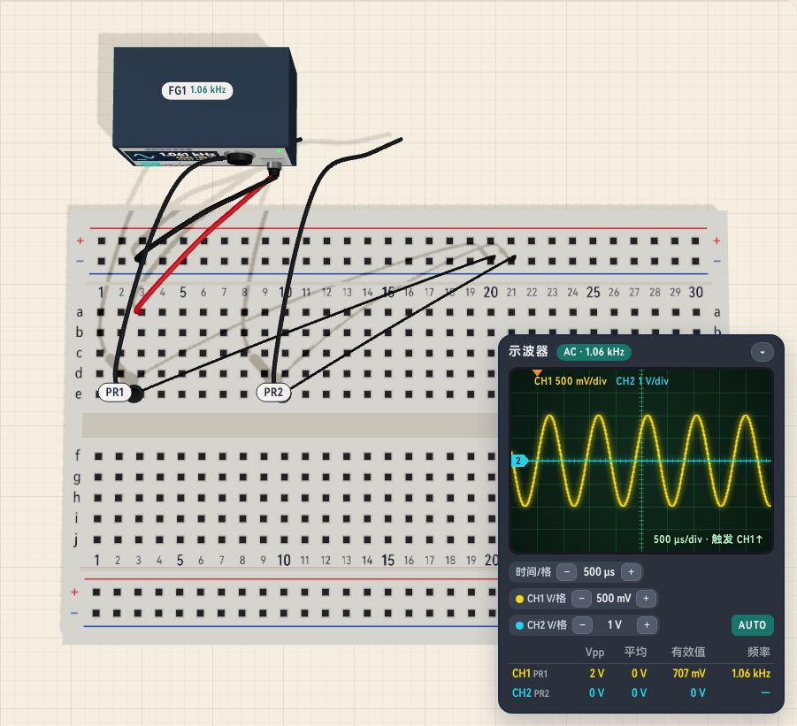
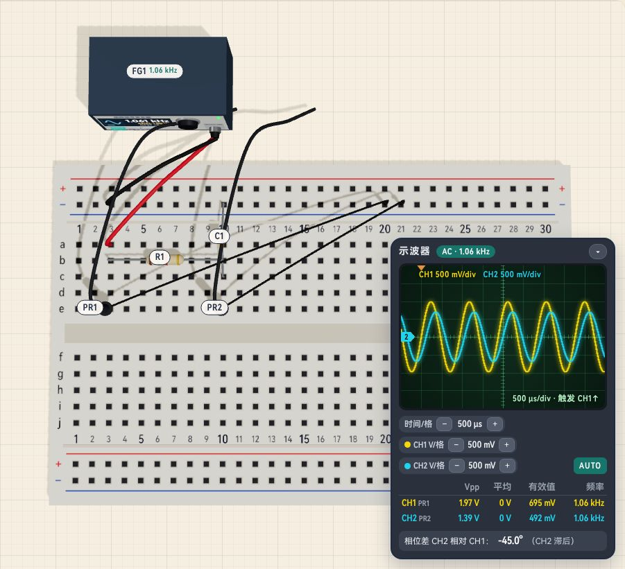
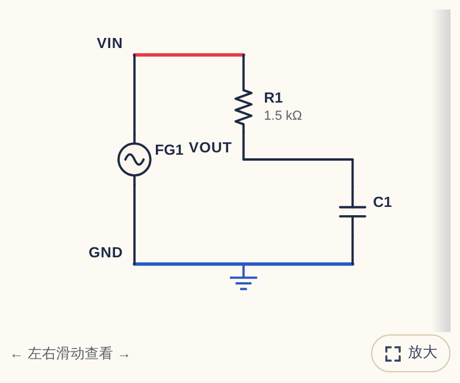
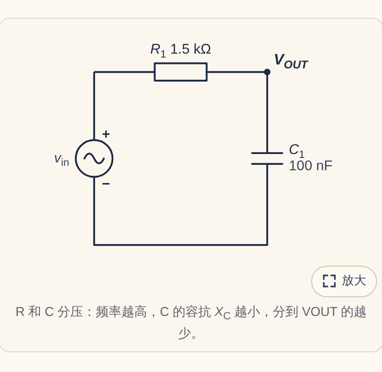
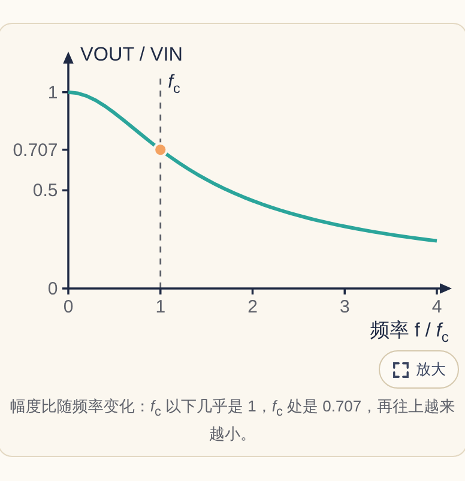

# 5.3 · RC 低通：高音被电容抄了近路

| 项目 | 内容 |
|---|---|
| id | `exp4-rc-lowpass-bode` |
| 文件 | `challenges/261-rc-lowpass-bode.json` |
| 类型 | 实验 / 挑战（没有分步，照目标电路图搭） · 难度 2/5 |
| 位置 | World 5 · 正弦稳态、相量与交流功率 → 5.3 RC 滤波器与级间负载（本节第 1 项） |
| 右侧面板 | 轨道由旧的四张卡片自动生成（还没手工精排） |
| 前后 | 上一项 [5.2 w5-ac-midterm2](../w5/5.02-1-w5-ac-midterm2.md) · 下一项 [5.3 exp4-rc-highpass-coupling](../w5/5.03-2-exp4-rc-highpass-coupling.md) |
| 先修 | lesson-scope-two-channels |
| 概念 | 网络函数 H(jω) = 1/(1 + jωRC)、截止频率 fc = 1/(2πRC)、−3 dB 点与 −45°、−20 dB/十倍频 −20 dB/decade、伯德图 Bode plot |

**一句话概要**：1.5 kΩ + 100 nF。把频率从低调到高，看输出越来越小；在截止频率和十倍截止频率处测增益和相位。

## 1. 左侧工作台（3D 面包板 → 2D 俯视截图）

截图是程序里真实的 3D 面包板换成俯视角拍的；表格是同一块板的文字版（元件、参数、每只脚插在哪个孔）。

### 1.1 起点：打开这一课时板上已经有的

右侧显示的「起点」说明：

> **半成品**：信号发生器（已经设好波形）和两个示波器探头已经接好。**为什么**：仪器的接法第 12、13 课练过，这个实验要看的是电路本身的波形。**你要做**：加上 R1（1.5kΩ，第 3 列 → 第 10 列）和 C1（100nF，第 10 列 → GND）。

| 元件 | 类型 | 参数 | 引脚 → 孔 |
|---|---|---|---|
| FG1 | function_gen | waveform=sine, frequency=1061, amplitude=1, offset=0 | +→a3 -→tn3 |
| PR1 | scope_probe | channel=1 | tip→e3 gnd→tn20 |
| PR2 | scope_probe | channel=2 | tip→e10 gnd→tn21 |

### 1.3 参考答案（「看答案」载入的板子）

| 元件 | 类型 | 参数 | 引脚 → 孔 |
|---|---|---|---|
| FG1 | function_gen | waveform=sine, frequency=1061, amplitude=1, offset=0 | +→a3 -→tn3 |
| R1 | resistor | resistance=1500 | 1→b3 2→b10 |
| C1 | capacitor | capacitance=1.0000000000000001e-7 | 1→c10 2→tn10 |
| PR1 | scope_probe | channel=1 | tip→e3 gnd→tn20 |
| PR2 | scope_probe | channel=2 | tip→e10 gnd→tn21 |

### 1.4 目标原理图（右侧「目标原理图」抽屉）

| 元件 | 类型 | 参数 |
|---|---|---|
| FG1 | function_gen |  |
| R1 | resistor | resistance=1500 |
| C1 | capacitor | capacitance=1.0000000000000001e-7 |

连接（每个结点上的引脚）：

- **VIN**：FG1.+、R1.1
- **VOUT**：R1.2、C1.1
- **GND**：C1.2、FG1.-

## 2. 右侧面板：学生从上往下看到的内容（单轨流）

### 第 1 步 · 🔧 动手搭：把频率往上拧

**电阻**（`1.5 kΩ`）插 **`b3`**–**`b10`**，**电容**（`100 nF`）插 **`c10`**–**`tn10`**。探头已经在板上：CH1 在输入，CH2 在电阻和电容之间（VOUT）。
信号发生器设成 **正弦波、幅度 `1 V`**，频率从 **`100 Hz`** 开始，慢慢调到 **`10 kHz`**。
频率越来越高时，CH2 的波形变大还是变小？

### 第 2 步 · 💡 想明白：电容给快信号开了一条近路

- 电阻和电容组成一个**分压器**，VOUT 是电容上分到的那一份。
- 电容对慢信号几乎是断开的；信号越快，它越像一根导线，把信号直接引到 GND。所以高频分到的越来越少。

*图 `divider`（schematic）：R 和 C 分压：频率越高，C 的容抗 X_C 越小，分到 VOUT 的越少。*

- 电容的“交流电阻”（**容抗**）$X_C = \frac{1}{2π f C}$ 随频率变小。它等于 R 的那个频率叫**截止频率**：
$$f_c = \frac{1}{2π R C}$$
代入：$f_c = \frac{1}{2π × 1500 × 100 × 10^{-9}} ≈ 1061$ Hz。
- 在 $f_c$ 处输出是输入的 0.707 倍；过了 $f_c$，频率越高，输出越小。

*图 `bode`（plot）：幅度比随频率变化：f_c 以下几乎是 1，f_c 处是 0.707，再往上越来越小。*

（这一步下面列着这节课的计算卡片，点开就地展开：`generator-output`、`phase-from-delay`、`capacitive-reactance`、`rc-impedance`、`rc-cutoff`、`rc-lowpass`、`first-order-phase`、`decibel`，全文见第 6 节）

### 第 3 步 · 🔧 动手搭：两个频率，两个通道

- 频率调到 **`1061 Hz`**：读 CH2 的 **Vpp**，再读示波器下面的 **CH2 相对 CH1 的相位差**。
- 频率调到 **`10.6 kHz`**：用 CH2 的 Vpp 除以 CH1 的 Vpp，得到幅度比。
- 为什么除以 CH1，而不是除以面板上的 `1 V`：信号发生器里面有 50 Ω，接上电路后端子电压会略低，而且随频率变。两个通道相比，这个误差就抵消了。

### 第 4 步 · 📏 测一测：测一测：读你自己的仪表

**测量题 1 · `vpp`**（读数题）

> f = 1061 Hz（≈ fc）：CH2（VOUT）的 Vpp

- 单位 V · 先写预测 · 状态：FG1 设为 信号发生器（正弦 1.06kHz 幅度 1V） · 参考答案的读数 **1.391 V** · 合理范围 [1.3, 1.45]

**测量题 2 · `ph`**（读数题）

> f = 1061 Hz：VOUT 相对 VIN 的相位差（CH2 滞后为负）

- 单位 ° · 先写预测 · 状态：FG1 设为 信号发生器（正弦 1.06kHz 幅度 1V） · 参考答案的读数 **-45 °** · 合理范围 [-48, -42]

答对后显示：

> 在 fc 处 ωRC = 1，H = 1/(1 + j)：|H| = 1/√2 ≈ 0.707，∠H = −45°。

**测量题 3 · `g10`**（读数题）

> f = 10.6 kHz（10 fc）：幅度比 VOUT/VIN（CH2 的 Vpp ÷ CH1 的 Vpp）

- 先写预测 · 状态：FG1 设为 信号发生器（正弦 10.6kHz 幅度 1V） · 参考答案的读数 **0.09949** · 合理范围 [0.094, 0.105]

答对后显示：

> |H| = 1/√(1 + 10²) ≈ 0.0995，即 −20 dB：频率升高 10 倍，幅度降到约 1/10。

### 第 5 步 · 🎒 带走：带走

- **低通**：低于 $f_c$ 几乎原样通过；高于 $f_c$，频率每高 10 倍，输出就小到 1/10，而且越来越落后于输入。
- 工程上把倍数写成**分贝**（dB）：0.707 倍 = −3 dB，1/10 = −20 dB。所以常说“截止频率是 −3 dB 点，之后每十倍频下降 20 dB”。
- $f_c$ 是“输出 = 0.707 × 输入”的频率，只由 R 和 C 决定。
- 坑：瓷片电容常有 ±10%～±20% 的误差，$f_c$ 跟着偏。真实电路里先扫频找 0.707 的那个点，那才是你这块板的 $f_c$。

趁热练理论题：`frequency`

## 3. 测量题一览

| # | id | 题目 | 类型 | 单位 | 状态 | 参考读数 |
|---|---|---|---|---|---|---|
| 1 | vpp | f = 1061 Hz（≈ fc）：CH2（VOUT）的 Vpp | scope | V | FG1 设为 信号发生器（正弦 1.06kHz 幅度 1V） | 1.391 V |
| 2 | ph | f = 1061 Hz：VOUT 相对 VIN 的相位差（CH2 滞后为负） | scope | ° | FG1 设为 信号发生器（正弦 1.06kHz 幅度 1V） | -45 ° |
| 3 | g10 | f = 10.6 kHz（10 fc）：幅度比 VOUT/VIN（CH2 的 Vpp ÷ CH1 的 Vpp） | scope |  | FG1 设为 信号发生器（正弦 10.6kHz 幅度 1V） | 0.09949 |

### 全部答完后显示的「对比」

**对比**：
  H(jω) = (1/(jωC)) / (R + 1/(jωC)) = 1 / (1 + jωRC)
  |H| = 1/√(1 + (f/fc)²)，∠H = −arctan(f/fc)，fc = 1/(2π × 1.5 kΩ × 100 nF) ≈ 1061 Hz。
- **f = fc/10 = 106 Hz**：|H| = 1/√1.01 ≈ 0.995（−0.04 dB），相位 −5.7°。信号几乎原样通过。
- **f = fc = 1061 Hz**：|H| = 1/√2 ≈ 0.707（−3 dB），相位 −45°。这就是“截止频率”的定义。
- **f = 10fc = 10.6 kHz**：|H| ≈ 1/√101 ≈ 0.0995（−20 dB），相位 −84.3°。频率每升高 10 倍，幅度再降 10 倍（−20 dB/十倍频），相位趋近 −90°。

### 提示按钮（依次显示）

1. 电阻串联在前，电容从 VOUT 接到 GND。
2. fc = 1/(2πRC)。先算出 fc 处的 |H| 和 ∠H，再和示波器的读数对比。
3. 拿 VOUT 和信号发生器端子上的电压（CH1）比，而不是和信号发生器面板上的数字比。

### 功能测试（「检查我的电路」时跑）

- fc/10 = 106 Hz：增益、相位合理
- fc = 1061 Hz：增益、相位合理
- 10fc = 10.6 kHz：增益、相位合理

## 5. 这一课的计算卡片

**计算卡片 `generator-output`：信号发生器的 50 Ω 输出电阻**

- 公式 `V_{out} = V_{set} \frac{R_L}{50 Ω + R_L}`
- 用途：信号发生器 = 理想波形源串 50 Ω：接上负载以后输出比设定小多少。
- 输入：V_set（设定的幅度（或偏置），V）；R_o（输出电阻，Ω）；R_L（负载（电路的输入电阻），Ω） → V_out（端口上的实际值，V）

1. 发生器内部 = 一个理想波形源 + 串联的 50 Ω（$R_o$）。空载时端口电压就是设定值。
2. 接负载 $R_L$：$R_o$ 和 $R_L$ 分压，$V_{out} = V_{set}\frac{R_L}{R_o + R_L}$。交流部分和直流偏置都被同一个比例缩小。
3. $R_L ≫ 50 Ω$（几 kΩ 以上）时差别不到 1 %；50 Ω 负载正好减半。
4. 负载是 RC、RL 时用阻抗的模：$|V_{out}| = V_{set}\frac{|Z|}{|Z + R_o|}$，而且随频率变——所以滤波实验用端口电压（CH1）做参考。
5. 时间常数里要把 50 Ω 算进 R：$τ = (R + 50)C$。

例子：- 第 12 课：设 1 V，50 Ω 负载：0.5 V 幅度 = 1.0 Vpp；偏置 +1 V 也变成 0.5 V。
- 实验 2-7：反相放大器输入电阻 10 kΩ：$1 × \frac{10000}{10050} ≈ 0.995$，输出 2.19 Vpp 而不是 2.2。
- 实验 4-3：$|Z| = 142.5 Ω$，$|Z + 50| = |151 + j100.5| ≈ 181 Ω$：端口只有 $\frac{142.5}{181} ≈ 0.786 V$ 峰值（1.57 Vpp）。

- ⚠ 很多真实发生器按“接 50 Ω 负载”显示幅度：接高阻电路实际是显示值的两倍（除非设成 High-Z）。
- ⚠ 算 τ、谐振电流、RLC 阻尼时忘了这 50 Ω。

**计算卡片 `phase-from-delay`：由时间差算相位差 Phase from time delay**

- 公式 `φ = -360° × \frac{Δt}{T} = -360° × Δt f`
- 用途：两个同频正弦，CH2 比 CH1 晚 Δt 到峰值：相位差是多少度（落后为负）。
- 输入：Δt（CH2 比 CH1 晚多少，s）；f（频率，Hz） → φ（CH2 相对 CH1 的相位（度），）

1. 一个整周期 T 对应 360°。
2. 晚了 Δt，就是晚了 $\frac{Δt}{T}$ 个周期 = $360° × \frac{Δt}{T}$。
3. 符号约定：CH2 **晚** 到（落后）记为负，**早** 到（超前）记为正。
4. 反过来：$Δt = \frac{|φ|}{360°} × T$。
5. 读 Δt：两个波形的过零点（同一方向）之间的格数 × time/div。

例子：第 13 课：1 kHz、1 kΩ + 100 nF，电容电压落后 $arctan\frac{1000}{1592}$ ≈ 32°，对应 $Δt = \frac{32}{360} × 1 ms ≈ 89 µs$。实验 4-1：在 $f_c$ 处 −45° = 晚八分之一周期。

- ⚠ Δt 超过半个周期时，“晚 Δt”也可以看成“早 T − Δt”：相位通常取 −180° … +180°。
- ⚠ 反相放大器的输出和输入差 180°，看起来像“晚了半个周期”。

**计算卡片 `capacitive-reactance`：容抗 Capacitive reactance**

- 公式 `X_C = \frac{1}{2π f C}`
- 用途：电容对某个频率的正弦信号“有多难通过”（单位 Ω）。
- 输入：f（频率，Hz）；C（电容，F） → X_C（容抗，Ω）

1. 电容的电流 $i = C\frac{dv}{dt}$。
2. 加正弦电压 $v = V_m sin(ωt)$，电流 $i = ωCU_m cos(ωt)$：幅度之比 $\frac{V_m}{I_m} = \frac{1}{ωC}$，其中 $ω = 2πf$。
3. 电流比电压 **超前 90°**（cos 比 sin 早四分之一周期）；相量写成 $Z_C = \frac{1}{jωC} = -jX_C$。
4. 频率越高、电容越大，容抗越小：**直流（f = 0）时电容是开路，高频时接近短路**。

例子：第 13 课：100 nF、1 kHz：$X_C = \frac{1}{2π × 1000 × 10^{-7}} ≈ 1.59 kΩ$，和 R₁ = 1 kΩ 差不多大。实验 4-1：100 nF 在 1061 Hz 正好 1.5 kΩ = R。

- ⚠ 用 f 代替 ω（少了 2π）：结果大了 6.28 倍。

**计算卡片 `rc-impedance`：RC 串联阻抗 Series RC impedance**

- 公式 `|Z| = \sqrt{R^{2} + X_C^{2}}, φ = -arctan\frac{X_C}{R}`
- 用途：电阻和电容串联后总的“阻碍”有多大，电流比电压超前多少。
- 输入：R（电阻，Ω）；C（电容，F）；f（频率，Hz） → |Z|（阻抗的模，Ω）

1. 相量：$Z = R + \frac{1}{jωC} = R - jX_C$。
2. 模：$|Z| = \sqrt{R^{2} + X_C^{2}}$——**不是** $R + X_C$，因为两者差 90°，像直角三角形的两条直角边。
3. 阻抗角 $φ_Z = -arctan\frac{X_C}{R}$：电压落后电流，也就是电流超前电压。
4. 电流 $I = \frac{V}{|Z|}$；电容分到 $V\frac{X_C}{|Z|}$，电阻分到 $V\frac{R}{|Z|}$。
5. 电容电压比输入落后 $arctan\frac{R}{X_C}$。

例子：第 13 课：1 kΩ + 100 nF、1 kHz：$X_C ≈ 1592 Ω$，$|Z| = \sqrt{1000^{2} + 1592^{2}} ≈ 1.88 kΩ$；电容电压 = 输入 × $\frac{1592}{1880} ≈ 0.847$，落后 $arctan\frac{1000}{1592} ≈ 32°$。

- ⚠ 直接把 R 和 $X_C$ 相加。

**计算卡片 `rc-cutoff`：RC 截止频率 Cut-off frequency**

- 公式 `f_c = \frac{1}{2π R C}`
- 用途：一阶 RC 滤波器的“拐点”：低通从这里开始往下掉，高通从这里开始通过。
- 输入：R（电阻，Ω）；C（电容，F） → f_c（截止频率（−3 dB），Hz）

1. 低通（输出取电容电压）用分压公式：$H = \frac{1/(jωC)}{R + 1/(jωC)} = \frac{1}{1 + jωRC}$。
2. 当 $ωRC = 1$，即 $X_C = R$ 时，$H = \frac{1}{1 + j}$：$|H| = \frac{1}{\sqrt{2}} ≈ 0.707$（−3 dB），相位 −45°。
3. 这一点就是截止频率：$f_c = \frac{1}{2πRC} = \frac{1}{2πτ}$。
4. 伯德图两条渐近线：$f ≪ f_c$ 时 0 dB 的平线；$f ≫ f_c$ 时每十倍频下降 20 dB，两条线交在 $f_c$。
5. 高通（输出取电阻电压）的 $f_c$ 一样，只是方向反过来。

例子：实验 4-1：$\frac{1}{2π × 1.5k × 100n} ≈ 1061 Hz$。实验 4-2：$15k × 10n$ 一样是 1061 Hz。实验 4-6：$R_F C_F = 10k × 15n$ → 1061 Hz。实验 5-14：$10k × 1µ$ → 16 Hz，远低于 1 kHz 的 PWM。

- ⚠ 信号源内阻（50 Ω）和后级负载都会挪动 $f_c$：前者加到 R 上，后者并在输出上。
- ⚠ 电容常有 ±10 %–20 % 误差，$f_c$ 跟着偏同样的比例：实测找 0.707、−45° 的点。

**计算卡片 `rc-lowpass`：RC 低通的增益 |H|**

- 公式 `|H| = \frac{1}{\sqrt{1 + (f/f_c)^{2}}}, f_c = \frac{1}{2πRC}`
- 用途：RC 低通在某个频率下输出是输入的几倍。
- 输入：R（串联电阻，Ω）；C（对地电容，F）；f（信号频率，Hz） → |H|（幅度比 Vₒᵤₜ / V_in，）

1. $H = \frac{1}{1 + jωRC} = \frac{1}{1 + j f/f_c}$。
2. 模：$|H| = \frac{1}{\sqrt{1 + (f/f_c)^{2}}}$；相位 $∠H = -arctan\frac{f}{f_c}$（输出落后）。
3. 三个好记的点：$f_c/10$ → 0.995（−0.04 dB，−5.7°）；$f_c$ → 0.707（−3 dB，−45°）；$10f_c$ → 0.0995（−20 dB，−84.3°）。
4. 高频时 $|H| ≈ \frac{f_c}{f}$：频率每乘 10，幅度除以 10。

例子：实验 4-1：10.6 kHz：$\frac{1}{\sqrt{1 + 10^{2}}} ≈ 0.0995$；1061 Hz：0.707，VOUT ≈ 1.4 Vpp。第 13 课（1 kΩ、100 nF、1 kHz）：$f_c ≈ 1592 Hz$，$|H| ≈ 0.847$。实验 4-8：跟随器后的第一级在 f₀ 处 0.707∠−45°。

- ⚠ 拿输出和发生器的“设定值”比，而不是和端口电压（CH1）比：50 Ω 的压降随频率变。

**计算卡片 `first-order-phase`：一阶滤波器的相位**

- 公式 `φ_{LP} = -arctan\frac{f}{f_c}, φ_{HP} = 90° - arctan\frac{f}{f_c}`
- 用途：RC / RL 一阶电路的输出比输入超前或落后几度。
- 输入：f（信号频率，Hz）；f_c（截止频率，Hz）；k（类型：0 = 低通（电容电压），1 = 高通（电阻电压），） → φ（输出相对输入的相位（度），）

1. 低通 $H = \frac{1}{1 + jf/f_c}$：分母的角是 $arctan\frac{f}{f_c}$，所以 H 的角是它的负数。
2. 高通多一个分子 $jf/f_c$，多 +90°。
3. 低频：低通 0°、高通 +90°；在 $f_c$：−45° / +45°；高频：−90° / 0°。
4. RL 电路一样：电阻电压（电流）相对输入就是“低通”的相位，$f_c = \frac{R}{2πL}$。
5. 方波驱动的 RC“积分器”对基波落后 $arctan(ωτ)$，接近 −90°；“微分器”超前 $arctan\frac{1}{ωτ}$，接近 +90°。

例子：实验 4-1：106 Hz −5.7°、1061 Hz −45°、10.6 kHz −84.3°。实验 3-2：τ = 10 ms、500 Hz：$-arctan(2π × 500 × 0.01) ≈ -88°$。实验 4-6 的有源低通：反相再加 180°，1061 Hz 处 +135°。

- ⚠ 计算器要用“度”模式，或者把弧度 × 180/π。

**计算卡片 `decibel`：分贝 dB**

- 公式 `G_{dB} = 20 lg\frac{V_{out}}{V_{in}}`
- 用途：把电压比换成 dB：伯德图的纵轴，乘法变加法。
- 输入：k（电压比 Vₒᵤₜ / V_in，） → G（增益（dB），）

1. 功率比的分贝是 $10 lg\frac{P_2}{P_1}$；功率正比于电压平方，所以电压比用 $20 lg$。
2. 好记的值：×2 = +6 dB，×0.707 = −3 dB（功率减半），×0.5 = −6 dB，×0.1 = −20 dB，×0.01 = −40 dB。
3. 两级串联（不互相负载时）：增益相乘 = dB 相加。
4. 反过来：$\frac{V_{out}}{V_{in}} = 10^{G/20}$。

例子：实验 4-1：0.995 → −0.04 dB，0.707 → −3 dB，0.0995 → −20 dB：在 lg f – dB 坐标上正好是两条渐近线。实验 4-6 通带增益 2.13 → +6.6 dB。

- ⚠ 电压比用 20 lg，功率比用 10 lg，别混。

## 6. English（界面英文版的同一份内容）

展开英文

### Node 1 · 🔧 Build：Turn the frequency up

**Resistor** (`1.5 kΩ`) into **`b3`**–**`b10`**, **capacitor** (`100 nF`) into **`c10`**–**`tn10`**. The probes are already on the board: CH1 on the input, CH2 between the resistor and the capacitor (VOUT).
Set the generator to **sine, amplitude `1 V`**, start at **`100 Hz`** and turn it slowly up to **`10 kHz`**.
As the frequency rises, does the CH2 trace get bigger or smaller?

### Node 2 · 💡 Why：The capacitor is a short-cut for fast signals

- The resistor and the capacitor form a **voltage divider**; VOUT is the share that lands on the capacitor.
- A capacitor is almost open for slow signals; the faster the signal, the more it looks like a wire straight to GND. So high frequencies get a smaller and smaller share.

[figure `divider`]

*Figure `divider`（schematic）：R 和 C 分压：频率越高，C 的容抗 X_C 越小，分到 VOUT 的越少。*

- The capacitor's "AC resistance" (its **capacitive reactance**) $X_C = \frac{1}{2π f C}$ falls with frequency. The frequency where it equals R is the **cutoff frequency**:
$$f_c = \frac{1}{2π R C}$$
Plugging in: $f_c = \frac{1}{2π × 1500 × 100 × 10^{-9}} ≈ 1061$ Hz.
- At $f_c$ the output is 0.707 of the input; past $f_c$, the higher the frequency, the smaller the output.

[figure `bode`]

*Figure `bode`（plot）：幅度比随频率变化：f_c 以下几乎是 1，f_c 处是 0.707，再往上越来越小。*

(This node lists the lesson’s calculation cards: `generator-output`、`phase-from-delay`、`capacitive-reactance`、`rc-impedance`、`rc-cutoff`、`rc-lowpass`、`first-order-phase`、`decibel`; full text in section 6)

### Node 3 · 🔧 Build：Two frequencies, two channels

- Set **`1061 Hz`**: read the **Vpp** of CH2, then the **phase of CH2 vs CH1** under the scope screen.
- Set **`10.6 kHz`**: divide CH2's Vpp by CH1's Vpp to get the amplitude ratio.
- Why divide by CH1 and not by the `1 V` on the panel: the generator has 50 Ω inside, so with a circuit attached its terminal voltage is a little lower, and that changes with frequency. Comparing the two channels cancels it.

### Node 4 · 📏 Measure：Measure: read your own instruments

**Question 1 · `vpp`**（reading）

> f = 1061 Hz (≈ fc): CH2's (VOUT's) Vpp

- unit V · predict first · state：FG1 is set to Function generator (sine 1.06kHz 1V peak) · range [1.3, 1.45]

**Question 2 · `ph`**（reading）

> f = 1061 Hz: the phase of VOUT relative to VIN (negative when CH2 lags)

- unit ° · predict first · state：FG1 is set to Function generator (sine 1.06kHz 1V peak) · range [-48, -42]

Shown once right:

> At fc, ωRC = 1 and H = 1/(1 + j): |H| = 1/√2 ≈ 0.707, ∠H = −45°.

**Question 3 · `g10`**（reading）

> f = 10.6 kHz (10 fc): the amplitude ratio VOUT/VIN (CH2 Vpp ÷ CH1 Vpp)

- predict first · state：FG1 is set to Function generator (sine 10.6kHz 1V peak) · range [0.094, 0.105]

Shown once right:

> |H| = 1/√(1 + 10²) ≈ 0.0995, i.e. −20 dB: ten times the frequency, about a tenth of the amplitude.

### Node 5 · 🎒 Take away：Take away

- **Low-pass**: below $f_c$ the signal passes almost unchanged; above $f_c$ every 10× in frequency leaves 1/10 of the output, lagging further and further behind the input.
- Engineers write ratios in **decibels** (dB): 0.707 = −3 dB, 1/10 = −20 dB. Hence "the cutoff is the −3 dB point, and above it the gain falls 20 dB per decade".
- $f_c$ is the frequency where output = 0.707 × input. Only R and C set it.
- Pitfall: ceramic capacitors are often ±10% to ±20% off, and $f_c$ moves with them. On a real board, sweep for the 0.707 point first — that is your board's actual $f_c$.

Practise：`frequency`

**Compare**

**Compare**:
  H(jω) = (1/(jωC)) / (R + 1/(jωC)) = 1 / (1 + jωRC)
  |H| = 1/√(1 + (f/fc)²), ∠H = −arctan(f/fc), fc = 1/(2π × 1.5 kΩ × 100 nF) ≈ 1061 Hz.
- **f = fc/10 = 106 Hz**: |H| = 1/√1.01 ≈ 0.995 (−0.04 dB), phase −5.7°. The signal passes almost unchanged.
- **f = fc = 1061 Hz**: |H| = 1/√2 ≈ 0.707 (−3 dB), phase −45°. That is what "cutoff frequency" means.
- **f = 10fc = 10.6 kHz**: |H| ≈ 1/√101 ≈ 0.0995 (−20 dB), phase −84.3°. Every 10× in frequency divides the amplitude by another 10 (−20 dB/decade), and the phase approaches −90°.

**Hints**

1. Resistor in series, capacitor from VOUT to GND.
2. fc = 1/(2πRC). Work out |H| and ∠H at fc first, then compare with the scope.
3. Compare VOUT with the generator's terminals (CH1), not with the number on the generator's display.

