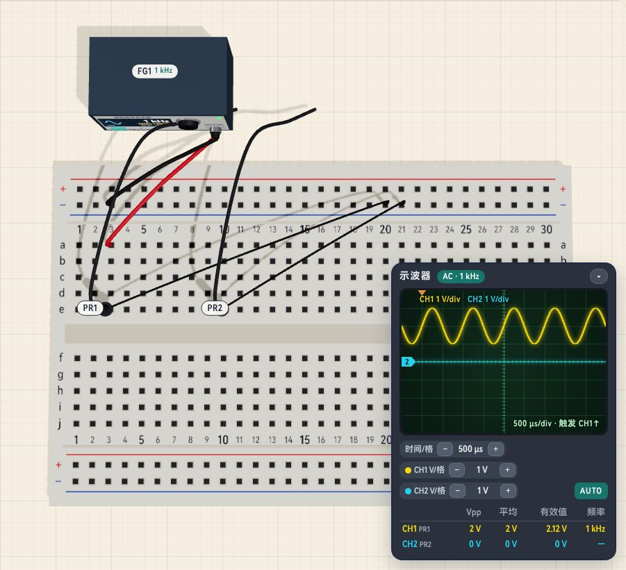
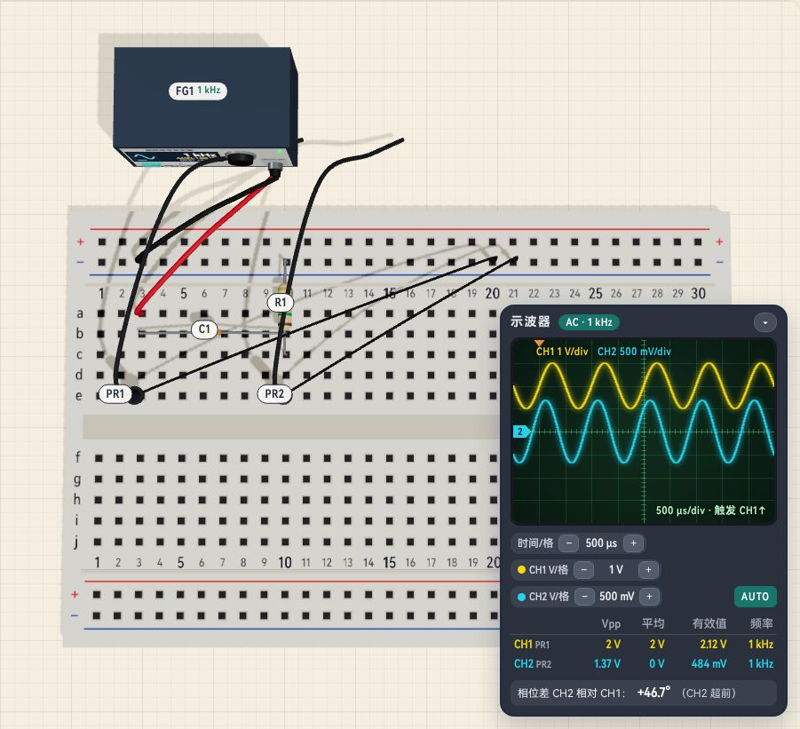
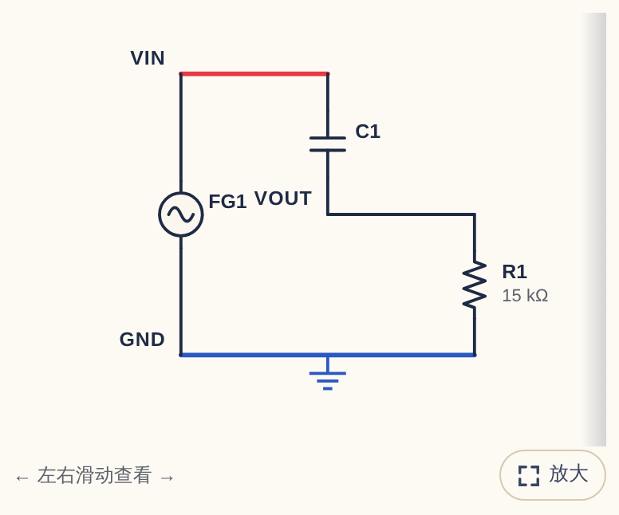
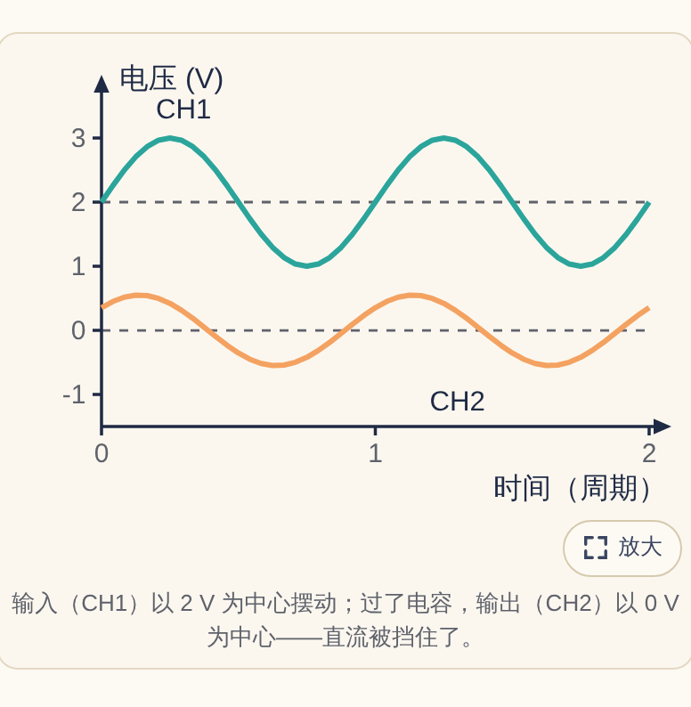
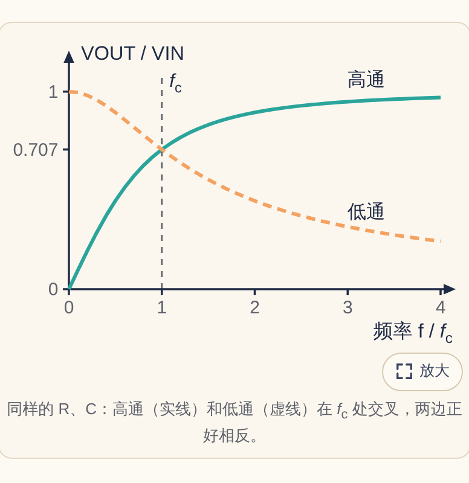

# 5.3 · RC 高通：电容挡住直流，放过交流

| 项目 | 内容 |
|---|---|
| id | `exp4-rc-highpass-coupling` |
| 文件 | `challenges/262-rc-highpass-coupling.json` |
| 类型 | 实验 / 挑战（没有分步，照目标电路图搭） · 难度 3/5 |
| 位置 | World 5 · 正弦稳态、相量与交流功率 → 5.3 RC 滤波器与级间负载（本节第 2 项） |
| 右侧面板 | 轨道由旧的四张卡片自动生成（还没手工精排） |
| 前后 | 上一项 [5.3 exp4-rc-lowpass-bode](../w5/5.03-1-exp4-rc-lowpass-bode.md) · 下一项 [5.3 exp4-rc-bandpass-loading](../w5/5.03-3-exp4-rc-bandpass-loading.md) |
| 先修 | lesson-scope-two-channels |
| 概念 | 高通滤波器 high-pass filter、H(jω) = jωRC/(1 + jωRC)、相位超前 phase lead、隔直电容 coupling capacitor、叠加定理：直流和交流分开算 superposition of DC and AC |

**一句话概要**：10 nF + 15 kΩ，输入带 2 V 直流偏置：看偏置被电容挡住，测低频的增益和相位，再扫频找出截止频率。

## 1. 左侧工作台（3D 面包板 → 2D 俯视截图）

截图是程序里真实的 3D 面包板换成俯视角拍的；表格是同一块板的文字版（元件、参数、每只脚插在哪个孔）。

### 1.1 起点：打开这一课时板上已经有的

| 元件 | 类型 | 参数 | 引脚 → 孔 |
|---|---|---|---|
| FG1 | function_gen | waveform=sine, frequency=1000, amplitude=1, offset=2 | +→a3 -→tn3 |
| PR1 | scope_probe | channel=1 | tip→e3 gnd→tn20 |
| PR2 | scope_probe | channel=2 | tip→e10 gnd→tn21 |

### 1.3 参考答案（「看答案」载入的板子）

| 元件 | 类型 | 参数 | 引脚 → 孔 |
|---|---|---|---|
| FG1 | function_gen | waveform=sine, frequency=1000, amplitude=1, offset=2 | +→a3 -→tn3 |
| C1 | capacitor | capacitance=1e-8 | 1→b3 2→b10 |
| R1 | resistor | resistance=15000 | 1→c10 2→tn10 |
| PR1 | scope_probe | channel=1 | tip→e3 gnd→tn20 |
| PR2 | scope_probe | channel=2 | tip→e10 gnd→tn21 |

### 1.4 目标原理图（右侧「目标原理图」抽屉）

| 元件 | 类型 | 参数 |
|---|---|---|
| FG1 | function_gen |  |
| C1 | capacitor | capacitance=1e-8 |
| R1 | resistor | resistance=15000 |

连接（每个结点上的引脚）：

- **VIN**：FG1.+、C1.1
- **VOUT**：C1.2、R1.1
- **GND**：R1.2、FG1.-

## 2. 右侧面板：学生从上往下看到的内容（单轨流）

### 第 1 步 · 🔧 动手搭：2 V 偏置去哪了？

这次**电容**（`10 nF`）在前：**`b3`**–**`b10`**；**电阻**（`15 kΩ`）在后：**`c10`**–**`tn10`**。和低通相比，只是两个元件对调了。
信号发生器：**正弦波、`1 kHz`、幅度 `1 V`、偏置 `2 V`**。CH1 的波形整体抬高了 2 V，在 1 V 到 3 V 之间摆动。
看 CH2：它的中心线在哪里？那 2 V 去哪了？

### 第 2 步 · 💡 想明白：电容是一扇只让变化通过的门

- 电容的两块极板之间是绝缘的。**直流**进去，充满以后就再也没有电流——2 V 偏置全“存”在电容上，电阻上一点也分不到。
- **交流**一直在变，电容一直在充、放电，变化就传过去了。所以 VOUT 只剩以 0 V 为中心的那一部分。

*图 `dcblock`（plot）：输入（CH1）以 2 V 为中心摆动；过了电容，输出（CH2）以 0 V 为中心——直流被挡住了。*

- 交流部分也看频率：频率越低，电容越像断开，传过去的越少。所以这是**高通**。截止频率的公式和低通一样：
$$f_c = \frac{1}{2π R C} = \frac{1}{2π × 15 × 10^{3} × 10 × 10^{-9}}$$
动手之前先把它算出来，再看下图：高通的曲线正好和低通左右相反。

*图 `hp`（plot）：同样的 R、C：高通（实线）和低通（虚线）在 f_c 处交叉，两边正好相反。*

（这一步下面列着这节课的计算卡片，点开就地展开：`phase-from-delay`、`capacitive-reactance`、`rc-impedance`、`rc-cutoff`、`rc-highpass`、`first-order-phase`、`decibel`，全文见第 6 节）

### 第 3 步 · 🔧 动手搭：先量直流，再扫频

- **万用表**红表笔点 VOUT（第 `10` 列），黑表笔在 GND：读平均电压（或者看示波器 CH2 的「平均」）。
- 频率调到 **`106 Hz`**：读幅度比（CH2 的 Vpp ÷ CH1 的 Vpp）和 **CH2 相对 CH1 的相位差**。
- 最后**扫频**：慢慢往上调，找到 CH2 的 Vpp 正好是 CH1 的 0.707 倍的那个频率。

### 第 4 步 · 📏 测一测：测一测：读你自己的仪表

**测量题 1 · `vavg`**（读数题）

> 万用表直流档（或示波器的平均值）：VOUT 对 GND 的平均电压

- 单位 V · 先写预测 · 状态：FG1 设为 信号发生器（正弦 1.06kHz 幅度 1V） · 参考答案的读数 **-2.781e-10 V** · 合理范围 [-0.02, 0.02]

答对后显示：

> 电容对直流开路，稳态下 R1 没有直流电流：VOUT 的直流分量是 0，2 V 全“存”在电容上。这就是隔直（耦合）电容。

**测量题 2 · `g106`**（读数题）

> f = 106 Hz：幅度比 VOUT/VIN（CH2 的 Vpp ÷ CH1 的 Vpp）

- 先写预测 · 状态：FG1 设为 信号发生器（正弦 106Hz 幅度 1V） · 参考答案的读数 **0.09943** · 合理范围 [0.0945, 0.104]

答对后显示：

> |H| = (f/fc)/√(1 + (f/fc)²) = 0.1/√1.01 ≈ 0.0995（−20 dB）。

**测量题 3 · `ph106`**（读数题）

> f = 106 Hz：VOUT 相对 VIN 的相位差（超前为正）

- 单位 ° · 先写预测 · 状态：FG1 设为 信号发生器（正弦 106Hz 幅度 1V） · 参考答案的读数 **84.29 °** · 合理范围 [80.1, 88.5]

答对后显示：

> ∠H = 90° − arctan(0.1) ≈ +84.3°：低频时剩下的一点输出超前将近 90°。

**测量题 4 · `fc`**（读数题）

> 扫频：幅度比降到 0.707 的频率 fc

- 单位 Hz · 先写预测 · 状态：FG1 设为 信号发生器（正弦 1.06kHz 幅度 1V） · 参考答案的读数 **1061 Hz** · 合理范围 [1010, 1110]

答对后显示：

> fc = 1/(2π × 15 kΩ × 10 nF) ≈ 1061 Hz，和低通一样；在 fc 处相位是 +45°。

### 第 5 步 · 🎒 带走：带走

- **隔直电容**：直流过不去，交流过得去。放大器之间常用它把上一级的偏置挡掉。
- **高通**：$f_c$ 以下越来越小，而且输出**超前**输入；$f_c$ 以上几乎原样通过。同样的 R、C，低通和高通的 $f_c$ 一样。
- 坑：µF 级的隔直电容多是**铝电解电容**，有正负。+ 脚要接直流电位高的一侧（这里是 2 V 的 VIN 一侧）。接反会漏电、发热，时间长了会坏。仿真里的电容不分正负。

趁热练理论题：`frequency`

## 3. 测量题一览

| # | id | 题目 | 类型 | 单位 | 状态 | 参考读数 |
|---|---|---|---|---|---|---|
| 1 | vavg | 万用表直流档（或示波器的平均值）：VOUT 对 GND 的平均电压 | voltage | V | FG1 设为 信号发生器（正弦 1.06kHz 幅度 1V） | -2.781e-10 V |
| 2 | g106 | f = 106 Hz：幅度比 VOUT/VIN（CH2 的 Vpp ÷ CH1 的 Vpp） | scope |  | FG1 设为 信号发生器（正弦 106Hz 幅度 1V） | 0.09943 |
| 3 | ph106 | f = 106 Hz：VOUT 相对 VIN 的相位差（超前为正） | scope | ° | FG1 设为 信号发生器（正弦 106Hz 幅度 1V） | 84.29 ° |
| 4 | fc | 扫频：幅度比降到 0.707 的频率 fc | scope | Hz | FG1 设为 信号发生器（正弦 1.06kHz 幅度 1V） | 1061 Hz |

### 全部答完后显示的「对比」

**对比**：
- **直流部分（2 V）**：稳态下 R1 里没有电流，VOUT 的直流分量 = 0，电容两端稳稳地“存”着 2 V。CH1 的平均值 ≈ 2 V，CH2 的平均值 ≈ 0。这就是放大器之间常用的**隔直（耦合）电容**。
- **交流部分**：H(jω) = jωRC/(1 + jωRC)，|H| = (f/fc)/√(1 + (f/fc)²)，∠H = 90° − arctan(f/fc)，fc = 1/(2π × 15 kΩ × 10 nF) ≈ 1061 Hz。
- **106 Hz（fc/10）**：|H| ≈ 0.0995（−20 dB），相位 **+84.3°**——低频几乎被挡住，剩下的一点还超前将近 90°（电容支路里电流超前电压）。
- **1061 Hz（fc）**：|H| ≈ 0.707（−3 dB），相位 **+45°**。
- **10.6 kHz（10fc）**：|H| ≈ 0.995，相位 +5.7°——高频时电容几乎是导线。

### 提示按钮（依次显示）

1. 电容串联在前，电阻从 VOUT 接到 GND。
2. 直流偏置过不了电容：稳态下 R1 里有没有直流电流？
3. fc = 1/(2πRC) ≈ 1061 Hz；在 fc 处应看到 0.707 和 +45°。

### 功能测试（「检查我的电路」时跑）

- 隔直：VIN 带直流偏置，VOUT 没有
- fc/10 = 106 Hz：增益、相位合理
- fc = 1061 Hz：增益、相位合理
- 10fc = 10.6 kHz：增益、相位合理

## 5. 这一课的计算卡片

**计算卡片 `phase-from-delay`：由时间差算相位差 Phase from time delay**

- 公式 `φ = -360° × \frac{Δt}{T} = -360° × Δt f`
- 用途：两个同频正弦，CH2 比 CH1 晚 Δt 到峰值：相位差是多少度（落后为负）。
- 输入：Δt（CH2 比 CH1 晚多少，s）；f（频率，Hz） → φ（CH2 相对 CH1 的相位（度），）

1. 一个整周期 T 对应 360°。
2. 晚了 Δt，就是晚了 $\frac{Δt}{T}$ 个周期 = $360° × \frac{Δt}{T}$。
3. 符号约定：CH2 **晚** 到（落后）记为负，**早** 到（超前）记为正。
4. 反过来：$Δt = \frac{|φ|}{360°} × T$。
5. 读 Δt：两个波形的过零点（同一方向）之间的格数 × time/div。

例子：第 13 课：1 kHz、1 kΩ + 100 nF，电容电压落后 $arctan\frac{1000}{1592}$ ≈ 32°，对应 $Δt = \frac{32}{360} × 1 ms ≈ 89 µs$。实验 4-1：在 $f_c$ 处 −45° = 晚八分之一周期。

- ⚠ Δt 超过半个周期时，“晚 Δt”也可以看成“早 T − Δt”：相位通常取 −180° … +180°。
- ⚠ 反相放大器的输出和输入差 180°，看起来像“晚了半个周期”。

**计算卡片 `capacitive-reactance`：容抗 Capacitive reactance**

- 公式 `X_C = \frac{1}{2π f C}`
- 用途：电容对某个频率的正弦信号“有多难通过”（单位 Ω）。
- 输入：f（频率，Hz）；C（电容，F） → X_C（容抗，Ω）

1. 电容的电流 $i = C\frac{dv}{dt}$。
2. 加正弦电压 $v = V_m sin(ωt)$，电流 $i = ωCU_m cos(ωt)$：幅度之比 $\frac{V_m}{I_m} = \frac{1}{ωC}$，其中 $ω = 2πf$。
3. 电流比电压 **超前 90°**（cos 比 sin 早四分之一周期）；相量写成 $Z_C = \frac{1}{jωC} = -jX_C$。
4. 频率越高、电容越大，容抗越小：**直流（f = 0）时电容是开路，高频时接近短路**。

例子：第 13 课：100 nF、1 kHz：$X_C = \frac{1}{2π × 1000 × 10^{-7}} ≈ 1.59 kΩ$，和 R₁ = 1 kΩ 差不多大。实验 4-1：100 nF 在 1061 Hz 正好 1.5 kΩ = R。

- ⚠ 用 f 代替 ω（少了 2π）：结果大了 6.28 倍。

**计算卡片 `rc-impedance`：RC 串联阻抗 Series RC impedance**

- 公式 `|Z| = \sqrt{R^{2} + X_C^{2}}, φ = -arctan\frac{X_C}{R}`
- 用途：电阻和电容串联后总的“阻碍”有多大，电流比电压超前多少。
- 输入：R（电阻，Ω）；C（电容，F）；f（频率，Hz） → |Z|（阻抗的模，Ω）

1. 相量：$Z = R + \frac{1}{jωC} = R - jX_C$。
2. 模：$|Z| = \sqrt{R^{2} + X_C^{2}}$——**不是** $R + X_C$，因为两者差 90°，像直角三角形的两条直角边。
3. 阻抗角 $φ_Z = -arctan\frac{X_C}{R}$：电压落后电流，也就是电流超前电压。
4. 电流 $I = \frac{V}{|Z|}$；电容分到 $V\frac{X_C}{|Z|}$，电阻分到 $V\frac{R}{|Z|}$。
5. 电容电压比输入落后 $arctan\frac{R}{X_C}$。

例子：第 13 课：1 kΩ + 100 nF、1 kHz：$X_C ≈ 1592 Ω$，$|Z| = \sqrt{1000^{2} + 1592^{2}} ≈ 1.88 kΩ$；电容电压 = 输入 × $\frac{1592}{1880} ≈ 0.847$，落后 $arctan\frac{1000}{1592} ≈ 32°$。

- ⚠ 直接把 R 和 $X_C$ 相加。

**计算卡片 `rc-cutoff`：RC 截止频率 Cut-off frequency**

- 公式 `f_c = \frac{1}{2π R C}`
- 用途：一阶 RC 滤波器的“拐点”：低通从这里开始往下掉，高通从这里开始通过。
- 输入：R（电阻，Ω）；C（电容，F） → f_c（截止频率（−3 dB），Hz）

1. 低通（输出取电容电压）用分压公式：$H = \frac{1/(jωC)}{R + 1/(jωC)} = \frac{1}{1 + jωRC}$。
2. 当 $ωRC = 1$，即 $X_C = R$ 时，$H = \frac{1}{1 + j}$：$|H| = \frac{1}{\sqrt{2}} ≈ 0.707$（−3 dB），相位 −45°。
3. 这一点就是截止频率：$f_c = \frac{1}{2πRC} = \frac{1}{2πτ}$。
4. 伯德图两条渐近线：$f ≪ f_c$ 时 0 dB 的平线；$f ≫ f_c$ 时每十倍频下降 20 dB，两条线交在 $f_c$。
5. 高通（输出取电阻电压）的 $f_c$ 一样，只是方向反过来。

例子：实验 4-1：$\frac{1}{2π × 1.5k × 100n} ≈ 1061 Hz$。实验 4-2：$15k × 10n$ 一样是 1061 Hz。实验 4-6：$R_F C_F = 10k × 15n$ → 1061 Hz。实验 5-14：$10k × 1µ$ → 16 Hz，远低于 1 kHz 的 PWM。

- ⚠ 信号源内阻（50 Ω）和后级负载都会挪动 $f_c$：前者加到 R 上，后者并在输出上。
- ⚠ 电容常有 ±10 %–20 % 误差，$f_c$ 跟着偏同样的比例：实测找 0.707、−45° 的点。

**计算卡片 `rc-highpass`：RC 高通的增益 |H|（隔直通交）**

- 公式 `|H| = \frac{f/f_c}{\sqrt{1 + (f/f_c)^{2}}}, f_c = \frac{1}{2πRC}`
- 用途：电容串在前、电阻对地：低频（包括直流）被挡住，高频通过。
- 输入：R（对地电阻，Ω）；C（串联电容，F）；f（信号频率，Hz） → |H|（幅度比 Vₒᵤₜ / V_in，）

1. 输出取电阻电压：$H = \frac{R}{R + 1/(jωC)} = \frac{jωRC}{1 + jωRC}$。
2. 模 $|H| = \frac{f/f_c}{\sqrt{1 + (f/f_c)^{2}}}$，相位 $∠H = 90° - arctan\frac{f}{f_c}$（输出 **超前**）。
3. 直流：f = 0，|H| = 0。稳态时电容“存住”了直流偏置，电阻上没有直流电流——这就是级间的 **耦合（隔直）电容**。
4. 同一个 RC 的低通和高通：$H_{LP} + H_{HP} = 1$，在 $f_c$ 两个都是 0.707，相量和正好是输入。

例子：实验 4-2（15 kΩ、10 nF，$f_c$ ≈ 1061 Hz）：106 Hz → 0.0995、+84.3°；1061 Hz → 0.707、+45°；10.6 kHz → 0.995、+5.7°。2 V 偏置全落在电容上，VOUT 平均为 0。

- ⚠ µF 级的耦合电容多是电解电容，有极性：+ 接直流电位高的一边。

**计算卡片 `first-order-phase`：一阶滤波器的相位**

- 公式 `φ_{LP} = -arctan\frac{f}{f_c}, φ_{HP} = 90° - arctan\frac{f}{f_c}`
- 用途：RC / RL 一阶电路的输出比输入超前或落后几度。
- 输入：f（信号频率，Hz）；f_c（截止频率，Hz）；k（类型：0 = 低通（电容电压），1 = 高通（电阻电压），） → φ（输出相对输入的相位（度），）

1. 低通 $H = \frac{1}{1 + jf/f_c}$：分母的角是 $arctan\frac{f}{f_c}$，所以 H 的角是它的负数。
2. 高通多一个分子 $jf/f_c$，多 +90°。
3. 低频：低通 0°、高通 +90°；在 $f_c$：−45° / +45°；高频：−90° / 0°。
4. RL 电路一样：电阻电压（电流）相对输入就是“低通”的相位，$f_c = \frac{R}{2πL}$。
5. 方波驱动的 RC“积分器”对基波落后 $arctan(ωτ)$，接近 −90°；“微分器”超前 $arctan\frac{1}{ωτ}$，接近 +90°。

例子：实验 4-1：106 Hz −5.7°、1061 Hz −45°、10.6 kHz −84.3°。实验 3-2：τ = 10 ms、500 Hz：$-arctan(2π × 500 × 0.01) ≈ -88°$。实验 4-6 的有源低通：反相再加 180°，1061 Hz 处 +135°。

- ⚠ 计算器要用“度”模式，或者把弧度 × 180/π。

**计算卡片 `decibel`：分贝 dB**

- 公式 `G_{dB} = 20 lg\frac{V_{out}}{V_{in}}`
- 用途：把电压比换成 dB：伯德图的纵轴，乘法变加法。
- 输入：k（电压比 Vₒᵤₜ / V_in，） → G（增益（dB），）

1. 功率比的分贝是 $10 lg\frac{P_2}{P_1}$；功率正比于电压平方，所以电压比用 $20 lg$。
2. 好记的值：×2 = +6 dB，×0.707 = −3 dB（功率减半），×0.5 = −6 dB，×0.1 = −20 dB，×0.01 = −40 dB。
3. 两级串联（不互相负载时）：增益相乘 = dB 相加。
4. 反过来：$\frac{V_{out}}{V_{in}} = 10^{G/20}$。

例子：实验 4-1：0.995 → −0.04 dB，0.707 → −3 dB，0.0995 → −20 dB：在 lg f – dB 坐标上正好是两条渐近线。实验 4-6 通带增益 2.13 → +6.6 dB。

- ⚠ 电压比用 20 lg，功率比用 10 lg，别混。

## 6. English（界面英文版的同一份内容）

展开英文

### Node 1 · 🔧 Build：Where did the 2 V go?

This time the **capacitor** (`10 nF`) comes first: **`b3`**–**`b10`**; the **resistor** (`15 kΩ`) after it: **`c10`**–**`tn10`**. Compared with the low-pass, the two parts have simply swapped places.
Generator: **sine, `1 kHz`, amplitude `1 V`, offset `2 V`**. The whole CH1 trace is lifted by 2 V and swings between 1 V and 3 V.
Look at CH2: where is its centre line? Where did the 2 V go?

### Node 2 · 💡 Why：A capacitor is a door that only lets change through

- The two plates of a capacitor are insulated from each other. Put **DC** in and, once it has charged, no more current flows — the whole 2 V offset sits on the capacitor, and the resistor gets none of it.
- **AC** keeps changing, so the capacitor keeps charging and discharging, and the change gets through. VOUT keeps only the part centred on 0 V.

[figure `dcblock`]

*Figure `dcblock`（plot）：输入（CH1）以 2 V 为中心摆动；过了电容，输出（CH2）以 0 V 为中心——直流被挡住了。*

- The AC part depends on frequency too: the lower the frequency, the more the capacitor looks open and the less gets through. So this is a **high-pass**. Its cutoff frequency has the same formula as the low-pass:
$$f_c = \frac{1}{2π R C} = \frac{1}{2π × 15 × 10^{3} × 10 × 10^{-9}}$$
Work it out before you start, then look at the curve below: the high-pass is the low-pass mirrored.

[figure `hp`]

*Figure `hp`（plot）：同样的 R、C：高通（实线）和低通（虚线）在 f_c 处交叉，两边正好相反。*

(This node lists the lesson’s calculation cards: `phase-from-delay`、`capacitive-reactance`、`rc-impedance`、`rc-cutoff`、`rc-highpass`、`first-order-phase`、`decibel`; full text in section 6)

### Node 3 · 🔧 Build：DC first, then sweep

- **Multimeter** red probe on VOUT (column `10`), black on GND: read the average voltage (or CH2's "Vavg" on the scope).
- Set **`106 Hz`**: read the amplitude ratio (CH2 Vpp ÷ CH1 Vpp) and the **phase of CH2 vs CH1**.
- Finally **sweep**: turn the frequency up slowly and find where CH2's Vpp is exactly 0.707 × CH1's.

### Node 4 · 📏 Measure：Measure: read your own instruments

**Question 1 · `vavg`**（reading）

> Multimeter DC range (or the scope's average): VOUT to GND, the average

- unit V · predict first · state：FG1 is set to Function generator (sine 1.06kHz 1V peak) · range [-0.02, 0.02]

Shown once right:

> The capacitor is open at DC, so in steady state R1 carries no DC: VOUT has no DC part and the whole 2 V sits on the capacitor. That is a DC-blocking (coupling) capacitor.

**Question 2 · `g106`**（reading）

> f = 106 Hz: amplitude ratio VOUT/VIN (CH2 Vpp ÷ CH1 Vpp)

- predict first · state：FG1 is set to Function generator (sine 106Hz 1V peak) · range [0.0945, 0.104]

Shown once right:

> |H| = (f/fc)/√(1 + (f/fc)²) = 0.1/√1.01 ≈ 0.0995 (−20 dB).

**Question 3 · `ph106`**（reading）

> f = 106 Hz: phase of VOUT relative to VIN (leading is positive)

- unit ° · predict first · state：FG1 is set to Function generator (sine 106Hz 1V peak) · range [80.1, 88.5]

Shown once right:

> ∠H = 90° − arctan(0.1) ≈ +84.3°: what little gets through at low frequency leads by nearly 90°.

**Question 4 · `fc`**（reading）

> Sweep: the frequency fc where the amplitude ratio is 0.707

- unit Hz · predict first · state：FG1 is set to Function generator (sine 1.06kHz 1V peak) · range [1010, 1110]

Shown once right:

> fc = 1/(2π × 15 kΩ × 10 nF) ≈ 1061 Hz, the same as the low-pass; the phase there is +45°.

### Node 5 · 🎒 Take away：Take away

- **DC-blocking (coupling) capacitor**: DC can't get through, AC can. Amplifier stages use it to keep one stage's bias out of the next.
- **High-pass**: below $f_c$ the output gets smaller and **leads** the input; above $f_c$ it passes almost unchanged. With the same R and C, low-pass and high-pass share one $f_c$.
- Pitfall: µF coupling capacitors are mostly **aluminium electrolytics**, which have a + and a − lead. The + lead goes to the side at the higher DC voltage (here the 2 V VIN side). Reversed, they leak, heat up and eventually fail. The simulated capacitor has no polarity.

Practise：`frequency`

**Compare**

**Compare**:
- **The DC part (2 V)**: in steady state no current flows in R1 and the DC part of VOUT is 0; the capacitor quietly "stores" the 2 V. CH1 averages ≈ 2 V, CH2 averages ≈ 0. That's the **coupling (DC-blocking) capacitor** used between amplifier stages.
- **The AC part**: H(jω) = jωRC/(1 + jωRC), |H| = (f/fc)/√(1 + (f/fc)²), ∠H = 90° − arctan(f/fc), fc = 1/(2π × 15 kΩ × 10 nF) ≈ 1061 Hz.
- **106 Hz (fc/10)**: |H| ≈ 0.0995 (−20 dB), phase **+84.3°** — low frequencies are almost blocked, and what's left leads by nearly 90° (current in a capacitive branch leads the voltage).
- **1061 Hz (fc)**: |H| ≈ 0.707 (−3 dB), phase **+45°**.
- **10.6 kHz (10fc)**: |H| ≈ 0.995, phase +5.7° — at high frequency the capacitor is almost a wire.

**Hints**

1. Capacitor in series first, resistor from VOUT to GND.
2. The DC offset cannot get through a capacitor: in steady state, does any DC flow in R1?
3. fc = 1/(2πRC) ≈ 1061 Hz; at fc expect 0.707 and +45°.

