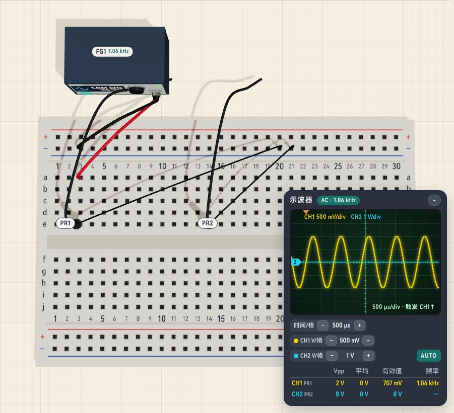
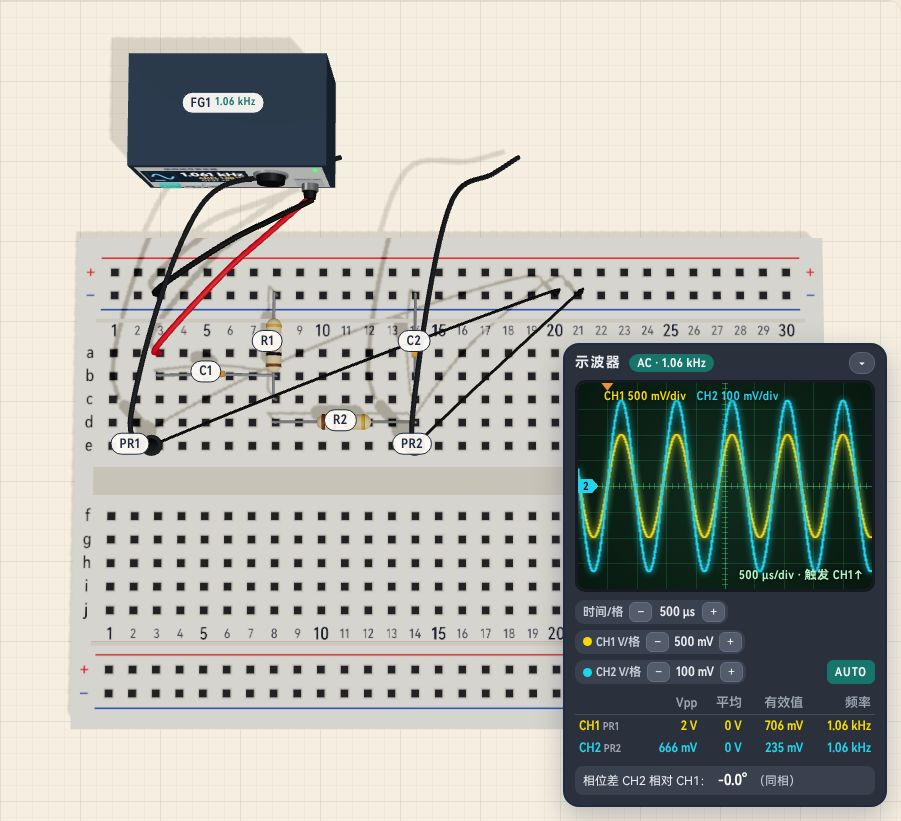
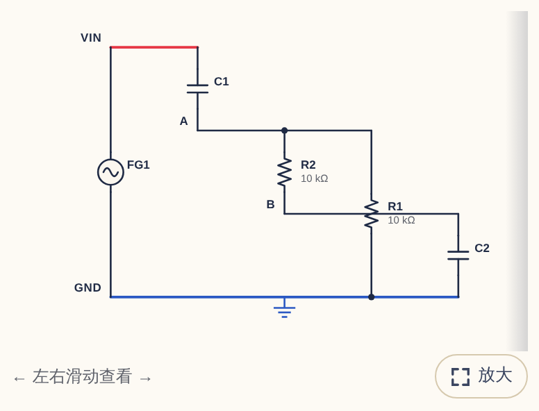
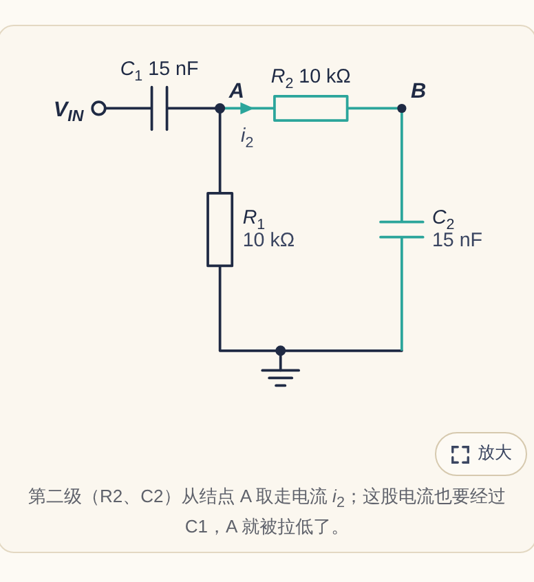

# 5.3 · 两级 RC 带通：后一级拖累前一级

| 项目 | 内容 |
|---|---|
| id | `exp4-rc-bandpass-loading` |
| 文件 | `challenges/267-rc-bandpass-loading.json` |
| 类型 | 实验 / 挑战（没有分步，照目标电路图搭） · 难度 4/5 |
| 位置 | World 5 · 正弦稳态、相量与交流功率 → 5.3 RC 滤波器与级间负载（本节第 3 项） |
| 右侧面板 | 轨道由旧的四张卡片自动生成（还没手工精排） |
| 前后 | 上一项 [5.3 exp4-rc-highpass-coupling](../w5/5.03-2-exp4-rc-highpass-coupling.md) · 下一项 [5.4 exp4-series-resonance](../w5/5.04-1-exp4-series-resonance.md) |
| 先修 | lesson-scope-two-channels |
| 概念 | 带通滤波器 band-pass filter、级联 cascading、负载效应 loading effect、网络函数 H = jωRC/(1 − ω²R²C² + 3jωRC)、中心频率 f0 = 1/(2πRC) |

**一句话概要**：高通（15 nF + 10 kΩ）后面直接接低通（10 kΩ + 15 nF）。先按“两级相乘”猜，再实测，看第二级怎样把第一级拉低。

## 1. 左侧工作台（3D 面包板 → 2D 俯视截图）

截图是程序里真实的 3D 面包板换成俯视角拍的；表格是同一块板的文字版（元件、参数、每只脚插在哪个孔）。

### 1.1 起点：打开这一课时板上已经有的

| 元件 | 类型 | 参数 | 引脚 → 孔 |
|---|---|---|---|
| FG1 | function_gen | waveform=sine, frequency=1061, amplitude=1, offset=0 | +→a3 -→tn3 |
| PR1 | scope_probe | channel=1 | tip→e3 gnd→tn20 |
| PR2 | scope_probe | channel=2 | tip→e14 gnd→tn21 |

### 1.3 参考答案（「看答案」载入的板子）

| 元件 | 类型 | 参数 | 引脚 → 孔 |
|---|---|---|---|
| FG1 | function_gen | waveform=sine, frequency=1061, amplitude=1, offset=0 | +→a3 -→tn3 |
| C1 | capacitor | capacitance=1.5000000000000002e-8 | 1→b3 2→b8 |
| R1 | resistor | resistance=10000 | 1→c8 2→tn8 |
| R2 | resistor | resistance=10000 | 1→d8 2→d14 |
| C2 | capacitor | capacitance=1.5000000000000002e-8 | 1→c14 2→tn14 |
| PR1 | scope_probe | channel=1 | tip→e3 gnd→tn20 |
| PR2 | scope_probe | channel=2 | tip→e14 gnd→tn21 |

### 1.4 目标原理图（右侧「目标原理图」抽屉）

| 元件 | 类型 | 参数 |
|---|---|---|
| FG1 | function_gen |  |
| C1 | capacitor | capacitance=1.5000000000000002e-8 |
| R1 | resistor | resistance=10000 |
| R2 | resistor | resistance=10000 |
| C2 | capacitor | capacitance=1.5000000000000002e-8 |

连接（每个结点上的引脚）：

- **VIN**：FG1.+、C1.1
- **A**：C1.2、R1.1、R2.1
- **B**：R2.2、C2.1
- **GND**：R1.2、C2.2、FG1.-

## 2. 右侧面板：学生从上往下看到的内容（单轨流）

### 第 1 步 · 🔧 动手搭：0.707 × 0.707 = 0.5？

第一级高通：**C1**（`15 nF`）**`b3`**–**`b8`**，**R1**（`10 kΩ`）**`c8`**–**`tn8`**。第二级低通：**R2**（`10 kΩ`）**`d8`**–**`d14`**，**C2**（`15 nF`）**`c14`**–**`tn14`**。
两级的截止频率都是 `1061 Hz`。单独一级在这个频率都让 0.707 倍通过，所以串起来“应该”是 0.707 × 0.707 = 0.5。
信号发生器调到 **`1061 Hz`、幅度 `1 V`**，比一比 CH2（B）和 CH1：输出真的是输入的一半吗？

### 第 2 步 · 💡 想明白：第二级在偷第一级的电流

- 第一级的输出 A 不是空着的：第二级（R2 + C2）接在 A 上，也要从 A 取电流 $i_2$。
- 这股电流也要流过 C1，C1 上多压掉一些电压，A 就被**拉低**了。这叫**负载效应**。

*图 `stages`（schematic）：第二级（R2、C2）从结点 A 取走电流 i_2；这股电流也要经过 C1，A 就被拉低了。*

- 从 A 往右看，第二级的阻抗和 R1 一样大，所以拉得很厉害：
$$Z_A = R_1 ∥ (R_2 + \frac{1}{jωC_2}) = 10 kΩ ∥ (10 - j10) kΩ$$
- 规律：只有后一级的输入阻抗**远大于**前一级的输出阻抗（10 倍以上），两级的放大倍数（输出 ÷ 输入）才能直接相乘。

（这一步下面列着这节课的计算卡片，点开就地展开：`rc-cutoff`、`two-stage-loading`，全文见第 6 节）

### 第 3 步 · 🔧 动手搭：量 B，也量 A

- **`1061 Hz`**：读幅度比 B/VIN（CH2 的 Vpp ÷ CH1 的 Vpp）和 CH2 相对 CH1 的相位差。
- 把 **CH2 针尖挪到 `e8`**（结点 A）：读 A/VIN。单独的高通在这里本该是 0.707。
- CH2 插回 **`e14`**，频率调到 **`106 Hz`**：再读一次 B/VIN。

### 第 4 步 · 📏 测一测：测一测：读你自己的仪表

**测量题 1 · `gb`**（读数题）

> 1061 Hz：幅度比 B/VIN（CH2 的 Vpp ÷ CH1 的 Vpp）

- 先写预测 · 状态：FG1 设为 信号发生器（正弦 1.06kHz 幅度 1V） · 参考答案的读数 **0.3333** · 合理范围 [0.317, 0.35]

答对后显示：

> H = jx / (1 − x² + 3jx)，x = 1 时 H = 1/3——不是“0.707 × 0.707 = 0.5”。

**测量题 2 · `phb`**（读数题）

> 1061 Hz：B 相对 VIN 的相位差

- 单位 ° · 先写预测 · 状态：FG1 设为 信号发生器（正弦 1.06kHz 幅度 1V） · 参考答案的读数 **-0.005917 °** · 合理范围 [-3, 3]

答对后显示：

> +45° 的高通和 −45° 的低通抵消，相位 0°。

**测量题 3 · `ga`**（读数题）

> 1061 Hz：CH2 针尖挪到 e8（结点 A），幅度比 A/VIN

- 先写预测 · 状态：FG1 设为 信号发生器（正弦 1.06kHz 幅度 1V） · 参考答案的读数 **0.4714** · 合理范围 [0.448, 0.495]

答对后显示：

> 第二级并在 R1 上，从 A 看进去 R1 ∥ (R2 + 1/(jωC2)) 比 R1 小：A 被压低到 √2/3 ≈ 0.471（不再是 0.707）。

**测量题 4 · `g106`**（读数题）

> 106 Hz：CH2 回到 e14，幅度比 B/VIN

- 先写预测 · 状态：FG1 设为 信号发生器（正弦 106Hz 幅度 1V） · 参考答案的读数 **0.0966** · 合理范围 [0.0918, 0.101]

答对后显示：

> x = 0.1：|H| = 0.1/|0.99 + 0.3j| ≈ 0.097，相位 ≈ +73°；10.6 kHz 时对称：≈ 0.097，≈ −73°。

**测量题 5 · `why`**（选择题）

> 为什么 1061 Hz 时 B 不是 0.5 × VIN？

- A. 第二级成了第一级的负载：它的输入阻抗（约 10 kΩ）和第一级的输出阻抗是同一个数量级 ✅（正确）
- B. 两级的截止频率不一样
- C. 示波器探头的负载效应

答对后显示：

> 只有后一级的输入阻抗远大于前一级的输出阻抗时，才能把两级的网络函数直接相乘。分母里的“3”就是负载效应，不考虑负载时是 2。办法：第二级阻抗放大 10 倍以上，或者加一个电压跟随器（下一个实验）。

### 第 5 步 · 🎒 带走：带走

- 两级直接串起来，后一级会**拉低**前一级。“各算各的再相乘”只在后一级输入阻抗远大于前一级输出阻抗时成立。
- 两个办法：把第二级的阻抗放大 10 倍以上（例如 100 kΩ + 1.5 nF），或者在两级之间加一个**电压跟随器**——就是下一个实验。
- 坑：示波器本身也是负载。真实输入约 1 MΩ 并联十几 pF（×10 探头约 10 MΩ）。电路阻抗到了几百 kΩ，探头一接上，读数就变了。

趁热练理论题：`frequency`、`ac-analysis`

## 3. 测量题一览

| # | id | 题目 | 类型 | 单位 | 状态 | 参考读数 |
|---|---|---|---|---|---|---|
| 1 | gb | 1061 Hz：幅度比 B/VIN（CH2 的 Vpp ÷ CH1 的 Vpp） | scope |  | FG1 设为 信号发生器（正弦 1.06kHz 幅度 1V） | 0.3333 |
| 2 | phb | 1061 Hz：B 相对 VIN 的相位差 | scope | ° | FG1 设为 信号发生器（正弦 1.06kHz 幅度 1V） | -0.005917 ° |
| 3 | ga | 1061 Hz：CH2 针尖挪到 e8（结点 A），幅度比 A/VIN | scope |  | FG1 设为 信号发生器（正弦 1.06kHz 幅度 1V） | 0.4714 |
| 4 | g106 | 106 Hz：CH2 回到 e14，幅度比 B/VIN | scope |  | FG1 设为 信号发生器（正弦 106Hz 幅度 1V） | 0.0966 |
| 5 | why | 为什么 1061 Hz 时 B 不是 0.5 × VIN？ | 选择 |  |  | 正确：A |

### 全部答完后显示的「对比」

**对比**：
- **天真的算法**：fc = 1/(2π × 10 kΩ × 15 nF) ≈ 1061 Hz，串起来应该是 0.5∠0°。
- **实际**：在 1061 Hz 输出 B 只有 VIN 的 **1/3**（相位 0°）。原因是第二级成了第一级的**负载**：从 A 看进去，R1 ∥ (R2 + 1/(jωC2)) 比 R1 小，第一级的输出 A 被压低到 √2/3 ≈ 0.471∠+45°（不再是 0.707∠+45°）。
- 结点电压法的结果：H(jω) = V̇B/V̇in = jx / (1 − x² + 3jx)。
- x = 1（1061 Hz）：H = j/(3j) = 1/3，相位 0°。分母里的“3”就是负载效应：不考虑负载时这里是 2。
- x = 0.1（106 Hz）：|H| = 0.1/|0.99 + 0.3j| ≈ 0.097，相位 ≈ +73°。
- x = 10（10.6 kHz）：|H| = 10/|−99 + 30j| ≈ 0.097，相位 ≈ −73°。
对数坐标上，响应以 f0 为中心左右对称：两边都按 ±20 dB/十倍频下降。

**负载效应的一般规律**：后一级的输入阻抗必须远大于前一级的输出阻抗，才能把两级的网络函数直接相乘。这里两者是同一个数量级（10 kΩ 对 10 kΩ），所以误差很大。解决办法：把第二级的阻抗放大 10 倍以上（例如 100 kΩ + 1.5 nF），或者在两级之间加一个电压跟随器——见下一个实验。

### 提示按钮（依次显示）

1. 第一级（高通）：电容 C1 串联，R1 从 A 接到 GND。
2. 第二级（低通）：R2 从 A 接到 B，C2 从 B 接到 GND。
3. 结点 A 上有三个元件：C1、R1、R2。

### 功能测试（「检查我的电路」时跑）

- f0 = 1061 Hz：输出 B 合理，和 VIN 同相
- f0：第一级输出 A 被第二级拉低
- 106 Hz：增益、相位合理
- 10.6 kHz：增益、相位合理

## 5. 这一课的计算卡片

**计算卡片 `rc-cutoff`：RC 截止频率 Cut-off frequency**

- 公式 `f_c = \frac{1}{2π R C}`
- 用途：一阶 RC 滤波器的“拐点”：低通从这里开始往下掉，高通从这里开始通过。
- 输入：R（电阻，Ω）；C（电容，F） → f_c（截止频率（−3 dB），Hz）

1. 低通（输出取电容电压）用分压公式：$H = \frac{1/(jωC)}{R + 1/(jωC)} = \frac{1}{1 + jωRC}$。
2. 当 $ωRC = 1$，即 $X_C = R$ 时，$H = \frac{1}{1 + j}$：$|H| = \frac{1}{\sqrt{2}} ≈ 0.707$（−3 dB），相位 −45°。
3. 这一点就是截止频率：$f_c = \frac{1}{2πRC} = \frac{1}{2πτ}$。
4. 伯德图两条渐近线：$f ≪ f_c$ 时 0 dB 的平线；$f ≫ f_c$ 时每十倍频下降 20 dB，两条线交在 $f_c$。
5. 高通（输出取电阻电压）的 $f_c$ 一样，只是方向反过来。

例子：实验 4-1：$\frac{1}{2π × 1.5k × 100n} ≈ 1061 Hz$。实验 4-2：$15k × 10n$ 一样是 1061 Hz。实验 4-6：$R_F C_F = 10k × 15n$ → 1061 Hz。实验 5-14：$10k × 1µ$ → 16 Hz，远低于 1 kHz 的 PWM。

- ⚠ 信号源内阻（50 Ω）和后级负载都会挪动 $f_c$：前者加到 R 上，后者并在输出上。
- ⚠ 电容常有 ±10 %–20 % 误差，$f_c$ 跟着偏同样的比例：实测找 0.707、−45° 的点。

**计算卡片 `two-stage-loading`：两级 RC 带通：级间负载**

- 公式 `|H| = \frac{x}{\sqrt{(1 - x^{2})^{2} + k^{2}x^{2}}}, x = ωRC`
- 用途：高通 + 低通串起来：直接相连（k = 3）和中间加跟随器（k = 2）的增益差多少。
- 输入：R（两级相同的 R，Ω）；C（两级相同的 C，F）；f（信号频率，Hz）；k（3 = 直接相连，2 = 中间有跟随器，） → |H|（总增益，）

1. **天真估算**：两级各自的 H 相乘，在 $f_0$ 处 $0.707 × 0.707 = 0.5$。
2. 实际直接相连时，第二级（R₂ + C₂）并在第一级的 R₁ 上，第一级不再是原来的高通：这就是 **负载效应**。
3. 对 A、B 两个结点列 KCL（令 $x = ωRC$），解出 $H = \frac{jx}{1 - x^{2} + 3jx}$。
4. 中间加电压跟随器：第一级不受影响，第二级看到理想电压源，正好相乘：$H = \frac{jx}{(1 + jx)^{2}} = \frac{jx}{1 - x^{2} + 2jx}$。
5. 分母里多出来的 jx 就是负载。规则：后级输入阻抗要比前级输出阻抗 **大得多**（10 倍以上），才能直接相乘。

例子：实验 4-7（k = 3）：1061 Hz → 1/3（不是 0.5），A 点只有 0.471；106 Hz 和 10.6 kHz → 0.097（±73°）。实验 4-8（k = 2）：1061 Hz → 0.5，106 Hz → 0.099（+78.6°）。

- ⚠ 示波器探头也是负载：几百 kΩ 的电路上，1 MΩ 的 ×1 探头会像第二级一样拖低读数。

## 6. English（界面英文版的同一份内容）

展开英文

### Node 1 · 🔧 Build：0.707 × 0.707 = 0.5?

Stage 1, a high-pass: **C1** (`15 nF`) **`b3`**–**`b8`**, **R1** (`10 kΩ`) **`c8`**–**`tn8`**. Stage 2, a low-pass: **R2** (`10 kΩ`) **`d8`**–**`d14`**, **C2** (`15 nF`) **`c14`**–**`tn14`**.
Both stages have their cutoff at `1061 Hz`. On its own each passes 0.707 there, so in series they "should" give 0.707 × 0.707 = 0.5.
Set the generator to **`1061 Hz`, amplitude `1 V`** and compare CH2 (B) with CH1: is the output really half the input?

### Node 2 · 💡 Why：The second stage steals current from the first

- The first stage's output A is not left alone: the second stage (R2 + C2) hangs on A and draws its own current $i_2$.
- That current has to flow through C1 as well, so C1 drops more voltage and A is **pulled down**. This is the **loading effect**.

[figure `stages`]

*Figure `stages`（schematic）：第二级（R2、C2）从结点 A 取走电流 i_2；这股电流也要经过 C1，A 就被拉低了。*

- Looking right from A, the second stage is as big as R1, so it pulls hard:
$$Z_A = R_1 ∥ (R_2 + \frac{1}{jωC_2}) = 10 kΩ ∥ (10 - j10) kΩ$$
- The rule: you may simply multiply the two stages' gains (output ÷ input) only when the next stage's input impedance is **much larger** (10× or more) than the previous stage's output impedance.

(This node lists the lesson’s calculation cards: `rc-cutoff`、`two-stage-loading`; full text in section 6)

### Node 3 · 🔧 Build：Measure B, and A too

- **`1061 Hz`**: read the amplitude ratio B/VIN (CH2 Vpp ÷ CH1 Vpp) and the phase of CH2 vs CH1.
- Move the **CH2 tip to `e8`** (node A): read A/VIN. On its own the high-pass would give 0.707 here.
- Put CH2 back into **`e14`** and set **`106 Hz`**: read B/VIN again.

### Node 4 · 📏 Measure：Measure: read your own instruments

**Question 1 · `gb`**（reading）

> 1061 Hz: amplitude ratio B/VIN (CH2 Vpp ÷ CH1 Vpp)

- predict first · state：FG1 is set to Function generator (sine 1.06kHz 1V peak) · range [0.317, 0.35]

Shown once right:

> H = jx / (1 − x² + 3jx); at x = 1, H = 1/3, not "0.707 × 0.707 = 0.5".

**Question 2 · `phb`**（reading）

> 1061 Hz: phase of B relative to VIN

- unit ° · predict first · state：FG1 is set to Function generator (sine 1.06kHz 1V peak) · range [-3, 3]

Shown once right:

> The high-pass's +45° and the low-pass's −45° cancel: 0°.

**Question 3 · `ga`**（reading）

> 1061 Hz: CH2 tip moved to e8 (node A), amplitude ratio A/VIN

- predict first · state：FG1 is set to Function generator (sine 1.06kHz 1V peak) · range [0.448, 0.495]

Shown once right:

> The second stage sits across R1, so looking in from A, R1 ∥ (R2 + 1/(jωC2)) is smaller than R1: A drops to √2/3 ≈ 0.471 (no longer 0.707).

**Question 4 · `g106`**（reading）

> 106 Hz: CH2 back on e14, amplitude ratio B/VIN

- predict first · state：FG1 is set to Function generator (sine 106Hz 1V peak) · range [0.0918, 0.101]

Shown once right:

> x = 0.1: |H| = 0.1/|0.99 + 0.3j| ≈ 0.097, phase ≈ +73°; 10.6 kHz is symmetric: ≈ 0.097, ≈ −73°.

**Question 5 · `why`**（multiple choice）

> Why is B not 0.5 × VIN at 1061 Hz?

- A. the second stage loads the first: its input impedance (about 10 kΩ) is the same order as the first stage's output impedance ✅ (right)
- B. the two stages have different cutoff frequencies
- C. the scope probes load the circuit

Shown once right:

> You may multiply the two network functions only when the next stage's input impedance is much larger than the previous stage's output impedance. The "3" in the denominator is the loading; without it, it would be 2. Fixes: scale the second stage's impedance up 10× or more, or add a voltage follower (next experiment).

### Node 5 · 🎒 Take away：Take away

- Chain two stages directly and the second **pulls down** the first. "Work them out separately and multiply" only holds when the next stage's input impedance is much larger than the previous stage's output impedance.
- Two fixes: scale the second stage's impedance up 10× or more (e.g. 100 kΩ + 1.5 nF), or put a **voltage follower** between the stages — the next experiment.
- Pitfall: the scope is a load too. A real input is about 1 MΩ in parallel with ten-odd pF (about 10 MΩ with a ×10 probe). With circuit impedances of several hundred kΩ, the reading changes the moment the probe touches.

Practise：`frequency`、`ac-analysis`

**Compare**

**Compare**:
- **The naive estimate**: fc = 1/(2π × 10 kΩ × 15 nF) ≈ 1061 Hz, so in series they should give 0.5∠0°.
- **What actually happens**: at 1061 Hz the output B is only **1/3** of VIN (phase 0°). The second stage **loads** the first: looking in from A, R1 ∥ (R2 + 1/(jωC2)) is smaller than R1, so the first stage's output A drops to √2/3 ≈ 0.471∠+45° (instead of 0.707∠+45°).
- Nodal analysis gives H(jω) = V_B/V_in = jx / (1 − x² + 3jx).
- x = 1 (1061 Hz): H = j/(3j) = 1/3, phase 0°. The "3" in the denominator is the loading effect: without loading it would be 2.
- x = 0.1 (106 Hz): |H| = 0.1/|0.99 + 0.3j| ≈ 0.097, phase ≈ +73°.
- x = 10 (10.6 kHz): |H| = 10/|−99 + 30j| ≈ 0.097, phase ≈ −73°.
On log axes the response is symmetric about f0, falling at ±20 dB/decade on each side.

**The general rule**: you may simply multiply the network functions of two stages only if the second stage's input impedance is much larger than the first stage's output impedance. Here they are the same size (10 kΩ vs 10 kΩ), so the error is large. Fixes: scale the second stage's impedance up 10× or more (e.g. 100 kΩ + 1.5 nF), or put a voltage follower between the stages — see the next experiment.

**Hints**

1. Stage 1 (high-pass): capacitor C1 in series, R1 from A to GND.
2. Stage 2 (low-pass): R2 from A to B, C2 from B to GND.
3. Node A has three things on it: C1, R1 and R2.

