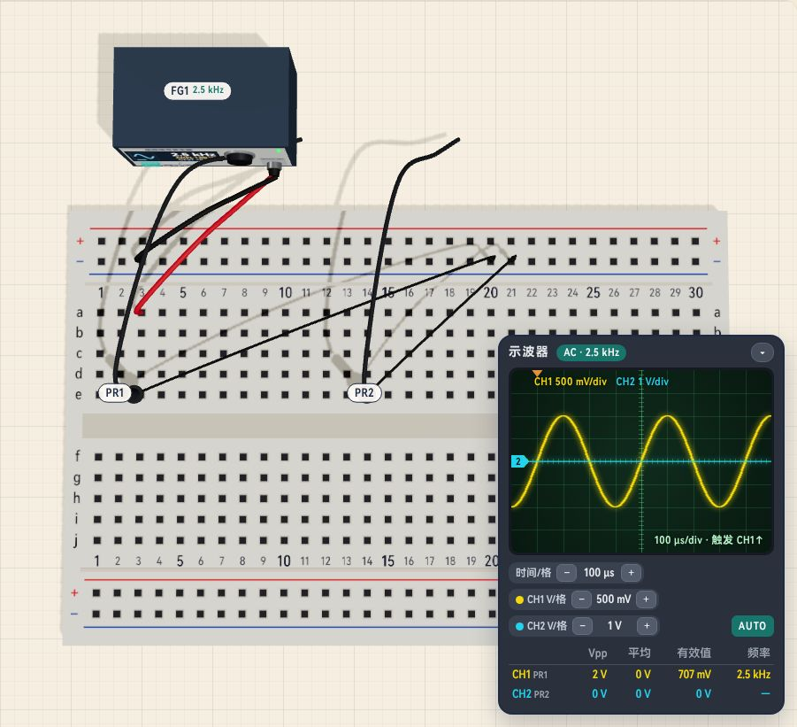
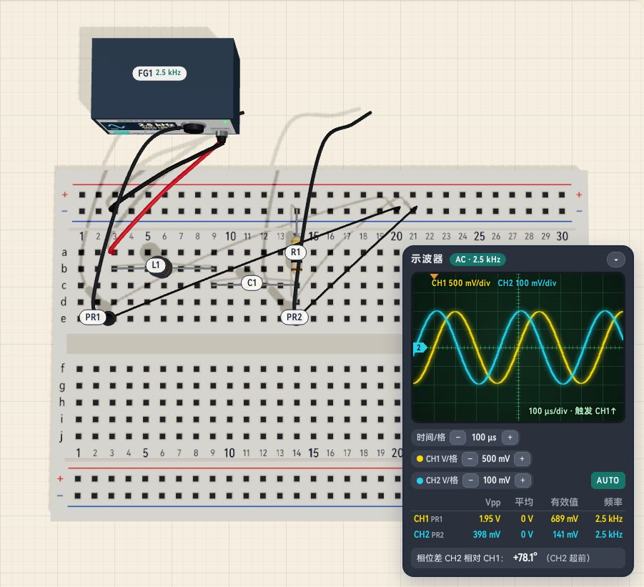
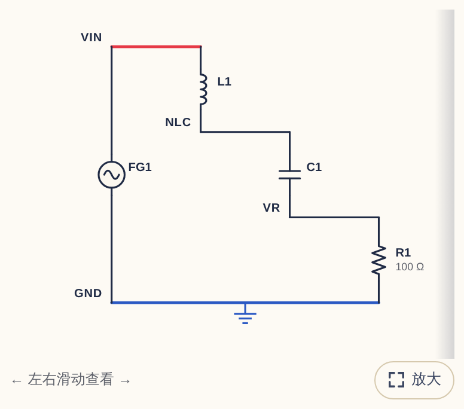
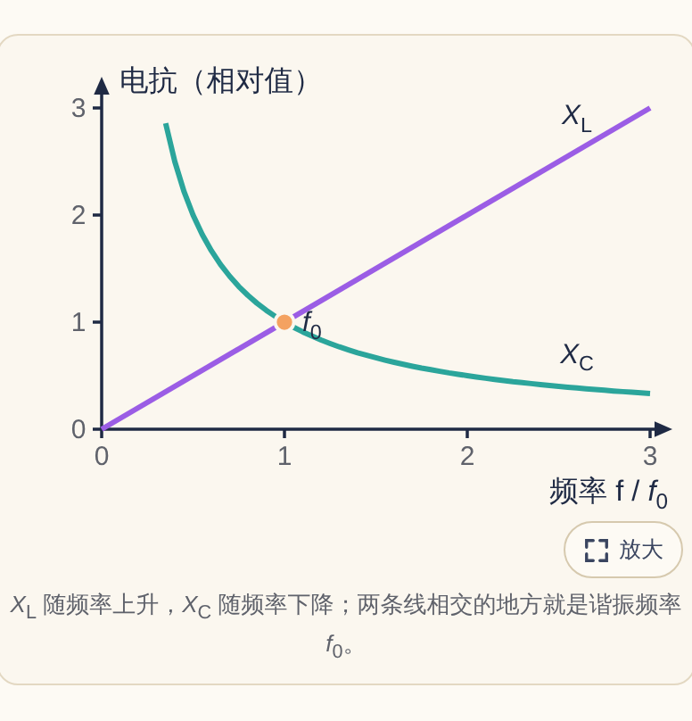
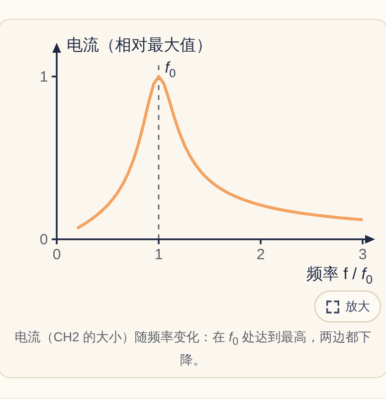

# 5.4 · RLC 串联谐振：扫频找 f0

| 项目 | 内容 |
|---|---|
| id | `exp4-series-resonance` |
| 文件 | `challenges/264-series-resonance.json` |
| 类型 | 实验 / 挑战（没有分步，照目标电路图搭） · 难度 4/5 |
| 位置 | World 5 · 正弦稳态、相量与交流功率 → 5.4 谐振（本节第 1 项） |
| 右侧面板 | 轨道由旧的四张卡片自动生成（还没手工精排） |
| 前后 | 上一项 [5.3 exp4-rc-bandpass-loading](../w5/5.03-3-exp4-rc-bandpass-loading.md) · 下一项 [5.4 exp4-parallel-lc-tank](../w5/5.04-2-exp4-parallel-lc-tank.md) |
| 先修 | lesson-scope-two-channels |
| 概念 | 串联谐振 series resonance、f0 = 1/(2π√(LC))、品质因数 Q = ω0L/R、谐振时 V_L = V_C = Q·V、容性 / 感性 capacitive / inductive |

**一句话概要**：10 mH + 100 nF + 100 Ω 串联。扫频找电流最大、和电压同相的谐振频率 f0，看谐振时电容上的电压比电源还高，再看 f0 两边电路呈容性还是感性。

## 1. 左侧工作台（3D 面包板 → 2D 俯视截图）

截图是程序里真实的 3D 面包板换成俯视角拍的；表格是同一块板的文字版（元件、参数、每只脚插在哪个孔）。

### 1.1 起点：打开这一课时板上已经有的

| 元件 | 类型 | 参数 | 引脚 → 孔 |
|---|---|---|---|
| FG1 | function_gen | waveform=sine, frequency=2500, amplitude=1, offset=0 | +→a3 -→tn3 |
| PR1 | scope_probe | channel=1 | tip→e3 gnd→tn20 |
| PR2 | scope_probe | channel=2 | tip→e14 gnd→tn21 |

### 1.3 参考答案（「看答案」载入的板子）

| 元件 | 类型 | 参数 | 引脚 → 孔 |
|---|---|---|---|
| FG1 | function_gen | waveform=sine, frequency=2500, amplitude=1, offset=0 | +→a3 -→tn3 |
| L1 | inductor | inductance=0.01 | 1→b3 2→b9 |
| C1 | capacitor | capacitance=1.0000000000000001e-7 | 1→c9 2→c14 |
| R1 | resistor | resistance=100 | 1→d14 2→tn14 |
| PR1 | scope_probe | channel=1 | tip→e3 gnd→tn20 |
| PR2 | scope_probe | channel=2 | tip→e14 gnd→tn21 |

### 1.4 目标原理图（右侧「目标原理图」抽屉）

| 元件 | 类型 | 参数 |
|---|---|---|
| FG1 | function_gen |  |
| L1 | inductor | inductance=0.01 |
| C1 | capacitor | capacitance=1.0000000000000001e-7 |
| R1 | resistor | resistance=100 |

连接（每个结点上的引脚）：

- **VIN**：FG1.+、L1.1
- **NLC**：L1.2、C1.1
- **VR**：C1.2、R1.1
- **GND**：R1.2、FG1.-

## 2. 右侧面板：学生从上往下看到的内容（单轨流）

### 第 1 步 · 🔧 动手搭：转旋钮，找最大的那一刻

三个元件串成一串：**电感**（`10 mH`）**`b3`**–**`b9`**，**电容**（`100 nF`）**`c9`**–**`c14`**，**电阻**（`100 Ω`）**`d14`**–**`tn14`**。CH2 在电阻上，看的是电流。
信号发生器：**正弦波、幅度 `1 V`**，频率从 **`2.5 kHz`** 慢慢调到 **`10 kHz`**。
CH2 先变大、再变小。它最大的时候，CH1 和 CH2 两条波形的波峰对得齐吗？

### 第 2 步 · 💡 想明白：两个方向相反的“阻力”正好抵消

- 电感的感抗 $X_L = 2π f L$ 随频率**变大**；电容的容抗 $X_C = \frac{1}{2π f C}$ 随频率**变小**。
- 它们的作用方向相反：电感让电流落后，电容让电流超前。两者相等的那个频率，它们正好**抵消**，只剩电阻挡着电流——电流最大，而且和电压同相。这叫**谐振**。

*图 `reactances`（plot）：X_L 随频率上升，X_C 随频率下降；两条线相交的地方就是谐振频率 f_0。*

- 令 $X_L = X_C$，就得到谐振频率：
$$f_0 = \frac{1}{2π\sqrt{LC}} = \frac{1}{2π\sqrt{0.01 × 100 × 10^{-9}}}$$
动手之前先算出来。低于 $f_0$ 电容占上风，高于 $f_0$ 电感占上风。

*图 `peak`（plot）：电流（CH2 的大小）随频率变化：在 f_0 处达到最高，两边都下降。*

（这一步下面列着这节课的计算卡片，点开就地展开：`generator-output`、`rms-sine`、`phase-from-delay`、`inductive-reactance`、`ac-kvl`、`lc-resonance`、`series-q`、`resonance-bandwidth`，全文见第 6 节）

### 第 3 步 · 🔧 动手搭：找 f0，再看电容上的电压

- **扫频**：找 CH2 和 CH1 相位差正好过 0 的频率，那里 CH2 也最大。
- 频率调到 **`2.5 kHz`**：读 CH2 相对 CH1 的相位差；再调到 **`10 kHz`** 看一眼相位的正负。
- 回到 $f_0$，把 **CH2 夹到电容两端**：针尖插 **`d9`**，接地夹插 **`a14`**（探头量的是“针尖减接地夹”）。和 CH1 比一比，电容上的电压比加上去的电压大还是小？

### 第 4 步 · 📏 测一测：测一测：读你自己的仪表

**测量题 1 · `f0`**（读数题）

> 扫频：VR 和 VIN 同相（相位差 0°）、VR 最大的频率 f0

- 单位 kHz · 先写预测 · 状态：FG1 设为 信号发生器（正弦 幅度 1V） · 参考答案的读数 **5.032 kHz** · 合理范围 [4900, 5150]

答对后显示：

> ωL = 1/(ωC) 时电抗抵消：f0 = 1/(2π√(LC)) ≈ 5.03 kHz。

**测量题 2 · `ph25`**（读数题）

> f = 2.5 kHz：VR（也就是电流）相对 VIN 的相位差

- 单位 ° · 先写预测 · 状态：FG1 设为 信号发生器（正弦 2.5kHz 幅度 1V） · 参考答案的读数 **78.1 °** · 合理范围 [75, 81]

答对后显示：

> 低于 f0 时 1/(ωC) > ωL，电路呈容性，电流超前电压，相位为正。

**测量题 3 · `vc`**（读数题）

> f = 5033 Hz：CH2 夹到电容两端（针尖 d9、接地夹 a14），电容电压的 Vpp

- 单位 V · 先写预测 · 状态：FG1 设为 信号发生器（正弦 5.03kHz 幅度 1V） · 参考答案的读数 **4.187 V** · 合理范围 [4, 4.4]

答对后显示：

> 谐振时 X_C = X_L = √(L/C) ≈ 316 Ω，电流 ≈ 4.7 mA（有效值），电容电压是 VIN 的 Q = 316/101 ≈ 3.1 倍：约 4.2 Vpp，而 VIN 只有约 1.34 Vpp。V̇L 和 V̇C 大小相等、方向相反，所以 KVL 仍然成立。

**测量题 4 · `ind`**（选择题）

> 把频率调到 10 kHz 再看相位：电路呈什么性质？

- A. 感性：电流落后电压（相位差为负） ✅（正确）
- B. 容性：电流超前电压（相位差为正）
- C. 纯电阻：同相

答对后显示：

> 高于 f0 时 ωL > 1/(ωC)，感抗占上风，电流落后电压约 78°。

### 第 5 步 · 🎒 带走：带走

- **串联谐振**：$X_L = X_C$，阻抗最小（只剩电阻），电流最大，电流和电压同相。
- 低于 $f_0$ 电路呈**容性**（电流超前），高于 $f_0$ 呈**感性**（电流落后）。
- 谐振时 L 和 C 上的电压大小相等、方向相反，各自可以是电源电压的好几倍（品质因数 Q 倍）。
- 坑：Q 很高的串联谐振电路里，电容上的电压能比电源高几十倍。真实电路要看电容的**耐压**。

趁热练理论题：`frequency`

## 3. 测量题一览

| # | id | 题目 | 类型 | 单位 | 状态 | 参考读数 |
|---|---|---|---|---|---|---|
| 1 | f0 | 扫频：VR 和 VIN 同相（相位差 0°）、VR 最大的频率 f0 | scope | kHz | FG1 设为 信号发生器（正弦 幅度 1V） | 5.032 kHz |
| 2 | ph25 | f = 2.5 kHz：VR（也就是电流）相对 VIN 的相位差 | scope | ° | FG1 设为 信号发生器（正弦 2.5kHz 幅度 1V） | 78.1 ° |
| 3 | vc | f = 5033 Hz：CH2 夹到电容两端（针尖 d9、接地夹 a14），电容电压的 Vpp | scope | V | FG1 设为 信号发生器（正弦 5.03kHz 幅度 1V） | 4.187 V |
| 4 | ind | 把频率调到 10 kHz 再看相位：电路呈什么性质？ | 选择 |  |  | 正确：A |

### 全部答完后显示的「对比」

**对比**：
- 当 ωL = 1/(ωC)，电抗互相抵消，|Z| 最小 = R + r，电流最大，并且电流和电压**同相**：f0 = 1/(2π√(LC)) = 1/(2π√(10 mH × 100 nF)) ≈ 5033 Hz。
- 在 f0：v_R/v_in = 100/101 ≈ 0.99，相位 ≈ 0°。电流有效值 = (1 V/√2)/(101 + 50) Ω ≈ 4.7 mA（这里要算上信号发生器的 50 Ω，因为谐振时电路的阻抗很小，50 Ω 分走了 1/3 的电压——所以 VIN 端子上只剩约 1.34 Vpp）。
- **电压放大**：谐振时 X_L = X_C = √(L/C) ≈ 316 Ω。V_C = V_L = I·316 Ω，相对端子电压 VIN 是 Q = 316/101 ≈ 3.1 倍：电容上约 4.2 Vpp，而 VIN 只有 1.34 Vpp！V̇L 和 V̇C 大小相等、方向相反，互相抵消，所以 KVL 仍然成立。（电容电压的最大值其实出现在略低于 f0 的地方，例如 4.5 kHz 时约 4.24 Vpp，但差别很小。）
- f < f0（例如 2.5 kHz）：1/(ωC) > ωL，电路呈**容性**，电流**超前**电压：v_R/v_in ≈ 0.20，相位 ≈ +78°。
- f > f0（例如 10 kHz）：ωL > 1/(ωC)，电路呈**感性**，电流**落后**电压：v_R/v_in ≈ 0.21，相位 ≈ −78°。
- 半功率点（v_R/v_in = 0.707×0.99）大约在 4.3 kHz 和 5.9 kHz，带宽 BW = (R + r)/(2πL) ≈ 1.6 kHz，f0/BW ≈ 3.1 = Q。

### 提示按钮（依次显示）

1. 串联顺序：信号发生器 → 电感 → 电容 → 电阻 → GND。
2. f0 = 1/(2π√(LC))。在 f0 处 VR 和 VIN 同相：扫频时找相位差过零的地方。
3. 低于 f0 电路呈容性（电流超前），高于 f0 呈感性（电流落后）。

### 功能测试（「检查我的电路」时跑）

- f0：电流与电压同相
- f0：电容电压比 VIN 高（Q > 1）
- 2.5 kHz：容性
- 10 kHz：感性

## 5. 这一课的计算卡片

**计算卡片 `generator-output`：信号发生器的 50 Ω 输出电阻**

- 公式 `V_{out} = V_{set} \frac{R_L}{50 Ω + R_L}`
- 用途：信号发生器 = 理想波形源串 50 Ω：接上负载以后输出比设定小多少。
- 输入：V_set（设定的幅度（或偏置），V）；R_o（输出电阻，Ω）；R_L（负载（电路的输入电阻），Ω） → V_out（端口上的实际值，V）

1. 发生器内部 = 一个理想波形源 + 串联的 50 Ω（$R_o$）。空载时端口电压就是设定值。
2. 接负载 $R_L$：$R_o$ 和 $R_L$ 分压，$V_{out} = V_{set}\frac{R_L}{R_o + R_L}$。交流部分和直流偏置都被同一个比例缩小。
3. $R_L ≫ 50 Ω$（几 kΩ 以上）时差别不到 1 %；50 Ω 负载正好减半。
4. 负载是 RC、RL 时用阻抗的模：$|V_{out}| = V_{set}\frac{|Z|}{|Z + R_o|}$，而且随频率变——所以滤波实验用端口电压（CH1）做参考。
5. 时间常数里要把 50 Ω 算进 R：$τ = (R + 50)C$。

例子：- 第 12 课：设 1 V，50 Ω 负载：0.5 V 幅度 = 1.0 Vpp；偏置 +1 V 也变成 0.5 V。
- 实验 2-7：反相放大器输入电阻 10 kΩ：$1 × \frac{10000}{10050} ≈ 0.995$，输出 2.19 Vpp 而不是 2.2。
- 实验 4-3：$|Z| = 142.5 Ω$，$|Z + 50| = |151 + j100.5| ≈ 181 Ω$：端口只有 $\frac{142.5}{181} ≈ 0.786 V$ 峰值（1.57 Vpp）。

- ⚠ 很多真实发生器按“接 50 Ω 负载”显示幅度：接高阻电路实际是显示值的两倍（除非设成 High-Z）。
- ⚠ 算 τ、谐振电流、RLC 阻尼时忘了这 50 Ω。

**计算卡片 `rms-sine`：正弦波的有效值 RMS of a sine**

- 公式 `V_{rms} = \frac{V_p}{\sqrt{2}} ≈ 0.707 V_p`
- 用途：正弦信号的有效值：和多大的直流电压在电阻上产生同样的热。
- 输入：V_p（峰值（幅度），V） → V_rms（有效值，V）

1. 有效值的定义：在电阻上产生相同平均功率的直流值，$V_{rms} = \sqrt{\frac{1}{T}∫_{0}^{T} v^{2} dt}$（均方根）。
2. 正弦：$v^{2} = V_p^{2}sin^{2}(ωt) = \frac{V_p^{2}}{2}(1 - cos 2ωt)$，一个周期里 cos 项平均为 0。
3. 所以均方值是 $\frac{V_p^{2}}{2}$，开方得 $\frac{V_p}{\sqrt{2}}$。
4. **只对正弦成立**：方波（±A）的有效值就是 A；占空比 D 的 0/$V_H$ 方波是 $V_H\sqrt{D}$。
5. 直流 + 交流：$V_{rms} = \sqrt{V_{dc}^{2} + V_{ac,rms}^{2}}$。

例子：第 12 课：50 Ω 负载上 0.5 V 峰值 → $\frac{0.5}{1.414} ≈ 0.354 V$。实验 4-4：谐振时有效值电流 $\frac{1/\sqrt{2}}{101 + 50} ≈ 4.7 mA$。

- ⚠ 普通万用表交流档按正弦标定：测方波、PWM 读数不对，要用真有效值表。
- ⚠ 有效值、峰值、峰峰值别混着比：先统一成同一种。

**计算卡片 `phase-from-delay`：由时间差算相位差 Phase from time delay**

- 公式 `φ = -360° × \frac{Δt}{T} = -360° × Δt f`
- 用途：两个同频正弦，CH2 比 CH1 晚 Δt 到峰值：相位差是多少度（落后为负）。
- 输入：Δt（CH2 比 CH1 晚多少，s）；f（频率，Hz） → φ（CH2 相对 CH1 的相位（度），）

1. 一个整周期 T 对应 360°。
2. 晚了 Δt，就是晚了 $\frac{Δt}{T}$ 个周期 = $360° × \frac{Δt}{T}$。
3. 符号约定：CH2 **晚** 到（落后）记为负，**早** 到（超前）记为正。
4. 反过来：$Δt = \frac{|φ|}{360°} × T$。
5. 读 Δt：两个波形的过零点（同一方向）之间的格数 × time/div。

例子：第 13 课：1 kHz、1 kΩ + 100 nF，电容电压落后 $arctan\frac{1000}{1592}$ ≈ 32°，对应 $Δt = \frac{32}{360} × 1 ms ≈ 89 µs$。实验 4-1：在 $f_c$ 处 −45° = 晚八分之一周期。

- ⚠ Δt 超过半个周期时，“晚 Δt”也可以看成“早 T − Δt”：相位通常取 −180° … +180°。
- ⚠ 反相放大器的输出和输入差 180°，看起来像“晚了半个周期”。

**计算卡片 `inductive-reactance`：感抗 Inductive reactance**

- 公式 `X_L = 2π f L`
- 用途：电感对某个频率的正弦信号的阻碍（单位 Ω）：频率越高越大。
- 输入：f（频率，Hz）；L（电感，H） → X_L（感抗，Ω）

1. 电感的电压 $v = L\frac{di}{dt}$。
2. 电流 $i = I_m sin(ωt)$ 时 $v = ωLI_m cos(ωt)$，幅度之比 $\frac{V_m}{I_m} = ωL$。
3. 电压比电流 **超前 90°**（电流落后）；相量 $Z_L = jωL = jX_L$。
4. 和电容相反：**直流时电感是短路**（只剩线圈电阻 r），高频时接近开路。

例子：实验 4-3：$2π × 1600 × 10 mH ≈ 100.5 Ω$，和 R + r = 101 Ω 几乎一样，所以电流落后约 45°。160 Hz 只有约 10 Ω，16 kHz 约 1005 Ω。实验 4-4：谐振 5033 Hz 时 $X_L ≈ 316 Ω$。

- ⚠ 真实电感还有线圈电阻 r：它和 $X_L$ 是相量相加，不是直接相加。

**计算卡片 `ac-kvl`：交流 KVL：相量相加**

- 公式 `V = \sqrt{V_R^{2} + V_X^{2}}`
- 用途：电阻电压和电感（或电容）电压差 90°：总电压是两者的“勾股和”，不是直接相加。
- 输入：V_R（电阻电压（Vpp 或有效值），V）；V_X（电感 / 电容电压（同一种量），V） → V（总电压，V）

1. 任何时刻 KVL 都成立：$v = v_R + v_L$（瞬时值相加）。
2. 但 $v_R$ 和 $v_L$ 的峰值不在同一时刻到达：电感电压比电阻电压超前 90°。
3. 用相量表示：$V̇ = V̇_R + V̇_L$，两个相量互相垂直，构成直角三角形（电压三角形）。
4. 所以幅度（或有效值、峰峰值）满足 $V = \sqrt{V_R^{2} + V_L^{2}}$，夹角 $arctan\frac{V_L}{V_R}$。

例子：实验 4-3：$v_R ≈ 1.10 Vpp$，$v_L ≈ 1.11 Vpp$：直接加是 2.21，但 $\sqrt{1.10^{2} + 1.11^{2}} ≈ 1.56 Vpp$ ≈ VIN 的 1.57 Vpp。实验 4-4 谐振时：$V_L$ 和 $V_C$ 大小相等、方向相反，互相抵消，KVL 仍成立。

- ⚠ 真实线圈有电阻 r，$v_L$ 和 $v_R$ 的夹角略小于 90°，勾股和只是近似。

**计算卡片 `lc-resonance`：LC 谐振频率 f₀ = 1/(2π√LC)**

- 公式 `f_0 = \frac{1}{2π\sqrt{LC}}`
- 用途：电感和电容的电抗正好相等（互相抵消）的频率——串联、并联 LC 和 RLC 振铃都用它。
- 输入：L（电感，H）；C（电容，F） → f_0（谐振频率，Hz）

1. 串联 RLC：$Z = R + j(ωL - \frac{1}{ωC})$。
2. 两个电抗相等时虚部为 0：$ω_0L = \frac{1}{ω_0C}$ ⇒ $ω_0 = \frac{1}{\sqrt{LC}}$，$f_0 = \frac{1}{2π\sqrt{LC}}$。
3. 串联谐振：|Z| 最小（= R），电流最大，电流和电压 **同相**；低于 f₀ 呈容性（电流超前），高于 f₀ 呈感性（电流落后）。
4. 并联 LC：导纳的虚部抵消，阻抗最大（见“并联谐振阻抗”）。
5. 谐振时每个电抗的大小 $X_0 = \sqrt{\frac{L}{C}}$（特性阻抗）。

例子：实验 3-4、4-4、4-5（10 mH、100 nF）：$f_0 = \frac{1}{2π\sqrt{10^{-9}}} ≈ 5033 Hz$，$X_0 = \sqrt{\frac{0.01}{10^{-7}}} ≈ 316 Ω$。2.5 kHz 电流超前约 78°，10 kHz 落后约 78°。

- ⚠ 把 √ 漏掉，或者把 2π 漏掉——结果差几个数量级或 6.28 倍。

**计算卡片 `series-q`：品质因数 Q 与谐振电压放大**

- 公式 `Q = \frac{ω_0 L}{R} = \frac{1}{R}\sqrt{\frac{L}{C}}, V_C = V_L = Q V`
- 用途：串联谐振时电容（电感）电压是电源电压的几倍；Q 也决定峰有多尖。
- 输入：L（电感，H）；C（电容，F）；R（回路总电阻（不含发生器时用端口电压），Ω） → Q（品质因数（电压放大倍数），）

1. 谐振时电抗抵消，电流 $I = \frac{V}{R}$（R 是回路电阻）。
2. 电容电压 $V_C = IX_0 = V\frac{X_0}{R}$，$X_0 = \sqrt{\frac{L}{C}}$；电感电压一样大、方向相反。
3. 定义 $Q = \frac{X_0}{R}$：元件电压是电源的 Q 倍——**比电源还高**。
4. Q 也是“储存的能量 / 每个周期损耗的能量”的 2π 倍：Q 越大，峰越尖，带宽 $BW = \frac{f_0}{Q}$ 越窄。
5. 并联槽路自己的 Q = $\frac{X_0}{r}$（r 是线圈电阻）：谐振时 L、C 之间的环流是外部电流的约 Q 倍。

例子：实验 4-4：$Q = \frac{316}{101} ≈ 3.1$，VIN 只有 1.34 Vpp 时电容上约 4.2 Vpp。实验 4-5：槽路自己的 $Q = \frac{316}{1} ≈ 316$，测到的环流比 $I_L/I_{R1}$ ≈ 300。

- ⚠ 高 Q 串联谐振里元件电压可以是电源的几十倍：注意电容耐压。
- ⚠ 真实线圈 10–30 Ω 的电阻会把 Q 拉低很多。

**计算卡片 `resonance-bandwidth`：谐振带宽 BW = f₀/Q**

- 公式 `BW = f_2 - f_1 = \frac{f_0}{Q}`
- 用途：谐振峰的两个半功率点（0.707）之间有多宽。
- 输入：f_0（谐振频率，Hz）；Q（品质因数，） → BW（−3 dB 带宽，Hz）

1. 串联 RLC：在半功率点，电抗的大小等于电阻：$|ωL - \frac{1}{ωC}| = R$，这时 $|Z| = \sqrt{2}R$，电流降到 0.707。
2. 解这个方程的两个正根 $ω_1$、$ω_2$，相减得 $ω_2 - ω_1 = \frac{R}{L}$，即 $BW = \frac{R}{2πL}$。
3. 用 $Q = \frac{ω_0L}{R}$ 改写：$BW = \frac{f_0}{Q}$。
4. 并联槽路同理，Q 用整个电路的：$Q = \frac{R_{总}}{X_0}$（R 是并在槽路上的所有电阻）。

例子：实验 4-4：$\frac{5033}{3.13} ≈ 1.6 kHz$（半功率点约 4.3 kHz 和 5.9 kHz）。实验 4-5：整个电路 $Q ≈ \frac{10k ∥ 100k}{316} ≈ 29$，$BW ≈ 175 Hz$——只有 4.95–5.12 kHz 能通过。

- ⚠ f₁、f₂ 关于 f₀ 是几何对称（$f_1f_2 = f_0^{2}$），不是算术对称。

## 6. English（界面英文版的同一份内容）

展开英文

### Node 1 · 🔧 Build：Turn the knob, find the biggest moment

Three parts in one string: **inductor** (`10 mH`) **`b3`**–**`b9`**, **capacitor** (`100 nF`) **`c9`**–**`c14`**, **resistor** (`100 Ω`) **`d14`**–**`tn14`**. CH2 sits on the resistor, so it shows the current.
Generator: **sine, amplitude `1 V`**; turn the frequency slowly from **`2.5 kHz`** up to **`10 kHz`**.
CH2 grows, then shrinks. At its biggest, do the peaks of CH1 and CH2 line up?

### Node 2 · 💡 Why：Two opposite "resistances" cancel

- The inductor's reactance $X_L = 2π f L$ **grows** with frequency; the capacitor's $X_C = \frac{1}{2π f C}$ **shrinks**.
- They pull in opposite directions: the inductor makes the current lag, the capacitor makes it lead. At the frequency where they are equal they **cancel**, and only the resistor holds the current back — the current is largest and in phase with the voltage. This is **resonance**.

[figure `reactances`]

*Figure `reactances`（plot）：X_L 随频率上升，X_C 随频率下降；两条线相交的地方就是谐振频率 f_0。*

- Setting $X_L = X_C$ gives the resonant frequency:
$$f_0 = \frac{1}{2π\sqrt{LC}} = \frac{1}{2π\sqrt{0.01 × 100 × 10^{-9}}}$$
Work it out before you start. Below $f_0$ the capacitor wins; above $f_0$ the inductor wins.

[figure `peak`]

*Figure `peak`（plot）：电流（CH2 的大小）随频率变化：在 f_0 处达到最高，两边都下降。*

(This node lists the lesson’s calculation cards: `generator-output`、`rms-sine`、`phase-from-delay`、`inductive-reactance`、`ac-kvl`、`lc-resonance`、`series-q`、`resonance-bandwidth`; full text in section 6)

### Node 3 · 🔧 Build：Find f0, then look at the capacitor

- **Sweep**: find the frequency where the phase of CH2 vs CH1 crosses 0; CH2 is also largest there.
- Set **`2.5 kHz`**: read the phase of CH2 vs CH1; then set **`10 kHz`** and note the sign of the phase.
- Back at $f_0$, **clip CH2 across the capacitor**: tip into **`d9`**, ground clip into **`a14`** (the probes measure tip minus clip). Compared with CH1, is the capacitor voltage bigger or smaller than the voltage you apply?

### Node 4 · 📏 Measure：Measure: read your own instruments

**Question 1 · `f0`**（reading）

> Sweep: the frequency f0 where VR is in phase with VIN (0° phase difference) and largest

- unit kHz · predict first · state：FG1 is set to Function generator (sine 1V peak) · range [4900, 5150]

Shown once right:

> The reactances cancel when ωL = 1/(ωC): f0 = 1/(2π√(LC)) ≈ 5.03 kHz.

**Question 2 · `ph25`**（reading）

> f = 2.5 kHz: the phase of VR (i.e. the current) relative to VIN

- unit ° · predict first · state：FG1 is set to Function generator (sine 2.5kHz 1V peak) · range [75, 81]

Shown once right:

> Below f0, 1/(ωC) > ωL: the circuit is capacitive and the current leads, so the phase is positive.

**Question 3 · `vc`**（reading）

> f = 5033 Hz: CH2 across the capacitor (tip d9, clip a14), the capacitor voltage's Vpp

- unit V · predict first · state：FG1 is set to Function generator (sine 5.03kHz 1V peak) · range [4, 4.4]

Shown once right:

> At resonance X_C = X_L = √(L/C) ≈ 316 Ω and the current is ≈ 4.7 mA (rms), so the capacitor voltage is Q = 316/101 ≈ 3.1 times VIN: about 4.2 Vpp while VIN is only about 1.34 Vpp. V_L and V_C are equal and opposite, so KVL still holds.

**Question 4 · `ind`**（multiple choice）

> Set 10 kHz and look at the phase again: how does the circuit behave?

- A. Inductive: the current lags the voltage (negative phase) ✅ (right)
- B. Capacitive: the current leads the voltage (positive phase)
- C. Purely resistive: in phase

Shown once right:

> Above f0, ωL > 1/(ωC): the inductance wins and the current lags by about 78°.

### Node 5 · 🎒 Take away：Take away

- **Series resonance**: $X_L = X_C$, the impedance is smallest (just the resistance), the current is largest and in phase with the voltage.
- Below $f_0$ the circuit is **capacitive** (current leads); above $f_0$ it is **inductive** (current lags).
- At resonance the L and C voltages are equal and opposite, and each can be several times the source voltage (Q times, the quality factor).
- Pitfall: in a high-Q series circuit the capacitor can see dozens of times the source voltage. In real circuits, check the capacitor's **voltage rating**.

Practise：`frequency`

**Compare**

**Compare**:
- When ωL = 1/(ωC) the reactances cancel, |Z| is at its minimum R + r, the current is at its maximum, and current and voltage are **in phase**: f0 = 1/(2π√(LC)) = 1/(2π√(10 mH × 100 nF)) ≈ 5033 Hz.
- At f0: v_R/v_in = 100/101 ≈ 0.99, phase ≈ 0°. RMS current = (1 V/√2)/(101 + 50) Ω ≈ 4.7 mA (the generator's 50 Ω counts here: at resonance the circuit's impedance is small and 50 Ω takes a third of the voltage — that's why only about 1.34 Vpp is left at the VIN terminals).
- **Voltage magnification**: at resonance X_L = X_C = √(L/C) ≈ 316 Ω. V_C = V_L = I·316 Ω, which is Q = 316/101 ≈ 3.1 times the terminal voltage VIN: about 4.2 Vpp across the capacitor while VIN is only 1.34 Vpp! V_L and V_C are equal and opposite and cancel, so KVL still holds. (Strictly, the capacitor voltage peaks slightly below f0 — about 4.24 Vpp at 4.5 kHz — but the difference is small.)
- f < f0 (e.g. 2.5 kHz): 1/(ωC) > ωL, the circuit is **capacitive** and the current **leads** the voltage: v_R/v_in ≈ 0.20, phase ≈ +78°.
- f > f0 (e.g. 10 kHz): ωL > 1/(ωC), the circuit is **inductive** and the current **lags**: v_R/v_in ≈ 0.21, phase ≈ −78°.
- The half-power points (v_R/v_in = 0.707 × 0.99) are near 4.3 kHz and 5.9 kHz; bandwidth BW = (R + r)/(2πL) ≈ 1.6 kHz, and f0/BW ≈ 3.1 = Q.

**Hints**

1. Series order: generator → inductor → capacitor → resistor → GND.
2. f0 = 1/(2π√(LC)). At f0, VR is in phase with VIN: sweep for the frequency where the phase difference crosses zero.
3. Below f0 the circuit is capacitive (current leads); above f0 inductive (current lags).

