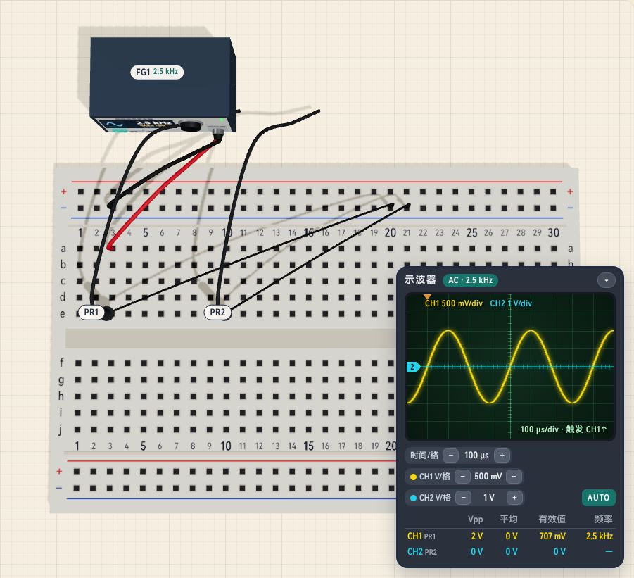
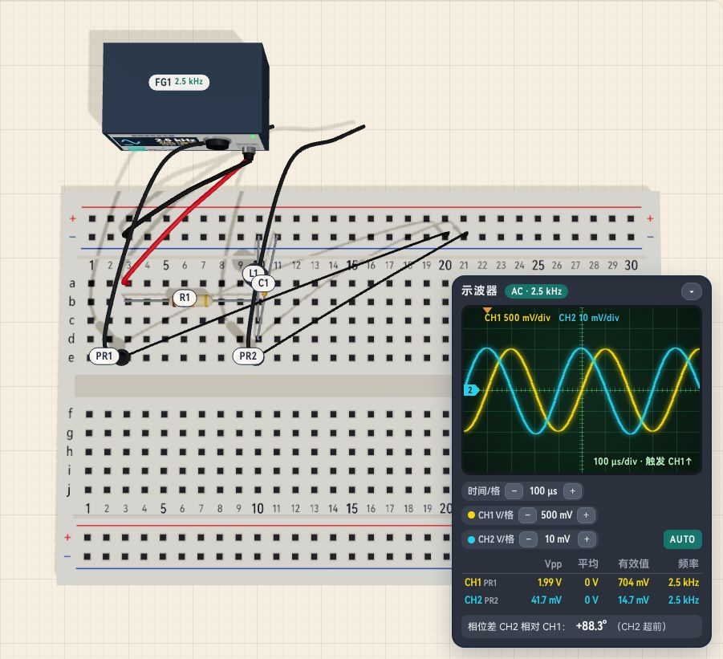
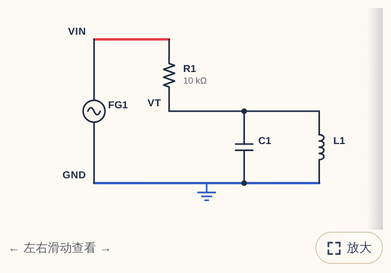
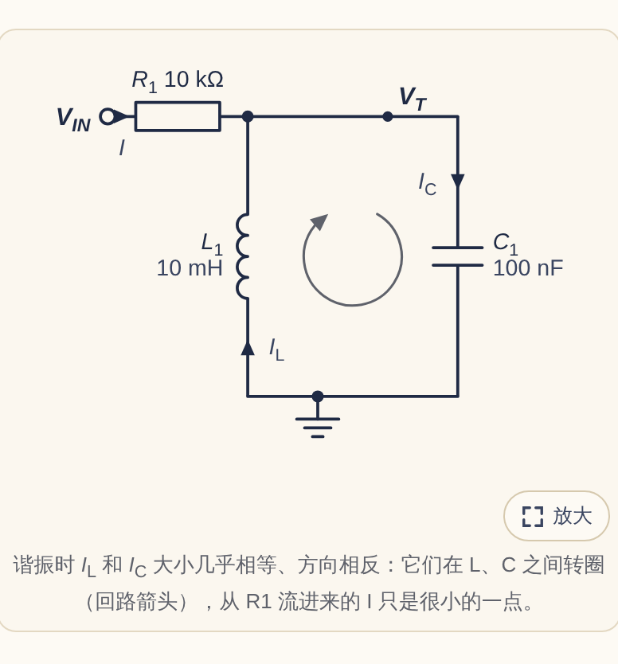
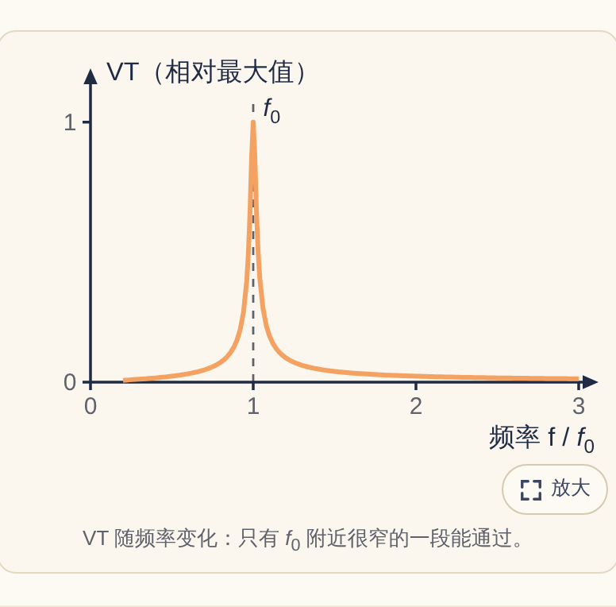

# 5.4 · LC 并联槽路：只让一个频率通过

| 项目 | 内容 |
|---|---|
| id | `exp4-parallel-lc-tank` |
| 文件 | `challenges/265-parallel-lc-tank.json` |
| 类型 | 实验 / 挑战（没有分步，照目标电路图搭） · 难度 4/5 |
| 位置 | World 5 · 正弦稳态、相量与交流功率 → 5.4 谐振（本节第 2 项） |
| 右侧面板 | 轨道由旧的四张卡片自动生成（还没手工精排） |
| 前后 | 上一项 [5.4 exp4-series-resonance](../w5/5.04-1-exp4-series-resonance.md) · 下一项 [5.5 exp4-pf-correction](../w5/5.05-1-exp4-pf-correction.md) |
| 先修 | lesson-scope-two-channels |
| 概念 | 并联谐振 parallel resonance、槽路阻抗 Z0 = L/(rC)、谐振时导纳虚部为零 susceptance cancels、环流 circulating current、选频 frequency selection |

**一句话概要**：10 kΩ 串一个 10 mH ∥ 100 nF 的槽路。扫频找槽路的谐振频率，再用电流表量槽路里来回流的电流，看它比外面的电流大多少倍。

## 1. 左侧工作台（3D 面包板 → 2D 俯视截图）

截图是程序里真实的 3D 面包板换成俯视角拍的；表格是同一块板的文字版（元件、参数、每只脚插在哪个孔）。

### 1.1 起点：打开这一课时板上已经有的

| 元件 | 类型 | 参数 | 引脚 → 孔 |
|---|---|---|---|
| FG1 | function_gen | waveform=sine, frequency=2500, amplitude=1, offset=0 | +→a3 -→tn3 |
| PR1 | scope_probe | channel=1 | tip→e3 gnd→tn20 |
| PR2 | scope_probe | channel=2 | tip→e10 gnd→tn21 |

### 1.3 参考答案（「看答案」载入的板子）

| 元件 | 类型 | 参数 | 引脚 → 孔 |
|---|---|---|---|
| FG1 | function_gen | waveform=sine, frequency=2500, amplitude=1, offset=0 | +→a3 -→tn3 |
| R1 | resistor | resistance=10000 | 1→b3 2→b10 |
| L1 | inductor | inductance=0.01 | 1→c10 2→tn10 |
| C1 | capacitor | capacitance=1.0000000000000001e-7 | 1→d10 2→tn11 |
| PR1 | scope_probe | channel=1 | tip→e3 gnd→tn20 |
| PR2 | scope_probe | channel=2 | tip→e10 gnd→tn21 |

### 1.4 目标原理图（右侧「目标原理图」抽屉）

| 元件 | 类型 | 参数 |
|---|---|---|
| FG1 | function_gen |  |
| R1 | resistor | resistance=10000 |
| L1 | inductor | inductance=0.01 |
| C1 | capacitor | capacitance=1.0000000000000001e-7 |

连接（每个结点上的引脚）：

- **VIN**：FG1.+、R1.1
- **VT**：R1.2、L1.1、C1.1
- **GND**：L1.2、C1.2、FG1.-

## 2. 右侧面板：学生从上往下看到的内容（单轨流）

### 第 1 步 · 🔧 动手搭：一个很尖的峰

**电阻**（`10 kΩ`）插 **`b3`**–**`b10`**。**电感**（`10 mH`）插 **`c10`**–**`tn10`**，**电容**（`100 nF`）插 **`d10`**–**`tn11`**：L 和 C 并排，都从 VT 接到 GND。
信号发生器：**正弦波、幅度 `1 V`**，频率从 **`2.5 kHz`** 往 **`10 kHz`** 调。峰很窄，到中间要**非常慢**地调。
大部分频率下 CH2 几乎是一条平线。在哪里它突然变大？

### 第 2 步 · 💡 想明白：L 和 C 在里面荡秋千

- 谐振时，能量在电感的磁场和电容的电场之间**来回倒**：电容放电推动电感，电感再把电容反向充满……就像荡秋千。
- 这股电流只在 L 和 C 之间转圈。从外面看，L 的电流和 C 的电流大小几乎相等、方向相反，**互相抵消**。外面只需要补一点线圈电阻上的损耗。

*图 `tank`（schematic）：谐振时 I_L 和 I_C 大小几乎相等、方向相反：它们在 L、C 之间转圈（回路箭头），从 R1 流进来的 I 只是很小的一点。*

- 所以谐振时槽路像一个**很大的电阻**，VT 几乎等于 VIN；偏离一点，L 或 C 就把信号短路到 GND。谐振频率和串联时一样：
$$f_0 = \frac{1}{2π\sqrt{LC}}$$

*图 `select`（plot）：VT 随频率变化：只有 f_0 附近很窄的一段能通过。*

（这一步下面列着这节课的计算卡片，点开就地展开：`rms-sine`、`inductive-reactance`、`lc-resonance`、`series-q`、`resonance-bandwidth`、`tank-impedance`，全文见第 6 节）

### 第 3 步 · 🔧 动手搭：找 f0，量里外两个电流

- **扫频**：找 CH2 最大、和 CH1 同相的频率，读那里的幅度比（CH2 ÷ CH1）。
- 正弦电流的**平均值**几乎是 0，所以在交流电路里，**电流表**的屏幕会自己换到 **AC RMS**（有效值）档：左上角写着 “AC RMS” 时，屏幕上的数就是要读的有效值。**点一下电流表**，右侧「属性」里还能看到平均值和有效值两行。
- 外面的电流：把 R1 右脚挪到 **`b7`**，电流表红笔插 **`a7`**、黑笔插 **`a10`**。
- 里面的电流：把 L1 上面那只脚挪到 **`c13`**，再放一块电流表，红笔 **`b10`**、黑笔 **`a13`**。两块表都在频率停在 $f_0$ 时读。

### 第 4 步 · 📏 测一测：测一测：读你自己的仪表

**测量题 1 · `f0`**（读数题）

> 扫频：VT 最大、和 VIN 同相（相位差 0°）的频率 f0

- 单位 kHz · 先写预测 · 状态：FG1 设为 信号发生器（正弦 幅度 1V） · 参考答案的读数 **5.032 kHz** · 合理范围 [4780, 5280]

答对后显示：

> f0 = 1/(2π√(LC)) ≈ 5.03 kHz：电感和电容的电纳互相抵消。

**测量题 2 · `g0`**（读数题）

> f = 5033 Hz：幅度比 VT/VIN（CH2 的 Vpp ÷ CH1 的 Vpp）

- 先写预测 · 状态：FG1 设为 信号发生器（正弦 5.03kHz 幅度 1V） · 参考答案的读数 **0.9086** · 合理范围 [0.863, 0.954]

答对后显示：

> 槽路阻抗 Z0 ≈ L/(rC) = 100 kΩ，和 R1 分压：100/110 ≈ 0.91。

**测量题 3 · `ir`**（读数题）

> f = 5033 Hz：串在 R1 里的电流表，屏幕上的 AC RMS 有效值（流进槽路的电流）

- 单位 µA · 先写预测 · 状态：FG1 设为 信号发生器（正弦 5.03kHz 幅度 1V） · 参考答案的读数 **6.513 µA** · 合理范围 [0.00000619, 0.00000684]

答对后显示：

> 槽路几乎像 100 kΩ 的电阻：≈ 0.707 V / 110 kΩ ≈ 6.5 µA。

**测量题 4 · `il`**（读数题）

> 同一频率：电感支路里的电流表，有效值（L1 的电流）

- 单位 mA · 先写预测 · 状态：FG1 设为 信号发生器（正弦 5.03kHz 幅度 1V） · 参考答案的读数 **2.03 mA** · 合理范围 [0.00193, 0.00213]

答对后显示：

> I_L ≈ V_T / (ωL) ≈ 0.64 V / 316 Ω ≈ 2.0 mA：能量在电感和电容之间来回交换。

**测量题 5 · `ratio`**（计算题（用自己的读数算））

> 用你的两个读数算环流放大倍数 I_L / I_R1

- 先写预测 · 参考答案的读数 **311.7** · 合理范围 [296, 327] · 公式 `il / ir`

答对后显示：

> ≈ 300，约等于槽路自身的 Q = √(L/C)/r ≈ 316。外面只需补充线圈电阻上的损耗；İL 和 İC 大小几乎相等、方向相反。

### 第 5 步 · 🎒 带走：带走

- **并联谐振**：L、C 的电流互相抵消，槽路阻抗最大，输出最大。偏离 $f_0$，槽路很快变成小电感或小电容。
- 槽路里的**环流**可以是外面电流的几百倍。收音机就是用这样的回路“选台”的。
- 坑：仿真里线圈电阻只有 1 Ω。真实 10 mH 小电感常有 10～30 Ω，峰会低很多、宽很多——这就是“品质因数”名字的来历。

趁热练理论题：`frequency`

## 3. 测量题一览

| # | id | 题目 | 类型 | 单位 | 状态 | 参考读数 |
|---|---|---|---|---|---|---|
| 1 | f0 | 扫频：VT 最大、和 VIN 同相（相位差 0°）的频率 f0 | scope | kHz | FG1 设为 信号发生器（正弦 幅度 1V） | 5.032 kHz |
| 2 | g0 | f = 5033 Hz：幅度比 VT/VIN（CH2 的 Vpp ÷ CH1 的 Vpp） | scope |  | FG1 设为 信号发生器（正弦 5.03kHz 幅度 1V） | 0.9086 |
| 3 | ir | f = 5033 Hz：串在 R1 里的电流表，屏幕上的 AC RMS 有效值（流进槽路的电流） | current | µA | FG1 设为 信号发生器（正弦 5.03kHz 幅度 1V） | 6.513 µA |
| 4 | il | 同一频率：电感支路里的电流表，有效值（L1 的电流） | current | mA | FG1 设为 信号发生器（正弦 5.03kHz 幅度 1V） | 2.03 mA |
| 5 | ratio | 用你的两个读数算环流放大倍数 I_L / I_R1 | formula |  |  | 311.7 |

### 全部答完后显示的「对比」

**对比**：
- 在 f0 = 1/(2π√(LC)) ≈ 5033 Hz，电感和电容的电纳互相抵消，Y 只剩一个很小的实部，槽路阻抗达到最大：Z0 ≈ L/(rC) = 10 mH / (1 Ω × 100 nF) = 100 kΩ。
- 于是 R1 和 100 kΩ 分压：VT/VIN ≈ 100/(10 + 100) ≈ 0.91，相位 ≈ 0。
- 偏离谐振，槽路阻抗迅速变小：f0/2 = 2.5 kHz 时，Z ≈ jωL/(1 − ω²LC) ≈ j211 Ω（感性，电感支路电流大），VT/VIN ≈ 0.021，相位 ≈ +88°；2f0 = 10 kHz 时 Z ≈ −j105 Ω（容性），VT/VIN ≈ 0.021，相位 ≈ −89°。
- 带宽：整个电路的 Q ≈ (R1 ∥ Z0)/√(L/C) ≈ 9.1 kΩ / 316 Ω ≈ 29，BW = f0/Q ≈ 175 Hz——只有约 4.95 ~ 5.12 kHz 这一小段能通过。收音机的调谐回路就是这样“选台”的。

**想一想（环流）**：谐振时从 R1 流进槽路的电流只有约 6.5 µA（有效值），而在 L 和 C 之间来回流动的电流约 2.0 mA——是外部电流的 300 多倍（≈ 槽路自身的 Q = √(L/C)/r ≈ 316）。能量在电感的磁场和电容的电场之间来回交换，外面只需要补充线圈电阻上的损耗。（相量图：İL 和 İC 大小几乎相等、方向相反。）

### 提示按钮（依次显示）

1. L1 和 C1 并排放，都从 VT 接到 GND；R1 把信号发生器接到 VT。
2. f0 时槽路像一个很大的电阻；偏离 f0 时它像一个小电感或小电容。
3. 在峰值附近要慢慢调：通带很窄。

### 功能测试（「检查我的电路」时跑）

- f0：VT 最大，和 VIN 同相
- f0：槽路里的环流远大于 R1 的电流
- f0/2 = 2.5 kHz：槽路呈感性，VT 很小
- 2f0 = 10 kHz：槽路呈容性，VT 很小

## 5. 这一课的计算卡片

**计算卡片 `rms-sine`：正弦波的有效值 RMS of a sine**

- 公式 `V_{rms} = \frac{V_p}{\sqrt{2}} ≈ 0.707 V_p`
- 用途：正弦信号的有效值：和多大的直流电压在电阻上产生同样的热。
- 输入：V_p（峰值（幅度），V） → V_rms（有效值，V）

1. 有效值的定义：在电阻上产生相同平均功率的直流值，$V_{rms} = \sqrt{\frac{1}{T}∫_{0}^{T} v^{2} dt}$（均方根）。
2. 正弦：$v^{2} = V_p^{2}sin^{2}(ωt) = \frac{V_p^{2}}{2}(1 - cos 2ωt)$，一个周期里 cos 项平均为 0。
3. 所以均方值是 $\frac{V_p^{2}}{2}$，开方得 $\frac{V_p}{\sqrt{2}}$。
4. **只对正弦成立**：方波（±A）的有效值就是 A；占空比 D 的 0/$V_H$ 方波是 $V_H\sqrt{D}$。
5. 直流 + 交流：$V_{rms} = \sqrt{V_{dc}^{2} + V_{ac,rms}^{2}}$。

例子：第 12 课：50 Ω 负载上 0.5 V 峰值 → $\frac{0.5}{1.414} ≈ 0.354 V$。实验 4-4：谐振时有效值电流 $\frac{1/\sqrt{2}}{101 + 50} ≈ 4.7 mA$。

- ⚠ 普通万用表交流档按正弦标定：测方波、PWM 读数不对，要用真有效值表。
- ⚠ 有效值、峰值、峰峰值别混着比：先统一成同一种。

**计算卡片 `inductive-reactance`：感抗 Inductive reactance**

- 公式 `X_L = 2π f L`
- 用途：电感对某个频率的正弦信号的阻碍（单位 Ω）：频率越高越大。
- 输入：f（频率，Hz）；L（电感，H） → X_L（感抗，Ω）

1. 电感的电压 $v = L\frac{di}{dt}$。
2. 电流 $i = I_m sin(ωt)$ 时 $v = ωLI_m cos(ωt)$，幅度之比 $\frac{V_m}{I_m} = ωL$。
3. 电压比电流 **超前 90°**（电流落后）；相量 $Z_L = jωL = jX_L$。
4. 和电容相反：**直流时电感是短路**（只剩线圈电阻 r），高频时接近开路。

例子：实验 4-3：$2π × 1600 × 10 mH ≈ 100.5 Ω$，和 R + r = 101 Ω 几乎一样，所以电流落后约 45°。160 Hz 只有约 10 Ω，16 kHz 约 1005 Ω。实验 4-4：谐振 5033 Hz 时 $X_L ≈ 316 Ω$。

- ⚠ 真实电感还有线圈电阻 r：它和 $X_L$ 是相量相加，不是直接相加。

**计算卡片 `lc-resonance`：LC 谐振频率 f₀ = 1/(2π√LC)**

- 公式 `f_0 = \frac{1}{2π\sqrt{LC}}`
- 用途：电感和电容的电抗正好相等（互相抵消）的频率——串联、并联 LC 和 RLC 振铃都用它。
- 输入：L（电感，H）；C（电容，F） → f_0（谐振频率，Hz）

1. 串联 RLC：$Z = R + j(ωL - \frac{1}{ωC})$。
2. 两个电抗相等时虚部为 0：$ω_0L = \frac{1}{ω_0C}$ ⇒ $ω_0 = \frac{1}{\sqrt{LC}}$，$f_0 = \frac{1}{2π\sqrt{LC}}$。
3. 串联谐振：|Z| 最小（= R），电流最大，电流和电压 **同相**；低于 f₀ 呈容性（电流超前），高于 f₀ 呈感性（电流落后）。
4. 并联 LC：导纳的虚部抵消，阻抗最大（见“并联谐振阻抗”）。
5. 谐振时每个电抗的大小 $X_0 = \sqrt{\frac{L}{C}}$（特性阻抗）。

例子：实验 3-4、4-4、4-5（10 mH、100 nF）：$f_0 = \frac{1}{2π\sqrt{10^{-9}}} ≈ 5033 Hz$，$X_0 = \sqrt{\frac{0.01}{10^{-7}}} ≈ 316 Ω$。2.5 kHz 电流超前约 78°，10 kHz 落后约 78°。

- ⚠ 把 √ 漏掉，或者把 2π 漏掉——结果差几个数量级或 6.28 倍。

**计算卡片 `series-q`：品质因数 Q 与谐振电压放大**

- 公式 `Q = \frac{ω_0 L}{R} = \frac{1}{R}\sqrt{\frac{L}{C}}, V_C = V_L = Q V`
- 用途：串联谐振时电容（电感）电压是电源电压的几倍；Q 也决定峰有多尖。
- 输入：L（电感，H）；C（电容，F）；R（回路总电阻（不含发生器时用端口电压），Ω） → Q（品质因数（电压放大倍数），）

1. 谐振时电抗抵消，电流 $I = \frac{V}{R}$（R 是回路电阻）。
2. 电容电压 $V_C = IX_0 = V\frac{X_0}{R}$，$X_0 = \sqrt{\frac{L}{C}}$；电感电压一样大、方向相反。
3. 定义 $Q = \frac{X_0}{R}$：元件电压是电源的 Q 倍——**比电源还高**。
4. Q 也是“储存的能量 / 每个周期损耗的能量”的 2π 倍：Q 越大，峰越尖，带宽 $BW = \frac{f_0}{Q}$ 越窄。
5. 并联槽路自己的 Q = $\frac{X_0}{r}$（r 是线圈电阻）：谐振时 L、C 之间的环流是外部电流的约 Q 倍。

例子：实验 4-4：$Q = \frac{316}{101} ≈ 3.1$，VIN 只有 1.34 Vpp 时电容上约 4.2 Vpp。实验 4-5：槽路自己的 $Q = \frac{316}{1} ≈ 316$，测到的环流比 $I_L/I_{R1}$ ≈ 300。

- ⚠ 高 Q 串联谐振里元件电压可以是电源的几十倍：注意电容耐压。
- ⚠ 真实线圈 10–30 Ω 的电阻会把 Q 拉低很多。

**计算卡片 `resonance-bandwidth`：谐振带宽 BW = f₀/Q**

- 公式 `BW = f_2 - f_1 = \frac{f_0}{Q}`
- 用途：谐振峰的两个半功率点（0.707）之间有多宽。
- 输入：f_0（谐振频率，Hz）；Q（品质因数，） → BW（−3 dB 带宽，Hz）

1. 串联 RLC：在半功率点，电抗的大小等于电阻：$|ωL - \frac{1}{ωC}| = R$，这时 $|Z| = \sqrt{2}R$，电流降到 0.707。
2. 解这个方程的两个正根 $ω_1$、$ω_2$，相减得 $ω_2 - ω_1 = \frac{R}{L}$，即 $BW = \frac{R}{2πL}$。
3. 用 $Q = \frac{ω_0L}{R}$ 改写：$BW = \frac{f_0}{Q}$。
4. 并联槽路同理，Q 用整个电路的：$Q = \frac{R_{总}}{X_0}$（R 是并在槽路上的所有电阻）。

例子：实验 4-4：$\frac{5033}{3.13} ≈ 1.6 kHz$（半功率点约 4.3 kHz 和 5.9 kHz）。实验 4-5：整个电路 $Q ≈ \frac{10k ∥ 100k}{316} ≈ 29$，$BW ≈ 175 Hz$——只有 4.95–5.12 kHz 能通过。

- ⚠ f₁、f₂ 关于 f₀ 是几何对称（$f_1f_2 = f_0^{2}$），不是算术对称。

**计算卡片 `tank-impedance`：并联谐振（槽路）阻抗 Z₀ ≈ L/(rC)**

- 公式 `Z_0 ≈ \frac{L}{rC} = Q^{2} r`
- 用途：L 和 C 并联、线圈有电阻 r：谐振时整个槽路像一个多大的电阻。
- 输入：L（电感，H）；C（电容，F）；r（线圈电阻，Ω） → Z_0（谐振阻抗，Ω）

1. 并联用导纳相加：$Y = \frac{1}{r + jωL} + jωC$。
2. 在 $f_0$ 附近，电感支路的电纳和电容的 $ωC$ 抵消，只剩很小的实部 $\frac{r}{(ω_0L)^{2}} = \frac{rC}{L}$。
3. 所以 $Z_0 = \frac{1}{Y} ≈ \frac{L}{rC}$，也等于 $Q^{2}r$（Q = $\frac{X_0}{r}$）。r 越小，峰越高越尖。
4. 偏离谐振时阻抗迅速变小：低于 f₀ 呈感性，高于 f₀ 呈容性。
5. 串一个 R 驱动它，就得到一个“只让一个频率通过”的分压器：$\frac{V_T}{V_{in}} = \frac{Z_0}{R + Z_0}$。

例子：实验 4-5：$\frac{10 mH}{1 Ω × 100 nF} = 100 kΩ$；和 R₁ = 10 kΩ 分压：$\frac{100}{110} ≈ 0.91$。2.5 kHz 时槽路只有约 j211 Ω，比值 ≈ 0.021。

- ⚠ 真实 10 mH 电感 10–30 Ω：Z₀ 降到几 kΩ，峰又低又宽。

## 6. English（界面英文版的同一份内容）

展开英文

### Node 1 · 🔧 Build：A very sharp peak

**Resistor** (`10 kΩ`) into **`b3`**–**`b10`**. **Inductor** (`10 mH`) into **`c10`**–**`tn10`**, **capacitor** (`100 nF`) into **`d10`**–**`tn11`**: L and C side by side, both from VT to GND.
Generator: **sine, amplitude `1 V`**; turn the frequency from **`2.5 kHz`** towards **`10 kHz`**. The peak is narrow — near the middle, turn **very slowly**.
At most frequencies CH2 is almost a flat line. Where does it suddenly grow?

### Node 2 · 💡 Why：L and C play on a swing

- At resonance the energy **sloshes back and forth** between the inductor's magnetic field and the capacitor's electric field: the capacitor discharges into the inductor, the inductor charges the capacitor the other way round… like a swing.
- That current only circles between L and C. From outside, the L current and the C current are almost equal and opposite and **cancel**. The outside only has to make up a little loss in the coil's resistance.

[figure `tank`]

*Figure `tank`（schematic）：谐振时 I_L 和 I_C 大小几乎相等、方向相反：它们在 L、C 之间转圈（回路箭头），从 R1 流进来的 I 只是很小的一点。*

- So at resonance the tank looks like a **very large resistor** and VT is almost VIN; a little off, and L or C shorts the signal to GND. The resonant frequency is the same as in the series circuit:
$$f_0 = \frac{1}{2π\sqrt{LC}}$$

[figure `select`]

*Figure `select`（plot）：VT 随频率变化：只有 f_0 附近很窄的一段能通过。*

(This node lists the lesson’s calculation cards: `rms-sine`、`inductive-reactance`、`lc-resonance`、`series-q`、`resonance-bandwidth`、`tank-impedance`; full text in section 6)

### Node 3 · 🔧 Build：Find f0, measure the inside and outside currents

- **Sweep**: find the frequency where CH2 is largest and in phase with CH1; read the amplitude ratio there (CH2 ÷ CH1).
- The **average** of a sine current is almost 0, so in an AC circuit the **ammeter**'s screen switches itself to its **AC RMS** range: when the top left says "AC RMS", the number on the screen is the RMS value to read. **Click the ammeter** to see both the average and the RMS under Properties on the right.
- The outside current: move R1's right lead to **`b7`**; ammeter red lead into **`a7`**, black into **`a10`**.
- The inside current: move L1's top lead to **`c13`** and add a second ammeter, red **`b10`**, black **`a13`**. Read both with the frequency at $f_0$.

### Node 4 · 📏 Measure：Measure: read your own instruments

**Question 1 · `f0`**（reading）

> Sweep: the frequency f0 where VT peaks and is in phase with VIN (0° phase difference)

- unit kHz · predict first · state：FG1 is set to Function generator (sine 1V peak) · range [4780, 5280]

Shown once right:

> f0 = 1/(2π√(LC)) ≈ 5.03 kHz: the inductor's and capacitor's susceptances cancel.

**Question 2 · `g0`**（reading）

> f = 5033 Hz: amplitude ratio VT/VIN (CH2 Vpp ÷ CH1 Vpp)

- predict first · state：FG1 is set to Function generator (sine 5.03kHz 1V peak) · range [0.863, 0.954]

Shown once right:

> The tank impedance Z0 ≈ L/(rC) = 100 kΩ divides with R1: 100/110 ≈ 0.91.

**Question 3 · `ir`**（reading）

> f = 5033 Hz: the ammeter in series with R1, its RMS value, as the screen shows it in AC RMS (the current into the tank)

- unit µA · predict first · state：FG1 is set to Function generator (sine 5.03kHz 1V peak) · range [0.00000619, 0.00000684]

Shown once right:

> The tank looks like about 100 kΩ: ≈ 0.707 V / 110 kΩ ≈ 6.5 µA.

**Question 4 · `il`**（reading）

> Same frequency: the ammeter in the inductor branch, its RMS value (L1's current)

- unit mA · predict first · state：FG1 is set to Function generator (sine 5.03kHz 1V peak) · range [0.00193, 0.00213]

Shown once right:

> I_L ≈ V_T / (ωL) ≈ 0.64 V / 316 Ω ≈ 2.0 mA: energy swings back and forth between L and C.

**Question 5 · `ratio`**（calculation from own readings）

> From your two readings, the circulating-current ratio I_L / I_R1

- predict first · range [296, 327] · formula `il / ir`

Shown once right:

> ≈ 300, close to the tank's own Q = √(L/C)/r ≈ 316. The outside only has to make up the winding-resistance loss; I_L and I_C are nearly equal and opposite.

### Node 5 · 🎒 Take away：Take away

- **Parallel resonance**: the L and C currents cancel, the tank's impedance is largest and so is the output. Away from $f_0$ the tank quickly turns into a small inductor or capacitor.
- The **circulating current** inside the tank can be hundreds of times the current coming in. A radio "picks a station" with a circuit like this.
- Pitfall: the simulated coil has only 1 Ω of resistance. A real small 10 mH inductor often has 10–30 Ω, so the peak is much lower and wider — which is where the name "quality factor" comes from.

Practise：`frequency`

**Compare**

**Compare**:
- At f0 = 1/(2π√(LC)) ≈ 5033 Hz the inductor's and capacitor's susceptances cancel, leaving only a tiny real part, so the tank impedance peaks: Z0 ≈ L/(rC) = 10 mH / (1 Ω × 100 nF) = 100 kΩ.
- R1 and 100 kΩ then form a divider: VT/VIN ≈ 100/(10 + 100) ≈ 0.91, phase ≈ 0.
- Away from resonance the tank impedance collapses: at f0/2 = 2.5 kHz, Z ≈ jωL/(1 − ω²LC) ≈ j211 Ω (inductive — the inductor branch carries most current), VT/VIN ≈ 0.021, phase ≈ +88°; at 2f0 = 10 kHz, Z ≈ −j105 Ω (capacitive), VT/VIN ≈ 0.021, phase ≈ −89°.
- Bandwidth: the whole circuit's Q ≈ (R1 ∥ Z0)/√(L/C) ≈ 9.1 kΩ / 316 Ω ≈ 29, so BW = f0/Q ≈ 175 Hz — only about 4.95 to 5.12 kHz gets through. That is how a radio's tuned circuit "picks a station".

**Think about it (circulating current)**: at resonance only about 6.5 µA (RMS) flows into the tank through R1, while about 2.0 mA flows back and forth between L and C — over 300× the outside current (≈ the tank's own Q = √(L/C)/r ≈ 316). Energy sloshes between the inductor's magnetic field and the capacitor's electric field; the outside only has to make up the loss in the winding resistance. (Phasor diagram: I_L and I_C are almost equal and opposite.)

**Hints**

1. L1 and C1 are side by side, both from VT to GND; R1 connects the generator to VT.
2. At f0 the tank looks like a very large resistor; away from f0 it looks like a small L or C.
3. Sweep slowly near the peak: the band is very narrow.

