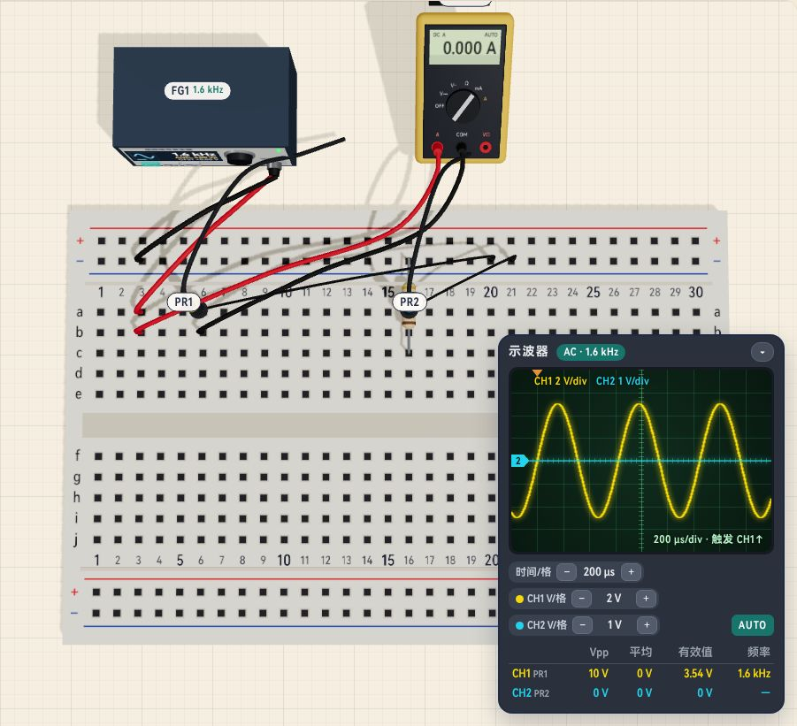
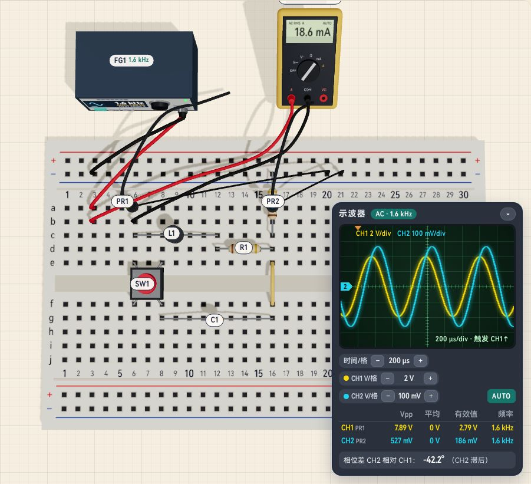
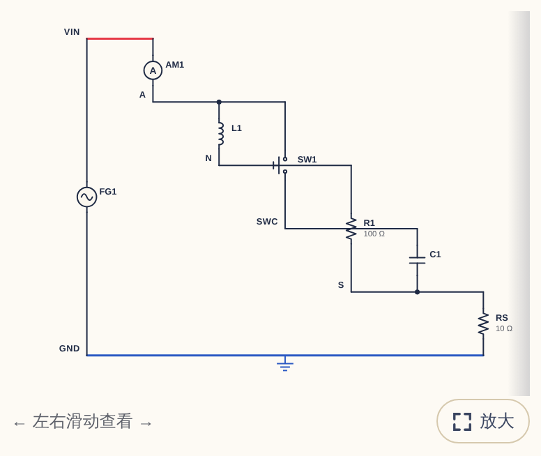
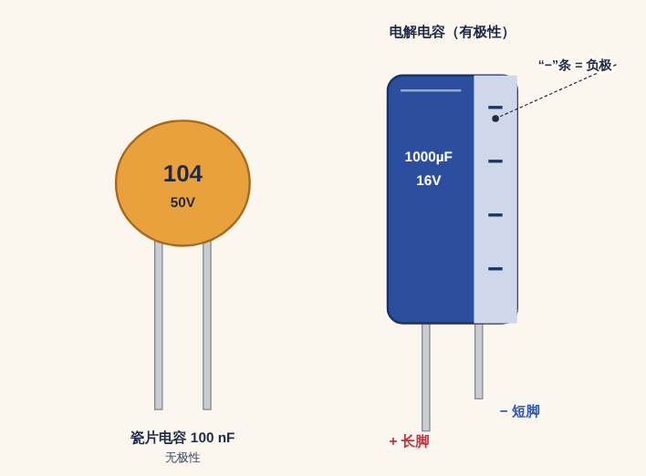
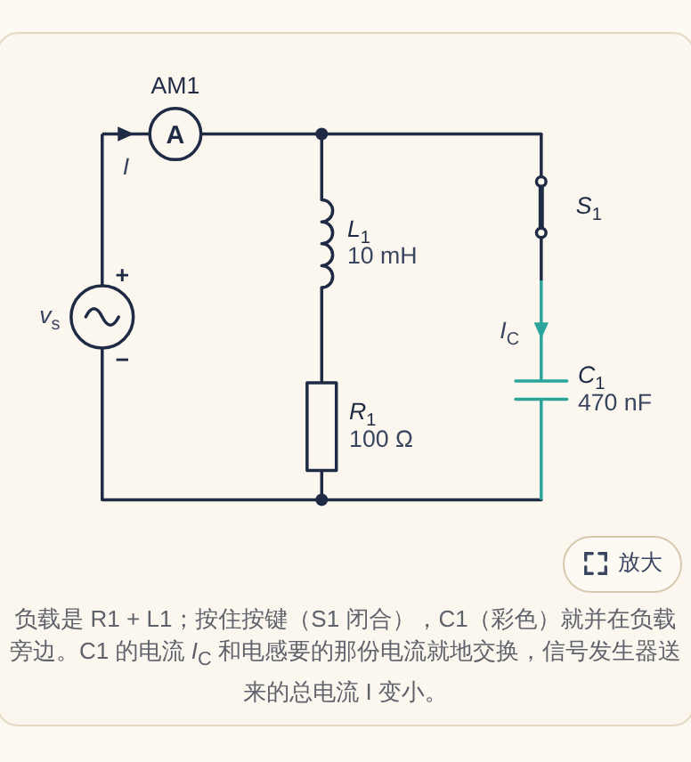
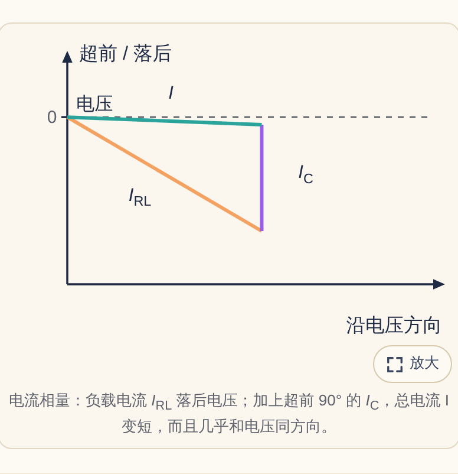

# 5.5 · 功率因数校正：并一个电容，电流变小了

| 项目 | 内容 |
|---|---|
| id | `exp4-pf-correction` |
| 文件 | `challenges/270-pf-correction.json` |
| 类型 | 实验 / 挑战（没有分步，照目标电路图搭） · 难度 4/5 |
| 位置 | World 5 · 正弦稳态、相量与交流功率 → 5.5 交流功率：功率因数、三相与变压器（本节第 1 项） |
| 右侧面板 | 轨道由旧的四张卡片自动生成（还没手工精排） |
| 前后 | 上一项 [5.4 exp4-parallel-lc-tank](../w5/5.04-2-exp4-parallel-lc-tank.md) · 下一项 [6.1 challenge-reverse-protection](../w6/6.01-1-challenge-reverse-protection.md) |
| 先修 | lesson-scope-two-channels |
| 概念 | 有功功率 P 与功率因数 cos θ active power, power factor、无功电流 reactive current、功率因数校正 power-factor correction、电流表有效值 RMS ammeter reading、取样电阻看电流 current-sense resistor |

**一句话概要**：电阻 + 电感的负载从信号发生器取电流，电流落后电压。按住按键并上一个 470 nF 电容：总电流变小、和电压对齐，电阻上的功率却不变。

## 1. 左侧工作台（3D 面包板 → 2D 俯视截图）

截图是程序里真实的 3D 面包板换成俯视角拍的；表格是同一块板的文字版（元件、参数、每只脚插在哪个孔）。

### 1.1 起点：打开这一课时板上已经有的

| 元件 | 类型 | 参数 | 引脚 → 孔 |
|---|---|---|---|
| FG1 | function_gen | waveform=sine, frequency=1600, amplitude=5, offset=0 | +→a3 -→tn3 |
| AM1 | ammeter |  | +→b3 -→b6 |
| RS | resistor | resistance=10 | 1→c16 2→tn16 |
| PR1 | scope_probe | channel=1 | tip→a6 gnd→tn20 |
| PR2 | scope_probe | channel=2 | tip→a16 gnd→tn21 |

### 1.3 参考答案（「看答案」载入的板子）

| 元件 | 类型 | 参数 | 引脚 → 孔 |
|---|---|---|---|
| FG1 | function_gen | waveform=sine, frequency=1600, amplitude=5, offset=0 | +→a3 -→tn3 |
| AM1 | ammeter |  | +→b3 -→b6 |
| L1 | inductor | inductance=0.01 | 1→c6 2→c12 |
| R1 | resistor | resistance=100 | 1→d12 2→d16 |
| RS | resistor | resistance=10 | 1→c16 2→tn16 |
| SW1 | pushbutton | pressed=false | 1a→e6 2a→e8 1b→f6 2b→f8 |
| C1 | capacitor | capacitance=4.7000000000000005e-7 | 1→g8 2→g16 |
| W8 | wire |  | a→e16 b→f16 |
| PR1 | scope_probe | channel=1 | tip→a6 gnd→tn20 |
| PR2 | scope_probe | channel=2 | tip→a16 gnd→tn21 |

### 1.4 目标原理图（右侧「目标原理图」抽屉）

| 元件 | 类型 | 参数 |
|---|---|---|
| FG1 | function_gen |  |
| AM1 | ammeter |  |
| L1 | inductor | inductance=0.01 |
| R1 | resistor | resistance=100 |
| RS | resistor | resistance=10 |
| SW1 | pushbutton |  |
| C1 | capacitor | capacitance=4.7000000000000005e-7 |

连接（每个结点上的引脚）：

- **VIN**：FG1.+、AM1.+
- **A**：AM1.-、L1.1、SW1.1
- **N**：L1.2、R1.1
- **S**：R1.2、C1.2、RS.1
- **SWC**：SW1.2、C1.1
- **GND**：RS.2、FG1.-

## 2. 右侧面板：学生从上往下看到的内容（单轨流）

### 第 1 步 · 🔍 先看一眼：先认识它：电容

**拆解「电容 Capacitor：两块极板夹一层绝缘」第 1 / 7 层：① 外形：瓷片电容和电解电容**

课程里有两种电容：
- 瓷片电容 ceramic capacitor：橙色小圆片，**没有极性**，容量小（pF – 几 µF）。上面印 三位数代码，单位是 **pF**：前两位是有效数字，第三位是 10 的几次方。**104** = 10 × 10⁴ pF = 100 000 pF = **100 nF** = 0.1 µF。102 = 1 nF，103 = 10 nF，105 = 1 µF。
- 电解电容 electrolytic capacitor：铝壳圆柱，容量大（1 µF – 几万 µF），**有极性**：长脚是 +，外壳上 印着一串“−”的白条 那边是 −（短脚）。直接印着容量和耐压，比如 1000 µF 16 V。

两种电容的 **耐压**（rated voltage）都要大于电路里的最高电压，一般留 1.5–2 倍余量：9 V 电路用 16 V 或 25 V 的。

呼吸灯实验（exp3-led-breathing）用的 1000 µF 就是电解电容：长脚（+）接 VC，短脚接 GND。

| 类型 | 标记 | 极性 | 常见范围 | 课程里 |
|---|---|---|---|---|
| 瓷片 / 陶瓷 | 三位代码（pF）：104 = 100 nF | 无 | 1 pF – 10 µF | RC 实验的 100 nF |
| 铝电解 | 直接印 µF 和 V；“−”条 = 负极 | 有：长脚 + | 1 µF – 47 mF | 呼吸灯的 1000 µF |

### 第 2 步 · 🔧 动手搭：电流里有一部分在白跑

信号发生器、电流表、取样电阻 **RS**（`10 Ω`）和两支探头已经在板上。接上负载：**电感**（`10 mH`）**`c6`**–**`c12`**，**电阻**（`100 Ω`）**`d12`**–**`d16`**。
信号发生器：**正弦波、`1.6 kHz`、幅度 `5 V`**。CH1 看负载上的电压，CH2 看 RS 上的电压——也就是总电流的形状。
电流（CH2）比电压晚到顶。负载里只有电阻会把电能变成热：信号发生器送来的电流，全都在干活吗？

### 第 3 步 · 💡 想明白：电感借了能量又还回来

- 电感每四分之一周期把能量存进磁场，下一个四分之一周期又**原样还回去**。为了这一借一还，导线里要多跑一份电流，可它什么活也没干。
- 电容正好相反：电感在“借”的时候，电容在“还”。并上一个电容，这份来回跑的电流就在 L 和 C 之间**就地交换**，不用再从信号发生器那里绕一圈。

*图 `pfc`（schematic）：负载是 R1 + L1；按住按键（S1 闭合），C1（彩色）就并在负载旁边。C1 的电流 I_C 和电感要的那份电流就地交换，信号发生器送来的总电流 I 变小。*

- 电阻真正用掉的功率是有功功率，它比“电压 × 电流”小，差的那个系数就是**功率因数**：
$$P = V I cos θ$$
例如电流落后 60° 时，$cos 60° = 0.5$：要输送同样的功率，导线里得跑两倍的电流。
- 并电容不改变电阻上的电压，所以不改变 P；它让 θ 变小，于是总电流 I 变小。

*图 `phasors`（plot）：电流相量：负载电流 I_RL 落后电压；加上超前 90° 的 I_C，总电流 I 变短，而且几乎和电压同方向。*

（这一步下面列着这节课的计算卡片，点开就地展开：`rms-sine`、`phase-from-delay`、`capacitive-reactance`、`inductive-reactance`、`rl-impedance`、`power-factor`、`pf-correction-capacitor`，全文见第 6 节）

### 第 4 步 · 🔧 动手搭：按下按键，比一比

- **按键**放在 **`e6`**（横跨凹槽）：按下时把第 `6` 列和第 `8` 列接通。**电容**（`470 nF`）插 **`g8`**–**`g16`**，再用一根**跳线** **`e16`**–**`f16`** 把第 16 列上下两半接起来。
- 正弦电流的**平均值**几乎是 0，所以在交流电路里，**电流表**的屏幕会自己换到 **AC RMS**（有效值）档：左上角写着 “AC RMS” 时，屏幕上的数就是要读的有效值。**点一下电流表**，右侧「属性」里还能看到平均值和有效值两行。
- **松开按键**：读电流表的有效值和 CH2 相对 CH1 的相位差。**点一下按键**让它保持按下：再读一次。

### 第 5 步 · 📏 测一测：测一测：读你自己的仪表

**测量题 1 · `i1`**（读数题）

> 松开按键：电流表的有效值（屏幕显示 AC RMS）

- 单位 mA · 先写预测 · 状态：FG1 设为 信号发生器（正弦 1.6kHz 幅度 5V）、松开 SW1 · 参考答案的读数 **18.62 mA** · 合理范围 [0.016, 0.021]

答对后显示：

> Z = (100 + 1 + 10) + j100.5 Ω，再加信号发生器内部的 50 Ω：I = (5/√2) / |161 + j100.5| ≈ 18.6 mA。

**测量题 2 · `ph1`**（读数题）

> 松开按键：CH2（电流）相对 CH1（负载电压）的相位差

- 单位 ° · 先写预测 · 状态：FG1 设为 信号发生器（正弦 1.6kHz 幅度 5V）、松开 SW1 · 参考答案的读数 **-42.17 °** · 合理范围 [-45, -35]

答对后显示：

> θ = arctan(100.5 / 111) ≈ 42°：电流落后，功率因数 cos θ ≈ 0.74。

**测量题 3 · `i2`**（读数题）

> 按住按键：电流表的有效值

- 单位 mA · 先写预测 · 状态：FG1 设为 信号发生器（正弦 1.6kHz 幅度 5V）、按下 SW1 · 参考答案的读数 **13.55 mA** · 合理范围 [0.011, 0.015]

答对后显示：

> C1 的电流超前 90°，抵掉了负载电流里落后的那一部分，总电流只剩和电压同相的那一份。

**测量题 4 · `ph2`**（读数题）

> 按住按键：CH2 相对 CH1 的相位差

- 单位 ° · 状态：FG1 设为 信号发生器（正弦 1.6kHz 幅度 5V）、按下 SW1 · 参考答案的读数 **-2.463 °** · 合理范围 [-6, 6]

答对后显示：

> 接近 0°：功率因数接近 1。470 nF 是离完全补偿（约 0.48 µF）最近的常用值。

**测量题 5 · `power`**（选择题）

> 按下按键后，R1 消耗的功率（有功功率）怎样？

- A. 基本不变：R1 两端的电压几乎没变 ✅（正确）
- B. 变小了：总电流变小了
- C. 变大了：功率因数变大了

答对后显示：

> 电容不消耗能量，也没有改变负载两端的电压，所以 R1 的功率基本不变（信号发生器内部 50 Ω 上的压降变小，A 点电压还略升一点）。变小的是导线里来回跑的那份电流。

### 第 6 步 · 🎒 带走：带走

- **功率因数** $cos θ$：有功功率和“电压 × 电流”之比。感性负载（电动机、变压器、日光灯镇流器）的电流落后电压，功率因数小于 1。
- **并联电容**补上电感要的那份来回的电流：有功功率不变，总电流变小，导线和发电机都轻松了。
- 坑：电容不是越大越好。补过头，电流反而**超前**电压，总电流又变大。工厂里的电容柜按负载分档投切，就是为了不补过头。
- 三相电和变压器的功率计算，都建立在同一个 $P = V I cos θ$ 上：去理论题里练。

趁热练理论题：`ac-power`、`three-phase`、`coupled`

## 3. 测量题一览

| # | id | 题目 | 类型 | 单位 | 状态 | 参考读数 |
|---|---|---|---|---|---|---|
| 1 | i1 | 松开按键：电流表的有效值（屏幕显示 AC RMS） | current | mA | FG1 设为 信号发生器（正弦 1.6kHz 幅度 5V）、松开 SW1 | 18.62 mA |
| 2 | ph1 | 松开按键：CH2（电流）相对 CH1（负载电压）的相位差 | scope | ° | FG1 设为 信号发生器（正弦 1.6kHz 幅度 5V）、松开 SW1 | -42.17 ° |
| 3 | i2 | 按住按键：电流表的有效值 | current | mA | FG1 设为 信号发生器（正弦 1.6kHz 幅度 5V）、按下 SW1 | 13.55 mA |
| 4 | ph2 | 按住按键：CH2 相对 CH1 的相位差 | scope | ° | FG1 设为 信号发生器（正弦 1.6kHz 幅度 5V）、按下 SW1 | -2.463 ° |
| 5 | power | 按下按键后，R1 消耗的功率（有功功率）怎样？ | 选择 |  |  | 正确：A |

### 全部答完后显示的「对比」

**对比**：
- 负载阻抗（含线圈电阻 1 Ω 和取样电阻 10 Ω）：Z = 111 + j100.5 Ω，|Z| ≈ 150 Ω，电流落后电压约 42°（只看 R1 + L1 是 45°，RS 让角度小了一点）。功率因数 cos 42° ≈ 0.74。
- **松开按键**：信号发生器内部还有 50 Ω，总电流有效值 ≈ (5 V/√2) / |161 + j100.5| ≈ 18.6 mA。
- **按下按键**：470 nF 在 1.6 kHz 的容抗 ≈ 212 Ω，它的电流超前 90°，正好抵掉负载电流里落后的那一部分。总电流降到 ≈ 13.5 mA，相位差接近 0（功率因数 ≈ 1）。
- **R1 的功率**：A 点电压几乎不变（信号发生器的 50 Ω 上压降变小，A 点电压反而略升），R1 的电流只多了约 2.6%（18.6 → 19.1 mA），功率基本不变——有功功率没变，只是导线里少跑了那份来回的电流。
- 完全补偿需要的电容：B_C = X_L/|Z_RL|² 时 C ≈ 0.48 µF；470 nF 是最接近的常用值。

### 提示按钮（依次显示）

1. 负载是一条串联支路：A（第 6 列）→ 电感 → 电阻 → S（第 16 列）。
2. 按键横跨凹槽放在 e6：第 6 列是一端，第 8 列是另一端；电容从第 8 列下半接到第 16 列下半。
3. 第 16 列上下两半要用一根短跳线接起来，RS 才同时接到 R1 和 C1。

### 功能测试（「检查我的电路」时跑）

- 松开按键：电流落后电压
- 按下按键：电流和电压几乎同相，总电流变小

## 4. 用到的拆解（全部层的文字，供改写参考）

### 拆解 `capacitor`：电容 Capacitor：两块极板夹一层绝缘

*电容储存的是电荷和电场能量。拆开是两块金属极板中间夹一层介质（dielectric）；由此推出 q = Cv、C = εA/d、i = C dv/dt、W = ½CV²，再推出 RC 充电的指数曲线（τ = RC）和“直流断路、高频短路”的容抗。最后看真实电容差在哪：ESR、漏电、极性。*

**拆解「电容 Capacitor：两块极板夹一层绝缘」第 1 / 7 层：① 外形：瓷片电容和电解电容**

课程里有两种电容：
- 瓷片电容 ceramic capacitor：橙色小圆片，**没有极性**，容量小（pF – 几 µF）。上面印 三位数代码，单位是 **pF**：前两位是有效数字，第三位是 10 的几次方。**104** = 10 × 10⁴ pF = 100 000 pF = **100 nF** = 0.1 µF。102 = 1 nF，103 = 10 nF，105 = 1 µF。
- 电解电容 electrolytic capacitor：铝壳圆柱，容量大（1 µF – 几万 µF），**有极性**：长脚是 +，外壳上 印着一串“−”的白条 那边是 −（短脚）。直接印着容量和耐压，比如 1000 µF 16 V。

两种电容的 **耐压**（rated voltage）都要大于电路里的最高电压，一般留 1.5–2 倍余量：9 V 电路用 16 V 或 25 V 的。

呼吸灯实验（exp3-led-breathing）用的 1000 µF 就是电解电容：长脚（+）接 VC，短脚接 GND。

| 类型 | 标记 | 极性 | 常见范围 | 课程里 |
|---|---|---|---|---|
| 瓷片 / 陶瓷 | 三位代码（pF）：104 = 100 nF | 无 | 1 pF – 10 µF | RC 实验的 100 nF |
| 铝电解 | 直接印 µF 和 V；“−”条 = 负极 | 有：长脚 + | 1 µF – 47 mF | 呼吸灯的 1000 µF |

**拆解「电容 Capacitor：两块极板夹一层绝缘」第 2 / 7 层：② 拆开：电极、介质，一层又一层**

每个电容不管长什么样，里面都是同一个结构：**两个互相绝缘的导体（电极 electrode），中间夹一层绝缘体（介质 dielectric）**。工厂做的事情，就是在小体积里把“面积做大、距离做小”。

**陶瓷电容（MLCC，多层陶瓷电容）**：几十到几百层 金属电极 和 陶瓷介质 交替叠在一起，单数层接左边的 端电极，双数层接右边——等于很多个电容 **并联**。陶瓷（钛酸钡）的相对介电常数 $ε_r$ 很大（X7R 约 2000），每层只有几 µm 厚。

**铝电解电容**：一条 阳极铝箔 和一条 阴极铝箔，中间夹 浸了电解液的纸，卷成一卷装进铝壳。真正的介质是阳极箔表面电化学生长出来的一层 氧化铝 Al₂O₃，只有十几 nm 厚；铝箔还被腐蚀得坑坑洼洼，实际表面积是平面的几十倍。所以它能在小体积里做出 1000 µF。

**极性的来源**：氧化层只在阳极箔上，而且只有阳极电压更高时才稳定。电压反过来，电化学反应会把它还原掉（第 ⑦ 层）。

**拆解「电容 Capacitor：两块极板夹一层绝缘」第 3 / 7 层：③ 模型：平行板，q = Cv，C = εA/d**

把电容理想化成两块面积为 A、距离为 d 的 平行金属板。加电压 v：电源从 下板 抽走电子送到上板的反面……结果是上板带 **+q**，下板带 **−q**，两板之间出现 电场。电荷和电压成正比，比例系数就是 **capacitance（电容）C**：
$$q = C·v$$
单位：法拉 F = C/V。1 F 很大，常用 µF（10⁻⁶）、nF（10⁻⁹）、pF（10⁻¹²）。

C 由几何和材料决定：
$$C = \frac{εA}{d},   ε = ε_r ε_0,   ε_0 = 8.85 pF/m$$
- 面积 A 越大 → 能放的电荷越多；
- 距离 d 越小 → 同样电压下电场越强、吸住的电荷越多；
- 介质 被电场 **极化**（polarization）：分子里的正负电荷被拉开，抵消掉一部分电场，于是同样的 v 能多放 $ε_r$ 倍的电荷。

**带数字**：空气、1 cm² 的两块板、相距 1 mm：$C = \frac{8.85×10^{-12} × 10^{-4}}{10^{-3}} ≈ 0.89 pF$——小得可怜。
一层 MLCC：$ε_r = 2000$，A = 2 mm × 1.2 mm，d = 5 µm：$C = \frac{8.85×10^{-12} × 2000 × 2.4×10^{-6}}{5×10^{-6}} ≈ 8.5 nF$；叠 12 层并联 ≈ **100 nF**。

- 公式 `q = C·v`：定义：每伏电压存多少库仑
- 公式 `C = \frac{ε_r ε_0 A}{d}`：平行板；MLCC 再乘层数

**拆解「电容 Capacitor：两块极板夹一层绝缘」第 4 / 7 层：④ i = C dv/dt：电流只看电压变化得多快**

对 $q = Cv$ 两边对时间求导，左边 $\frac{dq}{dt}$ 就是流进极板的电流：
$$i = C\frac{dv}{dt}$$
（关联参考方向：电流从 + 端流入）。这是电容 **唯一** 的 V–I 关系，三个推论都从这里来：

1. 电压不变 → 电流为 0。直流稳态下电容就是 **断路**（open circuit）。
2. 电压匀速上升 → 电流恒定：100 nF 在 1 ms 内从 0 升到 5 V，$i = 100 nF × \frac{5 V}{1 ms} = 0.5 mA$。下降得快一倍（0.5 ms），电流就是 −1 mA（反向流出）。
3. **电容电压不能跳变**：要在 0 秒内改变电压，需要无穷大的电流。所以开关动作的瞬间 $v_C(0^+) = v_C(0^-)$——这是一阶电路“三要素法”的出发点。

**储存的能量**：功率 $p = vi = Cv\frac{dv}{dt}$，从 0 充到 V 积分：
$$W = ∫_{0}^{V} Cv dv = \frac{1}{2}CV^{2}$$
- 100 nF 充到 5 V：$\frac{1}{2} × 10^{-7} × 25 = 1.25 µJ$；
- 1000 µF 充到 9 V：$\frac{1}{2} × 10^{-3} × 81 = 40.5 mJ$——足够让 LED 亮好几秒（呼吸灯实验）。

能量存在两板之间的 **电场** 里，不是“存了电流”。理想电容不消耗能量，只是借进来、再还回去。

- 公式 `i = C\frac{dv}{dt}`：直流稳态：dv/dt = 0 → i = 0（断路）
- 公式 `W = \frac{1}{2}CV^{2}`：1000 µF、9 V：40.5 mJ

**拆解「电容 Capacitor：两块极板夹一层绝缘」第 5 / 7 层：⑤ 通过电阻充电：τ = RC，1τ 走完 63%**

RC 方波实验（exp3-rc-square-charging）：信号发生器（内阻 50 Ω）→ 10 kΩ → 100 nF → GND，方波在 0 和 5 V 之间跳。

**推导**（方波刚跳到 5 V，电容从 0 V 开始）：
1. KVL：$V = Ri + v_C$；
2. 代入 $i = C\frac{dv_C}{dt}$：$RC\frac{dv_C}{dt} + v_C = V$，一阶线性微分方程；
3. 初值 $v_C(0) = 0$（电压不能跳），终值 $v_C(∞) = V$（充满后 i = 0），解是：
$$v_C(t) = V(1 - e^{-t/τ}),   τ = RC$$
4. 电流 $i = \frac{V - v_C}{R} = \frac{V}{R}e^{-t/τ}$：一开始最大（0.5 mA），然后指数衰减。开始瞬间电容像 **短路**，充满后像 **断路**。

**τ（time constant，时间常数）** 的意义：
- t = τ：$1 - e^{-1} = 63%$，到 3.16 V；
- t = 3τ：95%；t = 5τ：99.3%，工程上算“充满”；
- 起点的切线 恰好在 t = τ 时到达终值。

**带数字**：$τ = (10 kΩ + 50 Ω) × 100 nF ≈ 1.0 ms$。500 Hz 方波半周期 1 ms ≈ 1τ，电容只能充到约 63% 就开始放电；50 Hz 半周期 10 ms = 10τ，每次都充满放空，波形是完整的指数曲线；5 kHz 半周期 0.1τ，电容几乎来不及动，输出是一个小三角波。

| t | 已充到 | 5 V 方波时 $v_C$ | 电流 i |
|---|---|---|---|
| 0 | 0% | 0 V | 0.50 mA |
| 1τ = 1 ms | 63% | 3.16 V | 0.18 mA |
| 2τ | 86% | 4.32 V | 0.068 mA |
| 3τ | 95% | 4.75 V | 0.025 mA |
| 5τ | 99.3% | 4.97 V | 0.003 mA |

- 公式 `v_C(t) = V(1 - e^{-t/τ}), τ = RC`：充电；放电时 $v_C$ = V·e^{−t/τ}
- 公式 `τ = (10 kΩ + 50 Ω) × 100 nF ≈ 1.0 ms`

**拆解「电容 Capacitor：两块极板夹一层绝缘」第 6 / 7 层：⑥ 频率：直流断路，高频短路**

接正弦电压 $v = V_m sin ωt$，代入 $i = C\frac{dv}{dt}$：
$$i = ωCV_m cos ωt$$
两点结论：
- 电流的幅值是 $ωCV_m$，所以电压幅值 / 电流幅值 = $\frac{1}{ωC}$，这就是 **capacitive reactance（容抗）**：
$$X_C = \frac{1}{ωC} = \frac{1}{2πfC}$$
- cos 比 sin 早 90°：电容的 **电流超前电压 90°**。用相量写：$Z_C = \frac{1}{jωC}$。

容抗和频率成反比，在双对数坐标上是一条斜率 −1 的直线。对 100 nF：
- 50 Hz：31.8 kΩ；1 kHz：1.59 kΩ；100 kHz：15.9 Ω；
- f → 0（直流）：$X_C → ∞$，**断路**；
- f 很高：$X_C → 0$，接近 **短路**。

这就是电容的两大用途：**隔直流、通交流**（耦合电容 coupling capacitor），以及把高频噪声 **旁路到地**（去耦 / 旁路电容 bypass capacitor，每个芯片电源脚旁边那颗 100 nF）。RC 低通、高通滤波器的截止频率 $f_c = \frac{1}{2πRC}$ 就是 $X_C = R$ 的那个频率：10 kΩ 和 100 nF 时 $f_c ≈ 159 Hz$。

| f | $X_C$（100 nF） | 相当于 |
|---|---|---|
| 0（直流） | ∞ | 断路 |
| 50 Hz | 31.8 kΩ | 大电阻 |
| 159 Hz | 10 kΩ | = R：RC 截止频率 |
| 1 kHz | 1.59 kΩ | — |
| 100 kHz | 15.9 Ω | 接近短路 |

- 公式 `X_C = \frac{1}{2πfC}`：电流超前电压 90°；$Z_C$ = 1/(jωC)
- 公式 `f_c = \frac{1}{2πRC} = \frac{1}{2π × 10 kΩ × 100 nF} ≈ 159 Hz`

**拆解「电容 Capacitor：两块极板夹一层绝缘」第 7 / 7 层：⑦ 真实电容：ESR、ESL、漏电、极性**

真实电容 = 理想 C + 三个寄生元件：
- ESR（equivalent series resistance，等效串联电阻）：引线、电极和电解液的电阻。电解电容约 0.1–1 Ω，陶瓷电容只有几 mΩ。纹波电流流过它会发热：1 A 纹波、0.5 Ω → 0.5 W。
- ESL（equivalent series inductance，等效串联电感）：引线和卷绕带来的几 nH 到几十 nH。频率高到一定程度（**self-resonance 自谐振**，100 nF 陶瓷约 10–20 MHz），电容反而变成电感。所以去耦时大电容和小电容并联使用。
- 漏电电阻 $R_leak$：介质不是完美的绝缘体。电解电容的漏电流约 0.01CV（1000 µF、9 V 时几十 µA），充满的电解电容放几小时电压就掉下去了。

**电解电容接反**：阳极的氧化层被电化学反应还原掉，漏电流变大 → 发热 → 电解液汽化 → 外壳顶部的十字防爆纹 **鼓包、喷液甚至炸开**。几伏的反压就可能开始损坏。

**陶瓷电容的直流偏压效应**：X7R、Y5V 这类高介电常数陶瓷，加的直流电压越高，$ε_r$ 越小，实际容量可能只剩一半。精确的 RC 定时要用 C0G（NP0）陶瓷或薄膜电容。

**仿真器里**：电容是 **理想电容**——没有 ESR、ESL、漏电，也 **不区分电解电容的极性**（接反不会报错）。只有直流电源时它按断路处理；有信号发生器或 PWM 时按时域仿真。真实搭电路时，电解电容一定要按极性插。

| 参数 | 陶瓷 100 nF | 电解 1000 µF | 仿真器 |
|---|---|---|---|
| ESR | 几 mΩ | 0.1–1 Ω | 0 |
| ESL | ≈ 1–5 nH | ≈ 10–20 nH | 0 |
| 漏电 | nA | 几十 µA | 0 |
| 误差 | ±10% | ±20% | 0 |
| 极性 | 无 | 有，接反会坏 | 不检查 |

- 公式 `f_{SRF} = \frac{1}{2π\sqrt{ESL·C}}`：100 nF、1 nH：≈ 16 MHz。高于它电容就成了电感

**一句话记住**：电容 = 两块极板夹一层介质：$q = Cv$，$C = \frac{εA}{d}$。它的全部行为是 $i = C\frac{dv}{dt}$：电压不能跳变，直流稳态断路，储能 $\frac{1}{2}CV^{2}$；经电阻充电按 $τ = RC$ 指数变化（1τ 63%，5τ 充满）；交流下 $X_C = \frac{1}{2πfC}$，频率越高越接近短路。真实电容有 ESR、漏电，电解电容有极性——仿真器都不管，你得管。

## 5. 这一课的计算卡片

**计算卡片 `rms-sine`：正弦波的有效值 RMS of a sine**

- 公式 `V_{rms} = \frac{V_p}{\sqrt{2}} ≈ 0.707 V_p`
- 用途：正弦信号的有效值：和多大的直流电压在电阻上产生同样的热。
- 输入：V_p（峰值（幅度），V） → V_rms（有效值，V）

1. 有效值的定义：在电阻上产生相同平均功率的直流值，$V_{rms} = \sqrt{\frac{1}{T}∫_{0}^{T} v^{2} dt}$（均方根）。
2. 正弦：$v^{2} = V_p^{2}sin^{2}(ωt) = \frac{V_p^{2}}{2}(1 - cos 2ωt)$，一个周期里 cos 项平均为 0。
3. 所以均方值是 $\frac{V_p^{2}}{2}$，开方得 $\frac{V_p}{\sqrt{2}}$。
4. **只对正弦成立**：方波（±A）的有效值就是 A；占空比 D 的 0/$V_H$ 方波是 $V_H\sqrt{D}$。
5. 直流 + 交流：$V_{rms} = \sqrt{V_{dc}^{2} + V_{ac,rms}^{2}}$。

例子：第 12 课：50 Ω 负载上 0.5 V 峰值 → $\frac{0.5}{1.414} ≈ 0.354 V$。实验 4-4：谐振时有效值电流 $\frac{1/\sqrt{2}}{101 + 50} ≈ 4.7 mA$。

- ⚠ 普通万用表交流档按正弦标定：测方波、PWM 读数不对，要用真有效值表。
- ⚠ 有效值、峰值、峰峰值别混着比：先统一成同一种。

**计算卡片 `phase-from-delay`：由时间差算相位差 Phase from time delay**

- 公式 `φ = -360° × \frac{Δt}{T} = -360° × Δt f`
- 用途：两个同频正弦，CH2 比 CH1 晚 Δt 到峰值：相位差是多少度（落后为负）。
- 输入：Δt（CH2 比 CH1 晚多少，s）；f（频率，Hz） → φ（CH2 相对 CH1 的相位（度），）

1. 一个整周期 T 对应 360°。
2. 晚了 Δt，就是晚了 $\frac{Δt}{T}$ 个周期 = $360° × \frac{Δt}{T}$。
3. 符号约定：CH2 **晚** 到（落后）记为负，**早** 到（超前）记为正。
4. 反过来：$Δt = \frac{|φ|}{360°} × T$。
5. 读 Δt：两个波形的过零点（同一方向）之间的格数 × time/div。

例子：第 13 课：1 kHz、1 kΩ + 100 nF，电容电压落后 $arctan\frac{1000}{1592}$ ≈ 32°，对应 $Δt = \frac{32}{360} × 1 ms ≈ 89 µs$。实验 4-1：在 $f_c$ 处 −45° = 晚八分之一周期。

- ⚠ Δt 超过半个周期时，“晚 Δt”也可以看成“早 T − Δt”：相位通常取 −180° … +180°。
- ⚠ 反相放大器的输出和输入差 180°，看起来像“晚了半个周期”。

**计算卡片 `capacitive-reactance`：容抗 Capacitive reactance**

- 公式 `X_C = \frac{1}{2π f C}`
- 用途：电容对某个频率的正弦信号“有多难通过”（单位 Ω）。
- 输入：f（频率，Hz）；C（电容，F） → X_C（容抗，Ω）

1. 电容的电流 $i = C\frac{dv}{dt}$。
2. 加正弦电压 $v = V_m sin(ωt)$，电流 $i = ωCU_m cos(ωt)$：幅度之比 $\frac{V_m}{I_m} = \frac{1}{ωC}$，其中 $ω = 2πf$。
3. 电流比电压 **超前 90°**（cos 比 sin 早四分之一周期）；相量写成 $Z_C = \frac{1}{jωC} = -jX_C$。
4. 频率越高、电容越大，容抗越小：**直流（f = 0）时电容是开路，高频时接近短路**。

例子：第 13 课：100 nF、1 kHz：$X_C = \frac{1}{2π × 1000 × 10^{-7}} ≈ 1.59 kΩ$，和 R₁ = 1 kΩ 差不多大。实验 4-1：100 nF 在 1061 Hz 正好 1.5 kΩ = R。

- ⚠ 用 f 代替 ω（少了 2π）：结果大了 6.28 倍。

**计算卡片 `inductive-reactance`：感抗 Inductive reactance**

- 公式 `X_L = 2π f L`
- 用途：电感对某个频率的正弦信号的阻碍（单位 Ω）：频率越高越大。
- 输入：f（频率，Hz）；L（电感，H） → X_L（感抗，Ω）

1. 电感的电压 $v = L\frac{di}{dt}$。
2. 电流 $i = I_m sin(ωt)$ 时 $v = ωLI_m cos(ωt)$，幅度之比 $\frac{V_m}{I_m} = ωL$。
3. 电压比电流 **超前 90°**（电流落后）；相量 $Z_L = jωL = jX_L$。
4. 和电容相反：**直流时电感是短路**（只剩线圈电阻 r），高频时接近开路。

例子：实验 4-3：$2π × 1600 × 10 mH ≈ 100.5 Ω$，和 R + r = 101 Ω 几乎一样，所以电流落后约 45°。160 Hz 只有约 10 Ω，16 kHz 约 1005 Ω。实验 4-4：谐振 5033 Hz 时 $X_L ≈ 316 Ω$。

- ⚠ 真实电感还有线圈电阻 r：它和 $X_L$ 是相量相加，不是直接相加。

**计算卡片 `rl-impedance`：RL 串联阻抗 Series RL impedance**

- 公式 `|Z| = \sqrt{(R + r)^{2} + (ωL)^{2}}, φ = arctan\frac{ωL}{R + r}`
- 用途：电阻和电感（带线圈电阻 r）串联的阻抗，电流落后电压多少。
- 输入：R（电阻，Ω）；r（线圈电阻，Ω）；L（电感，H）；f（频率，Hz） → |Z|（阻抗的模，Ω）

1. $Z = (R + r) + jωL$：实部是所有电阻，虚部是感抗。
2. 模 $|Z| = \sqrt{(R + r)^{2} + (ωL)^{2}}$，角 $φ = arctan\frac{ωL}{R + r}$：电压超前电流，电流 **落后**。
3. 电阻电压和电流同相，所以示波器上 $v_R$ 就是电流的波形：$\frac{V_R}{V_{in}} = \frac{R}{|Z|}$。
4. 取 $v_R$ 当输出，这是一个 **RL 低通**：$ωL = R + r$ 时 |Z| 是 $\sqrt{2}(R + r)$，相位 45°，截止频率 $f_c = \frac{R + r}{2πL}$。

例子：实验 4-3：1.6 kHz：$|Z| = \sqrt{101^{2} + 100.5^{2}} ≈ 142.5 Ω$，电流落后约 45°，$\frac{V_R}{V_{in}} = \frac{100}{142.5} ≈ 0.70$；$f_c = \frac{101}{2π × 0.01} ≈ 1.6 kHz$。

- ⚠ 算电流用的是 |Z|，但算“发生器内部电动势”时还要加上 50 Ω：$|151 + j100.5|$。

**计算卡片 `power-factor`：功率因数 cos θ**

- 公式 `P = V I cos θ, cos θ = \frac{R}{|Z|}`
- 用途：感性负载（R + L）的电流落后电压：真正做功的有功功率只占 V·I 的 cos θ。
- 输入：R（负载电阻，Ω）；L（负载电感，H）；f（频率，Hz） → cos θ（功率因数，）

1. 负载 $Z = R + jX_L$，电流落后电压 $θ = arctan\frac{X_L}{R}$。
2. 只有电阻把电能变成热：有功功率 $P = I^{2}R = VI\frac{R}{|Z|} = VI cos θ$（V、I 是有效值）。
3. $cos θ$ 就是 **功率因数**；电感每四分之一周期借能量、下四分之一周期还回去，这部分来回的电流不做功，却要流过导线和电源。
4. 同样的功率，功率因数越低，线上电流越大：$I = \frac{P}{V cos θ}$。
5. 无功功率 $Q = VI sin θ$，视在功率 $S = VI$，$S^{2} = P^{2} + Q^{2}$。

例子：功率因数校正实验（1.6 kHz、10 mH、100 Ω + 1 Ω + 10 Ω）：$X_L ≈ 100.5 Ω$，$|Z| ≈ 150 Ω$，θ ≈ 42°，cos θ ≈ 0.74；总电流 ≈ 18.6 mA。并上电容后功率因数 ≈ 1，电流降到 ≈ 13.5 mA，R1 的功率基本不变。

- ⚠ $P = VI$ 只对纯电阻成立；交流里 V × I 是视在功率（单位 VA）。

**计算卡片 `pf-correction-capacitor`：功率因数校正电容**

- 公式 `C = \frac{X_L}{ω |Z_{RL}|^{2}}, |Z_{RL}|^{2} = R^{2} + X_L^{2}`
- 用途：在 R + L 负载两端并多大的电容，功率因数正好变成 1。
- 输入：R（负载电阻（电容并在哪两点之间，就算哪一段），Ω）；L（负载电感，H）；f（频率，Hz） → C（完全校正需要的电容，F）

1. 并联用导纳：负载 $Y = \frac{1}{R + jX_L} = \frac{R - jX_L}{R^{2} + X_L^{2}}$，虚部（感性电纳）是 $-\frac{X_L}{|Z|^{2}}$。
2. 电容的导纳是 $+jωC$，电流超前 90°，正好抵消负载电流里落后的那部分。
3. 令虚部和为 0：$ωC = \frac{X_L}{|Z|^{2}}$ ⇒ $C = \frac{X_L}{ω|Z|^{2}}$。
4. 校正后只剩实部：总电流 = 和电压同相的那部分，比原来小；负载两端电压不变，所以有功功率不变。
5. 电容大了会 **过补偿**：电流变成超前，总电流又变大。

例子：功率因数校正实验：电容并在 L1 + R1（101 + j100.5 Ω）上，$|Z|^{2} ≈ 20300 Ω^{2}$，$C = \frac{100.5}{2π × 1600 × 20300} ≈ 0.49 µF$，最近的标准值 470 nF（容抗 ≈ 212 Ω）。

- ⚠ 用 $C = \frac{1}{ωX_L}$（让 $X_C$ = $X_L$）：那是串联谐振的条件，并联校正要用导纳。

## 6. English（界面英文版的同一份内容）

展开英文

### Node 1 · 🔍 Look first：Meet it first: Capacitor

**Teardown「The capacitor: two plates and an insulator」layer 1 of 7：① Outside: ceramic and electrolytic**

Two kinds of capacitor appear in this course:
- ceramic capacitor: a small orange disc, **no polarity**, small values (pF – a few µF). It carries a three-digit code in **pF**: two digits and a power of ten. **104** = 10 × 10⁴ pF = 100 000 pF = **100 nF** = 0.1 µF. 102 = 1 nF, 103 = 10 nF, 105 = 1 µF.
- electrolytic capacitor: an aluminium can, large values (1 µF – tens of thousands of µF), **polarised**: the long leg is +, and the side of the sleeve with a white stripe of "−" signs is − (the short leg). Value and voltage are printed in full, e.g. 1000 µF 16 V.

For both, the **rated voltage** must exceed the highest voltage in the circuit, usually with a 1.5–2× margin: use 16 V or 25 V parts in a 9 V circuit.

The 1000 µF in the LED-breathing lab (exp3-led-breathing) is an electrolytic: long leg (+) to VC, short leg to GND.

| Type | Marking | Polarity | Typical range | In this course |
|---|---|---|---|---|
| ceramic | 3-digit code (pF): 104 = 100 nF | none | 1 pF – 10 µF | the 100 nF in the RC labs |
| aluminium electrolytic | µF and V printed; "−" stripe = negative | yes: long leg + | 1 µF – 47 mF | the 1000 µF in the breathing LED |

### Node 2 · 🔧 Build：Part of the current runs for nothing

The generator, the ammeter, the sense resistor **RS** (`10 Ω`) and both probes are already on the board. Add the load: **inductor** (`10 mH`) **`c6`**–**`c12`**, **resistor** (`100 Ω`) **`d12`**–**`d16`**.
Generator: **sine, `1.6 kHz`, amplitude `5 V`**. CH1 shows the voltage on the load, CH2 the voltage across RS — the shape of the total current.
The current (CH2) peaks after the voltage. Only the resistor turns electrical energy into heat: is all the current from the generator doing that work?

### Node 3 · 💡 Why：The inductor borrows energy and gives it back

- Every quarter period the inductor stores energy in its magnetic field, and the next quarter it **gives it all back**. That borrowing and returning takes an extra share of current in the wires — current that does no work.
- A capacitor does the opposite: while the inductor borrows, the capacitor returns. Put a capacitor beside the load and that back-and-forth current is **traded on the spot** between L and C, instead of making the round trip through the generator.

[figure `pfc`]

*Figure `pfc`（schematic）：负载是 R1 + L1；按住按键（S1 闭合），C1（彩色）就并在负载旁边。C1 的电流 I_C 和电感要的那份电流就地交换，信号发生器送来的总电流 I 变小。*

- The power the resistor really uses is the active power. It is less than "voltage × current", and the factor between them is the **power factor**:
$$P = V I cos θ$$
For example, with the current 60° behind, $cos 60° = 0.5$: to deliver the same power the wires must carry twice the current.
- The capacitor does not change the voltage across the resistor, so P stays; it makes θ smaller, so the total current I drops.

[figure `phasors`]

*Figure `phasors`（plot）：电流相量：负载电流 I_RL 落后电压；加上超前 90° 的 I_C，总电流 I 变短，而且几乎和电压同方向。*

(This node lists the lesson’s calculation cards: `rms-sine`、`phase-from-delay`、`capacitive-reactance`、`inductive-reactance`、`rl-impedance`、`power-factor`、`pf-correction-capacitor`; full text in section 6)

### Node 4 · 🔧 Build：Press the button and compare

- **Push button** at **`e6`** (straddling the gap): pressed, it joins column `6` to column `8`. **Capacitor** (`470 nF`) into **`g8`**–**`g16`**, plus a short **jumper** **`e16`**–**`f16`** to join the two halves of column 16.
- The **average** of a sine current is almost 0, so in an AC circuit the **ammeter**'s screen switches itself to its **AC RMS** range: when the top left says "AC RMS", the number on the screen is the RMS value to read. **Click the ammeter** to see both the average and the RMS under Properties on the right.
- **Button released**: read the ammeter's RMS value and the phase of CH2 vs CH1. **Click the button** so it stays pressed, and read both again.

### Node 5 · 📏 Measure：Measure: read your own instruments

**Question 1 · `i1`**（reading）

> Button released: the ammeter's RMS value (the screen shows AC RMS)

- unit mA · predict first · state：FG1 is set to Function generator (sine 1.6kHz 5V peak) and SW1 is released · range [0.016, 0.021]

Shown once right:

> Z = (100 + 1 + 10) + j100.5 Ω, plus the generator's internal 50 Ω: I = (5/√2) / |161 + j100.5| ≈ 18.6 mA.

**Question 2 · `ph1`**（reading）

> Button released: phase of CH2 (the current) vs CH1 (the load voltage)

- unit ° · predict first · state：FG1 is set to Function generator (sine 1.6kHz 5V peak) and SW1 is released · range [-45, -35]

Shown once right:

> θ = arctan(100.5 / 111) ≈ 42°: the current lags, and the power factor cos θ ≈ 0.74.

**Question 3 · `i2`**（reading）

> Button held: the ammeter's RMS value

- unit mA · predict first · state：FG1 is set to Function generator (sine 1.6kHz 5V peak) and SW1 is pressed · range [0.011, 0.015]

Shown once right:

> C1's current leads by 90° and cancels the lagging part of the load current; what remains of the total current is the part in phase with the voltage.

**Question 4 · `ph2`**（reading）

> Button held: phase of CH2 vs CH1

- unit ° · state：FG1 is set to Function generator (sine 1.6kHz 5V peak) and SW1 is pressed · range [-6, 6]

Shown once right:

> Close to 0°: the power factor is close to 1. 470 nF is the standard value nearest to full correction (about 0.48 µF).

**Question 5 · `power`**（multiple choice）

> After pressing the button, what happens to the power R1 uses (the active power)?

- A. About the same: the voltage across R1 hardly changed ✅ (right)
- B. Less: the total current dropped
- C. More: the power factor went up

Shown once right:

> The capacitor uses no energy and does not change the voltage across the load, so R1's power stays about the same (less drop across the generator's internal 50 Ω even lifts A a little). What dropped is the back-and-forth current in the wires.

### Node 6 · 🎒 Take away：Take away

- **Power factor** $cos θ$: active power divided by "voltage × current". Inductive loads (motors, transformers, fluorescent-lamp ballasts) draw a lagging current, so their power factor is below 1.
- A **parallel capacitor** supplies the back-and-forth current the inductor needs: the active power stays, the total current drops, and the wires and the generator have an easier time.
- Pitfall: more capacitance is not better. Overcorrect and the current **leads** the voltage, and the total current grows again. Factory capacitor banks switch in steps with the load so they never overcorrect.
- Three-phase power and transformers rest on the same $P = V I cos θ$: practise them in the theory problems.

Practise：`ac-power`、`three-phase`、`coupled`

**Compare**

**Compare**:
- The load's impedance (with the coil's 1 Ω and the 10 Ω sense resistor): Z = 111 + j100.5 Ω, |Z| ≈ 150 Ω, so the current lags the voltage by about 42° (45° for R1 + L1 alone; RS makes the angle a little smaller). Power factor cos 42° ≈ 0.74.
- **Button released**: with the generator's internal 50 Ω the total RMS current is ≈ (5 V/√2) / |161 + j100.5| ≈ 18.6 mA.
- **Button pressed**: 470 nF at 1.6 kHz has a reactance of ≈ 212 Ω; its current leads by 90° and cancels the lagging part of the load current. The total current drops to ≈ 13.5 mA, with almost no phase difference (power factor ≈ 1).
- **R1's power**: the voltage at A hardly changes (less drop across the generator's 50 Ω, so it even rises a little), so R1's current rises by only about 2.6% (18.6 → 19.1 mA) and its power stays about the same — the active power is unchanged; only the back-and-forth current in the wires is gone.
- The capacitor for full correction: B_C = X_L/|Z_RL|² gives C ≈ 0.48 µF; 470 nF is the nearest standard value.

**Hints**

1. The load is one series branch: A (column 6) → inductor → resistor → S (column 16).
2. The button straddles the gap at e6: column 6 is one end, column 8 the other; the capacitor runs from the lower half of column 8 to the lower half of column 16.
3. Join the two halves of column 16 with a short jumper, so RS reaches both R1 and C1.

