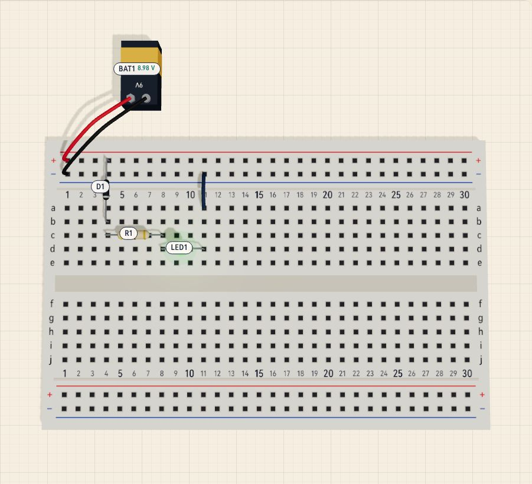
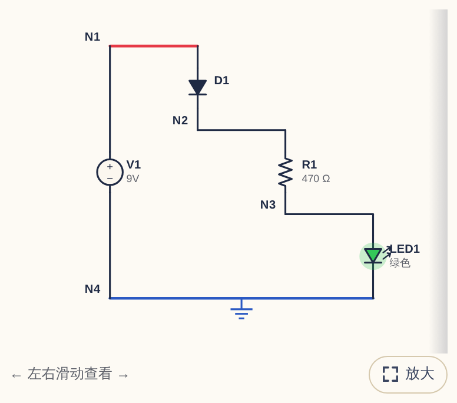
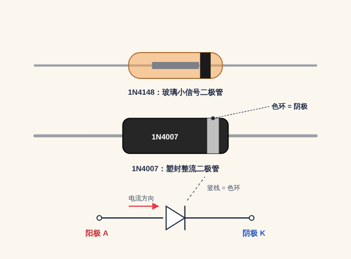
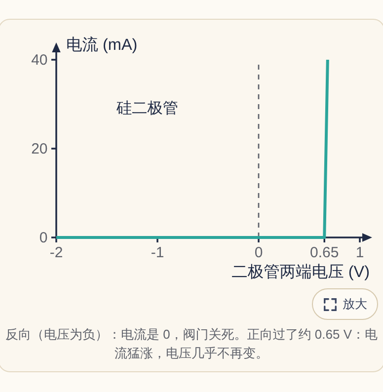
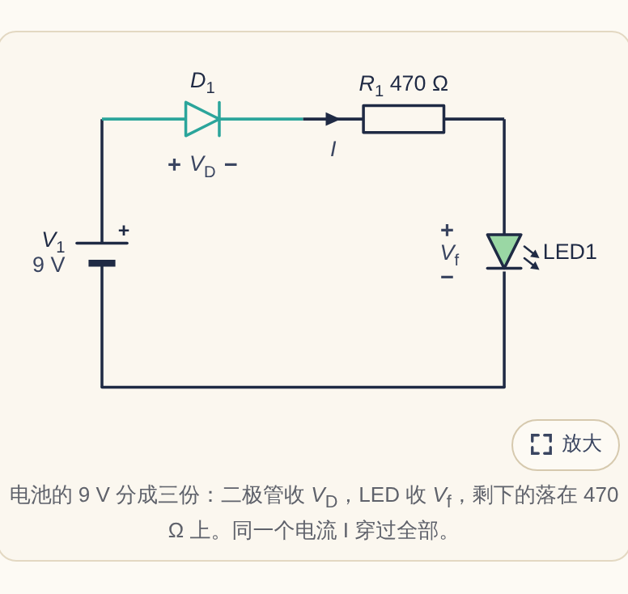

# 6.1 · 二极管：电流的单行道

| 项目 | 内容 |
|---|---|
| id | `challenge-reverse-protection` |
| 文件 | `challenges/14-reverse-protection.json` |
| 类型 | 实验 / 挑战（没有分步，照目标电路图搭） · 难度 3/5 |
| 位置 | World 6 · 半导体器件与分立放大器 → 6.1 二极管与非线性元件（本节第 1 项） |
| 右侧面板 | 轨道由旧的四张卡片自动生成（还没手工精排） |
| 前后 | 上一项 [5.5 exp4-pf-correction](../w5/5.05-1-exp4-pf-correction.md) · 下一项 [6.2 exp4-half-wave-rectifier](../w6/6.02-1-exp4-half-wave-rectifier.md) |
| 先修 | — |
| 概念 | diode 二极管、anode / cathode 阳极 / 阴极、forward voltage 正向压降、reverse polarity protection 防反接 |

**一句话概要**：先把二极管故意插反，看 LED 不亮；再转过来。二极管只让电流朝一个方向走，代价是大约 0.65 V。

## 1. 左侧工作台（3D 面包板 → 2D 俯视截图）

截图是程序里真实的 3D 面包板换成俯视角拍的；表格是同一块板的文字版（元件、参数、每只脚插在哪个孔）。

### 1.1 起点：空面包板（学生从零开始搭）

### 1.3 参考答案（「看答案」载入的板子）

| 元件 | 类型 | 参数 | 引脚 → 孔 |
|---|---|---|---|
| BAT1 | battery | variant=9V | +→tp1 -→tn1 |
| D1 | diode |  | anode→tp4 cathode→b4 |
| R1 | resistor | resistance=470 | 1→c4 2→c8 |
| LED1 | led | color=green | anode→d8 cathode→d11 |
| W5 | wire |  | a→a11 b→tn11 |

### 1.4 目标原理图（右侧「目标原理图」抽屉）

| 元件 | 类型 | 参数 |
|---|---|---|
| V1 | dc_source | voltage=9 |
| D1 | diode |  |
| R1 | resistor | resistance=470 |
| LED1 | led | color=green |

连接（每个结点上的引脚）：

- **N1**：V1.+、D1.anode
- **N2**：D1.cathode、R1.1
- **N3**：R1.2、LED1.anode
- **N4**：LED1.cathode、V1.-

## 2. 右侧面板：学生从上往下看到的内容（单轨流）

### 第 1 步 · 🔍 先看一眼：先认识它：二极管

**拆解「二极管 Diode：电流的单向阀」第 1 / 7 层：① 外形：有色环的那一端是阴极**

课程里会见到两种轴向二极管：
- 1N4148：橙色透明玻璃管，**small-signal diode（小信号二极管）**，电流小（≤ 300 mA）、速度快；
- 1N4007：黑色塑封，**rectifier diode（整流二极管）**，能过 1 A、耐反压 1000 V，但慢。仿真器里的二极管就是这一类。

二极管 **有极性**。两只脚叫：
- **anode（阳极，A）**：没有色环的那端；
- **cathode（阴极，K）**：有色环（黑 / 银）的那端。

电路符号 是一个三角形顶着一根竖线：三角形指向 **允许电流流动的方向**（A → K），竖线就是实物上的色环。记法：**“色环 = 竖线 = 阴极 = 电流出口”**。

它的作用一句话：**电流只能从 A 流向 K**，像水管里的单向阀（check valve）。

| 型号 | 外观 | 最大电流 | 反向耐压 | 用途 |
|---|---|---|---|---|
| 1N4148 | 橙色玻璃，黑环 | 300 mA | 100 V | 信号、逻辑、快速开关 |
| 1N4007 | 黑色塑封，银环 | 1 A | 1000 V | 整流、防反接、续流 |

### 第 2 步 · 🔧 动手搭：故意插反一次

**9 V 电池**接上方电源轨。然后搭一串：+ 轨 → **二极管** → **`470 Ω`** → **绿色 LED** → GND。
二极管故意**插反**：让有**色环**的那一端朝 + 轨。
LED 亮吗？再把二极管**掉个头**，看看有什么不同。色环那一端，到底是哪一端？

### 第 3 步 · 💡 想明白：二极管是一个单向阀

- 二极管像水管里的**单向阀**：电流只能从**阳极**流进、从**阴极**（色环端）流出。反过来，阀门关死。

*图 `iv`（plot）：反向（电压为负）：电流是 0，阀门关死。正向过了约 0.65 V：电流猛涨，电压几乎不再变。*

- 正向导通时，它要“收”一小段几乎固定的电压，叫**正向压降**。本仿真把硅二极管当成 0.65 V 再串一个 0.8 Ω 的小电阻：
$$V_D = 0.65 + 0.8 × I$$
- 代入数字：就算电流大到 0.1 A，$V_D = 0.65 + 0.8 × 0.1 = 0.73$ V。电流变十倍，压降只多零点几伏——它几乎是个常数。

*图 `loop`（schematic）：电池的 9 V 分成三份：二极管收 V_D，LED 收 V_f，剩下的落在 470 Ω 上。同一个电流 I 穿过全部。*

- 所以把它串在电池后面，就是一道**防反接**保险：接对了只少约 0.65 V，接反了一点电流都过不去。

（这一步下面列着这节课的计算卡片，点开就地展开：`diode-forward`，全文见第 6 节）

### 第 4 步 · 🔧 动手搭：接对方向，测一测

- 二极管**阳极**（没有色环的一端）插 + 轨，**阴极**接 `470 Ω`，电阻接 LED 长脚，LED 短脚接 GND。
- 点**「检查我的电路」**。通过后，用万用表测下面几个电压，再单击 LED 看它的电流。
- 先自己预测：电池 9 V 减去二极管和 LED 两道“坎”，剩下的压在 470 Ω 上。

### 第 5 步 · 📏 测一测：测一测：读你自己的仪表

**测量题 1 · `vk`**（读数题）

> 万用表：二极管色环那一端（阴极）对 GND 的电压

- 单位 V · 先写预测 · 参考答案的读数 **8.32 V** · 合理范围 [8, 8.6]

答对后显示：

> 9 V 减去二极管的压降，再减去电池自己 1.5 Ω 内阻上的一点点：约 8.32 V。

**测量题 2 · `va`**（读数题）

> 万用表：+ 轨（二极管阳极）对 GND 的电压

- 单位 V · 参考答案的读数 **8.981 V** · 合理范围 [8.9, 9]

答对后显示：

> 比 9 V 低一点：约 13 mA 流过电池的 1.5 Ω 内阻，掉了约 0.02 V。

**测量题 3 · `vd`**（计算题（用自己的读数算））

> 用你的两个读数算二极管的正向压降：V_D = 阳极 − 阴极

- 单位 V · 参考答案的读数 **0.6603 V** · 合理范围 [0.62, 0.7] · 公式 `va - vk`

答对后显示：

> 0.65 + 0.8 × 0.013 ≈ 0.66 V，刚过 0.65 V 的拐点。

**测量题 4 · `iled`**（读数题）

> 单击 LED：「属性」里显示的电流是多少？

- 单位 mA · 先写预测 · 参考答案的读数 **12.91 mA** · 合理范围 [0.012, 0.014]

答对后显示：

> (9 − 0.65 − 2.1) V / (470 + 0.8 + 12 + 1.5) Ω ≈ 12.9 mA。

**测量题 5 · `reversed`**（选择题）

> 设想电池接反了（二极管方向不变），LED 会？

- A. 不亮，二极管后面的电路一点电流都没有 ✅（正确）
- B. 照样亮
- C. 烧掉

答对后显示：

> 电池反过来，二极管的阳极在 −、阴极在 +，单向阀关死。没有电流，LED 和后面的电路都安全。

### 第 6 步 · 🎒 带走：带走

- **二极管是单行道**：电流从阳极流向色环端（阴极）。LED 也是一种二极管，所以它插反了也不亮。
- 正向压降几乎不随电流变：硅二极管约 0.65 V。防反接的代价就是这一小段电压。
- 真实电路里的坑：3.3 V 或一节锂电池供电时，0.65 V 占了电源的一大块。那时改用压降只有约 0.3 V 的**肖特基二极管**——5.2 的开发板在 USB 入口就用了一只。

趁热练理论题：`nonlinear`

## 3. 测量题一览

| # | id | 题目 | 类型 | 单位 | 状态 | 参考读数 |
|---|---|---|---|---|---|---|
| 1 | vk | 万用表：二极管色环那一端（阴极）对 GND 的电压 | voltage | V |  | 8.32 V |
| 2 | va | 万用表：+ 轨（二极管阳极）对 GND 的电压 | voltage | V |  | 8.981 V |
| 3 | vd | 用你的两个读数算二极管的正向压降：V_D = 阳极 − 阴极 | formula | V |  | 0.6603 V |
| 4 | iled | 单击 LED：「属性」里显示的电流是多少？ | current | mA |  | 12.91 mA |
| 5 | reversed | 设想电池接反了（二极管方向不变），LED 会？ | 选择 |  |  | 正确：A |

### 提示按钮（依次显示）

1. 二极管和 LED 一样有方向：电流从阳极流进，从色环端（阴极）流出。
2. 二极管的阳极可以直接插在红色 + 轨上；色环端插进一列孔里。

### 功能测试（「检查我的电路」时跑）

- LED 亮；二极管负极比电池低一个二极管压降

## 4. 用到的拆解（全部层的文字，供改写参考）

### 拆解 `diode`：二极管 Diode：电流的单向阀

*色环那一端是阴极。拆开是一块 PN 结：两种掺杂的硅在中间形成一层耗尽区和约 0.7 V 的势垒。正向推得过去，反向推不过去。最后用三种模型算防反接电路，再看续流二极管怎么吃掉继电器线圈的高压尖峰。*

**拆解「二极管 Diode：电流的单向阀」第 1 / 7 层：① 外形：有色环的那一端是阴极**

课程里会见到两种轴向二极管：
- 1N4148：橙色透明玻璃管，**small-signal diode（小信号二极管）**，电流小（≤ 300 mA）、速度快；
- 1N4007：黑色塑封，**rectifier diode（整流二极管）**，能过 1 A、耐反压 1000 V，但慢。仿真器里的二极管就是这一类。

二极管 **有极性**。两只脚叫：
- **anode（阳极，A）**：没有色环的那端；
- **cathode（阴极，K）**：有色环（黑 / 银）的那端。

电路符号 是一个三角形顶着一根竖线：三角形指向 **允许电流流动的方向**（A → K），竖线就是实物上的色环。记法：**“色环 = 竖线 = 阴极 = 电流出口”**。

它的作用一句话：**电流只能从 A 流向 K**，像水管里的单向阀（check valve）。

| 型号 | 外观 | 最大电流 | 反向耐压 | 用途 |
|---|---|---|---|---|
| 1N4148 | 橙色玻璃，黑环 | 300 mA | 100 V | 信号、逻辑、快速开关 |
| 1N4007 | 黑色塑封，银环 | 1 A | 1000 V | 整流、防反接、续流 |

**拆解「二极管 Diode：电流的单向阀」第 2 / 7 层：② 拆开：一块 p 型硅贴着一块 n 型硅**

纯硅几乎不导电：每个原子的 4 个外层电子都被共价键拴住了。**doping（掺杂）** 改变这一点：
- 掺入少量 **硼**（3 个外层电子）→ 每个硼原子缺一个电子，留下一个可以移动的 空穴 hole（相当于 +）；硼自己变成固定不动的 负离子 ⊖。这是 p 型硅（p = positive carriers）。
- 掺入少量 **磷**（5 个外层电子）→ 多出一个可以自由移动的 电子；磷自己变成固定的 正离子 ⊕。这是 n 型硅（n = negative carriers）。

两块都是 **电中性** 的：每个可移动载流子都有一个固定离子和它抵消。

把它们做在同一块硅片上，交界面叫 PN 结。p 区接 阳极 A，n 区接 阴极 K。二极管的所有性质都来自交界面上发生的事——下一层。

| 区 | 掺杂 | 可移动载流子 | 固定离子 | 接 |
|---|---|---|---|---|
| p 区 | 硼（3 价） | 空穴（+） | ⊖ | A |
| n 区 | 磷（5 价） | 电子（−） | ⊕ | K |

**拆解「二极管 Diode：电流的单向阀」第 3 / 7 层：③ 耗尽区：交界处自己筑起一道 0.7 V 的墙**

刚接触时，交界处两边浓度差很大：n 区的电子向 p 区 **扩散**（diffusion），p 区的空穴向 n 区扩散，在交界附近相遇、复合、一起消失。

消失的只是 **可移动** 的载流子；固定离子留在原地。于是交界两侧出现一层 **没有载流子** 的薄层——耗尽区 depletion region（约 1 µm 宽）：
- p 一侧留下 ⊖ 离子，n 一侧留下 ⊕ 离子；
- 这两层电荷产生一个从 n 指向 p 的 内建电场 E；
- 这个电场把后来想扩散过去的电子推回 n 区、空穴推回 p 区。

扩散和电场推回达到平衡时，两边的电位差叫 **built-in potential（内建电势）**，硅约 0.6–0.7 V。它就是一道 势垒 barrier：载流子要过结，必须先被外加电压“抬”过这道墙。

这就是 **“二极管导通约 0.7 V”** 的来源——不是电阻上的压降，而是 PN 结本身的性质（LED 的材料禁带更宽，所以墙更高，1.8–3 V）。

**拆解「二极管 Diode：电流的单向阀」第 4 / 7 层：④ 正向偏置推倒墙，反向偏置加高墙**

给二极管加电压，有两种方向：

**正向偏置 forward bias**（A 接 +、K 接 −）：外加电压和内建电场 **方向相反**，把墙压低、耗尽区变窄。外加电压接近 0.7 V 时，墙几乎被推平，电子和空穴大量越过结——电流随电压 **指数增长**。二极管两端的电压基本停在 0.6–0.8 V。

**反向偏置 reverse bias**（A 接 −、K 接 +）：外加电压和内建电场 **方向相同**，把载流子从结边上拉走、耗尽区变宽、墙变高。几乎没有电流，只剩 nA 级的 **leakage（漏电流）**。电压继续加大到 **breakdown voltage（击穿电压）**（1N4148 约 100 V，1N4007 约 1000 V）时，电场强到把共价键扯开，电流猛增——普通二极管这时就可能烧坏（稳压二极管 Zener 是专门工作在击穿区的）。

| 状态 | 接法 | 耗尽区 | 电流 | 二极管电压 |
|---|---|---|---|---|
| 正偏导通 | A +, K − | 变窄 | mA – A（由外电路决定） | ≈ 0.6–0.8 V |
| 反偏截止 | A −, K + | 变宽 | nA 级 | = 外加电压 |
| 反向击穿 | 反压 > 击穿电压 | — | 猛增 | ≈ −100 V (1N4148) |

**拆解「二极管 Diode：电流的单向阀」第 5 / 7 层：⑤ I–V 曲线：Shockley 方程**

PN 结的电流–电压关系由 **Shockley diode equation（肖克利方程）** 描述：
$$I = I_s(e^{V/(nV_T)} - 1)$$
- $I_s$：反向饱和电流，极小（1N4148 约 4 nA）；
- $V_T = \frac{kT}{q} ≈ 26 mV$（室温的 **thermal voltage 热电压**）；
- n：理想因子，1–2（1N4148 约 1.9）。

**读懂指数**：$nV_T ≈ 49 mV$，所以电压每多 $nV_T·ln 10 ≈ 114 mV$，电流就 **×10**。用这只 1N4148 的数字：
- 1 mA 时 0.61 V，10 mA 时 0.73 V，40 mA 时 0.82 V。

电流涨了 40 倍，电压只多了 0.2 V——这就是 曲线 在 ≈ 0.7 V 附近“拐弯”然后变陡的原因，也是“导通压降 0.7 V”这个说法的由来：它只是 **mA 级电流时** 的典型值。

反向：$e^{V/(nV_T)} → 0$，$I ≈ -I_s$，只有几 nA，直到击穿（图上把负电压轴压缩了）。温度每升高 1 °C，同样电流下的正向电压约降 2 mV。

| 电流 | 正向电压（1N4148） | 比上一行多 |
|---|---|---|
| 0.1 mA | 0.50 V | — |
| 1 mA | 0.61 V | + 0.11 V |
| 10 mA | 0.73 V | + 0.12 V |
| 100 mA | ≈ 0.9 V | + 0.17 V（体电阻开始起作用） |

- 公式 `I = I_s(e^{V/(nV_T)} - 1)`：$V_T$ = 26 mV（室温）
- 公式 `ΔV = nV_T·ln 10 ≈ 114 mV`：电流每 ×10 需要多加的电压（n = 1.9）

**拆解「二极管 Diode：电流的单向阀」第 6 / 7 层：⑥ 三种模型：按需要的精度选**

指数方程要迭代才能解。电路课里用三种越来越精确的 **分段线性** 模型：

1. 理想二极管：正偏 = 导线（0 V），反偏 = 断路。只回答“通不通”。
2. 恒压降模型 constant-drop：导通时 = 一个 0.7 V 的电压源。手算最常用。
3. 分段线性 piecewise linear：导通时 = $V_F$ 串一个小电阻 $r_d$。**仿真器用的就是这个**：$V_F = 0.65 V$，$r_d = 0.8 Ω$，截止时 1 GΩ。

**用三种模型算防反接实验**（+9 V → 二极管 → 470 Ω → 绿 LED（2.1 V + 12 Ω）→ GND）：
- 理想：$I = \frac{9 - 2.1}{470 + 12} = 14.3 mA$，二极管阴极 9 V；
- 0.7 V：$I = \frac{9 - 0.7 - 2.1}{482} = 12.9 mA$，阴极 8.3 V；
- 仿真器：$I = \frac{9 - 0.65 - 2.1}{482 + 0.8} = 12.9 mA$，二极管压降 $0.65 + 0.0129 × 0.8 ≈ 0.66 V$，阴极 ≈ 8.3 V。

结论：**电源电压比 0.7 V 大得多时，理想模型就够判断；要算具体电压时用 0.7 V**；后两种几乎一样。

**怎么判断二极管是通还是断**（假设–验证法）：先假设导通，算出电流；电流 > 0 就对了。电流 < 0 就改成截止，再验证它两端的电压 < $V_F$。仿真器每一步就是这样迭代的。

|  | 真实 1N4007 | 仿真器 |
|---|---|---|
| 导通 | 指数曲线，≈ 0.7–1 V | 0.65 V + 0.8 Ω |
| 截止 | nA 漏电流 | 1 GΩ |
| 反向击穿 | 1000 V | 没有 |
| 额定电流 | 1 A 平均 | > 2 A 平均烧坏 |
| 开关速度 / 结电容 | µs 级反向恢复，约 15 pF | 瞬时，无电容 |

- 公式 `V_D = V_F + I·r_d = 0.65 + 0.0129 × 0.8 ≈ 0.66 V`：防反接实验里二极管的压降（仿真器模型）

**拆解「二极管 Diode：电流的单向阀」第 7 / 7 层：⑦ 两个用途：防反接、续流**

**1. 防反接（reverse-polarity protection）**：把 二极管 串在电源 + 后面。电池接对了，二极管正偏导通，只损失约 0.7 V（阴极 ≈ 8.3 V）；电池接反了，二极管反偏截止，后面的电路一点电流都没有，安全。代价是那 0.7 V 和它上面的功率 $P = 0.66 V × 12.9 mA ≈ 8.5 mW$——大电流时（1 A 就是 0.7 W）会发热，那时改用压降约 0.3 V 的 **Schottky diode（肖特基二极管）** 或 P-MOSFET。

**2. 续流二极管（flyback diode）**：继电器 线圈 是一个电感（150 mH + 70 Ω），通电时电流 $\frac{5 V}{70 Ω} ≈ 71 mA$。三极管突然关断时，电感 **要维持电流不变**（$v = L\frac{di}{dt}$，见电感拆解），于是集电极电压猛冲上去：仿真里约 29 V，真实电路可能到三极管击穿。

反并一个二极管（**阴极接 +5 V**，阳极接集电极）：正常工作时它反偏，不起作用；关断瞬间集电极一超过 $5 + 0.7 = 5.7 V$，它就导通，给线圈电流一条回路“线圈 → 二极管 → 线圈”，电压被 钳在 5.7 V。电流在这个小回路里按 $τ = \frac{L}{R} = \frac{150 mH}{70 Ω} ≈ 2.1 ms$ 衰减，能量变成线圈电阻和二极管上的热。

- 公式 `V_{clamp} = V_s + V_F = 5 + 0.7 = 5.7 V`：有续流二极管时集电极的最高电压
- 公式 `τ = \frac{L}{R} = \frac{150 mH}{70 Ω} ≈ 2.1 ms`：线圈电流在续流回路里衰减的时间常数

**一句话记住**：二极管 = PN 结：p 区（空穴）贴着 n 区（电子），交界处的耗尽区筑起约 0.7 V 的墙。**正偏** 把墙推平，电流按 $I = I_s(e^{V/(nV_T)} - 1)$ 指数增长；**反偏** 把墙加高，只剩 nA 漏电流。手算用 0.7 V 模型，仿真器用 0.65 V + 0.8 Ω。色环 = 阴极 = 电流出口；串联防反接、反并续流。

## 5. 这一课的计算卡片

**计算卡片 `diode-forward`：二极管的正向压降：过一个二极管少 0.7 V**

- 公式 `V_{out} = V_{in} - V_F - I r_d`
- 用途：电流经过一个导通的二极管（防反接、USB 二极管、续流钳位）以后电压变成多少。
- 输入：V_in（二极管前的电压，V）；V_F（导通压降（硅 0.65–0.7 V，肖特基 0.3 V），V）；I（电流，A）；r_d（二极管内阻（不知道就填 0），Ω） → V_out（二极管后的电压，V）

1. 二极管只让电流从阳极流向阴极（有条纹的一端）。正向导通后两端电压几乎固定：硅管约 0.65–0.7 V，肖特基约 0.3 V。
2. 折线模型：$V_F$ 串一个小电阻 $r_d$，所以电流大时压降稍大。
3. 串在电源后面（防反接）：输出 = 输入 − 一个 $V_F$；接反时它截止，后面的电路不通电。
4. 续流 / 钳位：二极管导通把某一点钳在“另一点 + $V_F$”上——继电器集电极最高 5 V + 0.7 V。

例子：挑战 6：9 V 经二极管 → 约 8.3 V。开发板 5V 引脚：USB 5 V 经肖特基 → 约 4.7 V。实验 5-9：线圈断电时集电极被钳在 4.65 + 0.7 ≈ 5.4 V。实验 3-5：低电平时 D1 反偏，电容不能倒灌回发生器。

- ⚠ 防反接二极管会一直吃掉 0.7 V 和 0.7 V × I 的功率；低压电路用肖特基或 P-MOSFET。

## 6. English（界面英文版的同一份内容）

展开英文

### Node 1 · 🔍 Look first：Meet it first: Diode

**Teardown「The diode: a one-way valve for current」layer 1 of 7：① Outside: the banded end is the cathode**

You will meet two axial diodes in this course:
- 1N4148: an orange glass tube, a **small-signal diode** — small currents (≤ 300 mA), fast;
- 1N4007: black plastic, a **rectifier diode** — 1 A, 1000 V reverse, but slow. The simulator’s diode is this kind.

A diode **has polarity**. Its legs are:
- the **anode (A)**: the end without a band;
- the **cathode (K)**: the end with the (black / silver) band.

The symbol is a triangle against a bar: the triangle points the way **current is allowed to flow** (A → K), and the bar is the band on the part. Remember: **band = bar = cathode = where current comes out**.

Its job in one sentence: **current flows only from A to K**, like a check valve in a water pipe.

| Part | Looks | Max current | Reverse rating | Use |
|---|---|---|---|---|
| 1N4148 | orange glass, black band | 300 mA | 100 V | signals, logic, fast switching |
| 1N4007 | black plastic, silver band | 1 A | 1000 V | rectifying, protection, flyback |

### Node 2 · 🔧 Build：Put it in backwards once

Connect the **9 V battery** to the top rails. Then build a chain: + rail → **diode** → **`470 Ω`** → **green LED** → GND.
Put the diode in **backwards on purpose**: the end with the **band** faces the + rail.
Is the LED lit? Now **turn the diode round** and look again. Which end is the banded one, really?

### Node 3 · 💡 Why：A diode is a one-way valve

- A diode is like a **check valve** in a water pipe: current can only go in at the **anode** and out at the **cathode** (the banded end). The other way, the valve is shut.

[figure `iv`]

*Figure `iv`（plot）：反向（电压为负）：电流是 0，阀门关死。正向过了约 0.65 V：电流猛涨，电压几乎不再变。*

- Conducting forward, it takes a small, almost fixed slice of voltage: the **forward voltage**. This simulator models a silicon diode as 0.65 V plus a small 0.8 Ω resistance:
$$V_D = 0.65 + 0.8 × I$$
- With numbers: even at a large 0.1 A, $V_D = 0.65 + 0.8 × 0.1 = 0.73$ V. Ten times the current adds only a few tenths of a volt — it is almost a constant.

[figure `loop`]

*Figure `loop`（schematic）：电池的 9 V 分成三份：二极管收 V_D，LED 收 V_f，剩下的落在 470 Ω 上。同一个电流 I 穿过全部。*

- So a diode in series after the battery is a **reverse-polarity** guard: connected right you lose about 0.65 V; connected wrong, no current gets through at all.

(This node lists the lesson’s calculation cards: `diode-forward`; full text in section 6)

### Node 4 · 🔧 Build：The right way round, measured

- The diode's **anode** (the end without the band) goes in the + rail, its **cathode** to the `470 Ω`, the resistor to the LED's long lead, the LED's short lead to GND.
- Press **Check my circuit**. Once it passes, measure the voltages below with the multimeter, then click the LED to see its current.
- Predict first: the battery's 9 V minus two "steps" (the diode and the LED); what is left sits across the 470 Ω.

### Node 5 · 📏 Measure：Measure: read your own instruments

**Question 1 · `vk`**（reading）

> Multimeter: the diode's banded end (cathode) to GND

- unit V · predict first · range [8, 8.6]

Shown once right:

> 9 V minus the diode's drop, minus a little across the battery's own 1.5 Ω: about 8.32 V.

**Question 2 · `va`**（reading）

> Multimeter: the + rail (the diode's anode) to GND

- unit V · range [8.9, 9]

Shown once right:

> Slightly under 9 V: about 13 mA through the battery's 1.5 Ω costs about 0.02 V.

**Question 3 · `vd`**（calculation from own readings）

> From your two readings: the diode's forward voltage V_D = anode − cathode

- unit V · range [0.62, 0.7] · formula `va - vk`

Shown once right:

> 0.65 + 0.8 × 0.013 ≈ 0.66 V — just above the 0.65 V knee.

**Question 4 · `iled`**（reading）

> Click the LED: what current do Properties show?

- unit mA · predict first · range [0.012, 0.014]

Shown once right:

> (9 − 0.65 − 2.1) V / (470 + 0.8 + 12 + 1.5) Ω ≈ 12.9 mA.

**Question 5 · `reversed`**（multiple choice）

> Now imagine the battery connected backwards, with the diode still the right way round. The LED:

- A. stays dark, and nothing after the diode gets any current ✅ (right)
- B. lights up anyway
- C. burns out

Shown once right:

> Reversed, the diode's anode is at − and its cathode at +: the valve is shut. No current flows, so the LED (and any circuit after it) is safe.

### Node 6 · 🎒 Take away：Take away

- **A diode is a one-way street**: current goes from the anode to the banded end (the cathode). An LED is a diode too, which is why a reversed LED stays dark.
- The forward voltage hardly changes with current: about 0.65 V for silicon. That small slice is the price of reverse protection.
- A real-world catch: on 3.3 V or a single lithium cell, 0.65 V is a big piece of the supply. There a **Schottky diode** is used instead, with only about 0.3 V — the dev board in 5.2 has one on its USB input.

Practise：`nonlinear`

**Hints**

1. Like an LED, a diode has a direction: current flows from the anode into the banded end (the cathode).
2. The diode's anode can go straight into the red + rail; its banded end goes into a row of holes.

