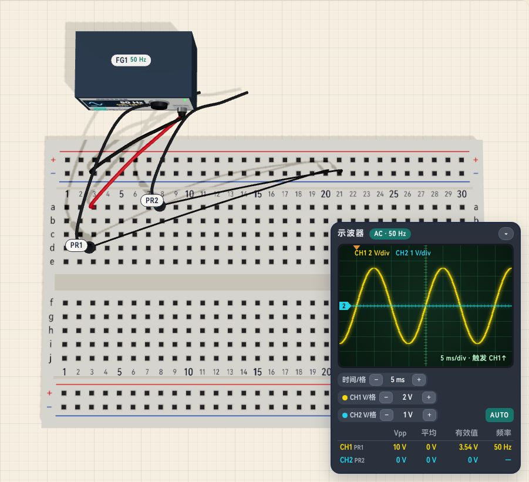
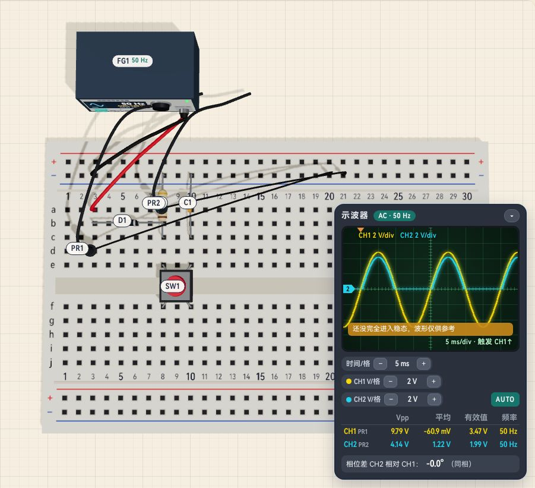
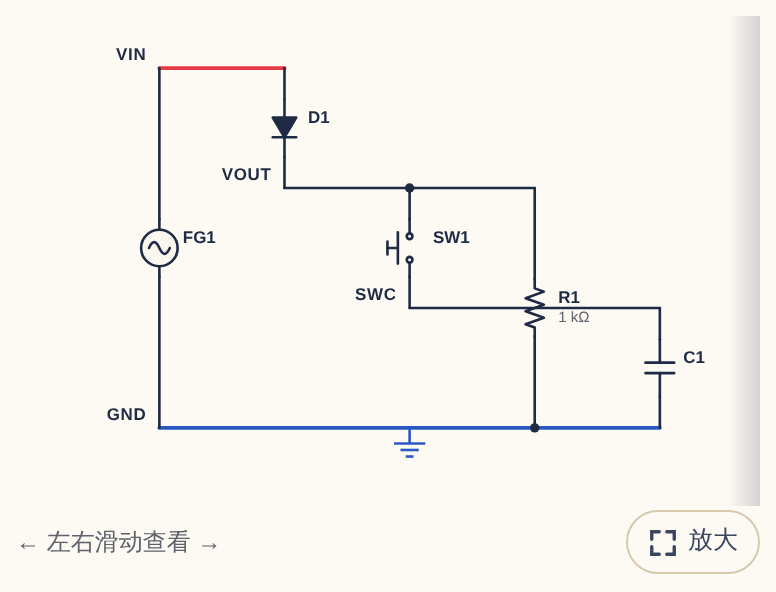
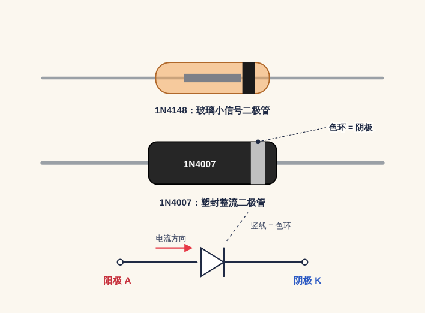
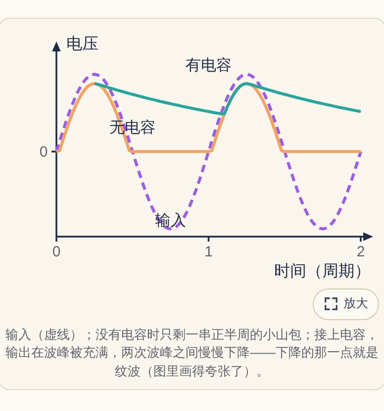
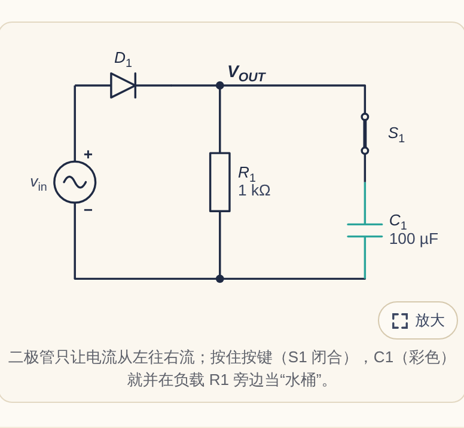

# 6.2 · 半波整流 + 电容滤波：把交流变成直流

| 项目 | 内容 |
|---|---|
| id | `exp4-half-wave-rectifier` |
| 文件 | `challenges/271-half-wave-rectifier.json` |
| 类型 | 实验 / 挑战（没有分步，照目标电路图搭） · 难度 4/5 |
| 位置 | World 6 · 半导体器件与分立放大器 → 6.2 整流（本节第 1 项） |
| 右侧面板 | 轨道由旧的四张卡片自动生成（还没手工精排） |
| 前后 | 上一项 [6.1 challenge-reverse-protection](../w6/6.01-1-challenge-reverse-protection.md) · 下一项 [7.1 exp-schmitt-trigger](../w7/7.01-1-exp-schmitt-trigger.md) |
| 先修 | lesson-scope-two-channels |
| 概念 | 二极管：单向导通 diode as a one-way valve、半波整流 half-wave rectifier、平均值 = 直流分量 average = DC component、电容滤波与纹波 capacitor filter and ripple、非正弦周期波 non-sinusoidal periodic wave |

**一句话概要**：信号发生器 → 二极管 → 1 kΩ 负载，只剩正半周。按住按键并上 100 µF 电容：输出变成一条带纹波的直流。用示波器的平均值和峰峰值看清楚。

## 1. 左侧工作台（3D 面包板 → 2D 俯视截图）

截图是程序里真实的 3D 面包板换成俯视角拍的；表格是同一块板的文字版（元件、参数、每只脚插在哪个孔）。

### 1.1 起点：打开这一课时板上已经有的

| 元件 | 类型 | 参数 | 引脚 → 孔 |
|---|---|---|---|
| FG1 | function_gen | waveform=sine, frequency=50, amplitude=5, offset=0 | +→a3 -→tn3 |
| PR1 | scope_probe | channel=1 | tip→d3 gnd→tn20 |
| PR2 | scope_probe | channel=2 | tip→a8 gnd→tn21 |

### 1.3 参考答案（「看答案」载入的板子）

| 元件 | 类型 | 参数 | 引脚 → 孔 |
|---|---|---|---|
| FG1 | function_gen | waveform=sine, frequency=50, amplitude=5, offset=0 | +→a3 -→tn3 |
| D1 | diode |  | anode→b3 cathode→b8 |
| R1 | resistor | resistance=1000 | 1→c8 2→tn8 |
| SW1 | pushbutton | pressed=false | 1a→e8 2a→e10 1b→f8 2b→f10 |
| C1 | capacitor | capacitance=0.00009999999999999999 | 1→c10 2→tn10 |
| PR1 | scope_probe | channel=1 | tip→d3 gnd→tn20 |
| PR2 | scope_probe | channel=2 | tip→a8 gnd→tn21 |

### 1.4 目标原理图（右侧「目标原理图」抽屉）

| 元件 | 类型 | 参数 |
|---|---|---|
| FG1 | function_gen |  |
| D1 | diode |  |
| R1 | resistor | resistance=1000 |
| SW1 | pushbutton |  |
| C1 | capacitor | capacitance=0.00009999999999999999 |

连接（每个结点上的引脚）：

- **VIN**：FG1.+、D1.anode
- **VOUT**：D1.cathode、R1.1、SW1.1
- **SWC**：SW1.2、C1.1
- **GND**：R1.2、C1.2、FG1.-

## 2. 右侧面板：学生从上往下看到的内容（单轨流）

### 第 1 步 · 🔍 先看一眼：先认识它：二极管

**拆解「二极管 Diode：电流的单向阀」第 1 / 7 层：① 外形：有色环的那一端是阴极**

课程里会见到两种轴向二极管：
- 1N4148：橙色透明玻璃管，**small-signal diode（小信号二极管）**，电流小（≤ 300 mA）、速度快；
- 1N4007：黑色塑封，**rectifier diode（整流二极管）**，能过 1 A、耐反压 1000 V，但慢。仿真器里的二极管就是这一类。

二极管 **有极性**。两只脚叫：
- **anode（阳极，A）**：没有色环的那端；
- **cathode（阴极，K）**：有色环（黑 / 银）的那端。

电路符号 是一个三角形顶着一根竖线：三角形指向 **允许电流流动的方向**（A → K），竖线就是实物上的色环。记法：**“色环 = 竖线 = 阴极 = 电流出口”**。

它的作用一句话：**电流只能从 A 流向 K**，像水管里的单向阀（check valve）。

| 型号 | 外观 | 最大电流 | 反向耐压 | 用途 |
|---|---|---|---|---|
| 1N4148 | 橙色玻璃，黑环 | 300 mA | 100 V | 信号、逻辑、快速开关 |
| 1N4007 | 黑色塑封，银环 | 1 A | 1000 V | 整流、防反接、续流 |

### 第 2 步 · 🔧 动手搭：负半周去哪了？

信号发生器和两支探头已经在板上。**二极管**：有黑圈（负极）的一头朝右，**`b3`**–**`b8`**。**电阻**（`1 kΩ`）**`c8`**–**`tn8`**。
信号发生器：**正弦波、`50 Hz`、幅度 `5 V`**（和市电同一个频率）。CH1 看输入，CH2 看电阻上的电压 VOUT。
CH1 有上半周也有下半周。CH2 呢？

### 第 3 步 · 💡 想明白：单向阀和水桶

- **二极管**是一个单向阀：正极比负极高出约 0.65 V，它才导通；反过来就断开。所以只有正半周能过去，输出是一串“小山包”——这叫**半波整流**。
- 这串小山包不是正弦波，但它有一个**平均值**——这就是它的直流成分，万用表直流档读到的就是它。剩下的起伏是各种频率的交流成分。
- 想要平稳的直流，就并一个大电容当**水桶**：每到波峰，二极管把桶灌满；两次波峰之间，负载慢慢从桶里取电，电压只往下掉一点。掉的那一点叫**纹波**。

*图 `waves`（plot）：输入（虚线）；没有电容时只剩一串正半周的小山包；接上电容，输出在波峰被充满，两次波峰之间慢慢下降——下降的那一点就是纹波（图里画得夸张了）。*

- 两次波峰之间隔一个周期 1/f，这段时间里电容放掉的电荷约是 I/f，所以
$$ΔV ≈ \frac{I}{f C} = \frac{I}{50 × 100 × 10^{-6}}$$
其中 I ≈ 输出电压 ÷ 1 kΩ。动手之前先估一估。

*图 `circuit`（schematic）：二极管只让电流从左往右流；按住按键（S1 闭合），C1（彩色）就并在负载 R1 旁边当“水桶”。*

（这一步下面列着这节课的计算卡片，点开就地展开：`generator-output`、`rectifier-ripple`、`diode-forward`，全文见第 6 节）

### 第 4 步 · 🔧 动手搭：按下按键，接上水桶

- **按键**放在 **`e8`**（横跨凹槽）：按下时把第 `8` 列和第 `10` 列接通。**电容**（`100 µF`）插 **`c10`**–**`tn10`**。
- **松开按键**：读 CH2 的「平均」。
- **点一下按键**让它保持按下：等波形稳定，读 CH2 的「平均」和 **Vpp**（纹波）。这时把 CH2 的伏/格调小，纹波看得更清楚。

### 第 5 步 · 📏 测一测：测一测：读你自己的仪表

**测量题 1 · `avg0`**（读数题）

> 松开按键：CH2（VOUT）的「平均」

- 单位 V · 先写预测 · 状态：FG1 设为 信号发生器（正弦 50Hz 幅度 5V）、松开 SW1 · 参考答案的读数 **1.218 V** · 合理范围 [1.1, 1.35]

答对后显示：

> 每个山包的峰值约 5 × 1000/1050.8 − 0.65 ≈ 4.1 V（信号发生器内部 50 Ω 分走一点，二极管再拦住 0.65 V）。整个周期的平均比 4.1/π ≈ 1.3 V 还小一点：输入要先超过 0.65 V 二极管才导通，山包两边被削掉了一些。

**测量题 2 · `avg1`**（读数题）

> 按住按键：CH2 的「平均」（直流输出）

- 单位 V · 先写预测 · 状态：FG1 设为 信号发生器（正弦 50Hz 幅度 5V）、按下 SW1 · 参考答案的读数 **3.196 V** · 合理范围 [3, 3.4]

答对后显示：

> 输出在约 2.95 V 到 3.45 V 之间，平均约 3.2 V。波峰没有到 4.1 V：电容每次只在波峰附近很短的时间里充电，充电电流很大，在信号发生器内部的 50 Ω 上压掉了一部分。

**测量题 3 · `rip`**（读数题）

> 按住按键：CH2 的 Vpp（纹波）

- 单位 V · 先写预测 · 状态：FG1 设为 信号发生器（正弦 50Hz 幅度 5V）、按下 SW1 · 参考答案的读数 **0.5032 V** · 合理范围 [0.42, 0.6]

答对后显示：

> I ≈ 3.2 V / 1 kΩ = 3.2 mA，ΔV ≈ I/(fC) = 0.0032 / (50 × 100 µF) ≈ 0.64 V。实测约 0.5 V，比估计小：电容并不是整整一个周期都在放电，波峰附近二极管还在给它充电。

**测量题 4 · `load`**（选择题）

> 如果把负载从 1 kΩ 换成 470 Ω，纹波会？

- A. 纹波变大：负载取电更快，桶里的水掉得更多 ✅（正确）
- B. 纹波变小：电阻小了，压降小了
- C. 不变：纹波只由电容决定

答对后显示：

> ΔV ≈ I/(fC)：电阻小了一半多，电流大了一倍多，两次波峰之间电容放掉的电荷也多一倍多。

### 第 6 步 · 🎒 带走：带走

- 整流后的波形 = **直流 + 一串谐波**（频率是 50 Hz 整数倍的正弦波）。平均值就是直流成分；电容（低通）留下直流，把谐波压小。
- 纹波 $ΔV ≈ I / (fC)$：负载电流越大、电容越小，纹波越大。全波整流的波峰间隔减半，纹波也减半。
- 坑：100 µF 是**电解电容**，+ 脚接二极管负极那一侧（VOUT），− 脚接 GND。接反会发热、鼓包甚至爆开。仿真里的电容不分正负。
- 坑：千万不要直接拿市电做这个实验。真实电源先用变压器降压、隔离，再整流滤波——变压器在理论题里练。
- 选学：非正弦波怎么拆成谐波（傅里叶）、怎样用拉普拉斯变换解暂态、怎样把一级电路看成一个二端口——各章的要点从下面进入。

趁热练理论题：`non-sinusoidal`、`s-domain`、`two-port`

## 3. 测量题一览

| # | id | 题目 | 类型 | 单位 | 状态 | 参考读数 |
|---|---|---|---|---|---|---|
| 1 | avg0 | 松开按键：CH2（VOUT）的「平均」 | scope | V | FG1 设为 信号发生器（正弦 50Hz 幅度 5V）、松开 SW1 | 1.218 V |
| 2 | avg1 | 按住按键：CH2 的「平均」（直流输出） | scope | V | FG1 设为 信号发生器（正弦 50Hz 幅度 5V）、按下 SW1 | 3.196 V |
| 3 | rip | 按住按键：CH2 的 Vpp（纹波） | scope | V | FG1 设为 信号发生器（正弦 50Hz 幅度 5V）、按下 SW1 | 0.5032 V |
| 4 | load | 如果把负载从 1 kΩ 换成 470 Ω，纹波会？ | 选择 |  |  | 正确：A |

### 全部答完后显示的「对比」

**对比**：
- **没有电容**：只剩正半周。峰值 ≈ 5 × 1000/1050.8 − 0.65 ≈ 4.1 V；平均 ≈ 1.22 V，比 4.1/π 略小（二极管要等输入过了 0.65 V 才导通）。
- **接上 100 µF**：输出在约 2.95～3.45 V 之间，平均 ≈ 3.2 V，纹波 ≈ 0.5 Vpp。粗估 ΔV ≈ I/(fC) = 3.2 mA / (50 Hz × 100 µF) ≈ 0.64 V 偏大一些，因为电容并不是放电整整一个周期。
- **波峰为什么降低了**：电容只在波峰附近短短一段时间里充电，充电电流是几十毫安的尖脉冲，在信号发生器内部 50 Ω 上压掉零点几伏。真实电源里的变压器绕组电阻也有同样的效果。

### 提示按钮（依次显示）

1. 二极管的负极（有黑圈的一头）朝 VOUT（第 8 列），正极接信号发生器那一列。
2. 按键横跨凹槽放在 e8：第 8 列是一端，第 10 列是另一端；电容从第 10 列接到 GND。
3. 示波器表格里的「平均」就是万用表直流档的读数。

### 功能测试（「检查我的电路」时跑）

- 松开按键：只剩正半周
- 按下按键：带纹波的直流

## 4. 用到的拆解（全部层的文字，供改写参考）

### 拆解 `diode`：二极管 Diode：电流的单向阀

*色环那一端是阴极。拆开是一块 PN 结：两种掺杂的硅在中间形成一层耗尽区和约 0.7 V 的势垒。正向推得过去，反向推不过去。最后用三种模型算防反接电路，再看续流二极管怎么吃掉继电器线圈的高压尖峰。*

**拆解「二极管 Diode：电流的单向阀」第 1 / 7 层：① 外形：有色环的那一端是阴极**

课程里会见到两种轴向二极管：
- 1N4148：橙色透明玻璃管，**small-signal diode（小信号二极管）**，电流小（≤ 300 mA）、速度快；
- 1N4007：黑色塑封，**rectifier diode（整流二极管）**，能过 1 A、耐反压 1000 V，但慢。仿真器里的二极管就是这一类。

二极管 **有极性**。两只脚叫：
- **anode（阳极，A）**：没有色环的那端；
- **cathode（阴极，K）**：有色环（黑 / 银）的那端。

电路符号 是一个三角形顶着一根竖线：三角形指向 **允许电流流动的方向**（A → K），竖线就是实物上的色环。记法：**“色环 = 竖线 = 阴极 = 电流出口”**。

它的作用一句话：**电流只能从 A 流向 K**，像水管里的单向阀（check valve）。

| 型号 | 外观 | 最大电流 | 反向耐压 | 用途 |
|---|---|---|---|---|
| 1N4148 | 橙色玻璃，黑环 | 300 mA | 100 V | 信号、逻辑、快速开关 |
| 1N4007 | 黑色塑封，银环 | 1 A | 1000 V | 整流、防反接、续流 |

**拆解「二极管 Diode：电流的单向阀」第 2 / 7 层：② 拆开：一块 p 型硅贴着一块 n 型硅**

纯硅几乎不导电：每个原子的 4 个外层电子都被共价键拴住了。**doping（掺杂）** 改变这一点：
- 掺入少量 **硼**（3 个外层电子）→ 每个硼原子缺一个电子，留下一个可以移动的 空穴 hole（相当于 +）；硼自己变成固定不动的 负离子 ⊖。这是 p 型硅（p = positive carriers）。
- 掺入少量 **磷**（5 个外层电子）→ 多出一个可以自由移动的 电子；磷自己变成固定的 正离子 ⊕。这是 n 型硅（n = negative carriers）。

两块都是 **电中性** 的：每个可移动载流子都有一个固定离子和它抵消。

把它们做在同一块硅片上，交界面叫 PN 结。p 区接 阳极 A，n 区接 阴极 K。二极管的所有性质都来自交界面上发生的事——下一层。

| 区 | 掺杂 | 可移动载流子 | 固定离子 | 接 |
|---|---|---|---|---|
| p 区 | 硼（3 价） | 空穴（+） | ⊖ | A |
| n 区 | 磷（5 价） | 电子（−） | ⊕ | K |

**拆解「二极管 Diode：电流的单向阀」第 3 / 7 层：③ 耗尽区：交界处自己筑起一道 0.7 V 的墙**

刚接触时，交界处两边浓度差很大：n 区的电子向 p 区 **扩散**（diffusion），p 区的空穴向 n 区扩散，在交界附近相遇、复合、一起消失。

消失的只是 **可移动** 的载流子；固定离子留在原地。于是交界两侧出现一层 **没有载流子** 的薄层——耗尽区 depletion region（约 1 µm 宽）：
- p 一侧留下 ⊖ 离子，n 一侧留下 ⊕ 离子；
- 这两层电荷产生一个从 n 指向 p 的 内建电场 E；
- 这个电场把后来想扩散过去的电子推回 n 区、空穴推回 p 区。

扩散和电场推回达到平衡时，两边的电位差叫 **built-in potential（内建电势）**，硅约 0.6–0.7 V。它就是一道 势垒 barrier：载流子要过结，必须先被外加电压“抬”过这道墙。

这就是 **“二极管导通约 0.7 V”** 的来源——不是电阻上的压降，而是 PN 结本身的性质（LED 的材料禁带更宽，所以墙更高，1.8–3 V）。

**拆解「二极管 Diode：电流的单向阀」第 4 / 7 层：④ 正向偏置推倒墙，反向偏置加高墙**

给二极管加电压，有两种方向：

**正向偏置 forward bias**（A 接 +、K 接 −）：外加电压和内建电场 **方向相反**，把墙压低、耗尽区变窄。外加电压接近 0.7 V 时，墙几乎被推平，电子和空穴大量越过结——电流随电压 **指数增长**。二极管两端的电压基本停在 0.6–0.8 V。

**反向偏置 reverse bias**（A 接 −、K 接 +）：外加电压和内建电场 **方向相同**，把载流子从结边上拉走、耗尽区变宽、墙变高。几乎没有电流，只剩 nA 级的 **leakage（漏电流）**。电压继续加大到 **breakdown voltage（击穿电压）**（1N4148 约 100 V，1N4007 约 1000 V）时，电场强到把共价键扯开，电流猛增——普通二极管这时就可能烧坏（稳压二极管 Zener 是专门工作在击穿区的）。

| 状态 | 接法 | 耗尽区 | 电流 | 二极管电压 |
|---|---|---|---|---|
| 正偏导通 | A +, K − | 变窄 | mA – A（由外电路决定） | ≈ 0.6–0.8 V |
| 反偏截止 | A −, K + | 变宽 | nA 级 | = 外加电压 |
| 反向击穿 | 反压 > 击穿电压 | — | 猛增 | ≈ −100 V (1N4148) |

**拆解「二极管 Diode：电流的单向阀」第 5 / 7 层：⑤ I–V 曲线：Shockley 方程**

PN 结的电流–电压关系由 **Shockley diode equation（肖克利方程）** 描述：
$$I = I_s(e^{V/(nV_T)} - 1)$$
- $I_s$：反向饱和电流，极小（1N4148 约 4 nA）；
- $V_T = \frac{kT}{q} ≈ 26 mV$（室温的 **thermal voltage 热电压**）；
- n：理想因子，1–2（1N4148 约 1.9）。

**读懂指数**：$nV_T ≈ 49 mV$，所以电压每多 $nV_T·ln 10 ≈ 114 mV$，电流就 **×10**。用这只 1N4148 的数字：
- 1 mA 时 0.61 V，10 mA 时 0.73 V，40 mA 时 0.82 V。

电流涨了 40 倍，电压只多了 0.2 V——这就是 曲线 在 ≈ 0.7 V 附近“拐弯”然后变陡的原因，也是“导通压降 0.7 V”这个说法的由来：它只是 **mA 级电流时** 的典型值。

反向：$e^{V/(nV_T)} → 0$，$I ≈ -I_s$，只有几 nA，直到击穿（图上把负电压轴压缩了）。温度每升高 1 °C，同样电流下的正向电压约降 2 mV。

| 电流 | 正向电压（1N4148） | 比上一行多 |
|---|---|---|
| 0.1 mA | 0.50 V | — |
| 1 mA | 0.61 V | + 0.11 V |
| 10 mA | 0.73 V | + 0.12 V |
| 100 mA | ≈ 0.9 V | + 0.17 V（体电阻开始起作用） |

- 公式 `I = I_s(e^{V/(nV_T)} - 1)`：$V_T$ = 26 mV（室温）
- 公式 `ΔV = nV_T·ln 10 ≈ 114 mV`：电流每 ×10 需要多加的电压（n = 1.9）

**拆解「二极管 Diode：电流的单向阀」第 6 / 7 层：⑥ 三种模型：按需要的精度选**

指数方程要迭代才能解。电路课里用三种越来越精确的 **分段线性** 模型：

1. 理想二极管：正偏 = 导线（0 V），反偏 = 断路。只回答“通不通”。
2. 恒压降模型 constant-drop：导通时 = 一个 0.7 V 的电压源。手算最常用。
3. 分段线性 piecewise linear：导通时 = $V_F$ 串一个小电阻 $r_d$。**仿真器用的就是这个**：$V_F = 0.65 V$，$r_d = 0.8 Ω$，截止时 1 GΩ。

**用三种模型算防反接实验**（+9 V → 二极管 → 470 Ω → 绿 LED（2.1 V + 12 Ω）→ GND）：
- 理想：$I = \frac{9 - 2.1}{470 + 12} = 14.3 mA$，二极管阴极 9 V；
- 0.7 V：$I = \frac{9 - 0.7 - 2.1}{482} = 12.9 mA$，阴极 8.3 V；
- 仿真器：$I = \frac{9 - 0.65 - 2.1}{482 + 0.8} = 12.9 mA$，二极管压降 $0.65 + 0.0129 × 0.8 ≈ 0.66 V$，阴极 ≈ 8.3 V。

结论：**电源电压比 0.7 V 大得多时，理想模型就够判断；要算具体电压时用 0.7 V**；后两种几乎一样。

**怎么判断二极管是通还是断**（假设–验证法）：先假设导通，算出电流；电流 > 0 就对了。电流 < 0 就改成截止，再验证它两端的电压 < $V_F$。仿真器每一步就是这样迭代的。

|  | 真实 1N4007 | 仿真器 |
|---|---|---|
| 导通 | 指数曲线，≈ 0.7–1 V | 0.65 V + 0.8 Ω |
| 截止 | nA 漏电流 | 1 GΩ |
| 反向击穿 | 1000 V | 没有 |
| 额定电流 | 1 A 平均 | > 2 A 平均烧坏 |
| 开关速度 / 结电容 | µs 级反向恢复，约 15 pF | 瞬时，无电容 |

- 公式 `V_D = V_F + I·r_d = 0.65 + 0.0129 × 0.8 ≈ 0.66 V`：防反接实验里二极管的压降（仿真器模型）

**拆解「二极管 Diode：电流的单向阀」第 7 / 7 层：⑦ 两个用途：防反接、续流**

**1. 防反接（reverse-polarity protection）**：把 二极管 串在电源 + 后面。电池接对了，二极管正偏导通，只损失约 0.7 V（阴极 ≈ 8.3 V）；电池接反了，二极管反偏截止，后面的电路一点电流都没有，安全。代价是那 0.7 V 和它上面的功率 $P = 0.66 V × 12.9 mA ≈ 8.5 mW$——大电流时（1 A 就是 0.7 W）会发热，那时改用压降约 0.3 V 的 **Schottky diode（肖特基二极管）** 或 P-MOSFET。

**2. 续流二极管（flyback diode）**：继电器 线圈 是一个电感（150 mH + 70 Ω），通电时电流 $\frac{5 V}{70 Ω} ≈ 71 mA$。三极管突然关断时，电感 **要维持电流不变**（$v = L\frac{di}{dt}$，见电感拆解），于是集电极电压猛冲上去：仿真里约 29 V，真实电路可能到三极管击穿。

反并一个二极管（**阴极接 +5 V**，阳极接集电极）：正常工作时它反偏，不起作用；关断瞬间集电极一超过 $5 + 0.7 = 5.7 V$，它就导通，给线圈电流一条回路“线圈 → 二极管 → 线圈”，电压被 钳在 5.7 V。电流在这个小回路里按 $τ = \frac{L}{R} = \frac{150 mH}{70 Ω} ≈ 2.1 ms$ 衰减，能量变成线圈电阻和二极管上的热。

- 公式 `V_{clamp} = V_s + V_F = 5 + 0.7 = 5.7 V`：有续流二极管时集电极的最高电压
- 公式 `τ = \frac{L}{R} = \frac{150 mH}{70 Ω} ≈ 2.1 ms`：线圈电流在续流回路里衰减的时间常数

**一句话记住**：二极管 = PN 结：p 区（空穴）贴着 n 区（电子），交界处的耗尽区筑起约 0.7 V 的墙。**正偏** 把墙推平，电流按 $I = I_s(e^{V/(nV_T)} - 1)$ 指数增长；**反偏** 把墙加高，只剩 nA 漏电流。手算用 0.7 V 模型，仿真器用 0.65 V + 0.8 Ω。色环 = 阴极 = 电流出口；串联防反接、反并续流。

## 5. 这一课的计算卡片

**计算卡片 `generator-output`：信号发生器的 50 Ω 输出电阻**

- 公式 `V_{out} = V_{set} \frac{R_L}{50 Ω + R_L}`
- 用途：信号发生器 = 理想波形源串 50 Ω：接上负载以后输出比设定小多少。
- 输入：V_set（设定的幅度（或偏置），V）；R_o（输出电阻，Ω）；R_L（负载（电路的输入电阻），Ω） → V_out（端口上的实际值，V）

1. 发生器内部 = 一个理想波形源 + 串联的 50 Ω（$R_o$）。空载时端口电压就是设定值。
2. 接负载 $R_L$：$R_o$ 和 $R_L$ 分压，$V_{out} = V_{set}\frac{R_L}{R_o + R_L}$。交流部分和直流偏置都被同一个比例缩小。
3. $R_L ≫ 50 Ω$（几 kΩ 以上）时差别不到 1 %；50 Ω 负载正好减半。
4. 负载是 RC、RL 时用阻抗的模：$|V_{out}| = V_{set}\frac{|Z|}{|Z + R_o|}$，而且随频率变——所以滤波实验用端口电压（CH1）做参考。
5. 时间常数里要把 50 Ω 算进 R：$τ = (R + 50)C$。

例子：- 第 12 课：设 1 V，50 Ω 负载：0.5 V 幅度 = 1.0 Vpp；偏置 +1 V 也变成 0.5 V。
- 实验 2-7：反相放大器输入电阻 10 kΩ：$1 × \frac{10000}{10050} ≈ 0.995$，输出 2.19 Vpp 而不是 2.2。
- 实验 4-3：$|Z| = 142.5 Ω$，$|Z + 50| = |151 + j100.5| ≈ 181 Ω$：端口只有 $\frac{142.5}{181} ≈ 0.786 V$ 峰值（1.57 Vpp）。

- ⚠ 很多真实发生器按“接 50 Ω 负载”显示幅度：接高阻电路实际是显示值的两倍（除非设成 High-Z）。
- ⚠ 算 τ、谐振电流、RLC 阻尼时忘了这 50 Ω。

**计算卡片 `rectifier-ripple`：半波整流 + 电容滤波的纹波**

- 公式 `ΔV ≈ \frac{I}{f C} = \frac{V_{out}}{R f C}`
- 用途：二极管整流后接一个大电容：两个峰之间电容给负载供电，电压掉多少。
- 输入：V_out（输出直流电压，V）；R（负载电阻，Ω）；f（峰的频率（半波 = 电源频率，全波 = 两倍），Hz）；C（滤波电容，F） → ΔV（纹波峰峰值（估算），V）

1. 二极管是单向阀：只有正半周通过，输出是一排“鼓包”，峰值 ≈ $V_p - 0.65 V$；不加电容时平均值约 $\frac{V_{peak}}{π}$。
2. 加电容：每个峰附近二极管把电容充满，两个峰之间二极管截止，电容独自给负载供电。
3. 负载电流约 $I = \frac{V_{out}}{R}$，两个峰相隔 $\frac{1}{f}$，电容放掉的电荷 $Q ≈ \frac{I}{f}$。
4. $ΔV = \frac{Q}{C} ≈ \frac{I}{fC}$：电流越大、电容越小，纹波越大。全波整流峰的间隔减半，纹波也减半。
5. 估算偏大一点：电容并不是放电整整一个周期，峰附近二极管已经开始充电了。

例子：半波整流实验（50 Hz、幅度 5 V、1 kΩ）：不加电容峰值 $5 × \frac{1000}{1050.8} - 0.65 ≈ 4.1 V$，平均约 1.2 V。加 100 µF：输出约 3.2 V，$ΔV ≈ \frac{3.2 mA}{50 × 100 µF} ≈ 0.64 V$（读数约 0.5 V）。负载换成 470 Ω，电流翻倍多，纹波也翻倍多。

- ⚠ 100 µF 是电解电容：+ 接二极管阴极一侧（VOUT），接反会发热、鼓包甚至爆裂。
- ⚠ 不要直接接市电做这个实验：真实电源先用变压器降压、隔离，再整流滤波。

**计算卡片 `diode-forward`：二极管的正向压降：过一个二极管少 0.7 V**

- 公式 `V_{out} = V_{in} - V_F - I r_d`
- 用途：电流经过一个导通的二极管（防反接、USB 二极管、续流钳位）以后电压变成多少。
- 输入：V_in（二极管前的电压，V）；V_F（导通压降（硅 0.65–0.7 V，肖特基 0.3 V），V）；I（电流，A）；r_d（二极管内阻（不知道就填 0），Ω） → V_out（二极管后的电压，V）

1. 二极管只让电流从阳极流向阴极（有条纹的一端）。正向导通后两端电压几乎固定：硅管约 0.65–0.7 V，肖特基约 0.3 V。
2. 折线模型：$V_F$ 串一个小电阻 $r_d$，所以电流大时压降稍大。
3. 串在电源后面（防反接）：输出 = 输入 − 一个 $V_F$；接反时它截止，后面的电路不通电。
4. 续流 / 钳位：二极管导通把某一点钳在“另一点 + $V_F$”上——继电器集电极最高 5 V + 0.7 V。

例子：挑战 6：9 V 经二极管 → 约 8.3 V。开发板 5V 引脚：USB 5 V 经肖特基 → 约 4.7 V。实验 5-9：线圈断电时集电极被钳在 4.65 + 0.7 ≈ 5.4 V。实验 3-5：低电平时 D1 反偏，电容不能倒灌回发生器。

- ⚠ 防反接二极管会一直吃掉 0.7 V 和 0.7 V × I 的功率；低压电路用肖特基或 P-MOSFET。

## 6. English（界面英文版的同一份内容）

展开英文

### Node 1 · 🔍 Look first：Meet it first: Diode

**Teardown「The diode: a one-way valve for current」layer 1 of 7：① Outside: the banded end is the cathode**

You will meet two axial diodes in this course:
- 1N4148: an orange glass tube, a **small-signal diode** — small currents (≤ 300 mA), fast;
- 1N4007: black plastic, a **rectifier diode** — 1 A, 1000 V reverse, but slow. The simulator’s diode is this kind.

A diode **has polarity**. Its legs are:
- the **anode (A)**: the end without a band;
- the **cathode (K)**: the end with the (black / silver) band.

The symbol is a triangle against a bar: the triangle points the way **current is allowed to flow** (A → K), and the bar is the band on the part. Remember: **band = bar = cathode = where current comes out**.

Its job in one sentence: **current flows only from A to K**, like a check valve in a water pipe.

| Part | Looks | Max current | Reverse rating | Use |
|---|---|---|---|---|
| 1N4148 | orange glass, black band | 300 mA | 100 V | signals, logic, fast switching |
| 1N4007 | black plastic, silver band | 1 A | 1000 V | rectifying, protection, flyback |

### Node 2 · 🔧 Build：Where did the negative half go?

The generator and both probes are already on the board. **Diode**: the end with the band (the cathode) faces right, **`b3`**–**`b8`**. **Resistor** (`1 kΩ`) **`c8`**–**`tn8`**.
Generator: **sine, `50 Hz`, amplitude `5 V`** (the mains frequency). CH1 shows the input, CH2 the voltage VOUT across the resistor.
CH1 has a top half and a bottom half. What about CH2?

### Node 3 · 💡 Why：A one-way valve and a bucket

- A **diode** is a one-way valve: it conducts only when its anode is about 0.65 V above its cathode, and blocks the other way. So only the positive halves get through and the output is a row of humps — **half-wave rectification**.
- These humps are not a sine wave, but they have an **average** — their DC part, which is what a multimeter's DC range reads. The rest of the wobble is AC at various frequencies.
- For a steady DC, add a big capacitor as a **bucket**: at every peak the diode fills it up; between peaks the load slowly draws from it, and the voltage only sags a little. That sag is the **ripple**.

[figure `waves`]

*Figure `waves`（plot）：输入（虚线）；没有电容时只剩一串正半周的小山包；接上电容，输出在波峰被充满，两次波峰之间慢慢下降——下降的那一点就是纹波（图里画得夸张了）。*

- The peaks are one period 1/f apart, and in that time the capacitor gives away a charge of about I/f, so
$$ΔV ≈ \frac{I}{f C} = \frac{I}{50 × 100 × 10^{-6}}$$
with I ≈ the output voltage ÷ 1 kΩ. Estimate it before you measure.

[figure `circuit`]

*Figure `circuit`（schematic）：二极管只让电流从左往右流；按住按键（S1 闭合），C1（彩色）就并在负载 R1 旁边当“水桶”。*

(This node lists the lesson’s calculation cards: `generator-output`、`rectifier-ripple`、`diode-forward`; full text in section 6)

### Node 4 · 🔧 Build：Press the button: add the bucket

- **Push button** at **`e8`** (straddling the gap): pressed, it joins column `8` to column `10`. **Capacitor** (`100 µF`) into **`c10`**–**`tn10`**.
- **Button released**: read CH2's "Vavg".
- **Click the button** so it stays pressed. Once the trace settles, read CH2's "Vavg" and its **Vpp** (the ripple). Turn CH2's V/div down to see the ripple better.

### Node 5 · 📏 Measure：Measure: read your own instruments

**Question 1 · `avg0`**（reading）

> Button released: CH2's (VOUT's) "Vavg"

- unit V · predict first · state：FG1 is set to Function generator (sine 50Hz 5V peak) and SW1 is released · range [1.1, 1.35]

Shown once right:

> Each hump peaks at about 5 × 1000/1050.8 − 0.65 ≈ 4.1 V (the generator's internal 50 Ω takes a little, the diode holds back 0.65 V). The average over a period is a little below 4.1/π ≈ 1.3 V: the input must first pass 0.65 V before the diode conducts, which trims both sides of each hump.

**Question 2 · `avg1`**（reading）

> Button held: CH2's "Vavg" (the DC output)

- unit V · predict first · state：FG1 is set to Function generator (sine 50Hz 5V peak) and SW1 is pressed · range [3, 3.4]

Shown once right:

> The output moves between about 2.95 V and 3.45 V and averages about 3.2 V. The peaks no longer reach 4.1 V: the capacitor charges only in a short moment near each peak, with a large current, and the generator's internal 50 Ω drops part of the voltage.

**Question 3 · `rip`**（reading）

> Button held: CH2's Vpp (the ripple)

- unit V · predict first · state：FG1 is set to Function generator (sine 50Hz 5V peak) and SW1 is pressed · range [0.42, 0.6]

Shown once right:

> I ≈ 3.2 V / 1 kΩ = 3.2 mA, ΔV ≈ I/(fC) = 0.0032 / (50 × 100 µF) ≈ 0.64 V. The reading, about 0.5 V, is smaller: the capacitor does not discharge for a whole period — near each peak the diode is still charging it.

**Question 4 · `load`**（multiple choice）

> If the load changes from 1 kΩ to 470 Ω, the ripple will:

- A. Grow: the load drains the bucket faster ✅ (right)
- B. Shrink: a smaller resistor drops less voltage
- C. Stay the same: only the capacitor sets the ripple

Shown once right:

> ΔV ≈ I/(fC): the resistance drops by more than half, the current more than doubles, and the capacitor gives away more than twice the charge between peaks.

### Node 6 · 🎒 Take away：Take away

- A rectified wave = **DC + a series of harmonics** (sine waves at whole multiples of 50 Hz). The average is the DC part; the capacitor (a low-pass) keeps the DC and shrinks the harmonics.
- Ripple $ΔV ≈ I / (fC)$: more load current or less capacitance means more ripple. A full-wave rectifier halves the time between peaks, and the ripple with it.
- Pitfall: 100 µF is an **electrolytic**. Its + lead goes to the diode's cathode side (VOUT), its − lead to GND. Reversed, it heats up, bulges or even bursts. The simulated capacitor has no polarity.
- Pitfall: never try this straight on the mains. A real supply first steps the voltage down and isolates it with a transformer, then rectifies and filters — transformers are in the theory problems.
- Electives: how a non-sinusoidal wave splits into harmonics (Fourier), how the Laplace transform solves transients, how to treat a stage as a two-port — each chapter's key points open below.

Practise：`non-sinusoidal`、`s-domain`、`two-port`

**Compare**

**Compare**:
- **No capacitor**: only the positive halves are left. Peak ≈ 5 × 1000/1050.8 − 0.65 ≈ 4.1 V; average ≈ 1.22 V, a little below 4.1/π (the diode waits until the input passes 0.65 V).
- **With 100 µF**: the output moves between about 2.95 and 3.45 V, averaging ≈ 3.2 V, with ≈ 0.5 Vpp of ripple. The rough ΔV ≈ I/(fC) = 3.2 mA / (50 Hz × 100 µF) ≈ 0.64 V comes out a little high, because the capacitor does not discharge for a whole period.
- **Why the peaks dropped**: the capacitor charges only in a short moment near each peak, in sharp pulses of tens of milliamps, which drop a few tenths of a volt across the generator's internal 50 Ω. In a real supply the transformer's winding resistance does the same.

**Hints**

1. The diode's cathode (the end with the band) faces VOUT (column 8); its anode goes to the generator's column.
2. The button straddles the gap at e8: column 8 is one end, column 10 the other; the capacitor runs from column 10 to GND.
3. The scope table's "Vavg" is what a multimeter's DC range would read.

