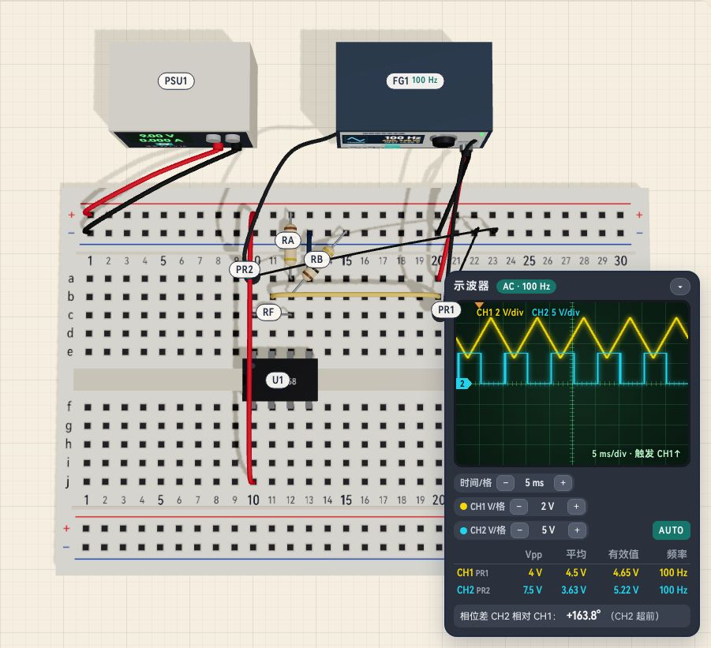
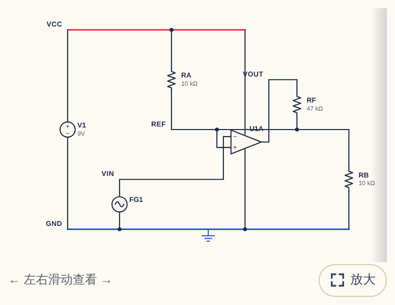
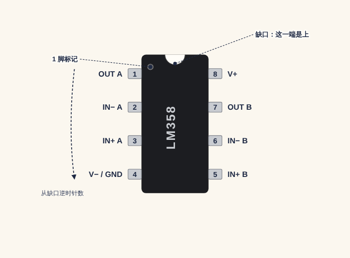
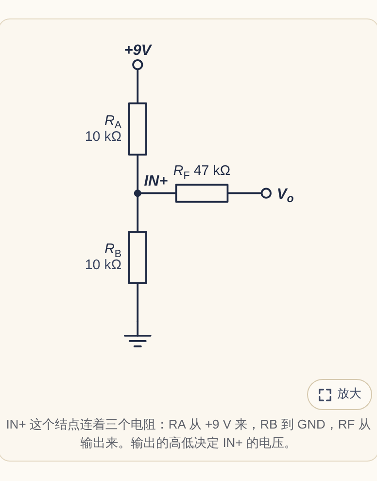
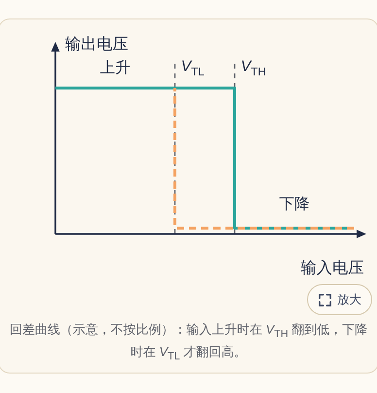

# 7.1 · 施密特触发器：会“记事”的比较器

| 项目 | 内容 |
|---|---|
| id | `exp-schmitt-trigger` |
| 文件 | `challenges/230-schmitt-trigger.json` |
| 类型 | 实验 / 挑战（没有分步，照目标电路图搭） · 难度 4/5 |
| 位置 | World 7 · 模拟 IC 进阶：非理想 op-amp（运算放大器）、波特图、有源滤波、555 与功放 → 7.1 施密特触发器（本节第 1 项） |
| 右侧面板 | 轨道由旧的四张卡片自动生成（还没手工精排） |
| 前后 | 上一项 [6.2 exp4-half-wave-rectifier](../w6/6.02-1-exp4-half-wave-rectifier.md) · 下一项 [7.2 exp4-active-lowpass](../w7/7.02-1-exp4-active-lowpass.md) |
| 先修 | lesson-lm358、lesson-generator-scope |
| 概念 | Schmitt trigger 施密特触发器、positive feedback 正反馈、hysteresis 回差、comparator 比较器、threshold 门限 |

**一句话概要**：这次故意把反馈接到 IN+。三角波慢慢升、慢慢降，输出却在两个不同的高度翻转——这就是回差。

## 1. 左侧工作台（3D 面包板 → 2D 俯视截图）

截图是程序里真实的 3D 面包板换成俯视角拍的；表格是同一块板的文字版（元件、参数、每只脚插在哪个孔）。

### 1.1 起点：空面包板（学生从零开始搭）

### 1.3 参考答案（「看答案」载入的板子）

| 元件 | 类型 | 参数 | 引脚 → 孔 |
|---|---|---|---|
| PSU1 | bench_supply | voltage=9, currentLimit=0.1 | +→tp1 -→tn1 |
| U1 | opamp |  | 1→e10 2→e11 3→e12 4→e13 5→f13 6→f12 7→f11 8→f10 |
| W3 | wire |  | a→tp10 b→j10 |
| W4 | wire |  | a→a13 b→tn13 |
| RA | resistor | resistance=10000 | 1→tp12 2→a12 |
| RB | resistor | resistance=10000 | 1→b12 2→tn15 |
| RF | resistor | resistance=47000 | 1→c10 2→c12 |
| FG1 | function_gen | waveform=triangle, frequency=100, amplitude=2, offset=4.5 | +→a20 -→tn20 |
| W9 | wire |  | a→b20 b→b11 |
| PR1 | scope_probe | channel=1 | tip→c20 gnd→tn22 |
| PR2 | scope_probe | channel=2 | tip→a10 gnd→tn23 |

### 1.4 目标原理图（右侧「目标原理图」抽屉）

| 元件 | 类型 | 参数 |
|---|---|---|
| V1 | dc_source | voltage=9 |
| U1 | opamp |  |
| FG1 | function_gen |  |
| RA | resistor | resistance=10000 |
| RB | resistor | resistance=10000 |
| RF | resistor | resistance=47000 |

连接（每个结点上的引脚）：

- **VCC**：V1.+、U1.v+、RA.1
- **GND**：V1.-、U1.v-、RB.2、FG1.-
- **VIN**：FG1.+、U1.inA-
- **REF**：RA.2、RB.1、RF.2、U1.inA+
- **VOUT**：U1.outA、RF.1

## 2. 右侧面板：学生从上往下看到的内容（单轨流）

### 第 1 步 · 🔍 先看一眼：先认识它：LM358 op-amp

**拆解「LM358：一颗芯片里的两个 op-amp」第 1 / 9 层：① 外形：8 只脚的黑色小芯片（DIP-8）**

LM358 装在 **DIP-8** 封装里（Dual In-line Package，两排直插，8 只脚）。怎么找 1 脚：
- 芯片一端有个 半圆缺口 notch，缺口朝上时，左上角有个 小圆点 的就是 **1 脚**；
- 从 1 脚开始 **逆时针** 数：左边一排从上往下 1、2、3、4，再从右边一排从下往上 5、6、7、8。

8 只脚分成三类：**A 号 op-amp 的 3 只脚**、**B 号 op-amp 的 3 只脚**、**两个 op-amp 共用的 2 只电源脚**。把鼠标放到下表每一行上，看它在芯片上的位置。

| 脚 | 名字 | 属于 | 它是什么 | 单电源时接哪 |
|---|---|---|---|---|
| 1 | OUT A | op-amp A | 输出（output） | 负载 / 反馈网络 |
| 2 | IN− A | op-amp A | 反相输入（inverting input） | 反馈回来的信号 |
| 3 | IN+ A | op-amp A | 同相输入（non-inverting input） | 要放大的信号 / 参考电压 |
| 4 | V− (GND) | A、B 共用 | 负电源 | GND |
| 5 | IN+ B | op-amp B | 同相输入 | 不用时接固定电压 |
| 6 | IN− B | op-amp B | 反相输入 | 不用时接 7 脚（跟随器） |
| 7 | OUT B | op-amp B | 输出 | — |
| 8 | V+ | A、B 共用 | 正电源 3–32 V | +5 V / +9 V |

### 第 2 步 · 🔧 动手搭：上去和下来，在同一个地方翻吗？

**LM358** 接 `9 V`（8 脚接 +9 V，4 脚接 GND）。**RA** `10 kΩ` 从 +9 V 接到 **IN+**，**RB** `10 kΩ` 从 IN+ 接到 GND，**RF** `47 kΩ` 从 **OUT 接到 IN+**——这次故意接 + 输入。
信号发生器接 **IN−**：**三角波**、`100 Hz`、幅度 **`2 V`**、偏置 **`4.5 V`**。示波器 **CH1** 看输入，**CH2** 看 OUT。
看两条波形。输出在三角波的哪个高度掉下来？又在哪个高度跳回去？

### 第 3 步 · 💡 想明白：正反馈：一推到底

- 2.5 里反馈接 IN−，让输出安静下来。接到 **IN+** 正好相反：输出一动，就把 IN+ 往同一个方向推得更远，输出一下子撞到电源轨。
- 所以 IN+ 有两个值。输出在高处时，RF 把 IN+ **往上**拉到上门限 $V_{TH}$；输出在低处时，把 IN+ **往下**拉到下门限 $V_{TL}$。
- 每个门限就是 IN+ 的结点电压（2.2 的结点电压法），OUT 当作又一个电源：
$$V_T = \frac{V_{CC}/R_A + V_o/R_F}{1/R_A + 1/R_B + 1/R_F}$$
- 举例：RF = 100 kΩ、输出在 0 V 时，$V_T = \frac{9/10}{0.1 + 0.1 + 0.01} = 4.29$ V。现在用 RF = 47 kΩ 算出两个门限：$V_o$ 取 0 V 和 7.5 V。

*图 `node`（schematic）：IN+ 这个结点连着三个电阻：RA 从 +9 V 来，RB 到 GND，RF 从输出来。输出的高低决定 IN+ 的电压。*

- 输入要爬过 $V_{TH}$，输出才翻到低；要降到 $V_{TL}$ 以下，才翻回高。就像恒温器：低于 19 °C 开始加热，高于 21 °C 才停。

*图 `loop`（plot）：回差曲线（示意，不按比例）：输入上升时在 V_TH 翻到低，下降时在 V_TL 才翻回高。*

（这一步下面列着这节课的计算卡片，点开就地展开：`node-voltage`、`schmitt-thresholds`，全文见第 6 节）

### 第 4 步 · 🔧 动手搭：把门限找出来

- 在 CH2 上读 **OUT 的高电平**。
- **把 CH2 移到 IN+**（3 脚）。它也是方波：顶是 $V_{TH}$，底是 $V_{TL}$。
- 再把信号发生器的幅度调到 **`0.25 V`**：三角波只在两个门限之间晃。OUT 会怎样？
- 电路检查通过后填测量题。

### 第 5 步 · 📏 测一测：测一测：读你自己的仪表

**测量题 1 · `vhi`**（读数题）

> CH2 在 OUT：输出的高电平

- 单位 V · 状态：FG1 设为 信号发生器（三角波 100Hz 幅度 2V） · 参考答案的读数 **7.499 V** · 合理范围 [7.2, 7.8]

答对后显示：

> 单电源 LM358 的输出上限：V+ − 1.5 V ≈ 7.5 V。

**测量题 2 · `vth`**（读数题）

> CH2 移到 IN+：它的最高值，也就是上门限 V_TH

- 单位 V · 先写预测 · 状态：FG1 设为 信号发生器（三角波 100Hz 幅度 2V） · 参考答案的读数 **4.788 V** · 合理范围 [4.6, 4.95]

答对后显示：

> 输出在 7.5 V：V_TH = (0.9 + 7.5/47) / (0.1 + 0.1 + 0.0213) ≈ 4.79 V。

**测量题 3 · `vtl`**（读数题）

> 同一状态：IN+ 的最低值，也就是下门限 V_TL

- 单位 V · 先写预测 · 状态：FG1 设为 信号发生器（三角波 100Hz 幅度 2V） · 参考答案的读数 **4.067 V** · 合理范围 [3.9, 4.25]

答对后显示：

> 输出在 0 V：V_TL = 0.9 / 0.2213 ≈ 4.07 V。

**测量题 4 · `hyst`**（计算题（用自己的读数算））

> 用你的两个读数算回差 V_TH − V_TL

- 单位 V · 先写预测 · 参考答案的读数 **0.721 V** · 合理范围 [0.6, 0.85] · 公式 `vth - vtl`

答对后显示：

> ≈ 4.79 − 4.07 = 0.72 V。也等于输出摆幅 7.5 V 乘以 RF 在 IN+ 结点上分到的份额：7.5 × 0.0213 / 0.2213 ≈ 0.72 V。

**测量题 5 · `small`**（读数题）

> 幅度调到 0.25 V：OUT 的峰峰值

- 单位 V · 状态：FG1 设为 信号发生器（三角波 100Hz 幅度 250mV） · 参考答案的读数 **0 V** · 合理范围 [-0.01, 0.1]

答对后显示：

> 三角波只在 4.25 V 和 4.75 V 之间晃，碰不到任何一个门限：输出停在原来的电平，峰峰值约为 0。

### 第 6 步 · 🎒 带走：带走

- **负反馈**（接 IN−）做放大器；**正反馈**（接 IN+）做一个有两种状态的开关。
- 施密特触发器有两个门限。两者之差叫**回差**，决定它能忽略多大的噪声。
- 真实用途：单片机读一个慢慢变化或者带噪声的信号之前（黄昏时的光敏电阻、按键），先用它整形。
- 坑：LM358 是慢 op-amp（运算放大器），翻转一次要几十微秒。要快的边沿，用真正的比较器，比如 LM393——它的输出要接上拉电阻。

趁热练理论题：`opamp`

## 3. 测量题一览

| # | id | 题目 | 类型 | 单位 | 状态 | 参考读数 |
|---|---|---|---|---|---|---|
| 1 | vhi | CH2 在 OUT：输出的高电平 | scope | V | FG1 设为 信号发生器（三角波 100Hz 幅度 2V） | 7.499 V |
| 2 | vth | CH2 移到 IN+：它的最高值，也就是上门限 V_TH | scope | V | FG1 设为 信号发生器（三角波 100Hz 幅度 2V） | 4.788 V |
| 3 | vtl | 同一状态：IN+ 的最低值，也就是下门限 V_TL | scope | V | FG1 设为 信号发生器（三角波 100Hz 幅度 2V） | 4.067 V |
| 4 | hyst | 用你的两个读数算回差 V_TH − V_TL | formula | V |  | 0.721 V |
| 5 | small | 幅度调到 0.25 V：OUT 的峰峰值 | scope | V | FG1 设为 信号发生器（三角波 100Hz 幅度 250mV） | 0 V |

### 全部答完后显示的「对比」

**对比**（手算，模拟器暂时算不出这个电路，见 docs/REBUILD_PLAN.md §6）：
- 输出高电平 ≈ **7.5 V**，低电平 ≈ 0 V，频率和输入一样（100 Hz）。
- V_TH = (0.9 + 7.5/47) / 0.2213 ≈ **4.79 V**，V_TL = 0.9 / 0.2213 ≈ **4.07 V**，回差 ≈ **0.72 V**。
- 幅度 0.25 V 时，三角波碰不到门限，输出不翻转。

### 提示按钮（依次显示）

1. RF 接在 OUT 和 IN+ 之间（3 脚），不是 IN−：这次要的就是正反馈。
2. RA、RB 在 IN+ 上组成分压器：一个接 +9 V，一个接 GND。
3. 信号发生器的红夹子接 IN−（2 脚），黑夹子接 GND；三角波要加 4.5 V 偏置，否则一半时间低于 0 V。

### 功能测试（「检查我的电路」时跑）

- 三角波 4 Vpp：输出在两个电平之间翻转，IN+ 跳到两个门限
- 三角波 0.5 Vpp：在两个门限之间晃，输出不动

## 4. 用到的拆解（全部层的文字，供改写参考）

### 拆解 `lm358`：LM358：一颗芯片里的两个 op-amp

*op-amp = operational amplifier（运算放大器）。我们从芯片外形一路拆到教授在黑板上画的那个三角形，再拆到三角形里面的等效电路，最后用它推出每一个放大器公式。*

**拆解「LM358：一颗芯片里的两个 op-amp」第 1 / 9 层：① 外形：8 只脚的黑色小芯片（DIP-8）**

LM358 装在 **DIP-8** 封装里（Dual In-line Package，两排直插，8 只脚）。怎么找 1 脚：
- 芯片一端有个 半圆缺口 notch，缺口朝上时，左上角有个 小圆点 的就是 **1 脚**；
- 从 1 脚开始 **逆时针** 数：左边一排从上往下 1、2、3、4，再从右边一排从下往上 5、6、7、8。

8 只脚分成三类：**A 号 op-amp 的 3 只脚**、**B 号 op-amp 的 3 只脚**、**两个 op-amp 共用的 2 只电源脚**。把鼠标放到下表每一行上，看它在芯片上的位置。

| 脚 | 名字 | 属于 | 它是什么 | 单电源时接哪 |
|---|---|---|---|---|
| 1 | OUT A | op-amp A | 输出（output） | 负载 / 反馈网络 |
| 2 | IN− A | op-amp A | 反相输入（inverting input） | 反馈回来的信号 |
| 3 | IN+ A | op-amp A | 同相输入（non-inverting input） | 要放大的信号 / 参考电压 |
| 4 | V− (GND) | A、B 共用 | 负电源 | GND |
| 5 | IN+ B | op-amp B | 同相输入 | 不用时接固定电压 |
| 6 | IN− B | op-amp B | 反相输入 | 不用时接 7 脚（跟随器） |
| 7 | OUT B | op-amp B | 输出 | — |
| 8 | V+ | A、B 共用 | 正电源 3–32 V | +5 V / +9 V |

**拆解「LM358：一颗芯片里的两个 op-amp」第 2 / 9 层：② X 光：硅片上有两个 op-amp，电源脚共用**

把黑色塑料变透明：中间是一小块 硅片 die，细细的 金线 bond wire 把硅片连到 8 只脚上。硅片上做了两个完全一样、互相独立的放大器：op-amp A 和 op-amp B。

“**Dual**（双）”就是这个意思。它们只共用两样东西：V+（8 脚） 和 V−（4 脚）。所以：
- 只要芯片插上电，A 和 B **都** 通电了，哪怕你只用 A；
- 不用的那一半不能让它的输入悬空——悬空的输入会让它乱跳甚至振荡，干扰另一半。通常把它接成跟随器（7 脚接 6 脚），5 脚接一个固定电压。

**拆解「LM358：一颗芯片里的两个 op-amp」第 3 / 9 层：③ 符号：教授画的那个三角形**

原理图里，一个 op-amp 画成一个 三角形，信号从左往右走：
- IN−（反相输入 inverting input）：标“−”的那只脚，它上面的电压记作 $v₋$；
- IN+（同相输入 non-inverting input）：标“+”的那只脚，电压记作 $v₊$；
- OUT（输出）：三角形的尖，电压 $v_o$；
- V+ 和 V−：电源脚。理论题里常常 **省略不画**，但真实电路里必须接，否则它不工作。

注意：“+”“−”不是电源正负极，而是“这只输入对输出的作用是同向还是反向”。op-amp 只关心两个输入之间的 **差**：
$$v_d = v₊ - v₋$$
v_d 叫 **差模输入电压**（differential input voltage）。

| 端子 | 符号 | LM358 A 的脚 | 作用 |
|---|---|---|---|
| IN+ | $v₊$ | 3 | $v₊$ 升高 → $v_o$ 升高 |
| IN− | $v₋$ | 2 | $v₋$ 升高 → $v_o$ 降低 |
| OUT | $v_o$ | 1 | 输出 $A·v_d$ |
| V+ / V− | — | 8 / 4 | 能量从这里来，也限制 $v_o$ 的范围 |

- 公式 `v_d = v₊ - v₋`：op-amp 唯一“看”的量

**拆解「LM358：一颗芯片里的两个 op-amp」第 4 / 9 层：④ 拆开三角形：三个元件的等效电路**

教授说“把 op-amp 拆成电路”，拆出来就是这三样（这是电路课里 op-amp 的 **线性模型**）：

1. 输入电阻 R_in：接在两个输入之间。LM358 的输入只取约 20 nA 的偏置电流，等效 $R_{in}$ 在 MΩ 以上，计算时可以当成 **开路**——输入端几乎不取电流。
2. 受控电压源 A·v_d：一个电压 **控制** 的电压源（VCVS），它的电压是输入差的 A 倍。A 叫 **开环增益**（open-loop gain），LM358 约 $10^5$（100 dB）。
3. 输出电阻 R_out：受控源到输出脚之间，几十 Ω 量级。

于是不接任何反馈时：
$$v_o = A·v_d = A(v₊ - v₋)$$
这个电路你在第 5 章“含运算放大器的电阻电路”和受控源那一节都能直接用结点法分析。

| 参数 | LM358（典型） | 理想 op-amp | 计算时 |
|---|---|---|---|
| 开环增益 A | ≈ 10⁵ (100 dB) | ∞ | 很大 → 得出“虚短” |
| 输入电阻 R_in | MΩ 以上（偏置 20 nA） | ∞ | 开路 → 得出“虚断” |
| 输出电阻 R_out | 几十 Ω（仿真 10 Ω） | 0 | 反馈后更小，可忽略 |

- 公式 `v_o = A(v₊ - v₋)`：开环（不接反馈），且输出没到电源边界时

**拆解「LM358：一颗芯片里的两个 op-amp」第 5 / 9 层：⑤ 不接反馈会怎样？——输出一下子撞到电源**

用上一层的公式算一下。LM358 接 9 V 单电源，输出最多到约 7.5 V。要让输出在 0–7.5 V 之间（线性区），输入差只能是：
$$0 < v_d < \frac{7.5 V}{10^5} = 75 µV$$
75 微伏！你手一碰导线、电位器动一点点、甚至输入失调电压（LM358 典型 2 mV）都比它大几十倍。所以 **开环** 的 op-amp 几乎永远停在两头：
- $v₊ > v₋$（哪怕多 1 mV）→ 输出 顶到 ≈ V+ − 1.5 V
- $v₊ < v₋$ → 输出 掉到 ≈ 0 V

这叫 **饱和**（saturation）。这样用 op-amp 就成了 **比较器**（comparator）：只回答“哪个输入大”。想让它当放大器，必须加 **负反馈**——下面两层就讲为什么反馈能把 $v_d$ 稳稳地压在 75 µV 以内。

- 公式 `|v_d| < \frac{V_{sat}}{A} = \frac{7.5}{10^{5}} = 75 µV`：线性区有多窄

**拆解「LM358：一颗芯片里的两个 op-amp」第 6 / 9 层：⑥ 理想 op-amp 的两条黄金法则：虚短、虚断**

把等效电路里的三个参数推到极限：$A → ∞$、$R_{in} → ∞$、$R_{out} → 0$。电路课的所有 op-amp 题都用这两条法则：

**法则 1 · 虚断（virtual open）**：$R_{in} → ∞$，所以 两个输入端都不取电流：
$$i_+ = i_- = 0$$
**法则 2 · 虚短（virtual short）**：有负反馈、输出没饱和时，$v_o$ 是有限值（几伏），而 $v_d = \frac{v_o}{A}$，A → ∞，所以 两个输入电压相等：
$$v₊ = v₋$$
“虚”的意思：两个输入 **电压相等，但并没有真的连在一起**（没有电流流过）。

⚠ 虚短 **只在有负反馈时成立**。上一层的开环电路里 $v₊ ≠ v₋$，输出是饱和的。

| 法则 | 式子 | 来自 | 什么时候成立 |
|---|---|---|---|
| 虚断 | $i_+ = i_- = 0$ | $R_{in} → ∞$ | 总是（输入电流 nA 级） |
| 虚短 | $v₊ = v₋$ | $A → ∞$ | 有负反馈且输出未饱和 |

**拆解「LM358：一颗芯片里的两个 op-amp」第 7 / 9 层：⑦ 负反馈第一例：电压跟随器，一步步推**

把 输出直接接回 IN−，信号接 IN+。先 **不用** 黄金法则，用 ④ 的模型硬算（忽略 $R_{out}$）：
1. 接线告诉我们：$v₊ = v_{in}$，$v₋ = v_o$
2. op-amp 的方程：$v_o = A(v₊ - v₋) = A(v_{in} - v_o)$
3. 移项：$v_o(1 + A) = A·v_{in}$
4. 所以 $v_o = \frac{A}{1+A}v_{in}$。代入 $A = 10^5$：$v_o = 0.99999 v_{in}$

再看反馈 **为什么能稳住**：如果 $v_o$ 偏低，$v_d = v_{in} - v_o$ 变大，A 倍放大后把 $v_o$ 往上推；偏高则往下拉。输出一直“追”着输入，$v_d$ 只剩 $\frac{v_o}{A}$——几十 µV。

用黄金法则一行就出来：虚短 $v₋ = v₊$，而 $v₋ = v_o$，所以 $v_o = v_{in}$。两种方法结果一致，这就是黄金法则的来历。

**用处**：输入几乎不取电流（虚断），输出能提供几十 mA——它把“带不动负载的信号”变成“能带负载的信号”，叫 **缓冲器**（buffer）。

- 公式 `v_o = \frac{A}{1+A} v_{in} ≈ v_{in}`：有限 A 的精确结果

**拆解「LM358：一颗芯片里的两个 op-amp」第 8 / 9 层：⑧ 负反馈第二例：同相放大器和反相放大器**

跟随器把 **全部** 输出送回 IN−。如果只送回 **一部分**，就能放大。用 R_f 和 R_1 分压，送回 IN− 的是 βvₒ：
$$β = \frac{R_1}{R_1 + R_f}$$
**同相放大器**（non-inverting），信号接 IN+：
1. 虚断：IN− 不取电流，所以 R_f、R_1 是简单的串联分压：$v₋ = β v_o$
2. 虚短：$v₋ = v₊ = v_{in}$
3. 所以 $β v_o = v_{in}$，$v_o = \frac{1}{β}v_{in} = (1 + \frac{R_f}{R_1})v_{in}$

用有限 A 推（同 ⑦ 的方法）得到 $v_o = \frac{A}{1+Aβ}v_{in}$：只要 $Aβ ≫ 1$，增益就只由 **两个电阻** 决定，和 op-amp 本身的 A 无关——这就是负反馈的价值。

**反相放大器**（inverting）：IN+ 接 GND，信号经 $R_1$ 接 IN−，$R_f$ 从 OUT 接回 IN−。
1. 虚短：$v₋ = v₊ = 0$，IN− 是 **虚地**（virtual ground）
2. 虚断：流进 $R_1$ 的电流全部流过 $R_f$：$\frac{v_{in} - 0}{R_1} = \frac{0 - v_o}{R_f}$
3. 所以 $v_o = -\frac{R_f}{R_1}v_{in}$（负号 = 反相）

| 电路 | 增益 vₒ / v_in | 输入电阻 | 实验 |
|---|---|---|---|
| 跟随器 | 1 | ∞ | 2-5 |
| 同相放大 | $1 + \frac{R_f}{R_1}$ | ∞ | 2-6 |
| 反相放大 | $-\frac{R_f}{R_1}$ | $R_1$ | 2-7 |
| 反相求和 | $-R_f(\frac{v_1}{R_1} + \frac{v_2}{R_2})$ | $R_1$, $R_2$ | 2-8 |

- 公式 `β = \frac{R_1}{R_1 + R_f}`：反馈系数：输出送回 IN− 的比例
- 公式 `v_o = \frac{A}{1 + Aβ} v_{in} ≈ \frac{1}{β} v_{in}`：Aβ ≫ 1 时增益只取决于电阻

**拆解「LM358：一颗芯片里的两个 op-amp」第 9 / 9 层：⑨ 再往里：三级晶体管电路，和它的“缺点”**

三角形里真正的东西是约 20 个晶体管，分三级：
1. 输入级：PNP 差分对——只放大两个输入的 **差**。LM358 用 PNP 管，所以 输入电压可以低到 0 V（GND），这就是它能单电源工作的原因；输入上限约 V+ − 1.5 V。
2. 增益级——提供 $10^5$ 倍的电压增益。里面的 补偿电容 C_c 让高频增益逐渐下降，防止接反馈后振荡，代价是 **带宽**：增益 × 带宽 ≈ 1 MHz（GBW）。
3. 输出级：推挽——一个管子往上推电流、一个往下拉，提供几十 mA。往上推的那一路有两个 $V_{BE}$ 压降，所以 输出到不了 V+，差约 1.5 V；往下拉的那一路能接近 0 V。

这一层解释了你在课里看到的三个“现象”：
- 第 14 课：输入 9 V，输出只有 7.5 V → 输出级的余量；
- 放大倍数做 100 倍时带宽只剩约 10 kHz → $GBW ≈ 1 MHz$；
- 方波边沿变成斜坡，约 0.3 V/µs → **压摆率**（slew rate），由 C_c 的充电电流决定。

| 参数 | LM358 典型值 | 影响什么 |
|---|---|---|
| 电源电压 | 3–32 V（±1.5–±16 V） | 能用的电源 |
| 输出摆幅 | 0 … V+ − 1.5 V | 输出最大值 |
| 共模输入范围 | 0 … V+ − 1.5 V | 输入能接多高 |
| 增益带宽积 GBW | ≈ 1 MHz | $f_{max} ≈ \frac{GBW}{增益}$ |
| 压摆率 SR | ≈ 0.3 V/µs | 大信号的最高频率 |
| 输入失调电压 | ≈ 2 mV | 直流误差 × 增益 |

- 公式 `f_{-3dB} ≈ \frac{GBW}{G}`：G = 闭环增益（同相放大器的 1 + R_f/R_1）
- 公式 `f_{max} = \frac{SR}{2π V_p}`：不失真的最大正弦频率

**一句话记住**：op-amp = 一个只看 $v₊ - v₋$ 的超高增益放大器。开环时它是比较器；加了负反馈，输出会调到让 $v₊ = v₋$（虚短），输入不取电流（虚断）——从这两条就能推出所有放大器公式。

## 5. 这一课的计算卡片

**计算卡片 `node-voltage`：结点电压法（一个结点）Node voltage**

- 公式 `V_N = \frac{\frac{V_1}{R_1} + \frac{V_2}{R_2} + I_s}{\frac{1}{R_1} + \frac{1}{R_2} + \frac{1}{R_3}}`
- 用途：几条支路汇到一个结点：一条 KCL 方程直接求出这个结点的电压。
- 输入：V_1（电源 1（经 R₁ 接到 N），V）；R_1（R₁，Ω）；V_2（电源 2（经 R₂ 接到 N，没有就填 0），V）；R_2（R₂，Ω）；R_3（N 到地的电阻 R₃，Ω）；I_s（流进 N 的电流源（没有就填 0），A） → V_N（结点 N 的电压，V）

1. 选 GND 做参考结点，未知量只剩 $V_N$。
2. 对 N 写 KCL，每条支路电流都写成“从 N 流出”：$\frac{V_N - V_1}{R_1} + \frac{V_N - V_2}{R_2} + \frac{V_N}{R_3} - I_s = 0$。
3. 把含 $V_N$ 的项合并：左边系数是接在 N 上所有电导之和（**自电导**），右边是每个“电压源 ÷ 串联电阻”加上流进的电流源（**注入电流**）。
4. 解出 $V_N$，再用欧姆定律求每条支路的电流，比如 $I_3 = \frac{V_N}{R_3}$。
单位技巧：用 V、kΩ、mA，电导就是 mS。

例子：实验 2-1（两个电源都接上）：$V_N = \frac{9/1 + 5/2.2}{1 + 0.4545 + 0.3030} = \frac{11.27}{1.7576} ≈ 6.41 V$，$I_3 = \frac{6.41}{3.3} ≈ 1.94 mA$。

- ⚠ 电流源：流进结点为正，流出为负。
- ⚠ 和电流源串联的电阻不进自电导（它不影响电流源送进来的电流）。

**计算卡片 `schmitt-thresholds`：施密特触发器的两个阈值**

- 公式 `V_T = \frac{V_{CC}/R_A + V_o/R_F}{1/R_A + 1/R_B + 1/R_F}`
- 用途：正反馈比较器：输出高时 IN+ 在上阈值 V_TH，输出低时在下阈值 V_TL，两者之差是回差。
- 输入：V_CC（电源，V）；R_A（电源到 IN+ 的 R_A，Ω）；R_B（IN+ 到地的 R_B，Ω）；R_F（OUT 到 IN+ 的反馈 R_F，Ω）；V_o（输出电平（LM358 高 ≈ 7.5 V，低 ≈ 0 V），V） → V_T（这时的阈值（IN+ 的电压），V）

1. 反馈接到 **IN+**（正反馈）：输出一动，IN+ 被推着往同一个方向走，输出就一直走到头——只有高、低两个状态。
2. IN+ 是一个结点，接着三条支路：$R_A$ 到电源、$R_B$ 到地、$R_F$ 到输出。把输出当成又一个电压源，用结点电压法：$V_T = \frac{V_{CC}/R_A + V_o/R_F}{1/R_A + 1/R_B + 1/R_F}$。
3. 输出高（$V_o ≈ 7.5 V$）时得到上阈值 $V_{TH}$；输出低（0 V）时得到下阈值 $V_{TL}$。
4. 输入（接 IN−）要升过 $V_{TH}$ 输出才翻低，要降到 $V_{TL}$ 以下才翻回高。
5. 回差 $V_{TH} - V_{TL} = ΔV_o\frac{1/R_F}{1/R_A + 1/R_B + 1/R_F}$：比它小的噪声不会让输出来回抖。

例子：本实验（9 V、10 k / 10 k、$R_F$ = 47 k）：分母 0.1 + 0.1 + 0.0213 = 0.2213 mS；$V_{TH} = \frac{0.9 + 7.5/47}{0.2213} ≈ 4.79 V$，$V_{TL} = \frac{0.9}{0.2213} ≈ 4.07 V$，回差 ≈ 0.72 V。幅度 0.25 V 的三角波（4.25–4.75 V）碰不到阈值，输出不翻转。

- ⚠ 把反馈接到 IN−：那是负反馈放大器，不是比较器。
- ⚠ 输出高电平用 V+ − 1.5 V（LM358），不是 9 V。

## 6. English（界面英文版的同一份内容）

展开英文

### Node 1 · 🔍 Look first：Meet it first: LM358 op-amp

**Teardown「LM358: two op-amps in one chip」layer 1 of 9：① Package: a small black 8-pin chip (DIP-8)**

The LM358 comes in a **DIP-8** package (Dual In-line Package: two rows, 8 pins). Finding pin 1:
- one end has a half-moon notch; with the notch at the top, the corner with the little dot (top left) is **pin 1**;
- count **anticlockwise** from pin 1: down the left side 1, 2, 3, 4, then up the right side 5, 6, 7, 8.

The 8 pins fall into three groups: **3 pins of op-amp A**, **3 pins of op-amp B**, and **2 power pins shared by both**. Hover each row of the table to see where it is on the chip.

| Pin | Name | Belongs to | What it is | Single supply: connect to |
|---|---|---|---|---|
| 1 | OUT A | op-amp A | output | the load / feedback network |
| 2 | IN− A | op-amp A | inverting input | the feedback signal |
| 3 | IN+ A | op-amp A | non-inverting input | the signal / a reference |
| 4 | V− (GND) | shared | negative supply | GND |
| 5 | IN+ B | op-amp B | non-inverting input | unused: tie to a fixed voltage |
| 6 | IN− B | op-amp B | inverting input | unused: tie to pin 7 (follower) |
| 7 | OUT B | op-amp B | output | — |
| 8 | V+ | shared | positive supply 3–32 V | +5 V / +9 V |

### Node 2 · 🔧 Build：Does it flip at the same place going up and coming down?

Power the **LM358** from `9 V` (pin 8 to +9 V, pin 4 to GND). **RA** `10 kΩ` from +9 V to **IN+**, **RB** `10 kΩ` from IN+ to GND, and **RF** `47 kΩ` from **OUT to IN+** — the + input, on purpose.
Signal generator to **IN−**: **triangle**, `100 Hz`, amplitude **`2 V`**, offset **`4.5 V`**. Scope **CH1** on the input, **CH2** on OUT.
Watch the two traces. Where on the triangle does the output drop — and where does it jump back up?

### Node 3 · 💡 Why：Positive feedback: all or nothing

- In 2.5 the feedback went to IN− and calmed the output down. Fed to **IN+**, it does the opposite: once the output starts to move, it pushes IN+ further the same way, and the output snaps to a rail.
- So IN+ has two values. With the output high, RF pulls IN+ **up** to the upper threshold $V_{TH}$; with the output low, it pulls IN+ **down** to $V_{TL}$.
- Each threshold is the node voltage of IN+ (2.2's nodal analysis), with OUT as one more source:
$$V_T = \frac{V_{CC}/R_A + V_o/R_F}{1/R_A + 1/R_B + 1/R_F}$$
- Example with RF = 100 kΩ and the output at 0 V: $V_T = \frac{9/10}{0.1 + 0.1 + 0.01} = 4.29$ V. Now work out both thresholds for RF = 47 kΩ, with $V_o$ = 0 V and 7.5 V.

[figure `node`]

*Figure `node`（schematic）：IN+ 这个结点连着三个电阻：RA 从 +9 V 来，RB 到 GND，RF 从输出来。输出的高低决定 IN+ 的电压。*

- The input has to climb past $V_{TH}$ to flip the output low, and fall below $V_{TL}$ to flip it back. Like a thermostat that heats below 19 °C and stops above 21 °C.

[figure `loop`]

*Figure `loop`（plot）：回差曲线（示意，不按比例）：输入上升时在 V_TH 翻到低，下降时在 V_TL 才翻回高。*

(This node lists the lesson’s calculation cards: `node-voltage`、`schmitt-thresholds`; full text in section 6)

### Node 4 · 🔧 Build：Find the two thresholds

- Read the **top level of OUT** on CH2.
- **Move CH2 to IN+** (pin 3). It is a square wave too: its top is $V_{TH}$, its bottom $V_{TL}$.
- Now set the generator's amplitude to **`0.25 V`**: the triangle wobbles between the two thresholds. What does OUT do?
- Once the circuit check passes, fill in the questions.

### Node 5 · 📏 Measure：Measure: read your own instruments

**Question 1 · `vhi`**（reading）

> CH2 on OUT: the output's high level

- unit V · state：FG1 is set to Function generator (triangle 100Hz 2V peak) · range [7.2, 7.8]

Shown once right:

> The single-supply LM358's ceiling: V+ − 1.5 V ≈ 7.5 V.

**Question 2 · `vth`**（reading）

> CH2 moved to IN+: its top value, the upper threshold V_TH

- unit V · predict first · state：FG1 is set to Function generator (triangle 100Hz 2V peak) · range [4.6, 4.95]

Shown once right:

> With the output at 7.5 V: V_TH = (0.9 + 7.5/47) / (0.1 + 0.1 + 0.0213) ≈ 4.79 V.

**Question 3 · `vtl`**（reading）

> Same setting: the bottom of IN+, the lower threshold V_TL

- unit V · predict first · state：FG1 is set to Function generator (triangle 100Hz 2V peak) · range [3.9, 4.25]

Shown once right:

> With the output at 0 V: V_TL = 0.9 / 0.2213 ≈ 4.07 V.

**Question 4 · `hyst`**（calculation from own readings）

> From your two readings, the hysteresis V_TH − V_TL

- unit V · predict first · range [0.6, 0.85] · formula `vth - vtl`

Shown once right:

> ≈ 4.79 − 4.07 = 0.72 V. It also equals the 7.5 V output swing times RF's share at the IN+ node: 7.5 × 0.0213 / 0.2213 ≈ 0.72 V.

**Question 5 · `small`**（reading）

> Amplitude at 0.25 V: OUT's peak-to-peak value

- unit V · state：FG1 is set to Function generator (triangle 100Hz 250mV peak) · range [-0.01, 0.1]

Shown once right:

> The triangle wobbles between 4.25 V and 4.75 V and reaches neither threshold: the output stays where it was, about 0 V peak to peak.

### Node 6 · 🎒 Take away：Take away

- **Negative feedback** (to IN−) makes an amplifier; **positive feedback** (to IN+) makes a switch with two states.
- A Schmitt trigger has two thresholds. The gap, the **hysteresis**, sets how much noise it ignores.
- Real use: cleaning a slow or noisy signal (a light sensor at dusk, a button) before a microcontroller reads it.
- Pitfall: the LM358 is a slow op-amp; its edges take tens of microseconds. For fast edges use a real comparator such as the LM393, which needs a pull-up resistor on its output.

Practise：`opamp`

**Compare**

**Compare** (by hand; the simulator cannot solve this circuit yet, see docs/REBUILD_PLAN.md §6):
- Output high ≈ **7.5 V**, low ≈ 0 V, at the input's frequency (100 Hz).
- V_TH = (0.9 + 7.5/47) / 0.2213 ≈ **4.79 V**, V_TL = 0.9 / 0.2213 ≈ **4.07 V**, hysteresis ≈ **0.72 V**.
- At 0.25 V amplitude the triangle never reaches a threshold, so the output does not flip.

**Hints**

1. RF goes between OUT and IN+ (pin 3), not IN−: positive feedback is the point this time.
2. RA and RB make a divider at IN+: one to +9 V, one to GND.
3. The generator's red clip goes to IN− (pin 2), the black one to GND; give the triangle a 4.5 V offset, or it spends half its time below 0 V.

