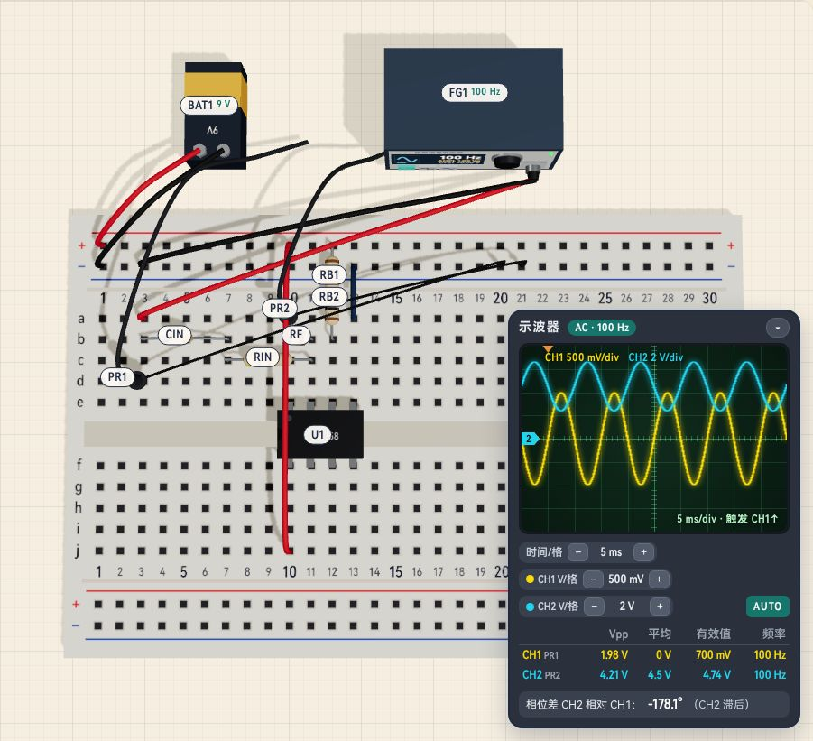
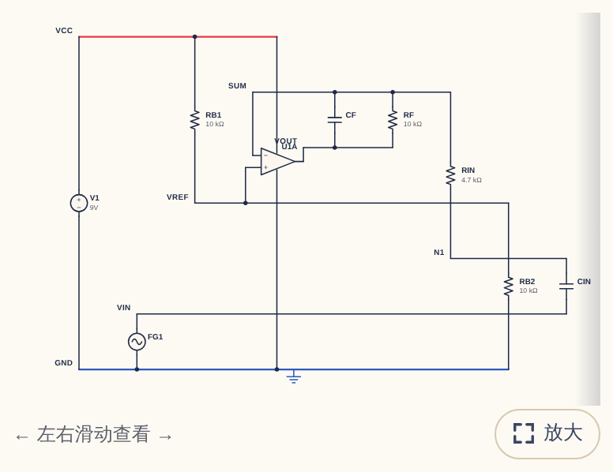
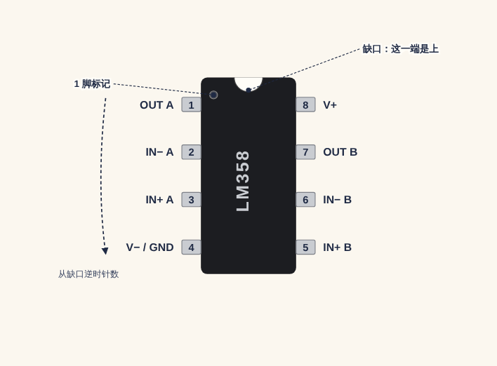
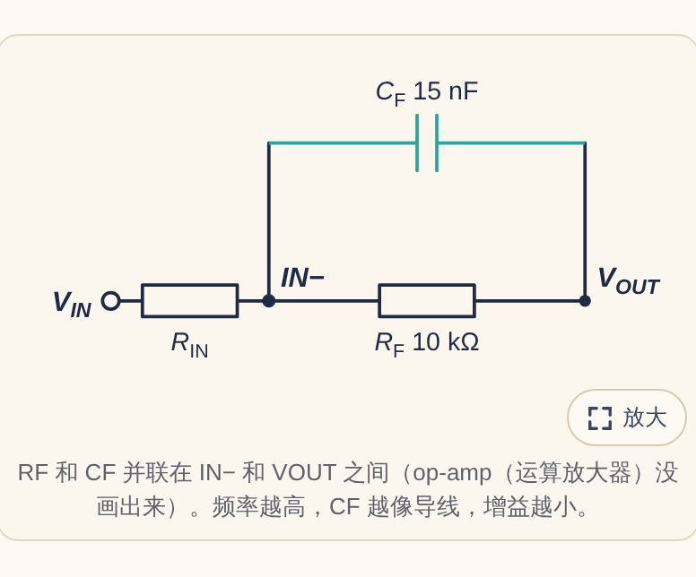
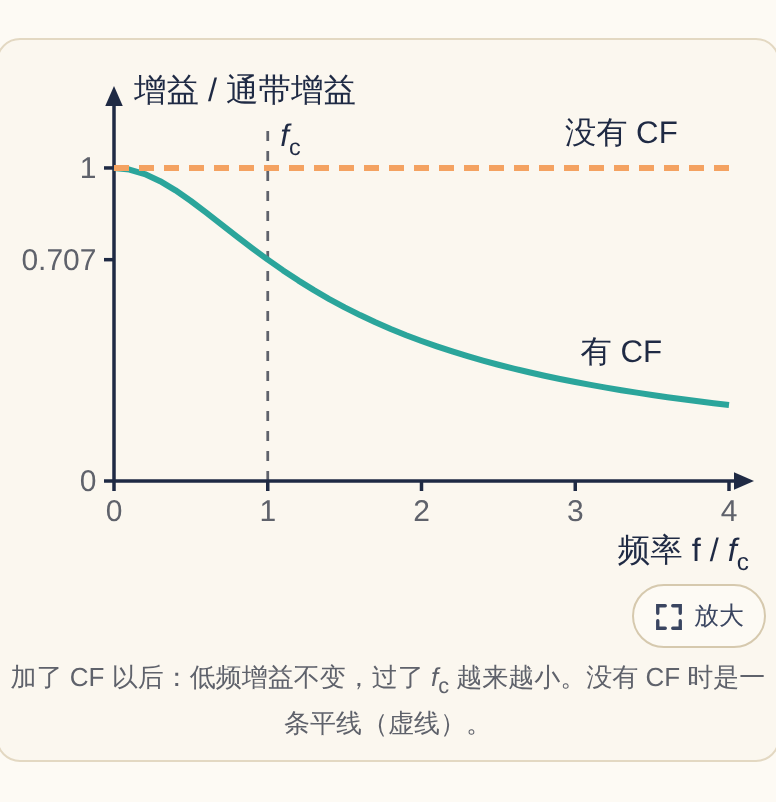

# 7.2 · 有源低通：会“忘掉高音”的放大器

| 项目 | 内容 |
|---|---|
| id | `exp4-active-lowpass` |
| 文件 | `challenges/266-active-lowpass.json` |
| 类型 | 实验 / 挑战（没有分步，照目标电路图搭） · 难度 5/5 |
| 位置 | World 7 · 模拟 IC 进阶：非理想 op-amp（运算放大器）、波特图、有源滤波、555 与功放 → 7.2 有源滤波与级间缓冲（本节第 1 项） |
| 右侧面板 | 轨道由旧的四张卡片自动生成（还没手工精排） |
| 前后 | 上一项 [7.1 exp-schmitt-trigger](../w7/7.01-1-exp-schmitt-trigger.md) · 下一项 [7.2 exp4-buffered-bandpass](../w7/7.02-2-exp4-buffered-bandpass.md) |
| 先修 | lesson-lm358、lesson-scope-two-channels |
| 概念 | 有源滤波器 active filter、H(jω) = −(RF/RIN)/(1 + jωRF·CF)、反相放大器 inverting amplifier、单电源偏置 single-supply bias、输出摆幅 output swing |

**一句话概要**：反相放大器的反馈电阻旁边并一个电容：测通带增益、扫频找截止频率，最后故意加大输入，看单电源 op-amp（运算放大器）把顶部削平。

## 1. 左侧工作台（3D 面包板 → 2D 俯视截图）

截图是程序里真实的 3D 面包板换成俯视角拍的；表格是同一块板的文字版（元件、参数、每只脚插在哪个孔）。

### 1.1 起点：打开这一课时板上已经有的

| 元件 | 类型 | 参数 | 引脚 → 孔 |
|---|---|---|---|
| BAT1 | battery | variant=9V | +→tp1 -→tn1 |
| U1 | opamp |  | 1→e10 2→e11 3→e12 4→e13 5→f13 6→f12 7→f11 8→f10 |
| W3 | wire |  | a→tp10 b→j10 |
| W4 | wire |  | a→a13 b→tn13 |
| RB1 | resistor | resistance=10000 | 1→tp12 2→a12 |
| RB2 | resistor | resistance=10000 | 1→b12 2→tn12 |
| FG1 | function_gen | waveform=sine, frequency=100, amplitude=1, offset=0 | +→a3 -→tn3 |
| CIN | capacitor | capacitance=0.000009999999999999999 | 1→b3 2→b7 |
| RIN | resistor | resistance=4700 | 1→c7 2→c11 |
| RF | resistor | resistance=10000 | 1→b11 2→b10 |
| PR1 | scope_probe | channel=1 | tip→d3 gnd→tn20 |
| PR2 | scope_probe | channel=2 | tip→a10 gnd→tn21 |

### 1.3 参考答案（「看答案」载入的板子）

| 元件 | 类型 | 参数 | 引脚 → 孔 |
|---|---|---|---|
| BAT1 | battery | variant=9V | +→tp1 -→tn1 |
| U1 | opamp |  | 1→e10 2→e11 3→e12 4→e13 5→f13 6→f12 7→f11 8→f10 |
| W3 | wire |  | a→tp10 b→j10 |
| W4 | wire |  | a→a13 b→tn13 |
| RB1 | resistor | resistance=10000 | 1→tp12 2→a12 |
| RB2 | resistor | resistance=10000 | 1→b12 2→tn12 |
| FG1 | function_gen | waveform=sine, frequency=100, amplitude=1, offset=0 | +→a3 -→tn3 |
| CIN | capacitor | capacitance=0.000009999999999999999 | 1→b3 2→b7 |
| RIN | resistor | resistance=4700 | 1→c7 2→c11 |
| RF | resistor | resistance=10000 | 1→b11 2→b10 |
| CF | capacitor | capacitance=1.5000000000000002e-8 | 1→d11 2→d10 |
| PR1 | scope_probe | channel=1 | tip→d3 gnd→tn20 |
| PR2 | scope_probe | channel=2 | tip→a10 gnd→tn21 |

### 1.4 目标原理图（右侧「目标原理图」抽屉）

| 元件 | 类型 | 参数 |
|---|---|---|
| V1 | dc_source | voltage=9 |
| U1 | opamp |  |
| FG1 | function_gen |  |
| RB1 | resistor | resistance=10000 |
| RB2 | resistor | resistance=10000 |
| CIN | capacitor | capacitance=0.000009999999999999999 |
| RIN | resistor | resistance=4700 |
| RF | resistor | resistance=10000 |
| CF | capacitor | capacitance=1.5000000000000002e-8 |

连接（每个结点上的引脚）：

- **VCC**：V1.+、U1.v+、RB1.1
- **GND**：V1.-、U1.v-、RB2.2、FG1.-
- **VREF**：RB1.2、RB2.1、U1.inA+
- **VIN**：FG1.+、CIN.1
- **N1**：CIN.2、RIN.1
- **SUM**：RIN.2、U1.inA-、RF.1、CF.1
- **VOUT**：U1.outA、RF.2、CF.2

## 2. 右侧面板：学生从上往下看到的内容（单轨流）

### 第 1 步 · 🔍 先看一眼：先认识它：LM358 op-amp

**拆解「LM358：一颗芯片里的两个 op-amp」第 1 / 9 层：① 外形：8 只脚的黑色小芯片（DIP-8）**

LM358 装在 **DIP-8** 封装里（Dual In-line Package，两排直插，8 只脚）。怎么找 1 脚：
- 芯片一端有个 半圆缺口 notch，缺口朝上时，左上角有个 小圆点 的就是 **1 脚**；
- 从 1 脚开始 **逆时针** 数：左边一排从上往下 1、2、3、4，再从右边一排从下往上 5、6、7、8。

8 只脚分成三类：**A 号 op-amp 的 3 只脚**、**B 号 op-amp 的 3 只脚**、**两个 op-amp 共用的 2 只电源脚**。把鼠标放到下表每一行上，看它在芯片上的位置。

| 脚 | 名字 | 属于 | 它是什么 | 单电源时接哪 |
|---|---|---|---|---|
| 1 | OUT A | op-amp A | 输出（output） | 负载 / 反馈网络 |
| 2 | IN− A | op-amp A | 反相输入（inverting input） | 反馈回来的信号 |
| 3 | IN+ A | op-amp A | 同相输入（non-inverting input） | 要放大的信号 / 参考电压 |
| 4 | V− (GND) | A、B 共用 | 负电源 | GND |
| 5 | IN+ B | op-amp B | 同相输入 | 不用时接固定电压 |
| 6 | IN− B | op-amp B | 反相输入 | 不用时接 7 脚（跟随器） |
| 7 | OUT B | op-amp B | 输出 | — |
| 8 | V+ | A、B 共用 | 正电源 3–32 V | +5 V / +9 V |

### 第 2 步 · 🔧 动手搭：扫一遍，加个电容，再扫一遍

板上已经搭好一个**反相放大器**：增益由 **RF**（`10 kΩ`）和 **RIN**（`4.7 kΩ`）决定，IN+ 接在 4.5 V 的分压点上。CH1 看输入，CH2 看 OUT。
信号发生器：**正弦波、幅度 `1 V`**。频率从 **`100 Hz`** 调到 **`10 kHz`**：CH2 的大小几乎不变。
现在把**电容**（`15 nF`）插在 **`d11`**–**`d10`**，和 RF 并联。再扫一遍：频率高的时候，CH2 怎么样了？

### 第 3 步 · 💡 想明白：反馈电阻旁边多了一条快车道

- 反相放大器的增益是 $R_F / R_{IN}$（输出和输入反相）。反馈支路越“难走”，增益越大。
- CF 并在 RF 旁边。低频时电容几乎断开，反馈还是 RF，增益不变；频率越高，CF 越像导线，反馈支路越“好走”，增益就往下掉。

*图 `circuit`（schematic）：RF 和 CF 并联在 IN− 和 VOUT 之间（op-amp（运算放大器）没画出来）。频率越高，CF 越像导线，增益越小。*

- 增益掉到通带 0.707 倍的那个频率，就是截止频率：
$$f_c = \frac{1}{2π R_F C_F} = \frac{1}{2π × 10 × 10^{3} × 15 × 10^{-9}}$$
- 它只由 RF 和 CF 决定，和信号源的内阻无关。这就是**有源滤波器**：op-amp（运算放大器）负责放大和推动负载，RC 负责挑频率。

*图 `gain`（plot）：加了 CF 以后：低频增益不变，过了 f_c 越来越小。没有 CF 时是一条平线（虚线）。*

（这一步下面列着这节课的计算卡片，点开就地展开：`opamp-inverting`、`rc-cutoff`、`first-order-phase`、`decibel`、`active-lowpass`，全文见第 6 节）

### 第 4 步 · 🔧 动手搭：测增益，再故意削顶

- **`106 Hz`**：读幅度比（CH2 的 Vpp ÷ CH1 的 Vpp）。
- **扫频**：找 CH2 相对 CH1 的相位差变成 **+135°** 的频率——反相的 180° 再落后 45°。
- **`10.6 kHz`**：再读一次幅度比。
- 回到 **`106 Hz`**，把幅度加到 **`2 V`**。看 CH2 的顶和底：用格子读出最高点和最低点。

### 第 5 步 · 📏 测一测：测一测：读你自己的仪表

**测量题 1 · `g`**（读数题）

> 106 Hz：幅度比 OUT/VIN（CH2 的 Vpp ÷ CH1 的 Vpp，通带增益）

- 先写预测 · 状态：FG1 设为 信号发生器（正弦 106Hz 幅度 1V） · 参考答案的读数 **2.116** · 合理范围 [2.01, 2.22]

答对后显示：

> 通带里 CF 相当于开路：|H| ≈ RF/RIN = 10/4.7 ≈ 2.13（106 Hz 时再乘 0.995 ≈ 2.12）。

**测量题 2 · `fc`**（读数题）

> 扫频：OUT 相对 VIN 的相位降到 +135°（= 180° − 45°）的频率，也就是截止频率 fc

- 单位 Hz · 先写预测 · 状态：FG1 设为 信号发生器（正弦 1.06kHz 幅度 1V） · 参考答案的读数 **1068 Hz** · 合理范围 [1010, 1120]

答对后显示：

> H = −(RF/RIN)/(1 + jωRF·CF)，fc = 1/(2π × 10 kΩ × 15 nF) ≈ 1061 Hz，只由 RF·CF 决定，和信号源内阻无关。

**测量题 3 · `g10k`**（读数题）

> 10.6 kHz：幅度比 OUT/VIN

- 先写预测 · 状态：FG1 设为 信号发生器（正弦 10.6kHz 幅度 1V） · 参考答案的读数 **0.2117** · 合理范围 [0.201, 0.222]

答对后显示：

> |H| ≈ 2.13 × 0.0995 ≈ 0.21，相位 ≈ 180° − 84° ≈ +96°。

**测量题 4 · `vmax`**（读数题）

> 106 Hz、幅度 2 V：用格子读 OUT 的最高点

- 单位 V · 先写预测 · 状态：FG1 设为 信号发生器（正弦 106Hz 幅度 2V） · 参考答案的读数 **7.496 V** · 合理范围 [7.12, 7.87]

答对后显示：

> 理想峰值 4.5 + 2 × 2.12 ≈ 8.7 V，超过 V+ − 1.5 V = 7.5 V：顶部被削平在 ≈ 7.5 V。

**测量题 5 · `vmin`**（读数题）

> 同一状态：用格子读 OUT 的最低点

- 单位 V · 先写预测 · 状态：FG1 设为 信号发生器（正弦 106Hz 幅度 2V） · 参考答案的读数 **0.4725 V** · 合理范围 [0.449, 0.496]

答对后显示：

> 理想的最低点是 4.5 − 2 × 2.12 ≈ 0.26 V；顶部被削掉后，CIN 的平均电流变了，中心略微上移，最低点约 0.47 V——仍在 0 V 以上，没有被削。中心 4.5 V 时往上只有 3 V 的空间，所以通带里输入幅度最大约 3 / 2.13 ≈ 1.4 V。

### 第 6 步 · 🎒 带走：带走

- **有源低通 = 反相放大 × RC 低通**：通带增益 $R_F / R_{IN}$，截止频率 $\frac{1}{2π R_F C_F}$。输出由 op-amp（运算放大器）推动，接上负载滤波特性也不变。
- 单电源 9 V 的 LM358，输出只能在 0～7.5 V 之间。中心在 4.5 V，往上只剩 3 V——输入一大，顶部先被削平。
- 坑：10 µF 的 CIN 一般是**电解电容**。+ 脚朝直流电位高的一侧：这里是 RIN 一侧（4.5 V），信号发生器一侧是 0 V。仿真里的电容不分正负，接反也不会报错。

趁热练理论题：`frequency`

## 3. 测量题一览

| # | id | 题目 | 类型 | 单位 | 状态 | 参考读数 |
|---|---|---|---|---|---|---|
| 1 | g | 106 Hz：幅度比 OUT/VIN（CH2 的 Vpp ÷ CH1 的 Vpp，通带增益） | scope |  | FG1 设为 信号发生器（正弦 106Hz 幅度 1V） | 2.116 |
| 2 | fc | 扫频：OUT 相对 VIN 的相位降到 +135°（= 180° − 45°）的频率，也就是截止频率 fc | scope | Hz | FG1 设为 信号发生器（正弦 1.06kHz 幅度 1V） | 1068 Hz |
| 3 | g10k | 10.6 kHz：幅度比 OUT/VIN | scope |  | FG1 设为 信号发生器（正弦 10.6kHz 幅度 1V） | 0.2117 |
| 4 | vmax | 106 Hz、幅度 2 V：用格子读 OUT 的最高点 | scope | V | FG1 设为 信号发生器（正弦 106Hz 幅度 2V） | 7.496 V |
| 5 | vmin | 同一状态：用格子读 OUT 的最低点 | scope | V | FG1 设为 信号发生器（正弦 106Hz 幅度 2V） | 0.4725 V |

### 全部答完后显示的「对比」

**对比**：
  H(jω) = −Z_F/RIN = −(RF/RIN) · 1/(1 + jω·RF·CF)
它就是一个增益为 −RF/RIN = −10/4.7 ≈ −2.13 的反相放大器，再乘上一个 RC 低通，fc = 1/(2π × 10 kΩ × 15 nF) ≈ 1061 Hz。
- **106 Hz**：|H| ≈ 2.12，相位 ≈ 180° − 5.7° ≈ +176°（反相；CIN 再超前约 2°）。输出 ≈ 4.2 Vpp，中心 4.5 V。
- **1061 Hz**：|H| = 2.13 × 0.707 ≈ 1.50，相位 ≈ 180° − 45° = +135°。
- **10.6 kHz**：|H| ≈ 2.13 × 0.0995 ≈ 0.21，相位 ≈ 180° − 84° ≈ +96°。

**想一想**：和无源 RC 低通（实验 4-1）比：通带增益可以大于 1；输出由 op-amp（运算放大器）驱动，接上负载也不会改变滤波特性；截止频率只由 RF·CF 决定，和信号源内阻无关。

**单电源的限制**：LM358 输出只能在 0 ~ 7.5 V（V+ − 1.5 V）之间。中心 4.5 V 时，往上只有 3 V 的空间，往下 4.5 V。所以在通带里输入幅度最大约 3 V / 2.13 ≈ 1.4 V；再大，输出峰值超过 7.5 V，波形的顶部就会被削平（失真）。想要更大的不失真摆幅，可以把偏置点调到 3.75 V（0 和 7.5 V 的中点），或者用双电源。

**削顶实验**：把幅度调到 2 V（106 Hz）。理想输出峰值应是 4.5 + 2 × 2.12 ≈ 8.7 V，超过了 7.5 V，所以波形顶部被削平在 7.5 V；底部 4.5 − 4.2 ≈ 0.3 V 还在 0 V 以上，没有被削（被削的顶部让 CIN 的平均电流变化，中心会略微移动，所以底部大约在 0.3–0.5 V）。最后一个测试检查的就是这一点。

### 提示按钮（依次显示）

1. 先给 op-amp（运算放大器）供电：8 脚接 +9 V，4 脚接 GND。
2. RF 和 CF 并联，都接在 IN− 和 OUT 之间。
3. IN+ 接 RB1/RB2 分压的中点（4.5 V），不是接 GND。

### 功能测试（「检查我的电路」时跑）

- 106 Hz：通带增益合理，反相，中心在 VREF
- 1061 Hz（fc）：增益降到通带的 0.707
- 10.6 kHz：增益、相位合理
- 106 Hz，幅度 2 V：顶部被削平，底部没有

## 4. 用到的拆解（全部层的文字，供改写参考）

### 拆解 `lm358`：LM358：一颗芯片里的两个 op-amp

*op-amp = operational amplifier（运算放大器）。我们从芯片外形一路拆到教授在黑板上画的那个三角形，再拆到三角形里面的等效电路，最后用它推出每一个放大器公式。*

**拆解「LM358：一颗芯片里的两个 op-amp」第 1 / 9 层：① 外形：8 只脚的黑色小芯片（DIP-8）**

LM358 装在 **DIP-8** 封装里（Dual In-line Package，两排直插，8 只脚）。怎么找 1 脚：
- 芯片一端有个 半圆缺口 notch，缺口朝上时，左上角有个 小圆点 的就是 **1 脚**；
- 从 1 脚开始 **逆时针** 数：左边一排从上往下 1、2、3、4，再从右边一排从下往上 5、6、7、8。

8 只脚分成三类：**A 号 op-amp 的 3 只脚**、**B 号 op-amp 的 3 只脚**、**两个 op-amp 共用的 2 只电源脚**。把鼠标放到下表每一行上，看它在芯片上的位置。

| 脚 | 名字 | 属于 | 它是什么 | 单电源时接哪 |
|---|---|---|---|---|
| 1 | OUT A | op-amp A | 输出（output） | 负载 / 反馈网络 |
| 2 | IN− A | op-amp A | 反相输入（inverting input） | 反馈回来的信号 |
| 3 | IN+ A | op-amp A | 同相输入（non-inverting input） | 要放大的信号 / 参考电压 |
| 4 | V− (GND) | A、B 共用 | 负电源 | GND |
| 5 | IN+ B | op-amp B | 同相输入 | 不用时接固定电压 |
| 6 | IN− B | op-amp B | 反相输入 | 不用时接 7 脚（跟随器） |
| 7 | OUT B | op-amp B | 输出 | — |
| 8 | V+ | A、B 共用 | 正电源 3–32 V | +5 V / +9 V |

**拆解「LM358：一颗芯片里的两个 op-amp」第 2 / 9 层：② X 光：硅片上有两个 op-amp，电源脚共用**

把黑色塑料变透明：中间是一小块 硅片 die，细细的 金线 bond wire 把硅片连到 8 只脚上。硅片上做了两个完全一样、互相独立的放大器：op-amp A 和 op-amp B。

“**Dual**（双）”就是这个意思。它们只共用两样东西：V+（8 脚） 和 V−（4 脚）。所以：
- 只要芯片插上电，A 和 B **都** 通电了，哪怕你只用 A；
- 不用的那一半不能让它的输入悬空——悬空的输入会让它乱跳甚至振荡，干扰另一半。通常把它接成跟随器（7 脚接 6 脚），5 脚接一个固定电压。

**拆解「LM358：一颗芯片里的两个 op-amp」第 3 / 9 层：③ 符号：教授画的那个三角形**

原理图里，一个 op-amp 画成一个 三角形，信号从左往右走：
- IN−（反相输入 inverting input）：标“−”的那只脚，它上面的电压记作 $v₋$；
- IN+（同相输入 non-inverting input）：标“+”的那只脚，电压记作 $v₊$；
- OUT（输出）：三角形的尖，电压 $v_o$；
- V+ 和 V−：电源脚。理论题里常常 **省略不画**，但真实电路里必须接，否则它不工作。

注意：“+”“−”不是电源正负极，而是“这只输入对输出的作用是同向还是反向”。op-amp 只关心两个输入之间的 **差**：
$$v_d = v₊ - v₋$$
v_d 叫 **差模输入电压**（differential input voltage）。

| 端子 | 符号 | LM358 A 的脚 | 作用 |
|---|---|---|---|
| IN+ | $v₊$ | 3 | $v₊$ 升高 → $v_o$ 升高 |
| IN− | $v₋$ | 2 | $v₋$ 升高 → $v_o$ 降低 |
| OUT | $v_o$ | 1 | 输出 $A·v_d$ |
| V+ / V− | — | 8 / 4 | 能量从这里来，也限制 $v_o$ 的范围 |

- 公式 `v_d = v₊ - v₋`：op-amp 唯一“看”的量

**拆解「LM358：一颗芯片里的两个 op-amp」第 4 / 9 层：④ 拆开三角形：三个元件的等效电路**

教授说“把 op-amp 拆成电路”，拆出来就是这三样（这是电路课里 op-amp 的 **线性模型**）：

1. 输入电阻 R_in：接在两个输入之间。LM358 的输入只取约 20 nA 的偏置电流，等效 $R_{in}$ 在 MΩ 以上，计算时可以当成 **开路**——输入端几乎不取电流。
2. 受控电压源 A·v_d：一个电压 **控制** 的电压源（VCVS），它的电压是输入差的 A 倍。A 叫 **开环增益**（open-loop gain），LM358 约 $10^5$（100 dB）。
3. 输出电阻 R_out：受控源到输出脚之间，几十 Ω 量级。

于是不接任何反馈时：
$$v_o = A·v_d = A(v₊ - v₋)$$
这个电路你在第 5 章“含运算放大器的电阻电路”和受控源那一节都能直接用结点法分析。

| 参数 | LM358（典型） | 理想 op-amp | 计算时 |
|---|---|---|---|
| 开环增益 A | ≈ 10⁵ (100 dB) | ∞ | 很大 → 得出“虚短” |
| 输入电阻 R_in | MΩ 以上（偏置 20 nA） | ∞ | 开路 → 得出“虚断” |
| 输出电阻 R_out | 几十 Ω（仿真 10 Ω） | 0 | 反馈后更小，可忽略 |

- 公式 `v_o = A(v₊ - v₋)`：开环（不接反馈），且输出没到电源边界时

**拆解「LM358：一颗芯片里的两个 op-amp」第 5 / 9 层：⑤ 不接反馈会怎样？——输出一下子撞到电源**

用上一层的公式算一下。LM358 接 9 V 单电源，输出最多到约 7.5 V。要让输出在 0–7.5 V 之间（线性区），输入差只能是：
$$0 < v_d < \frac{7.5 V}{10^5} = 75 µV$$
75 微伏！你手一碰导线、电位器动一点点、甚至输入失调电压（LM358 典型 2 mV）都比它大几十倍。所以 **开环** 的 op-amp 几乎永远停在两头：
- $v₊ > v₋$（哪怕多 1 mV）→ 输出 顶到 ≈ V+ − 1.5 V
- $v₊ < v₋$ → 输出 掉到 ≈ 0 V

这叫 **饱和**（saturation）。这样用 op-amp 就成了 **比较器**（comparator）：只回答“哪个输入大”。想让它当放大器，必须加 **负反馈**——下面两层就讲为什么反馈能把 $v_d$ 稳稳地压在 75 µV 以内。

- 公式 `|v_d| < \frac{V_{sat}}{A} = \frac{7.5}{10^{5}} = 75 µV`：线性区有多窄

**拆解「LM358：一颗芯片里的两个 op-amp」第 6 / 9 层：⑥ 理想 op-amp 的两条黄金法则：虚短、虚断**

把等效电路里的三个参数推到极限：$A → ∞$、$R_{in} → ∞$、$R_{out} → 0$。电路课的所有 op-amp 题都用这两条法则：

**法则 1 · 虚断（virtual open）**：$R_{in} → ∞$，所以 两个输入端都不取电流：
$$i_+ = i_- = 0$$
**法则 2 · 虚短（virtual short）**：有负反馈、输出没饱和时，$v_o$ 是有限值（几伏），而 $v_d = \frac{v_o}{A}$，A → ∞，所以 两个输入电压相等：
$$v₊ = v₋$$
“虚”的意思：两个输入 **电压相等，但并没有真的连在一起**（没有电流流过）。

⚠ 虚短 **只在有负反馈时成立**。上一层的开环电路里 $v₊ ≠ v₋$，输出是饱和的。

| 法则 | 式子 | 来自 | 什么时候成立 |
|---|---|---|---|
| 虚断 | $i_+ = i_- = 0$ | $R_{in} → ∞$ | 总是（输入电流 nA 级） |
| 虚短 | $v₊ = v₋$ | $A → ∞$ | 有负反馈且输出未饱和 |

**拆解「LM358：一颗芯片里的两个 op-amp」第 7 / 9 层：⑦ 负反馈第一例：电压跟随器，一步步推**

把 输出直接接回 IN−，信号接 IN+。先 **不用** 黄金法则，用 ④ 的模型硬算（忽略 $R_{out}$）：
1. 接线告诉我们：$v₊ = v_{in}$，$v₋ = v_o$
2. op-amp 的方程：$v_o = A(v₊ - v₋) = A(v_{in} - v_o)$
3. 移项：$v_o(1 + A) = A·v_{in}$
4. 所以 $v_o = \frac{A}{1+A}v_{in}$。代入 $A = 10^5$：$v_o = 0.99999 v_{in}$

再看反馈 **为什么能稳住**：如果 $v_o$ 偏低，$v_d = v_{in} - v_o$ 变大，A 倍放大后把 $v_o$ 往上推；偏高则往下拉。输出一直“追”着输入，$v_d$ 只剩 $\frac{v_o}{A}$——几十 µV。

用黄金法则一行就出来：虚短 $v₋ = v₊$，而 $v₋ = v_o$，所以 $v_o = v_{in}$。两种方法结果一致，这就是黄金法则的来历。

**用处**：输入几乎不取电流（虚断），输出能提供几十 mA——它把“带不动负载的信号”变成“能带负载的信号”，叫 **缓冲器**（buffer）。

- 公式 `v_o = \frac{A}{1+A} v_{in} ≈ v_{in}`：有限 A 的精确结果

**拆解「LM358：一颗芯片里的两个 op-amp」第 8 / 9 层：⑧ 负反馈第二例：同相放大器和反相放大器**

跟随器把 **全部** 输出送回 IN−。如果只送回 **一部分**，就能放大。用 R_f 和 R_1 分压，送回 IN− 的是 βvₒ：
$$β = \frac{R_1}{R_1 + R_f}$$
**同相放大器**（non-inverting），信号接 IN+：
1. 虚断：IN− 不取电流，所以 R_f、R_1 是简单的串联分压：$v₋ = β v_o$
2. 虚短：$v₋ = v₊ = v_{in}$
3. 所以 $β v_o = v_{in}$，$v_o = \frac{1}{β}v_{in} = (1 + \frac{R_f}{R_1})v_{in}$

用有限 A 推（同 ⑦ 的方法）得到 $v_o = \frac{A}{1+Aβ}v_{in}$：只要 $Aβ ≫ 1$，增益就只由 **两个电阻** 决定，和 op-amp 本身的 A 无关——这就是负反馈的价值。

**反相放大器**（inverting）：IN+ 接 GND，信号经 $R_1$ 接 IN−，$R_f$ 从 OUT 接回 IN−。
1. 虚短：$v₋ = v₊ = 0$，IN− 是 **虚地**（virtual ground）
2. 虚断：流进 $R_1$ 的电流全部流过 $R_f$：$\frac{v_{in} - 0}{R_1} = \frac{0 - v_o}{R_f}$
3. 所以 $v_o = -\frac{R_f}{R_1}v_{in}$（负号 = 反相）

| 电路 | 增益 vₒ / v_in | 输入电阻 | 实验 |
|---|---|---|---|
| 跟随器 | 1 | ∞ | 2-5 |
| 同相放大 | $1 + \frac{R_f}{R_1}$ | ∞ | 2-6 |
| 反相放大 | $-\frac{R_f}{R_1}$ | $R_1$ | 2-7 |
| 反相求和 | $-R_f(\frac{v_1}{R_1} + \frac{v_2}{R_2})$ | $R_1$, $R_2$ | 2-8 |

- 公式 `β = \frac{R_1}{R_1 + R_f}`：反馈系数：输出送回 IN− 的比例
- 公式 `v_o = \frac{A}{1 + Aβ} v_{in} ≈ \frac{1}{β} v_{in}`：Aβ ≫ 1 时增益只取决于电阻

**拆解「LM358：一颗芯片里的两个 op-amp」第 9 / 9 层：⑨ 再往里：三级晶体管电路，和它的“缺点”**

三角形里真正的东西是约 20 个晶体管，分三级：
1. 输入级：PNP 差分对——只放大两个输入的 **差**。LM358 用 PNP 管，所以 输入电压可以低到 0 V（GND），这就是它能单电源工作的原因；输入上限约 V+ − 1.5 V。
2. 增益级——提供 $10^5$ 倍的电压增益。里面的 补偿电容 C_c 让高频增益逐渐下降，防止接反馈后振荡，代价是 **带宽**：增益 × 带宽 ≈ 1 MHz（GBW）。
3. 输出级：推挽——一个管子往上推电流、一个往下拉，提供几十 mA。往上推的那一路有两个 $V_{BE}$ 压降，所以 输出到不了 V+，差约 1.5 V；往下拉的那一路能接近 0 V。

这一层解释了你在课里看到的三个“现象”：
- 第 14 课：输入 9 V，输出只有 7.5 V → 输出级的余量；
- 放大倍数做 100 倍时带宽只剩约 10 kHz → $GBW ≈ 1 MHz$；
- 方波边沿变成斜坡，约 0.3 V/µs → **压摆率**（slew rate），由 C_c 的充电电流决定。

| 参数 | LM358 典型值 | 影响什么 |
|---|---|---|
| 电源电压 | 3–32 V（±1.5–±16 V） | 能用的电源 |
| 输出摆幅 | 0 … V+ − 1.5 V | 输出最大值 |
| 共模输入范围 | 0 … V+ − 1.5 V | 输入能接多高 |
| 增益带宽积 GBW | ≈ 1 MHz | $f_{max} ≈ \frac{GBW}{增益}$ |
| 压摆率 SR | ≈ 0.3 V/µs | 大信号的最高频率 |
| 输入失调电压 | ≈ 2 mV | 直流误差 × 增益 |

- 公式 `f_{-3dB} ≈ \frac{GBW}{G}`：G = 闭环增益（同相放大器的 1 + R_f/R_1）
- 公式 `f_{max} = \frac{SR}{2π V_p}`：不失真的最大正弦频率

**一句话记住**：op-amp = 一个只看 $v₊ - v₋$ 的超高增益放大器。开环时它是比较器；加了负反馈，输出会调到让 $v₊ = v₋$（虚短），输入不取电流（虚断）——从这两条就能推出所有放大器公式。

## 5. 这一课的计算卡片

**计算卡片 `opamp-inverting`：反相放大器 Inverting amplifier**

- 公式 `v_o = -\frac{R_f}{R_1} v_{in}`
- 用途：放大并反相；IN− 是“虚地”。
- 输入：vin（v_in，V）；Rf（R_f，Ω）；R1（R₁，Ω） → vₒ（输出，V）

1. IN+ 接地，虚短：$v₋ = 0$（**虚地**）
2. 流过 R₁ 的电流：$i_1 = \frac{v_{in} - 0}{R_1}$
3. 虚断：这个电流不进 IN−，全部流过 R_f：$i_1 = \frac{0 - v_o}{R_f}$
4. 两式相等：$v_o = -\frac{R_f}{R_1}v_{in}$

输入电阻就是 $R_1$（信号源看进去，IN− 是 0 V）。单电源的 LM358 输出不能为负，所以实验 2-7 用 ±9 V 双电源。

**计算卡片 `rc-cutoff`：RC 截止频率 Cut-off frequency**

- 公式 `f_c = \frac{1}{2π R C}`
- 用途：一阶 RC 滤波器的“拐点”：低通从这里开始往下掉，高通从这里开始通过。
- 输入：R（电阻，Ω）；C（电容，F） → f_c（截止频率（−3 dB），Hz）

1. 低通（输出取电容电压）用分压公式：$H = \frac{1/(jωC)}{R + 1/(jωC)} = \frac{1}{1 + jωRC}$。
2. 当 $ωRC = 1$，即 $X_C = R$ 时，$H = \frac{1}{1 + j}$：$|H| = \frac{1}{\sqrt{2}} ≈ 0.707$（−3 dB），相位 −45°。
3. 这一点就是截止频率：$f_c = \frac{1}{2πRC} = \frac{1}{2πτ}$。
4. 伯德图两条渐近线：$f ≪ f_c$ 时 0 dB 的平线；$f ≫ f_c$ 时每十倍频下降 20 dB，两条线交在 $f_c$。
5. 高通（输出取电阻电压）的 $f_c$ 一样，只是方向反过来。

例子：实验 4-1：$\frac{1}{2π × 1.5k × 100n} ≈ 1061 Hz$。实验 4-2：$15k × 10n$ 一样是 1061 Hz。实验 4-6：$R_F C_F = 10k × 15n$ → 1061 Hz。实验 5-14：$10k × 1µ$ → 16 Hz，远低于 1 kHz 的 PWM。

- ⚠ 信号源内阻（50 Ω）和后级负载都会挪动 $f_c$：前者加到 R 上，后者并在输出上。
- ⚠ 电容常有 ±10 %–20 % 误差，$f_c$ 跟着偏同样的比例：实测找 0.707、−45° 的点。

**计算卡片 `first-order-phase`：一阶滤波器的相位**

- 公式 `φ_{LP} = -arctan\frac{f}{f_c}, φ_{HP} = 90° - arctan\frac{f}{f_c}`
- 用途：RC / RL 一阶电路的输出比输入超前或落后几度。
- 输入：f（信号频率，Hz）；f_c（截止频率，Hz）；k（类型：0 = 低通（电容电压），1 = 高通（电阻电压），） → φ（输出相对输入的相位（度），）

1. 低通 $H = \frac{1}{1 + jf/f_c}$：分母的角是 $arctan\frac{f}{f_c}$，所以 H 的角是它的负数。
2. 高通多一个分子 $jf/f_c$，多 +90°。
3. 低频：低通 0°、高通 +90°；在 $f_c$：−45° / +45°；高频：−90° / 0°。
4. RL 电路一样：电阻电压（电流）相对输入就是“低通”的相位，$f_c = \frac{R}{2πL}$。
5. 方波驱动的 RC“积分器”对基波落后 $arctan(ωτ)$，接近 −90°；“微分器”超前 $arctan\frac{1}{ωτ}$，接近 +90°。

例子：实验 4-1：106 Hz −5.7°、1061 Hz −45°、10.6 kHz −84.3°。实验 3-2：τ = 10 ms、500 Hz：$-arctan(2π × 500 × 0.01) ≈ -88°$。实验 4-6 的有源低通：反相再加 180°，1061 Hz 处 +135°。

- ⚠ 计算器要用“度”模式，或者把弧度 × 180/π。

**计算卡片 `decibel`：分贝 dB**

- 公式 `G_{dB} = 20 lg\frac{V_{out}}{V_{in}}`
- 用途：把电压比换成 dB：伯德图的纵轴，乘法变加法。
- 输入：k（电压比 Vₒᵤₜ / V_in，） → G（增益（dB），）

1. 功率比的分贝是 $10 lg\frac{P_2}{P_1}$；功率正比于电压平方，所以电压比用 $20 lg$。
2. 好记的值：×2 = +6 dB，×0.707 = −3 dB（功率减半），×0.5 = −6 dB，×0.1 = −20 dB，×0.01 = −40 dB。
3. 两级串联（不互相负载时）：增益相乘 = dB 相加。
4. 反过来：$\frac{V_{out}}{V_{in}} = 10^{G/20}$。

例子：实验 4-1：0.995 → −0.04 dB，0.707 → −3 dB，0.0995 → −20 dB：在 lg f – dB 坐标上正好是两条渐近线。实验 4-6 通带增益 2.13 → +6.6 dB。

- ⚠ 电压比用 20 lg，功率比用 10 lg，别混。

**计算卡片 `active-lowpass`：有源一阶低通（反相）**

- 公式 `H = -\frac{R_F}{R_{in}} \frac{1}{1 + jωR_FC_F}`
- 用途：反相放大器的反馈电阻上并一个电容：通带增益 R_F / Rᵢₙ，截止频率由 R_F·C_F 决定。
- 输入：R_F（反馈电阻，Ω）；R_in（输入电阻，Ω）；C_F（反馈电容，F）；f（信号频率，Hz） → |H|（增益的大小，）

1. 虚短：IN− 跟着 IN+（单电源时是 4.5 V 参考），对交流来说 IN− 是“地”。
2. 反馈支路的阻抗 $Z_F = R_F ∥ \frac{1}{jωC_F} = \frac{R_F}{1 + jωR_FC_F}$。
3. 反相放大器公式里把 $R_F$ 换成 $Z_F$：$H = -\frac{Z_F}{R_{in}}$。
4. 通带（低频，电容开路）：$|H| = \frac{R_F}{R_{in}}$；截止 $f_c = \frac{1}{2πR_FC_F}$；相位 = 180° − arctan(f/$f_c$)。
5. 和无源 RC 比：增益可以大于 1；输出由 op-amp 驱动，带负载不变；$f_c$ 和信号源内阻无关。

例子：实验 4-6：通带 $\frac{10}{4.7} ≈ 2.13$；$f_c = \frac{1}{2π × 10k × 15n} ≈ 1061 Hz$。106 Hz → 2.12；1061 Hz → 1.50（+135°）；10.6 kHz → 0.21（+96°）。单电源中心 4.5 V、上限 7.5 V：通带输入幅度最多约 $\frac{3}{2.13} ≈ 1.4 V$。

- ⚠ $f_c$ 用的是 $R_F$·$C_F$，不是 $R_in$·$C_F$。

## 6. English（界面英文版的同一份内容）

展开英文

### Node 1 · 🔍 Look first：Meet it first: LM358 op-amp

**Teardown「LM358: two op-amps in one chip」layer 1 of 9：① Package: a small black 8-pin chip (DIP-8)**

The LM358 comes in a **DIP-8** package (Dual In-line Package: two rows, 8 pins). Finding pin 1:
- one end has a half-moon notch; with the notch at the top, the corner with the little dot (top left) is **pin 1**;
- count **anticlockwise** from pin 1: down the left side 1, 2, 3, 4, then up the right side 5, 6, 7, 8.

The 8 pins fall into three groups: **3 pins of op-amp A**, **3 pins of op-amp B**, and **2 power pins shared by both**. Hover each row of the table to see where it is on the chip.

| Pin | Name | Belongs to | What it is | Single supply: connect to |
|---|---|---|---|---|
| 1 | OUT A | op-amp A | output | the load / feedback network |
| 2 | IN− A | op-amp A | inverting input | the feedback signal |
| 3 | IN+ A | op-amp A | non-inverting input | the signal / a reference |
| 4 | V− (GND) | shared | negative supply | GND |
| 5 | IN+ B | op-amp B | non-inverting input | unused: tie to a fixed voltage |
| 6 | IN− B | op-amp B | inverting input | unused: tie to pin 7 (follower) |
| 7 | OUT B | op-amp B | output | — |
| 8 | V+ | shared | positive supply 3–32 V | +5 V / +9 V |

### Node 2 · 🔧 Build：Sweep, add a capacitor, sweep again

An **inverting amplifier** is already built: **RF** (`10 kΩ`) and **RIN** (`4.7 kΩ`) set its gain, and IN+ sits on a 4.5 V divider. CH1 shows the input, CH2 the output OUT.
Generator: **sine, amplitude `1 V`**. Turn the frequency from **`100 Hz`** up to **`10 kHz`**: CH2 hardly changes size.
Now plug a **capacitor** (`15 nF`) into **`d11`**–**`d10`**, in parallel with RF. Sweep again: what happens to CH2 at high frequencies?

### Node 3 · 💡 Why：A fast lane next to the feedback resistor

- An inverting amplifier's gain is $R_F / R_{IN}$ (the output is inverted). The "harder" the feedback path, the bigger the gain.
- CF sits beside RF. At low frequency the capacitor is almost open, the feedback is still RF and the gain stays put; the higher the frequency, the more CF looks like a wire, the "easier" the feedback path and the lower the gain.

[figure `circuit`]

*Figure `circuit`（schematic）：RF 和 CF 并联在 IN− 和 VOUT 之间（op-amp（运算放大器）没画出来）。频率越高，CF 越像导线，增益越小。*

- The frequency where the gain has fallen to 0.707 of the passband is the cutoff frequency:
$$f_c = \frac{1}{2π R_F C_F} = \frac{1}{2π × 10 × 10^{3} × 15 × 10^{-9}}$$
- Only RF and CF set it, not the source's resistance. This is an **active filter**: the op-amp amplifies and drives the load, the RC picks the frequencies.

[figure `gain`]

*Figure `gain`（plot）：加了 CF 以后：低频增益不变，过了 f_c 越来越小。没有 CF 时是一条平线（虚线）。*

(This node lists the lesson’s calculation cards: `opamp-inverting`、`rc-cutoff`、`first-order-phase`、`decibel`、`active-lowpass`; full text in section 6)

### Node 4 · 🔧 Build：Measure the gain, then clip it on purpose

- **`106 Hz`**: read the amplitude ratio (CH2 Vpp ÷ CH1 Vpp).
- **Sweep**: find the frequency where the phase of CH2 vs CH1 becomes **+135°** — the 180° of the inversion, minus a 45° lag.
- **`10.6 kHz`**: read the amplitude ratio again.
- Back to **`106 Hz`**, raise the amplitude to **`2 V`**. Look at the top and bottom of CH2: read the highest and lowest points off the grid.

### Node 5 · 📏 Measure：Measure: read your own instruments

**Question 1 · `g`**（reading）

> 106 Hz: amplitude ratio OUT/VIN (CH2 Vpp ÷ CH1 Vpp, the passband gain)

- predict first · state：FG1 is set to Function generator (sine 106Hz 1V peak) · range [2.01, 2.22]

Shown once right:

> In the passband CF is practically open: |H| ≈ RF/RIN = 10/4.7 ≈ 2.13 (× 0.995 ≈ 2.12 at 106 Hz).

**Question 2 · `fc`**（reading）

> Sweep: the frequency where OUT's phase relative to VIN falls to +135° (= 180° − 45°), i.e. the cutoff fc

- unit Hz · predict first · state：FG1 is set to Function generator (sine 1.06kHz 1V peak) · range [1010, 1120]

Shown once right:

> H = −(RF/RIN)/(1 + jωRF·CF), fc = 1/(2π × 10 kΩ × 15 nF) ≈ 1061 Hz, set by RF·CF alone and independent of the source resistance.

**Question 3 · `g10k`**（reading）

> 10.6 kHz: amplitude ratio OUT/VIN

- predict first · state：FG1 is set to Function generator (sine 10.6kHz 1V peak) · range [0.201, 0.222]

Shown once right:

> |H| ≈ 2.13 × 0.0995 ≈ 0.21, phase ≈ 180° − 84° ≈ +96°.

**Question 4 · `vmax`**（reading）

> 106 Hz, amplitude 2 V: OUT's highest point, read off the grid

- unit V · predict first · state：FG1 is set to Function generator (sine 106Hz 2V peak) · range [7.12, 7.87]

Shown once right:

> The ideal peak 4.5 + 2 × 2.12 ≈ 8.7 V is above V+ − 1.5 V = 7.5 V, so the top is flattened at ≈ 7.5 V.

**Question 5 · `vmin`**（reading）

> Same state: OUT's lowest point, read off the grid

- unit V · predict first · state：FG1 is set to Function generator (sine 106Hz 2V peak) · range [0.449, 0.496]

Shown once right:

> The ideal lowest point is 4.5 − 2 × 2.12 ≈ 0.26 V; with the top clipped off, CIN's average current changes and the centre moves up a little, so the bottom sits near 0.47 V — still above 0 V, not clipped. With a 4.5 V centre there are only 3 V of headroom upwards, so the largest passband input is about 3 / 2.13 ≈ 1.4 V.

### Node 6 · 🎒 Take away：Take away

- **Active low-pass = inverting amplifier × RC low-pass**: passband gain $R_F / R_{IN}$, cutoff $\frac{1}{2π R_F C_F}$. The op-amp drives the output, so a load does not change the filter.
- On a single 9 V supply the LM358's output can only move between 0 and 7.5 V. Centred at 4.5 V it has just 3 V of room upwards — drive it too hard and the top is flattened first.
- Pitfall: a 10 µF CIN is usually an **electrolytic**. Its + lead faces the higher DC voltage: here the RIN side (4.5 V); the generator side is at 0 V. The simulated capacitor has no polarity, so a reversed one raises no warning.

Practise：`frequency`

**Compare**

**Compare**:
  H(jω) = −Z_F/RIN = −(RF/RIN) · 1/(1 + jω·RF·CF)
It's an inverting amplifier with gain −RF/RIN = −10/4.7 ≈ −2.13 times an RC low-pass with fc = 1/(2π × 10 kΩ × 15 nF) ≈ 1061 Hz.
- **106 Hz**: |H| ≈ 2.12, phase ≈ 180° − 5.7° ≈ +176° (inverted; CIN adds about 2° of lead). Output ≈ 4.2 Vpp centred on 4.5 V.
- **1061 Hz**: |H| = 2.13 × 0.707 ≈ 1.50, phase ≈ 180° − 45° = +135°.
- **10.6 kHz**: |H| ≈ 2.13 × 0.0995 ≈ 0.21, phase ≈ 180° − 84° ≈ +96°.

**Think about it**: compared with the passive RC low-pass (Experiment 4-1): the passband gain can exceed 1; the op-amp drives the output, so a load doesn't change the response; and fc depends only on RF·CF, not on the source resistance.

**The single-supply limit**: the LM358 output can only move between 0 and 7.5 V (V+ − 1.5 V). Centred at 4.5 V there are 3 V of room upwards and 4.5 V downwards, so in the passband the input amplitude can be at most about 3 V / 2.13 ≈ 1.4 V; beyond that the output peak would exceed 7.5 V and the top of the wave gets flattened (distortion). For a larger undistorted swing, bias at 3.75 V (midway between 0 and 7.5 V) or use a split supply.

**Clipping experiment**: turn the amplitude up to 2 V (106 Hz). The ideal output peak would be 4.5 + 2 × 2.12 ≈ 8.7 V, above 7.5 V, so the top of the wave is flattened at 7.5 V; the bottom, 4.5 − 4.2 ≈ 0.3 V, is still above 0 V and is not clipped (the flattened top changes CIN's average current, so the centre shifts slightly and the bottom lands around 0.3–0.5 V). The last test checks exactly this.

**Hints**

1. Power the op-amp first: pin 8 to +9 V, pin 4 to GND.
2. RF and CF are in parallel, both between IN− and OUT.
3. IN+ goes to the middle of the RB1/RB2 divider (4.5 V), not to GND.

