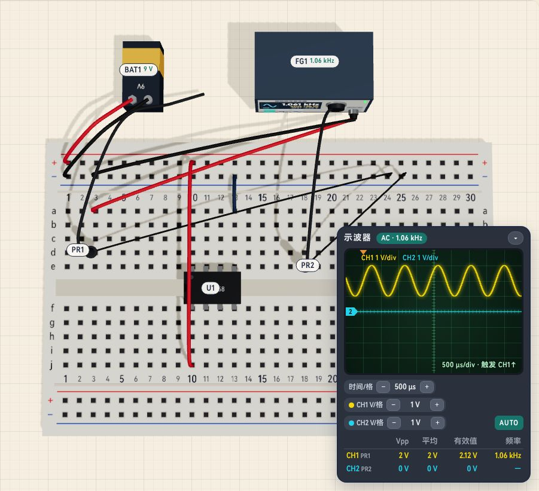
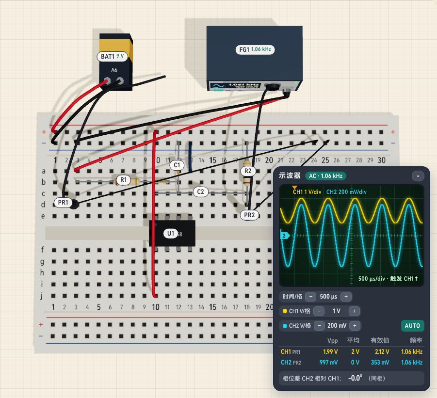
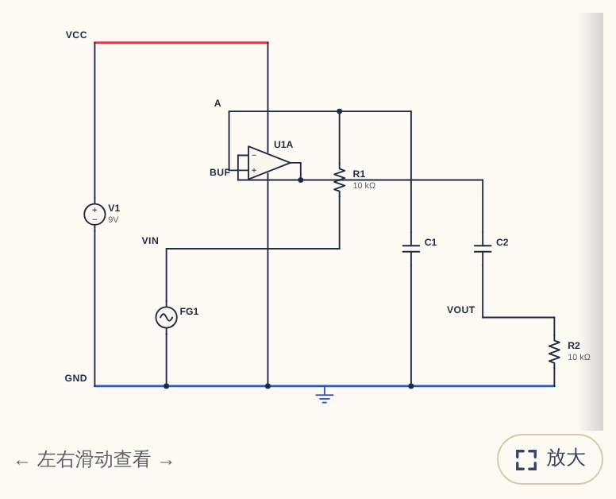
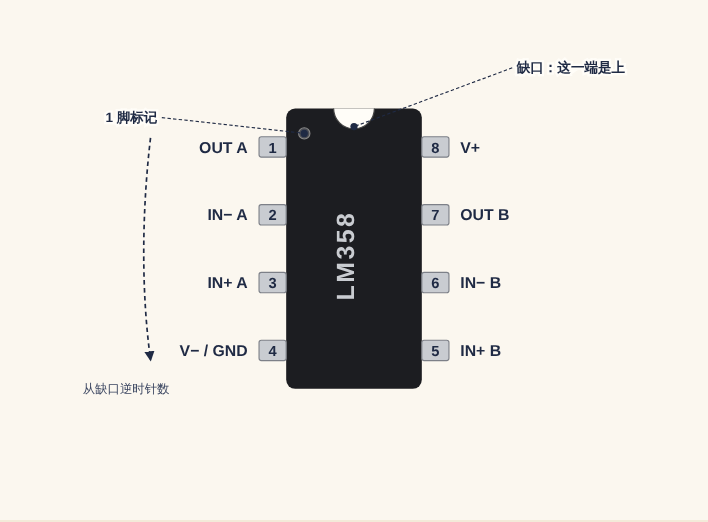
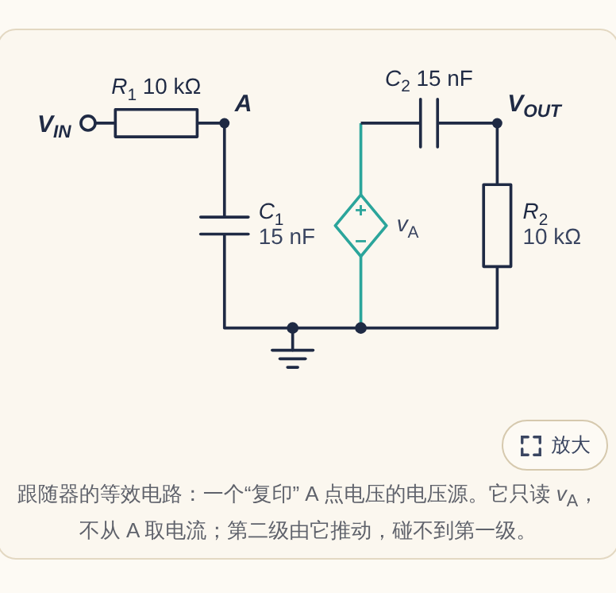

# 7.2 · 加一个电压跟随器：两级不再互相拖累

| 项目 | 内容 |
|---|---|
| id | `exp4-buffered-bandpass` |
| 文件 | `challenges/268-buffered-bandpass.json` |
| 类型 | 实验 / 挑战（没有分步，照目标电路图搭） · 难度 5/5 |
| 位置 | World 7 · 模拟 IC 进阶：非理想 op-amp（运算放大器）、波特图、有源滤波、555 与功放 → 7.2 有源滤波与级间缓冲（本节第 2 项） |
| 右侧面板 | 轨道由旧的四张卡片自动生成（还没手工精排） |
| 前后 | 上一项 [7.2 exp4-active-lowpass](../w7/7.02-1-exp4-active-lowpass.md) · 下一项 [8.1 w8-number-systems](../w8/8.01-1-w8-number-systems.md) |
| 先修 | lesson-lm358、lesson-scope-two-channels |
| 概念 | 电压跟随器 voltage follower / buffer、输入阻抗高、输出阻抗低 high Z_in, low Z_out、级联网络函数相乘 H = H1·H2、单电源偏置 single-supply bias、隔直 DC blocking |

**一句话概要**：RC 低通 → LM358 电压跟随器 → RC 高通。跟随器把两级隔开：测中心频率处的增益，和上一个实验不加跟随器的结果对比。

## 1. 左侧工作台（3D 面包板 → 2D 俯视截图）

截图是程序里真实的 3D 面包板换成俯视角拍的；表格是同一块板的文字版（元件、参数、每只脚插在哪个孔）。

### 1.1 起点：打开这一课时板上已经有的

| 元件 | 类型 | 参数 | 引脚 → 孔 |
|---|---|---|---|
| BAT1 | battery | variant=9V | +→tp1 -→tn1 |
| U1 | opamp |  | 1→e10 2→e11 3→e12 4→e13 5→f13 6→f12 7→f11 8→f10 |
| W3 | wire |  | a→tp10 b→j10 |
| W4 | wire |  | a→a13 b→tn13 |
| FG1 | function_gen | waveform=sine, frequency=1061, amplitude=1, offset=2 | +→a3 -→tn3 |
| PR1 | scope_probe | channel=1 | tip→d3 gnd→tn24 |
| PR2 | scope_probe | channel=2 | tip→e18 gnd→tn25 |

### 1.3 参考答案（「看答案」载入的板子）

| 元件 | 类型 | 参数 | 引脚 → 孔 |
|---|---|---|---|
| BAT1 | battery | variant=9V | +→tp1 -→tn1 |
| U1 | opamp |  | 1→e10 2→e11 3→e12 4→e13 5→f13 6→f12 7→f11 8→f10 |
| W3 | wire |  | a→tp10 b→j10 |
| W4 | wire |  | a→a13 b→tn13 |
| FG1 | function_gen | waveform=sine, frequency=1061, amplitude=1, offset=2 | +→a3 -→tn3 |
| R1 | resistor | resistance=10000 | 1→b3 2→b12 |
| C1 | capacitor | capacitance=1.5000000000000002e-8 | 1→c12 2→tn12 |
| W8 | wire |  | a→b10 b→b11 |
| C2 | capacitor | capacitance=1.5000000000000002e-8 | 1→c10 2→c18 |
| R2 | resistor | resistance=10000 | 1→d18 2→tn18 |
| PR1 | scope_probe | channel=1 | tip→d3 gnd→tn24 |
| PR2 | scope_probe | channel=2 | tip→e18 gnd→tn25 |

### 1.4 目标原理图（右侧「目标原理图」抽屉）

| 元件 | 类型 | 参数 |
|---|---|---|
| V1 | dc_source | voltage=9 |
| U1 | opamp |  |
| FG1 | function_gen |  |
| R1 | resistor | resistance=10000 |
| C1 | capacitor | capacitance=1.5000000000000002e-8 |
| C2 | capacitor | capacitance=1.5000000000000002e-8 |
| R2 | resistor | resistance=10000 |

连接（每个结点上的引脚）：

- **VCC**：V1.+、U1.v+
- **GND**：V1.-、U1.v-、FG1.-、C1.2、R2.2
- **VIN**：FG1.+、R1.1
- **A**：R1.2、C1.1、U1.inA+
- **BUF**：U1.outA、U1.inA-、C2.1
- **VOUT**：C2.2、R2.1

## 2. 右侧面板：学生从上往下看到的内容（单轨流）

### 第 1 步 · 🔍 先看一眼：先认识它：LM358 op-amp

**拆解「LM358：一颗芯片里的两个 op-amp」第 1 / 9 层：① 外形：8 只脚的黑色小芯片（DIP-8）**

LM358 装在 **DIP-8** 封装里（Dual In-line Package，两排直插，8 只脚）。怎么找 1 脚：
- 芯片一端有个 半圆缺口 notch，缺口朝上时，左上角有个 小圆点 的就是 **1 脚**；
- 从 1 脚开始 **逆时针** 数：左边一排从上往下 1、2、3、4，再从右边一排从下往上 5、6、7、8。

8 只脚分成三类：**A 号 op-amp 的 3 只脚**、**B 号 op-amp 的 3 只脚**、**两个 op-amp 共用的 2 只电源脚**。把鼠标放到下表每一行上，看它在芯片上的位置。

| 脚 | 名字 | 属于 | 它是什么 | 单电源时接哪 |
|---|---|---|---|---|
| 1 | OUT A | op-amp A | 输出（output） | 负载 / 反馈网络 |
| 2 | IN− A | op-amp A | 反相输入（inverting input） | 反馈回来的信号 |
| 3 | IN+ A | op-amp A | 同相输入（non-inverting input） | 要放大的信号 / 参考电压 |
| 4 | V− (GND) | A、B 共用 | 负电源 | GND |
| 5 | IN+ B | op-amp B | 同相输入 | 不用时接固定电压 |
| 6 | IN− B | op-amp B | 反相输入 | 不用时接 7 脚（跟随器） |
| 7 | OUT B | op-amp B | 输出 | — |
| 8 | V+ | A、B 共用 | 正电源 3–32 V | +5 V / +9 V |

### 第 2 步 · 🔧 动手搭：两级中间插一个 op-amp

LM358 已经通上电（8 脚 +9 V，4 脚 GND）。第一级低通：**R1**（`10 kΩ`）**`b3`**–**`b12`**，**C1**（`15 nF`）**`c12`**–**`tn12`**。第 12 列就是 op-amp（运算放大器）的 IN+。
跟随器：一根**跳线** **`b10`**–**`b11`**，把 OUT（第 10 列）接到 IN−（第 11 列）。
第二级高通：**C2**（`15 nF`）**`c10`**–**`c18`**，**R2**（`10 kΩ`）**`d18`**–**`tn18`**。
信号发生器：**`1061 Hz`、幅度 `1 V`、偏置 `2 V`**。和上一个实验比：输出离“两级相乘”的估计近了，还是远了？

### 第 3 步 · 💡 想明白：跟随器：只看，不拿

- 跟随器的输入几乎**不取电流**：第一级的结点 A 感觉不到后面接了什么。
- 它的输出阻抗很低（约 10 Ω）：第二级看到的是一个“理想电压源”。

*图 `follower`（schematic）：跟随器的等效电路：一个“复印” A 点电压的电压源。它只读 v_A，不从 A 取电流；第二级由它推动，碰不到第一级。*

- 于是两级可以**各算各的，再相乘**（令 x = f / f0，f0 = 1/(2πRC)）：
$$H = \frac{1}{1 + jx} · \frac{jx}{1 + jx}$$
动手之前代入 x = 1 算出 |H|，再和上一个实验的读数比一比。
- 为什么要 2 V 偏置：单电源 LM358 的输出不能低于 0 V。低通把偏置原样传给跟随器，它就在 1～3 V 之间摆动；C2 再把这 2 V 挡掉。

（这一步下面列着这节课的计算卡片，点开就地展开：`vpp-amplitude`、`opamp-follower`、`rc-cutoff`、`rc-lowpass`、`rc-highpass`、`two-stage-loading`，全文见第 6 节）

### 第 4 步 · 🔧 动手搭：量跟随器两边

- **`1061 Hz`**：先把 **CH2 针尖挪到 `a10`**（跟随器的输出），读 OUT/VIN；再插回 **`e18`**（VOUT），读 VOUT/VIN。
- **万用表**红笔点 OUT（第 `10` 列），黑笔 GND：读平均电压。
- **`106 Hz`**：读 VOUT/VIN。

### 第 5 步 · 📏 测一测：测一测：读你自己的仪表

**测量题 1 · `gf`**（读数题）

> 1061 Hz：CH2 针尖挪到 a10（跟随器输出），幅度比 OUT/VIN

- 先写预测 · 状态：FG1 设为 信号发生器（正弦 1.06kHz 幅度 1V） · 参考答案的读数 **0.707** · 合理范围 [0.672, 0.742]

答对后显示：

> 跟随器几乎不取电流，第一级是不带负载的 RC 低通：在 f0 处 0.707∠−45°。

**测量题 2 · `gv`**（读数题）

> 1061 Hz：CH2 插回 e18（VOUT），幅度比 VOUT/VIN

- 先写预测 · 状态：FG1 设为 信号发生器（正弦 1.06kHz 幅度 1V） · 参考答案的读数 **0.5** · 合理范围 [0.475, 0.525]

答对后显示：

> 0.707 × 0.707 = 0.5（不加跟随器时只有 1/3）。

**测量题 3 · `hp`**（计算题（用自己的读数算））

> 用你的两个读数算第二级（高通）单独的增益 = (VOUT/VIN) / (OUT/VIN)

- 先写预测 · 参考答案的读数 **0.7072** · 合理范围 [0.672, 0.743] · 公式 `gv / gf`

答对后显示：

> ≈ 0.707，正是一个不带负载的 RC 高通在 f0 处的值：跟随器的输出阻抗很低，第二级看到的是理想电压源，两级各算各的、直接相乘。

**测量题 4 · `vf`**（读数题）

> 万用表直流档：跟随器 OUT 对 GND 的平均电压

- 单位 V · 先写预测 · 状态：FG1 设为 信号发生器（正弦 1.06kHz 幅度 1V） · 参考答案的读数 **2 V** · 合理范围 [1.9, 2.1]

答对后显示：

> 低通把 2 V 偏置原样传过去，跟随器输出在 1 ~ 3 V 之间摆动，平均 2 V；C2 再把它挡掉，VOUT 的平均是 0。

**测量题 5 · `g106`**（读数题）

> 106 Hz：幅度比 VOUT/VIN

- 先写预测 · 状态：FG1 设为 信号发生器（正弦 106Hz 幅度 1V） · 参考答案的读数 **0.09893** · 合理范围 [0.094, 0.104]

答对后显示：

> H = jx/(1 + jx)²，x = 0.1：|H| = 0.1/1.01 ≈ 0.099，相位 ≈ +78.6°（不加跟随器时 0.097、+73°）。

### 第 6 步 · 🎒 带走：带走

- 级与级之间加**缓冲器**（电压跟随器），是“各级各算各的”的标准做法。代价：op-amp（运算放大器）要供电，还要安排好直流偏置。
- 分母从 $1 − x^{2} + 3jx$ 变成 $(1 + jx)^{2} = 1 − x^{2} + 2jx$：少掉的那个 $jx$ 就是负载效应。
- 坑：真实 LM358 的输出每微秒最多只能变 0.3～0.5 V（压摆率），带宽约 1 MHz，仿真里没有这两个限制。1 V 幅度的信号到 50 kHz 以上，跟随器就跟不上了。

趁热练理论题：`frequency`、`ac-analysis`

## 3. 测量题一览

| # | id | 题目 | 类型 | 单位 | 状态 | 参考读数 |
|---|---|---|---|---|---|---|
| 1 | gf | 1061 Hz：CH2 针尖挪到 a10（跟随器输出），幅度比 OUT/VIN | scope |  | FG1 设为 信号发生器（正弦 1.06kHz 幅度 1V） | 0.707 |
| 2 | gv | 1061 Hz：CH2 插回 e18（VOUT），幅度比 VOUT/VIN | scope |  | FG1 设为 信号发生器（正弦 1.06kHz 幅度 1V） | 0.5 |
| 3 | hp | 用你的两个读数算第二级（高通）单独的增益 = (VOUT/VIN) / (OUT/VIN) | formula |  |  | 0.7072 |
| 4 | vf | 万用表直流档：跟随器 OUT 对 GND 的平均电压 | voltage | V | FG1 设为 信号发生器（正弦 1.06kHz 幅度 1V） | 2 V |
| 5 | g106 | 106 Hz：幅度比 VOUT/VIN | scope |  | FG1 设为 信号发生器（正弦 106Hz 幅度 1V） | 0.09893 |

### 全部答完后显示的「对比」

**对比**：
  H = H_LP · H_HP = [1/(1 + jx)] · [jx/(1 + jx)] = jx/(1 + jx)²，x = f/f0，f0 = 1/(2π × 10 kΩ × 15 nF) ≈ 1061 Hz
- **1061 Hz**：跟随器输出 0.707∠−45°，VOUT = 0.707 × 0.707 = **0.5**∠0°（上一个实验不加跟随器只有 1/3）。VOUT ≈ 1.0 Vpp。
- **106 Hz**：|H| = 0.1/1.01 ≈ 0.099，相位 ≈ +84.3° − 5.7° ≈ +78.6°。
- **10.6 kHz**：|H| ≈ 0.099，相位 ≈ −78.6°。
注意分母从“1 − x² + 3jx”变成了“(1 + jx)² = 1 − x² + 2jx”：少掉的那个 jx 就是负载效应。跟随器的输入阻抗极高，第一级的 A 点不受第二级影响；输出阻抗很低（约 10 Ω），第二级看到的是一个“理想电压源”。

### 提示按钮（依次显示）

1. 先供电：8 脚 +9 V，4 脚 GND；跟随器就是一根从 OUT 到 IN− 的线。
2. 第一级：R1 再 C1 到 GND，中点接 IN+；第二级：从 OUT 出发，C2 再 R2 到 GND。
3. 信号发生器偏置保持 2 V，跟随器就不用输出低于 0 V 的电压。

### 功能测试（「检查我的电路」时跑）

- 1061 Hz：VOUT 等于两级网络函数的乘积，相位 0°
- 1061 Hz：跟随器输出带着直流偏置，VOUT 没有（C2 隔直）
- 106 Hz：增益、相位合理
- 10.6 kHz：增益、相位合理

## 4. 用到的拆解（全部层的文字，供改写参考）

### 拆解 `lm358`：LM358：一颗芯片里的两个 op-amp

*op-amp = operational amplifier（运算放大器）。我们从芯片外形一路拆到教授在黑板上画的那个三角形，再拆到三角形里面的等效电路，最后用它推出每一个放大器公式。*

**拆解「LM358：一颗芯片里的两个 op-amp」第 1 / 9 层：① 外形：8 只脚的黑色小芯片（DIP-8）**

LM358 装在 **DIP-8** 封装里（Dual In-line Package，两排直插，8 只脚）。怎么找 1 脚：
- 芯片一端有个 半圆缺口 notch，缺口朝上时，左上角有个 小圆点 的就是 **1 脚**；
- 从 1 脚开始 **逆时针** 数：左边一排从上往下 1、2、3、4，再从右边一排从下往上 5、6、7、8。

8 只脚分成三类：**A 号 op-amp 的 3 只脚**、**B 号 op-amp 的 3 只脚**、**两个 op-amp 共用的 2 只电源脚**。把鼠标放到下表每一行上，看它在芯片上的位置。

| 脚 | 名字 | 属于 | 它是什么 | 单电源时接哪 |
|---|---|---|---|---|
| 1 | OUT A | op-amp A | 输出（output） | 负载 / 反馈网络 |
| 2 | IN− A | op-amp A | 反相输入（inverting input） | 反馈回来的信号 |
| 3 | IN+ A | op-amp A | 同相输入（non-inverting input） | 要放大的信号 / 参考电压 |
| 4 | V− (GND) | A、B 共用 | 负电源 | GND |
| 5 | IN+ B | op-amp B | 同相输入 | 不用时接固定电压 |
| 6 | IN− B | op-amp B | 反相输入 | 不用时接 7 脚（跟随器） |
| 7 | OUT B | op-amp B | 输出 | — |
| 8 | V+ | A、B 共用 | 正电源 3–32 V | +5 V / +9 V |

**拆解「LM358：一颗芯片里的两个 op-amp」第 2 / 9 层：② X 光：硅片上有两个 op-amp，电源脚共用**

把黑色塑料变透明：中间是一小块 硅片 die，细细的 金线 bond wire 把硅片连到 8 只脚上。硅片上做了两个完全一样、互相独立的放大器：op-amp A 和 op-amp B。

“**Dual**（双）”就是这个意思。它们只共用两样东西：V+（8 脚） 和 V−（4 脚）。所以：
- 只要芯片插上电，A 和 B **都** 通电了，哪怕你只用 A；
- 不用的那一半不能让它的输入悬空——悬空的输入会让它乱跳甚至振荡，干扰另一半。通常把它接成跟随器（7 脚接 6 脚），5 脚接一个固定电压。

**拆解「LM358：一颗芯片里的两个 op-amp」第 3 / 9 层：③ 符号：教授画的那个三角形**

原理图里，一个 op-amp 画成一个 三角形，信号从左往右走：
- IN−（反相输入 inverting input）：标“−”的那只脚，它上面的电压记作 $v₋$；
- IN+（同相输入 non-inverting input）：标“+”的那只脚，电压记作 $v₊$；
- OUT（输出）：三角形的尖，电压 $v_o$；
- V+ 和 V−：电源脚。理论题里常常 **省略不画**，但真实电路里必须接，否则它不工作。

注意：“+”“−”不是电源正负极，而是“这只输入对输出的作用是同向还是反向”。op-amp 只关心两个输入之间的 **差**：
$$v_d = v₊ - v₋$$
v_d 叫 **差模输入电压**（differential input voltage）。

| 端子 | 符号 | LM358 A 的脚 | 作用 |
|---|---|---|---|
| IN+ | $v₊$ | 3 | $v₊$ 升高 → $v_o$ 升高 |
| IN− | $v₋$ | 2 | $v₋$ 升高 → $v_o$ 降低 |
| OUT | $v_o$ | 1 | 输出 $A·v_d$ |
| V+ / V− | — | 8 / 4 | 能量从这里来，也限制 $v_o$ 的范围 |

- 公式 `v_d = v₊ - v₋`：op-amp 唯一“看”的量

**拆解「LM358：一颗芯片里的两个 op-amp」第 4 / 9 层：④ 拆开三角形：三个元件的等效电路**

教授说“把 op-amp 拆成电路”，拆出来就是这三样（这是电路课里 op-amp 的 **线性模型**）：

1. 输入电阻 R_in：接在两个输入之间。LM358 的输入只取约 20 nA 的偏置电流，等效 $R_{in}$ 在 MΩ 以上，计算时可以当成 **开路**——输入端几乎不取电流。
2. 受控电压源 A·v_d：一个电压 **控制** 的电压源（VCVS），它的电压是输入差的 A 倍。A 叫 **开环增益**（open-loop gain），LM358 约 $10^5$（100 dB）。
3. 输出电阻 R_out：受控源到输出脚之间，几十 Ω 量级。

于是不接任何反馈时：
$$v_o = A·v_d = A(v₊ - v₋)$$
这个电路你在第 5 章“含运算放大器的电阻电路”和受控源那一节都能直接用结点法分析。

| 参数 | LM358（典型） | 理想 op-amp | 计算时 |
|---|---|---|---|
| 开环增益 A | ≈ 10⁵ (100 dB) | ∞ | 很大 → 得出“虚短” |
| 输入电阻 R_in | MΩ 以上（偏置 20 nA） | ∞ | 开路 → 得出“虚断” |
| 输出电阻 R_out | 几十 Ω（仿真 10 Ω） | 0 | 反馈后更小，可忽略 |

- 公式 `v_o = A(v₊ - v₋)`：开环（不接反馈），且输出没到电源边界时

**拆解「LM358：一颗芯片里的两个 op-amp」第 5 / 9 层：⑤ 不接反馈会怎样？——输出一下子撞到电源**

用上一层的公式算一下。LM358 接 9 V 单电源，输出最多到约 7.5 V。要让输出在 0–7.5 V 之间（线性区），输入差只能是：
$$0 < v_d < \frac{7.5 V}{10^5} = 75 µV$$
75 微伏！你手一碰导线、电位器动一点点、甚至输入失调电压（LM358 典型 2 mV）都比它大几十倍。所以 **开环** 的 op-amp 几乎永远停在两头：
- $v₊ > v₋$（哪怕多 1 mV）→ 输出 顶到 ≈ V+ − 1.5 V
- $v₊ < v₋$ → 输出 掉到 ≈ 0 V

这叫 **饱和**（saturation）。这样用 op-amp 就成了 **比较器**（comparator）：只回答“哪个输入大”。想让它当放大器，必须加 **负反馈**——下面两层就讲为什么反馈能把 $v_d$ 稳稳地压在 75 µV 以内。

- 公式 `|v_d| < \frac{V_{sat}}{A} = \frac{7.5}{10^{5}} = 75 µV`：线性区有多窄

**拆解「LM358：一颗芯片里的两个 op-amp」第 6 / 9 层：⑥ 理想 op-amp 的两条黄金法则：虚短、虚断**

把等效电路里的三个参数推到极限：$A → ∞$、$R_{in} → ∞$、$R_{out} → 0$。电路课的所有 op-amp 题都用这两条法则：

**法则 1 · 虚断（virtual open）**：$R_{in} → ∞$，所以 两个输入端都不取电流：
$$i_+ = i_- = 0$$
**法则 2 · 虚短（virtual short）**：有负反馈、输出没饱和时，$v_o$ 是有限值（几伏），而 $v_d = \frac{v_o}{A}$，A → ∞，所以 两个输入电压相等：
$$v₊ = v₋$$
“虚”的意思：两个输入 **电压相等，但并没有真的连在一起**（没有电流流过）。

⚠ 虚短 **只在有负反馈时成立**。上一层的开环电路里 $v₊ ≠ v₋$，输出是饱和的。

| 法则 | 式子 | 来自 | 什么时候成立 |
|---|---|---|---|
| 虚断 | $i_+ = i_- = 0$ | $R_{in} → ∞$ | 总是（输入电流 nA 级） |
| 虚短 | $v₊ = v₋$ | $A → ∞$ | 有负反馈且输出未饱和 |

**拆解「LM358：一颗芯片里的两个 op-amp」第 7 / 9 层：⑦ 负反馈第一例：电压跟随器，一步步推**

把 输出直接接回 IN−，信号接 IN+。先 **不用** 黄金法则，用 ④ 的模型硬算（忽略 $R_{out}$）：
1. 接线告诉我们：$v₊ = v_{in}$，$v₋ = v_o$
2. op-amp 的方程：$v_o = A(v₊ - v₋) = A(v_{in} - v_o)$
3. 移项：$v_o(1 + A) = A·v_{in}$
4. 所以 $v_o = \frac{A}{1+A}v_{in}$。代入 $A = 10^5$：$v_o = 0.99999 v_{in}$

再看反馈 **为什么能稳住**：如果 $v_o$ 偏低，$v_d = v_{in} - v_o$ 变大，A 倍放大后把 $v_o$ 往上推；偏高则往下拉。输出一直“追”着输入，$v_d$ 只剩 $\frac{v_o}{A}$——几十 µV。

用黄金法则一行就出来：虚短 $v₋ = v₊$，而 $v₋ = v_o$，所以 $v_o = v_{in}$。两种方法结果一致，这就是黄金法则的来历。

**用处**：输入几乎不取电流（虚断），输出能提供几十 mA——它把“带不动负载的信号”变成“能带负载的信号”，叫 **缓冲器**（buffer）。

- 公式 `v_o = \frac{A}{1+A} v_{in} ≈ v_{in}`：有限 A 的精确结果

**拆解「LM358：一颗芯片里的两个 op-amp」第 8 / 9 层：⑧ 负反馈第二例：同相放大器和反相放大器**

跟随器把 **全部** 输出送回 IN−。如果只送回 **一部分**，就能放大。用 R_f 和 R_1 分压，送回 IN− 的是 βvₒ：
$$β = \frac{R_1}{R_1 + R_f}$$
**同相放大器**（non-inverting），信号接 IN+：
1. 虚断：IN− 不取电流，所以 R_f、R_1 是简单的串联分压：$v₋ = β v_o$
2. 虚短：$v₋ = v₊ = v_{in}$
3. 所以 $β v_o = v_{in}$，$v_o = \frac{1}{β}v_{in} = (1 + \frac{R_f}{R_1})v_{in}$

用有限 A 推（同 ⑦ 的方法）得到 $v_o = \frac{A}{1+Aβ}v_{in}$：只要 $Aβ ≫ 1$，增益就只由 **两个电阻** 决定，和 op-amp 本身的 A 无关——这就是负反馈的价值。

**反相放大器**（inverting）：IN+ 接 GND，信号经 $R_1$ 接 IN−，$R_f$ 从 OUT 接回 IN−。
1. 虚短：$v₋ = v₊ = 0$，IN− 是 **虚地**（virtual ground）
2. 虚断：流进 $R_1$ 的电流全部流过 $R_f$：$\frac{v_{in} - 0}{R_1} = \frac{0 - v_o}{R_f}$
3. 所以 $v_o = -\frac{R_f}{R_1}v_{in}$（负号 = 反相）

| 电路 | 增益 vₒ / v_in | 输入电阻 | 实验 |
|---|---|---|---|
| 跟随器 | 1 | ∞ | 2-5 |
| 同相放大 | $1 + \frac{R_f}{R_1}$ | ∞ | 2-6 |
| 反相放大 | $-\frac{R_f}{R_1}$ | $R_1$ | 2-7 |
| 反相求和 | $-R_f(\frac{v_1}{R_1} + \frac{v_2}{R_2})$ | $R_1$, $R_2$ | 2-8 |

- 公式 `β = \frac{R_1}{R_1 + R_f}`：反馈系数：输出送回 IN− 的比例
- 公式 `v_o = \frac{A}{1 + Aβ} v_{in} ≈ \frac{1}{β} v_{in}`：Aβ ≫ 1 时增益只取决于电阻

**拆解「LM358：一颗芯片里的两个 op-amp」第 9 / 9 层：⑨ 再往里：三级晶体管电路，和它的“缺点”**

三角形里真正的东西是约 20 个晶体管，分三级：
1. 输入级：PNP 差分对——只放大两个输入的 **差**。LM358 用 PNP 管，所以 输入电压可以低到 0 V（GND），这就是它能单电源工作的原因；输入上限约 V+ − 1.5 V。
2. 增益级——提供 $10^5$ 倍的电压增益。里面的 补偿电容 C_c 让高频增益逐渐下降，防止接反馈后振荡，代价是 **带宽**：增益 × 带宽 ≈ 1 MHz（GBW）。
3. 输出级：推挽——一个管子往上推电流、一个往下拉，提供几十 mA。往上推的那一路有两个 $V_{BE}$ 压降，所以 输出到不了 V+，差约 1.5 V；往下拉的那一路能接近 0 V。

这一层解释了你在课里看到的三个“现象”：
- 第 14 课：输入 9 V，输出只有 7.5 V → 输出级的余量；
- 放大倍数做 100 倍时带宽只剩约 10 kHz → $GBW ≈ 1 MHz$；
- 方波边沿变成斜坡，约 0.3 V/µs → **压摆率**（slew rate），由 C_c 的充电电流决定。

| 参数 | LM358 典型值 | 影响什么 |
|---|---|---|
| 电源电压 | 3–32 V（±1.5–±16 V） | 能用的电源 |
| 输出摆幅 | 0 … V+ − 1.5 V | 输出最大值 |
| 共模输入范围 | 0 … V+ − 1.5 V | 输入能接多高 |
| 增益带宽积 GBW | ≈ 1 MHz | $f_{max} ≈ \frac{GBW}{增益}$ |
| 压摆率 SR | ≈ 0.3 V/µs | 大信号的最高频率 |
| 输入失调电压 | ≈ 2 mV | 直流误差 × 增益 |

- 公式 `f_{-3dB} ≈ \frac{GBW}{G}`：G = 闭环增益（同相放大器的 1 + R_f/R_1）
- 公式 `f_{max} = \frac{SR}{2π V_p}`：不失真的最大正弦频率

**一句话记住**：op-amp = 一个只看 $v₊ - v₋$ 的超高增益放大器。开环时它是比较器；加了负反馈，输出会调到让 $v₊ = v₋$（虚短），输入不取电流（虚断）——从这两条就能推出所有放大器公式。

## 5. 这一课的计算卡片

**计算卡片 `vpp-amplitude`：幅度、峰峰值与偏置 Amplitude and Vpp**

- 公式 `V_{pp} = 2A, V_{max} = V_{off} + A, V_{min} = V_{off} - A`
- 用途：信号发生器设的是幅度（峰值）和偏置，示波器读的是 Vpp、最大值、最小值：互相换算。
- 输入：A（幅度（中心线到波峰），V） → V_pp（峰峰值，V）

1. **幅度**（峰值）A：从中心线量到波峰。**峰峰值** Vpp：从波谷量到波峰，所以 $V_{pp} = 2A$。
2. **偏置** $V_{off}$：把整个波形上下平移，就是它的平均值（直流分量）。
3. 最大值 $V_{off} + A$，最小值 $V_{off} - A$。
4. 要一个 0 ↔ 5 V 的方波：$A = \frac{5 - 0}{2} = 2.5 V$，$V_{off} = \frac{5 + 0}{2} = 2.5 V$。
5. 在屏幕上数格：峰到谷的格数 × V/div = Vpp。

例子：实验 3-1：0–5 V 方波 = 幅度 2.5 V + 偏置 2.5 V，Vpp = 5 V。实验 3-5：0 ↔ 9 V = 幅度 4.5 V + 偏置 4.5 V。实验 2-7：幅度 0.5 V → 1 Vpp 输入，×2.2 → 2.2 Vpp 输出。

- ⚠ 把发生器的“幅度”当成 Vpp 设：信号大了一倍。

**计算卡片 `opamp-follower`：电压跟随器 Voltage follower**

- 公式 `v_o = \frac{A}{1 + A} v_{in} ≈ v_{in}`
- 用途：增益 1 的缓冲器：输入不取电流，输出能带负载。
- 输入：vin（v_in，V）；A（开环增益 A，） → vₒ（输出，V）

接线：$v₊ = v_{in}$，$v₋ = v_o$。代入 $v_o = A(v₊ - v₋)$：
$$v_o = A(v_{in} - v_o) ⇒ v_o = \frac{A}{1+A}v_{in}$$
A = 10⁵ 时误差只有 $\frac{1}{1+A} ≈ 0.001 %$。黄金法则（虚短）直接给出 $v_o = v_{in}$。

- ⚠ LM358 单电源：$v_{in}$ 超过 V+ − 1.5 V 时输出跟不上（第 14 课）。

**计算卡片 `rc-cutoff`：RC 截止频率 Cut-off frequency**

- 公式 `f_c = \frac{1}{2π R C}`
- 用途：一阶 RC 滤波器的“拐点”：低通从这里开始往下掉，高通从这里开始通过。
- 输入：R（电阻，Ω）；C（电容，F） → f_c（截止频率（−3 dB），Hz）

1. 低通（输出取电容电压）用分压公式：$H = \frac{1/(jωC)}{R + 1/(jωC)} = \frac{1}{1 + jωRC}$。
2. 当 $ωRC = 1$，即 $X_C = R$ 时，$H = \frac{1}{1 + j}$：$|H| = \frac{1}{\sqrt{2}} ≈ 0.707$（−3 dB），相位 −45°。
3. 这一点就是截止频率：$f_c = \frac{1}{2πRC} = \frac{1}{2πτ}$。
4. 伯德图两条渐近线：$f ≪ f_c$ 时 0 dB 的平线；$f ≫ f_c$ 时每十倍频下降 20 dB，两条线交在 $f_c$。
5. 高通（输出取电阻电压）的 $f_c$ 一样，只是方向反过来。

例子：实验 4-1：$\frac{1}{2π × 1.5k × 100n} ≈ 1061 Hz$。实验 4-2：$15k × 10n$ 一样是 1061 Hz。实验 4-6：$R_F C_F = 10k × 15n$ → 1061 Hz。实验 5-14：$10k × 1µ$ → 16 Hz，远低于 1 kHz 的 PWM。

- ⚠ 信号源内阻（50 Ω）和后级负载都会挪动 $f_c$：前者加到 R 上，后者并在输出上。
- ⚠ 电容常有 ±10 %–20 % 误差，$f_c$ 跟着偏同样的比例：实测找 0.707、−45° 的点。

**计算卡片 `rc-lowpass`：RC 低通的增益 |H|**

- 公式 `|H| = \frac{1}{\sqrt{1 + (f/f_c)^{2}}}, f_c = \frac{1}{2πRC}`
- 用途：RC 低通在某个频率下输出是输入的几倍。
- 输入：R（串联电阻，Ω）；C（对地电容，F）；f（信号频率，Hz） → |H|（幅度比 Vₒᵤₜ / V_in，）

1. $H = \frac{1}{1 + jωRC} = \frac{1}{1 + j f/f_c}$。
2. 模：$|H| = \frac{1}{\sqrt{1 + (f/f_c)^{2}}}$；相位 $∠H = -arctan\frac{f}{f_c}$（输出落后）。
3. 三个好记的点：$f_c/10$ → 0.995（−0.04 dB，−5.7°）；$f_c$ → 0.707（−3 dB，−45°）；$10f_c$ → 0.0995（−20 dB，−84.3°）。
4. 高频时 $|H| ≈ \frac{f_c}{f}$：频率每乘 10，幅度除以 10。

例子：实验 4-1：10.6 kHz：$\frac{1}{\sqrt{1 + 10^{2}}} ≈ 0.0995$；1061 Hz：0.707，VOUT ≈ 1.4 Vpp。第 13 课（1 kΩ、100 nF、1 kHz）：$f_c ≈ 1592 Hz$，$|H| ≈ 0.847$。实验 4-8：跟随器后的第一级在 f₀ 处 0.707∠−45°。

- ⚠ 拿输出和发生器的“设定值”比，而不是和端口电压（CH1）比：50 Ω 的压降随频率变。

**计算卡片 `rc-highpass`：RC 高通的增益 |H|（隔直通交）**

- 公式 `|H| = \frac{f/f_c}{\sqrt{1 + (f/f_c)^{2}}}, f_c = \frac{1}{2πRC}`
- 用途：电容串在前、电阻对地：低频（包括直流）被挡住，高频通过。
- 输入：R（对地电阻，Ω）；C（串联电容，F）；f（信号频率，Hz） → |H|（幅度比 Vₒᵤₜ / V_in，）

1. 输出取电阻电压：$H = \frac{R}{R + 1/(jωC)} = \frac{jωRC}{1 + jωRC}$。
2. 模 $|H| = \frac{f/f_c}{\sqrt{1 + (f/f_c)^{2}}}$，相位 $∠H = 90° - arctan\frac{f}{f_c}$（输出 **超前**）。
3. 直流：f = 0，|H| = 0。稳态时电容“存住”了直流偏置，电阻上没有直流电流——这就是级间的 **耦合（隔直）电容**。
4. 同一个 RC 的低通和高通：$H_{LP} + H_{HP} = 1$，在 $f_c$ 两个都是 0.707，相量和正好是输入。

例子：实验 4-2（15 kΩ、10 nF，$f_c$ ≈ 1061 Hz）：106 Hz → 0.0995、+84.3°；1061 Hz → 0.707、+45°；10.6 kHz → 0.995、+5.7°。2 V 偏置全落在电容上，VOUT 平均为 0。

- ⚠ µF 级的耦合电容多是电解电容，有极性：+ 接直流电位高的一边。

**计算卡片 `two-stage-loading`：两级 RC 带通：级间负载**

- 公式 `|H| = \frac{x}{\sqrt{(1 - x^{2})^{2} + k^{2}x^{2}}}, x = ωRC`
- 用途：高通 + 低通串起来：直接相连（k = 3）和中间加跟随器（k = 2）的增益差多少。
- 输入：R（两级相同的 R，Ω）；C（两级相同的 C，F）；f（信号频率，Hz）；k（3 = 直接相连，2 = 中间有跟随器，） → |H|（总增益，）

1. **天真估算**：两级各自的 H 相乘，在 $f_0$ 处 $0.707 × 0.707 = 0.5$。
2. 实际直接相连时，第二级（R₂ + C₂）并在第一级的 R₁ 上，第一级不再是原来的高通：这就是 **负载效应**。
3. 对 A、B 两个结点列 KCL（令 $x = ωRC$），解出 $H = \frac{jx}{1 - x^{2} + 3jx}$。
4. 中间加电压跟随器：第一级不受影响，第二级看到理想电压源，正好相乘：$H = \frac{jx}{(1 + jx)^{2}} = \frac{jx}{1 - x^{2} + 2jx}$。
5. 分母里多出来的 jx 就是负载。规则：后级输入阻抗要比前级输出阻抗 **大得多**（10 倍以上），才能直接相乘。

例子：实验 4-7（k = 3）：1061 Hz → 1/3（不是 0.5），A 点只有 0.471；106 Hz 和 10.6 kHz → 0.097（±73°）。实验 4-8（k = 2）：1061 Hz → 0.5，106 Hz → 0.099（+78.6°）。

- ⚠ 示波器探头也是负载：几百 kΩ 的电路上，1 MΩ 的 ×1 探头会像第二级一样拖低读数。

## 6. English（界面英文版的同一份内容）

展开英文

### Node 1 · 🔍 Look first：Meet it first: LM358 op-amp

**Teardown「LM358: two op-amps in one chip」layer 1 of 9：① Package: a small black 8-pin chip (DIP-8)**

The LM358 comes in a **DIP-8** package (Dual In-line Package: two rows, 8 pins). Finding pin 1:
- one end has a half-moon notch; with the notch at the top, the corner with the little dot (top left) is **pin 1**;
- count **anticlockwise** from pin 1: down the left side 1, 2, 3, 4, then up the right side 5, 6, 7, 8.

The 8 pins fall into three groups: **3 pins of op-amp A**, **3 pins of op-amp B**, and **2 power pins shared by both**. Hover each row of the table to see where it is on the chip.

| Pin | Name | Belongs to | What it is | Single supply: connect to |
|---|---|---|---|---|
| 1 | OUT A | op-amp A | output | the load / feedback network |
| 2 | IN− A | op-amp A | inverting input | the feedback signal |
| 3 | IN+ A | op-amp A | non-inverting input | the signal / a reference |
| 4 | V− (GND) | shared | negative supply | GND |
| 5 | IN+ B | op-amp B | non-inverting input | unused: tie to a fixed voltage |
| 6 | IN− B | op-amp B | inverting input | unused: tie to pin 7 (follower) |
| 7 | OUT B | op-amp B | output | — |
| 8 | V+ | shared | positive supply 3–32 V | +5 V / +9 V |

### Node 2 · 🔧 Build：An op-amp between the stages

The LM358 is already powered (pin 8 at +9 V, pin 4 at GND). Stage 1, a low-pass: **R1** (`10 kΩ`) **`b3`**–**`b12`**, **C1** (`15 nF`) **`c12`**–**`tn12`**. Column 12 is the op-amp's IN+.
The follower: one **jumper** **`b10`**–**`b11`**, joining OUT (column 10) to IN− (column 11).
Stage 2, a high-pass: **C2** (`15 nF`) **`c10`**–**`c18`**, **R2** (`10 kΩ`) **`d18`**–**`tn18`**.
Generator: **`1061 Hz`, amplitude `1 V`, offset `2 V`**. Compared with the previous experiment: is the output closer to the "multiply the two stages" guess, or further away?

### Node 3 · 💡 Why：A follower looks but does not take

- A follower's input draws almost **no current**: node A of the first stage cannot tell what hangs behind it.
- Its output impedance is tiny (about 10 Ω): the second stage sees an "ideal voltage source".

[figure `follower`]

*Figure `follower`（schematic）：跟随器的等效电路：一个“复印” A 点电压的电压源。它只读 v_A，不从 A 取电流；第二级由它推动，碰不到第一级。*

- So the two stages can be **worked out separately and multiplied** (let x = f / f0, f0 = 1/(2πRC)):
$$H = \frac{1}{1 + jx} · \frac{jx}{1 + jx}$$
Before you measure, put in x = 1 and work out |H|, then compare it with the previous experiment's reading.
- Why the 2 V offset: a single-supply LM358's output cannot go below 0 V. The low-pass passes the offset straight to the follower, which then swings between 1 and 3 V; C2 blocks those 2 V again.

(This node lists the lesson’s calculation cards: `vpp-amplitude`、`opamp-follower`、`rc-cutoff`、`rc-lowpass`、`rc-highpass`、`two-stage-loading`; full text in section 6)

### Node 4 · 🔧 Build：Measure both sides of the follower

- **`1061 Hz`**: first move the **CH2 tip to `a10`** (the follower's output) and read OUT/VIN; then put it back into **`e18`** (VOUT) and read VOUT/VIN.
- **Multimeter** red probe on OUT (column `10`), black on GND: read the average voltage.
- **`106 Hz`**: read VOUT/VIN.

### Node 5 · 📏 Measure：Measure: read your own instruments

**Question 1 · `gf`**（reading）

> 1061 Hz: CH2 tip on a10 (the follower output), amplitude ratio OUT/VIN

- predict first · state：FG1 is set to Function generator (sine 1.06kHz 1V peak) · range [0.672, 0.742]

Shown once right:

> The follower draws almost no current, so stage 1 is an unloaded RC low-pass: 0.707∠−45° at f0.

**Question 2 · `gv`**（reading）

> 1061 Hz: CH2 back on e18 (VOUT), amplitude ratio VOUT/VIN

- predict first · state：FG1 is set to Function generator (sine 1.06kHz 1V peak) · range [0.475, 0.525]

Shown once right:

> 0.707 × 0.707 = 0.5 (only 1/3 without the follower).

**Question 3 · `hp`**（calculation from own readings）

> From your two readings, the gain of stage 2 (the high-pass) on its own = (VOUT/VIN) / (OUT/VIN)

- predict first · range [0.672, 0.743] · formula `gv / gf`

Shown once right:

> ≈ 0.707, exactly an unloaded RC high-pass at f0: the follower's output impedance is tiny, so stage 2 sees an ideal voltage source and the stages simply multiply.

**Question 4 · `vf`**（reading）

> Multimeter DC range: the follower OUT to GND, the average

- unit V · predict first · state：FG1 is set to Function generator (sine 1.06kHz 1V peak) · range [1.9, 2.1]

Shown once right:

> The low-pass passes the 2 V offset unchanged, so the follower swings between 1 and 3 V, averaging 2 V; C2 then blocks it and VOUT averages 0.

**Question 5 · `g106`**（reading）

> 106 Hz: amplitude ratio VOUT/VIN

- predict first · state：FG1 is set to Function generator (sine 106Hz 1V peak) · range [0.094, 0.104]

Shown once right:

> H = jx/(1 + jx)², x = 0.1: |H| = 0.1/1.01 ≈ 0.099, phase ≈ +78.6° (0.097 and +73° without the follower).

### Node 6 · 🎒 Take away：Take away

- A **buffer** (voltage follower) between stages is the standard way to let each stage be worked out on its own. The price: the op-amp needs power, and the DC bias needs planning.
- The denominator changed from $1 − x^{2} + 3jx$ to $(1 + jx)^{2} = 1 − x^{2} + 2jx$: the missing $jx$ is the loading effect.
- Pitfall: a real LM358's output can change by at most 0.3–0.5 V per microsecond (its slew rate), and its bandwidth is about 1 MHz; neither limit is simulated. A 1 V-amplitude signal above roughly 50 kHz is too fast for the follower to keep up.

Practise：`frequency`、`ac-analysis`

**Compare**

**Compare**:
  H = H_LP · H_HP = [1/(1 + jx)] · [jx/(1 + jx)] = jx/(1 + jx)², x = f/f0, f0 = 1/(2π × 10 kΩ × 15 nF) ≈ 1061 Hz
- **1061 Hz**: the follower's output is 0.707∠−45°, VOUT = 0.707 × 0.707 = **0.5**∠0° (only 1/3 without the follower in the previous experiment). VOUT ≈ 1.0 Vpp.
- **106 Hz**: |H| = 0.1/1.01 ≈ 0.099, phase ≈ +84.3° − 5.7° ≈ +78.6°.
- **10.6 kHz**: |H| ≈ 0.099, phase ≈ −78.6°.
Notice the denominator changed from "1 − x² + 3jx" to "(1 + jx)² = 1 − x² + 2jx": the missing jx is the loading effect. The follower's very high input impedance means node A doesn't feel stage 2 at all; its tiny output impedance (about 10 Ω) means stage 2 sees an ideal voltage source.

**Hints**

1. Power first: pin 8 to +9 V, pin 4 to GND; the follower is just a wire from OUT to IN−.
2. Stage 1 is R1 then C1 to GND, with its middle on IN+; stage 2 is C2 then R2 to GND, driven from OUT.
3. Keep the generator offset at 2 V so the follower never has to go below 0 V.

