# 8.2 · 开发板：供电和 GPIO

| 项目 | 内容 |
|---|---|
| id | `lesson-mcu-gpio` |
| 文件 | `challenges/107-lesson-mcu-gpio.json` |
| 类型 | 课程（有分步，每步自动检查） · 难度 3/5 |
| 位置 | World 8 · 数字逻辑、MCU 与传感器实战 → 8.2 开发板与 GPIO（本节第 1 项） |
| 右侧面板 | 轨道由旧的四张卡片自动生成（还没手工精排） |
| 前后 | 上一项 [8.1 w8-logic-gates](../w8/8.01-2-w8-logic-gates.md) · 下一项 [8.2 exp5-gpio-led-resistor](../w8/8.02-2-exp5-gpio-led-resistor.md) |
| 先修 | — |
| 概念 | dev board 开发板、GPIO、3V3 / 5V / GND、output 输出、pull-up 上拉、pin current limit 引脚电流 |

**一句话概要**：把 ESP32 开发板插上面包板，用它给电源轨供电，再把一个引脚设成输出点亮 LED、另一个设成输入读按键。

## 1. 左侧工作台（3D 面包板 → 2D 俯视截图）

截图是程序里真实的 3D 面包板换成俯视角拍的；表格是同一块板的文字版（元件、参数、每只脚插在哪个孔）。

### 1.1 起点：空面包板（学生从零开始搭）

### 1.2 每一步之后的面包板

见第 2 节每个步骤下面的截图（按步骤的自动检查重建：放 / 改 / 拔元件、移动万用表表笔）。

### 1.3 参考答案（「看答案」载入的板子）

| 元件 | 类型 | 参数 | 引脚 → 孔 |
|---|---|---|---|
| U1 | esp32_devkit | usb=true, pins={"GPIO2":{"mode":"out_high"},"GPIO4":{"mode":"input_pullup"}} | GND→b1 GPIO23→b2 GPIO22→b3 GPIO1→b4 GPIO3→b5 GPIO21→b6 GND_2→b7 GPIO19→b8 GPIO18→b9 GPIO5→b10 GPIO17→b11 GPIO16→b12 GPIO4→b13 GPIO0→b14 GPIO2→b15 GPIO15→b16 GPIO8→b17 GPIO7→b18 GPIO6→b19 3V3→i1 EN→i2 GPIO36→i3 GPIO39→i4 GPIO34→i5 GPIO35→i6 GPIO32→i7 GPIO33→i8 GPIO25→i9 GPIO26→i10 GPIO27→i11 GPIO14→i12 GPIO12→i13 GND_3→i14 GPIO13→i15 GPIO9→i16 GPIO10→i17 GPIO11→i18 5V→i19 |
| W2 | wire |  | a→j1 b→bp1 |
| W3 | wire |  | a→j14 b→bn14 |
| W4 | wire |  | a→a7 b→tn7 |
| R1 | resistor | resistance=330 | 1→a15 2→a22 |
| LED1 | led | color=red | anode→c22 cathode→c25 |
| W7 | wire |  | a→a25 b→tn25 |
| SW1 | pushbutton | pressed=false | 1a→e27 2a→e29 1b→f27 2b→f29 |
| W9 | wire |  | a→a13 b→a27 |
| W10 | wire |  | a→j29 b→bn29 |

### 1.4 目标原理图（右侧「目标原理图」抽屉）

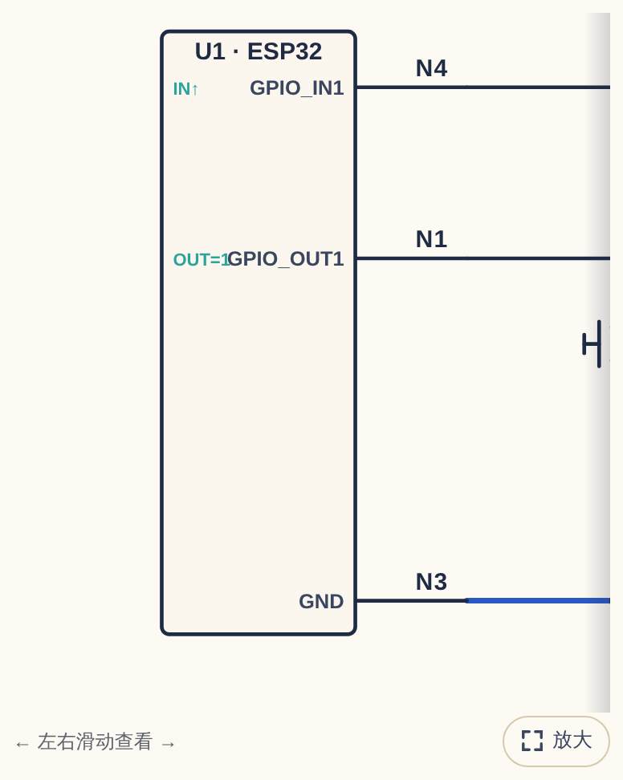

| 元件 | 类型 | 参数 |
|---|---|---|
| U1 | esp32_devkit | pins={"GPIO_OUT1":{"mode":"out_high"},"GPIO_IN1":{"mode":"input_pullup"}} |
| R1 | resistor | resistance=330 |
| LED1 | led | color=red |
| SW1 | pushbutton |  |

连接（每个结点上的引脚）：

- **N1**：U1.GPIO_OUT1、R1.1
- **N2**：R1.2、LED1.anode
- **N3**：LED1.cathode、U1.GND、SW1.2
- **N4**：U1.GPIO_IN1、SW1.1

## 2. 右侧面板：学生从上往下看到的内容（单轨流）

### 第 1 步 · 🔍 先看一眼：先认识它：开发板 GPIO

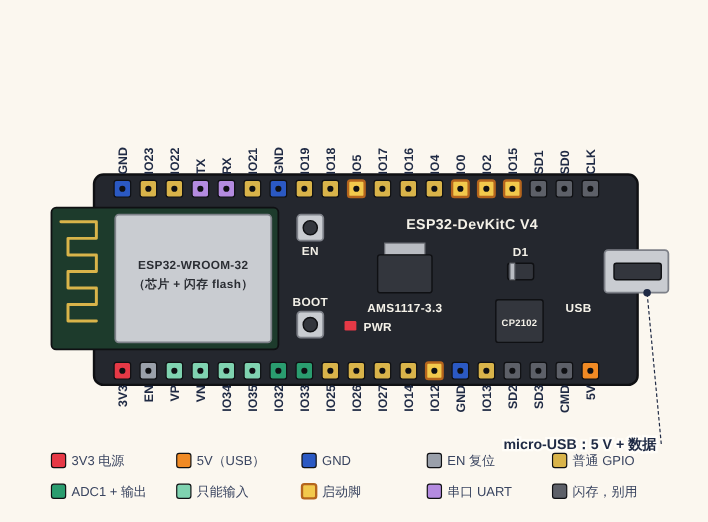

**拆解「开发板与 GPIO：一只引脚里面有什么」第 1 / 8 层：① 外形：一块板 = 芯片模块 + 稳压器 + USB + 两排针**

**dev board（开发板）** 不是芯片本身，而是把芯片做成“插上 USB 就能用”的一块小电路板。以 ESP32-DevKitC 为例：
- 左边的 金属屏蔽罩模块 里是真正的 ESP32 芯片和存程序的 flash（闪存），左端露出的弯曲铜线是 Wi-Fi 天线；
- micro-USB 口 同时做两件事：给板子供 5 V 电，和电脑传程序（经过 CP2102 这颗 USB 转串口芯片）；
- AMS1117-3.3 是 **LDO（低压差线性稳压器）**，把 5 V 降成芯片要的 3.3 V；
- EN 和 BOOT 两个按键：EN 是复位，BOOT 按住再复位进入下载模式；
- 上下两排共 38 只针，插在面包板上每只针旁边还空着一个孔。

一个关键事实：**这块板的逻辑电平是 3.3 V**。引脚输出高电平就是 3.3 V，输入能承受的上限也是 3.3 V——不是 5 V。

38 只针不是都一样，按用途分成下表这几组。悬停表格每一行，看它们在板上的位置。

| 组 | 引脚 | 能做什么 | 注意 |
|---|---|---|---|
| 3V3 电源 | 3V3 | LDO 的输出，给外部传感器供 3.3 V | 总电流受 LDO 和 USB 限制 |
| 5V 电源 | 5V | USB 5 V 经二极管后的电压 ≈ 4.7 V | 只能接 5 V 器件的电源，不能接 GPIO |
| GND | GND ×3 | 公共地，所有电压的参考点 | 外接电源必须共地 |
| EN | EN | 高 = 运行，拉低 = 复位 | 板上已有 10 kΩ 上拉 |
| 普通 GPIO | 4, 13, 14, 16–19, 21–23, 25–27 | 输出 / 输入 / 上下拉 / PWM | 首选这些 |
| ADC1 模拟输入 | 32–39（VP = 36，VN = 39） | 读 0–3.3 V 电压 | ADC2 的脚开 Wi-Fi 时不能用 |
| 只能输入 | 34, 35, 36, 39 | 只能输入 / ADC | 没有输出级，也没有内部上下拉 |
| 启动脚 strapping | 0, 2, 5, 12, 15 | 上电时被采样，决定启动方式 | 别接按键 / 上拉 / 负载 |
| 串口 UART | TX (1), RX (3) | 下载程序和串口打印 | 占用了就不能下载 |
| 闪存 flash | 6–11（CLK, SD0–3, CMD） | 接板上 flash 芯片 | 绝对不要用 |

### 第 2 步 · 🔧 动手搭：插上板子，接一颗灯

把 **ESP32 开发板**插上面包板，用它的电源脚给电源轨供电。
然后从一个引脚经过电阻接一颗 **LED**，照着下面的步骤做，每一步都会自动检查。
最后看一眼：LED 明明接在引脚上了，**为什么不亮**？

**步骤 1**

选**「ESP32 开发板 DevKitC」**，单击 **`b1`**（左上角的 GND 脚）。两排针插在 `b1`–`b19` 和 `i1`–`i19`。USB 默认插着，板子已经通电。鼠标停在针脚上能看到名字。

自动检查（做到这些才算完成）：把ESP32 开发板 DevKitC插到 b1–b2–b3–b4–b5–b6–b7–b8–b9–b10–b11–b12–b13–b14–b15–b16–b17–b18–b19–i1–i2–i3–i4–i5–i6–i7–i8–i9–i10–i11–i12–i13–i14–i15–i16–i17–i18–i19
板上高亮的孔：b1、b19、i1、i19

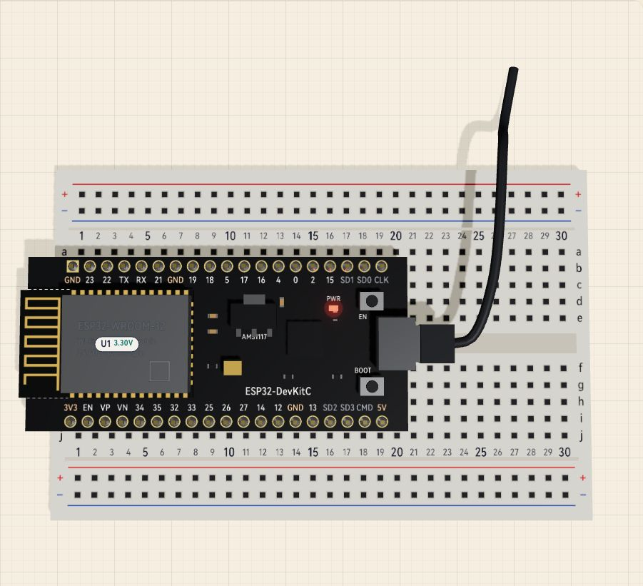

**步骤 2**

下方电源轨接到板子上：红色跳线 **`j1`** → **`bp1`**（3V3 脚），蓝色跳线 **`j14`** → **`bn14`**（GND 脚）。下方红轨现在是 3.3 V。

自动检查（做到这些才算完成）：把跳线插到 j1–bp1；把跳线插到 j14–bn14
板上高亮的孔：j1、bp1、j14、bn14

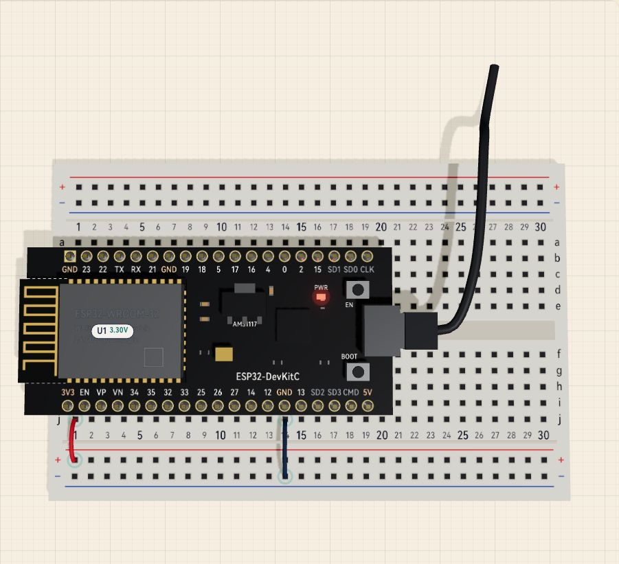

**步骤 3**

上方 GND 轨也接上：蓝色跳线 **`a7`** → **`tn7`**（上排第 7 列也是 GND 脚）。

自动检查（做到这些才算完成）：把跳线插到 a7–tn7
板上高亮的孔：a7、tn7

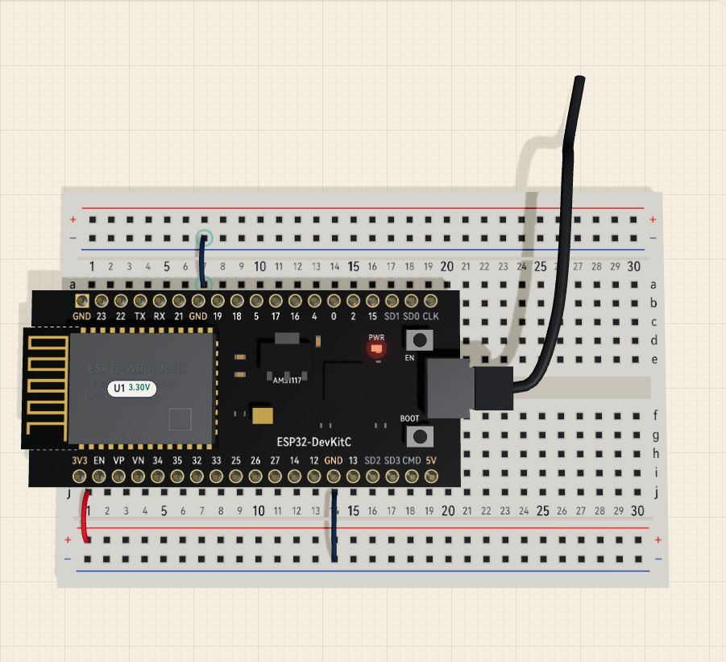

**步骤 4**

**万用表**：红表笔先点 **`bp5`**（3V3 轨），再点 **`j19`**（5V 脚）。两个读数各是多少？

自动检查（做到这些才算完成）：万用表红表笔点 j19（选“万用表”工具，单击孔）
板上高亮的孔：bp5、j19

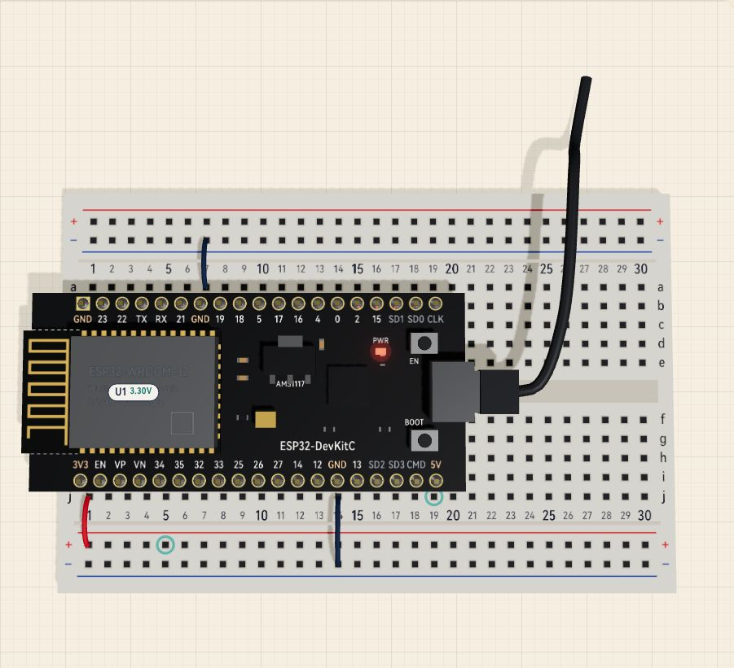

**步骤 5**

LED 电路：**电阻** `330 Ω` 插 **`a15`**（GPIO2）–**`a22`**。

自动检查（做到这些才算完成）：把电阻插到 a15–a22
板上高亮的孔：a15、a22

**步骤 6**

**红色 LED** 长脚插 **`c22`**、短脚插 **`c25`**；蓝色跳线 **`a25`** → **`tn25`**（GND）。LED 接好了——它亮吗？

自动检查（做到这些才算完成）：把LED 发光二极管插到 c22–c25；把跳线插到 a25–tn25
板上高亮的孔：c22、c25、a25、tn25

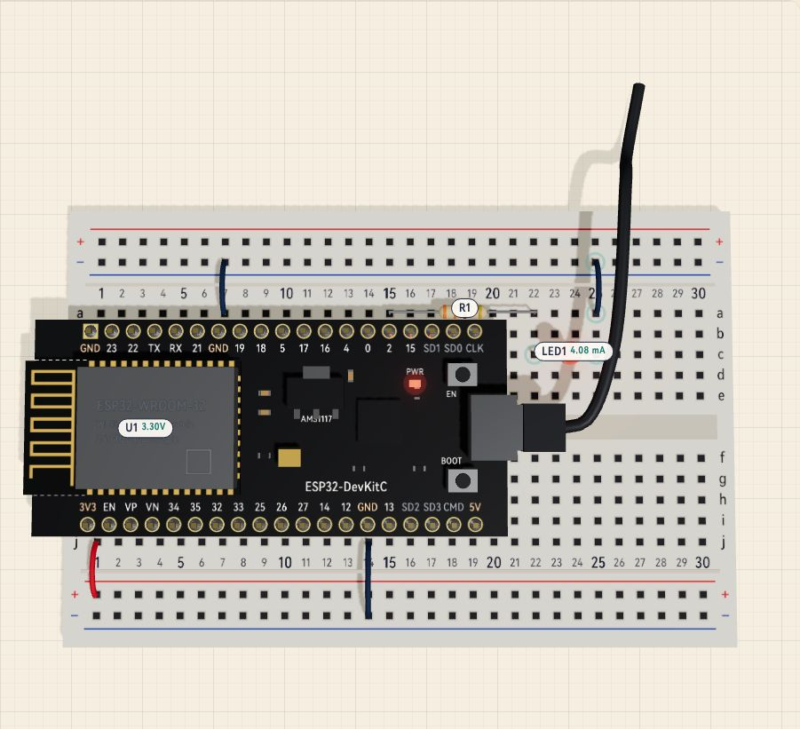

### 第 3 步 · 💡 想明白：引脚的模式就是程序

- 这里的开发板不跑代码。每个引脚（**GPIO**）在「属性」里选一个**模式**，模式就是程序。
- 没设过的引脚是**输入**：它只“听”，不出力。所以 LED 不亮。
- 设成**输出高**以后，引脚就像一节 3.3 V 电池，串着一个约 25 Ω 的小电阻。电流越大，这个小电阻上掉的电压越多：

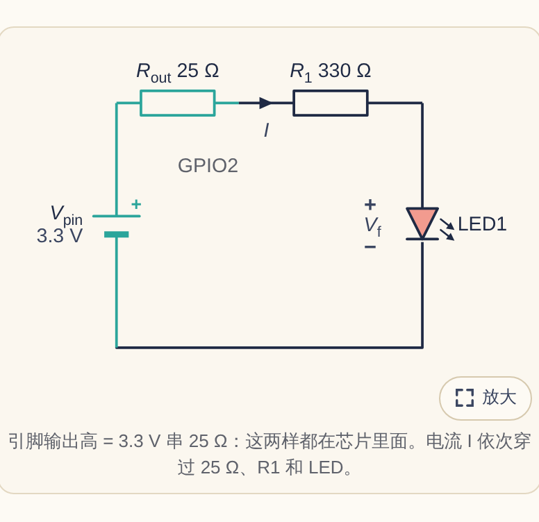

*图 `out`（schematic）：引脚输出高 = 3.3 V 串 25 Ω：这两样都在芯片里面。电流 I 依次穿过 25 Ω、R1 和 LED。*

$$I = \frac{3.3 - V_f}{R + 25 + 12}$$
- 代入数字：红色 LED 配 150 Ω 时，$I = \frac{3.3 - 1.8}{150 + 25 + 12} ≈ 0.008$ A，也就是 8 mA。
- 输入什么都不接时叫**浮空**，读数乱跳。**上拉**是芯片里一个约 45 kΩ 的电阻，把引脚轻轻拉到 3.3 V；按键一按，就把它直接接到 GND。

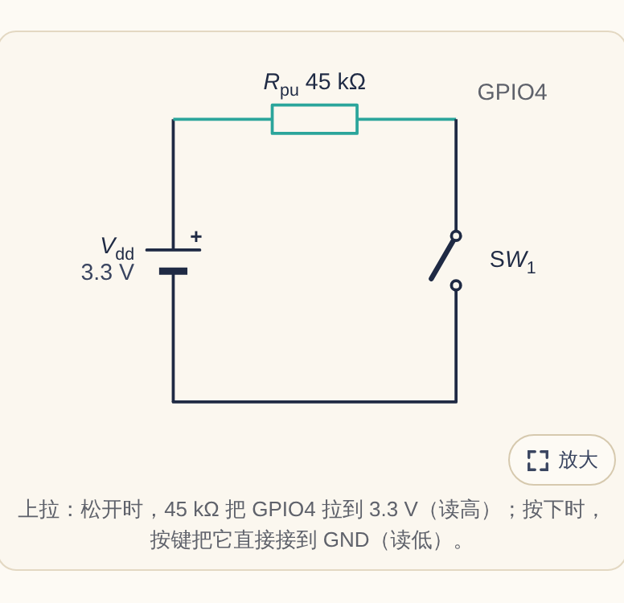

*图 `pullup`（schematic）：上拉：松开时，45 kΩ 把 GPIO4 拉到 3.3 V（读高）；按下时，按键把它直接接到 GND（读低）。*

（这一步下面列着这节课的计算卡片，点开就地展开：`gpio-led-resistor`、`gpio-output-resistance`、`pullup-current`、`diode-forward`、`usb-5v-pin`，全文见第 6 节）

### 第 4 步 · 🔧 动手搭：设成输出，再读一个按键

- **单击开发板**，在「属性」的引脚列表里改模式：先让 GPIO2 输出高。
- 再接一个按键，把 GPIO4 设成「输入 上拉」，按一下看读数怎么变。
- 先预测：你的电阻是 330 Ω，比上面例子里的 150 Ω 大一倍多，电流会是多少？

**步骤 7**

**单击开发板**，在「属性」的引脚列表里把 **GPIO2** 设成**「输出 高」**。LED 亮了。这一行还显示引脚电压和流出的电流。

自动检查（做到这些才算完成）：把ESP32 开发板 DevKitC插到 b1–b2–b3–b4–b5–b6–b7–b8–b9–b10–b11–b12–b13–b14–b15–b16–b17–b18–b19–i1–i2–i3–i4–i5–i6–i7–i8–i9–i10–i11–i12–i13–i14–i15–i16–i17–i18–i19
板上高亮的孔：a15

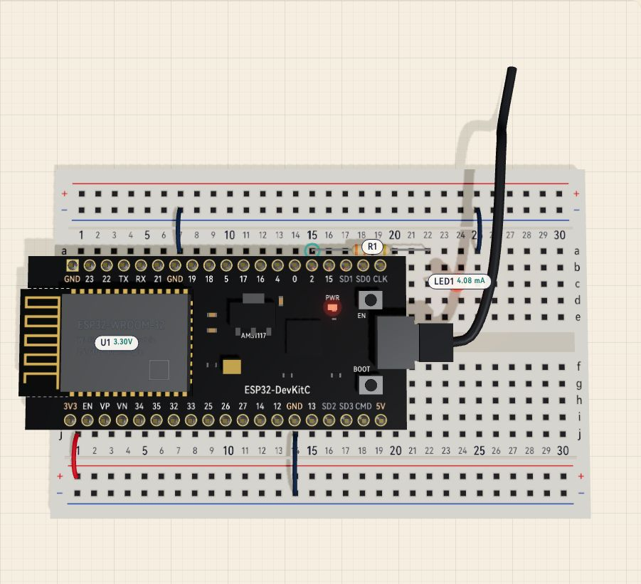

**步骤 8**

**按键**：选「按键开关」，单击 **`e27`**。它横跨中间的凹槽：一边在第 27 列，另一边在第 29 列。

自动检查（做到这些才算完成）：把按键开关插到 e27–e29–f27–f29
板上高亮的孔：e27、e29、f27、f29

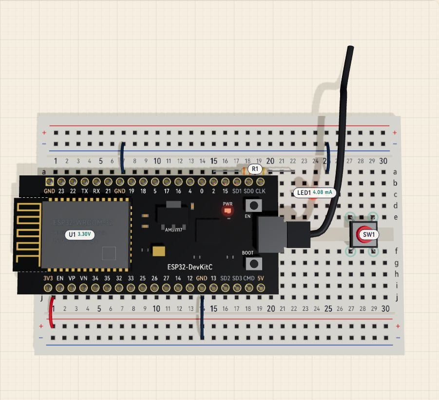

**步骤 9**

跳线 **`a13`** → **`a27`**（GPIO4 接按键一边），蓝色跳线 **`j29`** → **`bn29`**（按键另一边接 GND）。

自动检查（做到这些才算完成）：把跳线插到 a13–a27；把跳线插到 j29–bn29
板上高亮的孔：a13、a27、j29、bn29

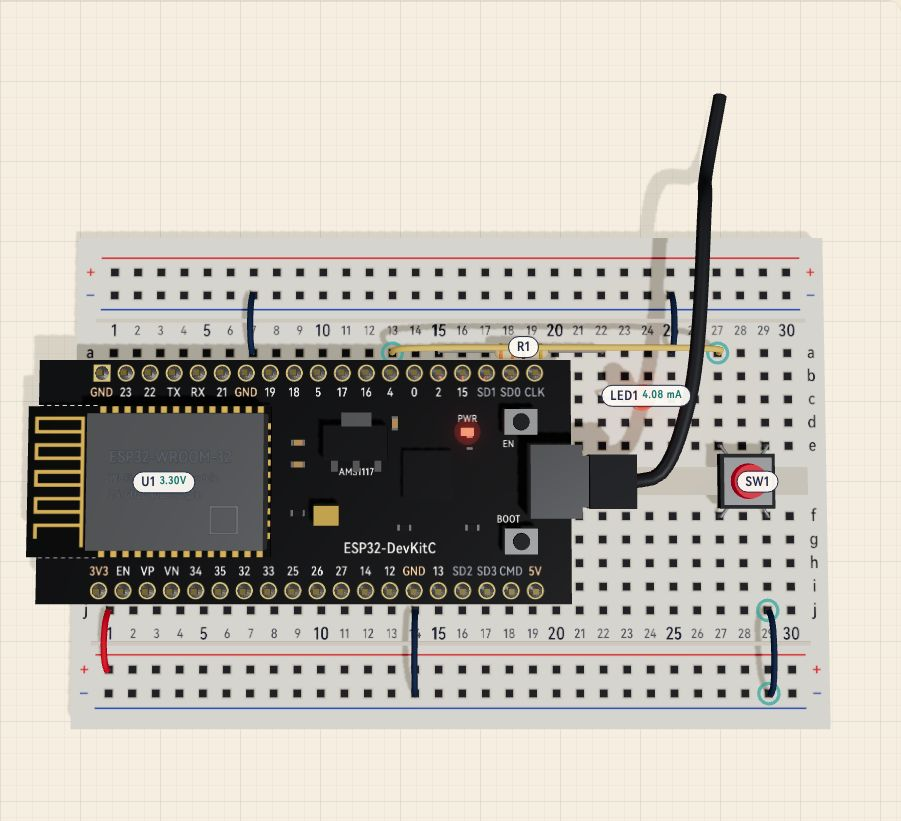

**步骤 10**

GPIO4 现在是普通输入。松开按键时它读「浮空」，「诊断」里也有提示。把 **GPIO4** 设成**「输入 上拉」**：读「高」。用「选择 / 操作」**单击按键**按下它：读「低」。

自动检查（做到这些才算完成）：把ESP32 开发板 DevKitC插到 b1–b2–b3–b4–b5–b6–b7–b8–b9–b10–b11–b12–b13–b14–b15–b16–b17–b18–b19–i1–i2–i3–i4–i5–i6–i7–i8–i9–i10–i11–i12–i13–i14–i15–i16–i17–i18–i19
板上高亮的孔：a13、e27

**步骤 11**

点**「检查我的电路」**，再用万用表和引脚列表回答测量题。

### 第 5 步 · 📏 测一测：测一测：读你自己的仪表

**测量题 1 · `u5v`**（读数题）

> 万用表：5V 脚（j19）对 GND 的电压

- 单位 V · 先写预测 · 参考答案的读数 **4.676 V** · 合理范围 [4.5, 4.85]

答对后显示：

> USB 的 5 V 先经过肖特基二极管，掉了约 0.3 V。

**测量题 2 · `iled`**（读数题）

> LED 的电流（单击 GPIO2 那一行看引脚电流，或者串一个电流表）

- 单位 mA · 先写预测 · 参考答案的读数 **4.08 mA** · 合理范围 [0.0038, 0.0044]

答对后显示：

> (3.3 − 1.8) V / (330 + 25 + 12) Ω ≈ 4.1 mA，远低于 20 mA 的建议上限。

**测量题 3 · `upin`**（读数题）

> 万用表：GPIO2（a15）对 GND 的电压

- 单位 V · 先写预测 · 参考答案的读数 **3.195 V** · 合理范围 [3.15, 3.25]

答对后显示：

> 输出电阻上掉了 25 Ω × 4.1 mA ≈ 0.1 V。

**测量题 4 · `rout`**（计算题（用自己的读数算））

> 用你的读数算引脚的输出电阻：(3.3 V − 引脚电压) / 电流

- 单位 Ω · 参考答案的读数 **25.68 Ω** · 合理范围 [22, 28] · 公式 `(3.3 - upin) / iled`

答对后显示：

> 约 25 Ω。电流 20 mA 时引脚只剩约 2.8 V——大电流负载要用三极管或 MOSFET 驱动（第 5 期实验）。

**测量题 5 · `press`**（选择题）

> GPIO4 设成“输入 上拉”，按下按键时读到什么？

- A. 高：按键接通了 3.3 V
- B. 低：按键把引脚接到 GND，上拉电阻只能提供很小的电流 ✅（正确）
- C. 浮空

答对后显示：

> 松开时上拉把引脚拉到 3.3 V（高）；按下时引脚直接接 GND（低）。这叫“低电平有效”。

### 第 6 步 · 🎒 带走：带走

- **3V3、5V、GND 脚都能给面包板供电。** 5V 脚比 USB 的 5 V 低一点：中间隔着一只肖特基二极管。
- **输出高 ≈ 3.3 V 串 25 Ω**：电流越大，引脚电压越低。每个引脚建议 ≤ 20 mA，超过 40 mA 会损坏——LED 一定要串电阻。
- **输入只听不出力**：什么都不接就浮空，按键要配上拉或下拉。
- 真实板子上的坑：很多引脚另有用途（启动配置、串口、接 Flash 的 GPIO6–11）。用之前先查开发板的引脚图。

趁热练理论题：`basics`

## 3. 测量题一览

| # | id | 题目 | 类型 | 单位 | 状态 | 参考读数 |
|---|---|---|---|---|---|---|
| 1 | u5v | 万用表：5V 脚（j19）对 GND 的电压 | voltage | V |  | 4.676 V |
| 2 | iled | LED 的电流（单击 GPIO2 那一行看引脚电流，或者串一个电流表） | current | mA |  | 4.08 mA |
| 3 | upin | 万用表：GPIO2（a15）对 GND 的电压 | voltage | V |  | 3.195 V |
| 4 | rout | 用你的读数算引脚的输出电阻：(3.3 V − 引脚电压) / 电流 | formula | Ω |  | 25.68 Ω |
| 5 | press | GPIO4 设成“输入 上拉”，按下按键时读到什么？ | 选择 |  |  | 正确：B |

### 全部答完后显示的「对比」

**对比**：
- 3V3 脚 ≈ 3.3 V；5V 脚 ≈ 5 V − 0.3 V ≈ **4.7 V**；
- LED 电流 = (3.3 − 1.8) V / (330 + 25 + 12) Ω ≈ **4.1 mA**（25 Ω 是引脚输出电阻，12 Ω 是 LED 内阻）；
- 引脚电压 = 3.3 V − 25 Ω × 4.1 mA ≈ **3.20 V**；由此算出输出电阻 ≈ **25 Ω**；
- 上拉输入：松开读高，按下读低（按下时引脚被按键接到 GND，上拉电阻里流过 3.3 V / 45 kΩ ≈ 73 µA）。

### 提示按钮（依次显示）

1. 每个引脚只剩 a 行（上排）或 j 行（下排）一个空孔能接线；鼠标停在针脚上看名字。
2. 输出高 = 3.3 V 串 25 Ω：LED 电流 = (3.3 − LED 压降) / (R + 25 Ω + LED 内阻 12 Ω)。
3. 上拉输入：松开时被拉到 3.3 V，按下时被按键接到 GND。

### 功能测试（「检查我的电路」时跑）

- 输出高：LED 亮；松开按键读高
- 按下按键读低

## 4. 用到的拆解（全部层的文字，供改写参考）

### 拆解 `devboard`：开发板与 GPIO：一只引脚里面有什么

*GPIO = General-Purpose Input/Output（通用输入输出）。从 ESP32 开发板的外形拆到电源路径，再拆到一只引脚里的两个晶体管、输入缓冲、上下拉电阻和钳位二极管；每一种模式都化成一个电路课能算的等效电路，最后用它算 LED 电阻和电流极限。*

**拆解「开发板与 GPIO：一只引脚里面有什么」第 1 / 8 层：① 外形：一块板 = 芯片模块 + 稳压器 + USB + 两排针**

**dev board（开发板）** 不是芯片本身，而是把芯片做成“插上 USB 就能用”的一块小电路板。以 ESP32-DevKitC 为例：
- 左边的 金属屏蔽罩模块 里是真正的 ESP32 芯片和存程序的 flash（闪存），左端露出的弯曲铜线是 Wi-Fi 天线；
- micro-USB 口 同时做两件事：给板子供 5 V 电，和电脑传程序（经过 CP2102 这颗 USB 转串口芯片）；
- AMS1117-3.3 是 **LDO（低压差线性稳压器）**，把 5 V 降成芯片要的 3.3 V；
- EN 和 BOOT 两个按键：EN 是复位，BOOT 按住再复位进入下载模式；
- 上下两排共 38 只针，插在面包板上每只针旁边还空着一个孔。

一个关键事实：**这块板的逻辑电平是 3.3 V**。引脚输出高电平就是 3.3 V，输入能承受的上限也是 3.3 V——不是 5 V。

38 只针不是都一样，按用途分成下表这几组。悬停表格每一行，看它们在板上的位置。

| 组 | 引脚 | 能做什么 | 注意 |
|---|---|---|---|
| 3V3 电源 | 3V3 | LDO 的输出，给外部传感器供 3.3 V | 总电流受 LDO 和 USB 限制 |
| 5V 电源 | 5V | USB 5 V 经二极管后的电压 ≈ 4.7 V | 只能接 5 V 器件的电源，不能接 GPIO |
| GND | GND ×3 | 公共地，所有电压的参考点 | 外接电源必须共地 |
| EN | EN | 高 = 运行，拉低 = 复位 | 板上已有 10 kΩ 上拉 |
| 普通 GPIO | 4, 13, 14, 16–19, 21–23, 25–27 | 输出 / 输入 / 上下拉 / PWM | 首选这些 |
| ADC1 模拟输入 | 32–39（VP = 36，VN = 39） | 读 0–3.3 V 电压 | ADC2 的脚开 Wi-Fi 时不能用 |
| 只能输入 | 34, 35, 36, 39 | 只能输入 / ADC | 没有输出级，也没有内部上下拉 |
| 启动脚 strapping | 0, 2, 5, 12, 15 | 上电时被采样，决定启动方式 | 别接按键 / 上拉 / 负载 |
| 串口 UART | TX (1), RX (3) | 下载程序和串口打印 | 占用了就不能下载 |
| 闪存 flash | 6–11（CLK, SD0–3, CMD） | 接板上 flash 芯片 | 绝对不要用 |

**拆解「开发板与 GPIO：一只引脚里面有什么」第 2 / 8 层：② X 光：电从 USB 到芯片走了哪条路**

把电路板变透明，只看电源。电流走的是一条串联的路：
1. USB 给 5.0 V；
2. 经过一个 肖特基二极管 Schottky diode（防止 5V 脚上的外部电源倒灌进电脑），压降约 0.3 V，所以 5V 脚实际约 4.7 V（第 15 课用万用表量到的就是它）；
3. LDO 把它降到 3.3 V，供给 ESP32 芯片 和 3V3 脚。

LDO 是“线性”稳压器：它像一个自动调节的电阻，把多出来的电压 **烧成热**。它要正常稳压，输入必须比输出高出一个 **dropout（压差）**：
$$V_{in} ≥ V_{out} + V_{dropout} = 3.3 + 1.1 = 4.4 V$$
4.7 V > 4.4 V，够用；但如果你用两节 AA 电池（3 V）从 5V 脚供电，LDO 就掉出稳压，3V3 会跟着掉。

所有 GPIO 输出电流、3V3 脚上外接的传感器，都从这一条路上来，所以有一个 **总预算**：芯片自己 ≈ 50 mA（开 Wi-Fi 发射时峰值几百 mA），USB 口最多 500 mA。

Blue Pill（STM32F103）的结构一样，只是数字不同，见下表。

| 参数 | ESP32-DevKitC | Blue Pill (STM32F103) |
|---|---|---|
| 逻辑电平 VDD | 3.3 V | 3.3 V |
| 稳压器（压差 / 上限） | AMS1117: 1.1 V / 1 A | 3.3 V LDO: 0.25 V / 300 mA |
| 芯片自身电流 | ≈ 50 mA | ≈ 20 mA |
| 输出电阻 R_out（仿真） | 25 Ω | 40 Ω |
| 每脚推荐 / 绝对最大 | 20 mA / 40 mA | 20 mA / 25 mA（PC13–15：3 mA） |
| $V_{IL}$ / $V_{IH}$ | 0.825 V / 2.475 V | 1.16 V / 2.15 V |
| 内部上下拉 | 45 kΩ | 40 kΩ |
| 5 V 容忍 | 没有任何脚 | FT 脚：PA8–15、PB2–4、PB6–15 |
| 掉电复位 brown-out | 2.5 V | 2.0 V |

- 公式 `V_{5V} = 5.0 - 0.3 = 4.7 V`：USB 经肖特基二极管
- 公式 `V_{in} ≥ 3.3 + 1.1 = 4.4 V`：AMS1117 能稳压的最低输入
- 公式 `P_{LDO} = (V_{in} - 3.3 V)·I = 1.4 V × 0.1 A = 0.14 W`：100 mA 负载时 LDO 发的热

**拆解「开发板与 GPIO：一只引脚里面有什么」第 3 / 8 层：③ 拆开一只引脚：两个晶体管、一个输入缓冲、两个电阻、两个二极管**

芯片手册里每只 GPIO 都画成这样一张图（STM32 参考手册 “I/O port bit” 那一节就是）。从右往左看：
- 焊盘 pad：芯片硅片上的一块金属，经金线连到外面的针；
- 两个钳位二极管 clamp diode：一个从引脚接到 3V3、一个从 GND 接到引脚。平时都反偏、不导电；引脚电压一旦高于 3V3 + 0.6 V 或低于 −0.6 V 就导通，把静电（ESD）泄放到电源轨上；
- 上拉电阻 $R_PU$ 和 下拉电阻 $R_PD$：各串一个开关，由程序决定接不接，约 45 kΩ；
- **输出级**：上管 P-MOS 接 3V3，下管 N-MOS 接 GND，两个管子的栅极都由 输出控制 驱动。这种一上一下的结构叫 **push-pull（推挽）**；
- 输入缓冲 input buffer：一个带回差的比较器（**Schmitt trigger，施密特触发器**），把引脚电压变成 0 或 1 存进输入寄存器。

注意输入缓冲 **一直接在引脚上**：不管引脚是不是输出，芯片都能读回它的电平。

| 部件 | 它是什么 | 什么时候起作用 | 数值（ESP32 仿真） |
|---|---|---|---|
| P-MOS | 引脚到 3V3 的开关 | 输出 HIGH 时导通 | 导通电阻 ≈ 25 Ω |
| N-MOS | 引脚到 GND 的开关 | 输出 LOW 时导通 | ≈ 25 Ω |
| 施密特输入缓冲 | 把电压变成 0 / 1 | 一直在读 | 输入电流 ≈ 0 |
| $R_{PU}$ / $R_{PD}$ | 可开关的上 / 下拉 | 输入模式选了上拉 / 下拉 | 45 kΩ |
| 钳位二极管 | 静电保护 | 引脚 > 3.9 V 或 < −0.6 V | 注入 < 5 mA |
| 输出控制 | 决定哪个管子导通 | 程序写 1 / 0 | — |

**拆解「开发板与 GPIO：一只引脚里面有什么」第 4 / 8 层：④ 输入：阈值、悬空和上拉电阻**

做输入时两个管子都关断，引脚只接着输入缓冲，它几乎不取电流（漏电小于 1 µA）。读数规则：
- 电压 ≤ $V_IL$ = 0.825 V（0.25·VDD） → 保证读 0；
- 电压 ≥ $V_IH$ = 2.475 V（0.75·VDD） → 保证读 1；
- 中间那一段 → 手册不保证，可能 0 也可能 1。

真正的翻转点在中间，而且 **上升和下降不是同一个点**：施密特触发器 上升时要过 $V_{T+}$ 才变 1，下降时要低于 $V_{T-}$ 才变 0。这段 **回差（hysteresis）** 让一个慢慢变化、带点噪声的信号（例如按键抖动、长导线）不会在阈值附近来回乱跳。

**悬空（floating）**：一只没人驱动的输入引脚，等效电路只是几 pF 的电容对地——电荷稍有扰动（手靠近、旁边导线的耦合）电压就变，读数随机。所以按键必须配一个 **上拉 / 下拉电阻**，给引脚一个确定的“默认电压”：
- 上拉（pull-up）：松开时电阻把引脚拉到 3.3 V 读 1；按下时按键把引脚接到 GND 读 0（**active-low，低有效**）；
- 按下时上拉电阻里有电流：$I = \frac{3.3 V}{45 kΩ} = 73 µA$，很小，所以选几十 kΩ：大到不浪费电，小到压得住噪声。

| 输入模式 | 按键接法 | 松开读 | 按下读 | 按下时电流 |
|---|---|---|---|---|
| 输入（无上下拉） | 任意 | 悬空，乱跳 | ? | — |
| 输入 + 内部上拉 | 引脚 → 按键 → GND | 1 | 0 | 3.3 V / 45 kΩ = 73 µA |
| 输入 + 内部下拉 | 3V3 → 按键 → 引脚 | 0 | 1 | 73 µA |
| 输入 + 外部 10 kΩ 下拉（实验 5-3） | 3V3 → 按键 → 引脚 | 0 | 1 | 3.3 V / 10 kΩ = 0.33 mA |

- 公式 `V_{IL} = 0.25·V_{DD} = 0.825 V,   V_{IH} = 0.75·V_{DD} = 2.475 V`：ESP32；Blue Pill 是 1.16 V / 2.15 V
- 公式 `I_{PU} = \frac{V_{DD}}{R_{PU}} = \frac{3.3}{45 k} = 73 µA`：按键按下时

**拆解「开发板与 GPIO：一只引脚里面有什么」第 5 / 8 层：⑤ 每种模式的等效电路：引脚就是“电源 + 电阻”**

把上一层的图按模式“删掉不导通的部分”，剩下的就是电路课里能直接算的模型：
- OUT HIGH：上管导通 → 引脚 = **3.3 V 理想电压源串联 $R_{out}$**（戴维南等效，Thevenin equivalent）。$R_{out}$ 就是 P-MOS 的导通电阻，ESP32 约 25 Ω、Blue Pill 约 40 Ω；
- OUT LOW：下管导通 → 引脚经 $R_{out}$ 接 GND（0 V 电源串 $R_{out}$）；
- INPUT：两管都关 → 引脚几乎是 **开路**，只剩几 pF 电容；
- INPUT + 上拉：开路 + 一个 45 kΩ 接 3V3。这其实还是戴维南电路：3.3 V 串 45 kΩ——只不过电阻大了一千多倍，所以它只能“建议”电平，任何外部驱动都能压过它；
- open-drain（开漏）：上管永远不用，只有下管：要么拉到 GND，要么断开。高电平靠外部上拉电阻，好处是外部上拉可以接 5 V（电平转换）、多个开漏输出可以并在一根线上（I²C 总线）；
- PWM：输出级在 HIGH 和 LOW 之间按占空比 D 来回切换，下一个拆解（PWM 与 ADC）细讲。

有了这些模型，接上外部电路就是一道普通的 KVL / 分压题。

| 模式 | 等效电路 | 引脚电压 | 典型用途 |
|---|---|---|---|
| OUT HIGH | 3.3 V 串 25 Ω | $3.3 - 25·I$ | 点 LED、驱动晶体管基极 / 栅极 |
| OUT LOW | 0 V 串 25 Ω | $25·I$ | 灌电流点 LED |
| INPUT | 开路（几 pF） | 由外部决定 | 读有源信号 |
| INPUT + 上拉 / 下拉 | 3.3 V 或 0 V 串 45 kΩ | 松开时 3.3 V / 0 V | 按键、开关 |
| open-drain | 开关到 GND | 0 V 或由外部上拉 | I²C、电平转换 |
| PWM | HIGH / LOW 交替 | 平均 D·3.3 V | 调光、调速 |
| ADC | 开路 + 采样电容 | 被测量 | 读传感器电压 |

**拆解「开发板与 GPIO：一只引脚里面有什么」第 6 / 8 层：⑥ 拉电流和灌电流：LED 接上面还是接下面**

推挽输出级有两个管子，所以一只引脚能用两种方向驱动负载（实验 5-2，Blue Pill，$R_{out}$ = 40 Ω）：
- source（拉电流）：负载接在引脚和 GND 之间，引脚 HIGH 时上管把电流 **推出** 引脚。
$$I_1 = \frac{3.3 - 1.8}{40 + 220 + 12} = \frac{1.5}{272} = 5.5 mA，V_{pin} = 3.3 - 40 × 5.5 mA = 3.08 V$$
- sink（灌电流）：负载接在 3V3 和引脚之间，引脚 LOW 时下管把电流 **吸进** 引脚到 GND。
$$I_2 = \frac{1.5}{272} = 5.5 mA，V_{pin} = 40 × 5.5 mA = 0.22 V$$

灌电流接法下，“写 0 灯亮、写 1 灯灭”，叫 **active-low（低有效）**。Blue Pill 板上 PC13 的 LED 就是这样接的：3V3 → 510 Ω → LED → PC13，PC13 输出 LOW 时灌入 $\frac{1.5}{510 + 40 + 12} ≈ 2.7 mA$。

仿真里两个管子电阻相同，所以两种接法电流相等；**真实芯片里 N-MOS 一般比 P-MOS 强**（同样面积导通电阻更小，因为电子比空穴跑得快），灌电流时压降更小。老式 TTL 和 8051 几乎只能灌不能拉，所以很多经典电路都是低电平点灯。

|  | 拉电流 source | 灌电流 sink |
|---|---|---|
| 负载接在 | 引脚 ↔ GND | 3V3 ↔ 引脚 |
| 亮的时候引脚是 | HIGH | LOW（低有效） |
| 导通的管子 | 上管 P-MOS | 下管 N-MOS |
| 引脚电流（仿真符号） | +5.5 mA（流出） | −5.5 mA（流入） |
| 引脚电压 | 3.08 V | 0.22 V |
| 例子 | 实验 5-1 的 LED | Blue Pill 的 PC13 LED |

- 公式 `I = \frac{V_{DD} - V_f}{R_{out} + R + R_{LED}}`：两种接法是同一个回路，只是开关的位置不同

**拆解「开发板与 GPIO：一只引脚里面有什么」第 7 / 8 层：⑦ 一步步算：3.3 V 引脚点一个 LED 要多大电阻**

实验 5-1：ESP32 引脚 HIGH → R → 红色 LED → GND，目标 10 mA。把每个元件换成第 ⑤ 层的模型：
- 引脚 = 3.3 V 串 $R_out$ = 25 Ω；
- 红色 LED = $V_f$ = 1.8 V 串 12 Ω（仿真模型）；
- 中间是我们要求的 R。

**第 1 步 · KVL**：绕回路一圈，电压升 = 电压降：
$$3.3 = I·R_{out} + I·R + I·R_{LED} + V_f$$
**第 2 步 · 解出 R**：
$$R = \frac{3.3 - V_f}{I} - R_{out} - R_{LED} = \frac{1.5 V}{10 mA} - 25 - 12 = 150 - 37 = 113 Ω$$
**第 3 步 · 选标准值**：E12 系列里最近的是 120 Ω（100 Ω 也行）。
**第 4 步 · 反过来验算**：$I = \frac{1.5}{25 + 120 + 12} = 9.5 mA$；引脚电压 $V_{pin} = 3.3 - 25 × 9.5 mA = 3.06 V$——带了负载，HIGH 就不是 3.3 V 了。

**如果不加电阻**（实验的初始电路）：$I = \frac{1.5}{25 + 12} = 40 mA$，正好是绝对最大值；引脚掉到 $3.3 - 25 × 40 mA = 2.29 V$，比 $V_{IH}$ = 2.475 V 还低——连一个合格的 HIGH 都不是了。很多人以为“3.3 V 很低，LED 不用电阻”，问题就在于：限流的只剩 $R_{out}$ 和 LED 的内阻。

| R | I | 引脚电压 | 结论 |
|---|---|---|---|
| 0 Ω（直连） | 40 mA | 2.29 V | 引脚损坏 |
| 100 Ω | 10.9 mA | 3.03 V | 可以 |
| 120 Ω | 9.5 mA | 3.06 V | 本实验的答案 |
| 150 Ω | 8.0 mA | 3.10 V | 亮，但低于 8.5 mA 窗口 |
| 1 kΩ | 1.4 mA | 3.26 V | 指示灯常用，够亮 |

- 公式 `R = \frac{V_{DD} - V_f}{I} - R_{out} - R_{LED}`：从 KVL 解出
- 公式 `V_{pin} = V_{DD} - I·R_{out}`：带载后的高电平

**拆解「开发板与 GPIO：一只引脚里面有什么」第 8 / 8 层：⑧ 局限：电流上限、3.3 V 不是 5 V、钳位二极管**

**电流**：$R_{out}$ 上的压降 $I·R_{out}$ 和发热 $I^{2}·R_{out}$ 随电流增大。ESP32 每脚推荐 ≤ 20 mA、绝对最大 40 mA（Blue Pill 25 mA，PC13–15 只有 3 mA）。还有 **所有引脚加起来** 的上限：电流都从芯片的几只 VDD 脚和 LDO 来。要驱动蜂鸣器、继电器、电机，用三极管或 MOSFET（后面两个拆解）。

**电压**：ESP32 的引脚 **没有一只能接 5 V**。原因就在 上钳位二极管：把一个 5 V 模块的输出经 $R_s$ 接到引脚上，引脚被二极管钳在约 3.9 V，多出的电压全落在 R_s 上，电流 注入 3V3 电源轨：
$$I_{inj} = \frac{5 - 3.3 - 0.6}{1 kΩ} ≈ 1.1 mA$$
这股电流没地方去——LDO 只能输出电流，不能吸收——于是它给 芯片内核 和其他负载供电，3V3 被“反向供电”顶高。不加电阻直接接 5 V，注入电流几十 mA，芯片可能当场损坏。仿真里注入超过 5 mA 就判损坏。

**正确做法**：分压电阻（5 V → 10 kΩ / 20 kΩ → 3.3 V）、电平转换芯片，或者用开漏输出 + 上拉到对方的电源（实验 5-10、5-11）。Blue Pill 的 **FT 脚**（five-volt tolerant）没有上钳位二极管，数字模式下能接 5 V；但 **一旦设成模拟输入（ADC）就不再容忍 5 V**。

**模型没画的**：$R_{out}$ 其实随电流和温度变化，固件可以调驱动强度；真实输入有几 µA 漏电。

| 极限 | ESP32 | Blue Pill | 超过会怎样 |
|---|---|---|---|
| 每脚推荐电流 | 20 mA | 20 mA（PC13–15：3 mA） | 警告：压降大、发热 |
| 每脚绝对最大 | 40 mA | 25 mA | 引脚损坏 |
| 引脚电压范围 | −0.3 … 3.6 V | 非 FT：同左；FT：≤ 5.5 V | 钳位二极管导通 |
| 钳位注入电流 | < 5 mA | < 5 mA | 损坏，3V3 被顶高 |
| USB 总电流 | 500 mA | 500 mA | 电脑口限流 / 掉电 |
| LDO 上限 | 1 A | 300 mA | 稳压器过热 / 限流 |

- 公式 `I_{inj} = \frac{V_{ext} - V_{DD} - 0.6 V}{R_s}`：外部高于 3V3 时钳位二极管里的电流

**一句话记住**：一只 GPIO = 两个开关（P-MOS 到 3V3、N-MOS 到 GND）+ 一个施密特输入 + 可开关的 45 kΩ 上下拉 + 两个钳位二极管。输出时它是“3.3 V 串 25 Ω”，输入时它是开路；算 LED 电阻要把 $R_{out}$ 算进 KVL，电流 ≤ 20 mA，电压永远不超过 3.3 V。

## 5. 这一课的计算卡片

**计算卡片 `gpio-led-resistor`：GPIO 点 LED 的电阻（含引脚内阻）**

- 公式 `R = \frac{V_{OH} - V_F}{I} - R_{out} - r_d`
- 用途：单片机引脚直接驱动 LED：串多大的电阻得到想要的电流。
- 输入：V_OH（引脚高电平（空载），V）；V_F（LED 正向压降（红 1.8 V），V）；I（想要的电流（≤ 20 mA），A）；R_out（引脚输出电阻（ESP32 25 Ω、Blue Pill 40 Ω），Ω）；r_d（LED 内阻，Ω） → R（串联电阻（再取一个标准值），Ω）

1. 输出高电平的引脚不是理想电压源：它像 3.3 V 串一个输出电阻 $R_{out}$（芯片里 MOS 管的导通电阻）。
2. LED 用折线模型：$V_F$ 串 $r_d$。
3. 回路 KVL：$V_{OH} = I(R_{out} + R + r_d) + V_F$。
4. 解出 $R = \frac{V_{OH} - V_F}{I} - R_{out} - r_d$，取最接近的标准值，再回算电流：$I = \frac{V_{OH} - V_F}{R + R_{out} + r_d}$。
5. 灌电流（LED 接 3V3、阴极接引脚、输出低电平点亮）公式一样，$R_{out}$ 换成下管的电阻。

例子：- 实验 5-1：10 mA：$\frac{1.5}{0.01} - 25 - 12 = 113 Ω$ → 120 Ω，$I = \frac{1.5}{157} ≈ 9.5 mA$。不串电阻：$\frac{1.5}{37} ≈ 40 mA$——到了绝对最大值。
- 第 15 课：330 Ω：$\frac{1.5}{330 + 25 + 12} ≈ 4.1 mA$。
- 实验 5-2（Blue Pill，40 Ω）：220 Ω：$\frac{1.5}{272} ≈ 5.5 mA$；板载 LED 510 Ω：≈ 2.7 mA。

- ⚠ 蓝 / 白 LED（$V_F$ ≈ 3 V）在 3.3 V 引脚上只剩 0.3 V 给电阻：亮度对一切都很敏感——用三极管从 5 V 驱动。
- ⚠ 每个引脚建议 ≤ 20 mA，所有引脚加起来也有上限（STM32F103 共 150 mA）。

**计算卡片 `gpio-output-resistance`：引脚的输出电阻（从读数反推）**

- 公式 `R_{out} = \frac{V_{DD} - V_{pin}}{I}`
- 用途：输出高电平时测到引脚电压和电流，算出引脚的内阻；也能预测重载时引脚掉到多少。
- 输入：V_DD（空载高电平，V）；V_pin（带载时测到的引脚电压，V）；I（引脚电流，A） → R_out（输出电阻，Ω）

1. 输出高电平 = 3.3 V 串 $R_{out}$（戴维宁模型）。
2. 有电流流出时，$R_{out}$ 上压降 $IR_{out}$，引脚电压 $V_{pin} = V_{DD} - IR_{out}$。
3. 量出 $V_{pin}$ 和 I，反解 $R_{out}$。
4. 低电平同理：$R_{low} = \frac{V_{OL}}{I}$（电流流进引脚）。
5. 引脚电压掉到 $V_{IH}$ 以下，别的芯片就不认它是高电平了。

例子：实验 5-1：$\frac{3.3 - 3.06}{9.5 mA} ≈ 25 Ω$。第 15 课：$\frac{3.3 - 3.20}{4.1 mA} ≈ 25 Ω$；20 mA 时引脚只剩约 2.8 V，40 mA 时 2.29 V < $V_{IH}$（2.475 V）。实验 5-2：$\frac{0.22 V}{5.5 mA} = 40 Ω$。

- ⚠ 真实芯片的输出电阻随电流、温度和固件里的驱动强度设置变化；这里的 25 Ω / 40 Ω 是模型值。

**计算卡片 `pullup-current`：上拉 / 下拉电阻的电流**

- 公式 `I = \frac{V}{R_{pull}}`
- 用途：按键按下（或开漏输出拉低）时，上拉 / 下拉电阻上流多少电流。
- 输入：V（电阻两端的电压，V）；R（上拉 / 下拉电阻（ESP32 内部 ≈ 45 kΩ），Ω） → I（按下时的电流，A）

1. CMOS 输入几乎不取电流（> 10 MΩ）：松开时上拉电阻上没有电流、没有压降，引脚就在 3.3 V（读 1）。
2. 按下时按键把引脚接到 GND（≈ 0 Ω 远小于 R），电阻两端是整个电源电压：$I = \frac{V}{R}$，引脚读 0。
3. 太小（比如 220 Ω）：按下时白白耗 15 mA；太大（1 MΩ）：抗干扰差、长线容易误触发。按键常用 4.7–10 kΩ。
4. 开漏输出拉低时同理：$I = \frac{V_{pull}}{R + R_{low}}$，引脚低电平 $V_{OL} = IR_{low}$。

例子：- 第 15 课、实验 5-3：内部上拉 $\frac{3.3}{45k} ≈ 73 µA$；外部 10 kΩ 下拉 $\frac{3.3}{10k} = 0.33 mA$。
- 实验 5-11：5 V 上拉 4.7 kΩ，开漏拉低：$\frac{4.69}{4.7k} ≈ 0.99 mA$，$V_{OL} = 40 × 0.99 mA ≈ 40 mV$。
- 实验 5-10：5 V 信号进 FT 引脚又开了内部上拉：$\frac{4.69 - 3.3}{40k} ≈ 35 µA$ 倒灌进 3V3。
- 实验 5-16：2.2 kΩ 的 I²C 线拉低：$\frac{3.3}{2.2k + 40} ≈ 1.47 mA$。

- ⚠ ESP32 的 GPIO34–39 没有内部上下拉：设成“输入 + 上拉”也是悬空。
- ⚠ 5 V 信号的 FT 引脚不要开内部上拉。

**计算卡片 `diode-forward`：二极管的正向压降：过一个二极管少 0.7 V**

- 公式 `V_{out} = V_{in} - V_F - I r_d`
- 用途：电流经过一个导通的二极管（防反接、USB 二极管、续流钳位）以后电压变成多少。
- 输入：V_in（二极管前的电压，V）；V_F（导通压降（硅 0.65–0.7 V，肖特基 0.3 V），V）；I（电流，A）；r_d（二极管内阻（不知道就填 0），Ω） → V_out（二极管后的电压，V）

1. 二极管只让电流从阳极流向阴极（有条纹的一端）。正向导通后两端电压几乎固定：硅管约 0.65–0.7 V，肖特基约 0.3 V。
2. 折线模型：$V_F$ 串一个小电阻 $r_d$，所以电流大时压降稍大。
3. 串在电源后面（防反接）：输出 = 输入 − 一个 $V_F$；接反时它截止，后面的电路不通电。
4. 续流 / 钳位：二极管导通把某一点钳在“另一点 + $V_F$”上——继电器集电极最高 5 V + 0.7 V。

例子：挑战 6：9 V 经二极管 → 约 8.3 V。开发板 5V 引脚：USB 5 V 经肖特基 → 约 4.7 V。实验 5-9：线圈断电时集电极被钳在 4.65 + 0.7 ≈ 5.4 V。实验 3-5：低电平时 D1 反偏，电容不能倒灌回发生器。

- ⚠ 防反接二极管会一直吃掉 0.7 V 和 0.7 V × I 的功率；低压电路用肖特基或 P-MOSFET。

**计算卡片 `usb-5v-pin`：开发板 5V 引脚的电压**

- 公式 `V_{5V} = V_{USB} - V_D - I R_s`
- 用途：USB 5 V 经线缆 / 保险丝和肖特基二极管到 5V 引脚：带载时掉到多少。
- 输入：V_USB（USB 电压，V）；V_D（肖特基二极管压降，V）；I（从 USB 取的总电流，A）；R_s（线缆 + 保险丝 + 二极管电阻（模型 0.25 + 0.15 Ω），Ω） → V_5V（5V 引脚电压，V）

1. 电源路径：USB 5 V →（线缆 + 自恢复保险丝 ≈ 0.25 Ω）→ 肖特基二极管（≈ 0.3 V + 0.15 Ω）→ **5V 引脚** → 板载 LDO → 3V3。
2. KVL：$V_{5V} = V_{USB} - V_D - IR_s$，空载约 4.7 V，电流越大越低。
3. 5V 引脚给 LDO 供电：它至少要比 3.3 V 高出 LDO 的压差（AMS1117 ≈ 1.1 V），否则 3V3 也会掉。
4. 电脑 USB 2.0 口只保证 500 mA。

例子：只有芯片和 LED（≈ 56 mA）：$5 - 0.3 - 0.056 × 0.4 ≈ 4.68 V$。实验 5-13：总 0.48 A → 4.51 V。实验 5-17：0.415 A → 4.53 V，仍高于 AMS1117 要的 4.4 V。

- ⚠ “5V 引脚”不是 5.0 V：需要精确 5 V 的模块要单独供电。

## 6. English（界面英文版的同一份内容）

展开英文

### Node 1 · 🔍 Look first：Meet it first: Dev board GPIO

**Teardown「The dev board and GPIO: what is inside one pin」layer 1 of 8：① Outside: a module, a regulator, USB and two rows of pins**

A **dev board** is not the chip itself but a small board that makes the chip "plug in USB and go". Take the ESP32-DevKitC:
- the metal-shielded module on the left holds the actual ESP32 chip and the flash that stores the program; the wiggly copper at the left end is the Wi-Fi antenna;
- the micro-USB socket does two jobs: it powers the board with 5 V and carries the program from the PC (through the CP2102 USB-to-serial chip);
- AMS1117-3.3 is an **LDO (low-dropout linear regulator)** that turns 5 V into the 3.3 V the chip runs on;
- the EN and BOOT buttons: EN is reset; hold BOOT while resetting to enter download mode;
- 38 pins in two rows; on a breadboard each pin keeps one free hole beside it.

One key fact: **the logic level of this board is 3.3 V**. A pin driven high is at 3.3 V, and 3.3 V is also the most an input may see — not 5 V.

The 38 pins are not all alike; they fall into the groups in the table. Hover a row to see where they are on the board.

| Group | Pins | What it can do | Watch out |
|---|---|---|---|
| 3V3 power | 3V3 | the LDO output: 3.3 V for sensors | total current limited by LDO and USB |
| 5V power | 5V | USB 5 V after a diode ≈ 4.7 V | for 5 V parts’ power, never a GPIO |
| GND | GND ×3 | common ground, reference of every voltage | external supplies must share it |
| EN | EN | high = run, low = reset | has a 10 kΩ pull-up on board |
| plain GPIO | 4, 13, 14, 16–19, 21–23, 25–27 | output / input / pulls / PWM | use these first |
| ADC1 analog | 32–39（VP = 36，VN = 39） | read 0–3.3 V | ADC2 pins stop working with Wi-Fi |
| input only | 34, 35, 36, 39 | input / ADC only | no output stage, no internal pulls |
| strapping | 0, 2, 5, 12, 15 | sampled at power-up to pick the boot mode | keep buttons, pulls and loads off |
| UART | TX (1), RX (3) | upload and serial print | busy = no uploads |
| flash | 6–11（CLK, SD0–3, CMD） | wired to the onboard flash | never use |

### Node 2 · 🔧 Build：Plug in the board, wire an LED

Plug the **ESP32 board** into the breadboard and power the rails from its supply pins.
Then wire an **LED** through a resistor from one pin. Follow the steps below; each one is checked automatically.
Last, look closely: the LED is wired to a pin — **so why is it dark**?

**Step 1**

Pick **ESP32 DevKitC** and click **`b1`** (the GND pin at the top left). The pin rows go into `b1`–`b19` and `i1`–`i19`. USB is plugged in by default, so the board is powered. Hover a pin to see its name.

Checked automatically：Place the ESP32 DevKitC at b1–b2–b3–b4–b5–b6–b7–b8–b9–b10–b11–b12–b13–b14–b15–b16–b17–b18–b19–i1–i2–i3–i4–i5–i6–i7–i8–i9–i10–i11–i12–i13–i14–i15–i16–i17–i18–i19
Holes highlighted：b1、b19、i1、i19

**Step 2**

Power the bottom rails from the board: red jumper **`j1`** → **`bp1`** (the 3V3 pin), blue jumper **`j14`** → **`bn14`** (a GND pin). The bottom red rail is now 3.3 V.

Checked automatically：Place the Jumper wire at j1–bp1；Place the Jumper wire at j14–bn14
Holes highlighted：j1、bp1、j14、bn14

**Step 3**

The top GND rail too: blue jumper **`a7`** → **`tn7`** (column 7 of the upper row is another GND pin).

Checked automatically：Place the Jumper wire at a7–tn7
Holes highlighted：a7、tn7

**Step 4**

**Multimeter**: red probe on **`bp5`** (the 3V3 rail), then on **`j19`** (the 5V pin). What does each read?

Checked automatically：Multimeter red probe on j19 (pick the Multimeter tool, click the hole)
Holes highlighted：bp5、j19

**Step 5**

LED circuit: a **resistor** of `330 Ω` from **`a15`** (GPIO2) to **`a22`**.

Checked automatically：Place the Resistor at a15–a22
Holes highlighted：a15、a22

**Step 6**

**Red LED**, long lead in **`c22`**, short lead in **`c25`**; blue jumper **`a25`** → **`tn25`** (GND). The LED is wired — is it lit?

Checked automatically：Place the LED at c22–c25；Place the Jumper wire at a25–tn25
Holes highlighted：c22、c25、a25、tn25

### Node 3 · 💡 Why：A pin's mode is its program

- This board runs no code. Each pin (**GPIO**) gets a **mode** under Properties, and the mode is the program.
- A pin you have not set is an **input**: it only "listens" and drives nothing. That is why the LED is dark.
- Set to **output high**, the pin acts like a 3.3 V battery with a small resistance of about 25 Ω in series. The more current flows, the more voltage that small resistance takes:

[figure `out`]

*Figure `out`（schematic）：引脚输出高 = 3.3 V 串 25 Ω：这两样都在芯片里面。电流 I 依次穿过 25 Ω、R1 和 LED。*

$$I = \frac{3.3 - V_f}{R + 25 + 12}$$
- With numbers: a red LED with 150 Ω gives $I = \frac{3.3 - 1.8}{150 + 25 + 12} ≈ 0.008$ A, that is 8 mA.
- An input with nothing attached is **floating**, and its reading jumps around. A **pull-up** is a resistor of about 45 kΩ inside the chip that gently pulls the pin to 3.3 V; pressing the button ties it straight to GND.

[figure `pullup`]

*Figure `pullup`（schematic）：上拉：松开时，45 kΩ 把 GPIO4 拉到 3.3 V（读高）；按下时，按键把它直接接到 GND（读低）。*

(This node lists the lesson’s calculation cards: `gpio-led-resistor`、`gpio-output-resistance`、`pullup-current`、`diode-forward`、`usb-5v-pin`; full text in section 6)

### Node 4 · 🔧 Build：Make it an output, then read a button

- **Click the board** and change modes in the pin list under Properties: first make GPIO2 output high.
- Then wire a button, set GPIO4 to IN pull-up, and press it to see the reading change.
- Predict first: your resistor is 330 Ω, more than twice the 150 Ω in the example above. What current will you get?

**Step 7**

**Click the board** and, in the pin list under Properties, set **GPIO2** to **OUT HIGH**. The LED lights. The row also shows the pin voltage and the current flowing out.

Checked automatically：Place the ESP32 DevKitC at b1–b2–b3–b4–b5–b6–b7–b8–b9–b10–b11–b12–b13–b14–b15–b16–b17–b18–b19–i1–i2–i3–i4–i5–i6–i7–i8–i9–i10–i11–i12–i13–i14–i15–i16–i17–i18–i19
Holes highlighted：a15

**Step 8**

**Push button**: pick it and click **`e27`**. It straddles the trench: one side on column 27, the other on column 29.

Checked automatically：Place the Push button at e27–e29–f27–f29
Holes highlighted：e27、e29、f27、f29

**Step 9**

Jumper **`a13`** → **`a27`** (GPIO4 to one side of the button), blue jumper **`j29`** → **`bn29`** (the other side to GND).

Checked automatically：Place the Jumper wire at a13–a27；Place the Jumper wire at j29–bn29
Holes highlighted：a13、a27、j29、bn29

**Step 10**

GPIO4 is a plain input now. With the button released it reads "floating", and Diagnostics says so. Set **GPIO4** to **IN pull-up**: it reads "high". **Click the button** with Select / use to press it: "low".

Checked automatically：Place the ESP32 DevKitC at b1–b2–b3–b4–b5–b6–b7–b8–b9–b10–b11–b12–b13–b14–b15–b16–b17–b18–b19–i1–i2–i3–i4–i5–i6–i7–i8–i9–i10–i11–i12–i13–i14–i15–i16–i17–i18–i19
Holes highlighted：a13、e27

**Step 11**

Press **Check my circuit**, then answer the questions with the multimeter and the pin list.

### Node 5 · 📏 Measure：Measure: read your own instruments

**Question 1 · `u5v`**（reading）

> Multimeter: the 5V pin (j19) to GND

- unit V · predict first · range [4.5, 4.85]

Shown once right:

> The USB 5 V passes a Schottky diode first and loses about 0.3 V.

**Question 2 · `iled`**（reading）

> The LED current (click the GPIO2 row to see the pin current, or put an ammeter in series)

- unit mA · predict first · range [0.0038, 0.0044]

Shown once right:

> (3.3 − 1.8) V / (330 + 25 + 12) Ω ≈ 4.1 mA, well under the recommended 20 mA.

**Question 3 · `upin`**（reading）

> Multimeter: GPIO2 (a15) to GND

- unit V · predict first · range [3.15, 3.25]

Shown once right:

> The output resistance drops 25 Ω × 4.1 mA ≈ 0.1 V.

**Question 4 · `rout`**（calculation from own readings）

> From your readings, the pin's output resistance: (3.3 V − pin voltage) / current

- unit Ω · range [22, 28] · formula `(3.3 - upin) / iled`

Shown once right:

> About 25 Ω. At 20 mA the pin would be down to about 2.8 V — heavy loads need a transistor or MOSFET driver (phase 5 labs).

**Question 5 · `press`**（multiple choice）

> GPIO4 set to input with pull-up: what does it read with the button pressed?

- A. high: the button connects 3.3 V
- B. low: the button ties the pin to GND; the pull-up can only supply a tiny current ✅ (right)
- C. floating

Shown once right:

> Released, the pull-up holds the pin at 3.3 V (high); pressed, the pin is tied to GND (low). This is called active-low.

### Node 6 · 🎒 Take away：Take away

- **The 3V3, 5V and GND pins can all power the breadboard.** The 5V pin is a little under USB's 5 V: a Schottky diode sits in between.
- **Output high ≈ 3.3 V behind 25 Ω**: the more current, the lower the pin voltage. Keep each pin ≤ 20 mA; above 40 mA it is damaged — an LED always needs a resistor.
- **An input only listens**: with nothing attached it floats, so a button needs a pull-up or a pull-down.
- A real-board catch: many pins have other jobs (boot configuration, the serial port, GPIO6–11 wired to the flash). Check the board's pinout before you use one.

Practise：`basics`

**Compare**

**Compare**:
- 3V3 pin ≈ 3.3 V; 5V pin ≈ 5 V − 0.3 V ≈ **4.7 V**;
- LED current = (3.3 − 1.8) V / (330 + 25 + 12) Ω ≈ **4.1 mA** (25 Ω is the pin's output resistance, 12 Ω the LED's);
- pin voltage = 3.3 V − 25 Ω × 4.1 mA ≈ **3.20 V**; from this the output resistance ≈ **25 Ω**;
- pulled-up input: released reads high, pressed reads low (pressed, the button ties the pin to GND and 3.3 V / 45 kΩ ≈ 73 µA flows in the pull-up).

**Hints**

1. Each pin has one free hole, in row a (upper row) or row j (lower row); hover a pin to see its name.
2. Output high = 3.3 V behind 25 Ω: LED current = (3.3 − LED drop) / (R + 25 Ω + the LED's 12 Ω).
3. Pulled-up input: pulled to 3.3 V when released, tied to GND by the button when pressed.

