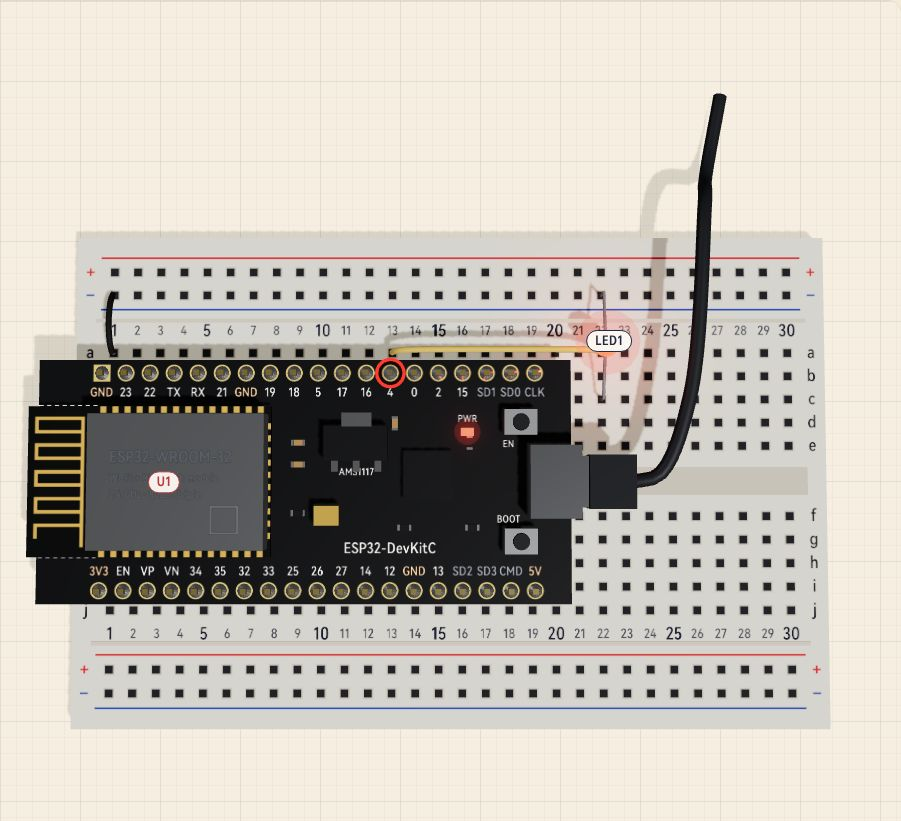
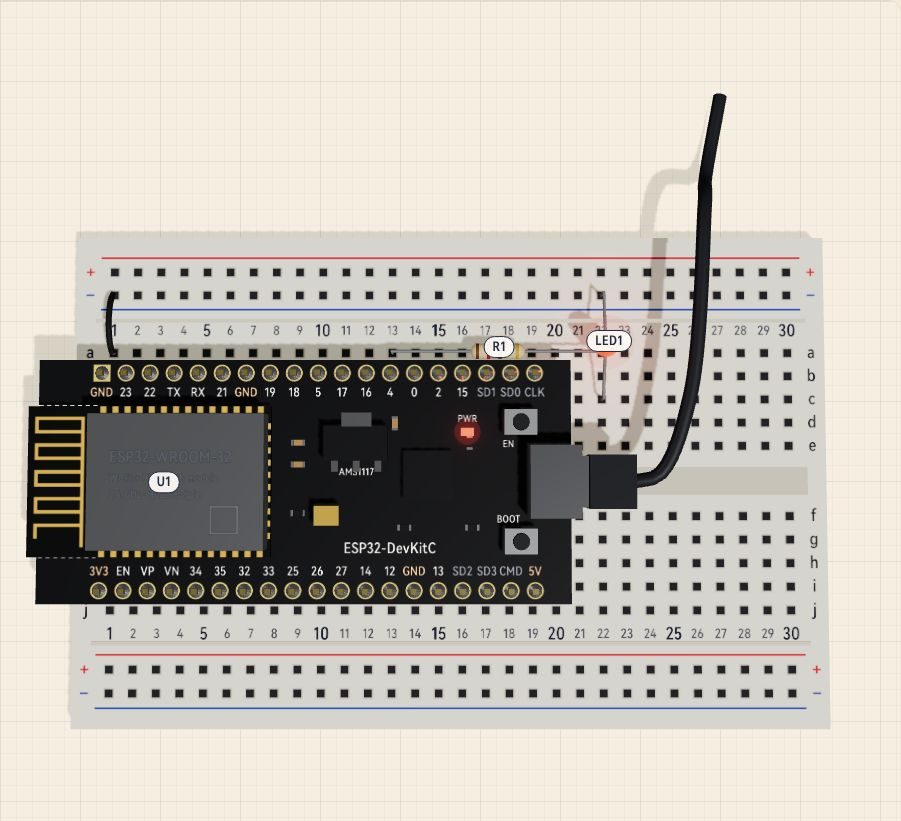
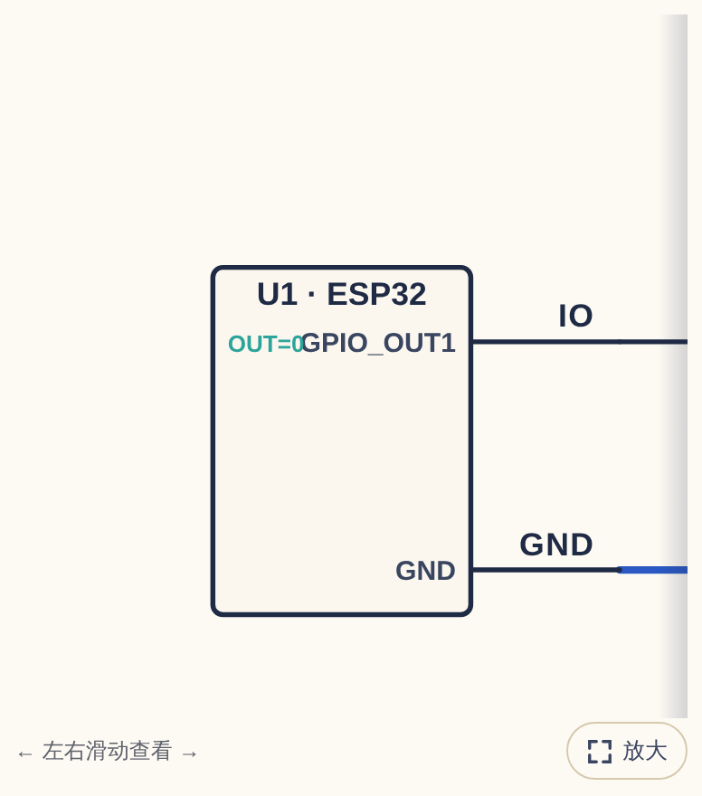
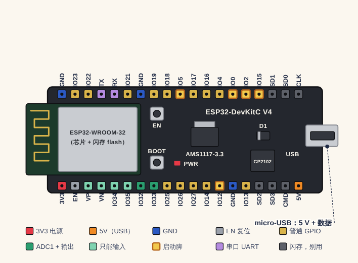
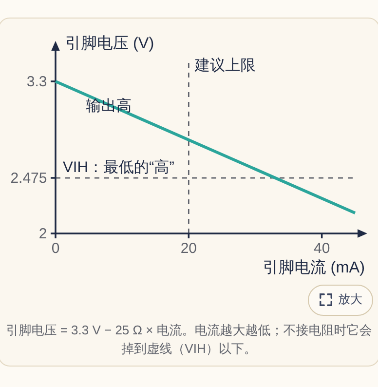
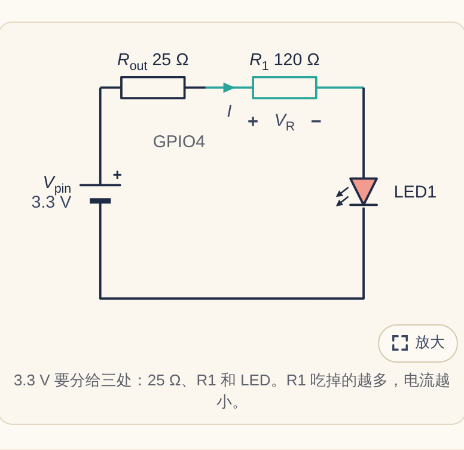

# 8.2 · GPIO 点灯：算出限流电阻

| 项目 | 内容 |
|---|---|
| id | `exp5-gpio-led-resistor` |
| 文件 | `challenges/280-gpio-led-resistor.json` |
| 类型 | 实验 / 挑战（没有分步，照目标电路图搭） · 难度 2/5 |
| 位置 | World 8 · 数字逻辑、MCU 与传感器实战 → 8.2 开发板与 GPIO（本节第 2 项） |
| 右侧面板 | 轨道由旧的四张卡片自动生成（还没手工精排） |
| 前后 | 上一项 [8.2 lesson-mcu-gpio](../w8/8.02-1-lesson-mcu-gpio.md) · 下一项 [8.2 lesson-bluepill-pins](../w8/8.02-3-lesson-bluepill-pins.md) |
| 先修 | lesson-mcu-gpio |
| 概念 | GPIO 输出 GPIO output、限流电阻 current-limiting resistor、引脚输出电阻 pin output resistance、引脚电流上限 pin current limit |

**一句话概要**：面包板上有人把 LED 直接接在 GPIO 上，引脚烧了。算出让 LED 电流约 10 mA 的电阻，换上去，再测引脚电压降了多少。

## 1. 左侧工作台（3D 面包板 → 2D 俯视截图）

截图是程序里真实的 3D 面包板换成俯视角拍的；表格是同一块板的文字版（元件、参数、每只脚插在哪个孔）。

### 1.1 起点：打开这一课时板上已经有的

右侧显示的「起点」说明：

> **半成品（有一处故意接错）**：ESP32 和 GND 线已经接好，LED 已经插好——但 GPIO4 和 LED 之间是一根**跳线**，没有电阻。**为什么**：先看诊断怎样报引脚过流，再自己算电阻。**你要做**：算出让 LED 约 10 mA 的电阻，把这根跳线换成它。

| 元件 | 类型 | 参数 | 引脚 → 孔 |
|---|---|---|---|
| U1 | esp32_devkit | usb=true, pins={"GPIO4":{"mode":"out_high"}} | GND→b1 GPIO23→b2 GPIO22→b3 GPIO1→b4 GPIO3→b5 GPIO21→b6 GND_2→b7 GPIO19→b8 GPIO18→b9 GPIO5→b10 GPIO17→b11 GPIO16→b12 GPIO4→b13 GPIO0→b14 GPIO2→b15 GPIO15→b16 GPIO8→b17 GPIO7→b18 GPIO6→b19 3V3→i1 EN→i2 GPIO36→i3 GPIO39→i4 GPIO34→i5 GPIO35→i6 GPIO32→i7 GPIO33→i8 GPIO25→i9 GPIO26→i10 GPIO27→i11 GPIO14→i12 GPIO12→i13 GND_3→i14 GPIO13→i15 GPIO9→i16 GPIO10→i17 GPIO11→i18 5V→i19 |
| W1 | wire |  | a→a1 b→tn1 |
| W2 | wire |  | a→a13 b→a22 |
| LED1 | led | color=red | anode→c22 cathode→tn22 |

### 1.3 参考答案（「看答案」载入的板子）

| 元件 | 类型 | 参数 | 引脚 → 孔 |
|---|---|---|---|
| U1 | esp32_devkit | usb=true, pins={"GPIO4":{"mode":"out_high"}} | GND→b1 GPIO23→b2 GPIO22→b3 GPIO1→b4 GPIO3→b5 GPIO21→b6 GND_2→b7 GPIO19→b8 GPIO18→b9 GPIO5→b10 GPIO17→b11 GPIO16→b12 GPIO4→b13 GPIO0→b14 GPIO2→b15 GPIO15→b16 GPIO8→b17 GPIO7→b18 GPIO6→b19 3V3→i1 EN→i2 GPIO36→i3 GPIO39→i4 GPIO34→i5 GPIO35→i6 GPIO32→i7 GPIO33→i8 GPIO25→i9 GPIO26→i10 GPIO27→i11 GPIO14→i12 GPIO12→i13 GND_3→i14 GPIO13→i15 GPIO9→i16 GPIO10→i17 GPIO11→i18 5V→i19 |
| W1 | wire |  | a→a1 b→tn1 |
| R1 | resistor | resistance=120 | 1→a13 2→a22 |
| LED1 | led | color=red | anode→c22 cathode→tn22 |

### 1.4 目标原理图（右侧「目标原理图」抽屉）

| 元件 | 类型 | 参数 |
|---|---|---|
| U1 | esp32_devkit |  |
| R1 | resistor | resistance=120 |
| LED1 | led | color=red |

连接（每个结点上的引脚）：

- **IO**：U1.GPIO_OUT1、R1.1
- **A**：R1.2、LED1.anode
- **GND**：LED1.cathode、U1.GND

## 2. 右侧面板：学生从上往下看到的内容（单轨流）

### 第 1 步 · 🔍 先看一眼：先认识它：开发板 GPIO

**拆解「开发板与 GPIO：一只引脚里面有什么」第 1 / 8 层：① 外形：一块板 = 芯片模块 + 稳压器 + USB + 两排针**

**dev board（开发板）** 不是芯片本身，而是把芯片做成“插上 USB 就能用”的一块小电路板。以 ESP32-DevKitC 为例：
- 左边的 金属屏蔽罩模块 里是真正的 ESP32 芯片和存程序的 flash（闪存），左端露出的弯曲铜线是 Wi-Fi 天线；
- micro-USB 口 同时做两件事：给板子供 5 V 电，和电脑传程序（经过 CP2102 这颗 USB 转串口芯片）；
- AMS1117-3.3 是 **LDO（低压差线性稳压器）**，把 5 V 降成芯片要的 3.3 V；
- EN 和 BOOT 两个按键：EN 是复位，BOOT 按住再复位进入下载模式；
- 上下两排共 38 只针，插在面包板上每只针旁边还空着一个孔。

一个关键事实：**这块板的逻辑电平是 3.3 V**。引脚输出高电平就是 3.3 V，输入能承受的上限也是 3.3 V——不是 5 V。

38 只针不是都一样，按用途分成下表这几组。悬停表格每一行，看它们在板上的位置。

| 组 | 引脚 | 能做什么 | 注意 |
|---|---|---|---|
| 3V3 电源 | 3V3 | LDO 的输出，给外部传感器供 3.3 V | 总电流受 LDO 和 USB 限制 |
| 5V 电源 | 5V | USB 5 V 经二极管后的电压 ≈ 4.7 V | 只能接 5 V 器件的电源，不能接 GPIO |
| GND | GND ×3 | 公共地，所有电压的参考点 | 外接电源必须共地 |
| EN | EN | 高 = 运行，拉低 = 复位 | 板上已有 10 kΩ 上拉 |
| 普通 GPIO | 4, 13, 14, 16–19, 21–23, 25–27 | 输出 / 输入 / 上下拉 / PWM | 首选这些 |
| ADC1 模拟输入 | 32–39（VP = 36，VN = 39） | 读 0–3.3 V 电压 | ADC2 的脚开 Wi-Fi 时不能用 |
| 只能输入 | 34, 35, 36, 39 | 只能输入 / ADC | 没有输出级，也没有内部上下拉 |
| 启动脚 strapping | 0, 2, 5, 12, 15 | 上电时被采样，决定启动方式 | 别接按键 / 上拉 / 负载 |
| 串口 UART | TX (1), RX (3) | 下载程序和串口打印 | 占用了就不能下载 |
| 闪存 flash | 6–11（CLK, SD0–3, CMD） | 接板上 flash 芯片 | 绝对不要用 |

### 第 2 步 · 🔧 动手搭：先看它烧掉

面包板上已经搭好了：**GPIO4** 设成「输出 高」，一根**黄色跳线**直接接到红色 LED，中间没有电阻。
看右边的**诊断**：GPIO4 怎么了？
再**单击开发板**，看引脚列表里 GPIO4 那一行的电压。它还算得上“高电平”吗？

### 第 3 步 · 💡 想明白：引脚不是理想电源

- 输出高的引脚像一节 **3.3 V 电池串一个 25 Ω** 的小电阻。没有外接电阻时，只有这 25 Ω 和 LED 里的 12 Ω 在限流——太小了，电流冲到上限。
- 电流越大，25 Ω 上掉的电压越多，引脚电压就越低。掉到一定程度，别的芯片连“高电平”都认不出来：

*图 `sag`（plot）：引脚电压 = 3.3 V − 25 Ω × 电流。电流越大越低；不接电阻时它会掉到虚线（VIH）以下。*

- 解决办法：串一个电阻。沿着回路写 KVL，解出电阻：
$$R = \frac{3.3 - V_f}{I} - 25 - 12$$
- 代入 10 mA：$R = \frac{3.3 - 1.8}{0.01} - 25 - 12 = 113$ Ω，取最接近的常用值 **120 Ω**（100 Ω 也行）。

*图 `loop`（schematic）：3.3 V 要分给三处：25 Ω、R1 和 LED。R1 吃掉的越多，电流越小。*

（这一步下面列着这节课的计算卡片，点开就地展开：`led-resistor`、`gpio-led-resistor`、`gpio-output-resistance`，全文见第 6 节）

### 第 4 步 · 🔧 动手搭：换上电阻

- **拔掉黄色跳线**，在同样的两个孔之间插上你算出的电阻。
- LED 长脚朝电阻，短脚接 GND——这两只脚已经插好了。
- 点**「检查我的电路」**。检查会自动把引脚切换成输出高和输出低；你也可以在引脚列表里自己切换。
- 然后串一块电流表读 LED 电流，用万用表测引脚电压。

### 第 5 步 · 📏 测一测：测一测：读你自己的仪表

**测量题 1 · `iled`**（读数题）

> 输出高电平：电流表串在电阻和 LED 之间，读 LED 电流

- 单位 mA · 先写预测 · 状态：U1 GPIO_OUT1 设为输出高电平 · 参考答案的读数 **9.535 mA** · 合理范围 [0.00906, 0.01]

答对后显示：

> I = (3.3 − 1.8) / (R + 25 Ω + 12 Ω)；120 Ω 时 1.5 / 157 ≈ 9.5 mA。

**测量题 2 · `vpin`**（读数题）

> 输出高电平：万用表测 GPIO 引脚对 GND 的电压

- 单位 V · 先写预测 · 状态：U1 GPIO_OUT1 设为输出高电平 · 参考答案的读数 **3.059 V** · 合理范围 [2.91, 3.21]

答对后显示：

> 3.3 − 25 Ω × 9.5 mA ≈ 3.06 V：有电流流出时引脚不再是 3.3 V。

**测量题 3 · `rout`**（计算题（用自己的读数算））

> 用你的两个读数算引脚的输出电阻 R_out = (3.3 V − V_pin) / I

- 单位 Ω · 先写预测 · 参考答案的读数 **25.32 Ω** · 合理范围 [24.1, 26.6] · 公式 `(3.3 - vpin) / iled`

答对后显示：

> ≈ 25 Ω（模型值；真实芯片里是输出 MOS 管的导通电阻）。引脚不是理想电压源：电流越大，压降越大。

**测量题 4 · `nores`**（选择题）

> 用你算出的 R_out 估计：如果像起始电路那样不接电阻，电流会是多少？

- A. 约 40 mA，到了绝对最大值，引脚电压低于 VIH，连“高电平”都算不上 ✅（正确）
- B. 约 10 mA，LED 自己会限流
- C. 约 1.5 A，LED 立刻烧断

答对后显示：

> I = 1.5 / (25 + 12) ≈ 40 mA，引脚电压 ≈ 2.29 V < 2.475 V（VIH）。LED 和引脚都只靠很小的内部电阻限流，必须串电阻。

### 第 6 步 · 🎒 带走：带走

- **GPIO 点 LED 一定要串电阻**：$R = (3.3 - V_f)/I - 25 - 12$，别忘了引脚自己的 25 Ω。
- **每个引脚建议 ≤ 20 mA，40 mA 就坏。** 所有引脚的电流还共用一个总预算：同时点十颗 20 mA 的灯就是 200 mA。大一点的负载要用三极管（5.3）。
- 现在的高亮 LED 1–2 mA 就很亮，指示灯常用 1 kΩ 左右，省电也不刺眼。
- 真实电路里的坑：蓝 / 白 LED 的 $V_f$ 约 2.9–3.2 V，3.3 V 引脚几乎没给电阻留下电压，亮度很不稳定。选引脚时也避开启动配置脚 GPIO0、2、5、12、15。

趁热练理论题：`basics`

## 3. 测量题一览

| # | id | 题目 | 类型 | 单位 | 状态 | 参考读数 |
|---|---|---|---|---|---|---|
| 1 | iled | 输出高电平：电流表串在电阻和 LED 之间，读 LED 电流 | current | mA | U1 GPIO_OUT1 设为输出高电平 | 9.535 mA |
| 2 | vpin | 输出高电平：万用表测 GPIO 引脚对 GND 的电压 | voltage | V | U1 GPIO_OUT1 设为输出高电平 | 3.059 V |
| 3 | rout | 用你的两个读数算引脚的输出电阻 R_out = (3.3 V − V_pin) / I | formula | Ω |  | 25.32 Ω |
| 4 | nores | 用你算出的 R_out 估计：如果像起始电路那样不接电阻，电流会是多少？ | 选择 |  |  | 正确：A |

### 全部答完后显示的「对比」

**对比**：
- 120 Ω 时：I = 1.5 / (120 + 25 + 12) ≈ **9.5 mA**，引脚电压 3.3 − 25 Ω × 9.5 mA ≈ **3.06 V**（掉了 0.24 V）。
- 没有电阻：I = 1.5 / 37 ≈ **40 mA**，引脚电压 ≈ 2.29 V，已经低于 VIH（2.475 V），还到了绝对最大值。
- 读数不在 8.5–11.5 mA 里时，先核对电阻值，再看 LED 方向和电阻是不是正好替换了那根跳线。

### 提示按钮（依次显示）

1. 先算电阻：沿回路 KVL，3.3 V = I·(R + 25 Ω + 12 Ω) + 1.8 V，代入 I = 10 mA 解出 R，再取最接近的常用值。
2. 拔掉黄色跳线，在同样的两个孔（GPIO 那一列和 LED 长脚那一列）之间插电阻。
3. R = (3.3 − 1.8) / 0.010 − 25 − 12 ≈ 113 Ω：100 Ω 或 120 Ω 都在 8.5–11.5 mA 里。

### 功能测试（「检查我的电路」时跑）

- 输出高电平：LED 亮，电流在 8.5–11.5 mA 之间，引脚电压是有效的高电平
- 输出低电平：LED 灭，引脚电流为 0

## 4. 用到的拆解（全部层的文字，供改写参考）

### 拆解 `devboard`：开发板与 GPIO：一只引脚里面有什么

*GPIO = General-Purpose Input/Output（通用输入输出）。从 ESP32 开发板的外形拆到电源路径，再拆到一只引脚里的两个晶体管、输入缓冲、上下拉电阻和钳位二极管；每一种模式都化成一个电路课能算的等效电路，最后用它算 LED 电阻和电流极限。*

**拆解「开发板与 GPIO：一只引脚里面有什么」第 1 / 8 层：① 外形：一块板 = 芯片模块 + 稳压器 + USB + 两排针**

**dev board（开发板）** 不是芯片本身，而是把芯片做成“插上 USB 就能用”的一块小电路板。以 ESP32-DevKitC 为例：
- 左边的 金属屏蔽罩模块 里是真正的 ESP32 芯片和存程序的 flash（闪存），左端露出的弯曲铜线是 Wi-Fi 天线；
- micro-USB 口 同时做两件事：给板子供 5 V 电，和电脑传程序（经过 CP2102 这颗 USB 转串口芯片）；
- AMS1117-3.3 是 **LDO（低压差线性稳压器）**，把 5 V 降成芯片要的 3.3 V；
- EN 和 BOOT 两个按键：EN 是复位，BOOT 按住再复位进入下载模式；
- 上下两排共 38 只针，插在面包板上每只针旁边还空着一个孔。

一个关键事实：**这块板的逻辑电平是 3.3 V**。引脚输出高电平就是 3.3 V，输入能承受的上限也是 3.3 V——不是 5 V。

38 只针不是都一样，按用途分成下表这几组。悬停表格每一行，看它们在板上的位置。

| 组 | 引脚 | 能做什么 | 注意 |
|---|---|---|---|
| 3V3 电源 | 3V3 | LDO 的输出，给外部传感器供 3.3 V | 总电流受 LDO 和 USB 限制 |
| 5V 电源 | 5V | USB 5 V 经二极管后的电压 ≈ 4.7 V | 只能接 5 V 器件的电源，不能接 GPIO |
| GND | GND ×3 | 公共地，所有电压的参考点 | 外接电源必须共地 |
| EN | EN | 高 = 运行，拉低 = 复位 | 板上已有 10 kΩ 上拉 |
| 普通 GPIO | 4, 13, 14, 16–19, 21–23, 25–27 | 输出 / 输入 / 上下拉 / PWM | 首选这些 |
| ADC1 模拟输入 | 32–39（VP = 36，VN = 39） | 读 0–3.3 V 电压 | ADC2 的脚开 Wi-Fi 时不能用 |
| 只能输入 | 34, 35, 36, 39 | 只能输入 / ADC | 没有输出级，也没有内部上下拉 |
| 启动脚 strapping | 0, 2, 5, 12, 15 | 上电时被采样，决定启动方式 | 别接按键 / 上拉 / 负载 |
| 串口 UART | TX (1), RX (3) | 下载程序和串口打印 | 占用了就不能下载 |
| 闪存 flash | 6–11（CLK, SD0–3, CMD） | 接板上 flash 芯片 | 绝对不要用 |

**拆解「开发板与 GPIO：一只引脚里面有什么」第 2 / 8 层：② X 光：电从 USB 到芯片走了哪条路**

把电路板变透明，只看电源。电流走的是一条串联的路：
1. USB 给 5.0 V；
2. 经过一个 肖特基二极管 Schottky diode（防止 5V 脚上的外部电源倒灌进电脑），压降约 0.3 V，所以 5V 脚实际约 4.7 V（第 15 课用万用表量到的就是它）；
3. LDO 把它降到 3.3 V，供给 ESP32 芯片 和 3V3 脚。

LDO 是“线性”稳压器：它像一个自动调节的电阻，把多出来的电压 **烧成热**。它要正常稳压，输入必须比输出高出一个 **dropout（压差）**：
$$V_{in} ≥ V_{out} + V_{dropout} = 3.3 + 1.1 = 4.4 V$$
4.7 V > 4.4 V，够用；但如果你用两节 AA 电池（3 V）从 5V 脚供电，LDO 就掉出稳压，3V3 会跟着掉。

所有 GPIO 输出电流、3V3 脚上外接的传感器，都从这一条路上来，所以有一个 **总预算**：芯片自己 ≈ 50 mA（开 Wi-Fi 发射时峰值几百 mA），USB 口最多 500 mA。

Blue Pill（STM32F103）的结构一样，只是数字不同，见下表。

| 参数 | ESP32-DevKitC | Blue Pill (STM32F103) |
|---|---|---|
| 逻辑电平 VDD | 3.3 V | 3.3 V |
| 稳压器（压差 / 上限） | AMS1117: 1.1 V / 1 A | 3.3 V LDO: 0.25 V / 300 mA |
| 芯片自身电流 | ≈ 50 mA | ≈ 20 mA |
| 输出电阻 R_out（仿真） | 25 Ω | 40 Ω |
| 每脚推荐 / 绝对最大 | 20 mA / 40 mA | 20 mA / 25 mA（PC13–15：3 mA） |
| $V_{IL}$ / $V_{IH}$ | 0.825 V / 2.475 V | 1.16 V / 2.15 V |
| 内部上下拉 | 45 kΩ | 40 kΩ |
| 5 V 容忍 | 没有任何脚 | FT 脚：PA8–15、PB2–4、PB6–15 |
| 掉电复位 brown-out | 2.5 V | 2.0 V |

- 公式 `V_{5V} = 5.0 - 0.3 = 4.7 V`：USB 经肖特基二极管
- 公式 `V_{in} ≥ 3.3 + 1.1 = 4.4 V`：AMS1117 能稳压的最低输入
- 公式 `P_{LDO} = (V_{in} - 3.3 V)·I = 1.4 V × 0.1 A = 0.14 W`：100 mA 负载时 LDO 发的热

**拆解「开发板与 GPIO：一只引脚里面有什么」第 3 / 8 层：③ 拆开一只引脚：两个晶体管、一个输入缓冲、两个电阻、两个二极管**

芯片手册里每只 GPIO 都画成这样一张图（STM32 参考手册 “I/O port bit” 那一节就是）。从右往左看：
- 焊盘 pad：芯片硅片上的一块金属，经金线连到外面的针；
- 两个钳位二极管 clamp diode：一个从引脚接到 3V3、一个从 GND 接到引脚。平时都反偏、不导电；引脚电压一旦高于 3V3 + 0.6 V 或低于 −0.6 V 就导通，把静电（ESD）泄放到电源轨上；
- 上拉电阻 $R_PU$ 和 下拉电阻 $R_PD$：各串一个开关，由程序决定接不接，约 45 kΩ；
- **输出级**：上管 P-MOS 接 3V3，下管 N-MOS 接 GND，两个管子的栅极都由 输出控制 驱动。这种一上一下的结构叫 **push-pull（推挽）**；
- 输入缓冲 input buffer：一个带回差的比较器（**Schmitt trigger，施密特触发器**），把引脚电压变成 0 或 1 存进输入寄存器。

注意输入缓冲 **一直接在引脚上**：不管引脚是不是输出，芯片都能读回它的电平。

| 部件 | 它是什么 | 什么时候起作用 | 数值（ESP32 仿真） |
|---|---|---|---|
| P-MOS | 引脚到 3V3 的开关 | 输出 HIGH 时导通 | 导通电阻 ≈ 25 Ω |
| N-MOS | 引脚到 GND 的开关 | 输出 LOW 时导通 | ≈ 25 Ω |
| 施密特输入缓冲 | 把电压变成 0 / 1 | 一直在读 | 输入电流 ≈ 0 |
| $R_{PU}$ / $R_{PD}$ | 可开关的上 / 下拉 | 输入模式选了上拉 / 下拉 | 45 kΩ |
| 钳位二极管 | 静电保护 | 引脚 > 3.9 V 或 < −0.6 V | 注入 < 5 mA |
| 输出控制 | 决定哪个管子导通 | 程序写 1 / 0 | — |

**拆解「开发板与 GPIO：一只引脚里面有什么」第 4 / 8 层：④ 输入：阈值、悬空和上拉电阻**

做输入时两个管子都关断，引脚只接着输入缓冲，它几乎不取电流（漏电小于 1 µA）。读数规则：
- 电压 ≤ $V_IL$ = 0.825 V（0.25·VDD） → 保证读 0；
- 电压 ≥ $V_IH$ = 2.475 V（0.75·VDD） → 保证读 1；
- 中间那一段 → 手册不保证，可能 0 也可能 1。

真正的翻转点在中间，而且 **上升和下降不是同一个点**：施密特触发器 上升时要过 $V_{T+}$ 才变 1，下降时要低于 $V_{T-}$ 才变 0。这段 **回差（hysteresis）** 让一个慢慢变化、带点噪声的信号（例如按键抖动、长导线）不会在阈值附近来回乱跳。

**悬空（floating）**：一只没人驱动的输入引脚，等效电路只是几 pF 的电容对地——电荷稍有扰动（手靠近、旁边导线的耦合）电压就变，读数随机。所以按键必须配一个 **上拉 / 下拉电阻**，给引脚一个确定的“默认电压”：
- 上拉（pull-up）：松开时电阻把引脚拉到 3.3 V 读 1；按下时按键把引脚接到 GND 读 0（**active-low，低有效**）；
- 按下时上拉电阻里有电流：$I = \frac{3.3 V}{45 kΩ} = 73 µA$，很小，所以选几十 kΩ：大到不浪费电，小到压得住噪声。

| 输入模式 | 按键接法 | 松开读 | 按下读 | 按下时电流 |
|---|---|---|---|---|
| 输入（无上下拉） | 任意 | 悬空，乱跳 | ? | — |
| 输入 + 内部上拉 | 引脚 → 按键 → GND | 1 | 0 | 3.3 V / 45 kΩ = 73 µA |
| 输入 + 内部下拉 | 3V3 → 按键 → 引脚 | 0 | 1 | 73 µA |
| 输入 + 外部 10 kΩ 下拉（实验 5-3） | 3V3 → 按键 → 引脚 | 0 | 1 | 3.3 V / 10 kΩ = 0.33 mA |

- 公式 `V_{IL} = 0.25·V_{DD} = 0.825 V,   V_{IH} = 0.75·V_{DD} = 2.475 V`：ESP32；Blue Pill 是 1.16 V / 2.15 V
- 公式 `I_{PU} = \frac{V_{DD}}{R_{PU}} = \frac{3.3}{45 k} = 73 µA`：按键按下时

**拆解「开发板与 GPIO：一只引脚里面有什么」第 5 / 8 层：⑤ 每种模式的等效电路：引脚就是“电源 + 电阻”**

把上一层的图按模式“删掉不导通的部分”，剩下的就是电路课里能直接算的模型：
- OUT HIGH：上管导通 → 引脚 = **3.3 V 理想电压源串联 $R_{out}$**（戴维南等效，Thevenin equivalent）。$R_{out}$ 就是 P-MOS 的导通电阻，ESP32 约 25 Ω、Blue Pill 约 40 Ω；
- OUT LOW：下管导通 → 引脚经 $R_{out}$ 接 GND（0 V 电源串 $R_{out}$）；
- INPUT：两管都关 → 引脚几乎是 **开路**，只剩几 pF 电容；
- INPUT + 上拉：开路 + 一个 45 kΩ 接 3V3。这其实还是戴维南电路：3.3 V 串 45 kΩ——只不过电阻大了一千多倍，所以它只能“建议”电平，任何外部驱动都能压过它；
- open-drain（开漏）：上管永远不用，只有下管：要么拉到 GND，要么断开。高电平靠外部上拉电阻，好处是外部上拉可以接 5 V（电平转换）、多个开漏输出可以并在一根线上（I²C 总线）；
- PWM：输出级在 HIGH 和 LOW 之间按占空比 D 来回切换，下一个拆解（PWM 与 ADC）细讲。

有了这些模型，接上外部电路就是一道普通的 KVL / 分压题。

| 模式 | 等效电路 | 引脚电压 | 典型用途 |
|---|---|---|---|
| OUT HIGH | 3.3 V 串 25 Ω | $3.3 - 25·I$ | 点 LED、驱动晶体管基极 / 栅极 |
| OUT LOW | 0 V 串 25 Ω | $25·I$ | 灌电流点 LED |
| INPUT | 开路（几 pF） | 由外部决定 | 读有源信号 |
| INPUT + 上拉 / 下拉 | 3.3 V 或 0 V 串 45 kΩ | 松开时 3.3 V / 0 V | 按键、开关 |
| open-drain | 开关到 GND | 0 V 或由外部上拉 | I²C、电平转换 |
| PWM | HIGH / LOW 交替 | 平均 D·3.3 V | 调光、调速 |
| ADC | 开路 + 采样电容 | 被测量 | 读传感器电压 |

**拆解「开发板与 GPIO：一只引脚里面有什么」第 6 / 8 层：⑥ 拉电流和灌电流：LED 接上面还是接下面**

推挽输出级有两个管子，所以一只引脚能用两种方向驱动负载（实验 5-2，Blue Pill，$R_{out}$ = 40 Ω）：
- source（拉电流）：负载接在引脚和 GND 之间，引脚 HIGH 时上管把电流 **推出** 引脚。
$$I_1 = \frac{3.3 - 1.8}{40 + 220 + 12} = \frac{1.5}{272} = 5.5 mA，V_{pin} = 3.3 - 40 × 5.5 mA = 3.08 V$$
- sink（灌电流）：负载接在 3V3 和引脚之间，引脚 LOW 时下管把电流 **吸进** 引脚到 GND。
$$I_2 = \frac{1.5}{272} = 5.5 mA，V_{pin} = 40 × 5.5 mA = 0.22 V$$

灌电流接法下，“写 0 灯亮、写 1 灯灭”，叫 **active-low（低有效）**。Blue Pill 板上 PC13 的 LED 就是这样接的：3V3 → 510 Ω → LED → PC13，PC13 输出 LOW 时灌入 $\frac{1.5}{510 + 40 + 12} ≈ 2.7 mA$。

仿真里两个管子电阻相同，所以两种接法电流相等；**真实芯片里 N-MOS 一般比 P-MOS 强**（同样面积导通电阻更小，因为电子比空穴跑得快），灌电流时压降更小。老式 TTL 和 8051 几乎只能灌不能拉，所以很多经典电路都是低电平点灯。

|  | 拉电流 source | 灌电流 sink |
|---|---|---|
| 负载接在 | 引脚 ↔ GND | 3V3 ↔ 引脚 |
| 亮的时候引脚是 | HIGH | LOW（低有效） |
| 导通的管子 | 上管 P-MOS | 下管 N-MOS |
| 引脚电流（仿真符号） | +5.5 mA（流出） | −5.5 mA（流入） |
| 引脚电压 | 3.08 V | 0.22 V |
| 例子 | 实验 5-1 的 LED | Blue Pill 的 PC13 LED |

- 公式 `I = \frac{V_{DD} - V_f}{R_{out} + R + R_{LED}}`：两种接法是同一个回路，只是开关的位置不同

**拆解「开发板与 GPIO：一只引脚里面有什么」第 7 / 8 层：⑦ 一步步算：3.3 V 引脚点一个 LED 要多大电阻**

实验 5-1：ESP32 引脚 HIGH → R → 红色 LED → GND，目标 10 mA。把每个元件换成第 ⑤ 层的模型：
- 引脚 = 3.3 V 串 $R_out$ = 25 Ω；
- 红色 LED = $V_f$ = 1.8 V 串 12 Ω（仿真模型）；
- 中间是我们要求的 R。

**第 1 步 · KVL**：绕回路一圈，电压升 = 电压降：
$$3.3 = I·R_{out} + I·R + I·R_{LED} + V_f$$
**第 2 步 · 解出 R**：
$$R = \frac{3.3 - V_f}{I} - R_{out} - R_{LED} = \frac{1.5 V}{10 mA} - 25 - 12 = 150 - 37 = 113 Ω$$
**第 3 步 · 选标准值**：E12 系列里最近的是 120 Ω（100 Ω 也行）。
**第 4 步 · 反过来验算**：$I = \frac{1.5}{25 + 120 + 12} = 9.5 mA$；引脚电压 $V_{pin} = 3.3 - 25 × 9.5 mA = 3.06 V$——带了负载，HIGH 就不是 3.3 V 了。

**如果不加电阻**（实验的初始电路）：$I = \frac{1.5}{25 + 12} = 40 mA$，正好是绝对最大值；引脚掉到 $3.3 - 25 × 40 mA = 2.29 V$，比 $V_{IH}$ = 2.475 V 还低——连一个合格的 HIGH 都不是了。很多人以为“3.3 V 很低，LED 不用电阻”，问题就在于：限流的只剩 $R_{out}$ 和 LED 的内阻。

| R | I | 引脚电压 | 结论 |
|---|---|---|---|
| 0 Ω（直连） | 40 mA | 2.29 V | 引脚损坏 |
| 100 Ω | 10.9 mA | 3.03 V | 可以 |
| 120 Ω | 9.5 mA | 3.06 V | 本实验的答案 |
| 150 Ω | 8.0 mA | 3.10 V | 亮，但低于 8.5 mA 窗口 |
| 1 kΩ | 1.4 mA | 3.26 V | 指示灯常用，够亮 |

- 公式 `R = \frac{V_{DD} - V_f}{I} - R_{out} - R_{LED}`：从 KVL 解出
- 公式 `V_{pin} = V_{DD} - I·R_{out}`：带载后的高电平

**拆解「开发板与 GPIO：一只引脚里面有什么」第 8 / 8 层：⑧ 局限：电流上限、3.3 V 不是 5 V、钳位二极管**

**电流**：$R_{out}$ 上的压降 $I·R_{out}$ 和发热 $I^{2}·R_{out}$ 随电流增大。ESP32 每脚推荐 ≤ 20 mA、绝对最大 40 mA（Blue Pill 25 mA，PC13–15 只有 3 mA）。还有 **所有引脚加起来** 的上限：电流都从芯片的几只 VDD 脚和 LDO 来。要驱动蜂鸣器、继电器、电机，用三极管或 MOSFET（后面两个拆解）。

**电压**：ESP32 的引脚 **没有一只能接 5 V**。原因就在 上钳位二极管：把一个 5 V 模块的输出经 $R_s$ 接到引脚上，引脚被二极管钳在约 3.9 V，多出的电压全落在 R_s 上，电流 注入 3V3 电源轨：
$$I_{inj} = \frac{5 - 3.3 - 0.6}{1 kΩ} ≈ 1.1 mA$$
这股电流没地方去——LDO 只能输出电流，不能吸收——于是它给 芯片内核 和其他负载供电，3V3 被“反向供电”顶高。不加电阻直接接 5 V，注入电流几十 mA，芯片可能当场损坏。仿真里注入超过 5 mA 就判损坏。

**正确做法**：分压电阻（5 V → 10 kΩ / 20 kΩ → 3.3 V）、电平转换芯片，或者用开漏输出 + 上拉到对方的电源（实验 5-10、5-11）。Blue Pill 的 **FT 脚**（five-volt tolerant）没有上钳位二极管，数字模式下能接 5 V；但 **一旦设成模拟输入（ADC）就不再容忍 5 V**。

**模型没画的**：$R_{out}$ 其实随电流和温度变化，固件可以调驱动强度；真实输入有几 µA 漏电。

| 极限 | ESP32 | Blue Pill | 超过会怎样 |
|---|---|---|---|
| 每脚推荐电流 | 20 mA | 20 mA（PC13–15：3 mA） | 警告：压降大、发热 |
| 每脚绝对最大 | 40 mA | 25 mA | 引脚损坏 |
| 引脚电压范围 | −0.3 … 3.6 V | 非 FT：同左；FT：≤ 5.5 V | 钳位二极管导通 |
| 钳位注入电流 | < 5 mA | < 5 mA | 损坏，3V3 被顶高 |
| USB 总电流 | 500 mA | 500 mA | 电脑口限流 / 掉电 |
| LDO 上限 | 1 A | 300 mA | 稳压器过热 / 限流 |

- 公式 `I_{inj} = \frac{V_{ext} - V_{DD} - 0.6 V}{R_s}`：外部高于 3V3 时钳位二极管里的电流

**一句话记住**：一只 GPIO = 两个开关（P-MOS 到 3V3、N-MOS 到 GND）+ 一个施密特输入 + 可开关的 45 kΩ 上下拉 + 两个钳位二极管。输出时它是“3.3 V 串 25 Ω”，输入时它是开路；算 LED 电阻要把 $R_{out}$ 算进 KVL，电流 ≤ 20 mA，电压永远不超过 3.3 V。

## 5. 这一课的计算卡片

**计算卡片 `led-resistor`：LED 限流电阻 LED series resistor**

- 公式 `R = \frac{V_s - V_F{I_F}`
- 用途：给 LED 选串联电阻，让它亮又不烧。
- 输入：Vs（电源电压，V）；VF（LED 正向压降 V_F（红 ≈ 2 V，蓝/白 ≈ 3 V），V）；IF（想要的电流（5–15 mA），A） → R（串联电阻，Ω）

LED 不是电阻：一旦导通，它两端的电压几乎固定在 $V_F$，电流却可以变得很大。所以必须串一个电阻来 **定电流**：
1. KVL：$V_s = V_R + V_F$，所以电阻上的电压 $V_R = V_s - V_F$
2. 欧姆定律：$I_F = \frac{V_R{R}$
3. 解出 $R = \frac{V_s - V_F{I_F}$，再选一个 **稍大** 的标准值（E12：330、470、680、1 k …）

例子：9 V、红 LED、15 mA：$R = \frac{9 - 2}{0.015} ≈ 467 Ω$ → 选 470 Ω（第 1 课）。

- ⚠ 忘了减 V_F：用 $\frac{V_s{I}$ 会得到偏大的电阻（不危险，只是暗）。
- ⚠ 不串电阻直接接电池：电流只受内阻限制，LED 立刻烧掉。

**计算卡片 `gpio-led-resistor`：GPIO 点 LED 的电阻（含引脚内阻）**

- 公式 `R = \frac{V_{OH} - V_F}{I} - R_{out} - r_d`
- 用途：单片机引脚直接驱动 LED：串多大的电阻得到想要的电流。
- 输入：V_OH（引脚高电平（空载），V）；V_F（LED 正向压降（红 1.8 V），V）；I（想要的电流（≤ 20 mA），A）；R_out（引脚输出电阻（ESP32 25 Ω、Blue Pill 40 Ω），Ω）；r_d（LED 内阻，Ω） → R（串联电阻（再取一个标准值），Ω）

1. 输出高电平的引脚不是理想电压源：它像 3.3 V 串一个输出电阻 $R_{out}$（芯片里 MOS 管的导通电阻）。
2. LED 用折线模型：$V_F$ 串 $r_d$。
3. 回路 KVL：$V_{OH} = I(R_{out} + R + r_d) + V_F$。
4. 解出 $R = \frac{V_{OH} - V_F}{I} - R_{out} - r_d$，取最接近的标准值，再回算电流：$I = \frac{V_{OH} - V_F}{R + R_{out} + r_d}$。
5. 灌电流（LED 接 3V3、阴极接引脚、输出低电平点亮）公式一样，$R_{out}$ 换成下管的电阻。

例子：- 实验 5-1：10 mA：$\frac{1.5}{0.01} - 25 - 12 = 113 Ω$ → 120 Ω，$I = \frac{1.5}{157} ≈ 9.5 mA$。不串电阻：$\frac{1.5}{37} ≈ 40 mA$——到了绝对最大值。
- 第 15 课：330 Ω：$\frac{1.5}{330 + 25 + 12} ≈ 4.1 mA$。
- 实验 5-2（Blue Pill，40 Ω）：220 Ω：$\frac{1.5}{272} ≈ 5.5 mA$；板载 LED 510 Ω：≈ 2.7 mA。

- ⚠ 蓝 / 白 LED（$V_F$ ≈ 3 V）在 3.3 V 引脚上只剩 0.3 V 给电阻：亮度对一切都很敏感——用三极管从 5 V 驱动。
- ⚠ 每个引脚建议 ≤ 20 mA，所有引脚加起来也有上限（STM32F103 共 150 mA）。

**计算卡片 `gpio-output-resistance`：引脚的输出电阻（从读数反推）**

- 公式 `R_{out} = \frac{V_{DD} - V_{pin}}{I}`
- 用途：输出高电平时测到引脚电压和电流，算出引脚的内阻；也能预测重载时引脚掉到多少。
- 输入：V_DD（空载高电平，V）；V_pin（带载时测到的引脚电压，V）；I（引脚电流，A） → R_out（输出电阻，Ω）

1. 输出高电平 = 3.3 V 串 $R_{out}$（戴维宁模型）。
2. 有电流流出时，$R_{out}$ 上压降 $IR_{out}$，引脚电压 $V_{pin} = V_{DD} - IR_{out}$。
3. 量出 $V_{pin}$ 和 I，反解 $R_{out}$。
4. 低电平同理：$R_{low} = \frac{V_{OL}}{I}$（电流流进引脚）。
5. 引脚电压掉到 $V_{IH}$ 以下，别的芯片就不认它是高电平了。

例子：实验 5-1：$\frac{3.3 - 3.06}{9.5 mA} ≈ 25 Ω$。第 15 课：$\frac{3.3 - 3.20}{4.1 mA} ≈ 25 Ω$；20 mA 时引脚只剩约 2.8 V，40 mA 时 2.29 V < $V_{IH}$（2.475 V）。实验 5-2：$\frac{0.22 V}{5.5 mA} = 40 Ω$。

- ⚠ 真实芯片的输出电阻随电流、温度和固件里的驱动强度设置变化；这里的 25 Ω / 40 Ω 是模型值。

## 6. English（界面英文版的同一份内容）

展开英文

### Node 1 · 🔍 Look first：Meet it first: Dev board GPIO

**Teardown「The dev board and GPIO: what is inside one pin」layer 1 of 8：① Outside: a module, a regulator, USB and two rows of pins**

A **dev board** is not the chip itself but a small board that makes the chip "plug in USB and go". Take the ESP32-DevKitC:
- the metal-shielded module on the left holds the actual ESP32 chip and the flash that stores the program; the wiggly copper at the left end is the Wi-Fi antenna;
- the micro-USB socket does two jobs: it powers the board with 5 V and carries the program from the PC (through the CP2102 USB-to-serial chip);
- AMS1117-3.3 is an **LDO (low-dropout linear regulator)** that turns 5 V into the 3.3 V the chip runs on;
- the EN and BOOT buttons: EN is reset; hold BOOT while resetting to enter download mode;
- 38 pins in two rows; on a breadboard each pin keeps one free hole beside it.

One key fact: **the logic level of this board is 3.3 V**. A pin driven high is at 3.3 V, and 3.3 V is also the most an input may see — not 5 V.

The 38 pins are not all alike; they fall into the groups in the table. Hover a row to see where they are on the board.

| Group | Pins | What it can do | Watch out |
|---|---|---|---|
| 3V3 power | 3V3 | the LDO output: 3.3 V for sensors | total current limited by LDO and USB |
| 5V power | 5V | USB 5 V after a diode ≈ 4.7 V | for 5 V parts’ power, never a GPIO |
| GND | GND ×3 | common ground, reference of every voltage | external supplies must share it |
| EN | EN | high = run, low = reset | has a 10 kΩ pull-up on board |
| plain GPIO | 4, 13, 14, 16–19, 21–23, 25–27 | output / input / pulls / PWM | use these first |
| ADC1 analog | 32–39（VP = 36，VN = 39） | read 0–3.3 V | ADC2 pins stop working with Wi-Fi |
| input only | 34, 35, 36, 39 | input / ADC only | no output stage, no internal pulls |
| strapping | 0, 2, 5, 12, 15 | sampled at power-up to pick the boot mode | keep buttons, pulls and loads off |
| UART | TX (1), RX (3) | upload and serial print | busy = no uploads |
| flash | 6–11（CLK, SD0–3, CMD） | wired to the onboard flash | never use |

### Node 2 · 🔧 Build：Watch it burn first

The board is already built: **GPIO4** is set to OUT HIGH, and a **yellow jumper** goes straight to a red LED, with no resistor.
Look at the **diagnostics** on the right: what happened to GPIO4?
Then **click the board** and read GPIO4's row in the pin list. Is that voltage still a valid "high"?

### Node 3 · 💡 Why：A pin is not an ideal source

- A pin at output high is like a **3.3 V battery behind 25 Ω**. With no resistor outside, only those 25 Ω and the LED's own 12 Ω limit the current — far too little, so the current hits the limit.
- The more current, the more voltage those 25 Ω take, and the lower the pin voltage. Low enough, and another chip no longer sees it as "high":

[figure `sag`]

*Figure `sag`（plot）：引脚电压 = 3.3 V − 25 Ω × 电流。电流越大越低；不接电阻时它会掉到虚线（VIH）以下。*

- The fix: a series resistor. Write KVL around the loop and solve for it:
$$R = \frac{3.3 - V_f}{I} - 25 - 12$$
- For 10 mA: $R = \frac{3.3 - 1.8}{0.01} - 25 - 12 = 113$ Ω; take the nearest standard value, **120 Ω** (100 Ω works too).

[figure `loop`]

*Figure `loop`（schematic）：3.3 V 要分给三处：25 Ω、R1 和 LED。R1 吃掉的越多，电流越小。*

(This node lists the lesson’s calculation cards: `led-resistor`、`gpio-led-resistor`、`gpio-output-resistance`; full text in section 6)

### Node 4 · 🔧 Build：Fit the resistor

- **Pull out the yellow jumper** and put the resistor you worked out between the same two holes.
- LED long lead toward the resistor, short lead to GND — both are already in place.
- Press **Check my circuit**. The check switches the pin to output high and output low by itself; you can switch it in the pin list too.
- Then put an ammeter in series to read the LED current, and measure the pin voltage with the multimeter.

### Node 5 · 📏 Measure：Measure: read your own instruments

**Question 1 · `iled`**（reading）

> Output HIGH: ammeter in series between the resistor and the LED, read the LED current

- unit mA · predict first · state：U1 GPIO_OUT1 is output HIGH · range [0.00906, 0.01]

Shown once right:

> I = (3.3 − 1.8) / (R + 25 Ω + 12 Ω); with 120 Ω, 1.5 / 157 ≈ 9.5 mA.

**Question 2 · `vpin`**（reading）

> Output HIGH: multimeter on the GPIO pin to GND

- unit V · predict first · state：U1 GPIO_OUT1 is output HIGH · range [2.91, 3.21]

Shown once right:

> 3.3 − 25 Ω × 9.5 mA ≈ 3.06 V: with current flowing out the pin is no longer 3.3 V.

**Question 3 · `rout`**（calculation from own readings）

> From your two readings, the pin's output resistance R_out = (3.3 V − V_pin) / I

- unit Ω · predict first · range [24.1, 26.6] · formula `(3.3 - vpin) / iled`

Shown once right:

> ≈ 25 Ω (the model value; in a real chip it is the output MOSFET's on-resistance). A pin is not an ideal voltage source: the more current, the bigger the drop.

**Question 4 · `nores`**（multiple choice）

> With your R_out, estimate: with no resistor, as on the starting board, the current would be

- A. about 40 mA, the absolute maximum, and the pin falls below VIH, not even a valid HIGH ✅ (right)
- B. about 10 mA, the LED limits itself
- C. about 1.5 A, the LED burns out at once

Shown once right:

> I = 1.5 / (25 + 12) ≈ 40 mA and the pin sits at ≈ 2.29 V < 2.475 V (VIH). Only tiny internal resistances limit the current, so a series resistor is a must.

### Node 6 · 🎒 Take away：Take away

- **An LED on a GPIO always needs a resistor**: $R = (3.3 - V_f)/I - 25 - 12$ — don't forget the pin's own 25 Ω.
- **Keep each pin ≤ 20 mA; 40 mA breaks it.** All the pins also share one budget: ten LEDs at 20 mA is 200 mA. Bigger loads need a transistor (5.3).
- Modern bright LEDs glow well at 1–2 mA; indicator lights usually get about 1 kΩ, which saves power and is easy on the eyes.
- A real-circuit catch: blue / white LEDs have $V_f$ ≈ 2.9–3.2 V, leaving almost nothing for the resistor on a 3.3 V pin, so their brightness is unstable. And keep away from the boot pins GPIO0, 2, 5, 12 and 15.

Practise：`basics`

**Compare**

**Compare**:
- With 120 Ω: I = 1.5 / (120 + 25 + 12) ≈ **9.5 mA**, pin voltage 3.3 − 25 Ω × 9.5 mA ≈ **3.06 V** (0.24 V lower).
- No resistor: I = 1.5 / 37 ≈ **40 mA**, pin voltage ≈ 2.29 V — below VIH (2.475 V), and at the absolute maximum.
- Reading outside 8.5–11.5 mA? Check the resistor value first, then the LED's direction and that the resistor sits exactly where the jumper was.

**Hints**

1. Work out the resistor first: KVL around the loop gives 3.3 V = I·(R + 25 Ω + 12 Ω) + 1.8 V; put in I = 10 mA, solve for R and take the nearest standard value.
2. Pull out the yellow jumper and put the resistor between the same two holes (the GPIO column and the LED's long-lead column).
3. R = (3.3 − 1.8) / 0.010 − 25 − 12 ≈ 113 Ω: 100 Ω or 120 Ω both land inside 8.5–11.5 mA.

