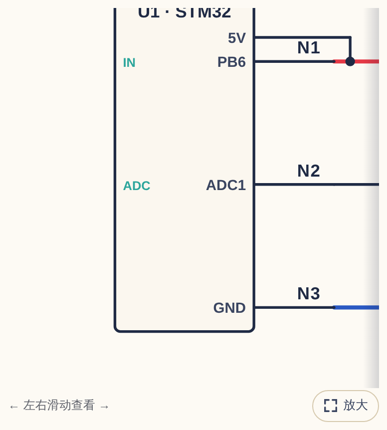
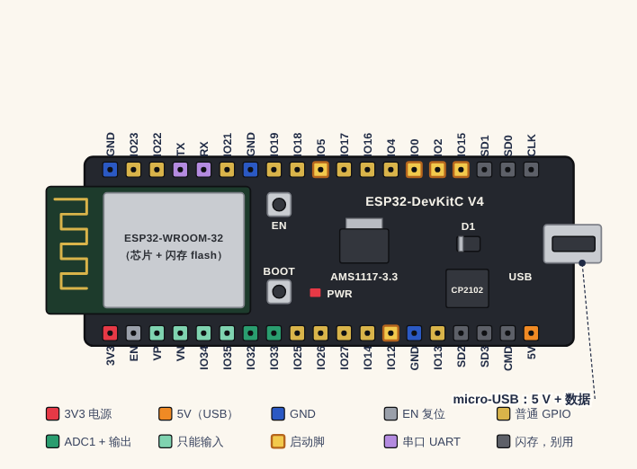
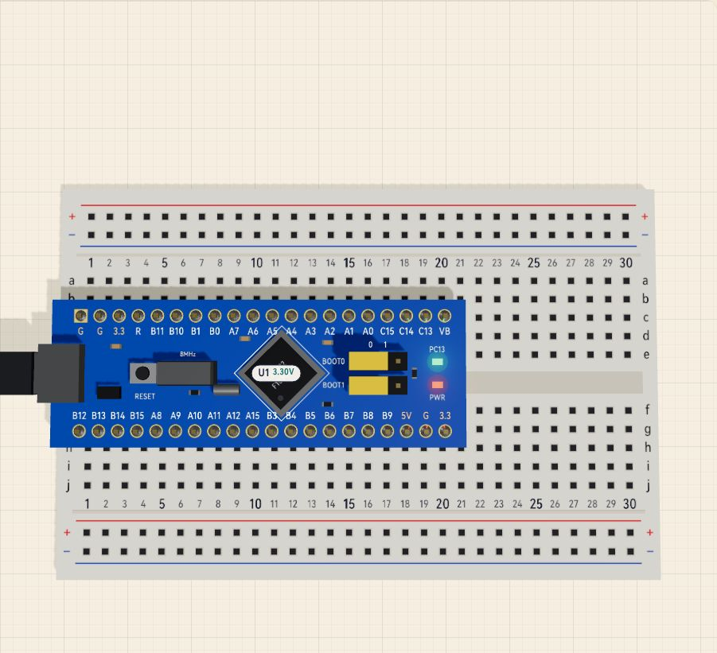
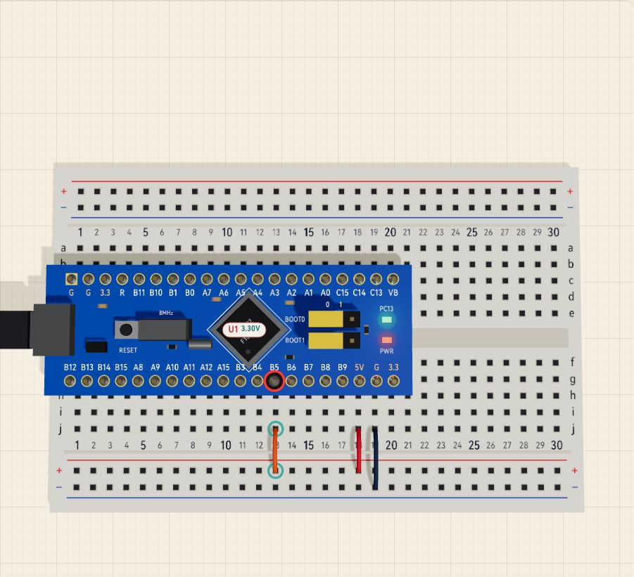
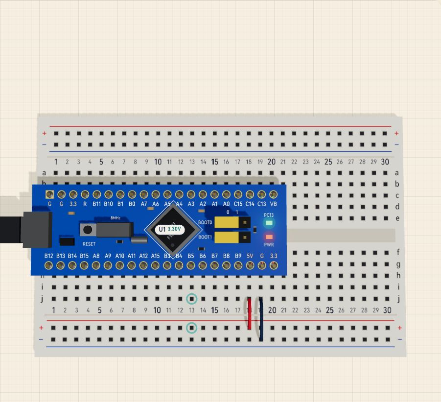
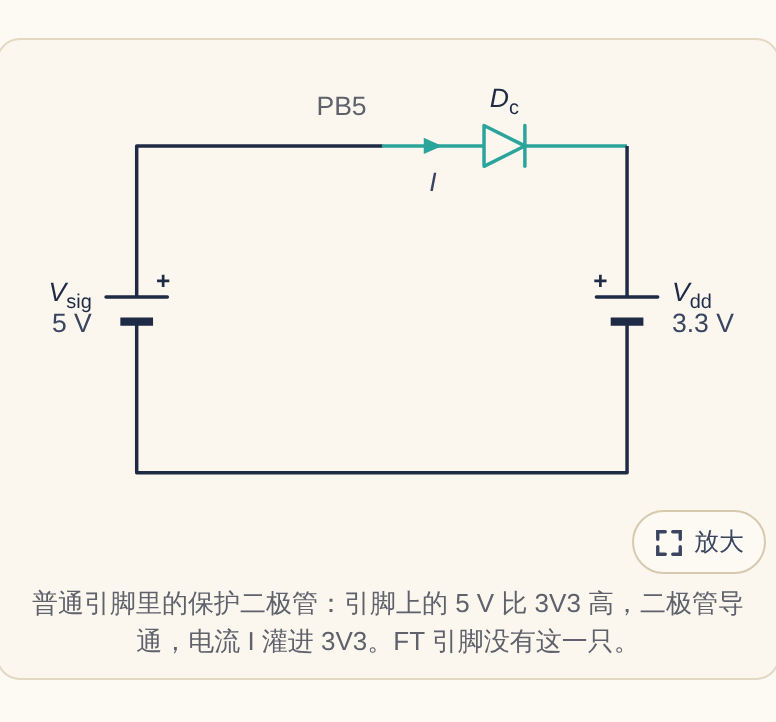
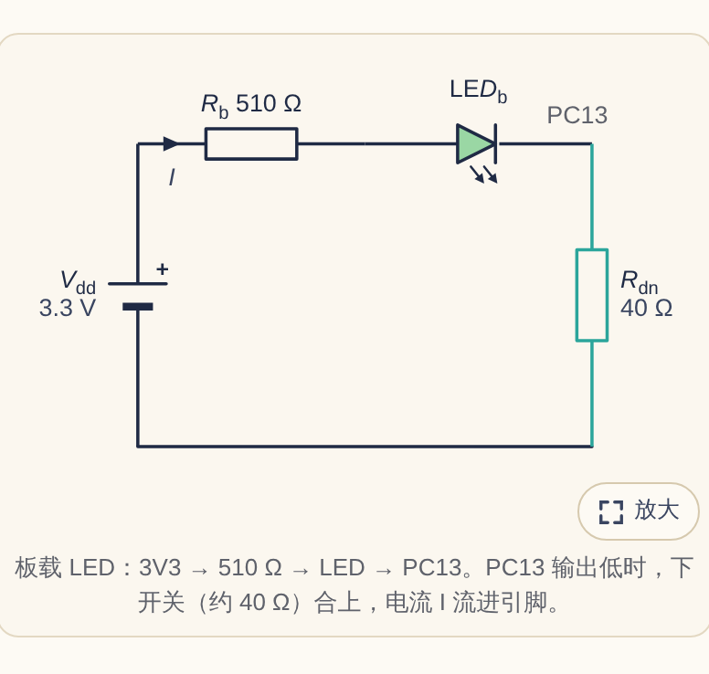
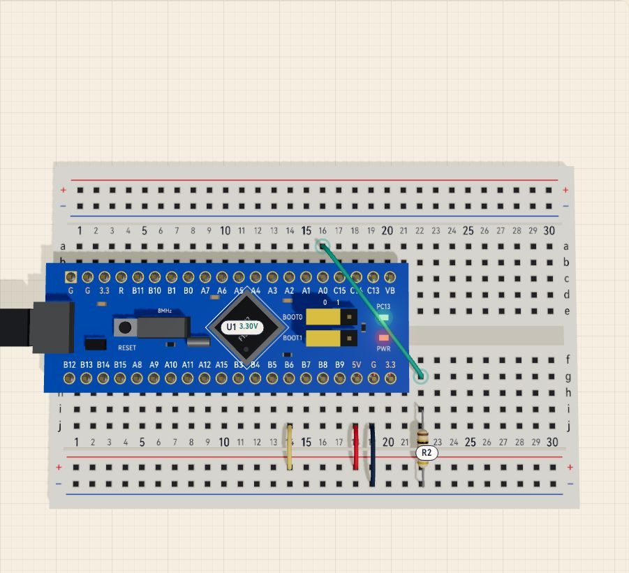

# 8.2 · Blue Pill 的引脚：哪个脚能干什么

| 项目 | 内容 |
|---|---|
| id | `lesson-bluepill-pins` |
| 文件 | `challenges/300-lesson-bluepill-pins.json` |
| 类型 | 课程（有分步，每步自动检查） · 难度 3/5 |
| 位置 | World 8 · 数字逻辑、MCU 与传感器实战 → 8.2 开发板与 GPIO（本节第 3 项） |
| 右侧面板 | 轨道由旧的四张卡片自动生成（还没手工精排） |
| 前后 | 上一项 [8.2 exp5-gpio-led-resistor](../w8/8.02-2-exp5-gpio-led-resistor.md) · 下一项 [8.2 exp5-sink-vs-source](../w8/8.02-4-exp5-sink-vs-source.md) |
| 先修 | lesson-mcu-gpio |
| 概念 | 5 V tolerant (FT) 耐 5 V 引脚、clamp diode 保护二极管、PC13 weak pin 弱引脚、onboard LED 板载 LED、ADC pins 模拟输入引脚 |

**一句话概要**：Blue Pill 的引脚长得一样，本事不一样：有的耐 5 V，有的只能给 3 mA，只有几个能读模拟电压。先把 5 V 送错一次，再挑对引脚。

## 1. 左侧工作台（3D 面包板 → 2D 俯视截图）

截图是程序里真实的 3D 面包板换成俯视角拍的；表格是同一块板的文字版（元件、参数、每只脚插在哪个孔）。

### 1.1 起点：空面包板（学生从零开始搭）

### 1.2 每一步之后的面包板

见第 2 节每个步骤下面的截图（按步骤的自动检查重建：放 / 改 / 拔元件、移动万用表表笔）。

### 1.3 参考答案（「看答案」载入的板子）

| 元件 | 类型 | 参数 | 引脚 → 孔 |
|---|---|---|---|
| U1 | stm32_bluepill | usb=true, pins={"PC13":{"mode":"out_low"},"PA0":{"mode":"adc"},"PB6":{"mode":"input"}} | GND→c1 GND_2→c2 3V3→c3 NRST→c4 PB11→c5 PB10→c6 PB1→c7 PB0→c8 PA7→c9 PA6→c10 PA5→c11 PA4→c12 PA3→c13 PA2→c14 PA1→c15 PA0→c16 PC15→c17 PC14→c18 PC13→c19 VBAT→c20 PB12→g1 PB13→g2 PB14→g3 PB15→g4 PA8→g5 PA9→g6 PA10→g7 PA11→g8 PA12→g9 PA15→g10 PB3→g11 PB4→g12 PB5→g13 PB6→g14 PB7→g15 PB8→g16 PB9→g17 5V→g18 GND_3→g19 3V3_2→g20 |
| W2 | wire |  | a→j18 b→bp18 |
| W3 | wire |  | a→j19 b→bn19 |
| W4 | wire |  | a→bp14 b→j14 |
| R1 | resistor | resistance=10000 | 1→bp22 2→j22 |
| R2 | resistor | resistance=10000 | 1→i22 2→bn22 |
| W7 | wire |  | a→g22 b→a16 |

### 1.4 目标原理图（右侧「目标原理图」抽屉）

| 元件 | 类型 | 参数 |
|---|---|---|
| U1 | stm32_bluepill | pins={"ADC1":{"mode":"adc"}} |
| R1 | resistor | resistance=10000 |
| R2 | resistor | resistance=10000 |

连接（每个结点上的引脚）：

- **N1**：U1.5V、R1.1、U1.PB6
- **N2**：R1.2、R2.1、U1.ADC1
- **N3**：R2.2、U1.GND

## 2. 右侧面板：学生从上往下看到的内容（单轨流）

### 第 1 步 · 🔍 先看一眼：先认识它：开发板 GPIO

**拆解「开发板与 GPIO：一只引脚里面有什么」第 1 / 8 层：① 外形：一块板 = 芯片模块 + 稳压器 + USB + 两排针**

**dev board（开发板）** 不是芯片本身，而是把芯片做成“插上 USB 就能用”的一块小电路板。以 ESP32-DevKitC 为例：
- 左边的 金属屏蔽罩模块 里是真正的 ESP32 芯片和存程序的 flash（闪存），左端露出的弯曲铜线是 Wi-Fi 天线；
- micro-USB 口 同时做两件事：给板子供 5 V 电，和电脑传程序（经过 CP2102 这颗 USB 转串口芯片）；
- AMS1117-3.3 是 **LDO（低压差线性稳压器）**，把 5 V 降成芯片要的 3.3 V；
- EN 和 BOOT 两个按键：EN 是复位，BOOT 按住再复位进入下载模式；
- 上下两排共 38 只针，插在面包板上每只针旁边还空着一个孔。

一个关键事实：**这块板的逻辑电平是 3.3 V**。引脚输出高电平就是 3.3 V，输入能承受的上限也是 3.3 V——不是 5 V。

38 只针不是都一样，按用途分成下表这几组。悬停表格每一行，看它们在板上的位置。

| 组 | 引脚 | 能做什么 | 注意 |
|---|---|---|---|
| 3V3 电源 | 3V3 | LDO 的输出，给外部传感器供 3.3 V | 总电流受 LDO 和 USB 限制 |
| 5V 电源 | 5V | USB 5 V 经二极管后的电压 ≈ 4.7 V | 只能接 5 V 器件的电源，不能接 GPIO |
| GND | GND ×3 | 公共地，所有电压的参考点 | 外接电源必须共地 |
| EN | EN | 高 = 运行，拉低 = 复位 | 板上已有 10 kΩ 上拉 |
| 普通 GPIO | 4, 13, 14, 16–19, 21–23, 25–27 | 输出 / 输入 / 上下拉 / PWM | 首选这些 |
| ADC1 模拟输入 | 32–39（VP = 36，VN = 39） | 读 0–3.3 V 电压 | ADC2 的脚开 Wi-Fi 时不能用 |
| 只能输入 | 34, 35, 36, 39 | 只能输入 / ADC | 没有输出级，也没有内部上下拉 |
| 启动脚 strapping | 0, 2, 5, 12, 15 | 上电时被采样，决定启动方式 | 别接按键 / 上拉 / 负载 |
| 串口 UART | TX (1), RX (3) | 下载程序和串口打印 | 占用了就不能下载 |
| 闪存 flash | 6–11（CLK, SD0–3, CMD） | 接板上 flash 芯片 | 绝对不要用 |

### 第 2 步 · 🔧 动手搭：把 5 V 送错一次

把 **Blue Pill** 插上面包板，让它的 5V 脚给下方电源轨供电。
然后把 5 V **故意**送进一个不该送的引脚，看诊断怎么说；再挪一列，送进旁边的引脚。
两个引脚紧挨着，为什么一个报警、一个没事？

**步骤 1**

选**「STM32 最小系统板 Blue Pill」**，单击 **`c1`**（左上角的 GND 脚）。上排针插在 c 行、下排插在 g 行，各占 20 列。USB 默认插着。

自动检查（做到这些才算完成）：把STM32 最小系统板 Blue Pill插到 c1–c2–c3–c4–c5–c6–c7–c8–c9–c10–c11–c12–c13–c14–c15–c16–c17–c18–c19–c20–g1–g2–g3–g4–g5–g6–g7–g8–g9–g10–g11–g12–g13–g14–g15–g16–g17–g18–g19–g20
板上高亮的孔：c1、c20、g1、g20

**步骤 2**

下方电源轨接上 5 V：红色跳线 **`j18`** → **`bp18`**（5V 脚），蓝色跳线 **`j19`** → **`bn19`**（GND 脚）。下方红轨现在是 5 V。

自动检查（做到这些才算完成）：把跳线插到 j18–bp18；把跳线插到 j19–bn19
板上高亮的孔：j18、bp18、j19、bn19

**步骤 3**

**故意接错一次**：黄色跳线 **`bp13`** → **`j13`**，把 5 V 直接送进 **PB5**。**单击开发板**，看 PB5 那一行和右边的**诊断**。

自动检查（做到这些才算完成）：把跳线插到 bp13–j13
板上高亮的孔：bp13、j13

**步骤 4**

选中这根跳线，按 **Delete** 删掉。

自动检查（做到这些才算完成）：清空这些孔：bp13、j13
板上高亮的孔：bp13、j13

**步骤 5**

挪一列再接：黄色跳线 **`bp14`** → **`j14`**，5 V 进 **PB6**。PB6 读到什么？诊断还报警吗？在引脚列表里比一比 PB5 和 PB6 的小标签。

自动检查（做到这些才算完成）：把跳线插到 bp14–j14
板上高亮的孔：bp14、j14

### 第 3 步 · 💡 想明白：引脚长得一样，本事不一样

- **单击开发板**，引脚列表里每一行都有小标签：**FT**、**ADC**、**3 mA**。接线之前先看标签。
- **FT = 耐 5 V。** 普通引脚里有一只通往 3V3 的保护二极管。送进 5 V，它就导通，电流从 5 V 灌进 3V3。FT 引脚没有这一只，能直接收 5 V 信号：

*图 `clamp`（schematic）：普通引脚里的保护二极管：引脚上的 5 V 比 3V3 高，二极管导通，电流 I 灌进 3V3。FT 引脚没有这一只。*

- 板上能用的 FT 引脚是 PA8–PA12、PA15、PB3、PB4、PB6–PB15（PA13、PA14 也耐 5 V，但留给下载器）。PB5 夹在中间，偏偏不是。
- **PC13–PC15 是弱引脚**，最多 3 mA。板载 LED 就接在 PC13 上，电流流进引脚，所以输出低才亮：

*图 `pc13`（schematic）：板载 LED：3V3 → 510 Ω → LED → PC13。PC13 输出低时，下开关（约 40 Ω）合上，电流 I 流进引脚。*

$$I = \frac{3.3 - V_f}{R + 12 + 40}$$
- 代入数字：要是外面再接一颗配 220 Ω 的红灯，$I = \frac{3.3 - 1.8}{220 + 12 + 40} ≈ 0.0055$ A，也就是 5.5 mA——PC13 吃不消。
- **模拟输入（ADC）**只在 PA0–PA7、PB0、PB1 上。它把 0–3.3 V 的电压读成数字，5.7 会细讲。

（这一步下面列着这节课的计算卡片，点开就地展开：`gpio-led-resistor`、`gpio-output-resistance`、`clamp-current`、`adc-code`、`usb-5v-pin`，全文见第 6 节）

### 第 4 步 · 🔧 动手搭：点板载灯，读一个电压

- 先让 PC13 输出低，点亮板载 LED，看它用了多少电流。
- 再用两个 `10 kΩ` 把 5 V 分成一半左右，送进模拟输入 PA0。ADC 引脚**不耐 5 V**，所以 5 V 不能直接接上去。
- 先预测：5V 脚比 5 V 低一点（107 课量过），分压器的中点是多少？

**步骤 6**

**单击开发板**，把 **PC13** 设成**「输出 低」**。板子上的小灯亮了。看 PC13 那一行：电流是负的，表示电流流**进**引脚。

自动检查（做到这些才算完成）：把STM32 最小系统板 Blue Pill插到 c1–c2–c3–c4–c5–c6–c7–c8–c9–c10–c11–c12–c13–c14–c15–c16–c17–c18–c19–c20–g1–g2–g3–g4–g5–g6–g7–g8–g9–g10–g11–g12–g13–g14–g15–g16–g17–g18–g19–g20
板上高亮的孔：c19

**步骤 7**

分压器：两个 **`10 kΩ`**。R1 插 **`bp22`**–**`j22`**，R2 插 **`i22`**–**`bn22`**。第 22 列下半边就是 5 V 的一半左右。

自动检查（做到这些才算完成）：把电阻插到 bp22–j22；把电阻插到 i22–bn22
板上高亮的孔：bp22、j22、i22、bn22

**步骤 8**

跳线 **`g22`** → **`a16`**：分压器的中点接到 **PA0**。

自动检查（做到这些才算完成）：把跳线插到 g22–a16
板上高亮的孔：g22、a16

**步骤 9**

把 **PA0** 设成**「ADC」**（模拟输入）。引脚列表里会显示它读到的电压。

自动检查（做到这些才算完成）：把STM32 最小系统板 Blue Pill插到 c1–c2–c3–c4–c5–c6–c7–c8–c9–c10–c11–c12–c13–c14–c15–c16–c17–c18–c19–c20–g1–g2–g3–g4–g5–g6–g7–g8–g9–g10–g11–g12–g13–g14–g15–g16–g17–g18–g19–g20
板上高亮的孔：a16

**步骤 10**

点**「检查我的电路」**，再用万用表和引脚列表回答测量题。

### 第 5 步 · 📏 测一测：测一测：读你自己的仪表

**测量题 1 · `vadc`**（读数题）

> 万用表：PA0（分压器的中点）对 GND 的电压

- 单位 V · 先写预测 · 参考答案的读数 **2.344 V** · 合理范围 [2.2, 2.45]

答对后显示：

> 两个一样的电阻把 5V 脚的电压平分。5V 脚约 4.68 V（USB 后面有一只二极管），所以中点约 2.34 V，在 0–3.3 V 的量程里。

**测量题 2 · `vpc13`**（读数题）

> PC13 输出低、板载 LED 亮着：万用表测 PC13 对 GND 的电压

- 单位 V · 先写预测 · 状态：U1 PC13 设为输出低电平 · 参考答案的读数 **0.1067 V** · 合理范围 [0.09, 0.12]

答对后显示：

> 电流流过下开关的约 40 Ω：40 × 0.00265 ≈ 0.106 V。低电平也不是正好 0 V。

**测量题 3 · `ipc13`**（计算题（用自己的读数算））

> 用你的读数算流进 PC13 的电流：I = V / 40 Ω

- 单位 mA · 参考答案的读数 **2.667 mA** · 合理范围 [0.0024, 0.0029] · 公式 `vpc13 / 40`

答对后显示：

> (3.3 − 1.8) / (510 + 12 + 40) ≈ 2.7 mA，离 3 mA 的上限只差一点。

**测量题 4 · `more`**（选择题）

> 想在 PC13 上再接一颗配 1 kΩ 的 LED（也是灌电流），行吗？

- A. 不行：板载 LED 已经用了约 2.7 mA，再加 1.4 mA 就超过 3 mA ✅（正确）
- B. 可以：1 kΩ 的电流很小
- C. 可以：PC13 是普通引脚，能给 20 mA

答对后显示：

> 两颗灯的电流都流进 PC13：2.7 + (3.3 − 1.8) / (1000 + 12 + 40) ≈ 4.1 mA，超过了 3 mA。要多接灯，换一个普通引脚。

**测量题 5 · `pick`**（选择题）

> 一个 5 V 供电的传感器输出 0 / 5 V 的数字信号，直接接 Blue Pill 的哪个引脚？

- A. PB6：耐 5 V（FT） ✅（正确）
- B. PB5：就在 PB6 旁边
- C. PA0：它是 ADC，什么电压都能读

答对后显示：

> 只有 FT 引脚能直接收 5 V。PB5 和 PA0 都不耐 5 V，5 V 会让保护二极管导通；要接它们，先分压。

### 第 6 步 · 🎒 带走：带走

- **接线之前先看引脚标签**：同一排相邻的两个脚，本事可能完全不同。
- **5 V 信号只能进 FT 引脚**，而且只能当输入（或者开漏输出，5.6 会讲）。
- **PC13–PC15 最多 3 mA**，只适合灌一点点电流；板载 LED 已经用掉了 PC13 的大半。
- 真实电路里的坑：ADC 引脚都不耐 5 V。5 V 传感器的输出要先分压，就像你刚搭的那样。

趁热练理论题：`basics`

## 3. 测量题一览

| # | id | 题目 | 类型 | 单位 | 状态 | 参考读数 |
|---|---|---|---|---|---|---|
| 1 | vadc | 万用表：PA0（分压器的中点）对 GND 的电压 | voltage | V |  | 2.344 V |
| 2 | vpc13 | PC13 输出低、板载 LED 亮着：万用表测 PC13 对 GND 的电压 | voltage | V | U1 PC13 设为输出低电平 | 0.1067 V |
| 3 | ipc13 | 用你的读数算流进 PC13 的电流：I = V / 40 Ω | formula | mA |  | 2.667 mA |
| 4 | more | 想在 PC13 上再接一颗配 1 kΩ 的 LED（也是灌电流），行吗？ | 选择 |  |  | 正确：A |
| 5 | pick | 一个 5 V 供电的传感器输出 0 / 5 V 的数字信号，直接接 Blue Pill 的哪个引脚？ | 选择 |  |  | 正确：A |

### 提示按钮（依次显示）

1. 单击开发板，引脚列表里每一行的小标签说明这个脚能干什么：FT（耐 5 V）、ADC、3 mA（弱引脚）。
2. 下排从左数：PB12、PB13、PB14、PB15、PA8……第 13 列是 PB5，第 14 列是 PB6，第 18 列是 5V，第 19 列是 GND。
3. 上排第 16 列是 PA0，第 19 列是 PC13；空孔在 a、b 行。

### 功能测试（「检查我的电路」时跑）

- 5 V 进 FT 引脚读高；PA0 的电压在 ADC 量程内；PC13 点亮板载 LED，电流在 3 mA 以内

## 4. 用到的拆解（全部层的文字，供改写参考）

### 拆解 `devboard`：开发板与 GPIO：一只引脚里面有什么

*GPIO = General-Purpose Input/Output（通用输入输出）。从 ESP32 开发板的外形拆到电源路径，再拆到一只引脚里的两个晶体管、输入缓冲、上下拉电阻和钳位二极管；每一种模式都化成一个电路课能算的等效电路，最后用它算 LED 电阻和电流极限。*

**拆解「开发板与 GPIO：一只引脚里面有什么」第 1 / 8 层：① 外形：一块板 = 芯片模块 + 稳压器 + USB + 两排针**

**dev board（开发板）** 不是芯片本身，而是把芯片做成“插上 USB 就能用”的一块小电路板。以 ESP32-DevKitC 为例：
- 左边的 金属屏蔽罩模块 里是真正的 ESP32 芯片和存程序的 flash（闪存），左端露出的弯曲铜线是 Wi-Fi 天线；
- micro-USB 口 同时做两件事：给板子供 5 V 电，和电脑传程序（经过 CP2102 这颗 USB 转串口芯片）；
- AMS1117-3.3 是 **LDO（低压差线性稳压器）**，把 5 V 降成芯片要的 3.3 V；
- EN 和 BOOT 两个按键：EN 是复位，BOOT 按住再复位进入下载模式；
- 上下两排共 38 只针，插在面包板上每只针旁边还空着一个孔。

一个关键事实：**这块板的逻辑电平是 3.3 V**。引脚输出高电平就是 3.3 V，输入能承受的上限也是 3.3 V——不是 5 V。

38 只针不是都一样，按用途分成下表这几组。悬停表格每一行，看它们在板上的位置。

| 组 | 引脚 | 能做什么 | 注意 |
|---|---|---|---|
| 3V3 电源 | 3V3 | LDO 的输出，给外部传感器供 3.3 V | 总电流受 LDO 和 USB 限制 |
| 5V 电源 | 5V | USB 5 V 经二极管后的电压 ≈ 4.7 V | 只能接 5 V 器件的电源，不能接 GPIO |
| GND | GND ×3 | 公共地，所有电压的参考点 | 外接电源必须共地 |
| EN | EN | 高 = 运行，拉低 = 复位 | 板上已有 10 kΩ 上拉 |
| 普通 GPIO | 4, 13, 14, 16–19, 21–23, 25–27 | 输出 / 输入 / 上下拉 / PWM | 首选这些 |
| ADC1 模拟输入 | 32–39（VP = 36，VN = 39） | 读 0–3.3 V 电压 | ADC2 的脚开 Wi-Fi 时不能用 |
| 只能输入 | 34, 35, 36, 39 | 只能输入 / ADC | 没有输出级，也没有内部上下拉 |
| 启动脚 strapping | 0, 2, 5, 12, 15 | 上电时被采样，决定启动方式 | 别接按键 / 上拉 / 负载 |
| 串口 UART | TX (1), RX (3) | 下载程序和串口打印 | 占用了就不能下载 |
| 闪存 flash | 6–11（CLK, SD0–3, CMD） | 接板上 flash 芯片 | 绝对不要用 |

**拆解「开发板与 GPIO：一只引脚里面有什么」第 2 / 8 层：② X 光：电从 USB 到芯片走了哪条路**

把电路板变透明，只看电源。电流走的是一条串联的路：
1. USB 给 5.0 V；
2. 经过一个 肖特基二极管 Schottky diode（防止 5V 脚上的外部电源倒灌进电脑），压降约 0.3 V，所以 5V 脚实际约 4.7 V（第 15 课用万用表量到的就是它）；
3. LDO 把它降到 3.3 V，供给 ESP32 芯片 和 3V3 脚。

LDO 是“线性”稳压器：它像一个自动调节的电阻，把多出来的电压 **烧成热**。它要正常稳压，输入必须比输出高出一个 **dropout（压差）**：
$$V_{in} ≥ V_{out} + V_{dropout} = 3.3 + 1.1 = 4.4 V$$
4.7 V > 4.4 V，够用；但如果你用两节 AA 电池（3 V）从 5V 脚供电，LDO 就掉出稳压，3V3 会跟着掉。

所有 GPIO 输出电流、3V3 脚上外接的传感器，都从这一条路上来，所以有一个 **总预算**：芯片自己 ≈ 50 mA（开 Wi-Fi 发射时峰值几百 mA），USB 口最多 500 mA。

Blue Pill（STM32F103）的结构一样，只是数字不同，见下表。

| 参数 | ESP32-DevKitC | Blue Pill (STM32F103) |
|---|---|---|
| 逻辑电平 VDD | 3.3 V | 3.3 V |
| 稳压器（压差 / 上限） | AMS1117: 1.1 V / 1 A | 3.3 V LDO: 0.25 V / 300 mA |
| 芯片自身电流 | ≈ 50 mA | ≈ 20 mA |
| 输出电阻 R_out（仿真） | 25 Ω | 40 Ω |
| 每脚推荐 / 绝对最大 | 20 mA / 40 mA | 20 mA / 25 mA（PC13–15：3 mA） |
| $V_{IL}$ / $V_{IH}$ | 0.825 V / 2.475 V | 1.16 V / 2.15 V |
| 内部上下拉 | 45 kΩ | 40 kΩ |
| 5 V 容忍 | 没有任何脚 | FT 脚：PA8–15、PB2–4、PB6–15 |
| 掉电复位 brown-out | 2.5 V | 2.0 V |

- 公式 `V_{5V} = 5.0 - 0.3 = 4.7 V`：USB 经肖特基二极管
- 公式 `V_{in} ≥ 3.3 + 1.1 = 4.4 V`：AMS1117 能稳压的最低输入
- 公式 `P_{LDO} = (V_{in} - 3.3 V)·I = 1.4 V × 0.1 A = 0.14 W`：100 mA 负载时 LDO 发的热

**拆解「开发板与 GPIO：一只引脚里面有什么」第 3 / 8 层：③ 拆开一只引脚：两个晶体管、一个输入缓冲、两个电阻、两个二极管**

芯片手册里每只 GPIO 都画成这样一张图（STM32 参考手册 “I/O port bit” 那一节就是）。从右往左看：
- 焊盘 pad：芯片硅片上的一块金属，经金线连到外面的针；
- 两个钳位二极管 clamp diode：一个从引脚接到 3V3、一个从 GND 接到引脚。平时都反偏、不导电；引脚电压一旦高于 3V3 + 0.6 V 或低于 −0.6 V 就导通，把静电（ESD）泄放到电源轨上；
- 上拉电阻 $R_PU$ 和 下拉电阻 $R_PD$：各串一个开关，由程序决定接不接，约 45 kΩ；
- **输出级**：上管 P-MOS 接 3V3，下管 N-MOS 接 GND，两个管子的栅极都由 输出控制 驱动。这种一上一下的结构叫 **push-pull（推挽）**；
- 输入缓冲 input buffer：一个带回差的比较器（**Schmitt trigger，施密特触发器**），把引脚电压变成 0 或 1 存进输入寄存器。

注意输入缓冲 **一直接在引脚上**：不管引脚是不是输出，芯片都能读回它的电平。

| 部件 | 它是什么 | 什么时候起作用 | 数值（ESP32 仿真） |
|---|---|---|---|
| P-MOS | 引脚到 3V3 的开关 | 输出 HIGH 时导通 | 导通电阻 ≈ 25 Ω |
| N-MOS | 引脚到 GND 的开关 | 输出 LOW 时导通 | ≈ 25 Ω |
| 施密特输入缓冲 | 把电压变成 0 / 1 | 一直在读 | 输入电流 ≈ 0 |
| $R_{PU}$ / $R_{PD}$ | 可开关的上 / 下拉 | 输入模式选了上拉 / 下拉 | 45 kΩ |
| 钳位二极管 | 静电保护 | 引脚 > 3.9 V 或 < −0.6 V | 注入 < 5 mA |
| 输出控制 | 决定哪个管子导通 | 程序写 1 / 0 | — |

**拆解「开发板与 GPIO：一只引脚里面有什么」第 4 / 8 层：④ 输入：阈值、悬空和上拉电阻**

做输入时两个管子都关断，引脚只接着输入缓冲，它几乎不取电流（漏电小于 1 µA）。读数规则：
- 电压 ≤ $V_IL$ = 0.825 V（0.25·VDD） → 保证读 0；
- 电压 ≥ $V_IH$ = 2.475 V（0.75·VDD） → 保证读 1；
- 中间那一段 → 手册不保证，可能 0 也可能 1。

真正的翻转点在中间，而且 **上升和下降不是同一个点**：施密特触发器 上升时要过 $V_{T+}$ 才变 1，下降时要低于 $V_{T-}$ 才变 0。这段 **回差（hysteresis）** 让一个慢慢变化、带点噪声的信号（例如按键抖动、长导线）不会在阈值附近来回乱跳。

**悬空（floating）**：一只没人驱动的输入引脚，等效电路只是几 pF 的电容对地——电荷稍有扰动（手靠近、旁边导线的耦合）电压就变，读数随机。所以按键必须配一个 **上拉 / 下拉电阻**，给引脚一个确定的“默认电压”：
- 上拉（pull-up）：松开时电阻把引脚拉到 3.3 V 读 1；按下时按键把引脚接到 GND 读 0（**active-low，低有效**）；
- 按下时上拉电阻里有电流：$I = \frac{3.3 V}{45 kΩ} = 73 µA$，很小，所以选几十 kΩ：大到不浪费电，小到压得住噪声。

| 输入模式 | 按键接法 | 松开读 | 按下读 | 按下时电流 |
|---|---|---|---|---|
| 输入（无上下拉） | 任意 | 悬空，乱跳 | ? | — |
| 输入 + 内部上拉 | 引脚 → 按键 → GND | 1 | 0 | 3.3 V / 45 kΩ = 73 µA |
| 输入 + 内部下拉 | 3V3 → 按键 → 引脚 | 0 | 1 | 73 µA |
| 输入 + 外部 10 kΩ 下拉（实验 5-3） | 3V3 → 按键 → 引脚 | 0 | 1 | 3.3 V / 10 kΩ = 0.33 mA |

- 公式 `V_{IL} = 0.25·V_{DD} = 0.825 V,   V_{IH} = 0.75·V_{DD} = 2.475 V`：ESP32；Blue Pill 是 1.16 V / 2.15 V
- 公式 `I_{PU} = \frac{V_{DD}}{R_{PU}} = \frac{3.3}{45 k} = 73 µA`：按键按下时

**拆解「开发板与 GPIO：一只引脚里面有什么」第 5 / 8 层：⑤ 每种模式的等效电路：引脚就是“电源 + 电阻”**

把上一层的图按模式“删掉不导通的部分”，剩下的就是电路课里能直接算的模型：
- OUT HIGH：上管导通 → 引脚 = **3.3 V 理想电压源串联 $R_{out}$**（戴维南等效，Thevenin equivalent）。$R_{out}$ 就是 P-MOS 的导通电阻，ESP32 约 25 Ω、Blue Pill 约 40 Ω；
- OUT LOW：下管导通 → 引脚经 $R_{out}$ 接 GND（0 V 电源串 $R_{out}$）；
- INPUT：两管都关 → 引脚几乎是 **开路**，只剩几 pF 电容；
- INPUT + 上拉：开路 + 一个 45 kΩ 接 3V3。这其实还是戴维南电路：3.3 V 串 45 kΩ——只不过电阻大了一千多倍，所以它只能“建议”电平，任何外部驱动都能压过它；
- open-drain（开漏）：上管永远不用，只有下管：要么拉到 GND，要么断开。高电平靠外部上拉电阻，好处是外部上拉可以接 5 V（电平转换）、多个开漏输出可以并在一根线上（I²C 总线）；
- PWM：输出级在 HIGH 和 LOW 之间按占空比 D 来回切换，下一个拆解（PWM 与 ADC）细讲。

有了这些模型，接上外部电路就是一道普通的 KVL / 分压题。

| 模式 | 等效电路 | 引脚电压 | 典型用途 |
|---|---|---|---|
| OUT HIGH | 3.3 V 串 25 Ω | $3.3 - 25·I$ | 点 LED、驱动晶体管基极 / 栅极 |
| OUT LOW | 0 V 串 25 Ω | $25·I$ | 灌电流点 LED |
| INPUT | 开路（几 pF） | 由外部决定 | 读有源信号 |
| INPUT + 上拉 / 下拉 | 3.3 V 或 0 V 串 45 kΩ | 松开时 3.3 V / 0 V | 按键、开关 |
| open-drain | 开关到 GND | 0 V 或由外部上拉 | I²C、电平转换 |
| PWM | HIGH / LOW 交替 | 平均 D·3.3 V | 调光、调速 |
| ADC | 开路 + 采样电容 | 被测量 | 读传感器电压 |

**拆解「开发板与 GPIO：一只引脚里面有什么」第 6 / 8 层：⑥ 拉电流和灌电流：LED 接上面还是接下面**

推挽输出级有两个管子，所以一只引脚能用两种方向驱动负载（实验 5-2，Blue Pill，$R_{out}$ = 40 Ω）：
- source（拉电流）：负载接在引脚和 GND 之间，引脚 HIGH 时上管把电流 **推出** 引脚。
$$I_1 = \frac{3.3 - 1.8}{40 + 220 + 12} = \frac{1.5}{272} = 5.5 mA，V_{pin} = 3.3 - 40 × 5.5 mA = 3.08 V$$
- sink（灌电流）：负载接在 3V3 和引脚之间，引脚 LOW 时下管把电流 **吸进** 引脚到 GND。
$$I_2 = \frac{1.5}{272} = 5.5 mA，V_{pin} = 40 × 5.5 mA = 0.22 V$$

灌电流接法下，“写 0 灯亮、写 1 灯灭”，叫 **active-low（低有效）**。Blue Pill 板上 PC13 的 LED 就是这样接的：3V3 → 510 Ω → LED → PC13，PC13 输出 LOW 时灌入 $\frac{1.5}{510 + 40 + 12} ≈ 2.7 mA$。

仿真里两个管子电阻相同，所以两种接法电流相等；**真实芯片里 N-MOS 一般比 P-MOS 强**（同样面积导通电阻更小，因为电子比空穴跑得快），灌电流时压降更小。老式 TTL 和 8051 几乎只能灌不能拉，所以很多经典电路都是低电平点灯。

|  | 拉电流 source | 灌电流 sink |
|---|---|---|
| 负载接在 | 引脚 ↔ GND | 3V3 ↔ 引脚 |
| 亮的时候引脚是 | HIGH | LOW（低有效） |
| 导通的管子 | 上管 P-MOS | 下管 N-MOS |
| 引脚电流（仿真符号） | +5.5 mA（流出） | −5.5 mA（流入） |
| 引脚电压 | 3.08 V | 0.22 V |
| 例子 | 实验 5-1 的 LED | Blue Pill 的 PC13 LED |

- 公式 `I = \frac{V_{DD} - V_f}{R_{out} + R + R_{LED}}`：两种接法是同一个回路，只是开关的位置不同

**拆解「开发板与 GPIO：一只引脚里面有什么」第 7 / 8 层：⑦ 一步步算：3.3 V 引脚点一个 LED 要多大电阻**

实验 5-1：ESP32 引脚 HIGH → R → 红色 LED → GND，目标 10 mA。把每个元件换成第 ⑤ 层的模型：
- 引脚 = 3.3 V 串 $R_out$ = 25 Ω；
- 红色 LED = $V_f$ = 1.8 V 串 12 Ω（仿真模型）；
- 中间是我们要求的 R。

**第 1 步 · KVL**：绕回路一圈，电压升 = 电压降：
$$3.3 = I·R_{out} + I·R + I·R_{LED} + V_f$$
**第 2 步 · 解出 R**：
$$R = \frac{3.3 - V_f}{I} - R_{out} - R_{LED} = \frac{1.5 V}{10 mA} - 25 - 12 = 150 - 37 = 113 Ω$$
**第 3 步 · 选标准值**：E12 系列里最近的是 120 Ω（100 Ω 也行）。
**第 4 步 · 反过来验算**：$I = \frac{1.5}{25 + 120 + 12} = 9.5 mA$；引脚电压 $V_{pin} = 3.3 - 25 × 9.5 mA = 3.06 V$——带了负载，HIGH 就不是 3.3 V 了。

**如果不加电阻**（实验的初始电路）：$I = \frac{1.5}{25 + 12} = 40 mA$，正好是绝对最大值；引脚掉到 $3.3 - 25 × 40 mA = 2.29 V$，比 $V_{IH}$ = 2.475 V 还低——连一个合格的 HIGH 都不是了。很多人以为“3.3 V 很低，LED 不用电阻”，问题就在于：限流的只剩 $R_{out}$ 和 LED 的内阻。

| R | I | 引脚电压 | 结论 |
|---|---|---|---|
| 0 Ω（直连） | 40 mA | 2.29 V | 引脚损坏 |
| 100 Ω | 10.9 mA | 3.03 V | 可以 |
| 120 Ω | 9.5 mA | 3.06 V | 本实验的答案 |
| 150 Ω | 8.0 mA | 3.10 V | 亮，但低于 8.5 mA 窗口 |
| 1 kΩ | 1.4 mA | 3.26 V | 指示灯常用，够亮 |

- 公式 `R = \frac{V_{DD} - V_f}{I} - R_{out} - R_{LED}`：从 KVL 解出
- 公式 `V_{pin} = V_{DD} - I·R_{out}`：带载后的高电平

**拆解「开发板与 GPIO：一只引脚里面有什么」第 8 / 8 层：⑧ 局限：电流上限、3.3 V 不是 5 V、钳位二极管**

**电流**：$R_{out}$ 上的压降 $I·R_{out}$ 和发热 $I^{2}·R_{out}$ 随电流增大。ESP32 每脚推荐 ≤ 20 mA、绝对最大 40 mA（Blue Pill 25 mA，PC13–15 只有 3 mA）。还有 **所有引脚加起来** 的上限：电流都从芯片的几只 VDD 脚和 LDO 来。要驱动蜂鸣器、继电器、电机，用三极管或 MOSFET（后面两个拆解）。

**电压**：ESP32 的引脚 **没有一只能接 5 V**。原因就在 上钳位二极管：把一个 5 V 模块的输出经 $R_s$ 接到引脚上，引脚被二极管钳在约 3.9 V，多出的电压全落在 R_s 上，电流 注入 3V3 电源轨：
$$I_{inj} = \frac{5 - 3.3 - 0.6}{1 kΩ} ≈ 1.1 mA$$
这股电流没地方去——LDO 只能输出电流，不能吸收——于是它给 芯片内核 和其他负载供电，3V3 被“反向供电”顶高。不加电阻直接接 5 V，注入电流几十 mA，芯片可能当场损坏。仿真里注入超过 5 mA 就判损坏。

**正确做法**：分压电阻（5 V → 10 kΩ / 20 kΩ → 3.3 V）、电平转换芯片，或者用开漏输出 + 上拉到对方的电源（实验 5-10、5-11）。Blue Pill 的 **FT 脚**（five-volt tolerant）没有上钳位二极管，数字模式下能接 5 V；但 **一旦设成模拟输入（ADC）就不再容忍 5 V**。

**模型没画的**：$R_{out}$ 其实随电流和温度变化，固件可以调驱动强度；真实输入有几 µA 漏电。

| 极限 | ESP32 | Blue Pill | 超过会怎样 |
|---|---|---|---|
| 每脚推荐电流 | 20 mA | 20 mA（PC13–15：3 mA） | 警告：压降大、发热 |
| 每脚绝对最大 | 40 mA | 25 mA | 引脚损坏 |
| 引脚电压范围 | −0.3 … 3.6 V | 非 FT：同左；FT：≤ 5.5 V | 钳位二极管导通 |
| 钳位注入电流 | < 5 mA | < 5 mA | 损坏，3V3 被顶高 |
| USB 总电流 | 500 mA | 500 mA | 电脑口限流 / 掉电 |
| LDO 上限 | 1 A | 300 mA | 稳压器过热 / 限流 |

- 公式 `I_{inj} = \frac{V_{ext} - V_{DD} - 0.6 V}{R_s}`：外部高于 3V3 时钳位二极管里的电流

**一句话记住**：一只 GPIO = 两个开关（P-MOS 到 3V3、N-MOS 到 GND）+ 一个施密特输入 + 可开关的 45 kΩ 上下拉 + 两个钳位二极管。输出时它是“3.3 V 串 25 Ω”，输入时它是开路；算 LED 电阻要把 $R_{out}$ 算进 KVL，电流 ≤ 20 mA，电压永远不超过 3.3 V。

## 5. 这一课的计算卡片

**计算卡片 `gpio-led-resistor`：GPIO 点 LED 的电阻（含引脚内阻）**

- 公式 `R = \frac{V_{OH} - V_F}{I} - R_{out} - r_d`
- 用途：单片机引脚直接驱动 LED：串多大的电阻得到想要的电流。
- 输入：V_OH（引脚高电平（空载），V）；V_F（LED 正向压降（红 1.8 V），V）；I（想要的电流（≤ 20 mA），A）；R_out（引脚输出电阻（ESP32 25 Ω、Blue Pill 40 Ω），Ω）；r_d（LED 内阻，Ω） → R（串联电阻（再取一个标准值），Ω）

1. 输出高电平的引脚不是理想电压源：它像 3.3 V 串一个输出电阻 $R_{out}$（芯片里 MOS 管的导通电阻）。
2. LED 用折线模型：$V_F$ 串 $r_d$。
3. 回路 KVL：$V_{OH} = I(R_{out} + R + r_d) + V_F$。
4. 解出 $R = \frac{V_{OH} - V_F}{I} - R_{out} - r_d$，取最接近的标准值，再回算电流：$I = \frac{V_{OH} - V_F}{R + R_{out} + r_d}$。
5. 灌电流（LED 接 3V3、阴极接引脚、输出低电平点亮）公式一样，$R_{out}$ 换成下管的电阻。

例子：- 实验 5-1：10 mA：$\frac{1.5}{0.01} - 25 - 12 = 113 Ω$ → 120 Ω，$I = \frac{1.5}{157} ≈ 9.5 mA$。不串电阻：$\frac{1.5}{37} ≈ 40 mA$——到了绝对最大值。
- 第 15 课：330 Ω：$\frac{1.5}{330 + 25 + 12} ≈ 4.1 mA$。
- 实验 5-2（Blue Pill，40 Ω）：220 Ω：$\frac{1.5}{272} ≈ 5.5 mA$；板载 LED 510 Ω：≈ 2.7 mA。

- ⚠ 蓝 / 白 LED（$V_F$ ≈ 3 V）在 3.3 V 引脚上只剩 0.3 V 给电阻：亮度对一切都很敏感——用三极管从 5 V 驱动。
- ⚠ 每个引脚建议 ≤ 20 mA，所有引脚加起来也有上限（STM32F103 共 150 mA）。

**计算卡片 `gpio-output-resistance`：引脚的输出电阻（从读数反推）**

- 公式 `R_{out} = \frac{V_{DD} - V_{pin}}{I}`
- 用途：输出高电平时测到引脚电压和电流，算出引脚的内阻；也能预测重载时引脚掉到多少。
- 输入：V_DD（空载高电平，V）；V_pin（带载时测到的引脚电压，V）；I（引脚电流，A） → R_out（输出电阻，Ω）

1. 输出高电平 = 3.3 V 串 $R_{out}$（戴维宁模型）。
2. 有电流流出时，$R_{out}$ 上压降 $IR_{out}$，引脚电压 $V_{pin} = V_{DD} - IR_{out}$。
3. 量出 $V_{pin}$ 和 I，反解 $R_{out}$。
4. 低电平同理：$R_{low} = \frac{V_{OL}}{I}$（电流流进引脚）。
5. 引脚电压掉到 $V_{IH}$ 以下，别的芯片就不认它是高电平了。

例子：实验 5-1：$\frac{3.3 - 3.06}{9.5 mA} ≈ 25 Ω$。第 15 课：$\frac{3.3 - 3.20}{4.1 mA} ≈ 25 Ω$；20 mA 时引脚只剩约 2.8 V，40 mA 时 2.29 V < $V_{IH}$（2.475 V）。实验 5-2：$\frac{0.22 V}{5.5 mA} = 40 Ω$。

- ⚠ 真实芯片的输出电阻随电流、温度和固件里的驱动强度设置变化；这里的 25 Ω / 40 Ω 是模型值。

**计算卡片 `clamp-current`：钳位二极管的注入电流（5 V 进 3.3 V 引脚）**

- 公式 `I = \frac{V_{in} - V_{DD} - V_F}{R_s + r_d}`
- 用途：高于 VDD 的信号接到普通（非 FT）引脚：经内部钳位二极管灌进 3V3 的电流有多大。
- 输入：V_in（输入信号（5V 引脚经 USB 二极管后 ≈ 4.69 V），V）；V_DD（芯片电源，V）；V_F（钳位二极管压降，V）；R_s（串联电阻（直接接就填 0），Ω）；r_d（二极管内阻（模型 15 Ω），Ω） → I（注入电流，A）

1. 普通引脚里有一只二极管从引脚接到 VDD（防静电）。引脚电压超过 $V_{DD} + V_F$ 它就导通。
2. 电流路径：信号 → 串联电阻 → 钳位二极管 → 3V3 电源轨。KVL 给出上面的公式。
3. 没有串联电阻时只剩二极管内阻限流：几十 mA，远超数据手册允许的约 5 mA，还会把 3V3 “反向供电”。
4. 办法：分压到 3.3 V 以下，或者串一个大电阻把电流限到 µA 级，或者用 **FT（耐 5 V）引脚**——它没有到 VDD 的二极管。

例子：实验 5-10 初始电路：$\frac{4.69 - 3.3 - 0.6}{15} ≈ 53 mA$（诊断报 52 mA），PA0 损坏。实验 5-11：4.7 kΩ 上拉开漏到 PA0：$\frac{0.79}{4715} ≈ 0.17 mA$，引脚被钳在约 3.9 V，输出不到 5 V。

- ⚠ ESP32 没有任何耐 5 V 的引脚。
- ⚠ FT 引脚在模拟（ADC）模式下也不耐 5 V。

**计算卡片 `adc-code`：ADC 读数 raw = V/Vref × 4095**

- 公式 `raw = \frac{V}{V_{ref}} × (2^{N} - 1)`
- 用途：一个电压在 N 位 ADC 上读出多少（0 … 4095）。
- 输入：V（ADC 引脚电压，V）；V_ref（满量程（参考电压），V）；N（位数，） → raw（读数，）

1. N 位 ADC 把 0 … $V_{ref}$ 分成 $2^{N}$ 个台阶：12 位就是 4096 个，读数 0 … 4095。
2. 线性换算：$raw = \frac{V}{V_{ref}} × 4095$，四舍五入成整数。
3. 一个 LSB（最低位）= $\frac{V_{ref}}{4095} ≈ 0.81 mV$：这是分辨率。
4. 固件反过来：$V = raw × \frac{V_{ref}}{4095}$。
5. 引脚电压超过 $V_{ref}$ 读数就停在 4095；超过 3.3 V（加二极管压降）引脚会坏——先分压。

例子：第 16 课：1.65 V → 2048。实验 5-4：8.4 V 电池分压后 2.084 V → 2586。实验 5-6：25 °C 1.649 V → 2046，80 °C 0.372 V → 461。实验 5-10：3.13 V → 3879。

- ⚠ ESP32 的 ADC 在 0.15 V 以下和 2.45 V 以上不线性，要校准；用 ADC1（GPIO32–39），ADC2 开 Wi-Fi 时不能用。

**计算卡片 `usb-5v-pin`：开发板 5V 引脚的电压**

- 公式 `V_{5V} = V_{USB} - V_D - I R_s`
- 用途：USB 5 V 经线缆 / 保险丝和肖特基二极管到 5V 引脚：带载时掉到多少。
- 输入：V_USB（USB 电压，V）；V_D（肖特基二极管压降，V）；I（从 USB 取的总电流，A）；R_s（线缆 + 保险丝 + 二极管电阻（模型 0.25 + 0.15 Ω），Ω） → V_5V（5V 引脚电压，V）

1. 电源路径：USB 5 V →（线缆 + 自恢复保险丝 ≈ 0.25 Ω）→ 肖特基二极管（≈ 0.3 V + 0.15 Ω）→ **5V 引脚** → 板载 LDO → 3V3。
2. KVL：$V_{5V} = V_{USB} - V_D - IR_s$，空载约 4.7 V，电流越大越低。
3. 5V 引脚给 LDO 供电：它至少要比 3.3 V 高出 LDO 的压差（AMS1117 ≈ 1.1 V），否则 3V3 也会掉。
4. 电脑 USB 2.0 口只保证 500 mA。

例子：只有芯片和 LED（≈ 56 mA）：$5 - 0.3 - 0.056 × 0.4 ≈ 4.68 V$。实验 5-13：总 0.48 A → 4.51 V。实验 5-17：0.415 A → 4.53 V，仍高于 AMS1117 要的 4.4 V。

- ⚠ “5V 引脚”不是 5.0 V：需要精确 5 V 的模块要单独供电。

## 6. English（界面英文版的同一份内容）

展开英文

### Node 1 · 🔍 Look first：Meet it first: Dev board GPIO

**Teardown「The dev board and GPIO: what is inside one pin」layer 1 of 8：① Outside: a module, a regulator, USB and two rows of pins**

A **dev board** is not the chip itself but a small board that makes the chip "plug in USB and go". Take the ESP32-DevKitC:
- the metal-shielded module on the left holds the actual ESP32 chip and the flash that stores the program; the wiggly copper at the left end is the Wi-Fi antenna;
- the micro-USB socket does two jobs: it powers the board with 5 V and carries the program from the PC (through the CP2102 USB-to-serial chip);
- AMS1117-3.3 is an **LDO (low-dropout linear regulator)** that turns 5 V into the 3.3 V the chip runs on;
- the EN and BOOT buttons: EN is reset; hold BOOT while resetting to enter download mode;
- 38 pins in two rows; on a breadboard each pin keeps one free hole beside it.

One key fact: **the logic level of this board is 3.3 V**. A pin driven high is at 3.3 V, and 3.3 V is also the most an input may see — not 5 V.

The 38 pins are not all alike; they fall into the groups in the table. Hover a row to see where they are on the board.

| Group | Pins | What it can do | Watch out |
|---|---|---|---|
| 3V3 power | 3V3 | the LDO output: 3.3 V for sensors | total current limited by LDO and USB |
| 5V power | 5V | USB 5 V after a diode ≈ 4.7 V | for 5 V parts’ power, never a GPIO |
| GND | GND ×3 | common ground, reference of every voltage | external supplies must share it |
| EN | EN | high = run, low = reset | has a 10 kΩ pull-up on board |
| plain GPIO | 4, 13, 14, 16–19, 21–23, 25–27 | output / input / pulls / PWM | use these first |
| ADC1 analog | 32–39（VP = 36，VN = 39） | read 0–3.3 V | ADC2 pins stop working with Wi-Fi |
| input only | 34, 35, 36, 39 | input / ADC only | no output stage, no internal pulls |
| strapping | 0, 2, 5, 12, 15 | sampled at power-up to pick the boot mode | keep buttons, pulls and loads off |
| UART | TX (1), RX (3) | upload and serial print | busy = no uploads |
| flash | 6–11（CLK, SD0–3, CMD） | wired to the onboard flash | never use |

### Node 2 · 🔧 Build：Send 5 V to the wrong pin once

Plug the **Blue Pill** into the breadboard and let its 5V pin power the bottom rails.
Then send 5 V into a pin where it does not belong, **on purpose**, and see what the diagnostics say; then move one column over to the next pin.
The two pins sit side by side — why does one complain and the other not?

**Step 1**

Pick **STM32 Blue Pill** and click **`c1`** (the GND pin at the top left). The upper pins go into row c and the lower pins into row g, 20 columns each. USB is plugged in by default.

Checked automatically：Place the STM32 Blue Pill at c1–c2–c3–c4–c5–c6–c7–c8–c9–c10–c11–c12–c13–c14–c15–c16–c17–c18–c19–c20–g1–g2–g3–g4–g5–g6–g7–g8–g9–g10–g11–g12–g13–g14–g15–g16–g17–g18–g19–g20
Holes highlighted：c1、c20、g1、g20

**Step 2**

Put 5 V on the bottom rails: red jumper **`j18`** → **`bp18`** (the 5V pin), blue jumper **`j19`** → **`bn19`** (a GND pin). The bottom red rail is now 5 V.

Checked automatically：Place the Jumper wire at j18–bp18；Place the Jumper wire at j19–bn19
Holes highlighted：j18、bp18、j19、bn19

**Step 3**

**Get it wrong on purpose**: yellow jumper **`bp13`** → **`j13`**, putting 5 V straight into **PB5**. **Click the board** and look at PB5's row and the **diagnostics** on the right.

Checked automatically：Place the Jumper wire at bp13–j13
Holes highlighted：bp13、j13

**Step 4**

Select this jumper and press **Delete**.

Checked automatically：holes empty again: bp13, j13
Holes highlighted：bp13、j13

**Step 5**

One column over: yellow jumper **`bp14`** → **`j14`**, 5 V into **PB6**. What does PB6 read? Do the diagnostics still complain? Compare the little tags of PB5 and PB6 in the pin list.

Checked automatically：Place the Jumper wire at bp14–j14
Holes highlighted：bp14、j14

### Node 3 · 💡 Why：Pins that look alike, but aren't

- **Click the board**: every row of the pin list has little tags — **FT**, **ADC**, **3 mA**. Read the tags before you wire.
- **FT = five-volt tolerant.** An ordinary pin has a clamp diode to 3V3 inside. Feed it 5 V and the diode conducts, pushing current from 5 V into 3V3. An FT pin has no such diode and can take a 5 V signal directly:

[figure `clamp`]

*Figure `clamp`（schematic）：普通引脚里的保护二极管：引脚上的 5 V 比 3V3 高，二极管导通，电流 I 灌进 3V3。FT 引脚没有这一只。*

- The usable FT pins are PA8–PA12, PA15, PB3, PB4 and PB6–PB15 (PA13 and PA14 are FT too, but reserved for the programmer). PB5 sits in the middle and is the odd one out.
- **PC13–PC15 are weak pins**, 3 mA at most. The onboard LED hangs on PC13 with its current flowing into the pin, so it lights on LOW:

[figure `pc13`]

*Figure `pc13`（schematic）：板载 LED：3V3 → 510 Ω → LED → PC13。PC13 输出低时，下开关（约 40 Ω）合上，电流 I 流进引脚。*

$$I = \frac{3.3 - V_f}{R + 12 + 40}$$
- With numbers: add one more red LED with 220 Ω outside, and $I = \frac{3.3 - 1.8}{220 + 12 + 40} ≈ 0.0055$ A, that is 5.5 mA — too much for PC13.
- **Analog inputs (ADC)** are only on PA0–PA7, PB0 and PB1. They turn a voltage of 0–3.3 V into a number; 5.7 goes into detail.

(This node lists the lesson’s calculation cards: `gpio-led-resistor`、`gpio-output-resistance`、`clamp-current`、`adc-code`、`usb-5v-pin`; full text in section 6)

### Node 4 · 🔧 Build：Light the onboard LED, read a voltage

- First make PC13 output LOW to light the onboard LED, and see how much current it takes.
- Then split 5 V roughly in half with two `10 kΩ` and feed it to the analog input PA0. ADC pins are **not 5 V tolerant**, so 5 V cannot go there directly.
- Predict first: the 5V pin is a little under 5 V (you measured it in the dev-board lesson). What is the divider's midpoint?

**Step 6**

**Click the board** and set **PC13** to **OUT LOW**. The little LED on the board lights. Look at PC13's row: the current is negative, meaning it flows **into** the pin.

Checked automatically：Place the STM32 Blue Pill at c1–c2–c3–c4–c5–c6–c7–c8–c9–c10–c11–c12–c13–c14–c15–c16–c17–c18–c19–c20–g1–g2–g3–g4–g5–g6–g7–g8–g9–g10–g11–g12–g13–g14–g15–g16–g17–g18–g19–g20
Holes highlighted：c19

**Step 7**

A divider: two **`10 kΩ`** resistors. R1 from **`bp22`** to **`j22`**, R2 from **`i22`** to **`bn22`**. The lower half of column 22 now sits at about half of 5 V.

Checked automatically：Place the Resistor at bp22–j22；Place the Resistor at i22–bn22
Holes highlighted：bp22、j22、i22、bn22

**Step 8**

Jumper **`g22`** → **`a16`**: the divider's midpoint goes to **PA0**.

Checked automatically：Place the Jumper wire at g22–a16
Holes highlighted：g22、a16

**Step 9**

Set **PA0** to **ADC** (analog input). The pin list shows the voltage it reads.

Checked automatically：Place the STM32 Blue Pill at c1–c2–c3–c4–c5–c6–c7–c8–c9–c10–c11–c12–c13–c14–c15–c16–c17–c18–c19–c20–g1–g2–g3–g4–g5–g6–g7–g8–g9–g10–g11–g12–g13–g14–g15–g16–g17–g18–g19–g20
Holes highlighted：a16

**Step 10**

Press **Check my circuit**, then answer the questions with the multimeter and the pin list.

### Node 5 · 📏 Measure：Measure: read your own instruments

**Question 1 · `vadc`**（reading）

> Multimeter: PA0 (the divider's midpoint) to GND

- unit V · predict first · range [2.2, 2.45]

Shown once right:

> Two equal resistors split the 5V pin's voltage in half. The 5V pin is about 4.68 V (there is a diode after USB), so the midpoint is about 2.34 V, inside the 0–3.3 V range.

**Question 2 · `vpc13`**（reading）

> PC13 output LOW, onboard LED lit: multimeter on PC13 to GND

- unit V · predict first · state：U1 PC13 is output LOW · range [0.09, 0.12]

Shown once right:

> The current flows through the low side's 40 Ω or so: 40 × 0.00265 ≈ 0.106 V. A LOW is not exactly 0 V.

**Question 3 · `ipc13`**（calculation from own readings）

> From your reading, the current into PC13: I = V / 40 Ω

- unit mA · range [0.0024, 0.0029] · formula `vpc13 / 40`

Shown once right:

> (3.3 − 1.8) / (510 + 12 + 40) ≈ 2.7 mA, just under the 3 mA limit.

**Question 4 · `more`**（multiple choice）

> You want one more LED with 1 kΩ on PC13 (sinking too). Can you?

- A. No: the onboard LED already takes about 2.7 mA, and another 1.4 mA would pass 3 mA ✅ (right)
- B. Yes: 1 kΩ draws very little
- C. Yes: PC13 is an ordinary pin that gives 20 mA

Shown once right:

> Both LEDs' currents flow into PC13: 2.7 + (3.3 − 1.8) / (1000 + 12 + 40) ≈ 4.1 mA, over 3 mA. For more LEDs, use an ordinary pin.

**Question 5 · `pick`**（multiple choice）

> A 5 V sensor puts out a 0 / 5 V digital signal. Which Blue Pill pin can take it directly?

- A. PB6: 5 V tolerant (FT) ✅ (right)
- B. PB5: right next to PB6
- C. PA0: it's an ADC pin, it reads any voltage

Shown once right:

> Only FT pins take 5 V directly. PB5 and PA0 are not 5 V tolerant: 5 V turns their clamp diode on. To use them, divide the voltage first.

### Node 6 · 🎒 Take away：Take away

- **Read the pin tags before wiring**: two neighbouring pins in one row can do completely different things.
- **5 V signals only go into FT pins**, and only as inputs (or open-drain outputs, see 5.6).
- **PC13–PC15 give at most 3 mA** and are only good for sinking a little current; the onboard LED already uses most of PC13's share.
- A real-circuit catch: no ADC pin is 5 V tolerant. A 5 V sensor's output needs a divider first, just like the one you built.

Practise：`basics`

**Hints**

1. Click the board: the tags on each row of the pin list say what the pin can do — FT (5 V tolerant), ADC, 3 mA (weak pin).
2. The lower row from the left: PB12, PB13, PB14, PB15, PA8 … column 13 is PB5, column 14 is PB6, column 18 is 5V, column 19 is GND.
3. In the upper row, column 16 is PA0 and column 19 is PC13; the free holes are in rows a and b.

