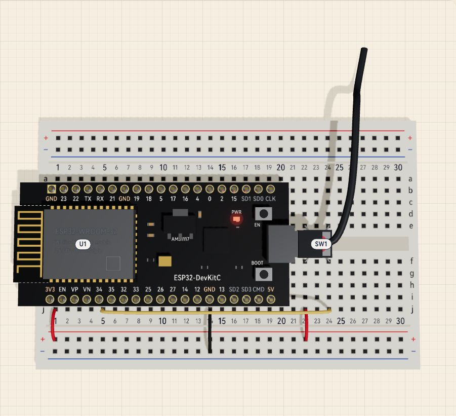
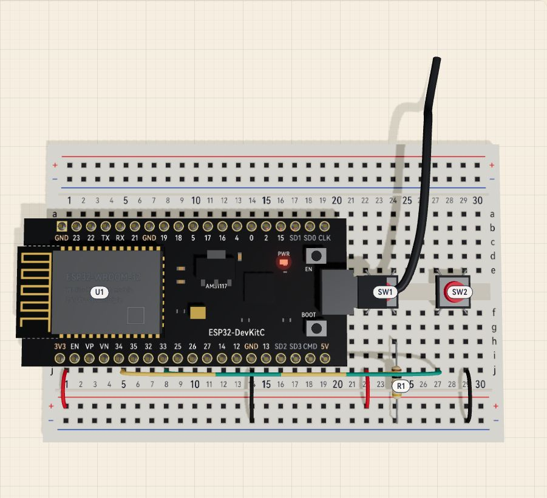
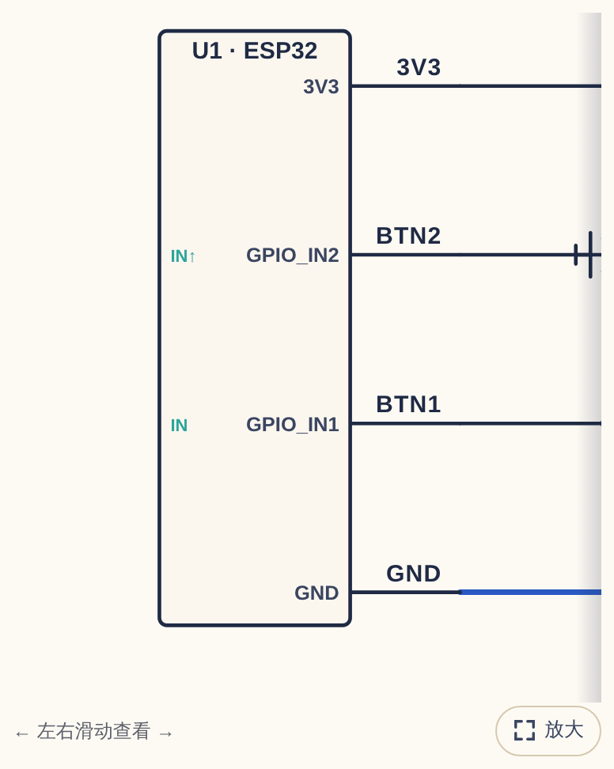
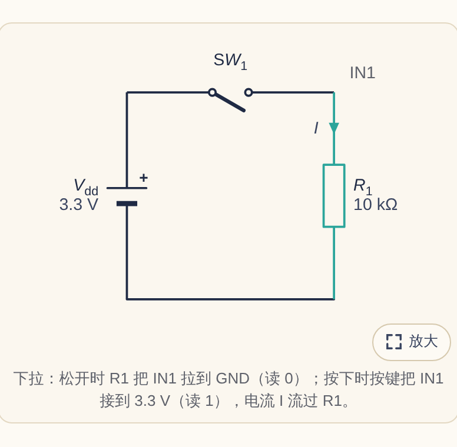

# 8.2 · 按键的上拉与下拉：别让输入悬空

| 项目 | 内容 |
|---|---|
| id | `exp5-button-pull-resistors` |
| 文件 | `challenges/282-button-pull-resistors.json` |
| 类型 | 实验 / 挑战（没有分步，照目标电路图搭） · 难度 3/5 |
| 位置 | World 8 · 数字逻辑、MCU 与传感器实战 → 8.2 开发板与 GPIO（本节第 5 项） |
| 右侧面板 | 轨道由旧的四张卡片自动生成（还没手工精排） |
| 前后 | 上一项 [8.2 exp5-sink-vs-source](../w8/8.02-4-exp5-sink-vs-source.md) · 下一项 [8.3 exp5-npn-buzzer-switch](../w8/8.03-1-exp5-npn-buzzer-switch.md) |
| 先修 | lesson-mcu-gpio |
| 概念 | 数字输入 digital input、下拉电阻 pull-down resistor、内部上拉 internal pull-up、高 / 低电平有效 active-high / active-low、浮空输入 floating input |

**一句话概要**：起始电路里的按键少了一个电阻，输入是浮空的。补上 10 kΩ 下拉（按下读 1），再用内部上拉接第二个按键（按下读 0）。

## 1. 左侧工作台（3D 面包板 → 2D 俯视截图）

截图是程序里真实的 3D 面包板换成俯视角拍的；表格是同一块板的文字版（元件、参数、每只脚插在哪个孔）。

### 1.1 起点：打开这一课时板上已经有的

右侧显示的「起点」说明：

> **找错 + 搭完**：ESP32、电源轨和按键 SW1（3V3 → GPIO34）已经接好，但 GPIO34 **没有下拉电阻**，是浮空输入。**为什么**：先在诊断里看到“浮空输入”是什么样子。**你要做**：加上 R1（10kΩ，GPIO34 → GND 下拉），再把 SW2 接在 GPIO33 和 GND 之间，并把 GPIO33 设成“输入 上拉”。

| 元件 | 类型 | 参数 | 引脚 → 孔 |
|---|---|---|---|
| U1 | esp32_devkit | usb=true, pins={"GPIO34":{"mode":"input"}} | GND→b1 GPIO23→b2 GPIO22→b3 GPIO1→b4 GPIO3→b5 GPIO21→b6 GND_2→b7 GPIO19→b8 GPIO18→b9 GPIO5→b10 GPIO17→b11 GPIO16→b12 GPIO4→b13 GPIO0→b14 GPIO2→b15 GPIO15→b16 GPIO8→b17 GPIO7→b18 GPIO6→b19 3V3→i1 EN→i2 GPIO36→i3 GPIO39→i4 GPIO34→i5 GPIO35→i6 GPIO32→i7 GPIO33→i8 GPIO25→i9 GPIO26→i10 GPIO27→i11 GPIO14→i12 GPIO12→i13 GND_3→i14 GPIO13→i15 GPIO9→i16 GPIO10→i17 GPIO11→i18 5V→i19 |
| W1 | wire |  | a→j1 b→bp1 |
| W2 | wire |  | a→j14 b→bn14 |
| SW1 | pushbutton | pressed=false | 1a→e22 2a→e24 1b→f22 2b→f24 |
| W3 | wire |  | a→j22 b→bp22 |
| W4 | wire |  | a→j5 b→j24 |

### 1.3 参考答案（「看答案」载入的板子）

| 元件 | 类型 | 参数 | 引脚 → 孔 |
|---|---|---|---|
| U1 | esp32_devkit | usb=true, pins={"GPIO34":{"mode":"input"},"GPIO33":{"mode":"input_pullup"}} | GND→b1 GPIO23→b2 GPIO22→b3 GPIO1→b4 GPIO3→b5 GPIO21→b6 GND_2→b7 GPIO19→b8 GPIO18→b9 GPIO5→b10 GPIO17→b11 GPIO16→b12 GPIO4→b13 GPIO0→b14 GPIO2→b15 GPIO15→b16 GPIO8→b17 GPIO7→b18 GPIO6→b19 3V3→i1 EN→i2 GPIO36→i3 GPIO39→i4 GPIO34→i5 GPIO35→i6 GPIO32→i7 GPIO33→i8 GPIO25→i9 GPIO26→i10 GPIO27→i11 GPIO14→i12 GPIO12→i13 GND_3→i14 GPIO13→i15 GPIO9→i16 GPIO10→i17 GPIO11→i18 5V→i19 |
| W1 | wire |  | a→j1 b→bp1 |
| W2 | wire |  | a→j14 b→bn14 |
| SW1 | pushbutton | pressed=false | 1a→e22 2a→e24 1b→f22 2b→f24 |
| W3 | wire |  | a→j22 b→bp22 |
| W4 | wire |  | a→j5 b→j24 |
| R1 | resistor | resistance=10000 | 1→h24 2→bn24 |
| SW2 | pushbutton | pressed=false | 1a→e27 2a→e29 1b→f27 2b→f29 |
| W5 | wire |  | a→j8 b→j27 |
| W6 | wire |  | a→j29 b→bn29 |

### 1.4 目标原理图（右侧「目标原理图」抽屉）

| 元件 | 类型 | 参数 |
|---|---|---|
| U1 | esp32_devkit | pins={"GPIO_IN2":{"mode":"input_pullup"}} |
| SW1 | pushbutton |  |
| R1 | resistor | resistance=10000 |
| SW2 | pushbutton |  |

连接（每个结点上的引脚）：

- **3V3**：U1.3V3、SW1.1
- **BTN1**：SW1.2、R1.1、U1.GPIO_IN1
- **GND**：R1.2、U1.GND、SW2.2
- **BTN2**：U1.GPIO_IN2、SW2.1

## 2. 右侧面板：学生从上往下看到的内容（单轨流）

### 第 1 步 · 🔧 动手搭：一个悬空的输入

面包板上已经接好：按键 **SW1** 一边接 **3V3**，另一边接 **GPIO34**，引脚是普通输入。
**单击开发板**，看 GPIO34 那一行的读数。再用「选择 / 操作」**按住 SW1**，然后松开。
按下时读到什么？松开时呢？右边的**诊断**怎么说？

### 第 2 步 · 💡 想明白：给输入拴一根绳子

- 输入几乎不取电流。按键松开时，GPIO34 什么都没接，它的电压由漏电和干扰决定——读数乱跳，这叫**浮空**。
- 解决办法：用一个电阻把它“拴”在一个电平上。**下拉**电阻接 GND：松开时读 0；按下时按键（约 0 Ω）轻松压过电阻，读 1。

*图 `pulldown`（schematic）：下拉：松开时 R1 把 IN1 拉到 GND（读 0）；按下时按键把 IN1 接到 3.3 V（读 1），电流 I 流过 R1。*

- 按下的整段时间里，电阻上都流着电流：
$$I = \frac{3.3}{R}$$
- 代入数字：用 4.7 kΩ 时，$I = \frac{3.3}{4700} ≈ 0.0007$ A，约 0.7 mA。电阻太小白白耗电，太大又容易被干扰，按键常用 4.7–10 kΩ。
- **上拉**反过来：电阻接 3.3 V，按键接 GND，按下读 0。大多数引脚芯片里自带一个约 45 kΩ 的上拉，选「输入 上拉」就有了。

（这一步下面列着这节课的计算卡片，点开就地展开：`pullup-current`，全文见第 6 节）

### 第 3 步 · 🔧 动手搭：补上下拉，再接一个按键

- 从 SW1 接 GPIO34 的那一列，插一个 **`10 kΩ`** 到 GND。
- 再插一个按键 **SW2**：一边接另一个 GPIO（例如 GPIO33），另一边直接接 GND，不用电阻。
- **单击开发板**，把 SW2 用的引脚设成**「输入 上拉」**。GPIO34–39 没有内部上下拉，所以 SW2 别用它们。
- 点**「检查我的电路」**，然后测两个输入的电压和 R1 的电流。

### 第 4 步 · 📏 测一测：测一测：读你自己的仪表

**测量题 1 · `v1`**（读数题）

> 两个按键都松开：IN1 引脚对 GND 的电压

- 单位 V · 先写预测 · 状态：松开 SW1、松开 SW2、U1 GPIO_IN1 设为输入（浮空） · 参考答案的读数 **0.00006595 V** · 合理范围 [-0.02, 0.02]

答对后显示：

> 输入几乎不取电流，R1 上没有压降：IN1 被拉到 0 V，读 0。

**测量题 2 · `v2`**（读数题）

> 都松开：IN2 引脚对 GND 的电压

- 单位 V · 先写预测 · 状态：松开 SW1、松开 SW2、U1 GPIO_IN1 设为输入（浮空） · 参考答案的读数 **3.297 V** · 合理范围 [3.13, 3.46]

答对后显示：

> 内部上拉把它拉到 3.3 V，读 1。

**测量题 3 · `ir1`**（读数题）

> 都按下：R1（下拉电阻）里的电流

- 单位 mA · 先写预测 · 状态：按下 SW1、按下 SW2、U1 GPIO_IN1 设为输入（浮空） · 参考答案的读数 **0.3297 mA** · 合理范围 [0.000313, 0.000346]

答对后显示：

> 按键把 3.3 V 直接加在 R1 上：3.3 V / 10 kΩ ≈ 0.33 mA。按下期间一直在耗电，所以下拉不能太小。

**测量题 4 · `float`**（选择题）

> 把 IN2 改成普通输入（不开上拉），按键松开时 IN2 读到的是：

- A. 不确定：引脚浮空，读数随漏电和干扰乱跳 ✅（正确）
- B. 一直是 1：输入默认是高电平
- C. 一直是 0：没接东西就是 0 V

答对后显示：

> CMOS 输入阻抗 > 10 MΩ，按键断开时没有任何东西把它拴在一个电平上——这正是起始电路里 GPIO34 的问题（GPIO34–39 没有内部上下拉，必须外接）。

### 第 5 步 · 🎒 带走：带走

- **输入一定要有确定的电平**：没有上拉或下拉，按键松开时引脚就浮空。
- **接 3V3 + 下拉 → 按下读 1；接 GND + 上拉 → 按下读 0。** 后者更常见：少一个零件，导线碰到机壳也不会短路电源。
- 机械按键会**抖动**：按下的几毫秒里通断好几次。程序里要延时消抖，或者加一个 RC 滤波。
- 真实电路里的坑：ESP32 的 GPIO34–39 没有内部上下拉，必须外接；GPIO0、2、5、12、15 在上电时决定启动方式，别在上面挂按键和上下拉。

趁热练理论题：`basics`

## 3. 测量题一览

| # | id | 题目 | 类型 | 单位 | 状态 | 参考读数 |
|---|---|---|---|---|---|---|
| 1 | v1 | 两个按键都松开：IN1 引脚对 GND 的电压 | voltage | V | 松开 SW1、松开 SW2、U1 GPIO_IN1 设为输入（浮空） | 0.00006595 V |
| 2 | v2 | 都松开：IN2 引脚对 GND 的电压 | voltage | V | 松开 SW1、松开 SW2、U1 GPIO_IN1 设为输入（浮空） | 3.297 V |
| 3 | ir1 | 都按下：R1（下拉电阻）里的电流 | current | mA | 按下 SW1、按下 SW2、U1 GPIO_IN1 设为输入（浮空） | 0.3297 mA |
| 4 | float | 把 IN2 改成普通输入（不开上拉），按键松开时 IN2 读到的是： | 选择 |  |  | 正确：A |

### 全部答完后显示的「对比」

**对比**：预期读数：
- 都松开：IN1 读 **0**（R1 把它拉到 0 V），IN2 读 **1**（内部上拉到 3.3 V）。
- 都按下：IN1 读 **1**（3.3 V），R1 里流过 3.3 V / 10 kΩ ≈ **0.33 mA**；IN2 读 **0**，内部上拉电流 3.3 V / 45 kΩ ≈ **73 µA**（从引脚流出到按键）。
- 把 IN2 改成普通输入（忘了开上拉）：松开时 IN2 **浮空**——这就是起始电路的错误。
读数在跳或显示浮空时，看那个输入是不是缺了上拉 / 下拉，或引脚模式没设对。

### 提示按钮（依次显示）

1. SW1 的另一边已经接到 GPIO34；从同一列再插一个 10 kΩ 到 GND。
2. SW2：一边接第二个 GPIO，另一边直接接 GND，不用电阻。
3. 选中开发板，把第二个 GPIO 设成「输入 上拉」。GPIO34–39 做不到，请用 GPIO33、GPIO25、GPIO26 这类引脚。

### 功能测试（「检查我的电路」时跑）

- 都松开：IN1 读 0（下拉），IN2 读 1（上拉）
- 都按下：IN1 读 1，IN2 读 0
- 忘了开上拉（普通输入）：松开时 IN2 浮空

## 5. 这一课的计算卡片

**计算卡片 `pullup-current`：上拉 / 下拉电阻的电流**

- 公式 `I = \frac{V}{R_{pull}}`
- 用途：按键按下（或开漏输出拉低）时，上拉 / 下拉电阻上流多少电流。
- 输入：V（电阻两端的电压，V）；R（上拉 / 下拉电阻（ESP32 内部 ≈ 45 kΩ），Ω） → I（按下时的电流，A）

1. CMOS 输入几乎不取电流（> 10 MΩ）：松开时上拉电阻上没有电流、没有压降，引脚就在 3.3 V（读 1）。
2. 按下时按键把引脚接到 GND（≈ 0 Ω 远小于 R），电阻两端是整个电源电压：$I = \frac{V}{R}$，引脚读 0。
3. 太小（比如 220 Ω）：按下时白白耗 15 mA；太大（1 MΩ）：抗干扰差、长线容易误触发。按键常用 4.7–10 kΩ。
4. 开漏输出拉低时同理：$I = \frac{V_{pull}}{R + R_{low}}$，引脚低电平 $V_{OL} = IR_{low}$。

例子：- 第 15 课、实验 5-3：内部上拉 $\frac{3.3}{45k} ≈ 73 µA$；外部 10 kΩ 下拉 $\frac{3.3}{10k} = 0.33 mA$。
- 实验 5-11：5 V 上拉 4.7 kΩ，开漏拉低：$\frac{4.69}{4.7k} ≈ 0.99 mA$，$V_{OL} = 40 × 0.99 mA ≈ 40 mV$。
- 实验 5-10：5 V 信号进 FT 引脚又开了内部上拉：$\frac{4.69 - 3.3}{40k} ≈ 35 µA$ 倒灌进 3V3。
- 实验 5-16：2.2 kΩ 的 I²C 线拉低：$\frac{3.3}{2.2k + 40} ≈ 1.47 mA$。

- ⚠ ESP32 的 GPIO34–39 没有内部上下拉：设成“输入 + 上拉”也是悬空。
- ⚠ 5 V 信号的 FT 引脚不要开内部上拉。

## 6. English（界面英文版的同一份内容）

展开英文

### Node 1 · 🔧 Build：A floating input

The board is already wired: button **SW1** has one side on **3V3** and the other on **GPIO34**, a plain input.
**Click the board** and watch GPIO34's reading. Then **hold SW1 down** with Select / use, and let go.
What does it read pressed? Released? What do the **diagnostics** on the right say?

### Node 2 · 💡 Why：Tie the input to a rope

- An input draws almost no current. With the button released GPIO34 is connected to nothing, so leakage and noise decide its voltage — the reading wanders. This is **floating**.
- The fix: tie it to a level with a resistor. A **pull-down** goes to GND: released it reads 0; pressed, the button (about 0 Ω) easily overrides the resistor and it reads 1.

[figure `pulldown`]

*Figure `pulldown`（schematic）：下拉：松开时 R1 把 IN1 拉到 GND（读 0）；按下时按键把 IN1 接到 3.3 V（读 1），电流 I 流过 R1。*

- For as long as the button is pressed, a current flows in the resistor:
$$I = \frac{3.3}{R}$$
- With numbers: with 4.7 kΩ, $I = \frac{3.3}{4700} ≈ 0.0007$ A, about 0.7 mA. Too small a resistor wastes power, too large picks up noise; buttons usually get 4.7–10 kΩ.
- A **pull-up** is the mirror image: the resistor goes to 3.3 V, the button to GND, and pressed reads 0. Most pins have a pull-up of about 45 kΩ inside the chip — choose IN pull-up and it is there.

(This node lists the lesson’s calculation cards: `pullup-current`; full text in section 6)

### Node 3 · 🔧 Build：Add the pull-down, then a second button

- From the column where SW1 meets GPIO34, put a **`10 kΩ`** to GND.
- Then a second button, **SW2**: one side to another GPIO (GPIO33, say), the other straight to GND, no resistor.
- **Click the board** and set SW2's pin to **IN pull-up**. GPIO34–39 have no internal pulls, so don't use them for SW2.
- Press **Check my circuit**, then measure both input voltages and the current in R1.

### Node 4 · 📏 Measure：Measure: read your own instruments

**Question 1 · `v1`**（reading）

> Both buttons released: the IN1 pin to GND

- unit V · predict first · state：SW1 is released and SW2 is released and U1 GPIO_IN1 is input (floating) · range [-0.02, 0.02]

Shown once right:

> The input draws almost nothing, so R1 drops nothing: IN1 sits at 0 V and reads 0.

**Question 2 · `v2`**（reading）

> Both released: the IN2 pin to GND

- unit V · predict first · state：SW1 is released and SW2 is released and U1 GPIO_IN1 is input (floating) · range [3.13, 3.46]

Shown once right:

> The internal pull-up takes it to 3.3 V; it reads 1.

**Question 3 · `ir1`**（reading）

> Both pressed: the current in R1 (the pull-down)

- unit mA · predict first · state：SW1 is pressed and SW2 is pressed and U1 GPIO_IN1 is input (floating) · range [0.000313, 0.000346]

Shown once right:

> The button puts 3.3 V straight across R1: 3.3 V / 10 kΩ ≈ 0.33 mA, drawn for as long as it is pressed, which is why a pull resistor can't be too small.

**Question 4 · `float`**（multiple choice）

> With IN2 changed to a plain input (no pull-up) and the button released, IN2 reads

- A. undefined: the pin floats and the reading wanders with leakage and noise ✅ (right)
- B. always 1: inputs default to HIGH
- C. always 0: an unconnected pin is 0 V

Shown once right:

> A CMOS input is > 10 MΩ; with the button open nothing ties it to a level — exactly the starting board's GPIO34 problem (GPIO34–39 have no internal pulls, so they need external ones).

### Node 5 · 🎒 Take away：Take away

- **An input needs a definite level**: without a pull-up or pull-down, the pin floats when the button is released.
- **To 3V3 + pull-down → pressed reads 1; to GND + pull-up → pressed reads 0.** The second is more common: one part fewer, and a wire touching the case cannot short the supply.
- Mechanical buttons **bounce**: for a few milliseconds they open and close several times. Debounce in the program with a delay, or add an RC filter.
- A real-circuit catch: the ESP32's GPIO34–39 have no internal pulls, so they need external ones; GPIO0, 2, 5, 12 and 15 set the boot mode at power-up, so keep buttons and pull resistors off them.

Practise：`basics`

**Compare**

**Compare**: expected readings:
- Both released: IN1 reads **0** (R1 pulls it to 0 V), IN2 reads **1** (internal pull-up to 3.3 V).
- Both pressed: IN1 reads **1** (3.3 V) and R1 carries 3.3 V / 10 kΩ ≈ **0.33 mA**; IN2 reads **0** and the internal pull-up passes 3.3 V / 45 kΩ ≈ **73 µA** (out of the pin into the button).
- IN2 switched to a plain input (pull-up forgotten): released, IN2 **floats** — the same mistake as the starting circuit.
If a reading jumps around or shows as floating, check that input has its pull resistor and the right pin mode.

**Hints**

1. SW1's other side already goes to GPIO34; put a 10 kΩ from the same column to GND.
2. SW2: one side to a second GPIO, the other straight to GND, no resistor.
3. Select the board and set the second GPIO to IN pull-up. GPIO34–39 can't do that; use a pin such as GPIO33, GPIO25 or GPIO26.

