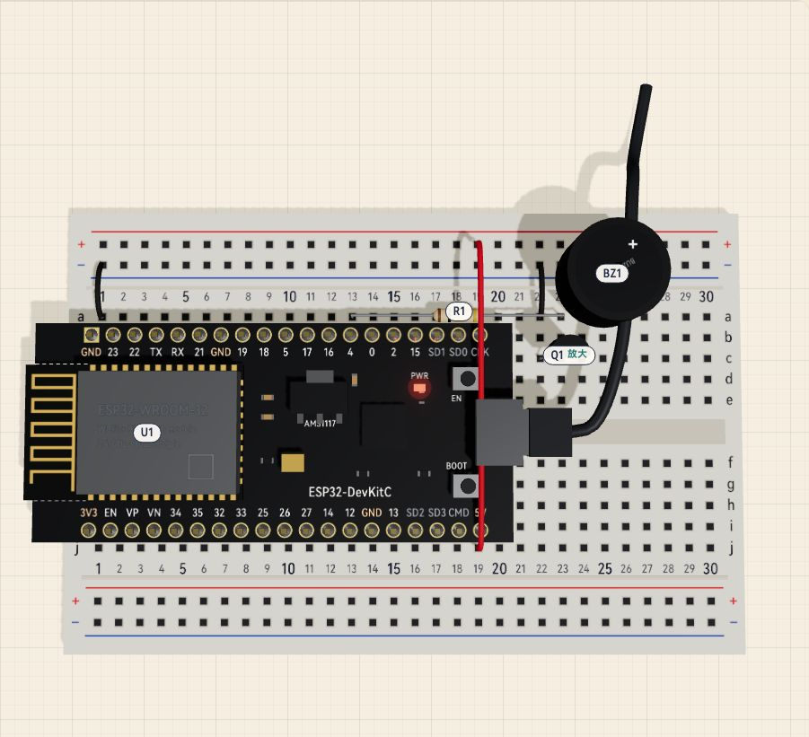
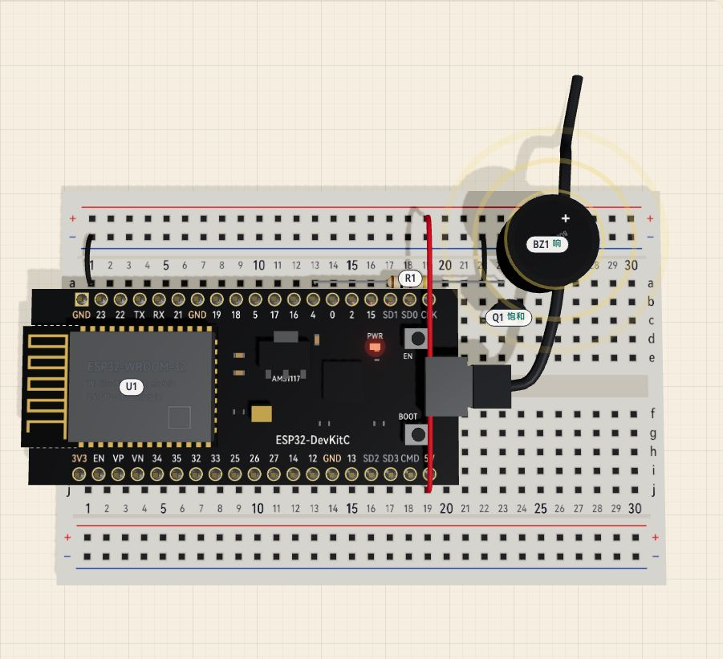
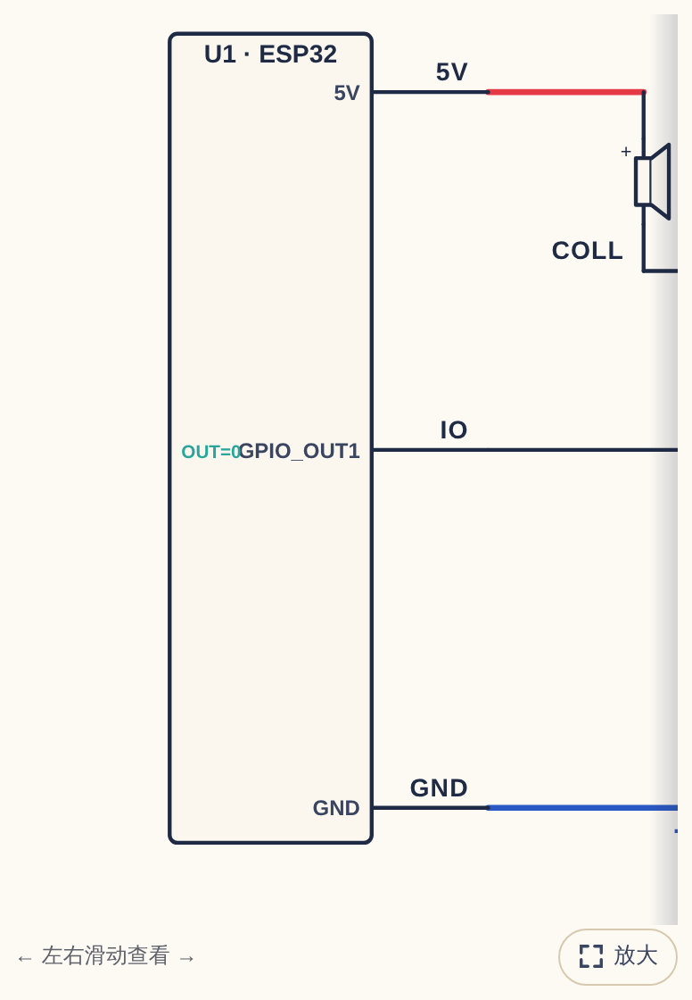
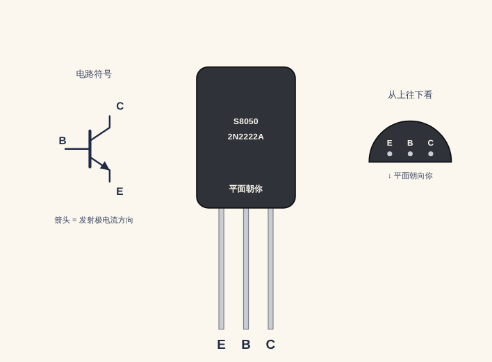
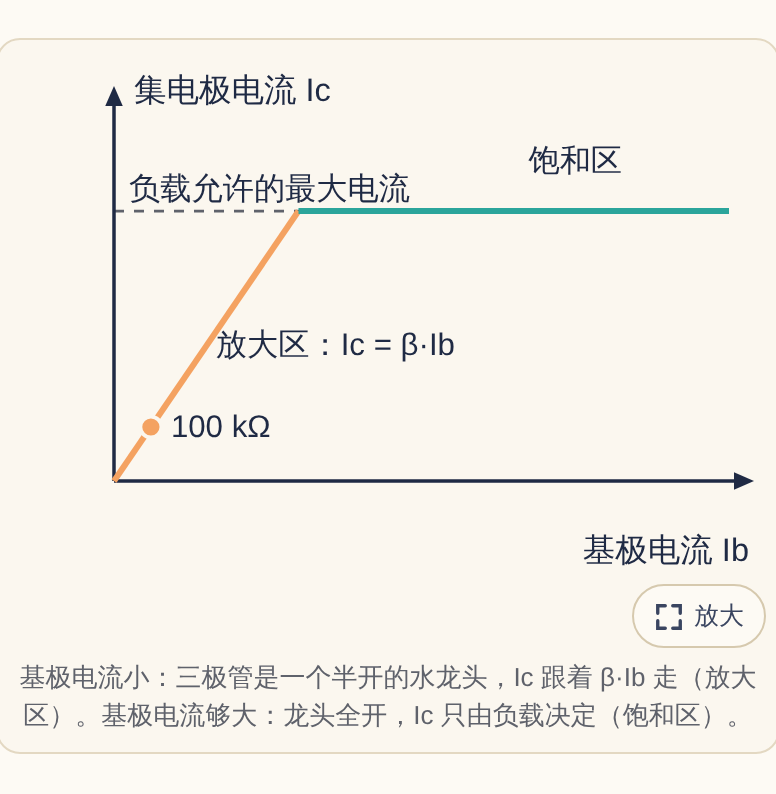
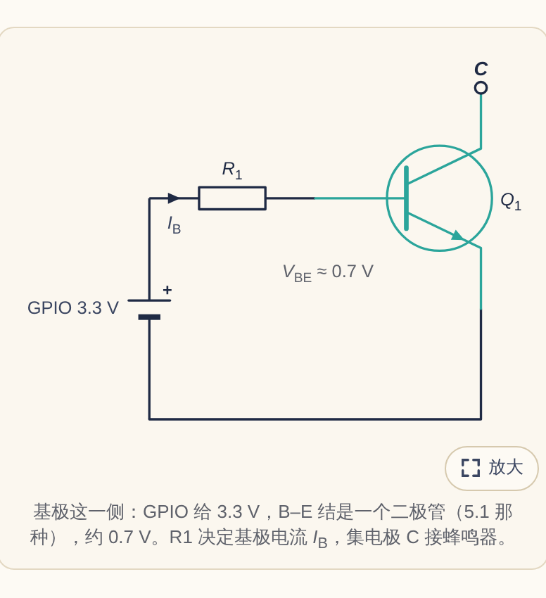

# 8.3 · NPN 三极管开关：3.3 V 引脚开关 5 V 蜂鸣器

| 项目 | 内容 |
|---|---|
| id | `exp5-npn-buzzer-switch` |
| 文件 | `challenges/286-npn-buzzer-switch.json` |
| 类型 | 实验 / 挑战（没有分步，照目标电路图搭） · 难度 3/5 |
| 位置 | World 8 · 数字逻辑、MCU 与传感器实战 → 8.3 NPN 三极管开关（本节第 1 项） |
| 右侧面板 | 轨道由旧的四张卡片自动生成（还没手工精排） |
| 前后 | 上一项 [8.2 exp5-button-pull-resistors](../w8/8.02-5-exp5-button-pull-resistors.md) · 下一项 [8.4 exp5-mosfet-logic-level](../w8/8.04-1-exp5-mosfet-logic-level.md) |
| 先修 | lesson-mcu-gpio |
| 概念 | NPN 三极管 transistor、放大区 / 饱和区 active / saturation、强制 β forced beta = Ic/Ib、基极电阻 base resistor、低边开关 low-side switch |

**一句话概要**：基极电阻太大，三极管只开了一条缝，蜂鸣器不响。算出让它饱和的基极电阻，把它变成一个真正的开关。

## 1. 左侧工作台（3D 面包板 → 2D 俯视截图）

截图是程序里真实的 3D 面包板换成俯视角拍的；表格是同一块板的文字版（元件、参数、每只脚插在哪个孔）。

### 1.1 起点：打开这一课时板上已经有的

右侧显示的「起点」说明：

> **半成品（有一处故意选错）**：整个蜂鸣器开关电路都搭好了，但基极电阻是 **100kΩ**。**为什么**：先看三极管停在放大区、蜂鸣器电压不够是什么样子。**你要做**：算出让 2N2222 深度饱和的基极电阻，换掉 R1。

| 元件 | 类型 | 参数 | 引脚 → 孔 |
|---|---|---|---|
| U1 | esp32_devkit | usb=true, pins={"GPIO4":{"mode":"out_high"}} | GND→b1 GPIO23→b2 GPIO22→b3 GPIO1→b4 GPIO3→b5 GPIO21→b6 GND_2→b7 GPIO19→b8 GPIO18→b9 GPIO5→b10 GPIO17→b11 GPIO16→b12 GPIO4→b13 GPIO0→b14 GPIO2→b15 GPIO15→b16 GPIO8→b17 GPIO7→b18 GPIO6→b19 3V3→i1 EN→i2 GPIO36→i3 GPIO39→i4 GPIO34→i5 GPIO35→i6 GPIO32→i7 GPIO33→i8 GPIO25→i9 GPIO26→i10 GPIO27→i11 GPIO14→i12 GPIO12→i13 GND_3→i14 GPIO13→i15 GPIO9→i16 GPIO10→i17 GPIO11→i18 5V→i19 |
| W2 | wire |  | a→a1 b→tn1 |
| W3 | wire |  | a→j19 b→tp19 |
| R1 | resistor | resistance=100000 | 1→a13 2→a23 |
| Q1 | npn | beta=150 | e→c22 b→c23 c→c24 |
| W6 | wire |  | a→a22 b→tn22 |
| BZ1 | buzzer |  | +→tp26 -→a24 |

### 1.3 参考答案（「看答案」载入的板子）

| 元件 | 类型 | 参数 | 引脚 → 孔 |
|---|---|---|---|
| U1 | esp32_devkit | usb=true, pins={"GPIO4":{"mode":"out_high"}} | GND→b1 GPIO23→b2 GPIO22→b3 GPIO1→b4 GPIO3→b5 GPIO21→b6 GND_2→b7 GPIO19→b8 GPIO18→b9 GPIO5→b10 GPIO17→b11 GPIO16→b12 GPIO4→b13 GPIO0→b14 GPIO2→b15 GPIO15→b16 GPIO8→b17 GPIO7→b18 GPIO6→b19 3V3→i1 EN→i2 GPIO36→i3 GPIO39→i4 GPIO34→i5 GPIO35→i6 GPIO32→i7 GPIO33→i8 GPIO25→i9 GPIO26→i10 GPIO27→i11 GPIO14→i12 GPIO12→i13 GND_3→i14 GPIO13→i15 GPIO9→i16 GPIO10→i17 GPIO11→i18 5V→i19 |
| W2 | wire |  | a→a1 b→tn1 |
| W3 | wire |  | a→j19 b→tp19 |
| R1 | resistor | resistance=1000 | 1→a13 2→a23 |
| Q1 | npn | beta=150 | e→c22 b→c23 c→c24 |
| W6 | wire |  | a→a22 b→tn22 |
| BZ1 | buzzer |  | +→tp26 -→a24 |

### 1.4 目标原理图（右侧「目标原理图」抽屉）

| 元件 | 类型 | 参数 |
|---|---|---|
| U1 | esp32_devkit |  |
| R1 | resistor | resistance=1000 |
| Q1 | npn |  |
| BZ1 | buzzer |  |

连接（每个结点上的引脚）：

- **IO**：U1.GPIO_OUT1、R1.1
- **BASE**：R1.2、Q1.b
- **COLL**：Q1.c、BZ1.-
- **5V**：U1.5V、BZ1.+
- **GND**：Q1.e、U1.GND

## 2. 右侧面板：学生从上往下看到的内容（单轨流）

### 第 1 步 · 🔍 先看一眼：先认识它：NPN 三极管

**拆解「NPN 三极管：小电流控制大电流」第 1 / 9 层：① 外形：TO-92，三只脚 E B C**

实验 5-7、5-18 用的 2N2222A / S8050 装在 **TO-92** 封装里：一个半圆柱形的黑色塑料块，一面是 平面，三只脚。

**认脚**：把印字的平面对着自己、脚朝下，从左到右是 E、B、C（从上往下看就是 D 字形，平面一边朝你）。注意：不同型号排列不一样（例如 BC547 是 C B E），**一定要查手册**，仿真器里统一是 E B C。

电路符号 里：
- 中间竖线是基极 B，一根横线接进来；
- 斜着向上的是集电极 C；
- 带箭头的是发射极 E，箭头 **向外** 表示 NPN（电流从 E 流出）。记法：“箭头不指进来 = Not Pointing iN = NPN”。

| 脚 | 名字 | 作用 | 低边开关里接 |
|---|---|---|---|
| E | 发射极 emitter | 电子从这里“发射”出来；电流从这里流出 | GND |
| B | 基极 base | 控制端：一点点电流就能开关 | 经 R_B 接 GPIO |
| C | 集电极 collector | 收集电子；大电流从这里流进 | 负载的下端 |

### 第 2 步 · 🔧 动手搭：三极管接上了，蜂鸣器却不响

面包板上已经搭好：GPIO → **`100 kΩ`** → 三极管 Q1 的基极，蜂鸣器接在 **5V** 脚和 Q1 的集电极之间，Q1 的发射极接 GND。
单击开发板，在「属性」里把这个 GPIO 设成**「输出 高」**。
蜂鸣器响吗？单击 **Q1**，看「属性」里它工作在哪个区。诊断说了什么？

### 第 3 步 · 💡 想明白：半开的水龙头和全开的水龙头

- 三极管像一个**水龙头**：基极的小电流 Ib 控制集电极的大电流 Ic。龙头半开时，$I_C = β·I_B$（β 约 150），这叫**放大区**。
- 用 100 kΩ 时 Ib 太小，龙头只开了一条缝。Ic 不够，剩下的电压全压在三极管上，蜂鸣器分不到。

*图 `faucet`（plot）：基极电流小：三极管是一个半开的水龙头，Ic 跟着 β·Ib 走（放大区）。基极电流够大：龙头全开，Ic 只由负载决定（饱和区）。*

- 当开关用，要让龙头**全开**：给的 Ib 远多于 β 倍关系需要的，Ic 就只由负载决定。这叫**饱和区**，C–E 之间只剩零点几伏。
- 经验规则：让 $I_B$ 至少是 $I_C$ 的十分之一（“强制 β” = 10）。基极电阻这样算：
$$R_1 = \frac{3.3 - 0.7}{I_B}$$

*图 `base`（schematic）：基极这一侧：GPIO 给 3.3 V，B–E 结是一个二极管（5.1 那种），约 0.7 V。R1 决定基极电流 I_B，集电极 C 接蜂鸣器。*

- 举个别的负载：要 50 mA 时，$I_B$ = 5 mA，$R_1 = \frac{3.3 - 0.7}{0.005} = 520$ Ω，取不大于它的标准值 **510 Ω**。

（这一步下面列着这节课的计算卡片，点开就地展开：`npn-base-resistor`、`npn-saturation`、`mosfet-power`、`usb-5v-pin`，全文见第 6 节）

### 第 4 步 · 🔧 动手搭：换一个够小的基极电阻

- 先估蜂鸣器要的 Ic：5V 脚约 4.7 V，蜂鸣器模型是 1.0 V 再串 140 Ω，饱和的三极管再占零点几伏。
- 由 $I_B = I_C / 10$ 和上面的公式算出 R1，取一个**不大于**结果的标准值。单击 **R1**，在「属性」里改阻值。
- 点**「检查我的电路」**。通过后用电流表、万用表完成测量题；最后一题要把 R1 **临时改回 `100 kΩ`**。

### 第 5 步 · 📏 测一测：测一测：读你自己的仪表

**测量题 1 · `ib`**（读数题）

> 「输出 高」：基极电流 Ib（电流表串进 R1）

- 单位 mA · 先写预测 · 状态：U1 GPIO_OUT1 设为输出高电平 · 参考答案的读数 **2.533 mA** · 合理范围 [0.00241, 0.00266]

答对后显示：

> (3.3 − 0.7) / 1 kΩ ≈ 2.5 mA，远低于引脚 20 mA 的建议值。

**测量题 2 · `ic`**（读数题）

> 「输出 高」：集电极电流 Ic（电流表串在蜂鸣器和 C 之间）

- 单位 mA · 先写预测 · 状态：U1 GPIO_OUT1 设为输出高电平 · 参考答案的读数 **24.94 mA** · 合理范围 [0.0237, 0.0262]

答对后显示：

> 5V 脚约 4.67 V，蜂鸣器占 4.49 V，Ic ≈ 24.9 mA。它由负载决定，不是 β·Ib。

**测量题 3 · `beta`**（计算题（用自己的读数算））

> 用你的两个读数算“强制 β” = Ic / Ib

- 先写预测 · 参考答案的读数 **9.846** · 合理范围 [9.35, 10.3] · 公式 `ic / ib`

答对后显示：

> ≈ 10，远小于三极管自己的 β（150）：Ib 比放大区需要的多得多，三极管被“压”进饱和区。β 随温度、批次变化很大，按 10 设计才有余量。

**测量题 4 · `vce`**（读数题）

> 「输出 高」：Vce（红表笔接 C，黑表笔接 E）

- 单位 V · 先写预测 · 状态：U1 GPIO_OUT1 设为输出高电平 · 参考答案的读数 **0.1749 V** · 合理范围 [0.166, 0.184]

答对后显示：

> 饱和压降 0.15 V + 1 Ω × Ic ≈ 0.17 V，三极管只消耗约 6 mW。

**测量题 5 · `vce100`**（读数题）

> 把 R1 临时改回 100 kΩ，「输出 高」：Vce

- 单位 V · 先写预测 · 状态：U1 GPIO_OUT1 设为输出高电平、R1 换成 100 kΩ · 参考答案的读数 **3.121 V** · 合理范围 [2.96, 3.28]

答对后显示：

> Ib ≈ 26.5 µA，Q1 在放大区，Ic = β·Ib ≈ 4.0 mA：它成了受控电流源，不是开关。Vce ≈ 3.1 V，蜂鸣器只剩 1.56 V，不响。

### 第 6 步 · 🎒 带走：带走

- **开关要饱和，不要放大**：Ib 至少给到 Ic 的十分之一。β 随温度、批次差很多，按 10 设计才有余量。
- **基极电阻必须有**：B–E 是一个二极管，不串电阻时 GPIO 会被拉出几十毫安，超过引脚的绝对上限。
- 这叫**低边开关**：三极管在负载和 GND 之间，发射极接地。
- 真实电路里的坑：ESP32 的 GPIO0 / 2 / 5 / 12 / 15 开机时会自己变高变低，别用它们开关会响、会动的东西；在基极和 GND 之间再加一个 10–100 kΩ 下拉，复位时也保证关断。

趁热练理论题：`nonlinear`

## 3. 测量题一览

| # | id | 题目 | 类型 | 单位 | 状态 | 参考读数 |
|---|---|---|---|---|---|---|
| 1 | ib | 「输出 高」：基极电流 Ib（电流表串进 R1） | current | mA | U1 GPIO_OUT1 设为输出高电平 | 2.533 mA |
| 2 | ic | 「输出 高」：集电极电流 Ic（电流表串在蜂鸣器和 C 之间） | current | mA | U1 GPIO_OUT1 设为输出高电平 | 24.94 mA |
| 3 | beta | 用你的两个读数算“强制 β” = Ic / Ib | formula |  |  | 9.846 |
| 4 | vce | 「输出 高」：Vce（红表笔接 C，黑表笔接 E） | voltage | V | U1 GPIO_OUT1 设为输出高电平 | 0.1749 V |
| 5 | vce100 | 把 R1 临时改回 100 kΩ，「输出 高」：Vce | voltage | V | U1 GPIO_OUT1 设为输出高电平、R1 换成 100 kΩ | 3.121 V |

### 全部答完后显示的「对比」

**对比**：
- 「输出 高」：Ib ≈ **2.53 mA**，Ic ≈ **24.9 mA**，强制 β ≈ 9.8，Vce ≈ **0.17 V**，Q1 饱和，蜂鸣器两端 4.49 V，响。
- 「输出 低」：Q1 截止，蜂鸣器不响。
- R1 = 100 kΩ：Ib ≈ 26.5 µA，Ic = β·Ib ≈ 4.0 mA，Vce ≈ **3.1 V**，蜂鸣器只剩 1.56 V，不响。
- 模型说明：蜂鸣器是 1.0 V + 140 Ω（≥ 2.5 V 才响）；关断时集电极约 3.7 V 是这个 1.0 V 造成的，真实电路里接近 5 V。

### 提示按钮（依次显示）

1. 起始电路的 R1 是 100 kΩ：基极电流太小，三极管进不了饱和区。单击 R1，在「属性」里改阻值。
2. 要饱和：Ib ≥ Ic / 10。先估 Ic，再用 R1 = (3.3 − 0.7) / Ib 算，取一个不大于结果的标准值。
3. 接线：E 接 GND，蜂鸣器 + 接 5V 脚，蜂鸣器 − 接 C。2N2222 平面朝你时三只脚是 E B C。

### 功能测试（「检查我的电路」时跑）

- 「输出 高」：蜂鸣器响，Q1 饱和，引脚电流在建议值以内
- 「输出 低」：Q1 截止，蜂鸣器不响
- R1 = 100 kΩ：Q1 只在放大区，蜂鸣器不响

## 4. 用到的拆解（全部层的文字，供改写参考）

### 拆解 `npn`：NPN 三极管：小电流控制大电流

*NPN = 两层 n 型半导体夹一层很薄的 p 型。我们从 TO-92 封装拆到硅片上的三层，看电子怎么穿过基区，得到“集电极电流 = β × 基极电流”；再把它化成三种状态的等效电路，最后用它算基极电阻，并解释为什么 3.3 V 的引脚不能把 NPN 放在负载上面。*

**拆解「NPN 三极管：小电流控制大电流」第 1 / 9 层：① 外形：TO-92，三只脚 E B C**

实验 5-7、5-18 用的 2N2222A / S8050 装在 **TO-92** 封装里：一个半圆柱形的黑色塑料块，一面是 平面，三只脚。

**认脚**：把印字的平面对着自己、脚朝下，从左到右是 E、B、C（从上往下看就是 D 字形，平面一边朝你）。注意：不同型号排列不一样（例如 BC547 是 C B E），**一定要查手册**，仿真器里统一是 E B C。

电路符号 里：
- 中间竖线是基极 B，一根横线接进来；
- 斜着向上的是集电极 C；
- 带箭头的是发射极 E，箭头 **向外** 表示 NPN（电流从 E 流出）。记法：“箭头不指进来 = Not Pointing iN = NPN”。

| 脚 | 名字 | 作用 | 低边开关里接 |
|---|---|---|---|
| E | 发射极 emitter | 电子从这里“发射”出来；电流从这里流出 | GND |
| B | 基极 base | 控制端：一点点电流就能开关 | 经 R_B 接 GPIO |
| C | 集电极 collector | 收集电子；大电流从这里流进 | 负载的下端 |

**拆解「NPN 三极管：小电流控制大电流」第 2 / 9 层：② X 光：一小块硅片坐在集电极引脚上**

把塑料变透明：C 脚 在里面变宽成一个 小平台，上面焊着不到 1 mm 见方的 硅片 die。硅片的 **背面就是集电区**，直接焊在 C 脚上（这样集电极的热量也能从这只脚导出去）。

硅片正面有两块金属，各用一根 金线 连到 E 脚和 B 脚。

所以三只脚并不对称：E 和 C **不能互换**。接反了（C 当 E 用）三极管还会“有点”工作，但 β 只剩几，开关根本打不开。

**拆解「NPN 三极管：小电流控制大电流」第 3 / 9 层：③ 内部结构：n⁺ – p – n 三层，两个 PN 结**

把硅片剖开（这里画成教材里的横截面）：
- 发射区 E：n 型，掺杂 **很浓**（n⁺），里面有大量自由电子；
- 基区 B：p 型，**非常薄**（约 1 µm），掺杂较淡；
- 集电区 C：n 型，掺杂淡、面积大，能承受高电压。

两层交界处就是两个 PN 结（和二极管拆解里的一样）：
- BE 结：在开关电路里 **正偏**，要约 0.65 V 才导通——所以 GPIO 到基极之间“看到”的是一个二极管；
- BC 结：**反偏**，耗尽区里有很强的电场，指向“把电子拉进集电区”的方向。

如果只看两只脚之间：B–E 是二极管，B–C 也是二极管。但两个二极管背靠背 **不能** 做成三极管——秘密在于基区很薄，下一层讲。

| 区 | 类型 | 掺杂 | 厚度 | 为什么这样做 |
|---|---|---|---|---|
| 发射区 E | n⁺ | 很浓 | 中 | 提供大量电子 |
| 基区 B | p | 淡 | 很薄 ≈ 1 µm | 电子来不及复合就穿过去 |
| 集电区 C | n | 更淡 | 厚 | 耐高压（V_CEO = 40 V） |

**拆解「NPN 三极管：小电流控制大电流」第 4 / 9 层：④ 为什么集电极电流 = β × 基极电流：电子穿过薄薄的基区**

给 BE 结加 0.65 V 正偏，发射区的大量电子涌进基区。接下来：
1. 基区很薄、空穴很少，绝大多数电子还没来得及和空穴复合，就扩散到了 BC 结边上；
2. BC 结反偏的电场把它们 一把拉进集电区——这就是集电极电流 $I_C$；
3. 只有很少一部分电子 在基区和空穴复合，被复合掉的空穴要靠基极电流 $I_B$ 补回来。

“到达集电极的电子”和“在基区复合的电子”的比例由结构决定，大致是常数，这个比例就是 **电流放大系数 β**（$h_{FE}$）。仿真里 β = 150：每复合 1 个，就有 150 个到达集电极：
$$I_C = β·I_B$$
根据 KCL（流进三极管的电流 = 流出的）：
$$I_E = I_B + I_C = (β + 1) I_B$$
例：$I_B$ = 26.5 µA → $I_C$ = 150 × 26.5 µA ≈ 4.0 mA，$I_E$ ≈ 4.0 mA。

关键：是 **基极电流** 控制集电极电流，不是基极电压。BE 结一旦导通，$V_{BE}$ 只在 0.65–0.75 V 之间变一点点。

- 公式 `I_C = β·I_B`：放大区；仿真 β = 150，2N2222 手册 35–300
- 公式 `I_E = I_B + I_C = (β + 1) I_B`：KCL

**拆解「NPN 三极管：小电流控制大电流」第 5 / 9 层：⑤ 等效电路：B–E 是二极管，C–E 随状态变**

仿真器用的模型（也是电路课里的分段线性模型）：
- **B–E**：理想二极管 0.65 V 串 20 Ω，三种状态都一样；
- 截止 cut-off：$V_{BE}$ < 0.65 V，没有基极电流，C–E 断开；
- 放大 active：C–E 是一个 **受控电流源**（电流控制电流源，CCCS）$β·I_B$——和 op-amp 拆解里的受控电压源一样，可以直接放进结点方程；
- 饱和 saturation：C–E 是 0.15 V 串 1 Ω，就是一个闭合的开关，压降很小。

怎么判断在哪个状态：先假设放大区，算出 $β·I_B$；如果负载在 $V_{CE}$ ≈ 0.2 V 时能流过的电流 **小于** $β·I_B$，假设不成立——三极管“想”给的电流比负载能接受的还多，它就饱和了，$I_C$ 由负载决定。

| 状态 | 条件 | C–E 等效 | 用途 |
|---|---|---|---|
| 截止 | $V_{BE}$ < 0.65 V | 开路，$I_C$ = 0 | 开关断开 |
| 放大 | $β·I_B$ < 负载在饱和时的电流 | $I_C = β·I_B$ | 放大器、恒流源 |
| 饱和 | $β·I_B$ > 负载电流 | 0.15 V + 1 Ω·$I_C$ | 开关闭合 |

**拆解「NPN 三极管：小电流控制大电流」第 6 / 9 层：⑥ 输出特性曲线 + 负载线：一眼看出在哪个区**

把 $I_C$ 对 $V_{CE}$ 画出来，每一个 $I_B$ 是一条曲线：在 放大区 几乎是水平线（$I_C$ = β·$I_B$，和 $V_{CE}$ 无关），在左边 饱和区（$V_{CE}$ < 约 0.3 V）全部挤在一起往下掉，底部是 截止区。

外电路给出另一条线——**负载线**。实验 5-7 的蜂鸣器（模型 1.0 V + 140 Ω）接在 5V 脚（4.67 V）和集电极之间，KVL：
$$V_{CE} = 4.67 - 1.0 - 140·I_C$$
这是一条直线：$I_C$ = 0 时 $V_{CE}$ = 3.67 V，$V_{CE}$ = 0 时 $I_C$ = 26.2 mA。三极管只能工作在 负载线 和某条 $I_B$ 曲线的交点上：
- 初始电路 $R_B$ = 100 kΩ：$I_B$ = 26.5 µA，交点 4 mA、3.1 V——放大区，蜂鸣器只分到 1.56 V，不响；
- 换成 1 kΩ：$I_B$ = 2.53 mA，$β·I_B$ = 380 mA，远超负载线的最大值 26 mA，交点被推到最左边 24.9 mA、0.17 V——饱和。

开关就是要在负载线的两端之间跳：截止（右下角）↔ 饱和（左上角），永远不停在中间。

- 公式 `V_{CE} = V_{CC} - V_{load}(I_C)`：负载线：外电路的 KVL

**拆解「NPN 三极管：小电流控制大电流」第 7 / 9 层：⑦ 当开关用：一步步算基极电阻（实验 5-7）**

目标：3.3 V 的 GPIO 控制 5 V 的 蜂鸣器，三极管放在负载 **下面**（低边，low-side），E 接地。

**第 1 步 · 负载电流**：饱和时 $V_{CE}$ ≈ 0.17 V，蜂鸣器分到 4.67 − 0.17 = 4.49 V，$I_C = \frac{4.49 - 1.0}{140}$ ≈ **24.9 mA**。
**第 2 步 · 需要的基极电流**：要保证 Q1 深度饱和，按 **强制 β**（forced β）= $\frac{I_C}{I_B}$ ≈ 10 来设计：
$$I_B ≥ \frac{I_C}{10} = 2.5 mA$$
为什么不用 β = 150？手册上的 β 范围是 35–300，还随温度和电流变，用 10 留足余量。
**第 3 步 · 基极电阻**：R1 两端是 GPIO 的 3.3 V 减去 $V_BE$ ≈ 0.7 V：
$$R_1 ≤ \frac{3.3 - 0.7}{2.5 mA} = 1.04 kΩ$$
**第 4 步 · 取 1 kΩ**，验算（仿真）：$I_B$ = 2.53 mA，$I_C$ = 24.9 mA，$V_CE$ = 0.17 V，管子功耗 $P ≈ V_{CE}·I_C + V_{BE}·I_B$ ≈ 4.2 + 1.8 ≈ 6 mW。GPIO 只出 2.5 mA，远低于 20 mA。

**为什么必须有 R1**：没有它，GPIO 的 3.3 V 直接加在 BE 二极管上，电流只受 $R_{out}$（25 Ω）和 20 Ω 限制：$\frac{3.3 - 0.65}{45 Ω}$ ≈ 60 mA，超过 40 mA 绝对最大值，引脚烧坏。

基极下拉 100 kΩ：MCU 复位时引脚是高阻输入，基极悬空可能让三极管半开；下拉保证它截止。

| $R_B$ | $I_B$ | $β·I_B$ | 状态 | $I_C$ | $V_{CE}$ | 蜂鸣器 |
|---|---|---|---|---|---|---|
| 0 Ω（直连） | ≈ 60 mA | — | 引脚烧坏 | — | — | — |
| 1 kΩ | 2.53 mA | 380 mA | 饱和 | 24.9 mA | 0.17 V | 响 |
| 10 kΩ | 0.26 mA | 39 mA | 刚好饱和（强制 β ≈ 96） | ≈ 24.8 mA | ≈ 0.2 V | 响，但没余量 |
| 100 kΩ | 26.5 µA | 4.0 mA | 放大 | 4.0 mA | 3.1 V | 不响 |

- 公式 `I_B ≥ \frac{I_C}{β_{forced}},   β_{forced} ≈ 10`：保证深度饱和
- 公式 `R_B ≤ \frac{V_{GPIO} - V_{BE}}{I_B}`：基极电阻上限

**拆解「NPN 三极管：小电流控制大电流」第 8 / 9 层：⑧ 低边 vs 高边：为什么 3.3 V 引脚不能把 NPN 放在负载上面（实验 5-18）**

实验 5-18 用两个 5 V 继电器（线圈 70 Ω，吸合需要 ≥ 53 mA），同样的 1 kΩ 基极电阻、同样的 2N2222：
- 低边：线圈在上、E 接 GND。基极电流 $\frac{3.23 - 0.70}{1 kΩ}$ ≈ 2.5 mA，$β·I_B$ ≈ 380 mA ≫ 线圈需要的 63 mA → 饱和，$V_CE$ = 0.21 V，线圈得到 4.44 V、63 mA，吸合。
- 高边：C 接 5V、E 接线圈。现在发射极不在地上，它跟着基极走——这叫 **emitter follower（射极跟随器 / 共集电极）**：
$$V_E = V_B - V_{BE}$$
而基极最高只能到 GPIO 的电压：$V_B$ = 3.29 − 0.23 mA × 1 kΩ ≈ 3.06 V，所以 $V_E$ ≈ 2.41 V，线圈只有 $\frac{2.41}{70}$ ≈ 34 mA < 53 mA，**不吸合**。剩下的 5 − 2.41 = 2.26 V 落在 C–E 上：放大区，白白发热 77 mW。

**加大电源或换 β = 1000 的管子都没用**：12 V 电源时发射极仍是 2.4 V；β = 1000 时 $V_E$ 也只升到 2.61 V。限制不是增益，而是“**发射极永远比基极低 0.65 V**”。

结论：MCU 直接驱动的开关默认用 **低边 N 型**（NPN 或逻辑电平 N-MOS），发射极 / 源极接地。真要高边（负载一端必须接地），用 P-MOSFET + 一个低边 NPN 做电平转换。继电器线圈都要并 续流二极管（见继电器拆解）。

|  | 高边（K1） | 低边（K2） |
|---|---|---|
| 三极管位置 | 负载上面，C 接 5V | 负载下面，E 接 GND |
| 电路名 | 射极跟随器 | 共发射极开关 |
| 状态 | 放大 | 饱和 |
| $V_{CE}$ | 2.26 V | 0.21 V |
| 线圈电压 / 电流 | 2.41 V / 34 mA | 4.44 V / 63 mA |
| 吸合？（≥ 53 mA） | 否 | 是 |
| 管子功耗 | 77 mW | 15 mW |

- 公式 `V_E = V_B - V_{BE} ≤ V_{GPIO} - 0.65 V`：高边 NPN 的发射极永远上不去

**拆解「NPN 三极管：小电流控制大电流」第 9 / 9 层：⑨ 局限：电流、功耗、电压、β 的分散**

2N2222 能工作的范围是 安全工作区 SOA，三条边界：
- $I_C$ ≤ 600 mA；
- P = $V_CE$·$I_C$ ≤ 625 mW（TO-92 不加散热片）：一条双曲线，开关状态 $V_{CE}$ 很小，所以离它很远；停在放大区才会碰到；
- $V_CEO$ = 40 V：C–E 能承受的最大电压。继电器线圈断电时的反向尖峰能轻松超过它，所以要续流二极管。

继电器低边 在左下角，非常安全。而 0.62 A 的电机 已经超过 600 mA，而且按强制 β = 10 需要 62 mA 基极电流——GPIO 给不出来。这正是下一个拆解 **MOSFET** 要解决的：栅极不取直流电流。

**β 的分散**：同一型号的 β 可以从 35 到 300，温度每升高 1 °C 还会增加约 0.5 %。所以开关设计永远按强制 β ≈ 10 算，不要依赖手册的典型值；放大电路则要用负反馈（发射极电阻）让增益不依赖 β。

**模型没画的**：真实 $V_{BE}$ 随温度每 °C 降约 2 mV；开关有存储时间（饱和越深关断越慢，约几百 ns）。

| 参数 | 2N2222A（仿真） | 超过会怎样 |
|---|---|---|
| $I_{C,max}$ | 600 mA | 过流损坏 |
| $P_{max}$ | 625 mW（TO-92） | 过热 |
| $V_{CEO}$ | 40 V | 击穿 |
| β | 150（手册 35–300） | 按强制 β ≈ 10 设计 |
| $V_{CE(sat)}$ | 0.15 V + 1 Ω·$I_C$ | 电流大时压降也大 |

- 公式 `P = V_{CE}·I_C + V_{BE}·I_B`：三极管的功耗

**一句话记住**：NPN = n⁺–p–n 三层，基区很薄，所以 $I_C = β·I_B$。等效电路：B–E 是 0.65 V 二极管；C–E 截止时开路、放大时是 $β·I_B$ 电流源、饱和时是 0.15 V 的闭合开关。当开关用：放在负载下面（低边），按强制 β ≈ 10 算 $I_B$，$R_B = \frac{3.3 - 0.7}{I_B}$。

## 5. 这一课的计算卡片

**计算卡片 `npn-base-resistor`：NPN 开关的基极电阻**

- 公式 `R_B = \frac{V_{OH} - V_{BE}}{I_C / β_{forced}}`
- 用途：用 3.3 V 引脚让 NPN 三极管饱和导通（低边开关），基极电阻取多大。
- 输入：V_OH（引脚高电平，V）；V_BE（B–E 压降，V）；I_C（负载需要的电流，A）；β_F（强制 β（取 10 留余量），） → R_B（基极电阻（取不大于它的标准值），Ω）

1. 先算负载电流 $I_C$：负载接在 5 V 和集电极之间，饱和时 $V_{CE}$ 只有 0.1–0.2 V，$I_C$ 由负载决定，不由 β 决定。
2. 想让它 **饱和**，基极电流要比放大区需要的 $\frac{I_C}{β}$ 多得多。经验：$I_B ≥ \frac{I_C}{10}$（强制 β ≈ 10）。β 随温度和批次变化很大（2N2222 是 35–300），按 10 设计有余量。
3. B–E 结是一个二极管（≈ 0.65–0.7 V）：$I_B = \frac{V_{OH} - V_{BE}}{R_B}$。
4. 解出 $R_B$，取不大于它的标准值。
5. 不串 $R_B$：3.3 V 直接加在 B–E 二极管上，只有引脚内阻限流，约 60 mA——引脚烧坏。

例子：实验 5-7：蜂鸣器 $I_C ≈ 24.9 mA$ → $I_B ≥ 2.5 mA$ → $R_B ≤ \frac{2.6}{2.5 mA} ≈ 1.04 kΩ$ → 1 kΩ。实验 5-9：线圈 63 mA，1 kΩ 给 2.53 mA，强制 β ≈ 25，仍远低于 150，照样饱和。

- ⚠ 用 β = 150 直接算 $I_B = I_C/β$：刚好在放大区边缘，温度一变就不饱和。
- ⚠ 基极到地加 10–100 kΩ 下拉，单片机复位时引脚悬空也能保证关断。

**计算卡片 `npn-saturation`：三极管饱和了吗？过驱系数**

- 公式 `I_B = \frac{V_{OH} - V_{BE}}{R_B}, k = \frac{β I_B}{I_{C,load}}`
- 用途：检查一个基极电阻能不能让三极管饱和：k > 1 才饱和，设计时取 2–10 以上。
- 输入：V_OH（引脚高电平，V）；V_BE（B–E 压降，V）；R_B（基极电阻，Ω）；β（三极管的 β，）；I_C（负载要的电流，A） → k（过驱系数（< 1 放大区，> 1 饱和），）

1. 放大区：$I_C = βI_B$，三极管像一个受控电流源，$V_{CE}$ 由负载上剩下的电压决定。
2. 如果 $βI_B$ 比负载在“完全接通”时需要的电流还大，三极管给不出那么多——负载限住了电流，$V_{CE}$ 掉到 0.1–0.2 V：**饱和**。
3. 所以判断量是 $k = \frac{βI_B}{I_{C,load}}$：k < 1 卡在放大区，三极管自己发热、负载电压不够；k > 1 饱和。
4. β 会变，所以要留余量：k ≥ 2–10。

例子：实验 5-7：100 kΩ：$I_B = \frac{2.65}{100k} ≈ 26.5 µA$，$βI_B ≈ 4.0 mA$，k ≈ 0.16 → 放大区，$V_{CE} ≈ 3.1 V$，蜂鸣器不响；1 kΩ：$I_B ≈ 2.65 mA$，k ≈ 16 → 饱和。实验 5-18 低边：2.5 mA × 150 ≈ 380 mA ≫ 63 mA。

- ⚠ MOSFET 的“饱和区”是恒流区，正好和三极管的“饱和”相反：MOSFET 当开关要在欧姆区（线性区）。

**计算卡片 `mosfet-power`：MOSFET 开关的发热 P = I²·R**

- 公式 `P = I^{2} R_{DS(on)} = V_{DS} I`
- 用途：完全导通的 MOSFET 自己耗多少功率；半导通时为什么会烫。
- 输入：I（漏极电流，A）；R_ds（导通电阻（IRLZ44N 在 3.3 V 栅压下 ≈ 43 mΩ），Ω） → P（MOSFET 发热，W）

1. 栅极电压足够时，MOSFET 工作在 **欧姆区**：D–S 像一个小电阻 $R_{DS(on)}$，$V_{DS} = IR_{DS(on)}$，只有几十 mV。
2. 发热 $P = V_{DS}I = I^{2}R_{DS(on)}$。
3. 数据手册的 $R_{DS(on)}$ 是在某个栅压下测的（IRLZ44N：5 V 时 22 mΩ）；3.3 V 栅压大约翻倍。
4. 栅压不够（普通 IRF540N，$V_{th}$ ≈ 3 V）：管子在 **恒流（饱和）区**，$V_{DS}$ 有几伏，$P = V_{DS}I$ 一下子到零点几瓦。
5. 所以 3.3 V 单片机要选“逻辑电平” MOSFET：$R_{DS(on)}$ 标在 2.5 V 或 4.5 V 栅压下。

例子：实验 5-8：$0.62^{2} × 0.043 ≈ 17 mW$，$V_{DS} ≈ 27 mV$。换 IRF540N：$3.9 V × 0.14 A ≈ 0.54 W$。实验 5-17：$0.356^{2} × 0.044 ≈ 6 mW$，不用散热片。（三极管同理：$P ≈ V_{CE}I_C + V_{BE}I_B$，实验 5-7 约 6 mW。）

- ⚠ $V_{th}$ 只是“开始导通”（250 µA）的栅压，不是“完全导通”。
- ⚠ 栅极要有下拉电阻（10–100 kΩ）：复位时引脚悬空，栅极电容上的电荷会让电机自己转起来。

**计算卡片 `usb-5v-pin`：开发板 5V 引脚的电压**

- 公式 `V_{5V} = V_{USB} - V_D - I R_s`
- 用途：USB 5 V 经线缆 / 保险丝和肖特基二极管到 5V 引脚：带载时掉到多少。
- 输入：V_USB（USB 电压，V）；V_D（肖特基二极管压降，V）；I（从 USB 取的总电流，A）；R_s（线缆 + 保险丝 + 二极管电阻（模型 0.25 + 0.15 Ω），Ω） → V_5V（5V 引脚电压，V）

1. 电源路径：USB 5 V →（线缆 + 自恢复保险丝 ≈ 0.25 Ω）→ 肖特基二极管（≈ 0.3 V + 0.15 Ω）→ **5V 引脚** → 板载 LDO → 3V3。
2. KVL：$V_{5V} = V_{USB} - V_D - IR_s$，空载约 4.7 V，电流越大越低。
3. 5V 引脚给 LDO 供电：它至少要比 3.3 V 高出 LDO 的压差（AMS1117 ≈ 1.1 V），否则 3V3 也会掉。
4. 电脑 USB 2.0 口只保证 500 mA。

例子：只有芯片和 LED（≈ 56 mA）：$5 - 0.3 - 0.056 × 0.4 ≈ 4.68 V$。实验 5-13：总 0.48 A → 4.51 V。实验 5-17：0.415 A → 4.53 V，仍高于 AMS1117 要的 4.4 V。

- ⚠ “5V 引脚”不是 5.0 V：需要精确 5 V 的模块要单独供电。

## 6. English（界面英文版的同一份内容）

展开英文

### Node 1 · 🔍 Look first：Meet it first: NPN transistor

**Teardown「The NPN transistor: a small current controls a big one」layer 1 of 9：① Package: TO-92 with three legs, E B C**

The 2N2222A / S8050 of labs 5-7 and 5-18 comes in a **TO-92** package: a half-cylinder of black plastic with one flat face and three legs.

**Finding the pins**: printed flat face toward you, legs down, left to right: E, B, C (seen from above it is a D with the flat side toward you). Careful: other part numbers use other orders (the BC547 is C B E) — **always check the datasheet**. The simulator always uses E B C.

In the circuit symbol:
- the vertical bar is the base B, with a line coming in;
- the slanted line going up is the collector C;
- the one with the arrow is the emitter E; the arrow points **out** for an NPN (current leaves at E). Mnemonic: "Not Pointing iN = NPN".

| Pin | Name | Role | In a low-side switch |
|---|---|---|---|
| E | emitter | emits electrons; current leaves here | GND |
| B | base | the control: a small current switches it | GPIO through R_B |
| C | collector | collects electrons; the big current enters here | the bottom of the load |

### Node 2 · 🔧 Build：The transistor is in, the buzzer is silent

The board is already built: GPIO → **`100 kΩ`** → the base of transistor Q1; the buzzer sits between the **5V** pin and Q1's collector; Q1's emitter goes to GND.
Click the dev board and set this GPIO to **Output HIGH** in Properties.
Does the buzzer sound? Click **Q1** and look at its region in Properties. What do the diagnostics say?

### Node 3 · 💡 Why：A half-open tap and a wide-open tap

- A transistor is like a **tap**: a small base current Ib controls a large collector current Ic. Half open, $I_C = β·I_B$ (β is about 150): the **active region**.
- With 100 kΩ, Ib is tiny and the tap is only open a crack. Ic is too small, the leftover voltage sits across the transistor, and the buzzer gets too little.

[figure `faucet`]

*Figure `faucet`（plot）：基极电流小：三极管是一个半开的水龙头，Ic 跟着 β·Ib 走（放大区）。基极电流够大：龙头全开，Ic 只由负载决定（饱和区）。*

- As a switch, the tap must be **wide open**: give far more Ib than the β rule needs, and the load alone sets Ic. That is **saturation**, with only a few tenths of a volt left across C–E.
- Rule of thumb: make $I_B$ at least a tenth of $I_C$ (a "forced β" of 10). The base resistor is then:
$$R_1 = \frac{3.3 - 0.7}{I_B}$$

[figure `base`]

*Figure `base`（schematic）：基极这一侧：GPIO 给 3.3 V，B–E 结是一个二极管（5.1 那种），约 0.7 V。R1 决定基极电流 I_B，集电极 C 接蜂鸣器。*

- For a different load: one that needs 50 mA wants $I_B$ = 5 mA, so $R_1 = \frac{3.3 - 0.7}{0.005} = 520$ Ω; take the standard value just below, **510 Ω**.

(This node lists the lesson’s calculation cards: `npn-base-resistor`、`npn-saturation`、`mosfet-power`、`usb-5v-pin`; full text in section 6)

### Node 4 · 🔧 Build：Swap in a small enough base resistor

- First estimate the buzzer's Ic: the 5V pin is about 4.7 V, the buzzer model is 1.0 V plus 140 Ω, and a saturated transistor takes a few tenths of a volt.
- From $I_B = I_C / 10$ and the formula above, work out R1 and pick a standard value **no larger** than the result. Click **R1** and change it in Properties.
- Press **Check my circuit**. Once it passes, answer the questions with the ammeter and multimeter; the last one has you set R1 **back to `100 kΩ` for a moment**.

### Node 5 · 📏 Measure：Measure: read your own instruments

**Question 1 · `ib`**（reading）

> Output HIGH: base current Ib (ammeter in series with R1)

- unit mA · predict first · state：U1 GPIO_OUT1 is output HIGH · range [0.00241, 0.00266]

Shown once right:

> (3.3 − 0.7) / 1 kΩ ≈ 2.5 mA, far below the pin's recommended 20 mA.

**Question 2 · `ic`**（reading）

> Output HIGH: collector current Ic (ammeter between the buzzer and C)

- unit mA · predict first · state：U1 GPIO_OUT1 is output HIGH · range [0.0237, 0.0262]

Shown once right:

> The 5V pin is about 4.67 V and the buzzer takes 4.49 V: Ic ≈ 24.9 mA. The load sets it, not β·Ib.

**Question 3 · `beta`**（calculation from own readings）

> From your two readings: the "forced β" = Ic / Ib

- predict first · range [9.35, 10.3] · formula `ic / ib`

Shown once right:

> About 10, far below the transistor's own β of 150: there is much more Ib than the active region needs, so the transistor is pushed into saturation.

**Question 4 · `vce`**（reading）

> Output HIGH: Vce (red lead on C, black lead on E)

- unit V · predict first · state：U1 GPIO_OUT1 is output HIGH · range [0.166, 0.184]

Shown once right:

> Saturation voltage 0.15 V + 1 Ω × Ic ≈ 0.17 V; the transistor dissipates only about 6 mW.

**Question 5 · `vce100`**（reading）

> Set R1 back to 100 kΩ for a moment, Output HIGH: Vce

- unit V · predict first · state：U1 GPIO_OUT1 is output HIGH and R1 is 100 kΩ · range [2.96, 3.28]

Shown once right:

> Ib ≈ 26.5 µA, Q1 is in the active region and Ic = β·Ib ≈ 4.0 mA: a controlled current source, not a switch. Vce ≈ 3.1 V leaves the buzzer only 1.56 V — silent.

### Node 6 · 🎒 Take away：Take away

- **A switch must saturate, not amplify**: give Ib at least a tenth of Ic. β varies a lot with temperature and batch; designing for 10 leaves margin.
- **The base resistor is not optional**: B–E is a diode, and without a resistor the GPIO would be pulled for tens of milliamps, past the pin's absolute limit.
- This is a **low-side switch**: the transistor sits between the load and GND, emitter grounded.
- A real-world catch: the ESP32's GPIO0 / 2 / 5 / 12 / 15 toggle by themselves at boot — don't use them for things that buzz or move; add a 10–100 kΩ pull-down from base to GND so the transistor stays off during reset.

Practise：`nonlinear`

**Compare**

**Compare**:
- Output HIGH: Ib ≈ **2.53 mA**, Ic ≈ **24.9 mA**, forced β ≈ 9.8, Vce ≈ **0.17 V**; Q1 saturated, 4.49 V across the buzzer, it sounds.
- Output LOW: Q1 off, buzzer silent.
- R1 = 100 kΩ: Ib ≈ 26.5 µA, Ic = β·Ib ≈ 4.0 mA, Vce ≈ **3.1 V**; the buzzer gets only 1.56 V and stays silent.
- Model note: the buzzer is 1.0 V + 140 Ω (sounds from 2.5 V); the collector's 3.7 V when off comes from that 1.0 V — a real circuit sits near 5 V.

**Hints**

1. The starting R1 is 100 kΩ: too little base current for saturation. Click R1 and change its value in Properties.
2. To saturate: Ib ≥ Ic / 10. Estimate Ic, then R1 = (3.3 − 0.7) / Ib; pick a standard value no larger than the result.
3. Wiring: E to GND, buzzer + to the 5V pin, buzzer − to C. With the 2N2222's flat face towards you the legs are E B C.

