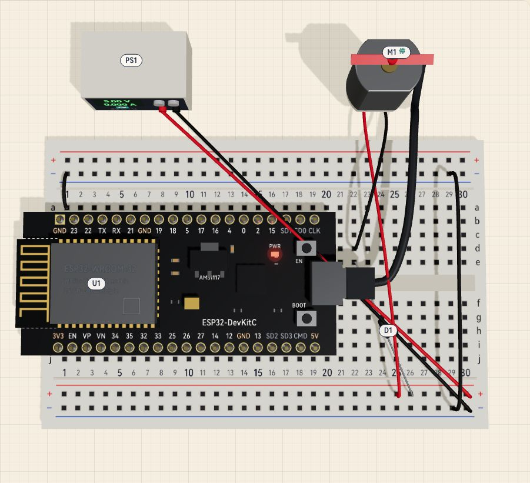
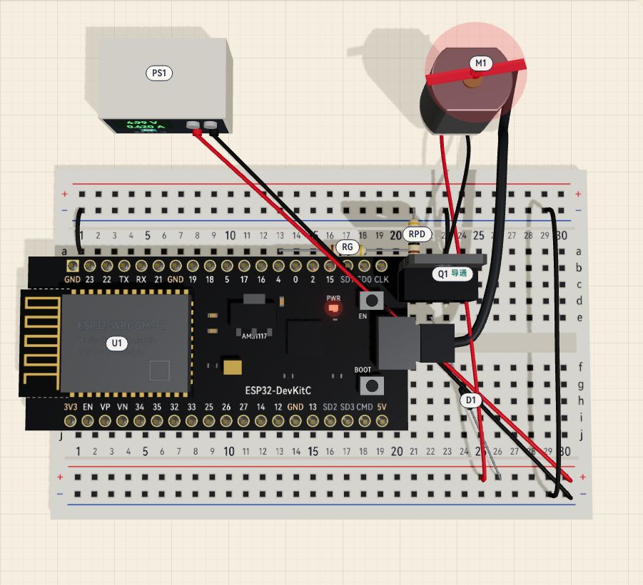
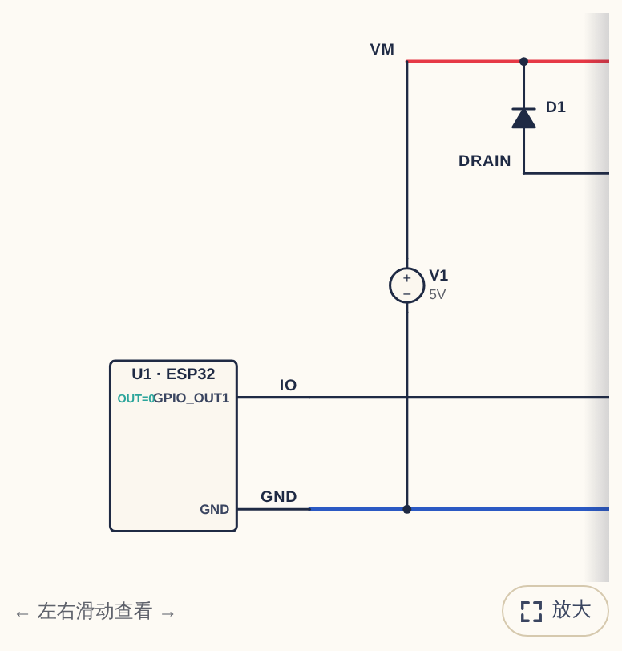
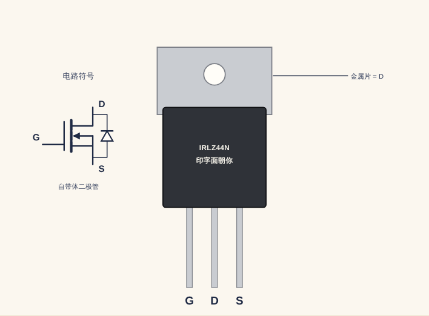
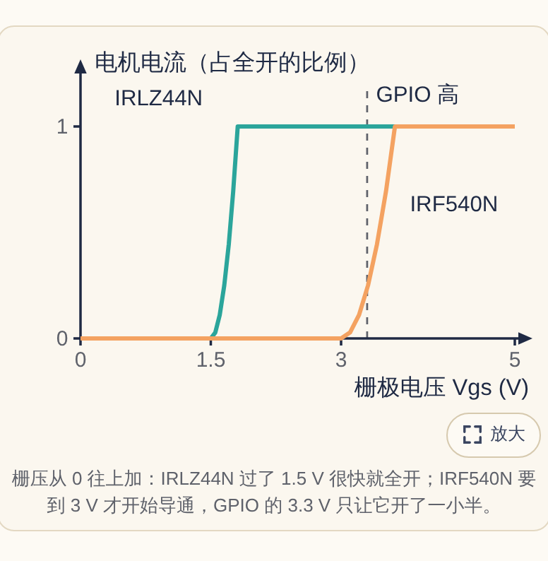

# 8.4 · 逻辑电平 MOSFET：3.3 V 引脚开关大电流电机

| 项目 | 内容 |
|---|---|
| id | `exp5-mosfet-logic-level` |
| 文件 | `challenges/287-mosfet-logic-level.json` |
| 类型 | 实验 / 挑战（没有分步，照目标电路图搭） · 难度 4/5 |
| 位置 | World 8 · 数字逻辑、MCU 与传感器实战 → 8.4 MOSFET 与继电器（本节第 1 项） |
| 右侧面板 | 轨道由旧的四张卡片自动生成（还没手工精排） |
| 前后 | 上一项 [8.3 exp5-npn-buzzer-switch](../w8/8.03-1-exp5-npn-buzzer-switch.md) · 下一项 [8.4 exp5-relay-flyback](../w8/8.04-2-exp5-relay-flyback.md) |
| 先修 | lesson-mcu-gpio |
| 概念 | N 沟道 MOSFET 低边开关 low-side switch、阈值电压 Vth、导通电阻 Rds(on)、逻辑电平 logic-level gate、工作区对照 BJT / MOSFET regions、栅极下拉 gate pull-down |

**一句话概要**：先用普通的 IRF540N：3.3 V 栅压只让它半开，电机几乎不动。换成逻辑电平的 IRLZ44N，它全开，0.6 A 的电机转起来，自己几乎不发热。

## 1. 左侧工作台（3D 面包板 → 2D 俯视截图）

截图是程序里真实的 3D 面包板换成俯视角拍的；表格是同一块板的文字版（元件、参数、每只脚插在哪个孔）。

### 1.1 起点：打开这一课时板上已经有的

右侧显示的「起点」说明：

> **半成品**：ESP32、5 V 电机电源（下方轨道）、两组地线、电机和续流二极管都已接好。**为什么**：负载和电源是重复技能；这里要学的是 MOSFET 的栅极驱动。**你要做**：放 IRLZ44N（c21：G、D、S），加 RG（100Ω，GPIO4 → 栅极）、RPD（100kΩ，栅极 → GND），再把源极接 GND。

| 元件 | 类型 | 参数 | 引脚 → 孔 |
|---|---|---|---|
| U1 | esp32_devkit | usb=true, pins={"GPIO4":{"mode":"out_high"}} | GND→b1 GPIO23→b2 GPIO22→b3 GPIO1→b4 GPIO3→b5 GPIO21→b6 GND_2→b7 GPIO19→b8 GPIO18→b9 GPIO5→b10 GPIO17→b11 GPIO16→b12 GPIO4→b13 GPIO0→b14 GPIO2→b15 GPIO15→b16 GPIO8→b17 GPIO7→b18 GPIO6→b19 3V3→i1 EN→i2 GPIO36→i3 GPIO39→i4 GPIO34→i5 GPIO35→i6 GPIO32→i7 GPIO33→i8 GPIO25→i9 GPIO26→i10 GPIO27→i11 GPIO14→i12 GPIO12→i13 GND_3→i14 GPIO13→i15 GPIO9→i16 GPIO10→i17 GPIO11→i18 5V→i19 |
| W2 | wire |  | a→a1 b→tn1 |
| PS1 | bench_supply | voltage=5, currentLimit=1 | +→bp30 -→bn30 |
| W4 | wire |  | a→bn29 b→tn29 |
| M1 | motor |  | +→bp25 -→d22 |
| D1 | diode |  | anode→e22 cathode→bp26 |

### 1.3 参考答案（「看答案」载入的板子）

| 元件 | 类型 | 参数 | 引脚 → 孔 |
|---|---|---|---|
| U1 | esp32_devkit | usb=true, pins={"GPIO4":{"mode":"out_high"}} | GND→b1 GPIO23→b2 GPIO22→b3 GPIO1→b4 GPIO3→b5 GPIO21→b6 GND_2→b7 GPIO19→b8 GPIO18→b9 GPIO5→b10 GPIO17→b11 GPIO16→b12 GPIO4→b13 GPIO0→b14 GPIO2→b15 GPIO15→b16 GPIO8→b17 GPIO7→b18 GPIO6→b19 3V3→i1 EN→i2 GPIO36→i3 GPIO39→i4 GPIO34→i5 GPIO35→i6 GPIO32→i7 GPIO33→i8 GPIO25→i9 GPIO26→i10 GPIO27→i11 GPIO14→i12 GPIO12→i13 GND_3→i14 GPIO13→i15 GPIO9→i16 GPIO10→i17 GPIO11→i18 5V→i19 |
| W2 | wire |  | a→a1 b→tn1 |
| PS1 | bench_supply | voltage=5, currentLimit=1 | +→bp30 -→bn30 |
| W4 | wire |  | a→bn29 b→tn29 |
| RG | resistor | resistance=100 | 1→a13 2→a21 |
| RPD | resistor | resistance=100000 | 1→b21 2→tn21 |
| Q1 | nmos | model=IRLZ44N | g→c21 d→c22 s→c23 |
| W8 | wire |  | a→a23 b→tn23 |
| M1 | motor |  | +→bp25 -→d22 |
| D1 | diode |  | anode→e22 cathode→bp26 |

### 1.4 目标原理图（右侧「目标原理图」抽屉）

| 元件 | 类型 | 参数 |
|---|---|---|
| U1 | esp32_devkit |  |
| V1 | dc_source | voltage=5 |
| RG | resistor | resistance=100 |
| RPD | resistor | resistance=100000 |
| Q1 | nmos | model=IRLZ44N |
| M1 | motor |  |
| D1 | diode |  |

连接（每个结点上的引脚）：

- **IO**：U1.GPIO_OUT1、RG.1
- **GATE**：RG.2、Q1.g、RPD.1
- **DRAIN**：Q1.d、M1.-、D1.anode
- **VM**：V1.+、M1.+、D1.cathode
- **GND**：V1.-、Q1.s、RPD.2、U1.GND

## 2. 右侧面板：学生从上往下看到的内容（单轨流）

### 第 1 步 · 🔍 先看一眼：先认识它：N-MOSFET

**拆解「N-MOSFET：用电压（电场）开关大电流」第 1 / 9 层：① 外形：TO-220，三只脚 G D S，金属片是 D**

实验 5-8 和 5-15 用的 IRLZ44N 装在 **TO-220** 封装里：黑色塑料体 + 一块带螺丝孔的 金属片（用来拧到散热片上）+ 三只脚。

印字面朝自己、脚朝下，从左到右是 G、D、S。**金属片和中间的 D 脚是连通的**——拧到散热片上时散热片也带着漏极电压，多个 MOSFET 共用散热片要加绝缘垫。

电路符号：
- 栅极 G 是一根和沟道 **隔开** 的竖线——表示栅极和沟道之间有绝缘层，不导电；
- 沟道画成三段虚线：增强型（enhancement），平时是断开的，要加栅极电压才“连起来”；
- 箭头指向沟道 = N 沟道；
- 旁边的 体二极管 body diode 不是额外加的，是结构里天生就有的（下一层能看到）。

| 脚 | 名字 | 作用 | 低边开关里接 |
|---|---|---|---|
| G | 栅极 gate | 控制端：电压控制，几乎不取电流 | 经 RG 接 GPIO，RPD 下拉到 GND |
| D | 漏极 drain（= 金属片） | 大电流从这里流进 | 负载的下端 |
| S | 源极 source | 电子的来源，电流从这里流出 | GND |

### 第 2 步 · 🔧 动手搭：先用一颗“普通” MOSFET

**稳压电源**调到 **`5 V`**，限流调到 **`1 A`**，它的 − 接开发板 GND（**共地**）。
栅极这一串：GPIO → **`100 Ω`** → Q1 栅极 G；**`100 kΩ`** 从 G 接到 GND；Q1 的源极 S 接 GND。电机接在 +5 V 和漏极 D 之间，电机两端反并一个二极管（色环朝 +5 V）。
Q1 先用 **IRF540N**。把 GPIO 设成**「输出 高」**：电机转得起来吗？单击 Q1，看它在哪个区、自己发热多少。

### 第 3 步 · 💡 想明白：Vth 只是“开始导通”

- MOSFET 的栅极像电容的一块极板：**直流下不取电流**。栅压越高，D–S 之间的通道开得越大。
- 数据手册上的 **Vth** 是“刚刚开始导通”的栅压（只有零点几毫安）。IRF540N 的 Vth 约 3 V，3.3 V 只比它高一点，通道只开了一小半。**逻辑电平** MOSFET（IRLZ44N）的 Vth 约 1.5 V，3.3 V 足够让它全开。

*图 `gate`（plot）：栅压从 0 往上加：IRLZ44N 过了 1.5 V 很快就全开；IRF540N 要到 3 V 才开始导通，GPIO 的 3.3 V 只让它开了一小半。*

- 名字容易搞反：MOSFET 的“饱和区”是**半开**，三极管的“饱和区”才是**全开**。

| | NPN 三极管 | MOSFET |
|---|---|---|
| 关断 | 截止区 | 截止区 |
| 半开（受控的电流源） | 放大区 | **饱和区** |
| 全开（当开关用） | **饱和区** | **可变电阻区** |

- 全开时 D–S 就是一个很小的电阻 $R_{DS(on)}$，上面的电压很小：
$$V_{DS} = I_D × R_{DS(on)}$$
- 代入数字：本模拟器取 IRLZ44N 在 5 V 栅压下 22 mΩ（数据手册给的上限是 25 mΩ），1 A 时 $V_{DS} = 1 × 0.022 = 0.022$ V，自己几乎不发热。

（这一步下面列着这节课的计算卡片，点开就地展开：`rl-time-constant`、`flyback-spike`、`mosfet-power`、`diode-forward`，全文见第 6 节）

### 第 4 步 · 🔧 动手搭：换成逻辑电平 MOSFET

- 单击 **Q1**，在「属性」里把型号换成 **IRLZ44N**。再看它的工作区和电机。
- 点**「检查我的电路」**。通过后用电流表、万用表完成测量题；有一题要把型号**临时换回 IRF540N**。
- 先预测：电机约 8 Ω，接在 5 V 上要多大电流？全开的 Q1 上会剩多少电压？

### 第 5 步 · 📏 测一测：测一测：读你自己的仪表

**测量题 1 · `im`**（读数题）

> 「输出 高」：电机电流（电流表串在 +5 V 和电机之间）

- 单位 A · 先写预测 · 状态：U1 GPIO_OUT1 设为输出高电平 · 参考答案的读数 **0.6201 A** · 合理范围 [0.589, 0.651]

答对后显示：

> 电机约 8 Ω 接 5 V：≈ 0.62 A——GPIO 能给的 30 倍。

**测量题 2 · `vds`**（读数题）

> 「输出 高」：Vds（红表笔接 D，黑表笔接 S）

- 单位 mV · 先写预测 · 状态：U1 GPIO_OUT1 设为输出高电平 · 参考答案的读数 **26.6 mV** · 合理范围 [0.0253, 0.0279]

答对后显示：

> 完全导通（可变电阻区），Vds ≈ 27 mV。

**测量题 3 · `rds`**（计算题（用自己的读数算））

> 用你的两个读数算导通电阻 Rds = Vds / Id

- 单位 mΩ · 先写预测 · 参考答案的读数 **42.9 mΩ** · 合理范围 [0.0408, 0.045] · 公式 `vds / im`

答对后显示：

> ≈ 43 mΩ：模型的 22 mΩ 是栅压 5 V 时的值，3.3 V 栅压时大约翻倍。Q1 只发热约 17 mW。

**测量题 4 · `vds540`**（读数题）

> 把 Q1 临时换回 IRF540N（栅极仍是 3.3 V）：Vds

- 单位 V · 先写预测 · 状态：U1 GPIO_OUT1 设为输出高电平、Q1 换成 IRF540N · 参考答案的读数 **3.877 V** · 合理范围 [3.68, 4.07]

答对后显示：

> Vth ≈ 3 V，只比 3.3 V 低一点：它停在“饱和区”（半开），Id ≈ 0.14 A，Vds ≈ 3.9 V，自己发热 0.54 W。

**测量题 5 · `pulldown`**（选择题）

> 把 GPIO 设成「输入」（就像上电、复位的那一瞬间），电机会？

- A. 停着：100 kΩ 下拉把栅极拉到 0 V ✅（正确）
- B. 转起来：栅极悬空，可能被干扰抬高
- C. 停着：MOSFET 没有栅极电压也是全开的

- 状态：U1 GPIO_OUT1 设为输入（浮空）

答对后显示：

> 引脚是输入时什么都不驱动，栅极只靠 100 kΩ 接到 GND，所以是 0 V，Q1 截止。没有下拉，栅极悬空，真实电路里电机可能自己转起来。

### 第 6 步 · 🎒 带走：带走

- **3.3 V 单片机要选逻辑电平 MOSFET**：看数据手册里 $R_{DS(on)}$ 是在多大栅压下规定的（要有 2.5 V 或 4.5 V 的值）。IRLZ44N、AO3400、Si2302 都可以。
- 当开关用的 MOSFET 要在**可变电阻区**，不是“饱和区”。
- **栅极下拉**（10–100 kΩ）一定要加：上电、复位时 GPIO 是输入，栅极悬空会让电机突然转起来。
- 真实电路里的坑：电机电流从单独的电源出，别从 USB 取；电源和开发板一定要**共地**。电机两端那个反并的二极管，下一个实验讲它为什么救命。

趁热练理论题：`nonlinear`

## 3. 测量题一览

| # | id | 题目 | 类型 | 单位 | 状态 | 参考读数 |
|---|---|---|---|---|---|---|
| 1 | im | 「输出 高」：电机电流（电流表串在 +5 V 和电机之间） | current | A | U1 GPIO_OUT1 设为输出高电平 | 0.6201 A |
| 2 | vds | 「输出 高」：Vds（红表笔接 D，黑表笔接 S） | voltage | mV | U1 GPIO_OUT1 设为输出高电平 | 26.6 mV |
| 3 | rds | 用你的两个读数算导通电阻 Rds = Vds / Id | formula | mΩ |  | 42.9 mΩ |
| 4 | vds540 | 把 Q1 临时换回 IRF540N（栅极仍是 3.3 V）：Vds | voltage | V | U1 GPIO_OUT1 设为输出高电平、Q1 换成 IRF540N | 3.877 V |
| 5 | pulldown | 把 GPIO 设成「输入」（就像上电、复位的那一瞬间），电机会？ | 选择 |  | U1 GPIO_OUT1 设为输入（浮空） | 正确：A |

### 全部答完后显示的「对比」

**对比**（仿真）：
- IRLZ44N，「输出 高」：Vgs ≈ 3.29 V，可变电阻区，Id ≈ **0.62 A**，Vds ≈ **27 mV**，Rds ≈ 43 mΩ，Q1 只发热约 17 mW。
- IRF540N，「输出 高」：饱和区（半开），Id ≈ 0.14 A，Vds ≈ **3.9 V**，Q1 自己发热约 0.54 W，电机只拿到不到四分之一的电流。
- 引脚是输入：下拉把栅极拉到 0 V，电机停。

**模型说明**：电机是 8 Ω + 2 mH，没有反电动势；MOSFET 是分段的平方律模型 Id = min(K·Vov·Vds, K·Vov²/2)，没有栅极电容和开关损耗。

### 提示按钮（依次显示）

1. 栅极这一串：GPIO → 100 Ω → G，再加一个 100 kΩ 从 G 接到 GND。S 接 GND。
2. 电机接在 +5 V 和 D 之间；二极管并在电机两端，色环（负极）朝 +5 V。
3. 稳压电源调到 5 V、限流 1 A，它的 − 接开发板 GND。

### 功能测试（「检查我的电路」时跑）

- 「输出 高」：电机转，Q1 全开（可变电阻区）
- 「输出 低」：Q1 截止，电机停
- 引脚是输入（复位时）：下拉让栅极保持 0 V，电机停
- 换成 IRF540N：停在饱和区（半开），电流很小

## 4. 用到的拆解（全部层的文字，供改写参考）

### 拆解 `mosfet`：N-MOSFET：用电压（电场）开关大电流

*MOSFET = Metal-Oxide-Semiconductor Field-Effect Transistor（金属-氧化物-半导体场效应晶体管）。三极管用电流控制，MOSFET 用栅极电压在硅里“画”出一条导电沟道。我们从 TO-220 封装拆到截面，看沟道怎么形成，再推出导通电阻、功耗、栅极电容和续流二极管。*

**拆解「N-MOSFET：用电压（电场）开关大电流」第 1 / 9 层：① 外形：TO-220，三只脚 G D S，金属片是 D**

实验 5-8 和 5-15 用的 IRLZ44N 装在 **TO-220** 封装里：黑色塑料体 + 一块带螺丝孔的 金属片（用来拧到散热片上）+ 三只脚。

印字面朝自己、脚朝下，从左到右是 G、D、S。**金属片和中间的 D 脚是连通的**——拧到散热片上时散热片也带着漏极电压，多个 MOSFET 共用散热片要加绝缘垫。

电路符号：
- 栅极 G 是一根和沟道 **隔开** 的竖线——表示栅极和沟道之间有绝缘层，不导电；
- 沟道画成三段虚线：增强型（enhancement），平时是断开的，要加栅极电压才“连起来”；
- 箭头指向沟道 = N 沟道；
- 旁边的 体二极管 body diode 不是额外加的，是结构里天生就有的（下一层能看到）。

| 脚 | 名字 | 作用 | 低边开关里接 |
|---|---|---|---|
| G | 栅极 gate | 控制端：电压控制，几乎不取电流 | 经 RG 接 GPIO，RPD 下拉到 GND |
| D | 漏极 drain（= 金属片） | 大电流从这里流进 | 负载的下端 |
| S | 源极 source | 电子的来源，电流从这里流出 | GND |

**拆解「N-MOSFET：用电压（电场）开关大电流」第 2 / 9 层：② X 光：硅片焊在漏极金属片上**

透视：硅片 背面就是漏极，直接焊在 金属片 上——热量从这里走，所以 TO-220 能散几瓦。正面两块金属：细的 金线连 G，粗的（或好几根）连 S，因为几十安的电流都从 S 出来。

功率 MOSFET 的硅片上其实是 **几千到几百万个小 MOSFET 单元并联**，每个单元的沟道电阻并联起来，才有 22 mΩ 这么小的导通电阻。但每个单元的原理和下一层画的教科书截面一模一样。

**拆解「N-MOSFET：用电压（电场）开关大电流」第 3 / 9 层：③ 截面：p 型衬底里两个 n⁺ 区，上面一层氧化物和栅极**

把一个单元切开：
- p 型衬底 body：大部分是 p 型硅，空穴多、自由电子少；
- 源极 S 和 漏极 D：两个浓掺杂的 n⁺ 区；
- 氧化层 SiO₂：只有几十 nm 厚的绝缘玻璃；
- 栅极 G：氧化层上面的导体（多晶硅）。

**没加栅压时**：从 S 走到 D 要经过 n⁺ → p → n⁺，就是两个 **背靠背的 PN 结**，不管 D–S 加哪个方向，总有一个结反偏——断开。

**体二极管**：衬底在内部接到 S 上（为了让衬底电位固定），于是 p 衬底和 n⁺ 漏极之间形成一个从 S 指向 D 的 二极管。D 比 S 低时它就导通，所以 MOSFET **只能单向阻断**。

**栅极和下面的硅之间是绝缘的**：G、氧化层、硅构成一个 **平行板电容**。这就是“栅极不取直流电流”的原因。

| 层 | 材料 | 作用 |
|---|---|---|
| 栅极 G | 多晶硅 / 金属 | 电容的上极板 |
| 氧化层 | SiO₂，几十 nm | 绝缘介质；太高的 V_GS 会击穿它（±16–20 V） |
| 源 / 漏 | n⁺ | 电子的入口和出口 |
| 衬底 body | p 型，接 S | 沟道在它的表面形成；和 D 构成体二极管 |

**拆解「N-MOSFET：用电压（电场）开关大电流」第 4 / 9 层：④ 栅极电场“画”出一条沟道：阈值电压**

给栅极加正电压（相对 S）：
1. 栅极这块“极板”带上 正电荷；
2. 电场穿过氧化层，把 p 衬底表面的空穴推开，再把少量自由电子吸到氧化层正下方；
3. 电压够大时，表面的电子多到让这一薄层 **反型**（inversion）成 n 型——一条连接 S 和 D 的 n 沟道 就出现了，电流 $I_D$ 可以从 D 流到 S。

刚好出现沟道的栅压叫 **阈值电压** $V_{GS(th)}$（手册里定义为 $I_D$ = 250 µA 时的 $V_{GS}$——只是“刚开始导通”）。超过阈值的部分叫 **过驱动电压**：
$$V_{ov} = V_{GS} - V_{th}$$
过驱动越大，沟道里电子越多，沟道越“宽”，电阻越小。IRLZ44N 的 $V_{th}$ = 1.5 V，GPIO 给 3.3 V，$V_{ov}$ = 1.8 V。

和三极管对比：三极管要 **持续的基极电流** 才能导通；MOSFET 只要把栅极这个电容 **充上电**，之后不再需要电流。

- 公式 `V_{ov} = V_{GS} - V_{th} = 3.3 - 1.5 = 1.8 V`：IRLZ44N 由 GPIO 驱动

**拆解「N-MOSFET：用电压（电场）开关大电流」第 5 / 9 层：⑤ 等效电路：截止、欧姆区、饱和区**

仿真器用的是电路课里的 **平方律模型**（square-law model）。K 是由器件决定的常数（单位 A/V²）：
$$I_D = min(K·V_{ov}·V_{DS},  \frac{K·V_{ov}^{2}}{2})$$
- 截止：$V_{GS}$ < $V_{th}$，没有沟道，D–S 开路（只剩体二极管）；
- 欧姆区 ohmic：$V_{DS}$ 小（< $\frac{V_{ov}}{2}$），沟道像一个电阻，$I_D$ 和 $V_{DS}$ 成正比：
$$R_{DS} = \frac{V_{DS}}{I_D} = \frac{1}{K·V_{ov}}$$
**开关就要工作在这里**；
- 饱和区 saturation：$V_{DS}$ 大，沟道在漏极一端被“夹断”，电流不再随 $V_{DS}$ 增加，变成恒流 $\frac{K V_{ov}^{2}}{2}$——开关只开了一半，$V_{DS}$ 很大，发热。

⚠ **名字陷阱**：MOSFET 的“饱和区”是 **恒流区**，对应三极管的“放大区”；MOSFET 当开关要在 **欧姆区**，而三极管当开关要在“饱和区”。名字相同，意思相反。

K 从手册算：IRLZ44N 在 $V_{GS}$ = 5 V 时 $R_{DS(on)}$ = 22 mΩ，
$$K = \frac{1}{R_{DS(on)}·(V_{GS} - V_{th})} = \frac{1}{0.022 × 3.5} = 13 A/V^{2}$$
GPIO 的 3.3 V 下：$R_{DS} = \frac{1}{13 × 1.8}$ ≈ **43 mΩ**。

栅极在三种状态里都只是一个电容 $C_{iss}$（约 1.7 nF），没有直流通路。

| 区 | 条件 | D–S 等效 | 对应三极管的 |
|---|---|---|---|
| 截止 | $V_{GS}$ < $V_{th}$ | 开路 | 截止 |
| 欧姆区 | $V_{DS}$ < $\frac{V_{ov}}{2}$ | $R_{DS} = \frac{1}{K V_{ov}}$ | 饱和（开关闭合） |
| 饱和区 | $V_{DS}$ > $\frac{V_{ov}}{2}$ | $I_D = \frac{K V_{ov}^{2}}{2}$ | 放大区（恒流） |

**拆解「N-MOSFET：用电压（电场）开关大电流」第 6 / 9 层：⑥ 逻辑电平 vs 标准：3.3 V 栅压够不够**

把 $R_{DS} = \frac{1}{K(V_{GS} - V_{th})}$ 对 $V_{GS}$ 画出来，两个型号差别一目了然：
- IRLZ44N（逻辑电平 logic-level）：$V_{th}$ = 1.5 V，手册在 $V_{GS}$ = 5 V（甚至 4.5 V）给出 $R_{DS(on)}$。在 GPIO 的 3.3 V 处已经降到 43 mΩ，完全导通；
- IRF540N（标准电平）：$V_{th}$ = 3.0 V，手册的 44 mΩ 是在 $V_{GS}$ = **10 V** 量的。3.3 V 时 $V_{ov}$ 只有 0.3 V：

实验 5-8 换成 IRF540N：电机想要 0.62 A，但饱和区最多 $\frac{K V_{ov}^{2}}{2} = \frac{3.25 × 0.3^{2}}{2}$ ≈ 0.14 A。它卡在恒流区，$V_{DS}$ = 3.9 V，电机只拿到 23 % 的电流，几乎不转，MOSFET 却在发热。

**手册陷阱**：IRF540N 的 $V_{th}$ 写着 “2–4 V”，看起来 3.3 V 够——但 $V_{th}$ 只是 250 µA 的“刚开始导通”。选型要看 **$R_{DS(on)}$ 是在哪个 $V_{GS}$ 下给的**：3.3 V 的 MCU 要选在 2.5 V 或 4.5 V 下给出 $R_{DS(on)}$ 的型号（IRLZ44N、IRLB8721、AO3400、Si2302）。

|  | IRLZ44N | IRF540N |
|---|---|---|
| 类型 | 逻辑电平 | 标准电平 |
| $V_{th}$ | 1.5 V | 3.0 V |
| 手册 $R_{DS(on)}$ | 22 mΩ @ 5 V | 44 mΩ @ 10 V |
| K | 13 A/V² | 3.25 A/V² |
| 3.3 V 栅压时 | 欧姆区，43 mΩ | 饱和区，0.14 A |
| 电机电流 / $V_{DS}$ | 620 mA / 27 mV | 140 mA / 3.9 V |
| 耐压 / 雪崩 | 55 V | 100 V |

- 公式 `K = \frac{1}{R_{DS(on)}·(V_{GS,spec} - V_{th})}`：从手册的一组数算 K
- 公式 `R_{DS}(V_{GS}) = \frac{1}{K(V_{GS} - V_{th})}`：欧姆区的导通电阻

**拆解「N-MOSFET：用电压（电场）开关大电流」第 7 / 9 层：⑦ 功耗：P = I²·R，为什么 MOSFET 几乎不发热**

实验 5-8：+5 V → 电机（8 Ω） → D，S 接地，GPIO 经 RG 100 Ω 接 G，RPD 100 kΩ 下拉。输出 HIGH 时：
1. $V_GS$ = 3.29 V → 欧姆区，$R_{DS}$ ≈ 43 mΩ；
2. 回路电流 $I_D = \frac{5 V}{8 Ω + 0.043 Ω}$ ≈ 620 mA；
3. $V_{DS} = I_D·R_{DS}$ = 0.62 × 0.043 ≈ 27 mV——“$V_{DS}$ < 50 mV 证明完全导通”；
4. 功耗：
$$P = I_D^{2}·R_{DS(on)} = 0.62^{2} × 0.043 ≈ 17 mW$$
TO-220 不加散热片的热阻 $R_{θJA}$ ≈ 62 °C/W，温升 $ΔT = P·R_{θJA}$ ≈ 1 °C。

同样的电路换 IRF540N：$P = V_{DS}·I_D$ = 3.9 V × 0.14 A ≈ 0.54 W，温升约 33 °C——**功耗增加 30 倍，电机反而停了**。

**为什么不用三极管**：2N2222 驱动 0.62 A 要按强制 β = 10 给 62 mA 基极电流，GPIO 给不出；而且 $V_{CE(sat)}$ ≈ 0.15 + 0.62 ≈ 0.77 V，功耗 0.48 W。MOSFET 的栅极 **不取直流电流**，导通电阻只有几十 mΩ。

|  | IRLZ44N | IRF540N | 2N2222（假设） |
|---|---|---|---|
| 控制端需要 | 3.3 V，直流 0 A | 3.3 V，直流 0 A | 62 mA 基极电流 ✗ |
| $V_{DS}$ / $V_{CE}$ | 27 mV | 3.9 V | ≈ 0.77 V |
| 电机电流 | 620 mA | 140 mA | ≈ 600 mA |
| 开关功耗 | 17 mW | 0.54 W | ≈ 0.48 W |
| 温升（无散热片） | ≈ 1 °C | ≈ 33 °C | TO-92：超额定 ✗ |

- 公式 `P = I_D^{2}·R_{DS(on)}`：欧姆区（完全导通）的功耗
- 公式 `ΔT = P·R_{θJA}`：结温升高；TO-220 无散热片约 62 °C/W

**拆解「N-MOSFET：用电压（电场）开关大电流」第 8 / 9 层：⑧ 栅极是一个电容：只在开关瞬间取电流**

从 GPIO 看进去，栅极就是一个 输入电容 $C_iss$（IRLZ44N 约 1.7 nF）。GPIO 从 0 跳到 3.3 V 时，就是一道一阶 RC 充电题：
$$v_G(t) = 3.3 V·(1 - e^{-t/τ}),   τ = (R_{out} + R_G)·C_{iss} = 125 Ω × 1.7 nF ≈ 0.21 µs$$
- 一开始电容相当于短路，电流峰值 $\frac{3.3 V}{125 Ω}$ ≈ 26 mA，然后指数衰减到 0；
- 栅压 过 $V_th$ 的时刻：$t = τ·ln\frac{3.3}{3.3 - 1.5}$ ≈ 0.13 µs；约 5τ ≈ 1 µs 后充满；
- 充满后 **直流电流为 0**——这就是“栅极不取电流”的准确含义。

RG（47–220 Ω） 的作用：限制充电峰值电流保护 GPIO，并阻尼导线电感引起的振荡；直流时上面没有压降。
RPD（10–100 kΩ）：MCU 复位、上电、下载程序时引脚是高阻输入，栅极电容上的电荷没地方放，悬空的栅极可能让电机自己转起来。RPD 把它放掉，时间常数 100 kΩ × 1.7 nF = 0.17 ms。

**PWM 时的平均栅极电流**：每个周期充一次电荷 $Q = C_{iss}·V$ ≈ 1.7 nF × 3.3 V ≈ 5.6 nC，20 kHz 时 $I = Q·f$ ≈ 0.11 mA。频率越高，开关过程占的比例越大、开关损耗越大，所以电机 PWM 一般用 20–25 kHz。（真实 MOSFET 还有米勒电容，栅极电荷手册给的是 $Q_g$。）

- 公式 `τ = (R_{out} + R_G)·C_{iss} ≈ 0.21 µs`：栅极充电时间常数
- 公式 `I_{G,avg} = Q·f = C_{iss}·V·f ≈ 0.11 mA`：20 kHz PWM 时

**拆解「N-MOSFET：用电压（电场）开关大电流」第 9 / 9 层：⑨ 续流二极管和 PWM 调速（实验 5-15）**

电机线圈是一个电感（模型 8 Ω + 2 mH）。MOSFET 关断的一瞬间，电感要维持电流（$v = L\frac{di}{dt}$）：
- 有 续流二极管 D1（反接在电机两端，阴极接 +5 V）：电流改走 电机 → D1 → 电机 这个小回路慢慢衰减，漏极被钳在 5 V + 0.7 V = 5.7 V；
- 没有 D1：电流无处可去，$\frac{di}{dt}$ 极大，漏极电压冲到 MOSFET 的雪崩电压 55 V，每个周期打一次，迟早击穿。

**PWM 调速**：导通期间 电机上是 5 V，关断期间是 −0.7 V（续流二极管）。电机电感的时间常数 $τ = \frac{L}{R}$ = 0.25 ms；20 kHz 时周期 50 µs ≪ τ，电流几乎是平的：
$$V̄_{motor} ≈ D·5 V - (1 - D)·0.7 V,   Ī = \frac{V̄_{motor}}{8 Ω}$$
- D = 25 %：0.71 V，**89 mA**（其中 66 mA 走二极管），低于 0.1 A 的起转电流——**电机不转**（真实电机也有这个“死区”）；
- D = 50 %：2.06 V，**258 mA**，一半时间在续流；
- D = 100 %：**620 mA**，二极管不工作。

**频率怎么选**：1 kHz、50 % 时平均电流差不多（263 mA），但周期 1 ms = 4τ，电流一涨一落，**有效值（RMS）**变成 317 mA——线圈发热 ∝ $I_{rms}^{2}$，多 45 %，而且 1 kHz 正是人耳最敏感的频率，电机会叫。所以电机 PWM 用 ≥ 20 kHz；LED 调光没有电感，≥ 1 kHz 不闪就行。

| PWM | 电机平均电流 | 二极管平均电流 | 电机 RMS | 结果 |
|---|---|---|---|---|
| 20 kHz, 25 % | 89 mA | 66 mA | ≈ 89 mA | 不转（< 0.1 A） |
| 20 kHz, 50 % | 258 mA | 129 mA | 258 mA | 平稳 |
| 20 kHz, 100 % | 620 mA | 0 | 620 mA | 全速 |
| 1 kHz, 50 % | 263 mA | — | 317 mA | 更热、啸叫 |

- 公式 `V̄_{motor} ≈ D·V_S - (1 - D)·V_D`：τ = L/R ≫ 周期时
- 公式 `V_{D,peak} = V_S + V_{D1} = 5.7 V`：续流二极管钳住的漏极电压

**一句话记住**：N-MOSFET = p 衬底里两个 n⁺ 区 + 氧化层上的栅极。$V_{GS}$ > $V_{th}$ 时电场画出 n 沟道；当开关要在欧姆区，$R_{DS} = \frac{1}{K(V_{GS} - V_{th})}$，功耗 $P = I^{2}·R_{DS}$。3.3 V 的 MCU 选逻辑电平型号；栅极是电容，串 RG、加 RPD 下拉；电感负载并续流二极管。

## 5. 这一课的计算卡片

**计算卡片 `rl-time-constant`：RL 时间常数 τ = L/R**

- 公式 `τ = \frac{L}{R}`
- 用途：电感电流建立 / 衰减有多快；R 是回路里所有电阻之和。
- 输入：L（电感，H）；R（回路总电阻（含 50 Ω、线圈电阻），Ω） → τ（时间常数，s）

1. 电感：$v_L = L\frac{di}{dt}$，**电流不能突变**（电压可以）。
2. KVL：$V_s = Ri + L\frac{di}{dt}$，和 RC 是同一类方程，$τ = \frac{L}{R}$（H / Ω = s）。
3. 稳态电流 $\frac{V_s}{R}$（电感当短路），从初值指数地走过去。
4. 和 RC 相反：**R 越大，τ 越小**（电流的“终点”变小了，走得更快）。
5. 跳变瞬间电流来不及变，整个跳变电压都落在电感上，然后按 τ 衰减。

例子：- 实验 3-3：$\frac{10 mH}{100 + 50 + 1} ≈ 66 µs$；稳态电流 $\frac{1 V}{151 Ω} ≈ 6.6 mA$。
- 实验 5-15：电机 $\frac{2 mH}{8 Ω} = 0.25 ms$：20 kHz 的 50 µs 周期 ≪ τ，电流几乎是平的。
- 实验 5-9：继电器线圈 $\frac{150 mH}{70 Ω} ≈ 2.1 ms$。

- ⚠ 忘了线圈自己的电阻：真实的小 10 mH 电感常有 10–30 Ω。
- ⚠ 把 RC 的习惯套过来写成 τ = LR。

**计算卡片 `flyback-spike`：电感断电的反冲 v = L·di/dt**

- 公式 `v = L \frac{di}{dt} ≈ L \frac{I}{Δt}`
- 用途：突然切断线圈的电流会产生多高的电压——以及为什么要并续流二极管。
- 输入：L（线圈电感，H）；I（断开前的电流，A）；Δt（开关断开用的时间，s） → v（“想要”的反冲电压，V）

1. 电感电流不能突变：三极管 / MOSFET 断开时，线圈“想”让电流按原方向继续流。
2. 没有路可走，$\frac{di}{dt}$ 极大，$v = L\frac{di}{dt}$ 就极高：集电极（漏极）冲到电源电压以上几十伏，直到三极管击穿或空气放电。
3. **续流二极管**反向并在线圈上：导通时它反偏不起作用；断开时集电极一超过 $V_s + 0.7 V$，它就导通，把电压钳住。
4. 电流改走“线圈 → 二极管 → 线圈”这个小回路，按 $τ = \frac{L}{R}$ 衰减，能量变成线圈电阻和二极管里的热。

例子：实验 5-9：150 mH、63 mA，如果 1 µs 内断开，“需要” $\frac{0.15 × 0.063}{10^{-6}} ≈ 9.5 kV$——实际在三极管 C–E 击穿（约 40 V）时就停住了（模拟器约 29 V）。并上 D1 后集电极最高只有 $4.65 + 0.7 ≈ 5.4 V$，电流按 $\frac{150 mH}{70 Ω} ≈ 2 ms$ 衰减。实验 5-8：电机漏极被钳在 $5 + 1.1 ≈ 6.1 V$。

- ⚠ 二极管接反：导通时它把线圈短路，三极管直接对电源短路。条纹（阴极）朝电源正端。
- ⚠ PWM 驱动电机时 1N4007 太慢，用肖特基（1N5819、SS34）。

**计算卡片 `mosfet-power`：MOSFET 开关的发热 P = I²·R**

- 公式 `P = I^{2} R_{DS(on)} = V_{DS} I`
- 用途：完全导通的 MOSFET 自己耗多少功率；半导通时为什么会烫。
- 输入：I（漏极电流，A）；R_ds（导通电阻（IRLZ44N 在 3.3 V 栅压下 ≈ 43 mΩ），Ω） → P（MOSFET 发热，W）

1. 栅极电压足够时，MOSFET 工作在 **欧姆区**：D–S 像一个小电阻 $R_{DS(on)}$，$V_{DS} = IR_{DS(on)}$，只有几十 mV。
2. 发热 $P = V_{DS}I = I^{2}R_{DS(on)}$。
3. 数据手册的 $R_{DS(on)}$ 是在某个栅压下测的（IRLZ44N：5 V 时 22 mΩ）；3.3 V 栅压大约翻倍。
4. 栅压不够（普通 IRF540N，$V_{th}$ ≈ 3 V）：管子在 **恒流（饱和）区**，$V_{DS}$ 有几伏，$P = V_{DS}I$ 一下子到零点几瓦。
5. 所以 3.3 V 单片机要选“逻辑电平” MOSFET：$R_{DS(on)}$ 标在 2.5 V 或 4.5 V 栅压下。

例子：实验 5-8：$0.62^{2} × 0.043 ≈ 17 mW$，$V_{DS} ≈ 27 mV$。换 IRF540N：$3.9 V × 0.14 A ≈ 0.54 W$。实验 5-17：$0.356^{2} × 0.044 ≈ 6 mW$，不用散热片。（三极管同理：$P ≈ V_{CE}I_C + V_{BE}I_B$，实验 5-7 约 6 mW。）

- ⚠ $V_{th}$ 只是“开始导通”（250 µA）的栅压，不是“完全导通”。
- ⚠ 栅极要有下拉电阻（10–100 kΩ）：复位时引脚悬空，栅极电容上的电荷会让电机自己转起来。

**计算卡片 `diode-forward`：二极管的正向压降：过一个二极管少 0.7 V**

- 公式 `V_{out} = V_{in} - V_F - I r_d`
- 用途：电流经过一个导通的二极管（防反接、USB 二极管、续流钳位）以后电压变成多少。
- 输入：V_in（二极管前的电压，V）；V_F（导通压降（硅 0.65–0.7 V，肖特基 0.3 V），V）；I（电流，A）；r_d（二极管内阻（不知道就填 0），Ω） → V_out（二极管后的电压，V）

1. 二极管只让电流从阳极流向阴极（有条纹的一端）。正向导通后两端电压几乎固定：硅管约 0.65–0.7 V，肖特基约 0.3 V。
2. 折线模型：$V_F$ 串一个小电阻 $r_d$，所以电流大时压降稍大。
3. 串在电源后面（防反接）：输出 = 输入 − 一个 $V_F$；接反时它截止，后面的电路不通电。
4. 续流 / 钳位：二极管导通把某一点钳在“另一点 + $V_F$”上——继电器集电极最高 5 V + 0.7 V。

例子：挑战 6：9 V 经二极管 → 约 8.3 V。开发板 5V 引脚：USB 5 V 经肖特基 → 约 4.7 V。实验 5-9：线圈断电时集电极被钳在 4.65 + 0.7 ≈ 5.4 V。实验 3-5：低电平时 D1 反偏，电容不能倒灌回发生器。

- ⚠ 防反接二极管会一直吃掉 0.7 V 和 0.7 V × I 的功率；低压电路用肖特基或 P-MOSFET。

## 6. English（界面英文版的同一份内容）

展开英文

### Node 1 · 🔍 Look first：Meet it first: N-MOSFET

**Teardown「The N-MOSFET: switching big currents with a voltage (a field)」layer 1 of 9：① Package: TO-220, three legs G D S, the tab is D**

The IRLZ44N of labs 5-8 and 5-15 comes in a **TO-220** package: a black plastic body, a metal tab with a screw hole (for a heatsink) and three legs.

Printed face toward you, legs down, left to right: G, D, S. **The tab is connected to the middle leg, D** — bolted to a heatsink, the heatsink sits at the drain voltage; MOSFETs sharing a heatsink need insulating pads.

The circuit symbol:
- the gate G is a line **separated** from the channel — there is an insulator between them, no conduction;
- the channel is drawn as three dashes: enhancement mode, normally off, "joined up" only by a gate voltage;
- the arrow points into the channel = N-channel;
- the body diode beside it is not an extra part; the structure has it built in (next layers).

| Pin | Name | Role | In a low-side switch |
|---|---|---|---|
| G | gate | the control: voltage-driven, takes almost no current | GPIO via RG, RPD to GND |
| D | drain (= the tab) | the big current enters here | the bottom of the load |
| S | source | source of electrons; current leaves here | GND |

### Node 2 · 🔧 Build：First, an "ordinary" MOSFET

Set the **bench supply** to **`5 V`** with a **`1 A`** current limit, and wire its − to the board's GND (**common ground**).
The gate chain: GPIO → **`100 Ω`** → Q1's gate G; **`100 kΩ`** from G to GND; Q1's source S to GND. The motor goes between +5 V and the drain D, with a reversed diode across it (band towards +5 V).
Use an **IRF540N** for Q1 first. Set the GPIO to **Output HIGH**: does the motor get going? Click Q1 and look at its region and how much it heats itself.

### Node 3 · 💡 Why：Vth only means "starting to conduct"

- A MOSFET's gate is like one plate of a capacitor: **it takes no DC current**. The higher the gate voltage, the wider the channel between D and S opens.
- The datasheet's **Vth** is the gate voltage where it *just starts* to conduct (a fraction of a milliamp). The IRF540N's Vth is about 3 V, so 3.3 V opens its channel only a little. A **logic-level** MOSFET (IRLZ44N) has Vth ≈ 1.5 V, and 3.3 V turns it fully on.

[figure `gate`]

*Figure `gate`（plot）：栅压从 0 往上加：IRLZ44N 过了 1.5 V 很快就全开；IRF540N 要到 3 V 才开始导通，GPIO 的 3.3 V 只让它开了一小半。*

- The names are easy to mix up: a MOSFET's "saturation" is **half open**; a transistor's "saturation" is **fully on**.

| | NPN transistor | MOSFET |
|---|---|---|
| off | cutoff | cutoff |
| half open (a controlled current source) | active | **saturation** |
| fully on (as a switch) | **saturation** | **ohmic** |

- Fully on, D–S is just a small resistance $R_{DS(on)}$, with very little voltage across it:
$$V_{DS} = I_D × R_{DS(on)}$$
- With numbers: this simulator gives the IRLZ44N 22 mΩ at a 5 V gate (the datasheet's maximum is 25 mΩ); at 1 A, $V_{DS} = 1 × 0.022 = 0.022$ V, so it hardly heats up.

(This node lists the lesson’s calculation cards: `rl-time-constant`、`flyback-spike`、`mosfet-power`、`diode-forward`; full text in section 6)

### Node 4 · 🔧 Build：Swap in a logic-level MOSFET

- Click **Q1** and change its model to **IRLZ44N** in Properties. Look at its region and the motor again.
- Press **Check my circuit**. Once it passes, answer the questions with the ammeter and multimeter; one of them has you switch the model **back to IRF540N for a moment**.
- Predict first: the motor is about 8 Ω; how much current does it take from 5 V? How much voltage is left across a fully-on Q1?

### Node 5 · 📏 Measure：Measure: read your own instruments

**Question 1 · `im`**（reading）

> Output HIGH: the motor current (ammeter between +5 V and the motor)

- unit A · predict first · state：U1 GPIO_OUT1 is output HIGH · range [0.589, 0.651]

Shown once right:

> About 8 Ω on 5 V: ≈ 0.62 A, 30 times what a GPIO can give.

**Question 2 · `vds`**（reading）

> Output HIGH: Vds (red lead on D, black on S)

- unit mV · predict first · state：U1 GPIO_OUT1 is output HIGH · range [0.0253, 0.0279]

Shown once right:

> Fully on (ohmic region), Vds ≈ 27 mV.

**Question 3 · `rds`**（calculation from own readings）

> From your two readings, the on-resistance Rds = Vds / Id

- unit mΩ · predict first · range [0.0408, 0.045] · formula `vds / im`

Shown once right:

> ≈ 43 mΩ: the model's 22 mΩ is at a 5 V gate; with 3.3 V on the gate it roughly doubles. Q1 dissipates only about 17 mW.

**Question 4 · `vds540`**（reading）

> Switch Q1 back to an IRF540N for a moment (still 3.3 V on the gate): Vds

- unit V · predict first · state：U1 GPIO_OUT1 is output HIGH and Q1 is a IRF540N · range [3.68, 4.07]

Shown once right:

> Vth ≈ 3 V is only a little below 3.3 V: it sits in "saturation" (half open), Id ≈ 0.14 A, Vds ≈ 3.9 V, dissipating 0.54 W itself.

**Question 5 · `pulldown`**（multiple choice）

> Set the GPIO to Input (as at the moment of power-up or reset). The motor:

- A. stays still: the 100 kΩ pull-down holds the gate at 0 V ✅ (right)
- B. starts: the gate floats and may be pulled up by noise
- C. stays still: a MOSFET is fully on with no gate voltage

- state：U1 GPIO_OUT1 is input (floating)

Shown once right:

> An input pin drives nothing, so the gate only sees 100 kΩ to GND: 0 V, Q1 off. Without the pull-down the gate floats, and in a real circuit the motor may start by itself.

### Node 6 · 🎒 Take away：Take away

- **A 3.3 V microcontroller needs a logic-level MOSFET**: check the gate voltage the datasheet specifies $R_{DS(on)}$ at (it should list 2.5 V or 4.5 V). IRLZ44N, AO3400 and Si2302 all work.
- A MOSFET used as a switch should be in the **ohmic** region, not "saturation".
- Always add a **gate pull-down** (10–100 kΩ): at power-up and reset the GPIO is an input, and a floating gate can start the motor by itself.
- A real-world catch: take the motor current from its own supply, not USB, and always **share the ground** with the board. The reversed diode across the motor — the next lab shows why it saves the transistor.

Practise：`nonlinear`

**Compare**

**Compare** (simulated):
- IRLZ44N, Output HIGH: Vgs ≈ 3.29 V, ohmic, Id ≈ **0.62 A**, Vds ≈ **27 mV**, Rds ≈ 43 mΩ; Q1 dissipates only about 17 mW.
- IRF540N, Output HIGH: saturation (half open), Id ≈ 0.14 A, Vds ≈ **3.9 V**; Q1 dissipates about 0.54 W and the motor gets under a quarter of the current.
- Pin as input: the pull-down holds the gate at 0 V, motor stopped.

**Model note**: the motor is 8 Ω + 2 mH with no back EMF; the MOSFET is a piecewise square-law model Id = min(K·Vov·Vds, K·Vov²/2), with no gate capacitance or switching losses.

**Hints**

1. Gate chain: GPIO → 100 Ω → G, plus 100 kΩ from G to GND. S to GND.
2. Motor between +5 V and D; diode across the motor with its band (cathode) on +5 V.
3. Set the bench supply to 5 V with a 1 A limit and wire its − to the board's GND.

