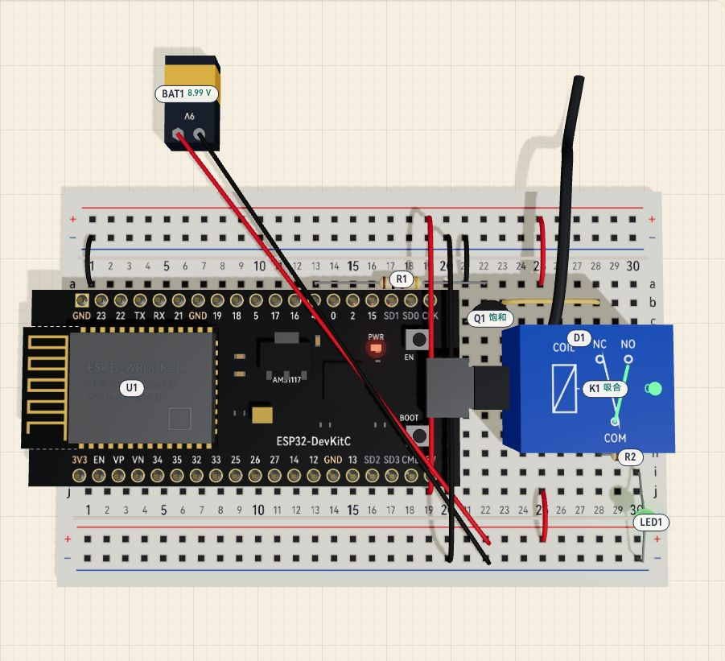
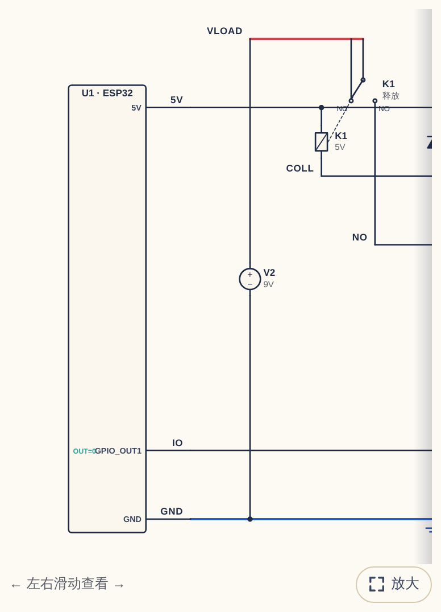
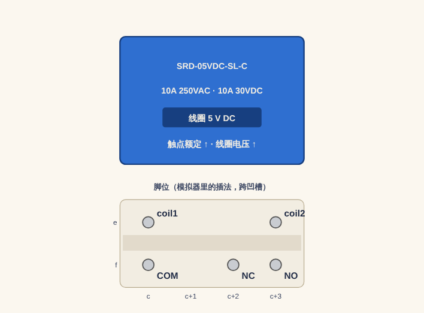
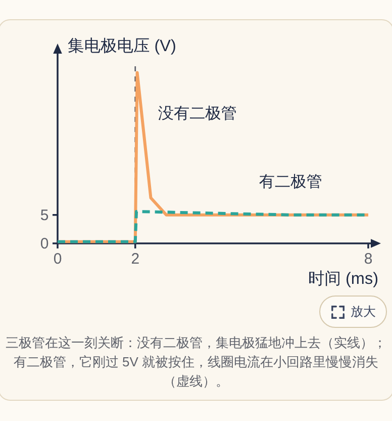
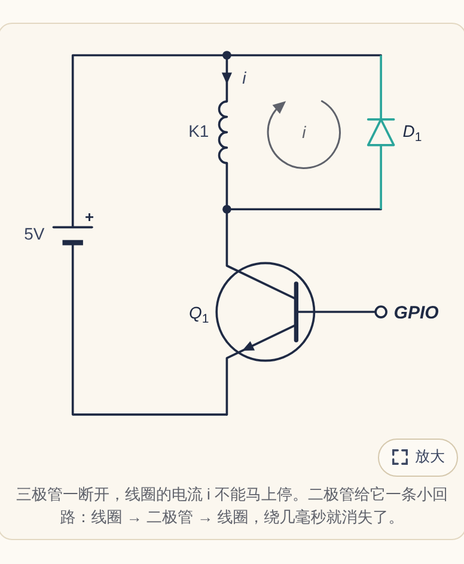

# 8.4 · 继电器 + 续流二极管：把线圈断电时的高压按住

| 项目 | 内容 |
|---|---|
| id | `exp5-relay-flyback` |
| 文件 | `challenges/288-relay-flyback.json` |
| 类型 | 实验 / 挑战（没有分步，照目标电路图搭） · 难度 4/5 |
| 位置 | World 8 · 数字逻辑、MCU 与传感器实战 → 8.4 MOSFET 与继电器（本节第 2 项） |
| 右侧面板 | 轨道由旧的四张卡片自动生成（还没手工精排） |
| 前后 | 上一项 [8.4 exp5-mosfet-logic-level](../w8/8.04-1-exp5-mosfet-logic-level.md) · 下一项 [8.4 exp5-high-side-vs-low-side](../w8/8.04-3-exp5-high-side-vs-low-side.md) |
| 先修 | lesson-mcu-gpio |
| 概念 | 继电器 relay、电感的反向高压 inductive kick v = L·di/dt、续流二极管 flyback diode、触点 COM / NO / NC |

**一句话概要**：三极管驱动 5 V 继电器，触点开关一个 9 V 电池供电的 LED。起始电路少了线圈两端的二极管：每次断电，集电极都冲到几十伏。加上它。

## 1. 左侧工作台（3D 面包板 → 2D 俯视截图）

截图是程序里真实的 3D 面包板换成俯视角拍的；表格是同一块板的文字版（元件、参数、每只脚插在哪个孔）。

### 1.1 起点：打开这一课时板上已经有的

右侧显示的「起点」说明：

> **半成品（故意缺一个元件）**：除了续流二极管 D1，整个继电器电路都搭好了；GPIO4 设成 10 Hz 的 PWM，让继电器反复开关、把问题放大。**为什么**：先在诊断里看到线圈断电时的反向高压。**你要做**：加上 D1（反并在线圈两端：负极朝 +5V），再把 GPIO4 设回“输出高”。

| 元件 | 类型 | 参数 | 引脚 → 孔 |
|---|---|---|---|
| U1 | esp32_devkit | usb=true, pins={"GPIO4":{"mode":"pwm","duty":50,"frequency":10}} | GND→b1 GPIO23→b2 GPIO22→b3 GPIO1→b4 GPIO3→b5 GPIO21→b6 GND_2→b7 GPIO19→b8 GPIO18→b9 GPIO5→b10 GPIO17→b11 GPIO16→b12 GPIO4→b13 GPIO0→b14 GPIO2→b15 GPIO15→b16 GPIO8→b17 GPIO7→b18 GPIO6→b19 3V3→i1 EN→i2 GPIO36→i3 GPIO39→i4 GPIO34→i5 GPIO35→i6 GPIO32→i7 GPIO33→i8 GPIO25→i9 GPIO26→i10 GPIO27→i11 GPIO14→i12 GPIO12→i13 GND_3→i14 GPIO13→i15 GPIO9→i16 GPIO10→i17 GPIO11→i18 5V→i19 |
| W2 | wire |  | a→a1 b→tn1 |
| W3 | wire |  | a→j19 b→tp19 |
| R1 | resistor | resistance=1000 | 1→a13 2→a22 |
| Q1 | npn | beta=150 | e→c21 b→c22 c→c23 |
| W6 | wire |  | a→a21 b→tn21 |
| K1 | relay |  | coil1→e25 coil2→e28 com→f25 nc→f27 no→f28 |
| W8 | wire |  | a→a25 b→tp25 |
| W9 | wire |  | a→b23 b→b28 |
| BAT1 | battery | variant=9V | +→bp22 -→bn22 |
| W11 | wire |  | a→bn20 b→tn20 |
| W12 | wire |  | a→j25 b→bp25 |
| R2 | resistor | resistance=1000 | 1→h28 2→h30 |
| LED1 | led | color=green | anode→i30 cathode→bn30 |

### 1.3 参考答案（「看答案」载入的板子）

| 元件 | 类型 | 参数 | 引脚 → 孔 |
|---|---|---|---|
| U1 | esp32_devkit | usb=true, pins={"GPIO4":{"mode":"out_high"}} | GND→b1 GPIO23→b2 GPIO22→b3 GPIO1→b4 GPIO3→b5 GPIO21→b6 GND_2→b7 GPIO19→b8 GPIO18→b9 GPIO5→b10 GPIO17→b11 GPIO16→b12 GPIO4→b13 GPIO0→b14 GPIO2→b15 GPIO15→b16 GPIO8→b17 GPIO7→b18 GPIO6→b19 3V3→i1 EN→i2 GPIO36→i3 GPIO39→i4 GPIO34→i5 GPIO35→i6 GPIO32→i7 GPIO33→i8 GPIO25→i9 GPIO26→i10 GPIO27→i11 GPIO14→i12 GPIO12→i13 GND_3→i14 GPIO13→i15 GPIO9→i16 GPIO10→i17 GPIO11→i18 5V→i19 |
| W2 | wire |  | a→a1 b→tn1 |
| W3 | wire |  | a→j19 b→tp19 |
| R1 | resistor | resistance=1000 | 1→a13 2→a22 |
| Q1 | npn | beta=150 | e→c21 b→c22 c→c23 |
| W6 | wire |  | a→a21 b→tn21 |
| K1 | relay |  | coil1→e25 coil2→e28 com→f25 nc→f27 no→f28 |
| W8 | wire |  | a→a25 b→tp25 |
| W9 | wire |  | a→b23 b→b28 |
| D1 | diode |  | anode→d28 cathode→d25 |
| BAT1 | battery | variant=9V | +→bp22 -→bn22 |
| W12 | wire |  | a→bn20 b→tn20 |
| W13 | wire |  | a→j25 b→bp25 |
| R2 | resistor | resistance=1000 | 1→h28 2→h30 |
| LED1 | led | color=green | anode→i30 cathode→bn30 |

### 1.4 目标原理图（右侧「目标原理图」抽屉）

| 元件 | 类型 | 参数 |
|---|---|---|
| U1 | esp32_devkit |  |
| R1 | resistor | resistance=1000 |
| Q1 | npn |  |
| K1 | relay |  |
| D1 | diode |  |
| V2 | dc_source | voltage=9 |
| R2 | resistor | resistance=1000 |
| LED1 | led |  |

连接（每个结点上的引脚）：

- **IO**：U1.GPIO_OUT1、R1.1
- **BASE**：R1.2、Q1.b
- **COLL**：Q1.c、K1.coil2、D1.anode
- **5V**：U1.5V、K1.coil1、D1.cathode
- **GND**：Q1.e、U1.GND、LED1.cathode、V2.-
- **VLOAD**：V2.+、K1.com
- **NO**：K1.no、R2.1
- **LA**：R2.2、LED1.anode

## 2. 右侧面板：学生从上往下看到的内容（单轨流）

### 第 1 步 · 🔍 先看一眼：先认识它：继电器

**拆解「继电器：用小电流控制一个机械开关」第 1 / 7 层：① 外形：蓝色小方块，5 只脚**

实验 288 用的是最常见的 5 V 继电器 SRD-05VDC-SL-C。外壳上印着两组数字，意思完全不同：
- 线圈电压 5 V DC：**控制侧**，给线圈加多少伏它才能可靠吸合；
- 触点额定 10 A 250 VAC / 10 A 30 VDC：**负载侧**，触点能开关多大的电压和电流。

5 只脚分成两组：两只 线圈脚（coil1、coil2，没有正负，但接了续流二极管以后就有了方向），三只 触点脚。模拟器里它横跨凹槽：e 行是两只线圈脚，f 行是 COM、NC、NO。

| 脚 | 属于 | 含义 | 实验 288 接到 |
|---|---|---|---|
| coil1 | 线圈 | 线圈一端 | 开发板 5V 脚 |
| coil2 | 线圈 | 线圈另一端 | Q1 集电极 |
| COM | 触点 | 公共端 common，跟着衔铁动 | 9 V 电池 + |
| NC | 触点 | 常闭 normally closed：线圈没电时接 COM | 不用 |
| NO | 触点 | 常开 normally open：线圈有电时接 COM | 1 kΩ → LED |

### 第 2 步 · 🔧 动手搭：少了一个二极管

面包板上已经搭好：GPIO → `1 kΩ` → 三极管 Q1，继电器 K1 的线圈接在 **5V** 脚和 Q1 的集电极之间。继电器的触点去开关一个 **9 V 电池**供电的 LED。
这个 GPIO 已经设成**每秒开关 10 次**（这种开关方式叫 PWM，5.8 再细讲），继电器“咔哒咔哒”地响。
看**诊断**：关于 K1 的线圈它说了什么？把**示波器**的探头接到 Q1 的集电极，最高冲到多少伏？

### 第 3 步 · 💡 想明白：线圈不肯让电流马上停

- 线圈是一个**电感**，它像一个转起来的飞轮：电流不能一下子停。你硬要它停，它就在两端憋出很高的电压：
$$v = L \frac{di}{dt}$$
- 代入数字：线圈 150 mH，60 mA 在 0.1 ms 里被切断，$v = 0.15 × \frac{0.06}{0.0001} = 90$ V。这个电压全压在三极管上，足够把它击穿。

*图 `kick`（plot）：三极管在这一刻关断：没有二极管，集电极猛地冲上去（实线）；有二极管，它刚过 5V 就被按住，线圈电流在小回路里慢慢消失（虚线）。*

- 解决办法：在线圈两端**反并一个二极管**（色环朝 5V）。平时它反偏，什么也不做。关断的一瞬间，集电极刚比 5V 高一点，它就导通，给电流一条绕回线圈的小路。

*图 `loop`（schematic）：三极管一断开，线圈的电流 i 不能马上停。二极管给它一条小回路：线圈 → 二极管 → 线圈，绕几毫秒就消失了。*

（这一步下面列着这节课的计算卡片，点开就地展开：`rl-time-constant`、`flyback-spike`、`npn-base-resistor`、`npn-saturation`、`diode-forward`、`usb-5v-pin`，全文见第 6 节）

### 第 4 步 · 🔧 动手搭：把续流二极管加上

- **二极管** D1 并在线圈两端：**色环（阴极）接 5V 那一端**，另一端接 Q1 的集电极。插反了会把 5V 直接短路到饱和的三极管上！
- 再看诊断：线圈的警告没了。示波器上，集电极的尖峰被按住了。
- 点**「检查我的电路」**。通过后完成测量题：先预测线圈电流（线圈约 70 Ω，5V 脚比 5 V 低一点，饱和的三极管再占零点几伏）。

### 第 5 步 · 📏 测一测：测一测：读你自己的仪表

**测量题 1 · `icoil`**（读数题）

> 「输出 高」：线圈电流（电流表串在 5V 脚和线圈之间）

- 单位 mA · 先写预测 · 状态：U1 GPIO_OUT1 设为输出高电平 · 参考答案的读数 **63.4 mA** · 合理范围 [0.0602, 0.0666]

答对后显示：

> (4.65 − 0.21) / 70 Ω ≈ 63 mA，大于 53 mA 的吸合电流。

**测量题 2 · `vce`**（读数题）

> 「输出 高」：Vce（红表笔接 C，黑表笔接 E）

- 单位 V · 先写预测 · 状态：U1 GPIO_OUT1 设为输出高电平 · 参考答案的读数 **0.2134 V** · 合理范围 [0.203, 0.224]

答对后显示：

> Ib ≈ 2.53 mA，强制 β ≈ 25，仍远小于 150：Q1 饱和，Vce ≈ 0.21 V。

**测量题 3 · `iled`**（读数题）

> 「输出 高」：负载侧 LED 的电流（9 V 电池经过触点供电）

- 单位 mA · 先写预测 · 状态：U1 GPIO_OUT1 设为输出高电平 · 参考答案的读数 **6.808 mA** · 合理范围 [0.00647, 0.00715]

答对后显示：

> (9 − 2.1) / 1 kΩ ≈ 6.8 mA。触点和线圈电气上隔离：控制侧 5 V，负载侧可以是别的电源。

**测量题 4 · `vmax`**（读数题）

> 每秒开关 10 次：示波器看集电极电压的最大值 Vmax

- 单位 V · 先写预测 · 状态：U1 GPIO_OUT1 设为PWM 输出 50% · 参考答案的读数 **5.37 V** · 合理范围 [5.1, 5.64]

答对后显示：

> D1 一导通就把集电极钳在 5V 脚电压 + 二极管压降 ≈ 5.4 V。

**测量题 5 · `nod1`**（选择题）

> 如果拿掉 D1（像起始电路那样），三极管关断的瞬间会怎样？

- A. 集电极冲到几十伏（v = L·di/dt），可能击穿三极管 ✅（正确）
- B. 集电极电压和有 D1 时一样
- C. 集电极变成负电压

答对后显示：

> 线圈的 63 mA 无处可去，仿真里集电极冲到约 29 V，真实电路可能更高，直到 C–E 击穿（约 40 V）。有 D1 时电流沿“线圈 → D1”的小回路以 L/R ≈ 2 ms 衰减。

### 第 6 步 · 🎒 带走：带走

- **线圈、电机、电磁阀：凡是电感负载，都要并续流二极管**，色环朝电源正极那一端。1N4007 或 1N4148 就够了。
- 继电器的触点和线圈**电气隔离**：控制侧 5 V，负载侧可以是完全不同的电源。
- 真实电路里的坑：买来的“继电器模块”通常已经带了三极管、二极管和指示灯，很多是低电平触发。触点写着 250 V 也不代表面包板能接市电——初学者不要碰 220 V。

趁热练理论题：`nonlinear`

## 3. 测量题一览

| # | id | 题目 | 类型 | 单位 | 状态 | 参考读数 |
|---|---|---|---|---|---|---|
| 1 | icoil | 「输出 高」：线圈电流（电流表串在 5V 脚和线圈之间） | current | mA | U1 GPIO_OUT1 设为输出高电平 | 63.4 mA |
| 2 | vce | 「输出 高」：Vce（红表笔接 C，黑表笔接 E） | voltage | V | U1 GPIO_OUT1 设为输出高电平 | 0.2134 V |
| 3 | iled | 「输出 高」：负载侧 LED 的电流（9 V 电池经过触点供电） | current | mA | U1 GPIO_OUT1 设为输出高电平 | 6.808 mA |
| 4 | vmax | 每秒开关 10 次：示波器看集电极电压的最大值 Vmax | scope | V | U1 GPIO_OUT1 设为PWM 输出 50% | 5.37 V |
| 5 | nod1 | 如果拿掉 D1（像起始电路那样），三极管关断的瞬间会怎样？ | 选择 |  |  | 正确：A |

### 全部答完后显示的「对比」

**对比**（仿真）：
- 线圈：(4.65 − 0.21) / 70 Ω ≈ **63 mA**，大于 53 mA 的吸合电流；Ib ≈ 2.53 mA，强制 β ≈ 25，Q1 饱和，Vce ≈ **0.21 V**。
- 负载侧：(9 − 2.1) / 1 kΩ ≈ **6.8 mA**，绿色 LED 亮。
- 有 D1：集电极最高 ≈ **5.4 V**（5V 脚电压 + 二极管压降）。没有 D1：约 **29 V**，真实电路可能更高，直到 C–E 击穿（约 40 V）。

**模型说明**：线圈是 70 Ω + 150 mH，≥ 53 mA 吸合、< 7 mA 释放，没有机械动作时间。电池 − 接到 GND 只是为了让仪表有同一个参考点；真实项目里负载侧可以完全独立。

### 提示按钮（依次显示）

1. 二极管并在线圈两端：色环（阴极）接 5V 那头，另一端（阳极）接集电极。
2. 线圈接在 5V 脚和 C 之间；E 接 GND；GPIO → 1 kΩ → B。
3. 负载侧：电池 + → COM，NO → 1 kΩ → LED → 电池 −；电池 − 接开发板 GND。

### 功能测试（「检查我的电路」时跑）

- 「输出 高」：继电器吸合，LED 亮，Q1 饱和
- 「输出 低」：继电器释放，LED 灭，Q1 截止
- 每秒开关 10 次：有 D1 时集电极的尖峰被钳住

## 4. 用到的拆解（全部层的文字，供改写参考）

### 拆解 `relay`：继电器：用小电流控制一个机械开关

*electromagnetic relay（电磁继电器）= 一个电磁铁 + 一个被它拉动的开关。线圈和触点之间只有磁和机械联系，没有电的连接。我们拆开看线圈、iron core（铁芯）、armature（衔铁）、spring（弹簧）和 COM / NO / NC 三个触点；再把线圈当成电感 L + 电阻 R，推出为什么断电会产生高压尖峰，以及 flyback diode（续流二极管）怎样把它钳住。*

**拆解「继电器：用小电流控制一个机械开关」第 1 / 7 层：① 外形：蓝色小方块，5 只脚**

实验 288 用的是最常见的 5 V 继电器 SRD-05VDC-SL-C。外壳上印着两组数字，意思完全不同：
- 线圈电压 5 V DC：**控制侧**，给线圈加多少伏它才能可靠吸合；
- 触点额定 10 A 250 VAC / 10 A 30 VDC：**负载侧**，触点能开关多大的电压和电流。

5 只脚分成两组：两只 线圈脚（coil1、coil2，没有正负，但接了续流二极管以后就有了方向），三只 触点脚。模拟器里它横跨凹槽：e 行是两只线圈脚，f 行是 COM、NC、NO。

| 脚 | 属于 | 含义 | 实验 288 接到 |
|---|---|---|---|
| coil1 | 线圈 | 线圈一端 | 开发板 5V 脚 |
| coil2 | 线圈 | 线圈另一端 | Q1 集电极 |
| COM | 触点 | 公共端 common，跟着衔铁动 | 9 V 电池 + |
| NC | 触点 | 常闭 normally closed：线圈没电时接 COM | 不用 |
| NO | 触点 | 常开 normally open：线圈有电时接 COM | 1 kΩ → LED |

**拆解「继电器：用小电流控制一个机械开关」第 2 / 7 层：② X 光：线圈、铁芯、衔铁、弹簧、触点**

把外壳变透明，从侧面看：
- 线圈：几千圈细漆包线，两头就是 coil1、coil2；
- 铁芯：线圈中间的软铁柱，和 L 形的 轭铁 连在一起；
- 衔铁：一块可以绕 支点 转动的铁片，横在铁芯上方，留着一条空气隙；
- 衔铁另一头连着一片弹性铜片，铜片末端是 **动触点**，它通过软导线接到 COM；
- 弹簧 把铜片往下拉，所以没通电时动触点压在下面的 NC 静触点 上；上面的 NO 静触点 悬空。

这就是“常闭 / 常开”名字的由来：**常（normally）= 线圈不通电时**。

**拆解「继电器：用小电流控制一个机械开关」第 3 / 7 层：③ 通电：磁力把衔铁拉下来，COM 换到 NO**

给线圈通 电流 I：
1. 电流产生磁场，铁芯 把它集中起来，磁通 Φ 沿着 铁芯 → 空气隙 → 衔铁 → 轭铁 走一圈（一个 **磁路**，magnetic circuit）；
2. 磁通想让磁路的“磁阻”最小，于是把衔铁吸向铁芯，关上空气隙；
3. 衔铁绕支点转动，另一头翘起：动触点离开 NC，压到 NO 上——**COM–NO 接通**；
4. 断电后磁力消失，弹簧 把它拉回 NC。

力有多大取决于 **安匝数** $N·I$：线圈圈数 N 是固定的，所以吸不吸合取决于 **线圈电流**。实验 288：线圈从开发板 5V 脚取电（USB 5 V 经肖特基二极管约 4.7 V），三极管饱和压降约 0.1 V：
$$I = \frac{4.7 - 0.1}{70 Ω} ≈ 65 mA$$
比 GPIO 能给的 20 mA 大得多——所以要用三极管驱动。

- 公式 `I_{coil} = \frac{V_{supply} - V_{CE(sat)}}{R_{coil}}`：稳态时电感相当于导线，只剩线圈电阻

**拆解「继电器：用小电流控制一个机械开关」第 4 / 7 层：④ 吸合 53 mA、释放 7 mA：回差**

模拟器的继电器模型（和真实器件的数据手册一致）：
- 电流从 0 往上加：到 53 mA 才吸合（线圈电压约 $0.053 × 70 = 3.7 V$，数据手册写“吸合电压 ≤ 3.75 V”）；
- 吸合以后电流往下减：要降到 7 mA 以下才释放（约 0.5 V）；
- 7–53 mA 之间，它保持原来的状态。

为什么吸合比保持难得多？因为磁力和空气隙有关：吸合前空气隙大，磁阻大，要很大的电流才能拉动衔铁；吸合后空气隙几乎为 0，很小的电流就能吸住。这叫 **hysteresis（回差 / 滞回）**，它有好处：电压在阈值附近抖一抖，触点也不会来回“打架”。

实验 288 的 65 mA 在 53 mA 之上，留了约 20% 余量。如果用 3.3 V 驱动 5 V 继电器：$\frac{3.3}{70} = 47 mA$ < 53 mA，**吸不动**——所以 3.3 V 系统要买 3 V 线圈的继电器。

| 参数 | 电流 | 线圈电压（× 70 Ω） | 意思 |
|---|---|---|---|
| 吸合 | 53 mA | 3.7 V | 超过它才动作 |
| 释放 | 7 mA | 0.5 V | 低于它才松开 |
| 额定 | 71 mA | 5 V | 数据手册的工作点 |
| 实验 288 | ≈ 65 mA | ≈ 4.6 V | 可靠吸合 |

**拆解「继电器：用小电流控制一个机械开关」第 5 / 7 层：⑤ 等效电路：线圈 = L + R，触点 = 开关**

电路上，继电器拆成两半，中间只有一条 虚线（机械联动）：
- **线圈** = 电感 L = 150 mH 串 电阻 R = 70 Ω（铜线的电阻）；
- **触点** = 一个 单刀双掷开关（COM–NO / COM–NC，接通 0.05 Ω），由线圈电流控制。

两半之间 **电气隔离**：控制侧可以是 5 V 的单片机电路，负载侧可以是完全不共地的另一路电源。

线圈是电感，所以电流不能突变。接通 V 的那一刻起，这是一个 RL 一阶电路：
1. KVL：$V = L\frac{di}{dt} + Ri$
2. 解：$i(t) = \frac{V}{R}(1 - e^{-t/τ})$，时间常数 $τ = \frac{L}{R} = \frac{0.15}{70} = 2.14 ms$
3. 电流 从 0 爬到 65.7 mA；到 53 mA 的时间：$t = -τ·ln(1 - \frac{53}{65.7}) = 2.14 × 1.65 ≈ 3.5 ms$

真实继电器还要再加几毫秒让衔铁“走过去”（动作时间约 5–10 ms）；模拟器 **没有机械时间**，电流到 53 mA 的那一刻触点就换了。

| 元件 | 值（仿真） | 来自 |
|---|---|---|
| 线圈电感 L | 150 mH | 线圈圈数 + 铁芯 |
| 线圈电阻 R | 70 Ω | 细铜线 |
| 时间常数 τ = L/R | 2.14 ms | 电流涨 / 落的快慢 |
| 触点电阻 | 0.05 Ω | 接通时 |

- 公式 `τ = \frac{L}{R} = \frac{150 mH}{70 Ω} = 2.14 ms`：RL 电路的时间常数
- 公式 `i(t) = \frac{V}{R}(1 - e^{-t/τ})`：接通后线圈电流

**拆解「继电器：用小电流控制一个机械开关」第 6 / 7 层：⑥ 断电那一刻：v = L di/dt 产生高压尖峰**

GPIO 变低，Q1 截止。线圈里本来有 65 mA，电感的电压–电流关系是：
$$v_L = L\frac{di}{dt}$$
三极管在约 1 µs 内关断，如果电流真的在 1 µs 里从 65 mA 变成 0：
$$|v_L| = 0.15 × \frac{0.065}{10^{-6}} ≈ 9750 V$$
当然不会真有 1 万伏：电感会 **自己抬高电压**，直到找到一条能让电流继续流的路。没有别的路时，集电极电压 V_C 一路往上冲（这时线圈的极性反过来，下端比 +5 V 高），直到三极管的 C–E 被击穿（2N2222 约 40 V）或者靠线圈的分布电容慢慢放掉。仿真里看到的 尖峰约 29 V（受步长和三极管关断过程限制），真实电路还可能更高。

换个角度看能量：线圈里存着 $W = \frac{1}{2}LI^{2} = \frac{1}{2} × 0.15 × 0.065^{2} ≈ 0.32 mJ$。这点能量必须找个地方放掉——没有二极管时，就是在三极管里“砸”出来。每秒开关 10 次，三极管每次都被打一下，迟早损坏；尖峰还会通过电源线干扰单片机，让它复位。

- 公式 `v_L = L\frac{di}{dt}`：电流变得越快，电压越高
- 公式 `W = \frac{1}{2}LI^{2} ≈ 0.32 mJ`：断电时必须释放的能量

**拆解「继电器：用小电流控制一个机械开关」第 7 / 7 层：⑦ 续流二极管：给电流一条路，把电压钳住**

在线圈两端反着并一个 二极管 D1：**负极（有环的一端）接 +5 V**，正极接集电极。
- 通电时：集电极约 0.1 V，比 +5 V 低，D1 反偏，**不起作用**；
- 断电时：线圈要维持电流方向，集电极电压往上升；一旦比 +5 V 高 0.7 V，D1 导通，电流沿着 线圈 → D1 → 线圈 这个小回路继续流；
- 于是 V_C 被钳在 5 + 0.7 = 5.7 V（实验 288 的测试：Vmax 在 5.1–5.7 V 之间），三极管再也看不到高压。

回路里的电流按 $i = I_0 e^{-t/τ}$ 衰减，τ = L/R ≈ 2 ms，0.32 mJ 的能量慢慢变成线圈电阻和二极管上的热。代价是继电器 **释放得慢一点**（几毫秒）；要释放得快，可以在 D1 上再串一个齐纳二极管，让钳位电压高一些、能量放得更快。

二极管用 1N4007 或 1N4148 就够：它只需要承受 65 mA、几毫秒。买到的“继电器模块”板上已经有三极管和这个二极管。

| 项目 | 模拟器 | 真实继电器 |
|---|---|---|
| 没有 D1 的尖峰 | ≈ 29 V | 可到 Q1 击穿（≈ 40 V）甚至更高 |
| 有 D1 的钳位 | 5.7 V | 5 V + V_F（0.7–1 V） |
| 动作 / 释放时间 | 无（只看电流） | ≈ 5–10 ms |
| 触点抖动 | 无 | 约 1 ms |
| 触点寿命 | 无限 | 满载约 10 万次 |

- 公式 `V_{C,max} = V_{CC} + V_F = 5 + 0.7 = 5.7 V`：二极管把集电极钳住
- 公式 `i(t) = I_0 e^{-t/τ}, τ = \frac{L}{R} ≈ 2 ms`：断电后线圈电流在小回路里衰减

**一句话记住**：继电器 = 电磁铁 + 开关：线圈电流超过吸合值（仿真 53 mA），衔铁被吸下，COM 从 NC 换到 NO；电流低于释放值（7 mA）才弹回。线圈是 L + R（150 mH、70 Ω，τ ≈ 2 ms），所以电流不能突变：断电时 $v = L·di/dt$ 会把集电极顶到几十伏。反并一个续流二极管（负极接 +5 V），电流有路可走，电压被钳在约 5.7 V。

## 5. 这一课的计算卡片

**计算卡片 `rl-time-constant`：RL 时间常数 τ = L/R**

- 公式 `τ = \frac{L}{R}`
- 用途：电感电流建立 / 衰减有多快；R 是回路里所有电阻之和。
- 输入：L（电感，H）；R（回路总电阻（含 50 Ω、线圈电阻），Ω） → τ（时间常数，s）

1. 电感：$v_L = L\frac{di}{dt}$，**电流不能突变**（电压可以）。
2. KVL：$V_s = Ri + L\frac{di}{dt}$，和 RC 是同一类方程，$τ = \frac{L}{R}$（H / Ω = s）。
3. 稳态电流 $\frac{V_s}{R}$（电感当短路），从初值指数地走过去。
4. 和 RC 相反：**R 越大，τ 越小**（电流的“终点”变小了，走得更快）。
5. 跳变瞬间电流来不及变，整个跳变电压都落在电感上，然后按 τ 衰减。

例子：- 实验 3-3：$\frac{10 mH}{100 + 50 + 1} ≈ 66 µs$；稳态电流 $\frac{1 V}{151 Ω} ≈ 6.6 mA$。
- 实验 5-15：电机 $\frac{2 mH}{8 Ω} = 0.25 ms$：20 kHz 的 50 µs 周期 ≪ τ，电流几乎是平的。
- 实验 5-9：继电器线圈 $\frac{150 mH}{70 Ω} ≈ 2.1 ms$。

- ⚠ 忘了线圈自己的电阻：真实的小 10 mH 电感常有 10–30 Ω。
- ⚠ 把 RC 的习惯套过来写成 τ = LR。

**计算卡片 `flyback-spike`：电感断电的反冲 v = L·di/dt**

- 公式 `v = L \frac{di}{dt} ≈ L \frac{I}{Δt}`
- 用途：突然切断线圈的电流会产生多高的电压——以及为什么要并续流二极管。
- 输入：L（线圈电感，H）；I（断开前的电流，A）；Δt（开关断开用的时间，s） → v（“想要”的反冲电压，V）

1. 电感电流不能突变：三极管 / MOSFET 断开时，线圈“想”让电流按原方向继续流。
2. 没有路可走，$\frac{di}{dt}$ 极大，$v = L\frac{di}{dt}$ 就极高：集电极（漏极）冲到电源电压以上几十伏，直到三极管击穿或空气放电。
3. **续流二极管**反向并在线圈上：导通时它反偏不起作用；断开时集电极一超过 $V_s + 0.7 V$，它就导通，把电压钳住。
4. 电流改走“线圈 → 二极管 → 线圈”这个小回路，按 $τ = \frac{L}{R}$ 衰减，能量变成线圈电阻和二极管里的热。

例子：实验 5-9：150 mH、63 mA，如果 1 µs 内断开，“需要” $\frac{0.15 × 0.063}{10^{-6}} ≈ 9.5 kV$——实际在三极管 C–E 击穿（约 40 V）时就停住了（模拟器约 29 V）。并上 D1 后集电极最高只有 $4.65 + 0.7 ≈ 5.4 V$，电流按 $\frac{150 mH}{70 Ω} ≈ 2 ms$ 衰减。实验 5-8：电机漏极被钳在 $5 + 1.1 ≈ 6.1 V$。

- ⚠ 二极管接反：导通时它把线圈短路，三极管直接对电源短路。条纹（阴极）朝电源正端。
- ⚠ PWM 驱动电机时 1N4007 太慢，用肖特基（1N5819、SS34）。

**计算卡片 `npn-base-resistor`：NPN 开关的基极电阻**

- 公式 `R_B = \frac{V_{OH} - V_{BE}}{I_C / β_{forced}}`
- 用途：用 3.3 V 引脚让 NPN 三极管饱和导通（低边开关），基极电阻取多大。
- 输入：V_OH（引脚高电平，V）；V_BE（B–E 压降，V）；I_C（负载需要的电流，A）；β_F（强制 β（取 10 留余量），） → R_B（基极电阻（取不大于它的标准值），Ω）

1. 先算负载电流 $I_C$：负载接在 5 V 和集电极之间，饱和时 $V_{CE}$ 只有 0.1–0.2 V，$I_C$ 由负载决定，不由 β 决定。
2. 想让它 **饱和**，基极电流要比放大区需要的 $\frac{I_C}{β}$ 多得多。经验：$I_B ≥ \frac{I_C}{10}$（强制 β ≈ 10）。β 随温度和批次变化很大（2N2222 是 35–300），按 10 设计有余量。
3. B–E 结是一个二极管（≈ 0.65–0.7 V）：$I_B = \frac{V_{OH} - V_{BE}}{R_B}$。
4. 解出 $R_B$，取不大于它的标准值。
5. 不串 $R_B$：3.3 V 直接加在 B–E 二极管上，只有引脚内阻限流，约 60 mA——引脚烧坏。

例子：实验 5-7：蜂鸣器 $I_C ≈ 24.9 mA$ → $I_B ≥ 2.5 mA$ → $R_B ≤ \frac{2.6}{2.5 mA} ≈ 1.04 kΩ$ → 1 kΩ。实验 5-9：线圈 63 mA，1 kΩ 给 2.53 mA，强制 β ≈ 25，仍远低于 150，照样饱和。

- ⚠ 用 β = 150 直接算 $I_B = I_C/β$：刚好在放大区边缘，温度一变就不饱和。
- ⚠ 基极到地加 10–100 kΩ 下拉，单片机复位时引脚悬空也能保证关断。

**计算卡片 `npn-saturation`：三极管饱和了吗？过驱系数**

- 公式 `I_B = \frac{V_{OH} - V_{BE}}{R_B}, k = \frac{β I_B}{I_{C,load}}`
- 用途：检查一个基极电阻能不能让三极管饱和：k > 1 才饱和，设计时取 2–10 以上。
- 输入：V_OH（引脚高电平，V）；V_BE（B–E 压降，V）；R_B（基极电阻，Ω）；β（三极管的 β，）；I_C（负载要的电流，A） → k（过驱系数（< 1 放大区，> 1 饱和），）

1. 放大区：$I_C = βI_B$，三极管像一个受控电流源，$V_{CE}$ 由负载上剩下的电压决定。
2. 如果 $βI_B$ 比负载在“完全接通”时需要的电流还大，三极管给不出那么多——负载限住了电流，$V_{CE}$ 掉到 0.1–0.2 V：**饱和**。
3. 所以判断量是 $k = \frac{βI_B}{I_{C,load}}$：k < 1 卡在放大区，三极管自己发热、负载电压不够；k > 1 饱和。
4. β 会变，所以要留余量：k ≥ 2–10。

例子：实验 5-7：100 kΩ：$I_B = \frac{2.65}{100k} ≈ 26.5 µA$，$βI_B ≈ 4.0 mA$，k ≈ 0.16 → 放大区，$V_{CE} ≈ 3.1 V$，蜂鸣器不响；1 kΩ：$I_B ≈ 2.65 mA$，k ≈ 16 → 饱和。实验 5-18 低边：2.5 mA × 150 ≈ 380 mA ≫ 63 mA。

- ⚠ MOSFET 的“饱和区”是恒流区，正好和三极管的“饱和”相反：MOSFET 当开关要在欧姆区（线性区）。

**计算卡片 `diode-forward`：二极管的正向压降：过一个二极管少 0.7 V**

- 公式 `V_{out} = V_{in} - V_F - I r_d`
- 用途：电流经过一个导通的二极管（防反接、USB 二极管、续流钳位）以后电压变成多少。
- 输入：V_in（二极管前的电压，V）；V_F（导通压降（硅 0.65–0.7 V，肖特基 0.3 V），V）；I（电流，A）；r_d（二极管内阻（不知道就填 0），Ω） → V_out（二极管后的电压，V）

1. 二极管只让电流从阳极流向阴极（有条纹的一端）。正向导通后两端电压几乎固定：硅管约 0.65–0.7 V，肖特基约 0.3 V。
2. 折线模型：$V_F$ 串一个小电阻 $r_d$，所以电流大时压降稍大。
3. 串在电源后面（防反接）：输出 = 输入 − 一个 $V_F$；接反时它截止，后面的电路不通电。
4. 续流 / 钳位：二极管导通把某一点钳在“另一点 + $V_F$”上——继电器集电极最高 5 V + 0.7 V。

例子：挑战 6：9 V 经二极管 → 约 8.3 V。开发板 5V 引脚：USB 5 V 经肖特基 → 约 4.7 V。实验 5-9：线圈断电时集电极被钳在 4.65 + 0.7 ≈ 5.4 V。实验 3-5：低电平时 D1 反偏，电容不能倒灌回发生器。

- ⚠ 防反接二极管会一直吃掉 0.7 V 和 0.7 V × I 的功率；低压电路用肖特基或 P-MOSFET。

**计算卡片 `usb-5v-pin`：开发板 5V 引脚的电压**

- 公式 `V_{5V} = V_{USB} - V_D - I R_s`
- 用途：USB 5 V 经线缆 / 保险丝和肖特基二极管到 5V 引脚：带载时掉到多少。
- 输入：V_USB（USB 电压，V）；V_D（肖特基二极管压降，V）；I（从 USB 取的总电流，A）；R_s（线缆 + 保险丝 + 二极管电阻（模型 0.25 + 0.15 Ω），Ω） → V_5V（5V 引脚电压，V）

1. 电源路径：USB 5 V →（线缆 + 自恢复保险丝 ≈ 0.25 Ω）→ 肖特基二极管（≈ 0.3 V + 0.15 Ω）→ **5V 引脚** → 板载 LDO → 3V3。
2. KVL：$V_{5V} = V_{USB} - V_D - IR_s$，空载约 4.7 V，电流越大越低。
3. 5V 引脚给 LDO 供电：它至少要比 3.3 V 高出 LDO 的压差（AMS1117 ≈ 1.1 V），否则 3V3 也会掉。
4. 电脑 USB 2.0 口只保证 500 mA。

例子：只有芯片和 LED（≈ 56 mA）：$5 - 0.3 - 0.056 × 0.4 ≈ 4.68 V$。实验 5-13：总 0.48 A → 4.51 V。实验 5-17：0.415 A → 4.53 V，仍高于 AMS1117 要的 4.4 V。

- ⚠ “5V 引脚”不是 5.0 V：需要精确 5 V 的模块要单独供电。

## 6. English（界面英文版的同一份内容）

展开英文

### Node 1 · 🔍 Look first：Meet it first: Relay

**Teardown「Relay: a small current flipping a mechanical switch」layer 1 of 7：① Outside: a small blue cube with 5 pins**

Lab 288 uses the most common 5 V relay, the SRD-05VDC-SL-C. Its case carries two sets of numbers that mean very different things:
- coil voltage 5 V DC: the **control side** — what the coil needs to pull in reliably;
- contact rating 10 A 250 VAC / 10 A 30 VDC: the **load side** — the voltage and current the contacts can switch.

The 5 pins form two groups: two coil pins (coil1, coil2 — no polarity of their own, though the flyback diode gives them one) and three contact pins. In the simulator it straddles the trench: row e holds the two coil pins, row f COM, NC and NO.

| Pin | Side | Meaning | Lab 288 goes to |
|---|---|---|---|
| coil1 | coil | one end of the coil | the board’s 5V pin |
| coil2 | coil | the other end | Q1 collector |
| COM | contacts | common, moves with the armature | 9 V battery + |
| NC | contacts | normally closed: joined to COM when the coil is off | unused |
| NO | contacts | normally open: joined to COM when the coil is on | 1 kΩ → LED |

### Node 2 · 🔧 Build：One diode missing

The board is already built: GPIO → `1 kΩ` → transistor Q1; relay K1's coil sits between the **5V** pin and Q1's collector. The relay's contact switches an LED powered by a **9 V battery**.
The GPIO is already set to **switch on and off 10 times a second** (this kind of switching is called PWM; more in 5.8), and the relay clicks away.
Look at the **diagnostics**: what do they say about K1's coil? Put the **scope** probe on Q1's collector: how high does it shoot?

### Node 3 · 💡 Why：A coil won't let its current stop at once

- A coil is an **inductor**, like a spinning flywheel: its current cannot stop all at once. Force it to stop and it builds up a large voltage across itself:
$$v = L \frac{di}{dt}$$
- With numbers: a 150 mH coil whose 60 mA is cut in 0.1 ms gives $v = 0.15 × \frac{0.06}{0.0001} = 90$ V. All of it lands on the transistor, enough to break it down.

[figure `kick`]

*Figure `kick`（plot）：三极管在这一刻关断：没有二极管，集电极猛地冲上去（实线）；有二极管，它刚过 5V 就被按住，线圈电流在小回路里慢慢消失（虚线）。*

- The fix: put a **reversed diode across the coil** (band towards 5V). Normally it is reverse-biased and does nothing. The instant the transistor turns off, the collector rises just above 5V, the diode conducts, and the current gets a small path back round the coil.

[figure `loop`]

*Figure `loop`（schematic）：三极管一断开，线圈的电流 i 不能马上停。二极管给它一条小回路：线圈 → 二极管 → 线圈，绕几毫秒就消失了。*

(This node lists the lesson’s calculation cards: `rl-time-constant`、`flyback-spike`、`npn-base-resistor`、`npn-saturation`、`diode-forward`、`usb-5v-pin`; full text in section 6)

### Node 4 · 🔧 Build：Add the flyback diode

- **Diode** D1 across the coil: **band (cathode) on the 5V end**, the other end on Q1's collector. Reversed, it would short 5V straight into the saturated transistor!
- Look at the diagnostics again: the coil warning is gone. On the scope, the collector spike is held down.
- Press **Check my circuit**. Once it passes, answer the questions; predict the coil current first (the coil is about 70 Ω, the 5V pin is a little under 5 V, and a saturated transistor takes a few tenths of a volt).

### Node 5 · 📏 Measure：Measure: read your own instruments

**Question 1 · `icoil`**（reading）

> Output HIGH: the coil current (ammeter between the 5V pin and the coil)

- unit mA · predict first · state：U1 GPIO_OUT1 is output HIGH · range [0.0602, 0.0666]

Shown once right:

> (4.65 − 0.21) / 70 Ω ≈ 63 mA, above the 53 mA pull-in current.

**Question 2 · `vce`**（reading）

> Output HIGH: Vce (red lead on C, black lead on E)

- unit V · predict first · state：U1 GPIO_OUT1 is output HIGH · range [0.203, 0.224]

Shown once right:

> Ib ≈ 2.53 mA, forced β ≈ 25, still far below 150: Q1 saturates, Vce ≈ 0.21 V.

**Question 3 · `iled`**（reading）

> Output HIGH: the LED current on the load side (9 V battery through the contact)

- unit mA · predict first · state：U1 GPIO_OUT1 is output HIGH · range [0.00647, 0.00715]

Shown once right:

> (9 − 2.1) / 1 kΩ ≈ 6.8 mA. The contact is isolated from the coil: 5 V on the control side, any supply on the load side.

**Question 4 · `vmax`**（reading）

> Switching 10 times a second: the collector's maximum voltage Vmax on the scope

- unit V · predict first · state：U1 GPIO_OUT1 is PWM output 50% · range [5.1, 5.64]

Shown once right:

> As soon as D1 conducts it clamps the collector at the 5V pin voltage + one diode drop ≈ 5.4 V.

**Question 5 · `nod1`**（multiple choice）

> Without D1 (as on the starting board), what happens the instant the transistor turns off?

- A. the collector shoots up to tens of volts (v = L·di/dt) and may break the transistor down ✅ (right)
- B. the collector voltage is the same as with D1
- C. the collector goes negative

Shown once right:

> The coil's 63 mA has nowhere to go: the simulated collector hits about 29 V, a real one may go higher until C–E breaks down (about 40 V). With D1 the current decays around the coil → D1 loop with L/R ≈ 2 ms.

### Node 6 · 🎒 Take away：Take away

- **Coils, motors, solenoid valves: every inductive load gets a flyback diode**, band towards the positive supply end. A 1N4007 or 1N4148 is enough.
- A relay's contact is **electrically isolated** from its coil: 5 V on the control side, a completely different supply on the load side.
- A real-world catch: ready-made "relay modules" usually include the transistor, the diode and an indicator LED, and many switch on when the input is LOW. A contact rated 250 V does not make a breadboard safe for mains — beginners should not touch 230 V.

Practise：`nonlinear`

**Compare**

**Compare** (simulated):
- Coil: (4.65 − 0.21) / 70 Ω ≈ **63 mA**, above the 53 mA pull-in current; Ib ≈ 2.53 mA, forced β ≈ 25, Q1 saturated, Vce ≈ **0.21 V**.
- Load side: (9 − 2.1) / 1 kΩ ≈ **6.8 mA**, the green LED is on.
- With D1: the collector peaks at ≈ **5.4 V** (the 5V pin + one diode drop). Without D1: about **29 V**, and a real circuit may go higher until C–E breaks down (about 40 V).

**Model note**: the coil is 70 Ω + 150 mH, pulls in at ≥ 53 mA and drops out below 7 mA, with no mechanical delay. Battery − joins GND only so the instruments share a reference; in a real project the load side can be fully separate.

**Hints**

1. The diode goes across the coil, band (cathode) on the 5V end, plain end (anode) on the collector.
2. Coil between the 5V pin and C; E to GND; GPIO → 1 kΩ → B.
3. Load: battery + → COM, NO → 1 kΩ → LED → battery −; join battery − to the board GND.

