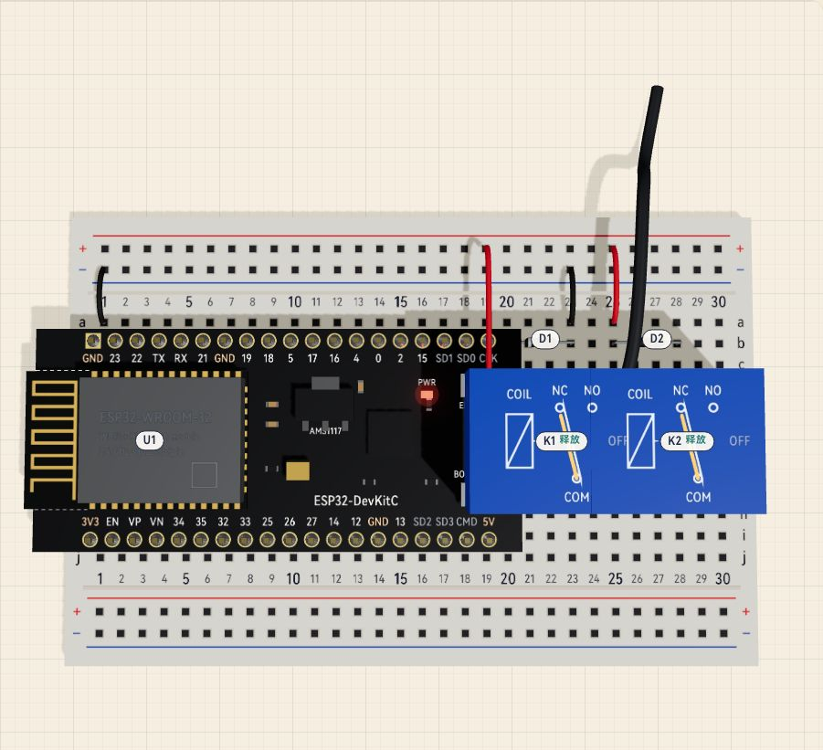
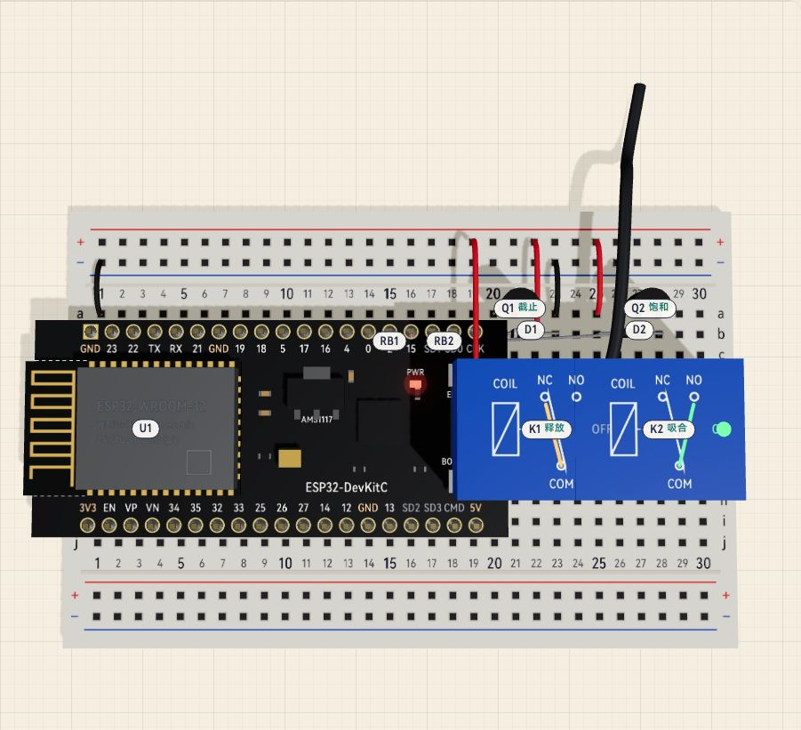
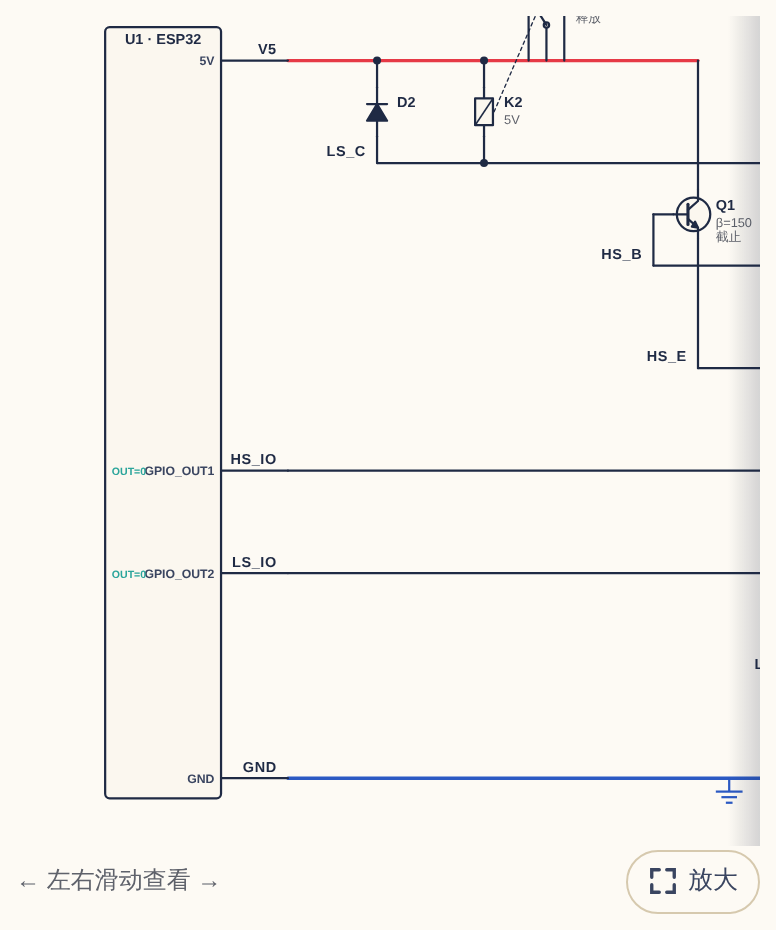
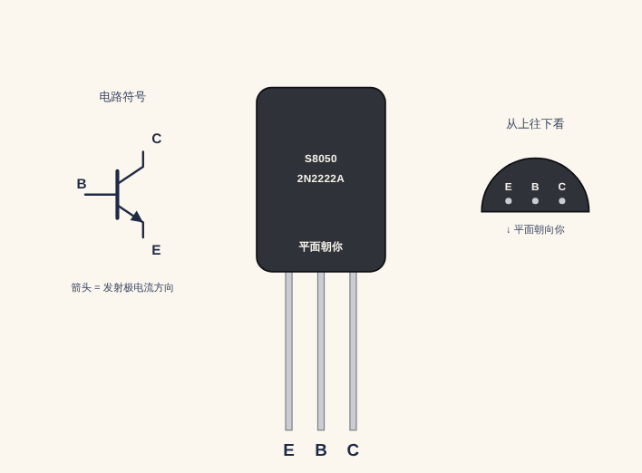
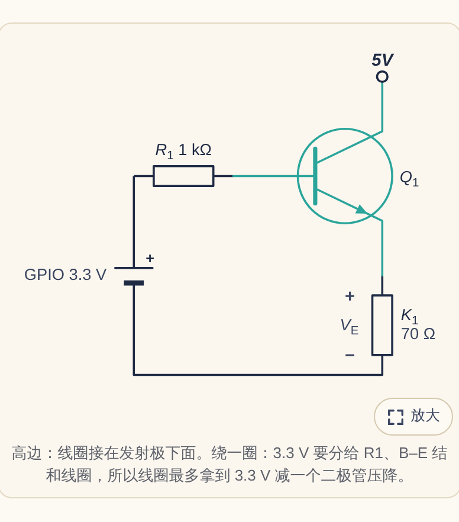
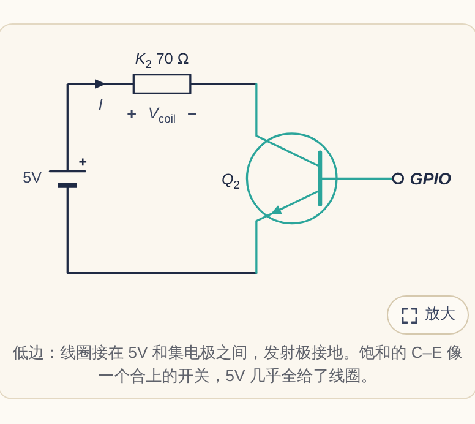

# 8.4 · 高边还是低边：NPN 为什么要放在负载下面

| 项目 | 内容 |
|---|---|
| id | `exp5-high-side-vs-low-side` |
| 文件 | `challenges/297-high-side-vs-low-side.json` |
| 类型 | 实验 / 挑战（没有分步，照目标电路图搭） · 难度 4/5 |
| 位置 | World 8 · 数字逻辑、MCU 与传感器实战 → 8.4 MOSFET 与继电器（本节第 3 项） |
| 右侧面板 | 轨道由旧的四张卡片自动生成（还没手工精排） |
| 前后 | 上一项 [8.4 exp5-relay-flyback](../w8/8.04-2-exp5-relay-flyback.md) · 下一项 [8.5 exp5-ldo-dropout](../w8/8.05-1-exp5-ldo-dropout.md) |
| 先修 | lesson-mcu-gpio |
| 概念 | 高边 / 低边开关 high-side / low-side switch、射极跟随 emitter follower、放大区 vs 饱和区 active vs saturation、继电器吸合电流 relay pull-in current |

**一句话概要**：同一块 ESP32 上并排两个 5 V 继电器：NPN 放在线圈上面（高边）吸不上，放在下面（低边）一下就吸合。看看为什么。

## 1. 左侧工作台（3D 面包板 → 2D 俯视截图）

截图是程序里真实的 3D 面包板换成俯视角拍的；表格是同一块板的文字版（元件、参数、每只脚插在哪个孔）。

### 1.1 起点：打开这一课时板上已经有的

右侧显示的「起点」说明：

> **半成品**：ESP32、5 V 电源、两个继电器 K1、K2 和它们的续流二极管都已接好。**为什么**：这个实验只比较三极管放在负载上面还是下面。**你要做**：放两只 NPN 和两个 1kΩ 基极电阻（GPIO18 → Q1，GPIO19 → Q2）；Q1 放在 K1 上面（集电极接 +5V），Q2 放在 K2 下面（发射极接 GND）。

| 元件 | 类型 | 参数 | 引脚 → 孔 |
|---|---|---|---|
| U1 | esp32_devkit | usb=true, pins={"GPIO18":{"mode":"out_low"},"GPIO19":{"mode":"out_high"}} | GND→b1 GPIO23→b2 GPIO22→b3 GPIO1→b4 GPIO3→b5 GPIO21→b6 GND_2→b7 GPIO19→b8 GPIO18→b9 GPIO5→b10 GPIO17→b11 GPIO16→b12 GPIO4→b13 GPIO0→b14 GPIO2→b15 GPIO15→b16 GPIO8→b17 GPIO7→b18 GPIO6→b19 3V3→i1 EN→i2 GPIO36→i3 GPIO39→i4 GPIO34→i5 GPIO35→i6 GPIO32→i7 GPIO33→i8 GPIO25→i9 GPIO26→i10 GPIO27→i11 GPIO14→i12 GPIO12→i13 GND_3→i14 GPIO13→i15 GPIO9→i16 GPIO10→i17 GPIO11→i18 5V→i19 |
| W1 | wire |  | a→a1 b→tn1 |
| W2 | wire |  | a→h19 b→tp19 |
| K1 | relay |  | coil1→e20 coil2→e23 com→f20 nc→f22 no→f23 |
| D1 | diode |  | anode→b23 cathode→b20 |
| W3 | wire |  | a→a23 b→tn23 |
| K2 | relay |  | coil1→e25 coil2→e28 com→f25 nc→f27 no→f28 |
| W6 | wire |  | a→a25 b→tp25 |
| D2 | diode |  | anode→b28 cathode→b25 |

### 1.3 参考答案（「看答案」载入的板子）

| 元件 | 类型 | 参数 | 引脚 → 孔 |
|---|---|---|---|
| U1 | esp32_devkit | usb=true, pins={"GPIO18":{"mode":"out_low"},"GPIO19":{"mode":"out_high"}} | GND→b1 GPIO23→b2 GPIO22→b3 GPIO1→b4 GPIO3→b5 GPIO21→b6 GND_2→b7 GPIO19→b8 GPIO18→b9 GPIO5→b10 GPIO17→b11 GPIO16→b12 GPIO4→b13 GPIO0→b14 GPIO2→b15 GPIO15→b16 GPIO8→b17 GPIO7→b18 GPIO6→b19 3V3→i1 EN→i2 GPIO36→i3 GPIO39→i4 GPIO34→i5 GPIO35→i6 GPIO32→i7 GPIO33→i8 GPIO25→i9 GPIO26→i10 GPIO27→i11 GPIO14→i12 GPIO12→i13 GND_3→i14 GPIO13→i15 GPIO9→i16 GPIO10→i17 GPIO11→i18 5V→i19 |
| W1 | wire |  | a→a1 b→tn1 |
| W2 | wire |  | a→h19 b→tp19 |
| K1 | relay |  | coil1→e20 coil2→e23 com→f20 nc→f22 no→f23 |
| Q1 | npn | beta=150 | e→a20 b→a21 c→a22 |
| D1 | diode |  | anode→b23 cathode→b20 |
| W3 | wire |  | a→a23 b→tn23 |
| W4 | wire |  | a→b22 b→tp22 |
| RB1 | resistor | resistance=1000 | 1→c9 2→b21 |
| K2 | relay |  | coil1→e25 coil2→e28 com→f25 nc→f27 no→f28 |
| Q2 | npn | beta=150 | e→a26 b→a27 c→a28 |
| W5 | wire |  | a→b26 b→tn26 |
| W6 | wire |  | a→a25 b→tp25 |
| D2 | diode |  | anode→b28 cathode→b25 |
| RB2 | resistor | resistance=1000 | 1→c8 2→b27 |

### 1.4 目标原理图（右侧「目标原理图」抽屉）

| 元件 | 类型 | 参数 |
|---|---|---|
| U1 | esp32_devkit |  |
| RB1 | resistor | resistance=1000 |
| Q1 | npn |  |
| K1 | relay |  |
| D1 | diode |  |
| RB2 | resistor | resistance=1000 |
| Q2 | npn |  |
| K2 | relay |  |
| D2 | diode |  |

连接（每个结点上的引脚）：

- **HS_IO**：U1.GPIO_OUT1、RB1.1
- **HS_B**：RB1.2、Q1.b
- **HS_E**：Q1.e、K1.coil1、D1.cathode
- **V5**：U1.5V、Q1.c、K2.coil1、D2.cathode
- **LS_IO**：U1.GPIO_OUT2、RB2.1
- **LS_B**：RB2.2、Q2.b
- **LS_C**：Q2.c、K2.coil2、D2.anode
- **GND**：K1.coil2、D1.anode、Q2.e、U1.GND

## 2. 右侧面板：学生从上往下看到的内容（单轨流）

### 第 1 步 · 🔍 先看一眼：先认识它：NPN 三极管

**拆解「NPN 三极管：小电流控制大电流」第 1 / 9 层：① 外形：TO-92，三只脚 E B C**

实验 5-7、5-18 用的 2N2222A / S8050 装在 **TO-92** 封装里：一个半圆柱形的黑色塑料块，一面是 平面，三只脚。

**认脚**：把印字的平面对着自己、脚朝下，从左到右是 E、B、C（从上往下看就是 D 字形，平面一边朝你）。注意：不同型号排列不一样（例如 BC547 是 C B E），**一定要查手册**，仿真器里统一是 E B C。

电路符号 里：
- 中间竖线是基极 B，一根横线接进来；
- 斜着向上的是集电极 C；
- 带箭头的是发射极 E，箭头 **向外** 表示 NPN（电流从 E 流出）。记法：“箭头不指进来 = Not Pointing iN = NPN”。

| 脚 | 名字 | 作用 | 低边开关里接 |
|---|---|---|---|
| E | 发射极 emitter | 电子从这里“发射”出来；电流从这里流出 | GND |
| B | 基极 base | 控制端：一点点电流就能开关 | 经 R_B 接 GPIO |
| C | 集电极 collector | 收集电子；大电流从这里流进 | 负载的下端 |

### 第 2 步 · 🔧 动手搭：先把三极管放在上面

继电器是一个由电磁铁拨动的开关：线圈里的电流够大（约 53 mA）时，触点“咔哒”一声吸合。
先搭**高边**：GPIO → `1 kΩ` → Q1 基极，Q1 **集电极接 5V**，**发射极接 K1 线圈**，线圈另一端接 GND，线圈两端反并一个二极管。
把这个 GPIO 设成**「输出 高」**。K1 吸合了吗？单击 Q1，看它在哪个区。

### 第 3 步 · 💡 想明白：发射极永远比基极低一个二极管

- B–E 结是一个二极管。只要三极管导通，发射极就**跟着**基极走，永远比它低约 0.65 V：
$$V_E = V_B - 0.65$$
- 基极最高也只有 GPIO 的 3.3 V，所以 $V_E ≤ 3.3 - 0.65 = 2.65$ V。线圈要 53 mA × 70 Ω ≈ 3.7 V 才吸合——差得远。

*图 `high`（schematic）：高边：线圈接在发射极下面。绕一圈：3.3 V 要分给 R1、B–E 结和线圈，所以线圈最多拿到 3.3 V 减一个二极管压降。*

- 换更大的 β、把 5V 换成 12V 都没用：限制它的是“比基极低 0.65 V”，不是放大倍数。多出来的电压只是压在三极管上发热。
- 把三极管挪到线圈**下面**（低边），发射极接地，B–E 永远是 0.65 V，基极电流由 R1 决定，三极管能饱和。

*图 `low`（schematic）：低边：线圈接在 5V 和集电极之间，发射极接地。饱和的 C–E 像一个合上的开关，5V 几乎全给了线圈。*

（这一步下面列着这节课的计算卡片，点开就地展开：`flyback-spike`、`npn-base-resistor`、`npn-saturation`、`emitter-follower-high-side`，全文见第 6 节）

### 第 4 步 · 🔧 动手搭：两种接法并排比一比

- 再搭一套**低边**：另一个 GPIO → `1 kΩ` → Q2 基极；K2 线圈从 **5V** 接到 Q2 **集电极**，Q2 **发射极接 GND**。
- 两个线圈都各反并一个二极管：**色环朝线圈电位高的那一端**。
- 两个 GPIO 都设成输出，点**「检查我的电路」**。测量题会分别只打开高边、只打开低边。

### 第 5 步 · 📏 测一测：测一测：读你自己的仪表

**测量题 1 · `ve`**（读数题）

> 只打开高边：Q1 发射极对 GND 的电压（线圈拿到的电压）

- 单位 V · 先写预测 · 状态：U1 GPIO_OUT1 设为输出高电平、U1 GPIO_OUT2 设为输出低电平 · 参考答案的读数 **2.409 V** · 合理范围 [2.29, 2.53]

答对后显示：

> 射极跟随器：V_E = 3.29 V − 0.23 mA × 1 kΩ − 0.65 V ≈ 2.41 V。发射极永远比基极低 0.65 V，而基极最高只有 3.3 V。

**测量题 2 · `ik1`**（读数题）

> 同一状态：K1 的线圈电流

- 单位 mA · 先写预测 · 状态：U1 GPIO_OUT1 设为输出高电平、U1 GPIO_OUT2 设为输出低电平 · 参考答案的读数 **34.42 mA** · 合理范围 [0.0327, 0.0361]

答对后显示：

> 2.41 V / 70 Ω ≈ 34 mA < 53 mA：K1 不吸合。剩下的约 2.3 V 落在 Q1 的 C–E 上，Q1 在放大区，白白发热。

**测量题 3 · `vce2`**（读数题）

> 只打开低边：Q2 的 Vce

- 单位 V · 先写预测 · 状态：U1 GPIO_OUT1 设为输出低电平、U1 GPIO_OUT2 设为输出高电平 · 参考答案的读数 **0.2134 V** · 合理范围 [0.203, 0.224]

答对后显示：

> Ib ≈ 2.5 mA，β·Ib ≈ 380 mA ≫ 63 mA：Q2 饱和，Vce ≈ 0.21 V。

**测量题 4 · `ik2`**（读数题）

> 同一状态：K2 的线圈电流

- 单位 mA · 先写预测 · 状态：U1 GPIO_OUT1 设为输出低电平、U1 GPIO_OUT2 设为输出高电平 · 参考答案的读数 **63.4 mA** · 合理范围 [0.0602, 0.0666]

答对后显示：

> 线圈上 4.65 − 0.21 ≈ 4.44 V，≈ 63 mA，K2 吸合。引脚只出 2.5 mA，三极管只耗 15 mW。

**测量题 5 · `beta`**（选择题）

> 高边换一个 β = 1000 的管子（在 Q1 的属性里改 β 试试），K1 能吸合吗？

- A. 不能：发射极电压仍被“基极电压 − 0.65 V”限制，只升到约 2.6 V ✅（正确）
- B. 能：β 大了，线圈电流就大了
- C. 能：三极管会进入饱和区

答对后显示：

> Ib 变小、RB 上压降少了，V_E 只升到 ≈ 2.61 V（37 mA）。限制它的不是放大倍数；把 5V 换成 12V 也没用。必须高边时用 P 沟道 MOSFET 加电平转换，或现成的高边开关。

### 第 6 步 · 🎒 带走：带走

- **单片机直接驱动的开关，默认用低边**：NPN 的发射极接地，负载接在电源和集电极之间。
- NPN 放在高边就成了“跟随器”：负载最多拿到基极电压减 0.65 V，三极管停在放大区发热。
- 必须开关负载上面那一端时（负载的 GND 和别的信号连在一起、汽车车身接地），用 P 沟道 MOSFET 加电平转换，或现成的高边开关芯片。本仿真暂时没有 PNP 和 P 沟道 MOSFET。
- 真实电路里的坑：5 V 继电器每个约 60–70 mA，从开发板 5V 脚取电时留意 USB 的电流预算（5.5 会讲）。

趁热练理论题：`nonlinear`

## 3. 测量题一览

| # | id | 题目 | 类型 | 单位 | 状态 | 参考读数 |
|---|---|---|---|---|---|---|
| 1 | ve | 只打开高边：Q1 发射极对 GND 的电压（线圈拿到的电压） | voltage | V | U1 GPIO_OUT1 设为输出高电平、U1 GPIO_OUT2 设为输出低电平 | 2.409 V |
| 2 | ik1 | 同一状态：K1 的线圈电流 | current | mA | U1 GPIO_OUT1 设为输出高电平、U1 GPIO_OUT2 设为输出低电平 | 34.42 mA |
| 3 | vce2 | 只打开低边：Q2 的 Vce | voltage | V | U1 GPIO_OUT1 设为输出低电平、U1 GPIO_OUT2 设为输出高电平 | 0.2134 V |
| 4 | ik2 | 同一状态：K2 的线圈电流 | current | mA | U1 GPIO_OUT1 设为输出低电平、U1 GPIO_OUT2 设为输出高电平 | 63.4 mA |
| 5 | beta | 高边换一个 β = 1000 的管子（在 Q1 的属性里改 β 试试），K1 能吸合吗？ | 选择 |  |  | 正确：A |

### 全部答完后显示的「对比」

**对比：高边**：V_E = 3.29 V − 0.23 mA × 1 kΩ − 0.65 V ≈ **2.41 V**，线圈只有 ≈ **34 mA** < 53 mA，K1 不吸合。剩下约 **2.26 V** 落在 Q1 的 C–E 上，Q1 在放大区，白白耗散 77 mW。换 β = 1000 只升到 **2.61 V**（37 mA）。

**对比：低边**：Ib ≈ **2.5 mA**，β·Ib ≈ 380 mA ≫ 63 mA，Q2 饱和，Vce ≈ **0.21 V**；线圈上 4.44 V、**63 mA**，K2 吸合。引脚只出 2.5 mA。

**模型说明**：NPN 是 0.65 V + 20 Ω 的 B–E 结、β = 150，饱和 Vce = 0.15 V + 1 Ω × Ic；继电器线圈 70 Ω + 150 mH，≥ 53 mA 吸合、< 7 mA 释放。

### 提示按钮（依次显示）

1. 高边：集电极接 5V，发射极接继电器线圈，线圈另一端接 GND。
2. 低边：线圈从 5V 接到集电极，发射极接 GND。
3. 每个线圈各并一个二极管：色环朝线圈电位高的那一端。
4. 两个基极各串一个 1 kΩ，分别接两个不同的输出 GPIO。

### 功能测试（「检查我的电路」时跑）

- 只打开高边：K1 吸不上，Q1 在放大区
- 只打开低边：Q2 饱和，K2 吸合；引脚电流很小
- 高边换 β = 1000 的管子：还是吸不上
- 两个都打开：只有低边的 K2 吸合

## 4. 用到的拆解（全部层的文字，供改写参考）

### 拆解 `npn`：NPN 三极管：小电流控制大电流

*NPN = 两层 n 型半导体夹一层很薄的 p 型。我们从 TO-92 封装拆到硅片上的三层，看电子怎么穿过基区，得到“集电极电流 = β × 基极电流”；再把它化成三种状态的等效电路，最后用它算基极电阻，并解释为什么 3.3 V 的引脚不能把 NPN 放在负载上面。*

**拆解「NPN 三极管：小电流控制大电流」第 1 / 9 层：① 外形：TO-92，三只脚 E B C**

实验 5-7、5-18 用的 2N2222A / S8050 装在 **TO-92** 封装里：一个半圆柱形的黑色塑料块，一面是 平面，三只脚。

**认脚**：把印字的平面对着自己、脚朝下，从左到右是 E、B、C（从上往下看就是 D 字形，平面一边朝你）。注意：不同型号排列不一样（例如 BC547 是 C B E），**一定要查手册**，仿真器里统一是 E B C。

电路符号 里：
- 中间竖线是基极 B，一根横线接进来；
- 斜着向上的是集电极 C；
- 带箭头的是发射极 E，箭头 **向外** 表示 NPN（电流从 E 流出）。记法：“箭头不指进来 = Not Pointing iN = NPN”。

| 脚 | 名字 | 作用 | 低边开关里接 |
|---|---|---|---|
| E | 发射极 emitter | 电子从这里“发射”出来；电流从这里流出 | GND |
| B | 基极 base | 控制端：一点点电流就能开关 | 经 R_B 接 GPIO |
| C | 集电极 collector | 收集电子；大电流从这里流进 | 负载的下端 |

**拆解「NPN 三极管：小电流控制大电流」第 2 / 9 层：② X 光：一小块硅片坐在集电极引脚上**

把塑料变透明：C 脚 在里面变宽成一个 小平台，上面焊着不到 1 mm 见方的 硅片 die。硅片的 **背面就是集电区**，直接焊在 C 脚上（这样集电极的热量也能从这只脚导出去）。

硅片正面有两块金属，各用一根 金线 连到 E 脚和 B 脚。

所以三只脚并不对称：E 和 C **不能互换**。接反了（C 当 E 用）三极管还会“有点”工作，但 β 只剩几，开关根本打不开。

**拆解「NPN 三极管：小电流控制大电流」第 3 / 9 层：③ 内部结构：n⁺ – p – n 三层，两个 PN 结**

把硅片剖开（这里画成教材里的横截面）：
- 发射区 E：n 型，掺杂 **很浓**（n⁺），里面有大量自由电子；
- 基区 B：p 型，**非常薄**（约 1 µm），掺杂较淡；
- 集电区 C：n 型，掺杂淡、面积大，能承受高电压。

两层交界处就是两个 PN 结（和二极管拆解里的一样）：
- BE 结：在开关电路里 **正偏**，要约 0.65 V 才导通——所以 GPIO 到基极之间“看到”的是一个二极管；
- BC 结：**反偏**，耗尽区里有很强的电场，指向“把电子拉进集电区”的方向。

如果只看两只脚之间：B–E 是二极管，B–C 也是二极管。但两个二极管背靠背 **不能** 做成三极管——秘密在于基区很薄，下一层讲。

| 区 | 类型 | 掺杂 | 厚度 | 为什么这样做 |
|---|---|---|---|---|
| 发射区 E | n⁺ | 很浓 | 中 | 提供大量电子 |
| 基区 B | p | 淡 | 很薄 ≈ 1 µm | 电子来不及复合就穿过去 |
| 集电区 C | n | 更淡 | 厚 | 耐高压（V_CEO = 40 V） |

**拆解「NPN 三极管：小电流控制大电流」第 4 / 9 层：④ 为什么集电极电流 = β × 基极电流：电子穿过薄薄的基区**

给 BE 结加 0.65 V 正偏，发射区的大量电子涌进基区。接下来：
1. 基区很薄、空穴很少，绝大多数电子还没来得及和空穴复合，就扩散到了 BC 结边上；
2. BC 结反偏的电场把它们 一把拉进集电区——这就是集电极电流 $I_C$；
3. 只有很少一部分电子 在基区和空穴复合，被复合掉的空穴要靠基极电流 $I_B$ 补回来。

“到达集电极的电子”和“在基区复合的电子”的比例由结构决定，大致是常数，这个比例就是 **电流放大系数 β**（$h_{FE}$）。仿真里 β = 150：每复合 1 个，就有 150 个到达集电极：
$$I_C = β·I_B$$
根据 KCL（流进三极管的电流 = 流出的）：
$$I_E = I_B + I_C = (β + 1) I_B$$
例：$I_B$ = 26.5 µA → $I_C$ = 150 × 26.5 µA ≈ 4.0 mA，$I_E$ ≈ 4.0 mA。

关键：是 **基极电流** 控制集电极电流，不是基极电压。BE 结一旦导通，$V_{BE}$ 只在 0.65–0.75 V 之间变一点点。

- 公式 `I_C = β·I_B`：放大区；仿真 β = 150，2N2222 手册 35–300
- 公式 `I_E = I_B + I_C = (β + 1) I_B`：KCL

**拆解「NPN 三极管：小电流控制大电流」第 5 / 9 层：⑤ 等效电路：B–E 是二极管，C–E 随状态变**

仿真器用的模型（也是电路课里的分段线性模型）：
- **B–E**：理想二极管 0.65 V 串 20 Ω，三种状态都一样；
- 截止 cut-off：$V_{BE}$ < 0.65 V，没有基极电流，C–E 断开；
- 放大 active：C–E 是一个 **受控电流源**（电流控制电流源，CCCS）$β·I_B$——和 op-amp 拆解里的受控电压源一样，可以直接放进结点方程；
- 饱和 saturation：C–E 是 0.15 V 串 1 Ω，就是一个闭合的开关，压降很小。

怎么判断在哪个状态：先假设放大区，算出 $β·I_B$；如果负载在 $V_{CE}$ ≈ 0.2 V 时能流过的电流 **小于** $β·I_B$，假设不成立——三极管“想”给的电流比负载能接受的还多，它就饱和了，$I_C$ 由负载决定。

| 状态 | 条件 | C–E 等效 | 用途 |
|---|---|---|---|
| 截止 | $V_{BE}$ < 0.65 V | 开路，$I_C$ = 0 | 开关断开 |
| 放大 | $β·I_B$ < 负载在饱和时的电流 | $I_C = β·I_B$ | 放大器、恒流源 |
| 饱和 | $β·I_B$ > 负载电流 | 0.15 V + 1 Ω·$I_C$ | 开关闭合 |

**拆解「NPN 三极管：小电流控制大电流」第 6 / 9 层：⑥ 输出特性曲线 + 负载线：一眼看出在哪个区**

把 $I_C$ 对 $V_{CE}$ 画出来，每一个 $I_B$ 是一条曲线：在 放大区 几乎是水平线（$I_C$ = β·$I_B$，和 $V_{CE}$ 无关），在左边 饱和区（$V_{CE}$ < 约 0.3 V）全部挤在一起往下掉，底部是 截止区。

外电路给出另一条线——**负载线**。实验 5-7 的蜂鸣器（模型 1.0 V + 140 Ω）接在 5V 脚（4.67 V）和集电极之间，KVL：
$$V_{CE} = 4.67 - 1.0 - 140·I_C$$
这是一条直线：$I_C$ = 0 时 $V_{CE}$ = 3.67 V，$V_{CE}$ = 0 时 $I_C$ = 26.2 mA。三极管只能工作在 负载线 和某条 $I_B$ 曲线的交点上：
- 初始电路 $R_B$ = 100 kΩ：$I_B$ = 26.5 µA，交点 4 mA、3.1 V——放大区，蜂鸣器只分到 1.56 V，不响；
- 换成 1 kΩ：$I_B$ = 2.53 mA，$β·I_B$ = 380 mA，远超负载线的最大值 26 mA，交点被推到最左边 24.9 mA、0.17 V——饱和。

开关就是要在负载线的两端之间跳：截止（右下角）↔ 饱和（左上角），永远不停在中间。

- 公式 `V_{CE} = V_{CC} - V_{load}(I_C)`：负载线：外电路的 KVL

**拆解「NPN 三极管：小电流控制大电流」第 7 / 9 层：⑦ 当开关用：一步步算基极电阻（实验 5-7）**

目标：3.3 V 的 GPIO 控制 5 V 的 蜂鸣器，三极管放在负载 **下面**（低边，low-side），E 接地。

**第 1 步 · 负载电流**：饱和时 $V_{CE}$ ≈ 0.17 V，蜂鸣器分到 4.67 − 0.17 = 4.49 V，$I_C = \frac{4.49 - 1.0}{140}$ ≈ **24.9 mA**。
**第 2 步 · 需要的基极电流**：要保证 Q1 深度饱和，按 **强制 β**（forced β）= $\frac{I_C}{I_B}$ ≈ 10 来设计：
$$I_B ≥ \frac{I_C}{10} = 2.5 mA$$
为什么不用 β = 150？手册上的 β 范围是 35–300，还随温度和电流变，用 10 留足余量。
**第 3 步 · 基极电阻**：R1 两端是 GPIO 的 3.3 V 减去 $V_BE$ ≈ 0.7 V：
$$R_1 ≤ \frac{3.3 - 0.7}{2.5 mA} = 1.04 kΩ$$
**第 4 步 · 取 1 kΩ**，验算（仿真）：$I_B$ = 2.53 mA，$I_C$ = 24.9 mA，$V_CE$ = 0.17 V，管子功耗 $P ≈ V_{CE}·I_C + V_{BE}·I_B$ ≈ 4.2 + 1.8 ≈ 6 mW。GPIO 只出 2.5 mA，远低于 20 mA。

**为什么必须有 R1**：没有它，GPIO 的 3.3 V 直接加在 BE 二极管上，电流只受 $R_{out}$（25 Ω）和 20 Ω 限制：$\frac{3.3 - 0.65}{45 Ω}$ ≈ 60 mA，超过 40 mA 绝对最大值，引脚烧坏。

基极下拉 100 kΩ：MCU 复位时引脚是高阻输入，基极悬空可能让三极管半开；下拉保证它截止。

| $R_B$ | $I_B$ | $β·I_B$ | 状态 | $I_C$ | $V_{CE}$ | 蜂鸣器 |
|---|---|---|---|---|---|---|
| 0 Ω（直连） | ≈ 60 mA | — | 引脚烧坏 | — | — | — |
| 1 kΩ | 2.53 mA | 380 mA | 饱和 | 24.9 mA | 0.17 V | 响 |
| 10 kΩ | 0.26 mA | 39 mA | 刚好饱和（强制 β ≈ 96） | ≈ 24.8 mA | ≈ 0.2 V | 响，但没余量 |
| 100 kΩ | 26.5 µA | 4.0 mA | 放大 | 4.0 mA | 3.1 V | 不响 |

- 公式 `I_B ≥ \frac{I_C}{β_{forced}},   β_{forced} ≈ 10`：保证深度饱和
- 公式 `R_B ≤ \frac{V_{GPIO} - V_{BE}}{I_B}`：基极电阻上限

**拆解「NPN 三极管：小电流控制大电流」第 8 / 9 层：⑧ 低边 vs 高边：为什么 3.3 V 引脚不能把 NPN 放在负载上面（实验 5-18）**

实验 5-18 用两个 5 V 继电器（线圈 70 Ω，吸合需要 ≥ 53 mA），同样的 1 kΩ 基极电阻、同样的 2N2222：
- 低边：线圈在上、E 接 GND。基极电流 $\frac{3.23 - 0.70}{1 kΩ}$ ≈ 2.5 mA，$β·I_B$ ≈ 380 mA ≫ 线圈需要的 63 mA → 饱和，$V_CE$ = 0.21 V，线圈得到 4.44 V、63 mA，吸合。
- 高边：C 接 5V、E 接线圈。现在发射极不在地上，它跟着基极走——这叫 **emitter follower（射极跟随器 / 共集电极）**：
$$V_E = V_B - V_{BE}$$
而基极最高只能到 GPIO 的电压：$V_B$ = 3.29 − 0.23 mA × 1 kΩ ≈ 3.06 V，所以 $V_E$ ≈ 2.41 V，线圈只有 $\frac{2.41}{70}$ ≈ 34 mA < 53 mA，**不吸合**。剩下的 5 − 2.41 = 2.26 V 落在 C–E 上：放大区，白白发热 77 mW。

**加大电源或换 β = 1000 的管子都没用**：12 V 电源时发射极仍是 2.4 V；β = 1000 时 $V_E$ 也只升到 2.61 V。限制不是增益，而是“**发射极永远比基极低 0.65 V**”。

结论：MCU 直接驱动的开关默认用 **低边 N 型**（NPN 或逻辑电平 N-MOS），发射极 / 源极接地。真要高边（负载一端必须接地），用 P-MOSFET + 一个低边 NPN 做电平转换。继电器线圈都要并 续流二极管（见继电器拆解）。

|  | 高边（K1） | 低边（K2） |
|---|---|---|
| 三极管位置 | 负载上面，C 接 5V | 负载下面，E 接 GND |
| 电路名 | 射极跟随器 | 共发射极开关 |
| 状态 | 放大 | 饱和 |
| $V_{CE}$ | 2.26 V | 0.21 V |
| 线圈电压 / 电流 | 2.41 V / 34 mA | 4.44 V / 63 mA |
| 吸合？（≥ 53 mA） | 否 | 是 |
| 管子功耗 | 77 mW | 15 mW |

- 公式 `V_E = V_B - V_{BE} ≤ V_{GPIO} - 0.65 V`：高边 NPN 的发射极永远上不去

**拆解「NPN 三极管：小电流控制大电流」第 9 / 9 层：⑨ 局限：电流、功耗、电压、β 的分散**

2N2222 能工作的范围是 安全工作区 SOA，三条边界：
- $I_C$ ≤ 600 mA；
- P = $V_CE$·$I_C$ ≤ 625 mW（TO-92 不加散热片）：一条双曲线，开关状态 $V_{CE}$ 很小，所以离它很远；停在放大区才会碰到；
- $V_CEO$ = 40 V：C–E 能承受的最大电压。继电器线圈断电时的反向尖峰能轻松超过它，所以要续流二极管。

继电器低边 在左下角，非常安全。而 0.62 A 的电机 已经超过 600 mA，而且按强制 β = 10 需要 62 mA 基极电流——GPIO 给不出来。这正是下一个拆解 **MOSFET** 要解决的：栅极不取直流电流。

**β 的分散**：同一型号的 β 可以从 35 到 300，温度每升高 1 °C 还会增加约 0.5 %。所以开关设计永远按强制 β ≈ 10 算，不要依赖手册的典型值；放大电路则要用负反馈（发射极电阻）让增益不依赖 β。

**模型没画的**：真实 $V_{BE}$ 随温度每 °C 降约 2 mV；开关有存储时间（饱和越深关断越慢，约几百 ns）。

| 参数 | 2N2222A（仿真） | 超过会怎样 |
|---|---|---|
| $I_{C,max}$ | 600 mA | 过流损坏 |
| $P_{max}$ | 625 mW（TO-92） | 过热 |
| $V_{CEO}$ | 40 V | 击穿 |
| β | 150（手册 35–300） | 按强制 β ≈ 10 设计 |
| $V_{CE(sat)}$ | 0.15 V + 1 Ω·$I_C$ | 电流大时压降也大 |

- 公式 `P = V_{CE}·I_C + V_{BE}·I_B`：三极管的功耗

**一句话记住**：NPN = n⁺–p–n 三层，基区很薄，所以 $I_C = β·I_B$。等效电路：B–E 是 0.65 V 二极管；C–E 截止时开路、放大时是 $β·I_B$ 电流源、饱和时是 0.15 V 的闭合开关。当开关用：放在负载下面（低边），按强制 β ≈ 10 算 $I_B$，$R_B = \frac{3.3 - 0.7}{I_B}$。

## 5. 这一课的计算卡片

**计算卡片 `flyback-spike`：电感断电的反冲 v = L·di/dt**

- 公式 `v = L \frac{di}{dt} ≈ L \frac{I}{Δt}`
- 用途：突然切断线圈的电流会产生多高的电压——以及为什么要并续流二极管。
- 输入：L（线圈电感，H）；I（断开前的电流，A）；Δt（开关断开用的时间，s） → v（“想要”的反冲电压，V）

1. 电感电流不能突变：三极管 / MOSFET 断开时，线圈“想”让电流按原方向继续流。
2. 没有路可走，$\frac{di}{dt}$ 极大，$v = L\frac{di}{dt}$ 就极高：集电极（漏极）冲到电源电压以上几十伏，直到三极管击穿或空气放电。
3. **续流二极管**反向并在线圈上：导通时它反偏不起作用；断开时集电极一超过 $V_s + 0.7 V$，它就导通，把电压钳住。
4. 电流改走“线圈 → 二极管 → 线圈”这个小回路，按 $τ = \frac{L}{R}$ 衰减，能量变成线圈电阻和二极管里的热。

例子：实验 5-9：150 mH、63 mA，如果 1 µs 内断开，“需要” $\frac{0.15 × 0.063}{10^{-6}} ≈ 9.5 kV$——实际在三极管 C–E 击穿（约 40 V）时就停住了（模拟器约 29 V）。并上 D1 后集电极最高只有 $4.65 + 0.7 ≈ 5.4 V$，电流按 $\frac{150 mH}{70 Ω} ≈ 2 ms$ 衰减。实验 5-8：电机漏极被钳在 $5 + 1.1 ≈ 6.1 V$。

- ⚠ 二极管接反：导通时它把线圈短路，三极管直接对电源短路。条纹（阴极）朝电源正端。
- ⚠ PWM 驱动电机时 1N4007 太慢，用肖特基（1N5819、SS34）。

**计算卡片 `npn-base-resistor`：NPN 开关的基极电阻**

- 公式 `R_B = \frac{V_{OH} - V_{BE}}{I_C / β_{forced}}`
- 用途：用 3.3 V 引脚让 NPN 三极管饱和导通（低边开关），基极电阻取多大。
- 输入：V_OH（引脚高电平，V）；V_BE（B–E 压降，V）；I_C（负载需要的电流，A）；β_F（强制 β（取 10 留余量），） → R_B（基极电阻（取不大于它的标准值），Ω）

1. 先算负载电流 $I_C$：负载接在 5 V 和集电极之间，饱和时 $V_{CE}$ 只有 0.1–0.2 V，$I_C$ 由负载决定，不由 β 决定。
2. 想让它 **饱和**，基极电流要比放大区需要的 $\frac{I_C}{β}$ 多得多。经验：$I_B ≥ \frac{I_C}{10}$（强制 β ≈ 10）。β 随温度和批次变化很大（2N2222 是 35–300），按 10 设计有余量。
3. B–E 结是一个二极管（≈ 0.65–0.7 V）：$I_B = \frac{V_{OH} - V_{BE}}{R_B}$。
4. 解出 $R_B$，取不大于它的标准值。
5. 不串 $R_B$：3.3 V 直接加在 B–E 二极管上，只有引脚内阻限流，约 60 mA——引脚烧坏。

例子：实验 5-7：蜂鸣器 $I_C ≈ 24.9 mA$ → $I_B ≥ 2.5 mA$ → $R_B ≤ \frac{2.6}{2.5 mA} ≈ 1.04 kΩ$ → 1 kΩ。实验 5-9：线圈 63 mA，1 kΩ 给 2.53 mA，强制 β ≈ 25，仍远低于 150，照样饱和。

- ⚠ 用 β = 150 直接算 $I_B = I_C/β$：刚好在放大区边缘，温度一变就不饱和。
- ⚠ 基极到地加 10–100 kΩ 下拉，单片机复位时引脚悬空也能保证关断。

**计算卡片 `npn-saturation`：三极管饱和了吗？过驱系数**

- 公式 `I_B = \frac{V_{OH} - V_{BE}}{R_B}, k = \frac{β I_B}{I_{C,load}}`
- 用途：检查一个基极电阻能不能让三极管饱和：k > 1 才饱和，设计时取 2–10 以上。
- 输入：V_OH（引脚高电平，V）；V_BE（B–E 压降，V）；R_B（基极电阻，Ω）；β（三极管的 β，）；I_C（负载要的电流，A） → k（过驱系数（< 1 放大区，> 1 饱和），）

1. 放大区：$I_C = βI_B$，三极管像一个受控电流源，$V_{CE}$ 由负载上剩下的电压决定。
2. 如果 $βI_B$ 比负载在“完全接通”时需要的电流还大，三极管给不出那么多——负载限住了电流，$V_{CE}$ 掉到 0.1–0.2 V：**饱和**。
3. 所以判断量是 $k = \frac{βI_B}{I_{C,load}}$：k < 1 卡在放大区，三极管自己发热、负载电压不够；k > 1 饱和。
4. β 会变，所以要留余量：k ≥ 2–10。

例子：实验 5-7：100 kΩ：$I_B = \frac{2.65}{100k} ≈ 26.5 µA$，$βI_B ≈ 4.0 mA$，k ≈ 0.16 → 放大区，$V_{CE} ≈ 3.1 V$，蜂鸣器不响；1 kΩ：$I_B ≈ 2.65 mA$，k ≈ 16 → 饱和。实验 5-18 低边：2.5 mA × 150 ≈ 380 mA ≫ 63 mA。

- ⚠ MOSFET 的“饱和区”是恒流区，正好和三极管的“饱和”相反：MOSFET 当开关要在欧姆区（线性区）。

**计算卡片 `emitter-follower-high-side`：高边 NPN = 射极跟随器：负载只得到基极电压 − 0.65 V**

- 公式 `V_E = \frac{V_{OH} - V_{BE}}{1 + \frac{R_B}{(β + 1)R_L}}`
- 用途：NPN 放在负载上面（集电极接 5 V、发射极接负载）：负载实际能得到多少电压。
- 输入：V_OH（引脚高电平，V）；V_BE（B–E 压降，V）；R_B（基极电阻，Ω）；β（β，）；R_L（负载（继电器线圈 70 Ω），Ω） → V_E（发射极 = 负载电压，V）

1. 负载接在发射极：$V_E = V_B - V_{BE}$，发射极永远比基极低约 0.65 V（**射极跟随器**，共集电极）。
2. 基极最高只能到引脚的 3.3 V，再减去 $I_BR_B$。
3. $I_B = \frac{I_E}{β + 1} = \frac{V_E}{(β + 1)R_L}$，代入 $V_E = V_{OH} - I_BR_B - V_{BE}$，解出上式。
4. 剩下的电压 $5 V - V_E$ 都压在 C–E 上：三极管在放大区发热，不是开关。
5. 换 12 V 电源、换 β = 1000 的管子都救不了：限制是“发射极 = 基极 − 0.65 V”，不是增益。

例子：实验 5-18：$V_E = \frac{2.64}{1 + 1000/(151 × 70)} ≈ 2.41 V$，线圈 $\frac{2.41}{70} ≈ 34 mA$ < 53 mA 吸合电流，不吸合；C–E 上 2.26 V，耗 77 mW。β = 1000：≈ 2.60 V、37 mA，仍不吸合。低边接法线圈得到 4.44 V、63 mA。

- ⚠ 确实需要高边开关时：用 P 沟道 MOSFET（源极接 5 V）加一个低边 NPN / N-MOS 做电平转换，或现成的高边开关芯片。

## 6. English（界面英文版的同一份内容）

展开英文

### Node 1 · 🔍 Look first：Meet it first: NPN transistor

**Teardown「The NPN transistor: a small current controls a big one」layer 1 of 9：① Package: TO-92 with three legs, E B C**

The 2N2222A / S8050 of labs 5-7 and 5-18 comes in a **TO-92** package: a half-cylinder of black plastic with one flat face and three legs.

**Finding the pins**: printed flat face toward you, legs down, left to right: E, B, C (seen from above it is a D with the flat side toward you). Careful: other part numbers use other orders (the BC547 is C B E) — **always check the datasheet**. The simulator always uses E B C.

In the circuit symbol:
- the vertical bar is the base B, with a line coming in;
- the slanted line going up is the collector C;
- the one with the arrow is the emitter E; the arrow points **out** for an NPN (current leaves at E). Mnemonic: "Not Pointing iN = NPN".

| Pin | Name | Role | In a low-side switch |
|---|---|---|---|
| E | emitter | emits electrons; current leaves here | GND |
| B | base | the control: a small current switches it | GPIO through R_B |
| C | collector | collects electrons; the big current enters here | the bottom of the load |

### Node 2 · 🔧 Build：Put the transistor on top first

A relay is a switch moved by an electromagnet: once the coil current is large enough (about 53 mA), the contacts click shut.
Build the **high side** first: GPIO → `1 kΩ` → Q1's base; Q1's **collector to 5V**, its **emitter to K1's coil**, the coil's other end to GND, and a reversed diode across the coil.
Set this GPIO to **Output HIGH**. Does K1 pull in? Click Q1 and see which region it is in.

### Node 3 · 💡 Why：The emitter always sits one diode below the base

- B–E is a diode. Whenever the transistor conducts, the emitter **follows** the base, always about 0.65 V below it:
$$V_E = V_B - 0.65$$
- The base can be at most the GPIO's 3.3 V, so $V_E ≤ 3.3 - 0.65 = 2.65$ V. The coil needs 53 mA × 70 Ω ≈ 3.7 V to pull in — far off.

[figure `high`]

*Figure `high`（schematic）：高边：线圈接在发射极下面。绕一圈：3.3 V 要分给 R1、B–E 结和线圈，所以线圈最多拿到 3.3 V 减一个二极管压降。*

- A bigger β or a 12 V supply instead of 5V don't help: the limit is "0.65 V below the base", not the gain. The extra voltage just sits across the transistor as heat.
- Move the transistor **below** the coil (the low side), emitter grounded: B–E is always 0.65 V, R1 sets the base current, and the transistor can saturate.

[figure `low`]

*Figure `low`（schematic）：低边：线圈接在 5V 和集电极之间，发射极接地。饱和的 C–E 像一个合上的开关，5V 几乎全给了线圈。*

(This node lists the lesson’s calculation cards: `flyback-spike`、`npn-base-resistor`、`npn-saturation`、`emitter-follower-high-side`; full text in section 6)

### Node 4 · 🔧 Build：Both ways side by side

- Build a **low side** too: another GPIO → `1 kΩ` → Q2's base; K2's coil from **5V** to Q2's **collector**, Q2's **emitter to GND**.
- Each coil gets its own reversed diode: **band towards the more positive end of the coil**.
- Set both GPIOs to output and press **Check my circuit**. The questions switch on only the high side, then only the low side.

### Node 5 · 📏 Measure：Measure: read your own instruments

**Question 1 · `ve`**（reading）

> High side on only: Q1's emitter to GND (the voltage the coil gets)

- unit V · predict first · state：U1 GPIO_OUT1 is output HIGH and U1 GPIO_OUT2 is output LOW · range [2.29, 2.53]

Shown once right:

> An emitter follower: V_E = 3.29 V − 0.23 mA × 1 kΩ − 0.65 V ≈ 2.41 V. The emitter is always 0.65 V below the base, and the base can't exceed 3.3 V.

**Question 2 · `ik1`**（reading）

> Same state: K1's coil current

- unit mA · predict first · state：U1 GPIO_OUT1 is output HIGH and U1 GPIO_OUT2 is output LOW · range [0.0327, 0.0361]

Shown once right:

> 2.41 V / 70 Ω ≈ 34 mA < 53 mA: K1 does not pull in. The remaining ≈ 2.3 V sits across Q1's C–E; Q1 is in the active region, just getting warm.

**Question 3 · `vce2`**（reading）

> Low side on only: Q2's Vce

- unit V · predict first · state：U1 GPIO_OUT1 is output LOW and U1 GPIO_OUT2 is output HIGH · range [0.203, 0.224]

Shown once right:

> Ib ≈ 2.5 mA, β·Ib ≈ 380 mA ≫ 63 mA: Q2 saturates, Vce ≈ 0.21 V.

**Question 4 · `ik2`**（reading）

> Same state: K2's coil current

- unit mA · predict first · state：U1 GPIO_OUT1 is output LOW and U1 GPIO_OUT2 is output HIGH · range [0.0602, 0.0666]

Shown once right:

> The coil gets 4.65 − 0.21 ≈ 4.44 V, ≈ 63 mA, and K2 pulls in. The pin supplies only 2.5 mA and the transistor dissipates 15 mW.

**Question 5 · `beta`**（multiple choice）

> Give the high side a β = 1000 transistor (change Q1's β in its properties). Does K1 pull in?

- A. no: the emitter is still capped at "base voltage − 0.65 V" and only rises to about 2.6 V ✅ (right)
- B. yes: a bigger β means a bigger coil current
- C. yes: the transistor saturates

Shown once right:

> Ib gets smaller and RB drops less, but V_E only reaches ≈ 2.61 V (37 mA). The limit is not the gain; a 12 V supply wouldn't help either. If you must switch the high side, use a P-channel MOSFET with a level shifter, or a ready-made high-side switch.

### Node 6 · 🎒 Take away：Take away

- **A switch driven straight from a microcontroller goes on the low side by default**: NPN emitter to ground, the load between the supply and the collector.
- An NPN on the high side becomes a "follower": the load gets at most the base voltage minus 0.65 V, and the transistor sits in the active region getting warm.
- When you must switch the top end of a load (its GND is shared with other signals, a car body is ground), use a P-channel MOSFET with a level shifter, or a ready-made high-side switch chip. This simulator has no PNP or P-channel MOSFET yet.
- A real-world catch: each 5 V relay takes about 60–70 mA; powered from the board's 5V pin, watch the USB current budget (unit 5.5).

Practise：`nonlinear`

**Compare**

**Compare: high side**: V_E = 3.29 V − 0.23 mA × 1 kΩ − 0.65 V ≈ **2.41 V**; the coil gets only ≈ **34 mA** < 53 mA and K1 stays open. The other ≈ **2.26 V** sits across Q1's C–E: active region, 77 mW wasted. A β = 1000 transistor only gets to **2.61 V** (37 mA).

**Compare: low side**: Ib ≈ **2.5 mA**, β·Ib ≈ 380 mA ≫ 63 mA, Q2 saturates with Vce ≈ **0.21 V**; the coil gets 4.44 V and **63 mA**, K2 pulls in. The pin supplies only 2.5 mA.

**Model note**: the NPN is a 0.65 V + 20 Ω B–E junction with β = 150, saturated Vce = 0.15 V + 1 Ω × Ic; the relay coil is 70 Ω + 150 mH, pulls in at ≥ 53 mA and drops out below 7 mA.

**Hints**

1. High side: collector to 5V, emitter to the relay coil, the coil's other end to GND.
2. Low side: the coil from 5V to the collector, emitter to GND.
3. Each coil gets its own reversed diode: band toward the more positive end of the coil.
4. Each base gets its own 1 kΩ from a different output GPIO.

