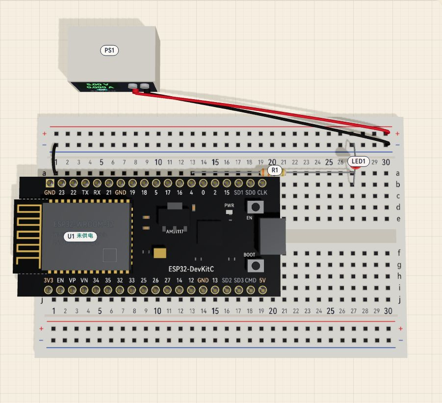
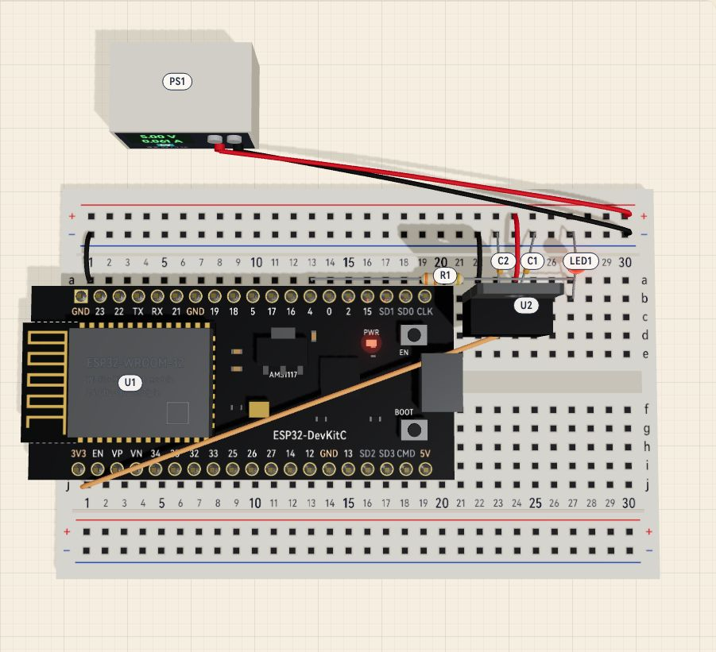
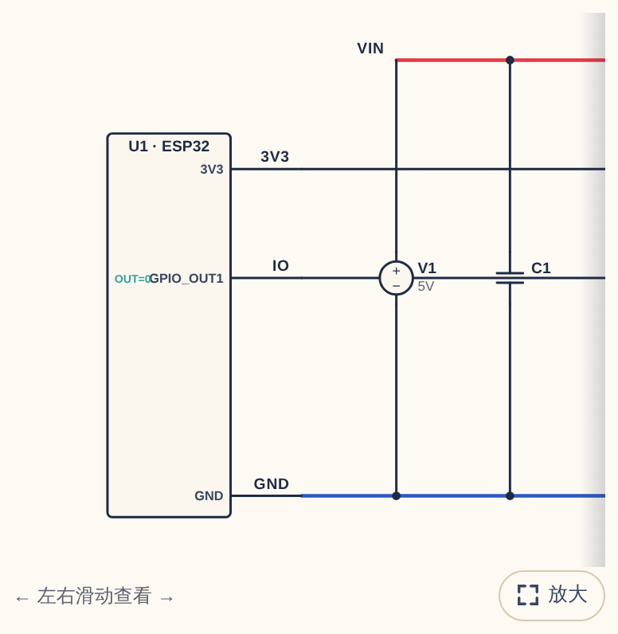
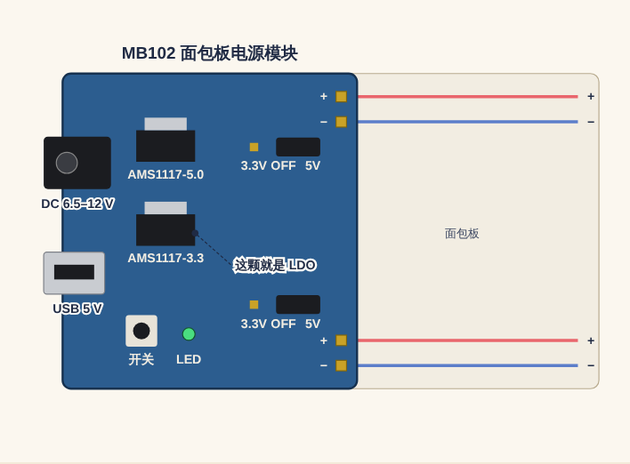
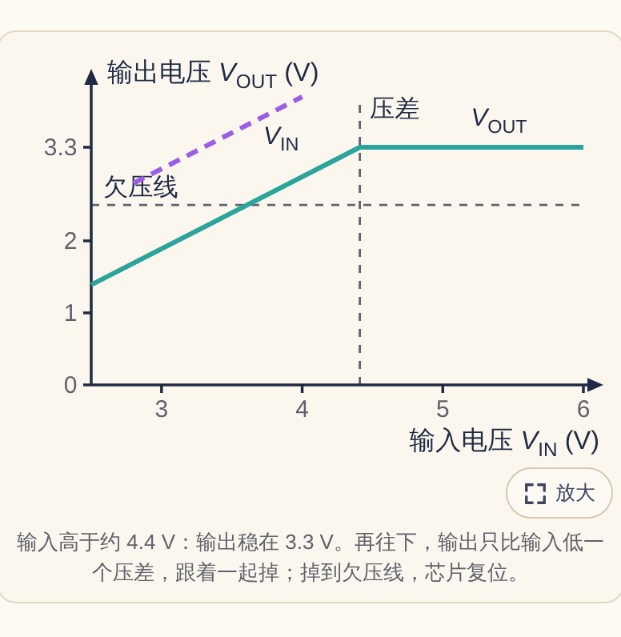

# 8.5 · 稳压器的压差：电池越来越没电时

| 项目 | 内容 |
|---|---|
| id | `exp5-ldo-dropout` |
| 文件 | `challenges/291-ldo-dropout.json` |
| 类型 | 实验 / 挑战（没有分步，照目标电路图搭） · 难度 3/5 |
| 位置 | World 8 · 数字逻辑、MCU 与传感器实战 → 8.5 供电：LDO 与电流预算（本节第 1 项） |
| 右侧面板 | 轨道由旧的四张卡片自动生成（还没手工精排） |
| 前后 | 上一项 [8.4 exp5-high-side-vs-low-side](../w8/8.04-3-exp5-high-side-vs-low-side.md) · 下一项 [8.5 exp5-board-power-budget](../w8/8.05-2-exp5-board-power-budget.md) |
| 先修 | lesson-mcu-gpio |
| 概念 | 线性稳压器 linear regulator / LDO、压差 dropout voltage、去耦电容 decoupling capacitors、欠压复位 brown-out、功耗 P = (Vin − Vout)·I |

**一句话概要**：ESP32 拔掉 USB，只靠 LM1117-3.3 稳压器供电。把输入电压往下调，像一节慢慢没电的锂电池：3.3 V 什么时候守不住，芯片什么时候复位？

## 1. 左侧工作台（3D 面包板 → 2D 俯视截图）

截图是程序里真实的 3D 面包板换成俯视角拍的；表格是同一块板的文字版（元件、参数、每只脚插在哪个孔）。

### 1.1 起点：打开这一课时板上已经有的

右侧显示的「起点」说明：

> **半成品**：稳压电源、ESP32（拔掉 USB）、GND 线和 GPIO4 → 330Ω → LED 的负载已经接好。**为什么**：这个实验的重点就是稳压器怎么接。**你要做**：放 LM1117（c22：GND、OUT、IN），GND 脚接地、IN 脚接 + 轨，输入和输出各加一个 10µF 到 GND，再把 OUT 接到 ESP32 的 3V3 脚（j1）。

| 元件 | 类型 | 参数 | 引脚 → 孔 |
|---|---|---|---|
| PS1 | bench_supply | voltage=5, currentLimit=0.5 | +→tp30 -→tn30 |
| U1 | esp32_devkit | usb=false, pins={"GPIO4":{"mode":"out_high"}} | GND→b1 GPIO23→b2 GPIO22→b3 GPIO1→b4 GPIO3→b5 GPIO21→b6 GND_2→b7 GPIO19→b8 GPIO18→b9 GPIO5→b10 GPIO17→b11 GPIO16→b12 GPIO4→b13 GPIO0→b14 GPIO2→b15 GPIO15→b16 GPIO8→b17 GPIO7→b18 GPIO6→b19 3V3→i1 EN→i2 GPIO36→i3 GPIO39→i4 GPIO34→i5 GPIO35→i6 GPIO32→i7 GPIO33→i8 GPIO25→i9 GPIO26→i10 GPIO27→i11 GPIO14→i12 GPIO12→i13 GND_3→i14 GPIO13→i15 GPIO9→i16 GPIO10→i17 GPIO11→i18 5V→i19 |
| W3 | wire |  | a→a1 b→tn1 |
| R1 | resistor | resistance=330 | 1→a13 2→a27 |
| LED1 | led | color=red | anode→b27 cathode→tn27 |

### 1.3 参考答案（「看答案」载入的板子）

| 元件 | 类型 | 参数 | 引脚 → 孔 |
|---|---|---|---|
| PS1 | bench_supply | voltage=5, currentLimit=0.5 | +→tp30 -→tn30 |
| U1 | esp32_devkit | usb=false, pins={"GPIO4":{"mode":"out_high"}} | GND→b1 GPIO23→b2 GPIO22→b3 GPIO1→b4 GPIO3→b5 GPIO21→b6 GND_2→b7 GPIO19→b8 GPIO18→b9 GPIO5→b10 GPIO17→b11 GPIO16→b12 GPIO4→b13 GPIO0→b14 GPIO2→b15 GPIO15→b16 GPIO8→b17 GPIO7→b18 GPIO6→b19 3V3→i1 EN→i2 GPIO36→i3 GPIO39→i4 GPIO34→i5 GPIO35→i6 GPIO32→i7 GPIO33→i8 GPIO25→i9 GPIO26→i10 GPIO27→i11 GPIO14→i12 GPIO12→i13 GND_3→i14 GPIO13→i15 GPIO9→i16 GPIO10→i17 GPIO11→i18 5V→i19 |
| W3 | wire |  | a→a1 b→tn1 |
| U2 | ldo | voltage=3.3 | gnd→c22 out→c23 in→c24 |
| W5 | wire |  | a→a22 b→tn22 |
| W6 | wire |  | a→a24 b→tp24 |
| C1 | capacitor | capacitance=0.000009999999999999999 | 1→b24 2→tn25 |
| C2 | capacitor | capacitance=0.000009999999999999999 | 1→b23 2→tn23 |
| W9 | wire |  | a→d23 b→j1 |
| R1 | resistor | resistance=330 | 1→a13 2→a27 |
| LED1 | led | color=red | anode→b27 cathode→tn27 |

### 1.4 目标原理图（右侧「目标原理图」抽屉）

| 元件 | 类型 | 参数 |
|---|---|---|
| V1 | dc_source | voltage=5 |
| U2 | ldo | voltage=3.3 |
| C1 | capacitor | capacitance=0.000009999999999999999 |
| C2 | capacitor | capacitance=0.000009999999999999999 |
| U1 | esp32_devkit | usb=false |
| R1 | resistor | resistance=330 |
| LED1 | led | color=red |

连接（每个结点上的引脚）：

- **VIN**：V1.+、U2.in、C1.1
- **3V3**：U2.out、C2.1、U1.3V3
- **IO**：U1.GPIO_OUT1、R1.1
- **LA**：R1.2、LED1.anode
- **GND**：V1.-、U2.gnd、C1.2、C2.2、U1.GND、LED1.cathode

## 2. 右侧面板：学生从上往下看到的内容（单轨流）

### 第 1 步 · 🔍 先看一眼：先认识它：稳压器 / 电源模块

**拆解「电源模块和 LDO 稳压器」第 1 / 7 层：① 外形：MB102 面包板电源模块**

MB102 插在面包板的一端，底下的 4 根针 同时插进 **上下两组** 电源轨：上面的 + / −、下面的 + / −。所以第 7、8 课里，上半区和下半区都能直接取电——这是它和电池、稳压电源（只接一组轨道）最大的不同。

取电有两条路：DC 插座（6.5–12 V）或 USB（5 V）。开关 打开后 指示灯 亮。

每组轨道各有一个 跳线帽：插在 “5V” 一边，这组轨道是 5 V；插在 “3.3V” 一边就是 3.3 V；拔掉（OFF）这组轨道没电。所以真实模块上 **上下两组可以是不同电压**。模拟器简化了：一个 voltage 属性同时决定两组，内阻 0.1 Ω，超过约 0.5 A 报过载。

**挑战 8（蓝色 LED）**：蓝 LED 的 $V_f$ ≈ 3.0 V。选 3.3 V：$I = \frac{3.3 - 3.0}{100 + 12} ≈ 2.7 mA$，很暗；选 5 V：$I = \frac{5 - 3.0}{112} ≈ 18 mA$。电压余量（headroom）要够。

| 部件 | 作用 | 数字 |
|---|---|---|
| DC 插座 | 外接电源适配器 | 6.5–12 V |
| USB | 从电脑 / 充电器取 5 V | 5 V，约 500 mA |
| 开关 + LED | 总开关、电源指示 | — |
| AMS1117-5.0 | DC 输入 → 5 V | 最大约 1 A（实际受发热限制） |
| AMS1117-3.3 | 5 V → 3.3 V | 同上 |
| 跳线帽 ×2 | 每组轨道选 5 V / 3.3 V / OFF | 上下两组各一个 |
| 针脚 ×4 | 插进上下两组 + / − 轨 | + 要对准红线 |

### 第 2 步 · 🔧 动手搭：把电池慢慢“用完”

这次 ESP32 **不插 USB**：单击它，在右侧「属性」里取消勾选**「USB 供电」**。它只能靠你给的电。
**稳压电源**（`5 V`）的 + 接 **LM1117-3.3** 的 IN（正面朝你，三只脚是 GND、OUT、IN），稳压器的 OUT 接 ESP32 的 **3V3** 脚，GND 都连在一起。
任意一个 GPIO 设成**「输出 高」**，串 **`330 Ω`** 接一颗**红色 LED** 到 GND。LED 亮着，就说明芯片在运行。
现在把稳压电源从 `5 V` **一点一点往下调**，像一节越用越没电的锂电池。LED 在哪里熄灭？输入明明还有 3 V 多，为什么不够？

### 第 3 步 · 💡 想明白：稳压器是一个自动拧的水龙头

- 线性稳压器像串在输入和输出之间的一个**自动拧的水龙头**。输入多出来的电压它都吃掉，输出就稳在 3.3 V。
- 可是水龙头全开时，自己也要吃掉一段电压，叫**压差**。输入再往下降，输出只能跟着降。本仿真里 LM1117 的压差是 1.1 V 再加 0.2 Ω：
$$V_{OUT} = V_{IN} - 1.1 - 0.2 × I$$
- 代入数字：输入 3.6 V、电流 0.05 A 时，$V_{OUT} = 3.6 - 1.1 - 0.2 × 0.05 = 2.49$ V。已经掉到 ESP32 的欠压线以下，芯片复位，所有引脚松开，LED 灭。

*图 `dropout`（plot）：输入高于约 4.4 V：输出稳在 3.3 V。再往下，输出只比输入低一个压差，跟着一起掉；掉到欠压线，芯片复位。*

- 反过来，输入很高时输出照样是 3.3 V，但多出来的电压 × 电流，全部变成稳压器上的**热**。

（这一步下面列着这节课的计算卡片，点开就地展开：`gpio-led-resistor`、`ldo-dropout`、`ldo-power`、`power-budget`，全文见第 6 节）

### 第 4 步 · 🔧 动手搭：加上电容，再测一遍

- 两个 **`10 µF`**：一个从 IN 到 GND，一个从 OUT 到 GND，都插在稳压器旁边。真实的 LM1117 没有输出电容可能自己振荡。
- 电源调回 **`5 V`**，点**「检查我的电路」**。检查会把电源依次调到 5 V、4.0 V、3.7 V、3.4 V 和 9 V，看输出和 LED。
- 通过后，按测量题把电源调到对应的电压，用万用表和电流表读数。先预测：4.0 V 在水龙头全开的那一段吗？
- 9 V 那几道题算的是稳压器的发热：它两端的电压乘以流过它的电流。

### 第 5 步 · 📏 测一测：测一测：读你自己的仪表

**测量题 1 · `v4`**（读数题）

> 电源调到 4.0 V：稳压器 OUT 对 GND 的电压

- 单位 V · 先写预测 · 状态：V1 设为 4 V、U1 GPIO_OUT1 设为输出高电平 · 参考答案的读数 **2.889 V** · 合理范围 [2.8, 2.98]

答对后显示：

> 进入压差区：OUT ≈ 4.0 − 1.1 − 0.2 Ω × I ≈ 2.89 V，已经不是 3.3 V。

**测量题 2 · `u9`**（读数题）

> 电源调到 9 V：稳压器上的压降 V_IN − V_OUT（红表笔 IN，黑表笔 OUT）

- 单位 V · 状态：V1 设为 9 V、U1 GPIO_OUT1 设为输出高电平 · 参考答案的读数 **5.702 V** · 合理范围 [5.5, 5.9]

答对后显示：

> 9 − 3.3 ≈ 5.7 V：输入里一大半的电压被稳压器吃掉了。

**测量题 3 · `i9`**（读数题）

> 电源调到 9 V：稳压器的输出电流（把电流表串进 OUT 到 ESP32 3V3 的连线里读）

- 单位 mA · 状态：V1 设为 9 V、U1 GPIO_OUT1 设为输出高电平 · 参考答案的读数 **55.52 mA** · 合理范围 [0.053, 0.059]

答对后显示：

> ESP32 芯片约 50 mA，加上 LED 约 4 mA。输入电流几乎一样，所以稳压器是“电流照样过，电压被吃掉”。

**测量题 4 · `p9`**（计算题（用自己的读数算））

> 9 V 时稳压器的发热 P = (V_IN − V_OUT) × I（用你的读数算）

- 单位 W · 先写预测 · 参考答案的读数 **0.3165 W** · 合理范围 [0.3, 0.36] · 公式 `u9 * i9`

答对后显示：

> 线性稳压器把多余的电压全变成热：(9 − 3.3) V × 56 mA ≈ 0.32 W，效率只有 3.3/9 ≈ 37%。

**测量题 5 · `reset`**（选择题）

> 电源调到 3.4 V，LED 会？

- A. 灭：输出低于欠压线，ESP32 复位，所有引脚松开 ✅（正确）
- B. 照样亮，只是暗一点
- C. 烧掉：电压太低，电流变大

- 状态：V1 设为 3.4 V、U1 GPIO_OUT1 设为输出高电平

答对后显示：

> 3.4 − 1.1 − 0.2 × 0.05 ≈ 2.3 V，低于 ESP32 的欠压线（仿真取 2.5 V）。芯片复位后引脚变成高阻，LED 没有电流。

### 第 6 步 · 🎒 带走：带走

- **线性稳压器只能降压**，输入至少要比输出高一个压差（LM1117 约 1.1 V，老式的 7805、LM317 要 2 V 左右）。低于这一点，输出跟着输入往下掉。
- 多出来的电压全变成热：$P = (V_{IN} - V_{OUT}) × I$。12 V 降到 3.3 V 时，大部分电能都烧在稳压器上，这时该用开关电源。
- 真实项目里的坑：**一节锂电池（3.0–4.2 V）+ AMS1117-3.3** 是经典错误。电池一降到 4 V 左右，3.3 V 就守不住，ESP32 一开 Wi-Fi 就重启。要选压差只有 0.1–0.25 V 的**低压差稳压器**（如 ME6211、HT7333）。
- 外部电源接 3V3 脚时，**不要同时插 USB**：两个电源会互相打架。

趁热练理论题：`nonlinear`

## 3. 测量题一览

| # | id | 题目 | 类型 | 单位 | 状态 | 参考读数 |
|---|---|---|---|---|---|---|
| 1 | v4 | 电源调到 4.0 V：稳压器 OUT 对 GND 的电压 | voltage | V | V1 设为 4 V、U1 GPIO_OUT1 设为输出高电平 | 2.889 V |
| 2 | u9 | 电源调到 9 V：稳压器上的压降 V_IN − V_OUT（红表笔 IN，黑表笔 OUT） | voltage | V | V1 设为 9 V、U1 GPIO_OUT1 设为输出高电平 | 5.702 V |
| 3 | i9 | 电源调到 9 V：稳压器的输出电流（把电流表串进 OUT 到 ESP32 3V3 的连线里读） | current | mA | V1 设为 9 V、U1 GPIO_OUT1 设为输出高电平 | 55.52 mA |
| 4 | p9 | 9 V 时稳压器的发热 P = (V_IN − V_OUT) × I（用你的读数算） | formula | W |  | 0.3165 W |
| 5 | reset | 电源调到 3.4 V，LED 会？ | 选择 |  | V1 设为 3.4 V、U1 GPIO_OUT1 设为输出高电平 | 正确：A |

### 全部答完后显示的「对比」

**对比**（仿真）：
- **5 V**：稳压，OUT = **3.30 V**；负载电流 ≈ **56 mA**，电源给出 61 mA（多出的 5 mA 是稳压器自己的静态电流）。发热 P = (5.0 − 3.3) × 0.056 ≈ **0.12 W**，效率 66 %。
- **4.0 V**：进入**压差区**，OUT = 4.0 − 1.1 − 0.2 Ω × I ≈ **2.89 V**，ESP32 还在运行，LED 变暗。
- **3.7 V**（锂电池的标称电压）：OUT ≈ **2.59 V**，ESP32 刚刚高于欠压阈值。GPIO 的“高电平”也只有 2.6 V 左右。
- **3.4 V**（锂电池快没电）：OUT ≈ **2.29 V**，ESP32 **欠压复位**，所有引脚变高阻，LED 灭。
- **9 V**：照样 3.30 V，但稳压器要把 (9 − 3.3) × 0.056 ≈ **0.36 W** 变成热量，效率只有 37 %。
- ESP32 开 Wi-Fi 时峰值电流 300–500 mA：从 5 V 降压要发热 0.5–0.85 W，SOT-223 小封装已经很烫。

### 提示按钮（依次显示）

1. LM1117 正面朝你，三只脚依次是 GND、OUT、IN。电源接 IN（右边那只脚）。
2. IN 到 GND 一个 10 µF，OUT 到 GND 一个 10 µF；OUT 接 ESP32 的 3V3 脚。
3. 单击 ESP32，在「属性」里取消勾选「USB 供电」——否则它从 USB 取电，就看不出稳压器的作用。

### 功能测试（「检查我的电路」时跑）

- 输入 5 V：稳压，LED 亮
- 输入 4.0 V：压差区，ESP32 还在运行
- 输入 3.7 V（锂电池）：GPIO 的高电平也跟着降低
- 输入 3.4 V：ESP32 欠压复位，LED 灭
- 输入 9 V：仍然稳压，但稳压器发热

## 4. 用到的拆解（全部层的文字，供改写参考）

### 拆解 `regulator`：电源模块和 LDO 稳压器

*MB102 面包板电源模块能输出稳稳的 5 V 或 3.3 V，靠的是上面两颗 AMS1117 linear regulator（线性稳压器）。我们先看模块，再拆开稳压器：reference（基准）、error amplifier（误差放大器）、pass transistor（调整管）、feedback divider（反馈分压）；然后用它算 dropout（压差）和发热，最后解释“锂电池 + AMS1117-3.3”为什么会出问题。*

**拆解「电源模块和 LDO 稳压器」第 1 / 7 层：① 外形：MB102 面包板电源模块**

MB102 插在面包板的一端，底下的 4 根针 同时插进 **上下两组** 电源轨：上面的 + / −、下面的 + / −。所以第 7、8 课里，上半区和下半区都能直接取电——这是它和电池、稳压电源（只接一组轨道）最大的不同。

取电有两条路：DC 插座（6.5–12 V）或 USB（5 V）。开关 打开后 指示灯 亮。

每组轨道各有一个 跳线帽：插在 “5V” 一边，这组轨道是 5 V；插在 “3.3V” 一边就是 3.3 V；拔掉（OFF）这组轨道没电。所以真实模块上 **上下两组可以是不同电压**。模拟器简化了：一个 voltage 属性同时决定两组，内阻 0.1 Ω，超过约 0.5 A 报过载。

**挑战 8（蓝色 LED）**：蓝 LED 的 $V_f$ ≈ 3.0 V。选 3.3 V：$I = \frac{3.3 - 3.0}{100 + 12} ≈ 2.7 mA$，很暗；选 5 V：$I = \frac{5 - 3.0}{112} ≈ 18 mA$。电压余量（headroom）要够。

| 部件 | 作用 | 数字 |
|---|---|---|
| DC 插座 | 外接电源适配器 | 6.5–12 V |
| USB | 从电脑 / 充电器取 5 V | 5 V，约 500 mA |
| 开关 + LED | 总开关、电源指示 | — |
| AMS1117-5.0 | DC 输入 → 5 V | 最大约 1 A（实际受发热限制） |
| AMS1117-3.3 | 5 V → 3.3 V | 同上 |
| 跳线帽 ×2 | 每组轨道选 5 V / 3.3 V / OFF | 上下两组各一个 |
| 针脚 ×4 | 插进上下两组 + / − 轨 | + 要对准红线 |

**拆解「电源模块和 LDO 稳压器」第 2 / 7 层：② X 光：模块的电路——两颗稳压器串起来**

把模块“画成原理图”：
1. DC 插座 → 二极管（防反接：插头极性反了它不导通，保护后面）→ 开关 → AMS1117-5.0 → 5 V 母线；
2. 用 USB 供电时，USB 本来就是 5 V，直接接到 5 V 母线，**不经过** 5 V 稳压器；
3. 5 V 母线再喂给 AMS1117-3.3，得到 3.3 V 母线；
4. 上排跳线、下排跳线 各自从 5 V 或 3.3 V 里选一个送到轨道的 +；
5. 所有的 GND 连在一起，接到 上下两条 − 轨。

注意第 2 点：USB 供电时“5 V”其实就是 USB 的电压（4.75–5.25 V 都算合格），不是稳压器给的。

**拆解「电源模块和 LDO 稳压器」第 3 / 7 层：③ 稳压器本身：3 只脚 IN、GND、OUT**

MB102 上用的是贴片封装 **SOT-223** 的 AMS1117；第 5 期实验（291）里用的是直插 **TO-220** 的 LM1117（印字面朝你，从左到右 GND、OUT、IN）。两者电路上完全一样，3 只脚：
- IN：接较高的输入电压；
- OUT：输出稳定的 3.3 V（或 5 V）。注意 **散热片（tab）也是 OUT**——别让它碰到别的金属；
- GND / ADJ：固定电压版接 GND；可调版（ADJ）接反馈电阻。

外面还要两颗 电容：IN 到 GND 10 µF，OUT 到 GND 10 µF。OUT 的电容是稳压器 **稳定性** 的一部分：没有它，内部的反馈环可能自激振荡，输出变成一串高频波。

| 脚 | SOT-223 | TO-220（仿真） | 接哪 | 仿真参数 |
|---|---|---|---|---|
| GND / ADJ | 1 | 左 | GND | 静态电流 I_q = 5 mA 从这里流出 |
| OUT | 2 + 散热片 | 中 | 负载 + 10 µF | 3.3 V，限流 800 mA |
| IN | 3 | 右 | 输入 + 10 µF | ≥ V_out + 1.1 V |

**拆解「电源模块和 LDO 稳压器」第 4 / 7 层：④ 内部：基准 + 误差放大器 + 调整管 + 分压反馈**

稳压器是一个 **负反馈** 系统，和 LM358 拆解里的同相放大器是同一个结构：
1. 基准电压 V_ref：一个 bandgap reference（带隙基准），不管输入、温度怎么变都稳定在 1.25 V；
2. 分压电阻 R_1、R_2 把输出分一部分回来：$V_{FB} = V_{out}\frac{R_2}{R_1 + R_2}$；
3. 误差放大器 比较 $V_{FB}$ 和 $V_{ref}$：$V_{FB}$ 偏低 → 输出升高 → 把 调整管 打开一点，更多电流流向 OUT；偏高则关小；
4. 平衡时（虚短）$V_{FB} = V_{ref}$，所以
$$V_{out} = V_{ref}(1 + \frac{R_1}{R_2})$$
3.3 V 版：$\frac{R_1}{R_2} = \frac{3.3}{1.25} - 1 = 1.64$。

调整管串在 IN 和 OUT 之间，**所有** 负载电流都从它身上流过，它两端的电压 $V_{in} - V_{out}$ 就落在它身上——这一层解释了下面两层的“压差”和“发热”。

（可调版 LM1117-ADJ：1.25 V 在 OUT 和 ADJ 之间，数据手册写作 $V_{out} = 1.25 V × (1 + \frac{R_2}{R_1})$，常用 R_1 = 120 Ω、R_2 = 200 Ω → 3.33 V，名字和这里的图正好反过来。）

| 方块 | 作用 | 类比 |
|---|---|---|
| 基准 V_ref | 一个不变的 1.25 V | 同相放大器的 v_in |
| 分压 R_1、R_2 | 把 V_out 缩小送回 | β = R_2/(R_1 + R_2) |
| 误差放大器 | 放大 V_ref − V_FB | op-amp |
| 调整管 | 可变“阀门”，吃掉多余电压 | op-amp 的输出级 |

- 公式 `V_{out} = V_{ref}(1 + \frac{R_1}{R_2})`：V_ref = 1.25 V；和同相放大器 1 + R_f/R_1 同一个式子

**拆解「电源模块和 LDO 稳压器」第 5 / 7 层：⑤ 等效电路：一个自动调节的电阻，以及压差**

从外面看，线性稳压器就是一个串在 IN 和 OUT 之间的 自动调节的电阻 R_pass，再加一点流到 GND 的 静态电流 I_q。

**稳压区**：反馈环把 $R_{pass}$ 调到正好 $R_{pass} = \frac{V_{in} - 3.3}{I}$。例如 5 V、56 mA：$R_{pass} = \frac{1.7}{0.056} ≈ 30 Ω$。

**压差区**：输入降低，$R_{pass}$ 就得变小……但调整管再怎么全开，也要留一个最小压降——**dropout voltage（压差）**。LM1117 / AMS1117 约 1.1 V（它的调整管是 NPN，基极驱动要再多一个 $V_{BE}$，所以不算真正的“低”压差）。于是：
$$V_{in} ≥ V_{out} + V_{dropout} = 3.3 + 1.1 = 4.4 V$$
不满足时 输出跟着输入往下掉。仿真模型：$V_{out} = V_{in} - 1.1 V - 0.2 Ω × I$。

**实验 291 的数字**（负载 56 mA，拐点 $1.1 + 0.2 × 0.056 + 3.3 = 4.41 V$）：
- 5 V、9 V：稳压，3.30 V；
- 4.0 V：$4.0 - 1.11 = 2.89 V$——已经不是 3.3 V，但 ESP32 还在跑；
- 3.7 V：2.59 V；
- 3.4 V：2.29 V，低于 欠压阈值 2.5 V，ESP32 复位，LED 灭。

| V_in | 模式 | V_out | ESP32 |
|---|---|---|---|
| 9 V | 稳压 | 3.30 V | 运行（但很热） |
| 5 V | 稳压 | 3.30 V | 运行 |
| 4.0 V | 压差 | 2.89 V | 运行（低于 3.0 V 规格） |
| 3.7 V | 压差 | 2.59 V | 勉强 |
| 3.4 V | 压差 | 2.29 V | 欠压复位 |

- 公式 `V_{in} ≥ V_{out} + V_{dropout}`：稳压的条件；LM1117 / AMS1117：V_dropout ≈ 1.1 V
- 公式 `V_{out} = V_{in} - 1.1 V - 0.2 Ω × I`：压差区（仿真模型）

**拆解「电源模块和 LDO 稳压器」第 6 / 7 层：⑥ 发热和效率：多出来的电压全变成热**

线性稳压器 **不能** 把多出来的电压“换成”电流：输入电流 ≈ 输出电流（再加 $I_q$）。功率守恒：
1. 输入功率：$P_{in} = V_{in}(I + I_q)$
2. 给负载的：$P_{out} = V_{out}·I$
3. 差值全部在调整管上变成热：$P = (V_{in} - V_{out})·I + V_{in}·I_q$
4. 效率：$η = \frac{P_{out}}{P_{in}} ≈ \frac{V_{out}}{V_{in}}$

**实验 291**（I = 56 mA，$I_q$ = 5 mA）：
- 5 V：$(5 - 3.3) × 0.056 = 95 mW$，加上 $I_q$ 的 25 mW 约 120 mW，η ≈ 61%；
- 9 V：$(9 - 3.3) × 0.056 = 319 mW$，加 45 mW 约 364 mW，η ≈ 34%——2/3 的能量变成热。

温度怎么估：$ΔT = P × θ_{JA}$。SOT-223 焊在小板上 $θ_{JA}$ ≈ 90 °C/W：0.36 W → 温升约 33 °C，摸上去烫手但还行。12 V → 3.3 V、500 mA 就是 4.35 W，根本不可能——要用 **buck（降压）开关电源**，效率 85–95%。

MB102 也一样：DC 插座接 12 V、5 V 轨上拉 200 mA，AMS1117-5.0 要发热 $(12 - 5) × 0.2 = 1.4 W$。所以 **DC 输入用 7–9 V 最好**，够压差、又不太热。

| 情况 | 发热 P | 效率 η | 温升（90 °C/W） |
|---|---|---|---|
| 5 V → 3.3 V, 56 mA | ≈ 0.12 W | 61% | ≈ 11 °C |
| 9 V → 3.3 V, 56 mA | ≈ 0.36 W | 34% | ≈ 33 °C |
| 12 V → 5 V, 200 mA (MB102) | 1.4 W | 42% | ≈ 126 °C：过热保护 |
| 12 V → 3.3 V, 500 mA | 4.35 W | 28% | 不可能 |

- 公式 `P = (V_{in} - V_{out})·I`：调整管的发热（忽略 I_q）
- 公式 `η ≈ \frac{V_{out}}{V_{in}}`：线性稳压器效率的上限

**拆解「电源模块和 LDO 稳压器」第 7 / 7 层：⑦ 为什么“锂电池 + AMS1117-3.3”会出问题**

一节锂离子电池满电 4.2 V、标称 3.7 V、放完 3.0 V，大部分时间在 3.6–3.9 V。把它接到 AMS1117-3.3 的 IN：
- 稳压需要 V_in ≥ 4.4 V——**整条曲线都在它下面**，连满电的 4.2 V 都不够；
- 所以稳压器一直在压差区，输出 = V_bat − 1.11 V：满电 3.09 V，标称 2.6 V，已经低于 ESP32 的 3.0 V 规格下限；
- 再一开 Wi-Fi（电流尖峰几百 mA），$0.2 Ω × I$ 再往下拉，碰到 欠压阈值 就复位，然后又启动、又复位……

**正确做法**：
- 选真正的 low-dropout（低压差）LDO：ME6211、HT7333、XC6220、RT9080，压差 0.1–0.25 V，只要约 3.45 V 就能稳压，几乎用完整节电池；
- 或者用 buck-boost（升降压）开关电源，电池从 4.2 V 到 3.0 V 都能输出 3.3 V；
- ESP32-DevKitC 板上就是 AMS1117：用锂电池时不要接 5V 脚，接到 3V3 脚并在前面用低压差 LDO。

**这一层的局限也一并列出**：仿真的 LDO 没有输出电容的稳定性问题、没有温度和热关断，压差是一个固定的 1.1 V + 0.2 Ω。

| 稳压器 | 压差 | 锂电池可用到 | 效率 |
|---|---|---|---|
| AMS1117 / LM1117 | 1.1 V | 4.4 V（一点都用不了） | V_out / V_in |
| ME6211 / HT7333 | 0.1–0.25 V | ≈ 3.45 V | V_out / V_in |
| Buck-boost 开关电源 | — | ≈ 2.5 V | 85–95% |

**一句话记住**：MB102 = DC 插座 → AMS1117-5.0 → 5 V，再 → AMS1117-3.3 → 3.3 V，跳线帽给上下两组轨道各选一个电压。LDO 内部是带负反馈的“自动可变电阻”：$V_{out} = V_{ref}(1 + R_1/R_2)$；要稳压必须 $V_{in} ≥ V_{out} + V_{dropout}$（AMS1117 约 1.1 V）；多出来的电压全变成热 $P = (V_{in} - V_{out})·I$。锂电池配 AMS1117-3.3 永远在压差区——换真正的低压差 LDO 或开关电源。

## 5. 这一课的计算卡片

**计算卡片 `gpio-led-resistor`：GPIO 点 LED 的电阻（含引脚内阻）**

- 公式 `R = \frac{V_{OH} - V_F}{I} - R_{out} - r_d`
- 用途：单片机引脚直接驱动 LED：串多大的电阻得到想要的电流。
- 输入：V_OH（引脚高电平（空载），V）；V_F（LED 正向压降（红 1.8 V），V）；I（想要的电流（≤ 20 mA），A）；R_out（引脚输出电阻（ESP32 25 Ω、Blue Pill 40 Ω），Ω）；r_d（LED 内阻，Ω） → R（串联电阻（再取一个标准值），Ω）

1. 输出高电平的引脚不是理想电压源：它像 3.3 V 串一个输出电阻 $R_{out}$（芯片里 MOS 管的导通电阻）。
2. LED 用折线模型：$V_F$ 串 $r_d$。
3. 回路 KVL：$V_{OH} = I(R_{out} + R + r_d) + V_F$。
4. 解出 $R = \frac{V_{OH} - V_F}{I} - R_{out} - r_d$，取最接近的标准值，再回算电流：$I = \frac{V_{OH} - V_F}{R + R_{out} + r_d}$。
5. 灌电流（LED 接 3V3、阴极接引脚、输出低电平点亮）公式一样，$R_{out}$ 换成下管的电阻。

例子：- 实验 5-1：10 mA：$\frac{1.5}{0.01} - 25 - 12 = 113 Ω$ → 120 Ω，$I = \frac{1.5}{157} ≈ 9.5 mA$。不串电阻：$\frac{1.5}{37} ≈ 40 mA$——到了绝对最大值。
- 第 15 课：330 Ω：$\frac{1.5}{330 + 25 + 12} ≈ 4.1 mA$。
- 实验 5-2（Blue Pill，40 Ω）：220 Ω：$\frac{1.5}{272} ≈ 5.5 mA$；板载 LED 510 Ω：≈ 2.7 mA。

- ⚠ 蓝 / 白 LED（$V_F$ ≈ 3 V）在 3.3 V 引脚上只剩 0.3 V 给电阻：亮度对一切都很敏感——用三极管从 5 V 驱动。
- ⚠ 每个引脚建议 ≤ 20 mA，所有引脚加起来也有上限（STM32F103 共 150 mA）。

**计算卡片 `ldo-dropout`：线性稳压器的压差 LDO dropout**

- 公式 `V_{out} = min(V_{set}, V_{in} - V_{drop} - R_d I)`
- 用途：输入电压不够高时，稳压器的输出掉到多少（LM1117 / AMS1117 需要约 1.1 V 压差）。
- 输入：V_in（输入电压，V）；V_set（额定输出，V）；V_drop（压差，V）；I（负载电流，A）；R_d（压差模型的电阻，Ω） → V_out（输出电压，V）

1. 线性稳压器 = 串在输入和输出之间、自己调节的“可变电阻”，把多出来的电压吃掉。
2. 输出只能比输入低：调整管至少要留 $V_{drop}$（LM1117 约 1.1 V），电流大时再多一点（模型里 $R_d I$）。
3. $V_{in} ≥ V_{set} + V_{drop}$：正常稳压，输出 = 额定值。
4. 不够时进入 **压差区**：输出跟着输入走，$V_{out} = V_{in} - V_{drop} - R_dI$。
5. 低到单片机的掉电复位阈值（模拟的 ESP32 是 2.5 V）就复位，所有引脚变高阻。

例子：实验 5-12（≈ 56 mA）：5 V → 3.30 V；4.0 V → 2.89 V；3.7 V（锂电池标称）→ 2.59 V；3.4 V → 2.29 V，ESP32 掉电复位。锂电池 + AMS1117 不行，要用 ME6211、HT7333 这类 0.1–0.25 V 压差的 LDO。

- ⚠ LM1117 / AMS1117 的输出电容不能省（≥ 10 µF），否则可能振荡。

**计算卡片 `ldo-power`：线性稳压器的发热与效率**

- 公式 `P = (V_{in} - V_{out}) I + V_{in} I_q, η ≈ \frac{V_{out}}{V_{in}}`
- 用途：线性稳压器把多出来的电压全部变成热：它自己耗多少瓦。
- 输入：V_in（输入电压，V）；V_out（输出电压，V）；I（负载电流，A）；I_q（静态电流（LM1117 ≈ 5 mA），A） → P（稳压器发热，W）

1. 输入电流 ≈ 输出电流（加上一点静态电流 $I_q$）——线性稳压器不会“变换”电流。
2. 进来的功率 $V_{in}(I + I_q)$，出去的功率 $V_{out}I$，差值就是热：$P = (V_{in} - V_{out})I + V_{in}I_q$。
3. 效率 $η = \frac{V_{out}I}{V_{in}(I + I_q)} ≈ \frac{V_{out}}{V_{in}}$：压差越大越浪费。
4. 小封装（SOT-223）不加散热大约只能散 0.5–1 W；压差大、电流大就用开关（buck）稳压器。

例子：实验 5-12：9 V、56 mA：$5.7 × 0.056 + 9 × 0.005 ≈ 0.36 W$，效率 37 %（只用读到的 V 和 I 算是 0.32 W）；5 V：≈ 0.12 W，效率 66 %。12 V → 3.3 V、500 mA 要烧 4.4 W——不现实。实验 5-13：板载 LDO 限流时 $(4.58 - 2.79) × 0.3 ≈ 0.54 W$。

- ⚠ ESP32 开 Wi-Fi 时峰值 300–500 mA：按峰值算发热和压差。

**计算卡片 `power-budget`：电流预算：用掉了百分之几**

- 公式 `\frac{ΣI}{I_{max}} × 100 %`
- 用途：3V3（板载 LDO）或 5V（USB 500 mA）上所有负载加起来，占了上限的多少。
- 输入：I_1（负载 1（芯片：Blue Pill 20 mA、ESP32 50 mA），A）；I_2（负载 2，A）；I_3（负载 3，A）；I_4（负载 4（没有就填 0），A）；I_max（上限（RT9193 300 mA、AMS1117 1 A、USB 500 mA），A） → use（占用，%）

1. 把每个负载的 **最坏情况** 电流列出来：舵机堵转、电机启动、Wi-Fi 发射、LED 全亮。
2. 按电源分开加：3V3 上的走板载 LDO；5V 上的直接走 USB（还要加上 LDO 自己的输入电流）。
3. 经验：3V3 总和 < LDO 额定的 70 %，5V 总和 < USB 的 80 %。
4. 超了：大电流负载（电机、舵机、LED 灯带、继电器）挪到 5V 或单独电源，**GND 一定要连在一起**。

例子：实验 5-13：3V3 = 20 + 1.5 + 3.9 + 1.2 ≈ 27 mA，占 300 mA 的 9 %；10 Ω 负载错放在 3V3 上要 330 mA，超过 LDO 上限，3V3 掉到 2.79 V。5V = 31 + 451 ≈ 482 mA，占 USB 的 96 %。实验 5-17：USB ≈ 415 mA，83 %。

- ⚠ 超过 500 mA 时电脑的 USB 口会断电或掉线——“电机一启动串口就断”。

## 6. English（界面英文版的同一份内容）

展开英文

### Node 1 · 🔍 Look first：Meet it first: Regulator / power module

**Teardown「The power module and the LDO regulator」layer 1 of 7：① Outside: the MB102 breadboard power module**

The MB102 plugs into one end of the breadboard; its 4 pins go into **both** pairs of rails at once: top + / − and bottom + / −. That's why in lessons 7 and 8 both halves of the board have power — the big difference from a battery or a bench supply, which feed only one pair.

Power comes in one of two ways: the DC jack (6.5–12 V) or USB (5 V). Turn the switch on and the LED lights.

Each rail pair has its own jumper cap: on the "5V" side that pair is 5 V; on the "3.3V" side it is 3.3 V; removed (OFF) that pair is dead. So on a real module **the two pairs can be at different voltages**. The simulator simplifies: one voltage property sets both, internal resistance 0.1 Ω, overload flagged above about 0.5 A.

**Challenge 8 (blue LED)**: a blue LED has $V_f$ ≈ 3.0 V. At 3.3 V: $I = \frac{3.3 - 3.0}{100 + 12} ≈ 2.7 mA$, dim; at 5 V: $I = \frac{5 - 3.0}{112} ≈ 18 mA$. You need enough headroom.

| Part | What it does | Numbers |
|---|---|---|
| DC jack | wall adapter in | 6.5–12 V |
| USB | 5 V from a computer / charger | 5 V, ≈ 500 mA |
| switch + LED | on/off, power indicator | — |
| AMS1117-5.0 | DC input → 5 V | ≤ 1 A (heat-limited) |
| AMS1117-3.3 | 5 V → 3.3 V | same |
| jumper caps ×2 | per rail pair: 5 V / 3.3 V / OFF | one per pair |
| pins ×4 | into both pairs of + / − rails | + must face the red line |

### Node 2 · 🔧 Build：Run a battery down, slowly

This time the ESP32 has **no USB**: click it and untick **USB power** in Properties on the right. It only gets what you give it.
The **bench supply** (`5 V`) + goes to the IN pin of an **LM1117-3.3** (printed face towards you, the pins are GND, OUT, IN); the regulator's OUT goes to the ESP32's **3V3** pin, and all the GNDs join.
Set any GPIO to **output HIGH** and drive a **red LED** through **`330 Ω`** to GND. While the LED is lit, the chip is running.
Now turn the bench supply down from `5 V`, **a little at a time**, like a lithium cell running flat. Where does the LED go out? The input still has more than 3 V — why is that not enough?

### Node 3 · 💡 Why：A regulator is a tap that turns itself

- A linear regulator is like a **tap that turns itself**, sitting between input and output. It eats whatever extra voltage the input has, so the output stays at 3.3 V.
- But even wide open, the tap eats a slice of voltage of its own: the **dropout**. Once the input falls further, the output has to fall with it. In this simulator the LM1117's dropout is 1.1 V plus 0.2 Ω:
$$V_{OUT} = V_{IN} - 1.1 - 0.2 × I$$
- With numbers: input 3.6 V and 0.05 A, $V_{OUT} = 3.6 - 1.1 - 0.2 × 0.05 = 2.49$ V. That is below the ESP32's brown-out line: the chip resets, every pin lets go, and the LED goes dark.

[figure `dropout`]

*Figure `dropout`（plot）：输入高于约 4.4 V：输出稳在 3.3 V。再往下，输出只比输入低一个压差，跟着一起掉；掉到欠压线，芯片复位。*

- The other way round, with a high input the output is still 3.3 V, but the extra voltage times the current all turns into **heat** in the regulator.

(This node lists the lesson’s calculation cards: `gpio-led-resistor`、`ldo-dropout`、`ldo-power`、`power-budget`; full text in section 6)

### Node 4 · 🔧 Build：Add the capacitors, measure again

- Two **`10 µF`** capacitors: one from IN to GND and one from OUT to GND, both right next to the regulator. A real LM1117 without its output capacitor can oscillate.
- Set the supply back to **`5 V`** and press **Check my circuit**. The check sets the supply to 5 V, 4.0 V, 3.7 V, 3.4 V and 9 V in turn and looks at the output and the LED.
- Once it passes, set the supply as each question says and read the multimeter and ammeter. Predict first: is 4.0 V on the wide-open stretch of the tap?
- The 9 V questions work out the regulator's heat: the voltage across it times the current through it.

### Node 5 · 📏 Measure：Measure: read your own instruments

**Question 1 · `v4`**（reading）

> Supply at 4.0 V: the regulator's OUT to GND

- unit V · predict first · state：V1 is set to 4 V and U1 GPIO_OUT1 is output HIGH · range [2.8, 2.98]

Shown once right:

> Dropout: OUT ≈ 4.0 − 1.1 − 0.2 Ω × I ≈ 2.89 V, no longer 3.3 V.

**Question 2 · `u9`**（reading）

> Supply at 9 V: the drop across the regulator V_IN − V_OUT (red lead on IN, black on OUT)

- unit V · state：V1 is set to 9 V and U1 GPIO_OUT1 is output HIGH · range [5.5, 5.9]

Shown once right:

> 9 − 3.3 ≈ 5.7 V: the regulator eats more than half of the input voltage.

**Question 3 · `i9`**（reading）

> Supply at 9 V: the regulator's output current (put the ammeter in the wire from OUT to the ESP32's 3V3)

- unit mA · state：V1 is set to 9 V and U1 GPIO_OUT1 is output HIGH · range [0.053, 0.059]

Shown once right:

> About 50 mA for the ESP32 chip plus about 4 mA for the LED. The input current is almost the same: the current passes, the voltage is eaten.

**Question 4 · `p9`**（calculation from own readings）

> Heat in the regulator at 9 V: P = (V_IN − V_OUT) × I (from your readings)

- unit W · predict first · range [0.3, 0.36] · formula `u9 * i9`

Shown once right:

> A linear regulator turns all the extra voltage into heat: (9 − 3.3) V × 56 mA ≈ 0.32 W, an efficiency of only 3.3/9 ≈ 37%.

**Question 5 · `reset`**（multiple choice）

> Supply at 3.4 V. The LED:

- A. goes out: the output is below the brown-out line, the ESP32 resets and every pin lets go ✅ (right)
- B. stays lit, just a little dimmer
- C. burns out: a lower voltage means a bigger current

- state：V1 is set to 3.4 V and U1 GPIO_OUT1 is output HIGH

Shown once right:

> 3.4 − 1.1 − 0.2 × 0.05 ≈ 2.3 V, below the ESP32's brown-out line (2.5 V in the simulator). After the reset the pins are high-impedance and the LED gets no current.

### Node 6 · 🎒 Take away：Take away

- **A linear regulator only steps down**, and its input must stay at least one dropout above the output (about 1.1 V for the LM1117; the classic 7805 or LM317 needs about 2 V). Below that, the output follows the input down.
- All the extra voltage becomes heat: $P = (V_{IN} - V_{OUT}) × I$. From 12 V down to 3.3 V most of the energy is burned in the regulator; that is a job for a switching supply.
- A real-world catch: **one lithium cell (3.0–4.2 V) + AMS1117-3.3** is the classic mistake. Once the cell drops to about 4 V the 3.3 V gives way, and the ESP32 reboots as soon as Wi-Fi transmits. Choose a **low-dropout regulator** with only 0.1–0.25 V (ME6211, HT7333).
- When an outside supply feeds the 3V3 pin, **don't plug in USB as well**: the two supplies fight.

Practise：`nonlinear`

**Compare**

**Compare** (simulated):
- **5 V**: regulating, OUT = **3.30 V**; load ≈ **56 mA**, the supply gives 61 mA (the extra 5 mA is the regulator's own quiescent current). Dissipation P = (5.0 − 3.3) × 0.056 ≈ **0.12 W**, efficiency 66 %.
- **4.0 V**: in **dropout**, OUT = 4.0 − 1.1 − 0.2 Ω × I ≈ **2.89 V**; the ESP32 still runs and the LED dims.
- **3.7 V** (a Li-ion cell's nominal voltage): OUT ≈ **2.59 V**, just above the brown-out threshold. A GPIO "HIGH" is now only about 2.6 V.
- **3.4 V** (an almost empty Li-ion cell): OUT ≈ **2.29 V**, the ESP32 **browns out**, every pin goes high-impedance and the LED goes off.
- **9 V**: still 3.30 V, but the regulator turns (9 − 3.3) × 0.056 ≈ **0.36 W** into heat; efficiency only 37 %.
- With Wi-Fi on, an ESP32 peaks at 300–500 mA: from 5 V that is 0.5–0.85 W, already very hot for a small SOT-223.

**Hints**

1. With the LM1117's printed face towards you, the pins are GND, OUT, IN. The supply goes to IN (the right-hand pin).
2. 10 µF from IN to GND and 10 µF from OUT to GND; OUT goes to the ESP32's 3V3 pin.
3. Click the ESP32 and untick USB power in Properties — otherwise it runs from USB and the regulator shows nothing.

