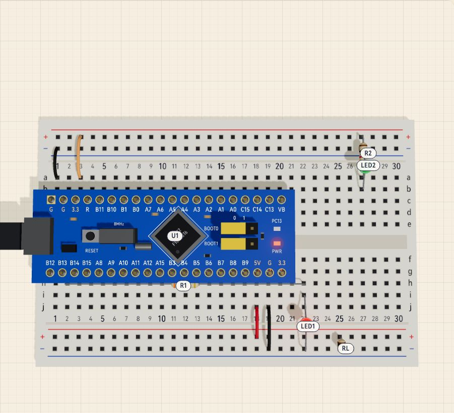
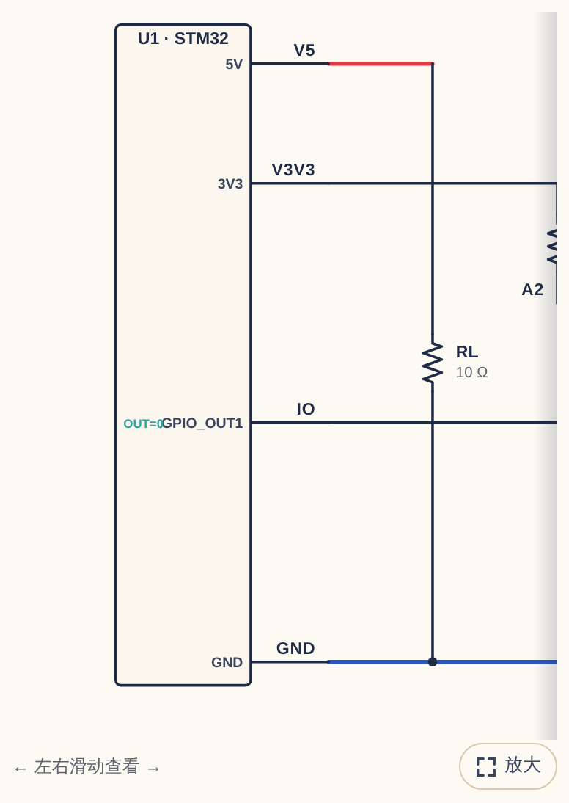
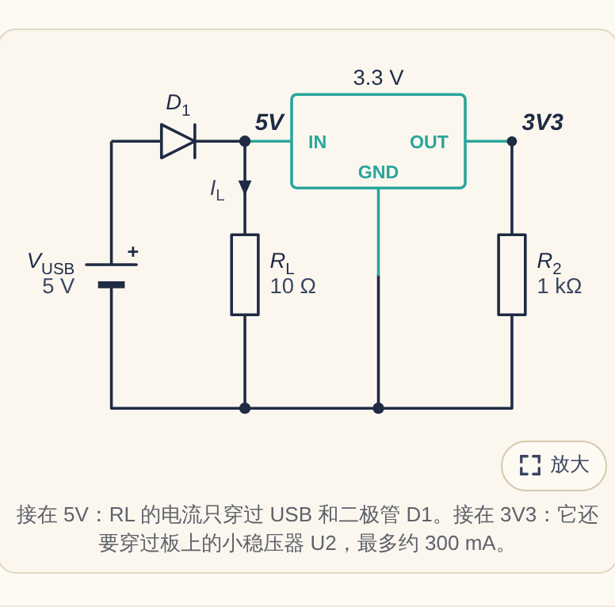

# 8.5 · 电流预算：大负载该接 5V 还是 3V3

| 项目 | 内容 |
|---|---|
| id | `exp5-board-power-budget` |
| 文件 | `challenges/292-board-power-budget.json` |
| 类型 | 实验 / 挑战（没有分步，照目标电路图搭） · 难度 3/5 |
| 位置 | World 8 · 数字逻辑、MCU 与传感器实战 → 8.5 供电：LDO 与电流预算（本节第 2 项） |
| 右侧面板 | 轨道由旧的四张卡片自动生成（还没手工精排） |
| 前后 | 上一项 [8.5 exp5-ldo-dropout](../w8/8.05-1-exp5-ldo-dropout.md) · 下一项 [8.6 exp5-5v-signal-level-shift](../w8/8.06-1-exp5-5v-signal-level-shift.md) |
| 先修 | lesson-mcu-gpio |
| 概念 | 电源预算 power budget、LDO 限流 regulator current limit、5V 引脚 = USB 经肖特基二极管 5V pin = USB through a Schottky、USB 500 mA、欠压复位 brown-out |

**一句话概要**：一个 10 Ω 的大负载插在 Blue Pill 的 3V3 轨上，把板上的小稳压器拖垮了。把它挪到 5V 引脚，再算一算 USB 的 500 mA 还剩多少。

## 1. 左侧工作台（3D 面包板 → 2D 俯视截图）

截图是程序里真实的 3D 面包板换成俯视角拍的；表格是同一块板的文字版（元件、参数、每只脚插在哪个孔）。

### 1.1 起点：打开这一课时板上已经有的

右侧显示的「起点」说明：

> **找错**：整块板的负载都已经接好，但 10Ω 的大负载 RL 插在了 **3V3 轨**上，把板载 LDO 拖进了限流。**为什么**：这个实验要学的是电源预算，不是接线。**你要做**：把 RL 挪到能供得起它的那条电源轨（5V，下方轨道），其他不动。

| 元件 | 类型 | 参数 | 引脚 → 孔 |
|---|---|---|---|
| U1 | stm32_bluepill | usb=true, pins={"PB13":{"mode":"out_high"}} | GND→c1 GND_2→c2 3V3→c3 NRST→c4 PB11→c5 PB10→c6 PB1→c7 PB0→c8 PA7→c9 PA6→c10 PA5→c11 PA4→c12 PA3→c13 PA2→c14 PA1→c15 PA0→c16 PC15→c17 PC14→c18 PC13→c19 VBAT→c20 PB12→g1 PB13→g2 PB14→g3 PB15→g4 PA8→g5 PA9→g6 PA10→g7 PA11→g8 PA12→g9 PA15→g10 PB3→g11 PB4→g12 PB5→g13 PB6→g14 PB7→g15 PB8→g16 PB9→g17 5V→g18 GND_3→g19 3V3_2→g20 |
| W1 | wire |  | a→a1 b→tn1 |
| W2 | wire |  | a→a3 b→tp3 |
| W3 | wire |  | a→j19 b→bn19 |
| W4 | wire |  | a→j18 b→bp18 |
| RL | resistor | resistance=10 | 1→tp25 2→tn25 |
| R1 | resistor | resistance=330 | 1→h2 2→h22 |
| LED1 | led | color=red | anode→i22 cathode→bn22 |
| R2 | resistor | resistance=1000 | 1→tp27 2→a27 |
| LED2 | led | color=green | anode→b27 cathode→tn27 |

### 1.3 参考答案（「看答案」载入的板子）

| 元件 | 类型 | 参数 | 引脚 → 孔 |
|---|---|---|---|
| U1 | stm32_bluepill | usb=true, pins={"PB13":{"mode":"out_high"}} | GND→c1 GND_2→c2 3V3→c3 NRST→c4 PB11→c5 PB10→c6 PB1→c7 PB0→c8 PA7→c9 PA6→c10 PA5→c11 PA4→c12 PA3→c13 PA2→c14 PA1→c15 PA0→c16 PC15→c17 PC14→c18 PC13→c19 VBAT→c20 PB12→g1 PB13→g2 PB14→g3 PB15→g4 PA8→g5 PA9→g6 PA10→g7 PA11→g8 PA12→g9 PA15→g10 PB3→g11 PB4→g12 PB5→g13 PB6→g14 PB7→g15 PB8→g16 PB9→g17 5V→g18 GND_3→g19 3V3_2→g20 |
| W1 | wire |  | a→a1 b→tn1 |
| W2 | wire |  | a→a3 b→tp3 |
| W3 | wire |  | a→j19 b→bn19 |
| W4 | wire |  | a→j18 b→bp18 |
| RL | resistor | resistance=10 | 1→bp25 2→bn25 |
| R1 | resistor | resistance=330 | 1→h2 2→h22 |
| LED1 | led | color=red | anode→i22 cathode→bn22 |
| R2 | resistor | resistance=1000 | 1→tp27 2→a27 |
| LED2 | led | color=green | anode→b27 cathode→tn27 |

### 1.4 目标原理图（右侧「目标原理图」抽屉）

| 元件 | 类型 | 参数 |
|---|---|---|
| U1 | stm32_bluepill |  |
| RL | resistor | resistance=10 |
| R1 | resistor | resistance=330 |
| LED1 | led | color=red |
| R2 | resistor | resistance=1000 |
| LED2 | led | color=green |

连接（每个结点上的引脚）：

- **V5**：U1.5V、RL.1
- **V3V3**：U1.3V3、R2.1
- **IO**：U1.GPIO_OUT1、R1.1
- **A1**：R1.2、LED1.anode
- **A2**：R2.2、LED2.anode
- **GND**：RL.2、LED1.cathode、LED2.cathode、U1.GND

## 2. 右侧面板：学生从上往下看到的内容（单轨流）

### 第 1 步 · 🔧 动手搭：谁在喊救命？

起始电路已经搭好：Blue Pill 插着 USB。上方电源轨接的是 **3V3**，下方电源轨接的是 **5V** 引脚。
一个 **`10 Ω`** 的大负载 RL 插在上方 **3V3 轨**上。它代表一段灯带、一个舵机这样要零点几安的东西。
看右边的**「诊断」**：哪个零件在报警？再**单击绿色 LED2**，看看 3V3 轨上的电压正常吗？
猜一猜：同一块板子、同一个负载，为什么换一条电源轨就可能没事？

### 第 2 步 · 💡 想明白：两条电源路，两个上限

- USB 的 5 V 先穿过一只肖特基二极管，到 **5V 引脚**。再穿过板上一个小稳压器，才到 **3V3 引脚**。

*图 `paths`（schematic）：接在 5V：RL 的电流只穿过 USB 和二极管 D1。接在 3V3：它还要穿过板上的小稳压器 U2，最多约 300 mA。*

- 两条路的上限不一样：Blue Pill 的小稳压器最多给约 **300 mA**；5V 引脚只受 USB 口限制，电脑的 USB 口按 **500 mA** 设计。
- 负载要多少电流，用欧姆定律一算就知道：
$$I = \frac{V}{R_L}$$
- 接在 3V3 上：$I = \frac{3.3}{10} = 0.33$ A，再加芯片自己的约 0.02 A，超过了 0.3 A。稳压器只好**限流**，3V3 被拖下来，芯片和两颗 LED 都跟着遭殃。

（这一步下面列着这节课的计算卡片，点开就地展开：`power`、`gpio-led-resistor`、`diode-forward`、`usb-5v-pin`、`ldo-dropout`、`ldo-power`、`power-budget`，全文见第 6 节）

### 第 3 步 · 🔧 动手搭：挪一个电阻

- 把 RL 从上方 3V3 轨挪到**下方的 5V 轨**（例如 **`bp25`**–**`bn25`**）。其他都不动。
- 点**「检查我的电路」**。诊断应该安静了，绿色 LED2 恢复正常亮度。
- 通过后量四样东西：3V3 引脚的电压、RL 的电流、5V 引脚的电压，再用读数算 RL 的功率。
- 先预测：5V 引脚会是整整 5 V 吗？USB 和它之间隔着什么？

### 第 4 步 · 📏 测一测：测一测：读你自己的仪表

**测量题 1 · `v33`**（读数题）

> RL 挪到 5V 之后：万用表测 3V3 引脚对 GND

- 单位 V · 先写预测 · 状态：U1 GPIO_OUT1 设为输出高电平 · 参考答案的读数 **3.299 V** · 合理范围 [3.13, 3.46]

答对后显示：

> 稳压器只输出约 27 mA（芯片 20 + LED1 3.9 + LED2 1.2 + 电源灯），远低于 300 mA：稳在 3.30 V。

**测量题 2 · `irl`**（读数题）

> RL 的电流（电流表串进 RL）

- 单位 A · 先写预测 · 状态：U1 GPIO_OUT1 设为输出高电平 · 参考答案的读数 **0.4507 A** · 合理范围 [0.428, 0.473]

答对后显示：

> ≈ 4.5 V / 10 Ω ≈ 0.45 A。

**测量题 3 · `v5`**（读数题）

> 5V 引脚对 GND 的电压

- 单位 V · 先写预测 · 状态：U1 GPIO_OUT1 设为输出高电平 · 参考答案的读数 **4.507 V** · 合理范围 [4.28, 4.73]

答对后显示：

> USB 5 V − 0.48 A × 0.25 Ω − 二极管 ≈ 4.51 V。USB 总电流约 0.48 A，已经用掉 96% 的 500 mA 预算。

**测量题 4 · `p`**（计算题（用自己的读数算））

> 用你的两个读数算 RL 上的功率 P = V × I

- 单位 W · 先写预测 · 参考答案的读数 **2.032 W** · 合理范围 [1.93, 2.13] · 公式 `v5 * irl`

答对后显示：

> ≈ 2 W：真实电路里要用 ≥ 3 W 的功率电阻，普通 1/4 W 电阻会烧。如果 RL 留在 3V3 上，LDO 自己就要耗散约 0.5 W。

### 第 5 步 · 🎒 带走：带走

- **先列电流预算表**：每个负载的**最大**电流（电机启动、Wi-Fi 发射、LED 全亮）分别记在 3V3 和 5V 下面。3V3 总和别超过板上稳压器的七成，5V 总和别超过 USB 的八成。
- 3V3 只给传感器、逻辑芯片、小 LED 这类几十 mA 的东西。电机、舵机、灯带、继电器用 5V 引脚，或者用独立电源，**GND 一定要连在一起**。
- 5V 引脚不是精确的 5.0 V：隔着一只二极管，电流越大越低。
- 真实电路里的坑：电脑 USB 口超过 500 mA 会断电，表现成“一开电机，串口就掉线”。10 Ω 这样的负载要用**功率电阻**，普通 1/4 W 电阻会烧。

趁热练理论题：`nonlinear`

## 3. 测量题一览

| # | id | 题目 | 类型 | 单位 | 状态 | 参考读数 |
|---|---|---|---|---|---|---|
| 1 | v33 | RL 挪到 5V 之后：万用表测 3V3 引脚对 GND | voltage | V | U1 GPIO_OUT1 设为输出高电平 | 3.299 V |
| 2 | irl | RL 的电流（电流表串进 RL） | current | A | U1 GPIO_OUT1 设为输出高电平 | 0.4507 A |
| 3 | v5 | 5V 引脚对 GND 的电压 | voltage | V | U1 GPIO_OUT1 设为输出高电平 | 4.507 V |
| 4 | p | 用你的两个读数算 RL 上的功率 P = V × I | formula | W |  | 2.032 W |

### 全部答完后显示的「对比」

**对比**（仿真）：
- 起始（RL 在 3V3）：负载想要 3.3 V / 10 Ω = 330 mA，加上芯片 20 mA 超过了 300 mA，LDO 进入**限流**，3V3 掉到 **2.79 V**；RL 实际只拿到 279 mA，PB13 输出高电平只有 2.69 V，LED1 电流从 3.9 mA 掉到 2.6 mA，绿灯也变暗（0.68 mA）。LDO 上耗散 (4.58 − 2.79) V × 0.3 A ≈ 0.54 W，小小的 SOT-23 稳压器会烫手。
- 答案（RL 在 5V）：3V3 稳在 **3.30 V**，LDO 只输出约 **27 mA**（芯片 20 + LED1 3.9 + LED2 1.2 + 电源灯）；RL 从 5V 引脚拿 **0.45 A**，5V 引脚被拉到 **4.51 V**；USB 总电流约 **0.48 A**——已经用掉了 96% 的 USB 预算。
- 3V3 低于 2.0 V（ESP32 为 2.5 V）时芯片进入欠压复位，所有引脚变成高阻；这里的 2.79 V 还没复位，但输出电平、ADC 参考和时钟都已经不可靠了，真实板子常常表现为“随机重启”。

**电源预算表**（答案电路）：
- 3V3（LDO 300 mA）：芯片 20 mA + 电源灯 1.5 mA + LED1 3.9 mA + LED2 1.2 mA ≈ 27 mA → 余量很大；
- 5V（USB 500 mA）：LDO 输入 ≈ 31 mA + RL 451 mA ≈ 481 mA → 几乎用完。

### 提示按钮（依次显示）

1. 先看实时诊断：哪个稳压器过流了？它的输出上接了什么？
2. 3V3 引脚要经过板上最多约 300 mA 的小稳压器；5V 引脚几乎直接来自 USB。
3. 把 RL 从 tp25 – tn25 挪到下方电源轨，例如 bp25 – bn25（bp 接的是 5V 引脚）。

### 功能测试（「检查我的电路」时跑）

- 负载在 5V：3V3 稳住，绿灯正常
- 芯片正常工作：GPIO 输出完整的高电平
- 10 Ω 负载从 5V 引脚取电流，没有经过 LDO
- GPIO 输出低电平：LED1 灭，3V3 仍然稳定

## 5. 这一课的计算卡片

**计算卡片 `power`：功率 Power**

- 公式 `P = UI = I^{2}R = \frac{V^{2}}{R}`
- 用途：元件消耗多少瓦——选电阻功率、判断会不会烫。
- 输入：V（电阻两端电压，V）；R（电阻，Ω） → P（功率，W）

功率 = 每秒做的功 = 电压 × 电流：$P = UI$。把欧姆定律 $V = IR$ 代进去得到另外两种写法。
- 普通直插电阻是 **1/4 W**（0.25 W）。算出来超过它的一半，就换大功率电阻。
- 关联参考方向下 $P > 0$ 表示 **吸收** 功率，$P < 0$ 表示 **发出** 功率（电源）。

例子：5 V 加在 100 Ω 上：$P = \frac{25}{100} = 0.25 W$——1/4 W 电阻刚好满载，会很烫。

**计算卡片 `gpio-led-resistor`：GPIO 点 LED 的电阻（含引脚内阻）**

- 公式 `R = \frac{V_{OH} - V_F}{I} - R_{out} - r_d`
- 用途：单片机引脚直接驱动 LED：串多大的电阻得到想要的电流。
- 输入：V_OH（引脚高电平（空载），V）；V_F（LED 正向压降（红 1.8 V），V）；I（想要的电流（≤ 20 mA），A）；R_out（引脚输出电阻（ESP32 25 Ω、Blue Pill 40 Ω），Ω）；r_d（LED 内阻，Ω） → R（串联电阻（再取一个标准值），Ω）

1. 输出高电平的引脚不是理想电压源：它像 3.3 V 串一个输出电阻 $R_{out}$（芯片里 MOS 管的导通电阻）。
2. LED 用折线模型：$V_F$ 串 $r_d$。
3. 回路 KVL：$V_{OH} = I(R_{out} + R + r_d) + V_F$。
4. 解出 $R = \frac{V_{OH} - V_F}{I} - R_{out} - r_d$，取最接近的标准值，再回算电流：$I = \frac{V_{OH} - V_F}{R + R_{out} + r_d}$。
5. 灌电流（LED 接 3V3、阴极接引脚、输出低电平点亮）公式一样，$R_{out}$ 换成下管的电阻。

例子：- 实验 5-1：10 mA：$\frac{1.5}{0.01} - 25 - 12 = 113 Ω$ → 120 Ω，$I = \frac{1.5}{157} ≈ 9.5 mA$。不串电阻：$\frac{1.5}{37} ≈ 40 mA$——到了绝对最大值。
- 第 15 课：330 Ω：$\frac{1.5}{330 + 25 + 12} ≈ 4.1 mA$。
- 实验 5-2（Blue Pill，40 Ω）：220 Ω：$\frac{1.5}{272} ≈ 5.5 mA$；板载 LED 510 Ω：≈ 2.7 mA。

- ⚠ 蓝 / 白 LED（$V_F$ ≈ 3 V）在 3.3 V 引脚上只剩 0.3 V 给电阻：亮度对一切都很敏感——用三极管从 5 V 驱动。
- ⚠ 每个引脚建议 ≤ 20 mA，所有引脚加起来也有上限（STM32F103 共 150 mA）。

**计算卡片 `diode-forward`：二极管的正向压降：过一个二极管少 0.7 V**

- 公式 `V_{out} = V_{in} - V_F - I r_d`
- 用途：电流经过一个导通的二极管（防反接、USB 二极管、续流钳位）以后电压变成多少。
- 输入：V_in（二极管前的电压，V）；V_F（导通压降（硅 0.65–0.7 V，肖特基 0.3 V），V）；I（电流，A）；r_d（二极管内阻（不知道就填 0），Ω） → V_out（二极管后的电压，V）

1. 二极管只让电流从阳极流向阴极（有条纹的一端）。正向导通后两端电压几乎固定：硅管约 0.65–0.7 V，肖特基约 0.3 V。
2. 折线模型：$V_F$ 串一个小电阻 $r_d$，所以电流大时压降稍大。
3. 串在电源后面（防反接）：输出 = 输入 − 一个 $V_F$；接反时它截止，后面的电路不通电。
4. 续流 / 钳位：二极管导通把某一点钳在“另一点 + $V_F$”上——继电器集电极最高 5 V + 0.7 V。

例子：挑战 6：9 V 经二极管 → 约 8.3 V。开发板 5V 引脚：USB 5 V 经肖特基 → 约 4.7 V。实验 5-9：线圈断电时集电极被钳在 4.65 + 0.7 ≈ 5.4 V。实验 3-5：低电平时 D1 反偏，电容不能倒灌回发生器。

- ⚠ 防反接二极管会一直吃掉 0.7 V 和 0.7 V × I 的功率；低压电路用肖特基或 P-MOSFET。

**计算卡片 `usb-5v-pin`：开发板 5V 引脚的电压**

- 公式 `V_{5V} = V_{USB} - V_D - I R_s`
- 用途：USB 5 V 经线缆 / 保险丝和肖特基二极管到 5V 引脚：带载时掉到多少。
- 输入：V_USB（USB 电压，V）；V_D（肖特基二极管压降，V）；I（从 USB 取的总电流，A）；R_s（线缆 + 保险丝 + 二极管电阻（模型 0.25 + 0.15 Ω），Ω） → V_5V（5V 引脚电压，V）

1. 电源路径：USB 5 V →（线缆 + 自恢复保险丝 ≈ 0.25 Ω）→ 肖特基二极管（≈ 0.3 V + 0.15 Ω）→ **5V 引脚** → 板载 LDO → 3V3。
2. KVL：$V_{5V} = V_{USB} - V_D - IR_s$，空载约 4.7 V，电流越大越低。
3. 5V 引脚给 LDO 供电：它至少要比 3.3 V 高出 LDO 的压差（AMS1117 ≈ 1.1 V），否则 3V3 也会掉。
4. 电脑 USB 2.0 口只保证 500 mA。

例子：只有芯片和 LED（≈ 56 mA）：$5 - 0.3 - 0.056 × 0.4 ≈ 4.68 V$。实验 5-13：总 0.48 A → 4.51 V。实验 5-17：0.415 A → 4.53 V，仍高于 AMS1117 要的 4.4 V。

- ⚠ “5V 引脚”不是 5.0 V：需要精确 5 V 的模块要单独供电。

**计算卡片 `ldo-dropout`：线性稳压器的压差 LDO dropout**

- 公式 `V_{out} = min(V_{set}, V_{in} - V_{drop} - R_d I)`
- 用途：输入电压不够高时，稳压器的输出掉到多少（LM1117 / AMS1117 需要约 1.1 V 压差）。
- 输入：V_in（输入电压，V）；V_set（额定输出，V）；V_drop（压差，V）；I（负载电流，A）；R_d（压差模型的电阻，Ω） → V_out（输出电压，V）

1. 线性稳压器 = 串在输入和输出之间、自己调节的“可变电阻”，把多出来的电压吃掉。
2. 输出只能比输入低：调整管至少要留 $V_{drop}$（LM1117 约 1.1 V），电流大时再多一点（模型里 $R_d I$）。
3. $V_{in} ≥ V_{set} + V_{drop}$：正常稳压，输出 = 额定值。
4. 不够时进入 **压差区**：输出跟着输入走，$V_{out} = V_{in} - V_{drop} - R_dI$。
5. 低到单片机的掉电复位阈值（模拟的 ESP32 是 2.5 V）就复位，所有引脚变高阻。

例子：实验 5-12（≈ 56 mA）：5 V → 3.30 V；4.0 V → 2.89 V；3.7 V（锂电池标称）→ 2.59 V；3.4 V → 2.29 V，ESP32 掉电复位。锂电池 + AMS1117 不行，要用 ME6211、HT7333 这类 0.1–0.25 V 压差的 LDO。

- ⚠ LM1117 / AMS1117 的输出电容不能省（≥ 10 µF），否则可能振荡。

**计算卡片 `ldo-power`：线性稳压器的发热与效率**

- 公式 `P = (V_{in} - V_{out}) I + V_{in} I_q, η ≈ \frac{V_{out}}{V_{in}}`
- 用途：线性稳压器把多出来的电压全部变成热：它自己耗多少瓦。
- 输入：V_in（输入电压，V）；V_out（输出电压，V）；I（负载电流，A）；I_q（静态电流（LM1117 ≈ 5 mA），A） → P（稳压器发热，W）

1. 输入电流 ≈ 输出电流（加上一点静态电流 $I_q$）——线性稳压器不会“变换”电流。
2. 进来的功率 $V_{in}(I + I_q)$，出去的功率 $V_{out}I$，差值就是热：$P = (V_{in} - V_{out})I + V_{in}I_q$。
3. 效率 $η = \frac{V_{out}I}{V_{in}(I + I_q)} ≈ \frac{V_{out}}{V_{in}}$：压差越大越浪费。
4. 小封装（SOT-223）不加散热大约只能散 0.5–1 W；压差大、电流大就用开关（buck）稳压器。

例子：实验 5-12：9 V、56 mA：$5.7 × 0.056 + 9 × 0.005 ≈ 0.36 W$，效率 37 %（只用读到的 V 和 I 算是 0.32 W）；5 V：≈ 0.12 W，效率 66 %。12 V → 3.3 V、500 mA 要烧 4.4 W——不现实。实验 5-13：板载 LDO 限流时 $(4.58 - 2.79) × 0.3 ≈ 0.54 W$。

- ⚠ ESP32 开 Wi-Fi 时峰值 300–500 mA：按峰值算发热和压差。

**计算卡片 `power-budget`：电流预算：用掉了百分之几**

- 公式 `\frac{ΣI}{I_{max}} × 100 %`
- 用途：3V3（板载 LDO）或 5V（USB 500 mA）上所有负载加起来，占了上限的多少。
- 输入：I_1（负载 1（芯片：Blue Pill 20 mA、ESP32 50 mA），A）；I_2（负载 2，A）；I_3（负载 3，A）；I_4（负载 4（没有就填 0），A）；I_max（上限（RT9193 300 mA、AMS1117 1 A、USB 500 mA），A） → use（占用，%）

1. 把每个负载的 **最坏情况** 电流列出来：舵机堵转、电机启动、Wi-Fi 发射、LED 全亮。
2. 按电源分开加：3V3 上的走板载 LDO；5V 上的直接走 USB（还要加上 LDO 自己的输入电流）。
3. 经验：3V3 总和 < LDO 额定的 70 %，5V 总和 < USB 的 80 %。
4. 超了：大电流负载（电机、舵机、LED 灯带、继电器）挪到 5V 或单独电源，**GND 一定要连在一起**。

例子：实验 5-13：3V3 = 20 + 1.5 + 3.9 + 1.2 ≈ 27 mA，占 300 mA 的 9 %；10 Ω 负载错放在 3V3 上要 330 mA，超过 LDO 上限，3V3 掉到 2.79 V。5V = 31 + 451 ≈ 482 mA，占 USB 的 96 %。实验 5-17：USB ≈ 415 mA，83 %。

- ⚠ 超过 500 mA 时电脑的 USB 口会断电或掉线——“电机一启动串口就断”。

## 6. English（界面英文版的同一份内容）

展开英文

### Node 1 · 🔧 Build：Who is crying for help?

The starting circuit is built: a Blue Pill on USB. The top rails carry **3V3**, the bottom rails the **5V** pin.
A big **`10 Ω`** load RL sits on the top **3V3 rail**. It stands for a strip of LEDs or a servo — something that wants a few tenths of an amp.
Look at the **diagnostics** on the right: which part is complaining? Then **click the green LED2**: is the voltage on the 3V3 rail healthy?
Guess: same board, same load — why might moving it to the other rail fix everything?

### Node 2 · 💡 Why：Two power paths, two limits

- USB's 5 V first passes a Schottky diode to reach the **5V pin**. Then it passes a small regulator on the board to reach the **3V3 pin**.

[figure `paths`]

*Figure `paths`（schematic）：接在 5V：RL 的电流只穿过 USB 和二极管 D1。接在 3V3：它还要穿过板上的小稳压器 U2，最多约 300 mA。*

- The two paths have different limits: the Blue Pill's little regulator gives at most about **300 mA**; the 5V pin is limited only by the USB port, and a computer's USB port is designed for **500 mA**.
- How much current a load wants is plain Ohm's law:
$$I = \frac{V}{R_L}$$
- On 3V3: $I = \frac{3.3}{10} = 0.33$ A, plus about 0.02 A for the chip itself — more than 0.3 A. The regulator has to **limit the current**, the 3V3 sags, and the chip and both LEDs suffer with it.

(This node lists the lesson’s calculation cards: `power`、`gpio-led-resistor`、`diode-forward`、`usb-5v-pin`、`ldo-dropout`、`ldo-power`、`power-budget`; full text in section 6)

### Node 3 · 🔧 Build：Move one resistor

- Move RL from the top 3V3 rail to the **bottom 5V rail** (for example **`bp25`**–**`bn25`**). Leave everything else.
- Press **Check my circuit**. The diagnostics should go quiet and the green LED2 shine normally again.
- Once it passes, measure four things: the 3V3 pin's voltage, RL's current, the 5V pin's voltage, and from your readings RL's power.
- Predict first: will the 5V pin be a full 5 V? What sits between it and USB?

### Node 4 · 📏 Measure：Measure: read your own instruments

**Question 1 · `v33`**（reading）

> With RL moved to 5V: multimeter on the 3V3 pin to GND

- unit V · predict first · state：U1 GPIO_OUT1 is output HIGH · range [3.13, 3.46]

Shown once right:

> The regulator now supplies only about 27 mA (chip 20 + LED1 3.9 + LED2 1.2 + power LED), far below 300 mA: steady at 3.30 V.

**Question 2 · `irl`**（reading）

> RL's current (ammeter in series with RL)

- unit A · predict first · state：U1 GPIO_OUT1 is output HIGH · range [0.428, 0.473]

Shown once right:

> ≈ 4.5 V / 10 Ω ≈ 0.45 A.

**Question 3 · `v5`**（reading）

> The 5V pin to GND

- unit V · predict first · state：U1 GPIO_OUT1 is output HIGH · range [4.28, 4.73]

Shown once right:

> USB 5 V − 0.48 A × 0.25 Ω − the diode ≈ 4.51 V. The USB total is about 0.48 A, 96% of the 500 mA budget.

**Question 4 · `p`**（calculation from own readings）

> From your two readings, the power in RL, P = V × I

- unit W · predict first · range [1.93, 2.13] · formula `v5 * irl`

Shown once right:

> ≈ 2 W: a real circuit needs a ≥ 3 W power resistor; a normal 1/4 W one would burn. Left on 3V3, the LDO itself would have to dissipate about 0.5 W.

### Node 5 · 🎒 Take away：Take away

- **Write a current budget first**: each load's **largest** current (a motor starting, Wi-Fi transmitting, every LED on) goes under 3V3 or 5V. Keep the 3V3 total under 70% of the board's regulator and the 5V total under 80% of USB.
- 3V3 is for sensors, logic chips and small LEDs — tens of mA. Motors, servos, LED strips and relays go on the 5V pin or on a separate supply, and **the GNDs must be joined**.
- The 5V pin is not an exact 5.0 V: it sits behind a diode and drops further as the current grows.
- A real-world catch: a computer's USB port cuts out above 500 mA — "the serial port drops as soon as the motor starts". A 10 Ω load like this needs a **power resistor**; an ordinary 1/4 W resistor burns.

Practise：`nonlinear`

**Compare**

**Compare** (simulated):
- Start (RL on 3V3): the load wants 3.3 V / 10 Ω = 330 mA; with the chip's 20 mA that is over 300 mA, so the LDO goes into **current limit** and 3V3 sags to **2.79 V**. RL only gets 279 mA, PB13 output HIGH is only 2.69 V, LED1 drops from 3.9 mA to 2.6 mA and the green LED dims (0.68 mA). The LDO dissipates (4.58 − 2.79) V × 0.3 A ≈ 0.54 W — a tiny SOT-23 regulator gets too hot to touch.
- Solution (RL on 5V): 3V3 holds at **3.30 V**, the LDO supplies only about **27 mA** (chip 20 + LED1 3.9 + LED2 1.2 + power LED); RL takes **0.45 A** from the 5V pin, which drops to **4.51 V**; the total USB current is about **0.48 A** — 96 % of the USB budget is used.
- Below 2.0 V on 3V3 (2.5 V for an ESP32) the chip is held in brown-out reset and every pin goes high-Z. 2.79 V is not a reset yet, but output levels, the ADC reference and the clock are no longer trustworthy; on a real board this shows up as "random reboots".

**Power budget table** (solution circuit):
- 3V3 (LDO 300 mA): chip 20 mA + power LED 1.5 mA + LED1 3.9 mA + LED2 1.2 mA ≈ 27 mA → plenty of margin;
- 5V (USB 500 mA): LDO input ≈ 31 mA + RL 451 mA ≈ 481 mA → almost all used up.

**Hints**

1. Read the live diagnostics first: which regulator is overloaded? What is connected to its output?
2. The 3V3 pin goes through the board's small regulator (about 300 mA at most); the 5V pin comes almost straight from USB.
3. Move RL from tp25 – tn25 to the bottom rails, for example bp25 – bn25 (bp is connected to the 5V pin).

