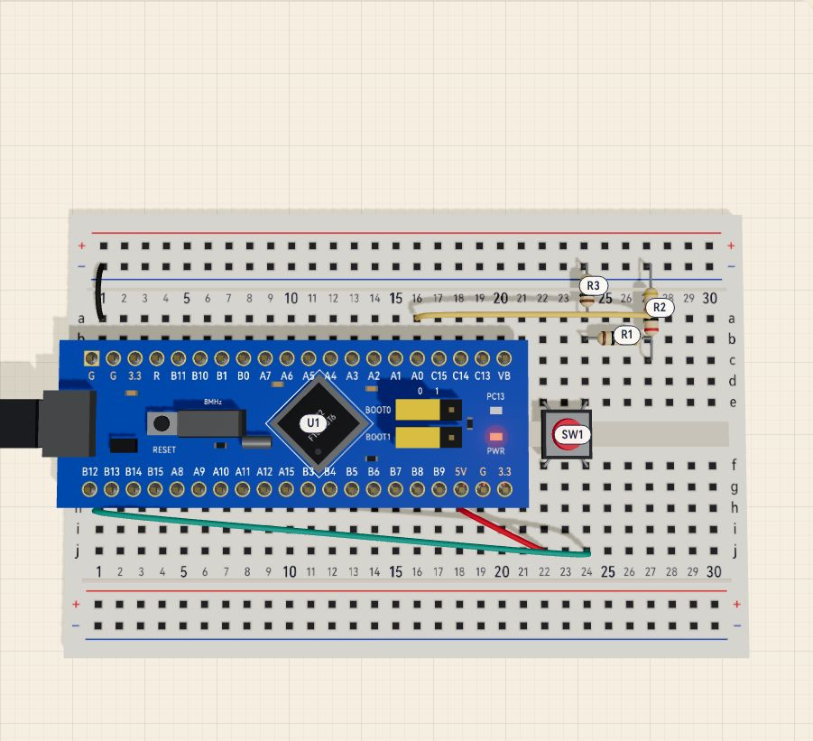
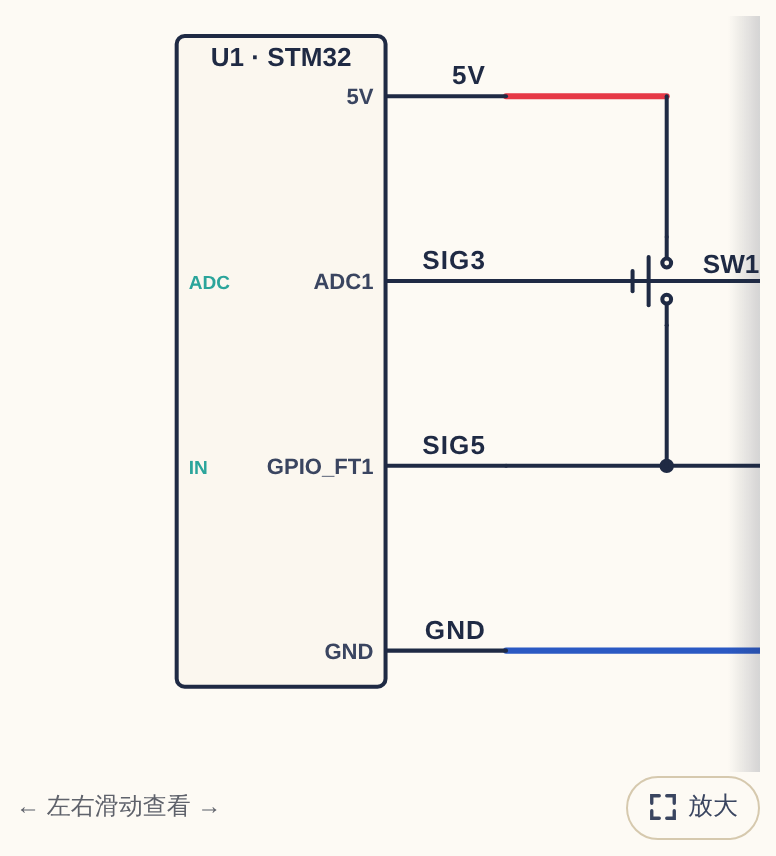
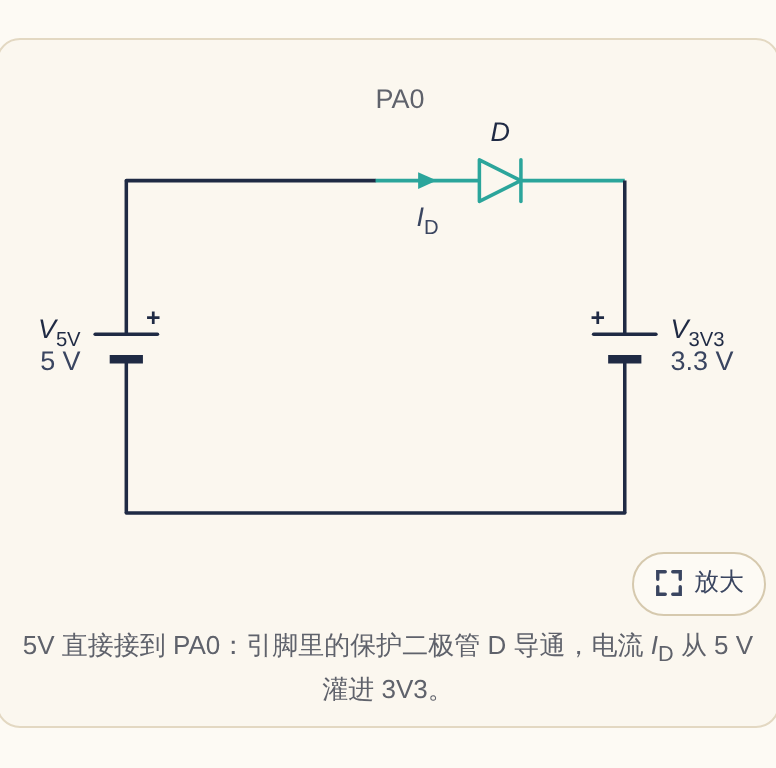
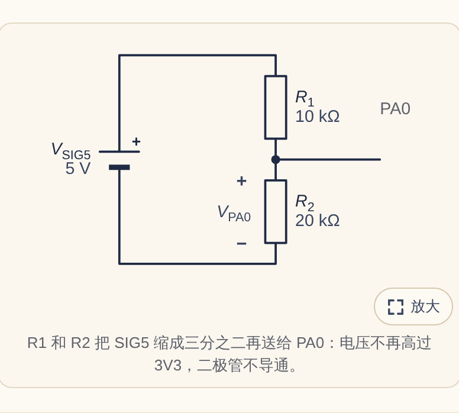

# 8.6 · 5 V 信号进 3.3 V 引脚：分压，或者用耐 5 V 的引脚

| 项目 | 内容 |
|---|---|
| id | `exp5-5v-signal-level-shift` |
| 文件 | `challenges/289-5v-signal-level-shift.json` |
| 类型 | 实验 / 挑战（没有分步，照目标电路图搭） · 难度 3/5 |
| 位置 | World 8 · 数字逻辑、MCU 与传感器实战 → 8.6 3.3 V 和 5 V 对话（本节第 1 项） |
| 右侧面板 | 轨道由旧的四张卡片自动生成（还没手工精排） |
| 前后 | 上一项 [8.5 exp5-board-power-budget](../w8/8.05-2-exp5-board-power-budget.md) · 下一项 [8.6 exp5-open-drain-level-shifter](../w8/8.06-2-exp5-open-drain-level-shifter.md) |
| 先修 | lesson-mcu-gpio |
| 概念 | 5 V 耐受 5 V-tolerant (FT) pin、分压电平转换 divider level shifting、保护二极管 / 钳位电流 clamp diode current、VIH 输入高电平阈值、下拉电阻 pull-down |

**一句话概要**：一个按键模拟 5 V 传感器的输出。起始电路把 5 V 直接接到了不耐 5 V 的 PA0。拆掉它，改用分压接 PA0，再直接接一个耐 5 V 的 FT 引脚。

## 1. 左侧工作台（3D 面包板 → 2D 俯视截图）

截图是程序里真实的 3D 面包板换成俯视角拍的；表格是同一块板的文字版（元件、参数、每只脚插在哪个孔）。

### 1.1 起点：打开这一课时板上已经有的

右侧显示的「起点」说明：

> **找错**：按键已经按下，5 V 信号经一根跳线**直接**接在不耐 5 V 的 PA0 上——诊断会报引脚烧坏。**为什么**：先看清“5 V 进 3.3 V 引脚”的后果。**你要做**：拆掉这根线，加上 R1（10kΩ）和 R2（20kΩ）分压，把分压点接到 PA0。

| 元件 | 类型 | 参数 | 引脚 → 孔 |
|---|---|---|---|
| U1 | stm32_bluepill | usb=true, pins={"PA0":{"mode":"input"},"PB12":{"mode":"input"}} | GND→c1 GND_2→c2 3V3→c3 NRST→c4 PB11→c5 PB10→c6 PB1→c7 PB0→c8 PA7→c9 PA6→c10 PA5→c11 PA4→c12 PA3→c13 PA2→c14 PA1→c15 PA0→c16 PC15→c17 PC14→c18 PC13→c19 VBAT→c20 PB12→g1 PB13→g2 PB14→g3 PB15→g4 PA8→g5 PA9→g6 PA10→g7 PA11→g8 PA12→g9 PA15→g10 PB3→g11 PB4→g12 PB5→g13 PB6→g14 PB7→g15 PB8→g16 PB9→g17 5V→g18 GND_3→g19 3V3_2→g20 |
| W2 | wire |  | a→a1 b→tn1 |
| W3 | wire |  | a→h18 b→j22 |
| SW1 | pushbutton | pressed=true | 1a→e22 2a→e24 1b→f22 2b→f24 |
| R3 | resistor | resistance=10000 | 1→a24 2→tn24 |
| W6 | wire |  | a→a16 b→c24 |
| W7 | wire |  | a→h1 b→j24 |

### 1.3 参考答案（「看答案」载入的板子）

| 元件 | 类型 | 参数 | 引脚 → 孔 |
|---|---|---|---|
| U1 | stm32_bluepill | usb=true, pins={"PA0":{"mode":"input"},"PB12":{"mode":"input"}} | GND→c1 GND_2→c2 3V3→c3 NRST→c4 PB11→c5 PB10→c6 PB1→c7 PB0→c8 PA7→c9 PA6→c10 PA5→c11 PA4→c12 PA3→c13 PA2→c14 PA1→c15 PA0→c16 PC15→c17 PC14→c18 PC13→c19 VBAT→c20 PB12→g1 PB13→g2 PB14→g3 PB15→g4 PA8→g5 PA9→g6 PA10→g7 PA11→g8 PA12→g9 PA15→g10 PB3→g11 PB4→g12 PB5→g13 PB6→g14 PB7→g15 PB8→g16 PB9→g17 5V→g18 GND_3→g19 3V3_2→g20 |
| W2 | wire |  | a→a1 b→tn1 |
| W3 | wire |  | a→h18 b→j22 |
| SW1 | pushbutton | pressed=false | 1a→e22 2a→e24 1b→f22 2b→f24 |
| R3 | resistor | resistance=10000 | 1→a24 2→tn24 |
| R1 | resistor | resistance=10000 | 1→b24 2→b27 |
| R2 | resistor | resistance=20000 | 1→c27 2→tn27 |
| W8 | wire |  | a→a16 b→a27 |
| W9 | wire |  | a→h1 b→j24 |

### 1.4 目标原理图（右侧「目标原理图」抽屉）

| 元件 | 类型 | 参数 |
|---|---|---|
| U1 | stm32_bluepill |  |
| SW1 | pushbutton |  |
| R3 | resistor | resistance=10000 |
| R1 | resistor | resistance=10000 |
| R2 | resistor | resistance=20000 |

连接（每个结点上的引脚）：

- **5V**：U1.5V、SW1.1
- **SIG5**：SW1.2、R3.1、R1.1、U1.GPIO_FT1
- **SIG3**：R1.2、R2.1、U1.ADC1
- **GND**：R3.2、R2.2、U1.GND

## 2. 右侧面板：学生从上往下看到的内容（单轨流）

### 第 1 步 · 🔧 动手搭：5 V 直接进 PA0

起始电路里，一个**按键**在扮演“5 V 传感器”：按下时，它把开发板的 **5V** 脚接到信号线上。按键现在是按下的。
信号线**直接**插在 **PA0** 上。PA0 是一个普通的 3.3 V 引脚。
看右边的**「诊断」**：PA0 怎么了？电流是从哪条路跑走的？

### 第 2 步 · 💡 想明白：引脚里藏着一只二极管

- 普通引脚里面有一只**保护二极管**，从引脚通向 3V3。引脚电压一比 3V3 高出一个二极管压降，它就导通——就是 5.1 里那只单向阀。

*图 `clamp`（schematic）：5V 直接接到 PA0：引脚里的保护二极管 D 导通，电流 I_D 从 5 V 灌进 3V3。*

- 5 V 和 3V3 之间只隔着这只二极管，电流大得吓人。引脚会烧坏，3V3 电源也被“倒灌”抬高。
- 办法一：**分压**。两个电阻把 5 V 缩成三分之二：
$$V_{PA0} = V_{SIG5} × \frac{R_2}{R_1 + R_2}$$

*图 `divider`（schematic）：R1 和 R2 把 SIG5 缩成三分之二再送给 PA0：电压不再高过 3V3，二极管不导通。*

- 代入整 5 V：$5 × \frac{20}{10 + 20} ≈ 3.33$ V，正好落在 3.3 V 附近。开发板的 5V 脚其实还要低一点，所以更安全。
- 办法二：Blue Pill 的 **FT 引脚**（5.2 的 Blue Pill 课讲过）。它们里面**没有**通往 3V3 的那只二极管，5 V 信号可以直接接。

（这一步下面列着这节课的计算卡片，点开就地展开：`pullup-current`、`clamp-current`、`adc-code`、`usb-5v-pin`，全文见第 6 节）

### 第 3 步 · 🔧 动手搭：两条安全的路

- 先**拆掉** SIG5 到 PA0 的那根线。
- **分压**：SIG5 → **`10 kΩ`** → PA0 那一列 → **`20 kΩ`** → GND。
- **直接接**：SIG5 再用一根线接到一个 **FT 引脚**（下排，例如 **PB12**）。
- 点**「检查我的电路」**。通过后按住按键，量两个引脚的电压，再算分压比。

### 第 4 步 · 📏 测一测：测一测：读你自己的仪表

**测量题 1 · `v3`**（读数题）

> 按下按键：万用表测分压后的 SIG3（PA0）对 GND

- 单位 V · 先写预测 · 状态：按下 SW1、U1 ADC1 设为输入（浮空）、U1 GPIO_FT1 设为输入（浮空） · 参考答案的读数 **3.126 V** · 合理范围 [2.97, 3.28]

答对后显示：

> 4.69 × 20k / 30k ≈ 3.13 V：高于 VIH（2.15 V），读到 1，又不超过 3.3 V。

**测量题 2 · `v5`**（读数题）

> 同一状态：FT 引脚（PB12）对 GND

- 单位 V · 先写预测 · 状态：按下 SW1、U1 ADC1 设为输入（浮空）、U1 GPIO_FT1 设为输入（浮空） · 参考答案的读数 **4.69 V** · 合理范围 [4.46, 4.92]

答对后显示：

> 5V 脚经 USB 二极管约 4.69 V，直接加在 FT 引脚上：它没有接到 3V3 的保护二极管，所以没有电流流进去。

**测量题 3 · `k`**（计算题（用自己的读数算））

> 用你的两个读数算分压比 SIG3 / SIG5

- 先写预测 · 参考答案的读数 **0.6667** · 合理范围 [0.633, 0.7] · 公式 `v3 / v5`

答对后显示：

> R2 / (R1 + R2) = 20 / 30 ≈ 0.667。5 V 信号乘 2/3 正好落在 3.3 V 以内。

**测量题 4 · `pu`**（选择题）

> 5 V 信号接在 FT 引脚上时，能不能顺手打开它的内部上拉？（可以在引脚表里改成“输入 + 上拉”试试）

- A. 不行：上拉接在 3.3 V，5 V 会经它倒灌进 3V3（约 35 µA） ✅（正确）
- B. 可以：FT 引脚什么模式都耐 5 V
- C. 可以：上拉让高电平更可靠

答对后显示：

> (4.69 − 3.3) / 40 kΩ ≈ 35 µA 从引脚流进去。FT 引脚的另一个例外是模拟模式（ADC）：那时它也不耐 5 V。

### 第 5 步 · 🎒 带走：带走

- **5 V 不能直接碰不耐 5 V 的引脚**：引脚里的保护二极管会把它接到 3V3 上。
- 分压只适合**单向、慢速**的信号。几十 kΩ 的电阻和引脚电容会让边沿变缓；快信号用电平转换芯片。
- FT 引脚有两个例外：当 **ADC** 用时不耐 5 V；接 5 V 信号时**不要打开内部上拉**，否则电流会从上拉电阻倒灌进 3V3。
- 真实项目里的坑：**ESP32 没有任何耐 5 V 的引脚**，5 V 传感器（比如超声波模块的回波脚）一定要分压。

趁热练理论题：`nonlinear`

## 3. 测量题一览

| # | id | 题目 | 类型 | 单位 | 状态 | 参考读数 |
|---|---|---|---|---|---|---|
| 1 | v3 | 按下按键：万用表测分压后的 SIG3（PA0）对 GND | voltage | V | 按下 SW1、U1 ADC1 设为输入（浮空）、U1 GPIO_FT1 设为输入（浮空） | 3.126 V |
| 2 | v5 | 同一状态：FT 引脚（PB12）对 GND | voltage | V | 按下 SW1、U1 ADC1 设为输入（浮空）、U1 GPIO_FT1 设为输入（浮空） | 4.69 V |
| 3 | k | 用你的两个读数算分压比 SIG3 / SIG5 | formula |  |  | 0.6667 |
| 4 | pu | 5 V 信号接在 FT 引脚上时，能不能顺手打开它的内部上拉？（可以在引脚表里改成“输入 + 上拉”试试） | 选择 |  |  | 正确：A |

### 全部答完后显示的「对比」

**对比**（仿真）：
- 分压：V(SIG3) = 4.69 × 20k/(10k + 20k) = **3.13 V**，高于 VIH，读到 1；ADC 读数 **3879**（3.13 V）。
- FT 引脚：PB12 = **4.69 V**，读到 1，没有电流流进引脚。
- 松开：下拉把两路都拉到 0 V，读到 0。
- 起始电路：5 V 直接进 PA0，引脚内部到 3V3 的**保护二极管**导通。电源内阻很小，二极管电流 **52 mA**（STM32 允许的注入电流只有约 5 mA），而且这股电流把整个 3V3 电源轨“倒灌”抬高。

**为什么 FT 引脚可以**：FT 引脚上面**没有**接到 VDD 的保护二极管（换成了别的保护结构），所以输入可以到 VDD + 4 V（数据手册写 5.5 V 以内）。但有两个例外：
- **模拟模式（ADC）下不耐 5 V**——FT 引脚当 ADC 用时，5 V 照样会损坏它。STM32F103 的 ADC 引脚本来就全是非 FT 的。
- **打开内部上拉时**：上拉电阻接在 3.3 V 上，5 V 会通过它往 3V3 倒灌。仿真：PB12 设成输入 + 上拉时，有 **35 µA** 从引脚流进去（(4.69 − 3.3)/40 kΩ）。数据手册也规定 FT 引脚在 5 V 时不要使能上拉 / 下拉。

### 提示按钮（依次显示）

1. 起始电路：先拆掉 SIG5 到 PA0 的那根线——5 V 绝不能直接碰不耐 5 V 的引脚。
2. 分压：SIG5 → 10 kΩ → PA0 那一列 → 20 kΩ → GND，正好把 5 V 缩到三分之二。
3. FT 引脚在下排（PB12–PB15、PA8–PA12、PA15、PB3、PB4、PB6–PB9），把 SIG5 直接接过去。

### 功能测试（「检查我的电路」时跑）

- 松开：两个引脚都读到低电平（下拉起作用）
- 按下：两路都读到高，没有电流流进 FT 引脚
- 按下、PA0 设为 ADC：没有到满量程
- 按下、FT 引脚打开内部上拉：电流倒灌进引脚——5 V 输入的 FT 脚不要开上拉

## 5. 这一课的计算卡片

**计算卡片 `pullup-current`：上拉 / 下拉电阻的电流**

- 公式 `I = \frac{V}{R_{pull}}`
- 用途：按键按下（或开漏输出拉低）时，上拉 / 下拉电阻上流多少电流。
- 输入：V（电阻两端的电压，V）；R（上拉 / 下拉电阻（ESP32 内部 ≈ 45 kΩ），Ω） → I（按下时的电流，A）

1. CMOS 输入几乎不取电流（> 10 MΩ）：松开时上拉电阻上没有电流、没有压降，引脚就在 3.3 V（读 1）。
2. 按下时按键把引脚接到 GND（≈ 0 Ω 远小于 R），电阻两端是整个电源电压：$I = \frac{V}{R}$，引脚读 0。
3. 太小（比如 220 Ω）：按下时白白耗 15 mA；太大（1 MΩ）：抗干扰差、长线容易误触发。按键常用 4.7–10 kΩ。
4. 开漏输出拉低时同理：$I = \frac{V_{pull}}{R + R_{low}}$，引脚低电平 $V_{OL} = IR_{low}$。

例子：- 第 15 课、实验 5-3：内部上拉 $\frac{3.3}{45k} ≈ 73 µA$；外部 10 kΩ 下拉 $\frac{3.3}{10k} = 0.33 mA$。
- 实验 5-11：5 V 上拉 4.7 kΩ，开漏拉低：$\frac{4.69}{4.7k} ≈ 0.99 mA$，$V_{OL} = 40 × 0.99 mA ≈ 40 mV$。
- 实验 5-10：5 V 信号进 FT 引脚又开了内部上拉：$\frac{4.69 - 3.3}{40k} ≈ 35 µA$ 倒灌进 3V3。
- 实验 5-16：2.2 kΩ 的 I²C 线拉低：$\frac{3.3}{2.2k + 40} ≈ 1.47 mA$。

- ⚠ ESP32 的 GPIO34–39 没有内部上下拉：设成“输入 + 上拉”也是悬空。
- ⚠ 5 V 信号的 FT 引脚不要开内部上拉。

**计算卡片 `clamp-current`：钳位二极管的注入电流（5 V 进 3.3 V 引脚）**

- 公式 `I = \frac{V_{in} - V_{DD} - V_F}{R_s + r_d}`
- 用途：高于 VDD 的信号接到普通（非 FT）引脚：经内部钳位二极管灌进 3V3 的电流有多大。
- 输入：V_in（输入信号（5V 引脚经 USB 二极管后 ≈ 4.69 V），V）；V_DD（芯片电源，V）；V_F（钳位二极管压降，V）；R_s（串联电阻（直接接就填 0），Ω）；r_d（二极管内阻（模型 15 Ω），Ω） → I（注入电流，A）

1. 普通引脚里有一只二极管从引脚接到 VDD（防静电）。引脚电压超过 $V_{DD} + V_F$ 它就导通。
2. 电流路径：信号 → 串联电阻 → 钳位二极管 → 3V3 电源轨。KVL 给出上面的公式。
3. 没有串联电阻时只剩二极管内阻限流：几十 mA，远超数据手册允许的约 5 mA，还会把 3V3 “反向供电”。
4. 办法：分压到 3.3 V 以下，或者串一个大电阻把电流限到 µA 级，或者用 **FT（耐 5 V）引脚**——它没有到 VDD 的二极管。

例子：实验 5-10 初始电路：$\frac{4.69 - 3.3 - 0.6}{15} ≈ 53 mA$（诊断报 52 mA），PA0 损坏。实验 5-11：4.7 kΩ 上拉开漏到 PA0：$\frac{0.79}{4715} ≈ 0.17 mA$，引脚被钳在约 3.9 V，输出不到 5 V。

- ⚠ ESP32 没有任何耐 5 V 的引脚。
- ⚠ FT 引脚在模拟（ADC）模式下也不耐 5 V。

**计算卡片 `adc-code`：ADC 读数 raw = V/Vref × 4095**

- 公式 `raw = \frac{V}{V_{ref}} × (2^{N} - 1)`
- 用途：一个电压在 N 位 ADC 上读出多少（0 … 4095）。
- 输入：V（ADC 引脚电压，V）；V_ref（满量程（参考电压），V）；N（位数，） → raw（读数，）

1. N 位 ADC 把 0 … $V_{ref}$ 分成 $2^{N}$ 个台阶：12 位就是 4096 个，读数 0 … 4095。
2. 线性换算：$raw = \frac{V}{V_{ref}} × 4095$，四舍五入成整数。
3. 一个 LSB（最低位）= $\frac{V_{ref}}{4095} ≈ 0.81 mV$：这是分辨率。
4. 固件反过来：$V = raw × \frac{V_{ref}}{4095}$。
5. 引脚电压超过 $V_{ref}$ 读数就停在 4095；超过 3.3 V（加二极管压降）引脚会坏——先分压。

例子：第 16 课：1.65 V → 2048。实验 5-4：8.4 V 电池分压后 2.084 V → 2586。实验 5-6：25 °C 1.649 V → 2046，80 °C 0.372 V → 461。实验 5-10：3.13 V → 3879。

- ⚠ ESP32 的 ADC 在 0.15 V 以下和 2.45 V 以上不线性，要校准；用 ADC1（GPIO32–39），ADC2 开 Wi-Fi 时不能用。

**计算卡片 `usb-5v-pin`：开发板 5V 引脚的电压**

- 公式 `V_{5V} = V_{USB} - V_D - I R_s`
- 用途：USB 5 V 经线缆 / 保险丝和肖特基二极管到 5V 引脚：带载时掉到多少。
- 输入：V_USB（USB 电压，V）；V_D（肖特基二极管压降，V）；I（从 USB 取的总电流，A）；R_s（线缆 + 保险丝 + 二极管电阻（模型 0.25 + 0.15 Ω），Ω） → V_5V（5V 引脚电压，V）

1. 电源路径：USB 5 V →（线缆 + 自恢复保险丝 ≈ 0.25 Ω）→ 肖特基二极管（≈ 0.3 V + 0.15 Ω）→ **5V 引脚** → 板载 LDO → 3V3。
2. KVL：$V_{5V} = V_{USB} - V_D - IR_s$，空载约 4.7 V，电流越大越低。
3. 5V 引脚给 LDO 供电：它至少要比 3.3 V 高出 LDO 的压差（AMS1117 ≈ 1.1 V），否则 3V3 也会掉。
4. 电脑 USB 2.0 口只保证 500 mA。

例子：只有芯片和 LED（≈ 56 mA）：$5 - 0.3 - 0.056 × 0.4 ≈ 4.68 V$。实验 5-13：总 0.48 A → 4.51 V。实验 5-17：0.415 A → 4.53 V，仍高于 AMS1117 要的 4.4 V。

- ⚠ “5V 引脚”不是 5.0 V：需要精确 5 V 的模块要单独供电。

## 6. English（界面英文版的同一份内容）

展开英文

### Node 1 · 🔧 Build：5 V straight into PA0

In the starting circuit a **pushbutton** plays a "5 V sensor": pressed, it connects the board's **5V** pin to the signal line. The button is pressed right now.
The signal line goes **straight** into **PA0**, an ordinary 3.3 V pin.
Look at the **diagnostics** on the right: what happened to PA0? Which way is the current escaping?

### Node 2 · 💡 Why：A diode hidden inside the pin

- An ordinary pin has a **protection diode** inside, from the pin to 3V3. As soon as the pin is one diode drop above 3V3, it conducts — the one-way valve from 5.1.

[figure `clamp`]

*Figure `clamp`（schematic）：5V 直接接到 PA0：引脚里的保护二极管 D 导通，电流 I_D 从 5 V 灌进 3V3。*

- Only that diode sits between 5 V and 3V3, so the current is frightening. The pin is destroyed, and the 3V3 supply is pushed up from behind.
- Fix one: a **divider**. Two resistors shrink 5 V to two thirds:
$$V_{PA0} = V_{SIG5} × \frac{R_2}{R_1 + R_2}$$

[figure `divider`]

*Figure `divider`（schematic）：R1 和 R2 把 SIG5 缩成三分之二再送给 PA0：电压不再高过 3V3，二极管不导通。*

- With a round 5 V: $5 × \frac{20}{10 + 20} ≈ 3.33$ V, right around 3.3 V. The board's 5V pin is actually a little lower, which makes it safer still.
- Fix two: the Blue Pill's **FT pins** (from the Blue Pill lesson in 5.2). They have **no** diode to 3V3 inside, so a 5 V signal can go straight in.

(This node lists the lesson’s calculation cards: `pullup-current`、`clamp-current`、`adc-code`、`usb-5v-pin`; full text in section 6)

### Node 3 · 🔧 Build：Two safe paths

- First **remove** the wire from SIG5 to PA0.
- **Divider**: SIG5 → **`10 kΩ`** → PA0's column → **`20 kΩ`** → GND.
- **Direct**: one more wire from SIG5 to an **FT pin** (bottom row, for example **PB12**).
- Press **Check my circuit**. Once it passes, hold the button down, measure both pins' voltages, and work out the divider ratio.

### Node 4 · 📏 Measure：Measure: read your own instruments

**Question 1 · `v3`**（reading）

> Button pressed: multimeter on the divided SIG3 (PA0) to GND

- unit V · predict first · state：SW1 is pressed and U1 ADC1 is input (floating) and U1 GPIO_FT1 is input (floating) · range [2.97, 3.28]

Shown once right:

> 4.69 × 20k / 30k ≈ 3.13 V: above VIH (2.15 V), so it reads 1, and below 3.3 V.

**Question 2 · `v5`**（reading）

> Same state: the FT pin (PB12) to GND

- unit V · predict first · state：SW1 is pressed and U1 ADC1 is input (floating) and U1 GPIO_FT1 is input (floating) · range [4.46, 4.92]

Shown once right:

> The 5V pin is about 4.69 V after the USB diode and sits straight on the FT pin: with no clamp diode to 3V3, no current flows in.

**Question 3 · `k`**（calculation from own readings）

> From your two readings, the divider ratio SIG3 / SIG5

- predict first · range [0.633, 0.7] · formula `v3 / v5`

Shown once right:

> R2 / (R1 + R2) = 20 / 30 ≈ 0.667. Two thirds of a 5 V signal lands just inside 3.3 V.

**Question 4 · `pu`**（multiple choice）

> With a 5 V signal on an FT pin, may you also turn its internal pull-up on? (Try "input + pull-up" in the pin table.)

- A. no: the pull-up goes to 3.3 V, so 5 V feeds back through it into 3V3 (about 35 µA) ✅ (right)
- B. yes: an FT pin tolerates 5 V in every mode
- C. yes: a pull-up makes the HIGH more reliable

Shown once right:

> (4.69 − 3.3) / 40 kΩ ≈ 35 µA flows into the pin. The other exception for FT pins is analog (ADC) mode: then they are not 5 V tolerant either.

### Node 5 · 🎒 Take away：Take away

- **5 V must never touch a pin that is not 5 V-tolerant**: the pin's protection diode connects it to 3V3.
- A divider only suits **one-way, slow** signals. Tens of kΩ together with the pin's capacitance slow the edges down; fast signals need a level-shifter chip.
- FT pins have two exceptions: used as an **ADC** input they are not 5 V-tolerant, and with a 5 V signal on them **don't turn on the internal pull-up**, or current flows back through it into 3V3.
- A real-world catch: **the ESP32 has no 5 V-tolerant pins at all**, so a 5 V sensor (an ultrasonic module's echo pin, say) always needs a divider.

Practise：`nonlinear`

**Compare**

**Compare** (simulated):
- Divider: V(SIG3) = 4.69 × 20k/(10k + 20k) = **3.13 V**, above VIH, so it reads 1; the ADC reads **3879** (3.13 V).
- FT pin: PB12 = **4.69 V**, reads 1, and no current flows into the pin.
- Released: the pull-down takes both paths to 0 V and they read 0.
- Starting board: 5 V straight into PA0 forward-biases the pin's internal **clamp diode** to 3V3. With almost no source resistance the diode carries **52 mA** (the STM32 allows only about 5 mA of injected current), and that current back-powers the whole 3V3 rail.

**Why an FT pin copes**: an FT pin has **no** clamp diode to VDD (it uses a different protection structure), so its input may go to VDD + 4 V (5.5 V max in the datasheet). Two exceptions:
- **Not 5 V tolerant in analog (ADC) mode** — used as an ADC input, an FT pin is damaged by 5 V like any other. On the STM32F103 the ADC pins are all non-FT anyway.
- **With the internal pull-up enabled**: the pull-up goes to 3.3 V, so 5 V back-feeds 3V3 through it. Simulated: with PB12 as input + pull-up, **35 µA** flows into the pin ((4.69 − 3.3)/40 kΩ). The datasheet also says not to enable pulls on an FT pin that sees 5 V.

**Hints**

1. Starting circuit: remove the wire from SIG5 to PA0 first — 5 V must never touch a pin that is not 5 V-tolerant.
2. Divider: SIG5 → 10 kΩ → PA0's column → 20 kΩ → GND, which shrinks 5 V to two thirds.
3. The FT pins are on the bottom row (PB12–PB15, PA8–PA12, PA15, PB3, PB4, PB6–PB9): wire SIG5 straight to one of them.

