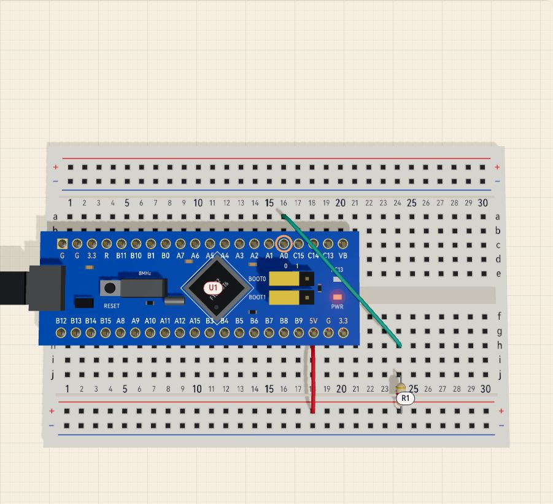
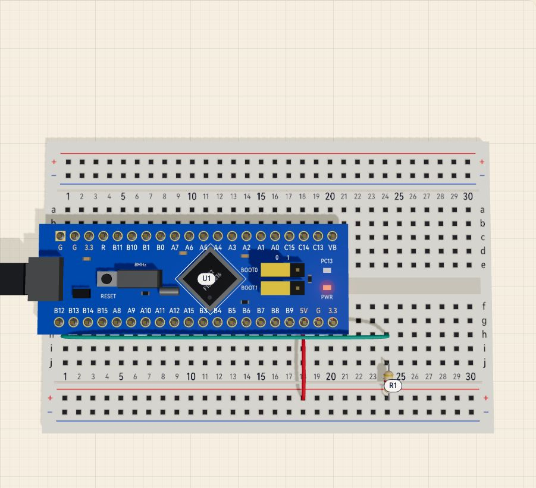
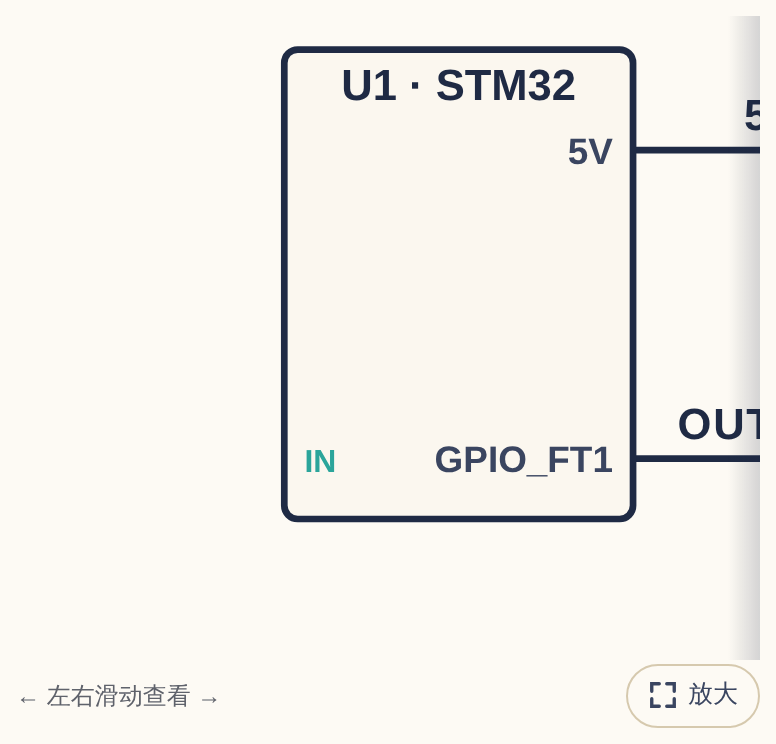
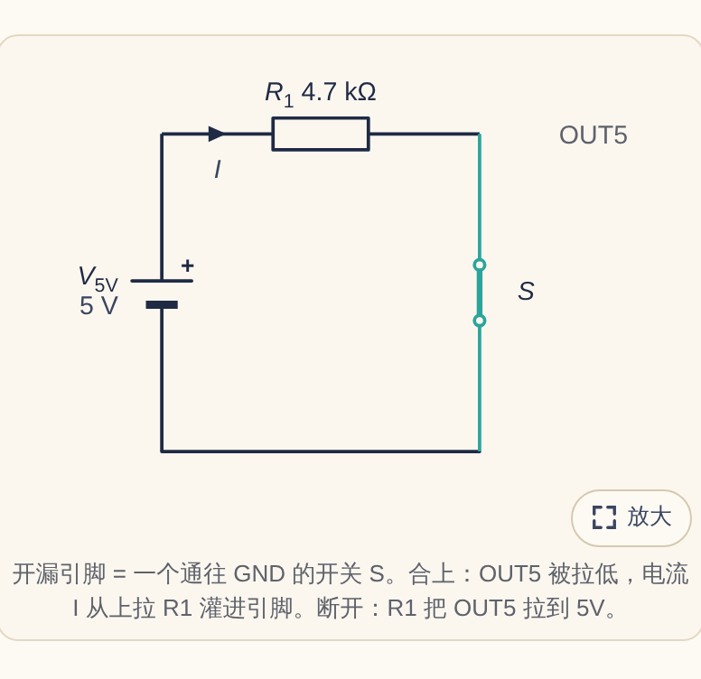

# 8.6 · 开漏输出：3.3 V 单片机送出 5 V 高电平

| 项目 | 内容 |
|---|---|
| id | `exp5-open-drain-level-shifter` |
| 文件 | `challenges/290-open-drain-level-shifter.json` |
| 类型 | 实验 / 挑战（没有分步，照目标电路图搭） · 难度 4/5 |
| 位置 | World 8 · 数字逻辑、MCU 与传感器实战 → 8.6 3.3 V 和 5 V 对话（本节第 2 项） |
| 右侧面板 | 轨道由旧的四张卡片自动生成（还没手工精排） |
| 前后 | 上一项 [8.6 exp5-5v-signal-level-shift](../w8/8.06-1-exp5-5v-signal-level-shift.md) · 下一项 [8.7 lesson-mcu-pwm-adc](../w8/8.07-1-lesson-mcu-pwm-adc.md) |
| 先修 | lesson-mcu-gpio |
| 概念 | 开漏输出 open-drain output、上拉电阻 pull-up resistor、推挽输出 push-pull output、5 V 耐受 FT pin、电平转换 level shifting、I²C 总线 I2C bus |

**一句话概要**：一个耐 5 V 的 FT 引脚设成开漏输出，外接 4.7 kΩ 上拉到 5V。起始电路用的是不耐 5 V 的 PA0。测开漏低、开漏高和推挽高三种情况。

## 1. 左侧工作台（3D 面包板 → 2D 俯视截图）

截图是程序里真实的 3D 面包板换成俯视角拍的；表格是同一块板的文字版（元件、参数、每只脚插在哪个孔）。

### 1.1 起点：打开这一课时板上已经有的

右侧显示的「起点」说明：

> **找错**：5 V 上拉 R1 已经接好，但信号线接在不耐 5 V 的 **PA0** 上。**为什么**：开漏 + 5 V 上拉只能用耐 5 V（FT）的引脚。**你要做**：把信号线改接到 FT 引脚 PB12（h1），并把 PB12 设成开漏输出。

| 元件 | 类型 | 参数 | 引脚 → 孔 |
|---|---|---|---|
| U1 | stm32_bluepill | usb=true, pins={"PA0":{"mode":"out_high","openDrain":true}} | GND→c1 GND_2→c2 3V3→c3 NRST→c4 PB11→c5 PB10→c6 PB1→c7 PB0→c8 PA7→c9 PA6→c10 PA5→c11 PA4→c12 PA3→c13 PA2→c14 PA1→c15 PA0→c16 PC15→c17 PC14→c18 PC13→c19 VBAT→c20 PB12→g1 PB13→g2 PB14→g3 PB15→g4 PA8→g5 PA9→g6 PA10→g7 PA11→g8 PA12→g9 PA15→g10 PB3→g11 PB4→g12 PB5→g13 PB6→g14 PB7→g15 PB8→g16 PB9→g17 5V→g18 GND_3→g19 3V3_2→g20 |
| W2 | wire |  | a→h18 b→bp18 |
| R1 | resistor | resistance=4700 | 1→bp24 2→j24 |
| W4 | wire |  | a→a16 b→h24 |

### 1.3 参考答案（「看答案」载入的板子）

| 元件 | 类型 | 参数 | 引脚 → 孔 |
|---|---|---|---|
| U1 | stm32_bluepill | usb=true, pins={"PB12":{"mode":"out_high","openDrain":true}} | GND→c1 GND_2→c2 3V3→c3 NRST→c4 PB11→c5 PB10→c6 PB1→c7 PB0→c8 PA7→c9 PA6→c10 PA5→c11 PA4→c12 PA3→c13 PA2→c14 PA1→c15 PA0→c16 PC15→c17 PC14→c18 PC13→c19 VBAT→c20 PB12→g1 PB13→g2 PB14→g3 PB15→g4 PA8→g5 PA9→g6 PA10→g7 PA11→g8 PA12→g9 PA15→g10 PB3→g11 PB4→g12 PB5→g13 PB6→g14 PB7→g15 PB8→g16 PB9→g17 5V→g18 GND_3→g19 3V3_2→g20 |
| W2 | wire |  | a→h18 b→bp18 |
| R1 | resistor | resistance=4700 | 1→bp24 2→j24 |
| W4 | wire |  | a→h1 b→h24 |

### 1.4 目标原理图（右侧「目标原理图」抽屉）

| 元件 | 类型 | 参数 |
|---|---|---|
| U1 | stm32_bluepill |  |
| R1 | resistor | resistance=4700 |

连接（每个结点上的引脚）：

- **5V**：U1.5V、R1.1
- **OUT5**：R1.2、U1.GPIO_FT1

## 2. 右侧面板：学生从上往下看到的内容（单轨流）

### 第 1 步 · 🔧 动手搭：PA0 想送出 5 V

起始电路：**`4.7 kΩ`** 的电阻 R1 从开发板 **5V** 脚接到信号线 OUT5，OUT5 接在 **PA0** 上。
单击开发板，看引脚表：PA0 设成了**「输出 高」**，并勾选了**「开漏」**。
看右边的**「诊断」**：OUT5 到了 5 V 吗？想一想上一个实验里，藏在普通引脚里的那只二极管。

### 第 2 步 · 💡 想明白：开漏：只会拉低，不会推高

- 普通的**推挽**输出里有两个开关：上面一个接 3.3 V，下面一个接 GND。**开漏**输出拆掉了上面那个，只剩一个通往 GND 的开关。

*图 `od`（schematic）：开漏引脚 = 一个通往 GND 的开关 S。合上：OUT5 被拉低，电流 I 从上拉 R1 灌进引脚。断开：R1 把 OUT5 拉到 5V。*

- **输出低**：开关合上，OUT5 接地，电流从上拉电阻灌进引脚。**输出高**：开关断开，引脚“松手”，上拉电阻把线拉到它接的电压——这里是 5 V。
- 输出低时灌进引脚的电流，就是上拉电阻上的电流：
$$I = \frac{V_{5V}}{R_1}$$
- 代入整 5 V：$I = \frac{5}{4700} ≈ 0.0011$ A，引脚轻松吃得下。
- 松手时引脚上真的是 5 V，所以它必须**耐 5 V**。PA0 不行：它的保护二极管把线钳在 3V3 上面一点点。要用 FT 引脚。

（这一步下面列着这节课的计算卡片，点开就地展开：`pullup-current`、`clamp-current`、`i2c-rise-time`，全文见第 6 节）

### 第 3 步 · 🔧 动手搭：换到 FT 引脚

- 把 OUT5 的信号线从 PA0 挪到一个 **FT 引脚**（下排，例如 **PB12**）。
- 在引脚表里把它设成**「输出 高」**，勾选**「开漏」**。
- 点**「检查我的电路」**。通过后，按测量题依次换成开漏低、开漏高、推挽高，量 OUT5 的电压和 R1 的电流。
- 先预测：推挽输出高时，上拉电阻里的电流往哪边流？

### 第 4 步 · 📏 测一测：测一测：读你自己的仪表

**测量题 1 · `vl`**（读数题）

> 开漏输出低：OUT5 对 GND 的电压

- 单位 mV · 先写预测 · 状态：U1 GPIO_FT1 设为输出低电平 · 参考答案的读数 **39.57 mV** · 合理范围 [0.0376, 0.0416]

答对后显示：

> N 管约 40 Ω：40 Ω × 0.99 mA ≈ 40 mV。

**测量题 2 · `il`**（读数题）

> 开漏输出低：上拉 R1 的电流（也就是引脚灌进的电流）

- 单位 mA · 先写预测 · 状态：U1 GPIO_FT1 设为输出低电平 · 参考答案的读数 **0.9893 mA** · 合理范围 [0.00094, 0.00104]

答对后显示：

> 4.69 V / 4.7 kΩ ≈ 0.99 mA。上拉越小上升沿越快，但输出低时灌电流越大。

**测量题 3 · `vh`**（读数题）

> 开漏输出高（引脚松开）：OUT5 对 GND

- 单位 V · 先写预测 · 状态：U1 GPIO_FT1 设为输出高电平 · 参考答案的读数 **4.69 V** · 合理范围 [4.46, 4.92]

答对后显示：

> 引脚不再拉，R1 里没有电流，OUT5 等于 5V 脚的 4.69 V——FT 引脚没有接 3V3 的保护二极管，所以不会被钳住。

**测量题 4 · `vpp`**（读数题）

> 改成推挽输出高：OUT5 对 GND

- 单位 V · 先写预测 · 状态：U1 GPIO_FT1 设为输出高电平 · 参考答案的读数 **3.311 V** · 合理范围 [3.15, 3.48]

答对后显示：

> 上管把 OUT5 拉在约 3.3 V，低于 5 V CMOS 的 VIH ≈ 3.5 V：不一定能被认作高电平。

**测量题 5 · `ipp`**（读数题）

> 同一状态：R1 的电流（从 5V 脚流向引脚）

- 单位 mA · 先写预测 · 状态：U1 GPIO_FT1 设为输出高电平 · 参考答案的读数 **0.2934 mA** · 合理范围 [0.000279, 0.000308]

答对后显示：

> (4.69 − 3.31) / 4.7 kΩ ≈ 0.29 mA 从 5 V 倒流进引脚、再灌进 3V3：推挽和 5 V 上拉在打架。

### 第 5 步 · 🎒 带走：带走

- **开漏输出只会拉低**；“高”由上拉电阻决定，上拉到几伏就是几伏。所以它能做电平转换，前提是引脚耐得住那个电压。
- 上拉电阻常用 **1–10 kΩ**：越小边沿越快，但输出低时灌电流越大。
- **I²C 就是开漏总线**：几个芯片可以共用一根线而不打架。Blue Pill 的 I²C 引脚是 FT，可以上拉到 5 V。
- 真实电路里的坑：ESP32 没有耐 5 V 的引脚，开漏上拉到 5 V 同样会倒灌。要用 BSS138 一类的电平转换模块。FT 引脚接 5 V 上拉时，也**不要**再打开内部上拉。

趁热练理论题：`nonlinear`

## 3. 测量题一览

| # | id | 题目 | 类型 | 单位 | 状态 | 参考读数 |
|---|---|---|---|---|---|---|
| 1 | vl | 开漏输出低：OUT5 对 GND 的电压 | voltage | mV | U1 GPIO_FT1 设为输出低电平 | 39.57 mV |
| 2 | il | 开漏输出低：上拉 R1 的电流（也就是引脚灌进的电流） | current | mA | U1 GPIO_FT1 设为输出低电平 | 0.9893 mA |
| 3 | vh | 开漏输出高（引脚松开）：OUT5 对 GND | voltage | V | U1 GPIO_FT1 设为输出高电平 | 4.69 V |
| 4 | vpp | 改成推挽输出高：OUT5 对 GND | voltage | V | U1 GPIO_FT1 设为输出高电平 | 3.311 V |
| 5 | ipp | 同一状态：R1 的电流（从 5V 脚流向引脚） | current | mA | U1 GPIO_FT1 设为输出高电平 | 0.2934 mA |

### 全部答完后显示的「对比」

**对比**（仿真）：
- 开漏低：V = **0.04 V**，灌入 **0.99 mA**（= 4.69 V / 4.7 kΩ）。
- 开漏高：V = **4.69 V**（5V 脚），引脚电流 0。
- 推挽高：只有 **3.31 V**，还会有 **0.29 mA** 从 5 V 经上拉倒流进引脚。5 V CMOS 输入的 VIH ≈ **3.5 V**，3.3 V 不一定能被认作高电平。

**为什么必须是 FT 引脚**：开漏“高”时引脚上是 5 V。普通引脚内部有接 3V3 的保护二极管，会把 OUT5 钳在约 3.9 V（3.3 V + 二极管压降），电流从 5 V 经上拉、二极管灌进 3V3——既输出不了 5 V，又在倒灌电源。FT 引脚没有这个二极管，可以承受 5 V。

### 提示按钮（依次显示）

1. 起始电路：PA0 不耐 5 V。把信号线换到下排的 FT 引脚，例如 PB12。
2. 只要一个电阻：4.7 kΩ 从 5V 脚接到信号结点。
3. 在引脚表里选「输出 高」，并勾选「开漏」。

### 功能测试（「检查我的电路」时跑）

- 开漏输出低：接近 0 V，从上拉灌入电流
- 开漏输出高：引脚松开，上拉拉到 5V 脚的电压，没有电流（FT 引脚，没有保护二极管）
- 换成推挽输出高：只有 3.3 V，电流倒流进引脚

## 5. 这一课的计算卡片

**计算卡片 `pullup-current`：上拉 / 下拉电阻的电流**

- 公式 `I = \frac{V}{R_{pull}}`
- 用途：按键按下（或开漏输出拉低）时，上拉 / 下拉电阻上流多少电流。
- 输入：V（电阻两端的电压，V）；R（上拉 / 下拉电阻（ESP32 内部 ≈ 45 kΩ），Ω） → I（按下时的电流，A）

1. CMOS 输入几乎不取电流（> 10 MΩ）：松开时上拉电阻上没有电流、没有压降，引脚就在 3.3 V（读 1）。
2. 按下时按键把引脚接到 GND（≈ 0 Ω 远小于 R），电阻两端是整个电源电压：$I = \frac{V}{R}$，引脚读 0。
3. 太小（比如 220 Ω）：按下时白白耗 15 mA；太大（1 MΩ）：抗干扰差、长线容易误触发。按键常用 4.7–10 kΩ。
4. 开漏输出拉低时同理：$I = \frac{V_{pull}}{R + R_{low}}$，引脚低电平 $V_{OL} = IR_{low}$。

例子：- 第 15 课、实验 5-3：内部上拉 $\frac{3.3}{45k} ≈ 73 µA$；外部 10 kΩ 下拉 $\frac{3.3}{10k} = 0.33 mA$。
- 实验 5-11：5 V 上拉 4.7 kΩ，开漏拉低：$\frac{4.69}{4.7k} ≈ 0.99 mA$，$V_{OL} = 40 × 0.99 mA ≈ 40 mV$。
- 实验 5-10：5 V 信号进 FT 引脚又开了内部上拉：$\frac{4.69 - 3.3}{40k} ≈ 35 µA$ 倒灌进 3V3。
- 实验 5-16：2.2 kΩ 的 I²C 线拉低：$\frac{3.3}{2.2k + 40} ≈ 1.47 mA$。

- ⚠ ESP32 的 GPIO34–39 没有内部上下拉：设成“输入 + 上拉”也是悬空。
- ⚠ 5 V 信号的 FT 引脚不要开内部上拉。

**计算卡片 `clamp-current`：钳位二极管的注入电流（5 V 进 3.3 V 引脚）**

- 公式 `I = \frac{V_{in} - V_{DD} - V_F}{R_s + r_d}`
- 用途：高于 VDD 的信号接到普通（非 FT）引脚：经内部钳位二极管灌进 3V3 的电流有多大。
- 输入：V_in（输入信号（5V 引脚经 USB 二极管后 ≈ 4.69 V），V）；V_DD（芯片电源，V）；V_F（钳位二极管压降，V）；R_s（串联电阻（直接接就填 0），Ω）；r_d（二极管内阻（模型 15 Ω），Ω） → I（注入电流，A）

1. 普通引脚里有一只二极管从引脚接到 VDD（防静电）。引脚电压超过 $V_{DD} + V_F$ 它就导通。
2. 电流路径：信号 → 串联电阻 → 钳位二极管 → 3V3 电源轨。KVL 给出上面的公式。
3. 没有串联电阻时只剩二极管内阻限流：几十 mA，远超数据手册允许的约 5 mA，还会把 3V3 “反向供电”。
4. 办法：分压到 3.3 V 以下，或者串一个大电阻把电流限到 µA 级，或者用 **FT（耐 5 V）引脚**——它没有到 VDD 的二极管。

例子：实验 5-10 初始电路：$\frac{4.69 - 3.3 - 0.6}{15} ≈ 53 mA$（诊断报 52 mA），PA0 损坏。实验 5-11：4.7 kΩ 上拉开漏到 PA0：$\frac{0.79}{4715} ≈ 0.17 mA$，引脚被钳在约 3.9 V，输出不到 5 V。

- ⚠ ESP32 没有任何耐 5 V 的引脚。
- ⚠ FT 引脚在模拟（ADC）模式下也不耐 5 V。

**计算卡片 `i2c-rise-time`：I²C 上升时间 ≈ 0.8473·R·C**

- 公式 `t_r(30 %→70 %) = R C ln\frac{7}{3} ≈ 0.8473 R C`
- 用途：开漏总线松开后只靠上拉电阻给总线电容充电：规范定义的上升时间是多少。
- 输入：R（上拉电阻，Ω）；C（总线电容（每个器件 ~10 pF，每 10 cm 线 5–10 pF），F） → t_r（30 %→70 % 上升时间，s）

1. 开漏输出只会“拉低”：松开时总线电压按 $V(t) = V_{DD}(1 - e^{-t/RC})$ 充上去。
2. 到 30 % 的时刻 $τ ln\frac{1}{0.7}$，到 70 % 的时刻 $τ ln\frac{1}{0.3}$，相减 $τ ln\frac{7}{3} ≈ 0.8473τ$。
3. 示波器的 rise 量的是 10 %→90 %：$τ ln 9 ≈ 2.197τ$，是 I²C $t_r$ 的约 2.6 倍。
4. 规范：标准模式（100 kHz）$t_r ≤ 1000 ns$，快速模式（400 kHz）$t_r ≤ 300 ns$。
5. 半个周期里还没爬到 $V_{IH}$（STM32 2.15 V、I²C 0.7·$V_DD$），对方读到的永远是 0。

例子：实验 5-16（200 pF）：2.2 kΩ：τ = 440 ns，$t_r ≈ 373 ns$（10–90 % 0.97 µs）——满足标准模式，不满足快速模式。10 kΩ：τ = 2 µs，$t_r ≈ 1.7 µs$，连标准模式都不行；400 kHz 时半周期 1.25 µs 只爬到 $3.3(1 - e^{-0.625}) ≈ 1.5 V$。

- ⚠ 内部上拉（40–45 kΩ）太弱：200 pF 时 τ ≈ 8–9 µs，比一个 100 kHz 周期还长。

## 6. English（界面英文版的同一份内容）

展开英文

### Node 1 · 🔧 Build：PA0 tries to send 5 V

Starting circuit: a **`4.7 kΩ`** resistor R1 from the board's **5V** pin to the signal line OUT5, and OUT5 on **PA0**.
Click the board and look at the pin table: PA0 is set to **output HIGH** with **open drain** ticked.
Look at the **diagnostics** on the right: does OUT5 reach 5 V? Think of the diode hidden inside an ordinary pin in the previous experiment.

### Node 2 · 💡 Why：Open drain: it pulls down, it never pushes up

- An ordinary **push-pull** output has two switches: the upper one to 3.3 V, the lower one to GND. An **open-drain** output removes the upper one, leaving only a switch to GND.

[figure `od`]

*Figure `od`（schematic）：开漏引脚 = 一个通往 GND 的开关 S。合上：OUT5 被拉低，电流 I 从上拉 R1 灌进引脚。断开：R1 把 OUT5 拉到 5V。*

- **Output LOW**: the switch closes, OUT5 goes to ground, and current flows from the pull-up into the pin. **Output HIGH**: the switch opens, the pin "lets go", and the pull-up takes the line to whatever it is tied to — 5 V here.
- The current the pin sinks when LOW is the current in the pull-up:
$$I = \frac{V_{5V}}{R_1}$$
- With a round 5 V: $I = \frac{5}{4700} ≈ 0.0011$ A — easy for a pin.
- When it lets go there really are 5 V on the pin, so the pin must be **5 V-tolerant**. PA0 is not: its protection diode clamps the line a little above 3V3. Use an FT pin.

(This node lists the lesson’s calculation cards: `pullup-current`、`clamp-current`、`i2c-rise-time`; full text in section 6)

### Node 3 · 🔧 Build：Move to an FT pin

- Move OUT5's signal wire from PA0 to an **FT pin** (bottom row, for example **PB12**).
- In the pin table set it to **output HIGH** and tick **open drain**.
- Press **Check my circuit**. Once it passes, switch to open-drain LOW, open-drain HIGH and push-pull HIGH as the questions say, and measure OUT5's voltage and R1's current.
- Predict first: with a push-pull HIGH, which way does the current in the pull-up flow?

### Node 4 · 📏 Measure：Measure: read your own instruments

**Question 1 · `vl`**（reading）

> Open-drain LOW: OUT5 to GND

- unit mV · predict first · state：U1 GPIO_FT1 is output LOW · range [0.0376, 0.0416]

Shown once right:

> The N-channel switch is about 40 Ω: 40 Ω × 0.99 mA ≈ 40 mV.

**Question 2 · `il`**（reading）

> Open-drain LOW: the current in the pull-up R1 (the current the pin sinks)

- unit mA · predict first · state：U1 GPIO_FT1 is output LOW · range [0.00094, 0.00104]

Shown once right:

> 4.69 V / 4.7 kΩ ≈ 0.99 mA. A smaller pull-up gives faster edges but more sink current in LOW.

**Question 3 · `vh`**（reading）

> Open-drain HIGH (pin released): OUT5 to GND

- unit V · predict first · state：U1 GPIO_FT1 is output HIGH · range [4.46, 4.92]

Shown once right:

> The pin lets go, R1 carries no current, and OUT5 equals the 5V pin's 4.69 V — an FT pin has no clamp diode to 3V3, so nothing holds it down.

**Question 4 · `vpp`**（reading）

> Push-pull HIGH instead: OUT5 to GND

- unit V · predict first · state：U1 GPIO_FT1 is output HIGH · range [3.15, 3.48]

Shown once right:

> The high-side switch holds OUT5 at about 3.3 V, below a 5 V CMOS input's VIH ≈ 3.5 V: it may not count as HIGH.

**Question 5 · `ipp`**（reading）

> Same state: the current in R1 (from the 5V pin toward the pin)

- unit mA · predict first · state：U1 GPIO_FT1 is output HIGH · range [0.000279, 0.000308]

Shown once right:

> (4.69 − 3.31) / 4.7 kΩ ≈ 0.29 mA flows back from 5 V into the pin and on into 3V3: push-pull is fighting the 5 V pull-up.

### Node 5 · 🎒 Take away：Take away

- **An open-drain output only pulls down**; HIGH is whatever the pull-up is tied to. That makes it a level shifter — as long as the pin can stand that voltage.
- Pull-ups are usually **1–10 kΩ**: smaller gives faster edges but more sink current when LOW.
- **I²C is an open-drain bus**: several chips share one line without fighting. The Blue Pill's I²C pins are FT and may be pulled up to 5 V.
- A real-world catch: the ESP32 has no 5 V-tolerant pins, so an open-drain pull-up to 5 V leaks back into it too; use a level-shifter module such as a BSS138 board. On an FT pin with a 5 V pull-up, **don't** also turn on the internal pull-up.

Practise：`nonlinear`

**Compare**

**Compare** (simulated):
- Open-drain LOW: V = **0.04 V**, sinking **0.99 mA** (= 4.69 V / 4.7 kΩ).
- Open-drain HIGH: V = **4.69 V** (the 5V pin), zero pin current.
- Push-pull HIGH: only **3.31 V**, and **0.29 mA** flows back from 5 V through the pull-up into the pin. With VIH ≈ **3.5 V**, a 5 V CMOS input may not count 3.3 V as HIGH.

**Why it must be an FT pin**: at open-drain "high" the pin sees 5 V. A normal pin has a clamp diode to 3V3 that holds OUT5 at about 3.9 V (3.3 V + one diode drop), with current flowing from 5 V through the pull-up and the diode into 3V3 — it can't output 5 V and it back-feeds the supply. An FT pin has no such diode and withstands 5 V.

**Hints**

1. Starting circuit: PA0 is not 5 V-tolerant. Move the signal wire to an FT pin on the bottom row, for example PB12.
2. Only one resistor: 4.7 kΩ from the 5V pin to the signal node.
3. In the pin table choose output HIGH and tick open drain.

