# 8.7 · 开发板：PWM 预习和 ADC

| 项目 | 内容 |
|---|---|
| id | `lesson-mcu-pwm-adc` |
| 文件 | `challenges/108-lesson-mcu-pwm-adc.json` |
| 类型 | 课程（有分步，每步自动检查） · 难度 3/5 |
| 位置 | World 8 · 数字逻辑、MCU 与传感器实战 → 8.7 ADC 与模拟传感器（本节第 1 项） |
| 右侧面板 | 轨道由旧的四张卡片自动生成（还没手工精排） |
| 前后 | 上一项 [8.6 exp5-open-drain-level-shifter](../w8/8.06-2-exp5-open-drain-level-shifter.md) · 下一项 [8.7 exp5-adc-battery-divider](../w8/8.07-2-exp5-adc-battery-divider.md) |
| 先修 | — |
| 概念 | PWM、duty cycle 占空比、average 平均值、ADC 模数转换、potentiometer 电位器 |

**一句话概要**：PWM 引脚在 0 和 3.3 V 之间快速切换：万用表读到平均值，示波器看到方波。ADC 引脚把 0–3.3 V 量成 0–4095 的数。

## 1. 左侧工作台（3D 面包板 → 2D 俯视截图）

截图是程序里真实的 3D 面包板换成俯视角拍的；表格是同一块板的文字版（元件、参数、每只脚插在哪个孔）。

### 1.1 起点：空面包板（学生从零开始搭）

### 1.2 每一步之后的面包板

见第 2 节每个步骤下面的截图（按步骤的自动检查重建：放 / 改 / 拔元件、移动万用表表笔）。

### 1.3 参考答案（「看答案」载入的板子）

| 元件 | 类型 | 参数 | 引脚 → 孔 |
|---|---|---|---|
| U1 | esp32_devkit | usb=true, pins={"GPIO2":{"mode":"pwm","duty":25,"frequency":1000},"GPIO34":{"mode":"adc"}} | GND→b1 GPIO23→b2 GPIO22→b3 GPIO1→b4 GPIO3→b5 GPIO21→b6 GND_2→b7 GPIO19→b8 GPIO18→b9 GPIO5→b10 GPIO17→b11 GPIO16→b12 GPIO4→b13 GPIO0→b14 GPIO2→b15 GPIO15→b16 GPIO8→b17 GPIO7→b18 GPIO6→b19 3V3→i1 EN→i2 GPIO36→i3 GPIO39→i4 GPIO34→i5 GPIO35→i6 GPIO32→i7 GPIO33→i8 GPIO25→i9 GPIO26→i10 GPIO27→i11 GPIO14→i12 GPIO12→i13 GND_3→i14 GPIO13→i15 GPIO9→i16 GPIO10→i17 GPIO11→i18 5V→i19 |
| W2 | wire |  | a→j1 b→bp1 |
| W3 | wire |  | a→j14 b→bn14 |
| W4 | wire |  | a→a7 b→tn7 |
| W5 | wire |  | a→a15 b→a20 |
| R1 | resistor | resistance=330 | 1→c20 2→c23 |
| LED1 | led | color=red | anode→d23 cathode→d26 |
| W8 | wire |  | a→a26 b→tn26 |
| P1 | scope_probe | channel=1 | tip→e20 gnd→tn18 |
| POT1 | potentiometer | resistance=10000, wiper=0.5 | 1→h22 2→h23 3→h24 |
| W11 | wire |  | a→j22 b→bn22 |
| W12 | wire |  | a→j24 b→bp24 |
| W13 | wire |  | a→g23 b→j5 |

### 1.4 目标原理图（右侧「目标原理图」抽屉）

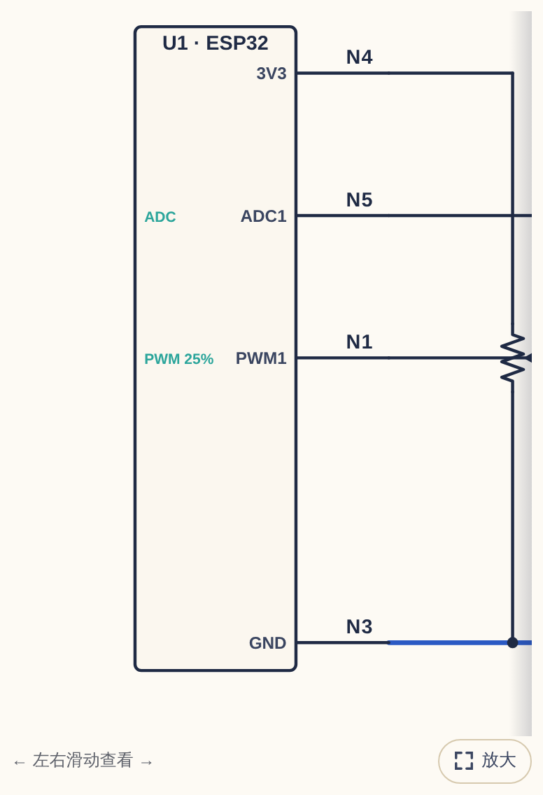

| 元件 | 类型 | 参数 |
|---|---|---|
| U1 | esp32_devkit | pins={"PWM1":{"mode":"pwm","duty":25,"frequency":1000},"ADC1":{"mode":"adc"}} |
| R1 | resistor | resistance=330 |
| LED1 | led | color=red |
| POT1 | potentiometer | resistance=10000 |

连接（每个结点上的引脚）：

- **N1**：U1.PWM1、R1.1
- **N2**：R1.2、LED1.anode
- **N3**：LED1.cathode、U1.GND、POT1.1
- **N4**：POT1.3、U1.3V3
- **N5**：POT1.2、U1.ADC1

## 2. 右侧面板：学生从上往下看到的内容（单轨流）

### 第 1 步 · 🔍 先看一眼：先认识它：PWM 与 ADC

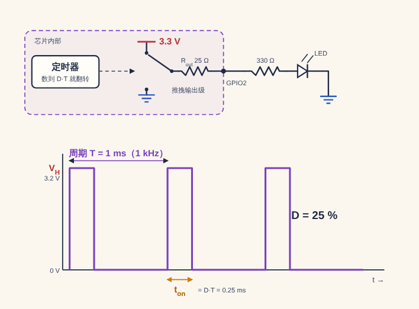

**拆解「PWM 与 ADC：数字引脚怎么“输出”和“读入”模拟量」第 1 / 8 层：① PWM：同一个输出级，开开关关**

PWM 不是新的硬件，就是上一个拆解里那个 推挽输出级，只不过由芯片里的 定时器 timer 自动地、很快地在 HIGH 和 LOW 之间切换：
- 每个 周期 T 开始时引脚变 HIGH；
- 定时器数到 $t_on$ 就把它变 LOW，等下一个周期。

高电平占整个周期的比例叫 **duty cycle（占空比）**：
$$D = \frac{t_{on}}{T}$$
第 16 课：GPIO2 设成 PWM，1 kHz（T = 1 ms），D = 25 %，所以 $t_{on}$ = 0.25 ms。

注意 高电平 不是 3.3 V 而是 3.2 V：高电平期间引脚就是“3.3 V 串 25 Ω”，LED 和 330 Ω 上的电流 $I = \frac{3.3 - 1.8}{25 + 330 + 12} = 4.1 mA$ 在 $R_{out}$ 上压掉 $25 × 4.1 mA ≈ 0.1 V$。示波器上量到的 Vpp ≈ 3.2 V。

**PWM 没有改变“每一刻”的电流**：亮的那 25 % 时间里 LED 照样流 4.1 mA。它不能绕过引脚的电流上限。

| 量 | 符号 | 第 16 课的值 |
|---|---|---|
| 频率 | $f = \frac{1}{T}$ | 1 kHz |
| 周期 | T | 1 ms |
| 占空比 | $D = \frac{t_{on}}{T}$ | 25 % |
| 高电平时间 | $t_{on}$ | 0.25 ms |
| 高电平 | $V_H$ | 3.3 − 25 Ω × 4.1 mA ≈ 3.2 V |
| 高电平期间的 LED 电流 | $I_{on}$ | 4.1 mA |

### 第 2 步 · 🔧 动手搭：两块表，两个答案

这一课先**预习 PWM**（5.8 会细讲），再学本单元的主角 **ADC**。
先让一个引脚用 PWM 点亮 LED，然后**用两种仪表看同一个引脚**：万用表和示波器。
两个读数对不上。到底谁说的是真话？

**步骤 1**

选**「ESP32 开发板 DevKitC」**，单击 **`b1`**：两排针插进 b1–b19 和 i1–i19。USB 默认插着，板子已经通电。

自动检查（做到这些才算完成）：把ESP32 开发板 DevKitC插到 b1–b2–b3–b4–b5–b6–b7–b8–b9–b10–b11–b12–b13–b14–b15–b16–b17–b18–b19–i1–i2–i3–i4–i5–i6–i7–i8–i9–i10–i11–i12–i13–i14–i15–i16–i17–i18–i19
板上高亮的孔：b1、i1

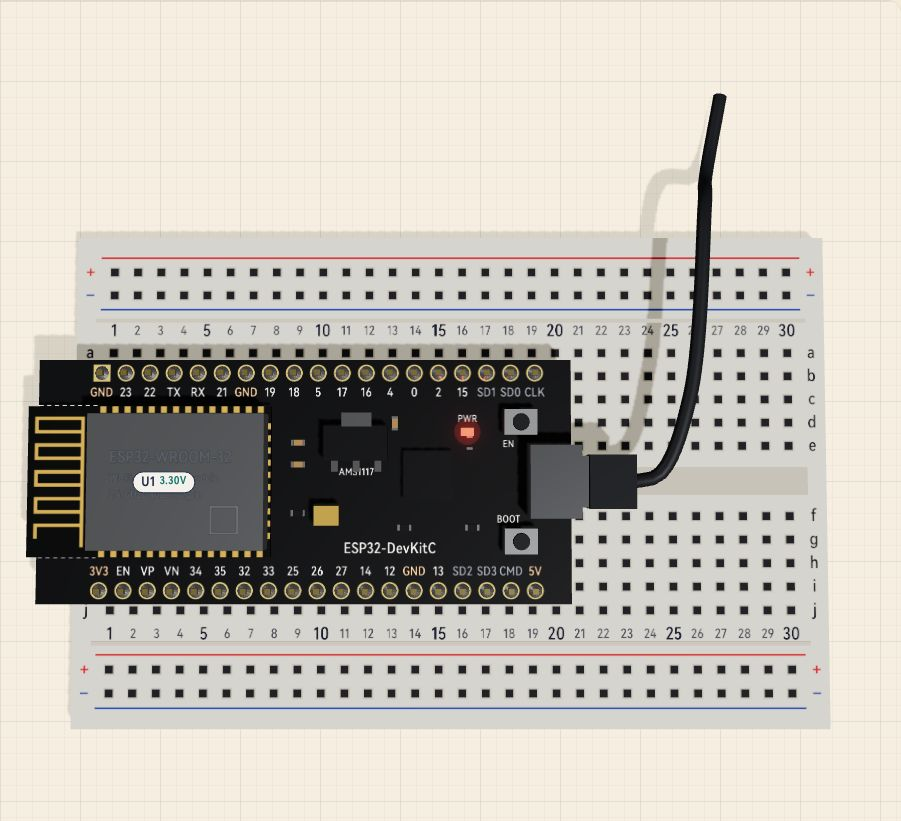

**步骤 2**

三根**跳线**：红的 **`j1`** → **`bp1`**（3V3），蓝的 **`j14`** → **`bn14`**（GND），蓝的 **`a7`** → **`tn7`**（GND）。

自动检查（做到这些才算完成）：把跳线插到 j1–bp1；把跳线插到 j14–bn14；把跳线插到 a7–tn7
板上高亮的孔：j1、bp1、j14、bn14、a7、tn7

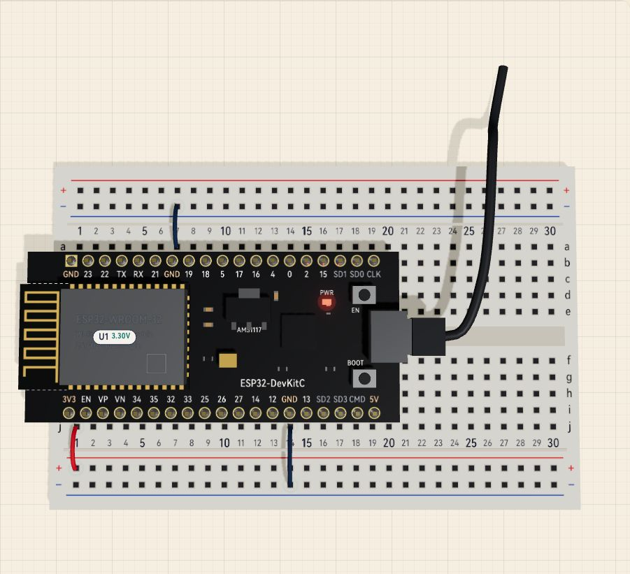

**步骤 3**

GPIO2 只有 **`a15`** 一个空孔。**跳线** **`a15`** → **`a20`** 把它引到第 20 列：电阻、表笔和探头就都有地方插了。

自动检查（做到这些才算完成）：把跳线插到 a15–a20
板上高亮的孔：a15、a20

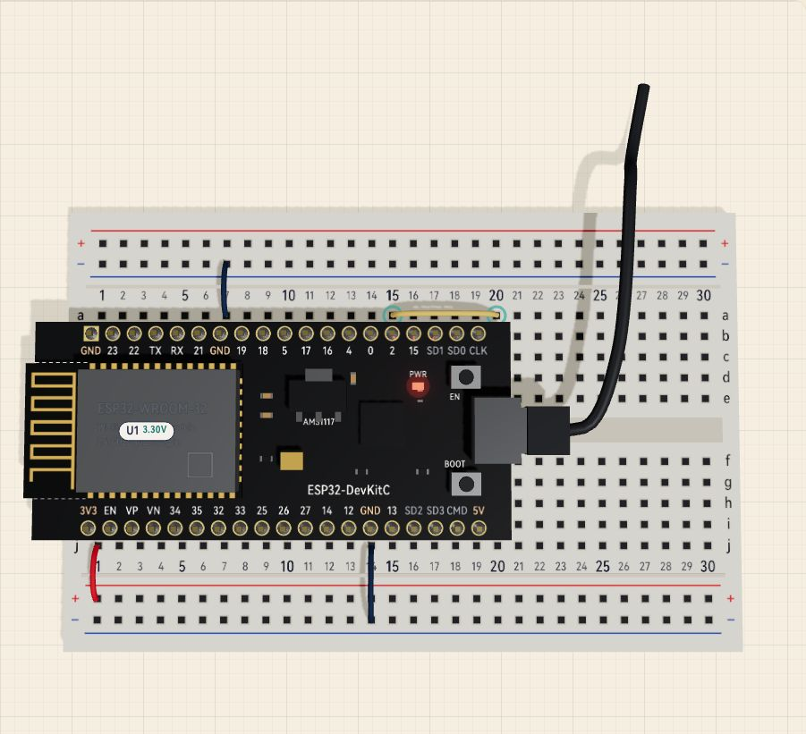

**步骤 4**

**电阻** **`330 Ω`** 插 **`c20`**–**`c23`**；**红色 LED** 长脚 **`d23`**、短脚 **`d26`**；蓝**跳线** **`a26`** → **`tn26`**。

自动检查（做到这些才算完成）：把电阻插到 c20–c23；把LED 发光二极管插到 d23–d26；把跳线插到 a26–tn26
板上高亮的孔：c20、c23、d23、d26、a26、tn26

**步骤 5**

**单击开发板**，在「属性」的引脚列表里把 **GPIO2** 设成 **PWM**。单击这一行展开：占空比 **`25 %`**，频率 **`1 kHz`**。LED 亮了，但比较暗。

自动检查（做到这些才算完成）：把ESP32 开发板 DevKitC插到 b1–b2–b3–b4–b5–b6–b7–b8–b9–b10–b11–b12–b13–b14–b15–b16–b17–b18–b19–i1–i2–i3–i4–i5–i6–i7–i8–i9–i10–i11–i12–i13–i14–i15–i16–i17–i18–i19
板上高亮的孔：a15

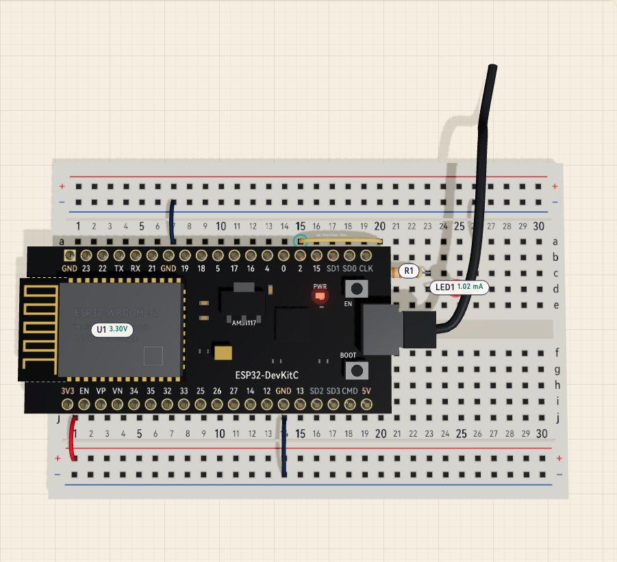

**步骤 6**

**万用表**红表笔点 **`b20`**。它读到的电压，比引脚的 3.3 V 小得多。

自动检查（做到这些才算完成）：万用表红表笔点 b20（选“万用表”工具，单击孔）
板上高亮的孔：b20

**步骤 7**

**示波器**探头：针尖 **`e20`**，接地夹 **`tn18`**。看波形：电压只在两个值之间跳。示波器窗口挡住面包板时，点它右上角的 **▾** 收起，或拖标题栏挪开。

自动检查（做到这些才算完成）：把示波器探头插到 e20–tn18
板上高亮的孔：e20、tn18

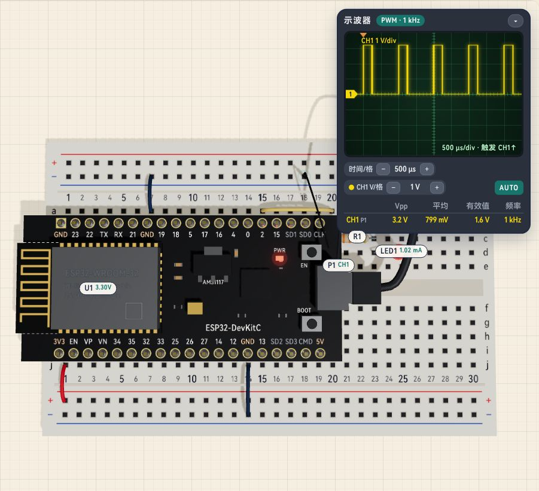

### 第 3 步 · 💡 想明白：PWM 是快速开关，ADC 是一把尺子

- **PWM**：引脚每秒开、关 1000 次。开的时候是满电压，关的时候是 0。“开”占一个周期的比例叫**占空比** D。

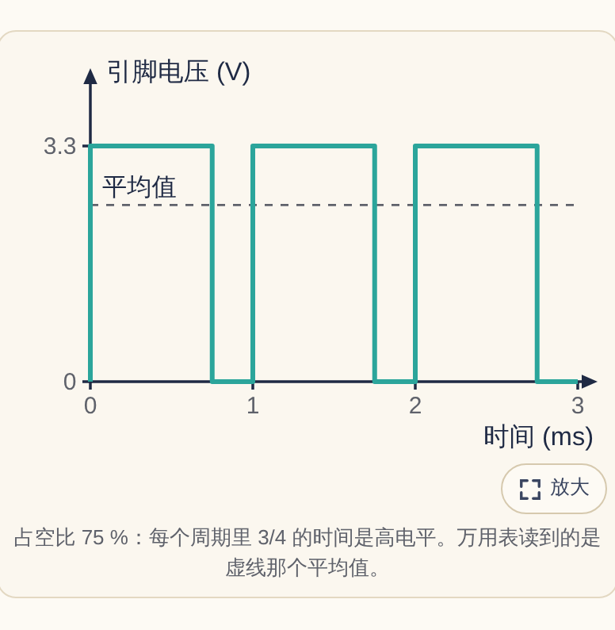

*图 `pwm`（plot）：占空比 75 %：每个周期里 3/4 的时间是高电平。万用表读到的是虚线那个平均值。*

- 万用表反应慢，只读到**平均值**；示波器看到真实的方波。两个都对：
$$V_{avg} = D × V_{high}$$
- 代入数字：D = 75 %，高电平约 3.3 V，$V_{avg} = 0.75 × 3.3 ≈ 2.5$ V。LED 的亮度也跟着平均值走。
- **ADC** 反过来：它把引脚上 0–3.3 V 的电压**量成一个数**，从 0 到 4095，像一把有 4096 个刻度的尺子。

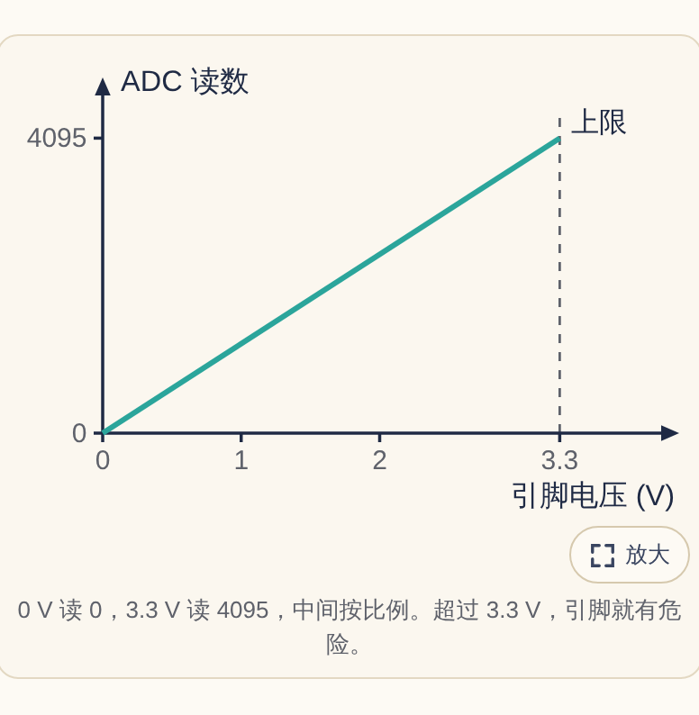

*图 `adc`（plot）：0 V 读 0，3.3 V 读 4095，中间按比例。超过 3.3 V，引脚就有危险。*

（这一步下面列着这节课的计算卡片，点开就地展开：`gpio-led-resistor`、`gpio-output-resistance`、`adc-code`、`pwm-average`，全文见第 6 节）

### 第 4 步 · 🔧 动手搭：换占空比，再接一个旋钮

- 换几个占空比，看三样东西怎么变：LED 的亮度、万用表的读数、方波的宽度。
- 然后接一个**电位器**当可调的分压器：滑动端的电压送进 ADC 引脚。
- ADC 引脚最多只能接 3.3 V。比它高的电压要先分压——下一个实验就做这件事。

**步骤 8**

占空比改成 **`75 %`**。LED 变亮，万用表读数变成三倍；示波器上方波的高度没变，只是变宽了。

自动检查（做到这些才算完成）：把ESP32 开发板 DevKitC插到 b1–b2–b3–b4–b5–b6–b7–b8–b9–b10–b11–b12–b13–b14–b15–b16–b17–b18–b19–i1–i2–i3–i4–i5–i6–i7–i8–i9–i10–i11–i12–i13–i14–i15–i16–i17–i18–i19
板上高亮的孔：a15

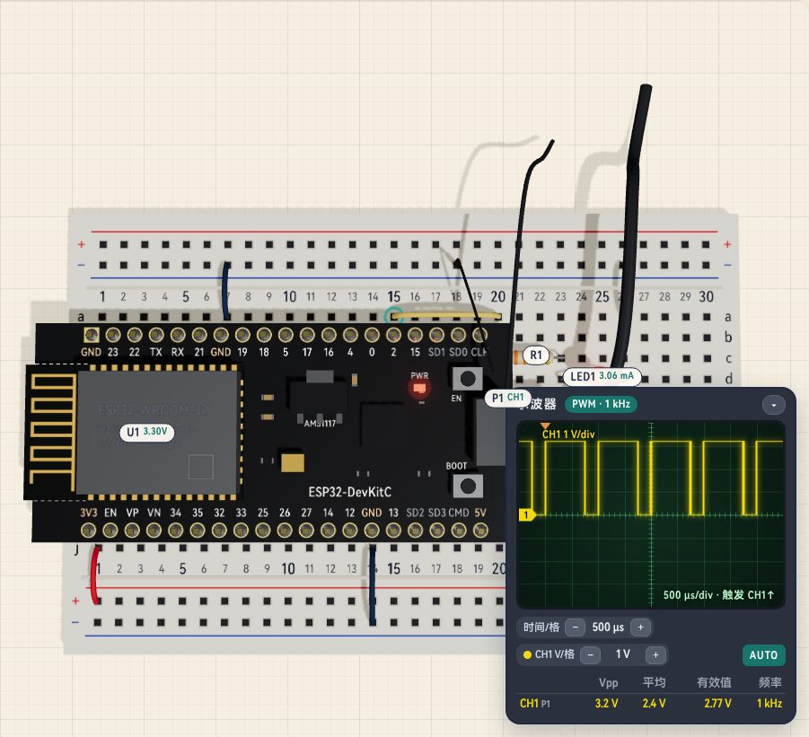

**步骤 9**

占空比改回 **`25 %`**。

自动检查（做到这些才算完成）：把ESP32 开发板 DevKitC插到 b1–b2–b3–b4–b5–b6–b7–b8–b9–b10–b11–b12–b13–b14–b15–b16–b17–b18–b19–i1–i2–i3–i4–i5–i6–i7–i8–i9–i10–i11–i12–i13–i14–i15–i16–i17–i18–i19
板上高亮的孔：a15

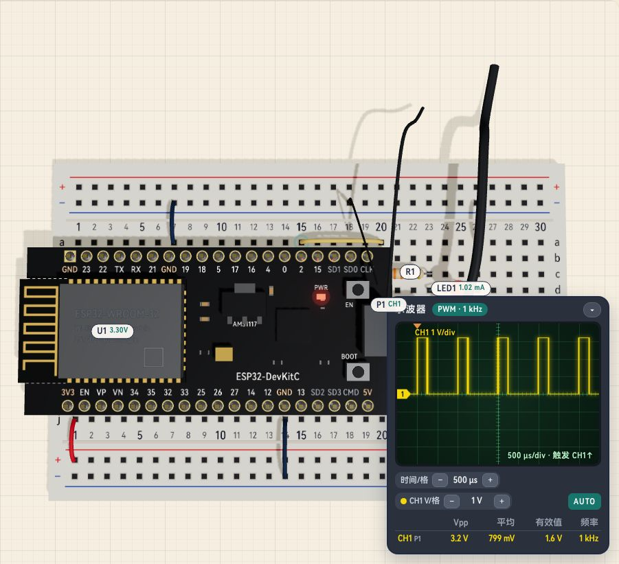

**步骤 10**

**电位器**（**`10 kΩ`**）单击 **`h22`**，三只脚在 h22、h23、h24。蓝**跳线** **`j22`** → **`bn22`**（GND），红**跳线** **`j24`** → **`bp24`**（3V3）。

自动检查（做到这些才算完成）：把电位器插到 h22–h23–h24；把跳线插到 j22–bn22；把跳线插到 j24–bp24
板上高亮的孔：h22、h23、h24、j22、bn22、j24、bp24

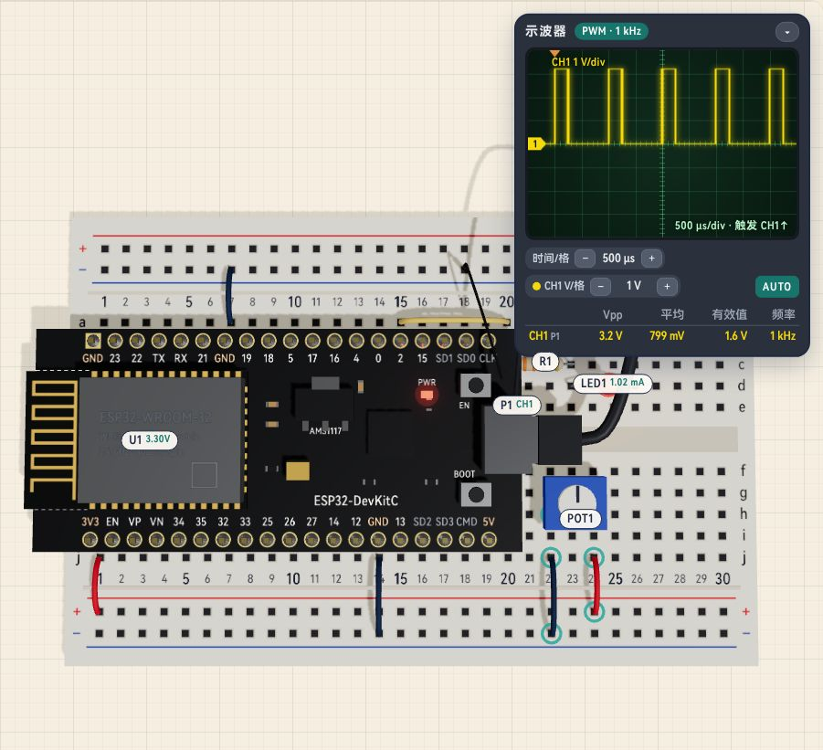

**步骤 11**

滑动端接 GPIO34：**跳线** **`g23`** → **`j5`**（GPIO34 在下排第 5 列）。把 **GPIO34** 设成 **ADC**：这一行显示 ADC 电压和 0–4095 的读数。**拖动电位器**，看数字跟着变。

自动检查（做到这些才算完成）：把跳线插到 g23–j5；把ESP32 开发板 DevKitC插到 b1–b2–b3–b4–b5–b6–b7–b8–b9–b10–b11–b12–b13–b14–b15–b16–b17–b18–b19–i1–i2–i3–i4–i5–i6–i7–i8–i9–i10–i11–i12–i13–i14–i15–i16–i17–i18–i19
板上高亮的孔：g23、j5

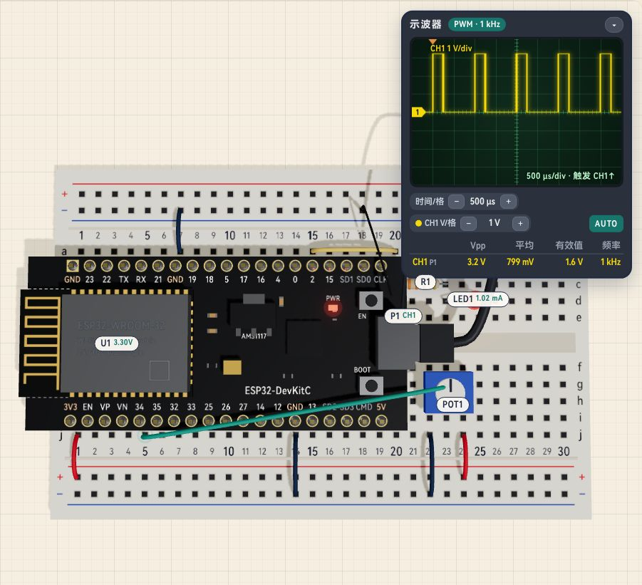

**步骤 12**

点**「检查我的电路」**，再用示波器、万用表和引脚列表回答测量题。

### 第 5 步 · 📏 测一测：测一测：读你自己的仪表

**测量题 1 · `vpp`**（读数题）

> 示波器 CH1（GPIO2）的峰峰值

- 单位 V · 先写预测 · 参考答案的读数 **3.195 V** · 合理范围 [3.1, 3.3]

答对后显示：

> 方波在 0 V 和高电平之间跳：高电平是 3.3 V 减去输出电阻上的压降。

**测量题 2 · `avg`**（读数题）

> 万用表：GPIO2（第 20 列）对 GND 的电压

- 单位 V · 先写预测 · 参考答案的读数 **0.7988 V** · 合理范围 [0.74, 0.86]

答对后显示：

> 直流档读平均值：0.25 × 3.2 V ≈ 0.80 V。

**测量题 3 · `iavg`**（读数题）

> LED 的平均电流（单击 LED 看「属性」里的电流）

- 单位 mA · 先写预测 · 参考答案的读数 **1.02 mA** · 合理范围 [0.0009, 0.0011]

答对后显示：

> 0.25 × 4.1 mA ≈ 1.0 mA；“高”的那 25 % 时间里还是 4.1 mA。

**测量题 4 · `vadc`**（读数题）

> 电位器滑动端在 50 %：GPIO34 的电压（看引脚列表的 ADC 电压，或用万用表）

- 单位 V · 先写预测 · 状态：把 POT1 旋到 50% · 参考答案的读数 **1.649 V** · 合理范围 [1.6, 1.7]

答对后显示：

> 3.3 V 的一半：1.65 V。

**测量题 5 · `raw`**（选择题）

> 同一状态下，GPIO34 的 12 位 ADC 原始读数大约是多少？

- A. 约 1024
- B. 约 2048 ✅（正确）
- C. 约 4095
- D. 约 1650

答对后显示：

> 1.65 / 3.3 × 4095 ≈ 2048：12 位 = 4096 级，3.3 V 对应满量程。

### 第 6 步 · 🎒 带走：带走

- **PWM 不改变高电平，只改变“高”的时间比例。** 万用表读平均值，示波器看真实波形。
- PWM 每次“高”时，电流和常亮时一样大：它不能绕过引脚的电流上限。
- **ADC 把 0–3.3 V 量成 0–4095。** 超过 3.3 V 会损坏引脚。ESP32 只有 GPIO32–39（ADC1）能和 Wi-Fi 同时用。
- 真实的坑：ESP32 的 ADC 在接近 0 V 和 3.3 V 的两头不线性，还有噪声。项目里要校准，多读几次取平均。

趁热练理论题：`equivalence`

## 3. 测量题一览

| # | id | 题目 | 类型 | 单位 | 状态 | 参考读数 |
|---|---|---|---|---|---|---|
| 1 | vpp | 示波器 CH1（GPIO2）的峰峰值 | scope | V |  | 3.195 V |
| 2 | avg | 万用表：GPIO2（第 20 列）对 GND 的电压 | voltage | V |  | 0.7988 V |
| 3 | iavg | LED 的平均电流（单击 LED 看「属性」里的电流） | current | mA |  | 1.02 mA |
| 4 | vadc | 电位器滑动端在 50 %：GPIO34 的电压（看引脚列表的 ADC 电压，或用万用表） | voltage | V | 把 POT1 旋到 50% | 1.649 V |
| 5 | raw | 同一状态下，GPIO34 的 12 位 ADC 原始读数大约是多少？ | 选择 |  |  | 正确：B |

### 全部答完后显示的「对比」

**对比**（占空比 25 %）：
- 高电平 ≈ 3.3 V − 25 Ω × 4.1 mA ≈ 3.2 V，示波器 Vpp ≈ **3.2 V**；
- 万用表平均值 ≈ 0.25 × 3.2 V ≈ **0.80 V**；
- LED 平均电流 ≈ 0.25 × 4.1 mA ≈ **1.0 mA**（每次“高”时还是 4.1 mA）；
- 滑动端在中间：ADC 电压 = 3.3 V / 2 ≈ **1.65 V**，读数 ≈ 1.65 / 3.3 × 4095 ≈ **2048**。

### 提示按钮（依次显示）

1. 万用表直流档读的是平均值：平均 = 占空比 × 高电平。
2. 示波器上的方波高电平和常亮时的引脚电压一样，PWM 只改变“高”的时间比例。
3. ADC 读数 = 电压 / 3.3 V × 4095；滑动端在中间时电压是 3.3 V 的一半。

### 功能测试（「检查我的电路」时跑）

- PWM 点亮 LED；ADC 读到滑动端的电压

## 4. 用到的拆解（全部层的文字，供改写参考）

### 拆解 `pwm-adc`：PWM 与 ADC：数字引脚怎么“输出”和“读入”模拟量

*PWM = Pulse-Width Modulation（脉冲宽度调制），ADC = Analog-to-Digital Converter（模数转换器）。芯片只会输出 0 和 3.3 V、只会处理数字——我们拆开看它怎样用“快速开关 + 平均”假装输出模拟电压，又怎样用“采样 + 二分查找”把电压变成数字。*

**拆解「PWM 与 ADC：数字引脚怎么“输出”和“读入”模拟量」第 1 / 8 层：① PWM：同一个输出级，开开关关**

PWM 不是新的硬件，就是上一个拆解里那个 推挽输出级，只不过由芯片里的 定时器 timer 自动地、很快地在 HIGH 和 LOW 之间切换：
- 每个 周期 T 开始时引脚变 HIGH；
- 定时器数到 $t_on$ 就把它变 LOW，等下一个周期。

高电平占整个周期的比例叫 **duty cycle（占空比）**：
$$D = \frac{t_{on}}{T}$$
第 16 课：GPIO2 设成 PWM，1 kHz（T = 1 ms），D = 25 %，所以 $t_{on}$ = 0.25 ms。

注意 高电平 不是 3.3 V 而是 3.2 V：高电平期间引脚就是“3.3 V 串 25 Ω”，LED 和 330 Ω 上的电流 $I = \frac{3.3 - 1.8}{25 + 330 + 12} = 4.1 mA$ 在 $R_{out}$ 上压掉 $25 × 4.1 mA ≈ 0.1 V$。示波器上量到的 Vpp ≈ 3.2 V。

**PWM 没有改变“每一刻”的电流**：亮的那 25 % 时间里 LED 照样流 4.1 mA。它不能绕过引脚的电流上限。

| 量 | 符号 | 第 16 课的值 |
|---|---|---|
| 频率 | $f = \frac{1}{T}$ | 1 kHz |
| 周期 | T | 1 ms |
| 占空比 | $D = \frac{t_{on}}{T}$ | 25 % |
| 高电平时间 | $t_{on}$ | 0.25 ms |
| 高电平 | $V_H$ | 3.3 − 25 Ω × 4.1 mA ≈ 3.2 V |
| 高电平期间的 LED 电流 | $I_{on}$ | 4.1 mA |

**拆解「PWM 与 ADC：数字引脚怎么“输出”和“读入”模拟量」第 2 / 8 层：② 平均值 = 占空比 × 高电平：面积除以时间**

万用表的直流档很“慢”，它显示的是一段时间里的 **平均值**。平均值的定义：一个周期内电压对时间的积分（阴影面积）除以周期：
$$V̄ = \frac{1}{T}∫_{0}^{T} v(t) dt$$
PWM 的 $v(t)$ 只有两段：$t_{on}$ 内是 $V_H$，其余时间是 0，所以积分就是一个矩形：
$$V̄ = \frac{V_H·t_{on} + 0·(T - t_{on})}{T} = D·V_H$$
代数字（第 16 课）：
- D = 25 %：V̄ = 0.25 × 3.2 V = **0.80 V**（万用表读数）；
- D = 75 %：V̄ = 0.75 × 3.2 V = **2.40 V**，正好是 25 % 时的 3 倍；
- LED 的平均电流同理：0.25 × 4.1 mA ≈ **1.0 mA**。

眼睛也是“慢”的：几百 Hz 以上看不出闪，只感觉到平均亮度。所以 PWM 能调光、调速——改变的是 **平均** 功率，而不是瞬时电压。

| 仪器 | 它看到什么 | D = 25 % 时读数 |
|---|---|---|
| 示波器 | 真实方波：0 和 3.2 V | Vpp ≈ 3.2 V |
| 万用表直流档 | 平均值 | ≈ 0.80 V |
| 万用表电流档（串在 LED 上） | 平均电流 | ≈ 1.0 mA |
| 眼睛 | 平均亮度 | 约全亮的 1/4 |

- 公式 `V̄ = \frac{1}{T}∫_{0}^{T} v dt = D·V_H`：任何 PWM 波形的直流分量

**拆解「PWM 与 ADC：数字引脚怎么“输出”和“读入”模拟量」第 3 / 8 层：③ 加一个 RC：把方波变成直流（PWM DAC）**

实验 5-14：引脚 → R = 10 kΩ → 结点 VDAC → C = 1 µF → GND，VDAC 再接回一个 ADC 引脚 自己读。

**为什么能得到直流**：方波 = 直流分量 $D·V_H$ + 频率为 f、2f、3f… 的交流分量。RC 低通对直流是开路（电容不通直流），直流全部通过；对交流的衰减约为 $\frac{f_c}{f}$：
$$f_c = \frac{1}{2πRC} = \frac{1}{2π × 10 kΩ × 1 µF} ≈ 16 Hz$$
1 kHz 的基波只剩 16/1000 ≈ 1.6 %。

**剩下的纹波（ripple）有多大**：τ = RC = 10 ms ≫ T = 1 ms，电容电压几乎不变，约等于 V̄。高电平期间流进电容的电流 $\frac{V_H - V̄}{R}$ 近似恒定，持续 $D·T$，电容电压升高
$$ΔV = \frac{I·t_{on}}{C} = \frac{(V_H - D V_H)·D T}{RC} = \frac{V_H·D(1 - D)}{f·R·C}$$
- 1 kHz、50 %：$\frac{3.3 × 0.25}{1000 × 10 ms}$ ≈ **82 mV**（仿真 82 mV）；
- 25 % 或 75 %：D(1 − D) = 0.1875 → **62 mV**——50 % 时纹波最大；
- 10 kHz：频率 ×10，纹波 ÷10 → **8.2 mV**；
- 100 Hz：T = τ，近似不再成立，精确值 $3.3·tanh(\frac{T}{4τ})$ ≈ **0.81 V**——这已经不是“直流”了。

**代价**：RC 越大纹波越小，但改占空比后 VDAC 要等 4.6τ ≈ 46 ms 才稳定到 1 % 以内。想又小又快，就提高 PWM 频率。

| 频率 | D | 平均 VDAC | ADC 读数 | 纹波 Vpp |
|---|---|---|---|---|
| 1 kHz | 25 % | 0.824 V | 1023 | 62 mV |
| 1 kHz | 50 % | 1.649 V | 2045 | 82 mV |
| 1 kHz | 75 % | 2.473 V | 3068 | 62 mV |
| 100 Hz | 50 % | 1.649 V | 2045 | 0.81 V |
| 10 kHz | 50 % | 1.649 V | 2045 | 8.2 mV |

- 公式 `f_c = \frac{1}{2πRC} ≈ 16 Hz`：截止频率要远低于 PWM 频率
- 公式 `ΔV ≈ \frac{V_H·D(1 - D)}{f·R·C}`：τ ≫ T 时的纹波（峰峰值）

**拆解「PWM 与 ADC：数字引脚怎么“输出”和“读入”模拟量」第 4 / 8 层：④ 反过来：ADC 里面是采样保持 + 比较器 + DAC**

ADC 把电压变成数字，ESP32 和 STM32 用的都是 **SAR ADC（逐次逼近型，Successive Approximation Register）**。它由四块组成：
1. 采样保持 sample-and-hold：一个开关 + 一个几 pF 的电容 $C_{SH}$。开关闭合一小段时间（采样），电容充到输入电压；然后开关断开（保持），后面怎么比较输入都不会变；
2. DAC（数模转换器）：把一个试探码变回电压，满量程等于 参考电压 $V_ref$ = 3.3 V；
3. 比较器 comparator：只回答一个问题——采样到的电压比 DAC 的电压高还是低？
4. SAR 逻辑：根据比较结果一位一位地定下数字码。

**源阻抗**：采样时 $C_{SH}$ 要经过外部电路的电阻 $R_src$ 充电。要在采样时间内充到误差小于半个 LSB，需要大约 $(N + 1)·ln2 ≈ 9$ 个时间常数（12 位）。$R_{src}$ 太大，读数偏低、发抖。实验 5-4 的分压器源阻抗 = 100 kΩ ∥ 33 kΩ ≈ 24.8 kΩ，所以在引脚上并一个 100 nF 电容做“小水库”：采样那一下从电容取电荷，而不是从 24.8 kΩ 后面取。

| 块 | 作用 | 数值 / 注意 |
|---|---|---|
| 采样保持 | 冻结输入电压 | $C_{SH}$ 几 pF；采样时间 µs 级 |
| DAC | 试探码 → 电压 | $V = \frac{code}{4095}·V_{ref}$ |
| 比较器 | 高还是低 | 每一步 1 位 |
| SAR 逻辑 | 二分查找 | 12 位 = 12 步 |
| 源阻抗 | 给 $C_{SH}$ 充电的路径 | ESP32 宜 < 10 kΩ，或加电容 |

**拆解「PWM 与 ADC：数字引脚怎么“输出”和“读入”模拟量」第 5 / 8 层：⑤ SAR：一次比一位的二分查找**

用一个 4 位 ADC（16 个台阶，每个台阶 $\frac{3.3}{16}$ = 0.206 V）演示，输入是实验 5-4 满电时的 $V_in$ = 2.084 V。SAR 从最高位开始猜：
1. 试 1000₂ = 8 → 1.650 V：V_in 更高 → 这一位 **保留 1**；
2. 试 1100₂ = 12 → 2.475 V：V_in 更低 → 这一位 **改回 0**；
3. 试 1010₂ = 10 → 2.063 V：V_in 更高 → **保留 1**；
4. 试 1011₂ = 11 → 2.269 V：V_in 更低 → **改回 0**。

结果 1010₂ = 10，代表 10 × 0.206 = 2.06 V，和真实值差不到一个台阶。

每一步把可能的范围砍掉一半，所以 N 位只要 N 次比较：12 位的 ESP32 / STM32 是 12 步，加上采样，一次转换只要几微秒。这和你猜 1–100 之间的数“先猜 50”是同一个道理。

| 步 | 试探码 | DAC 电压 | 比较 | 这一位 |
|---|---|---|---|---|
| 1 | 1000₂ = 8 | 1.650 V | 2.084 > 1.650 | b3 = 1 |
| 2 | 1100₂ = 12 | 2.475 V | 2.084 < 2.475 | b2 = 0 |
| 3 | 1010₂ = 10 | 2.063 V | 2.084 > 2.063 | b1 = 1 |
| 4 | 1011₂ = 11 | 2.269 V | 2.084 < 2.269 | b0 = 0 |

**拆解「PWM 与 ADC：数字引脚怎么“输出”和“读入”模拟量」第 6 / 8 层：⑥ 量化：台阶有多细（分辨率）**

ADC 的输出只能是整数，所以输入和输出之间是一条 台阶，而不是 直线。一个台阶叫 **1 LSB**（Least Significant Bit，最低有效位），它就是分辨率：
$$1 LSB = \frac{V_{ref}}{2^{N}} = \frac{3.3 V}{4096} = 0.806 mV$$
本仿真器的读数规则（和第 16 课一样）：
$$code = round(\frac{V}{V_{ref}}·(2^{N} - 1)) = round(\frac{V}{3.3}·4095)$$
- 第 16 课，电位器中点 1.65 V：$\frac{1.65}{3.3} × 4095 = 2047.5$ → **2048**；
- 实验 5-4 满电 2.084 V：$\frac{2.084}{3.3} × 4095$ → **2586**。

（教材有的写 $2^{N}$、有的写 $2^{N} - 1$，差 1/4096 = 0.02 %，远小于真实 ADC 的误差。）

四舍五入意味着 量化误差 最多 ±½ LSB——这是 ADC 再理想也去不掉的误差。位数每多 1 位，台阶细一倍。

| 位数 N | 台阶数 2^N | 1 LSB（V_ref = 3.3 V） | 例子 |
|---|---|---|---|
| 8 | 256 | 12.9 mV | ESP32 的 DAC（GPIO25 / 26） |
| 10 | 1024 | 3.22 mV | Arduino Uno（5 V：4.9 mV） |
| 12 | 4096 | 0.806 mV | ESP32 / STM32F103 ADC |
| 16 | 65536 | 50 µV | 外置 ADC（ADS1115） |

- 公式 `code = round(\frac{V}{V_{ref}}·(2^{N} - 1))`：仿真器的读数公式
- 公式 `1 LSB = \frac{V_{ref}}{2^{N}} = 0.806 mV`：12 位、3.3 V

**拆解「PWM 与 ADC：数字引脚怎么“输出”和“读入”模拟量」第 7 / 8 层：⑦ 量一个比 3.3 V 高的电压：先分压，再读，再乘回去**

实验 5-4：2S 锂电池 6.0–8.4 V，比 ADC 的 3.3 V 满量程高，直接接会烧引脚。用 R1 = 100 kΩ 和 R2 = 33 kΩ 分压，VSENSE 接 GPIO34：
$$k = \frac{R_2}{R_1 + R_2} = \frac{33}{133} = 0.248$$
**第 1 步 · 电池 → ADC 电压**：$V_{ADC} = k·V_{BAT}$，8.4 V → 2.084 V。
**第 2 步 · ADC 电压 → 读数**：$code = round(\frac{2.084}{3.3} × 4095)$ = **2586**。
**第 3 步 · 固件反算**：
$$V_{BAT} = \frac{code·3.3 / 4095}{k} ≈ code × 3.25 mV$$
每一个读数代表电池上的 3.25 mV。

右边两根刻度尺 就是这个乘以 k 的映射：电池 0–13.3 V 对应 ADC 0–3.3 V。所以充电器接错成 12 V 时，ADC 只看到 2.98 V，引脚安全。

为什么不选 22 k / 10 k 让满电更接近 3.3 V？真实 ESP32 的 ADC 在 2.45 V 以上开始弯曲（见下一层），把满电放在 2.1 V 左右留了余量。

C1 = 100 nF 是上一层说的“小水库”。分压器还一直从电池取电：$I = \frac{8.4 V}{133 kΩ} ≈ 63 µA$，一年约 550 mAh——深度睡眠的设备要用更大的电阻或用 MOSFET 只在测量时接通。

| 电池 | $V_{ADC} = 0.248·V_{BAT}$ | 12 位读数 | 说明 |
|---|---|---|---|
| 8.4 V | 2.084 V | 2586 | 满电 |
| 7.4 V | 1.836 V | 2278 | 标称 |
| 6.0 V | 1.489 V | 1847 | 没电 |
| 12 V | 2.977 V | 3695 | 接错充电器，仍 < 3.3 V |

- 公式 `V_{ADC} = \frac{R_2}{R_1 + R_2}·V_{BAT}`：无负载分压（ADC 输入不取电流）
- 公式 `R_{src} = R_1 ∥ R_2 = 24.8 kΩ`：ADC 看进去的源阻抗

**拆解「PWM 与 ADC：数字引脚怎么“输出”和“读入”模拟量」第 8 / 8 层：⑧ 局限：真实 ADC 不是直线，PWM 也不是万能**

仿真器里的 ADC 是 理想直线。真实的 ESP32 ADC（11 dB 衰减档）是 红色那条：
- 低于约 0.1 V 读 0；
- 0.15–2.45 V 比较线性，但不同芯片之间偏差可达 ±6 %，要用 ESP-IDF 的校准（eFuse 里的出厂 V_ref）；
- 高于约 2.45 V 开始弯，约 3.1 V 饱和。

所以设计时把有用的电压放在中间，多次采样取平均。STM32 的 ADC 线性好得多，满量程 = VDDA（3.3 V）。

**ADC 的硬性规则**：
- 输入不能超过 3.3 V（会经钳位二极管注入，见“开发板”拆解），STM32 的 FT 脚设成模拟输入后也 **不** 耐 5 V；
- ESP32 只用 ADC1（GPIO32–39）：ADC2 在开 Wi-Fi 时不能用；
- 测量地必须和被测电路共地。

**PWM 的限制**：
- 不能突破引脚的电流上限（每个高电平期间都是满电流）；
- ESP32 的 PWM（LEDC）频率和分辨率互相牵制：$f × 2^{bits} ≤ 80 MHz$，例如 10 位最高约 78 kHz，12 位只到 19.5 kHz；
- 驱动电机、灯带这样的大电流负载要接 MOSFET（见 MOSFET 拆解）。

|  | 仿真 | ESP32 | STM32F103 |
|---|---|---|---|
| 分辨率 | 12 位 | 12 位 | 12 位 |
| 满量程 | 3.3 V | ≈ 3.1 V（11 dB） | VDDA = 3.3 V |
| 线性 | 理想 | 0.15–2.45 V 较好，需校准 | 好 |
| ADC 引脚 | ADC1 / ADC | GPIO32–39（ADC1） | PA0–PA7, PB0, PB1 |
| PWM | 任意频率 | $f × 2^{bits} ≤ 80 MHz$ | 定时器通道 |

**一句话记住**：PWM：输出级快速开关，平均值 $V̄ = D·V_H$，RC 低通把它变成直流，纹波 $ΔV ≈ \frac{V_H·D(1 - D)}{fRC}$。ADC：采样保持 + 比较器 + DAC 做二分查找，$code = round(\frac{V}{3.3}·4095)$，1 LSB = 0.806 mV；高于 3.3 V 的电压先分压，固件再乘回去。

## 5. 这一课的计算卡片

**计算卡片 `gpio-led-resistor`：GPIO 点 LED 的电阻（含引脚内阻）**

- 公式 `R = \frac{V_{OH} - V_F}{I} - R_{out} - r_d`
- 用途：单片机引脚直接驱动 LED：串多大的电阻得到想要的电流。
- 输入：V_OH（引脚高电平（空载），V）；V_F（LED 正向压降（红 1.8 V），V）；I（想要的电流（≤ 20 mA），A）；R_out（引脚输出电阻（ESP32 25 Ω、Blue Pill 40 Ω），Ω）；r_d（LED 内阻，Ω） → R（串联电阻（再取一个标准值），Ω）

1. 输出高电平的引脚不是理想电压源：它像 3.3 V 串一个输出电阻 $R_{out}$（芯片里 MOS 管的导通电阻）。
2. LED 用折线模型：$V_F$ 串 $r_d$。
3. 回路 KVL：$V_{OH} = I(R_{out} + R + r_d) + V_F$。
4. 解出 $R = \frac{V_{OH} - V_F}{I} - R_{out} - r_d$，取最接近的标准值，再回算电流：$I = \frac{V_{OH} - V_F}{R + R_{out} + r_d}$。
5. 灌电流（LED 接 3V3、阴极接引脚、输出低电平点亮）公式一样，$R_{out}$ 换成下管的电阻。

例子：- 实验 5-1：10 mA：$\frac{1.5}{0.01} - 25 - 12 = 113 Ω$ → 120 Ω，$I = \frac{1.5}{157} ≈ 9.5 mA$。不串电阻：$\frac{1.5}{37} ≈ 40 mA$——到了绝对最大值。
- 第 15 课：330 Ω：$\frac{1.5}{330 + 25 + 12} ≈ 4.1 mA$。
- 实验 5-2（Blue Pill，40 Ω）：220 Ω：$\frac{1.5}{272} ≈ 5.5 mA$；板载 LED 510 Ω：≈ 2.7 mA。

- ⚠ 蓝 / 白 LED（$V_F$ ≈ 3 V）在 3.3 V 引脚上只剩 0.3 V 给电阻：亮度对一切都很敏感——用三极管从 5 V 驱动。
- ⚠ 每个引脚建议 ≤ 20 mA，所有引脚加起来也有上限（STM32F103 共 150 mA）。

**计算卡片 `gpio-output-resistance`：引脚的输出电阻（从读数反推）**

- 公式 `R_{out} = \frac{V_{DD} - V_{pin}}{I}`
- 用途：输出高电平时测到引脚电压和电流，算出引脚的内阻；也能预测重载时引脚掉到多少。
- 输入：V_DD（空载高电平，V）；V_pin（带载时测到的引脚电压，V）；I（引脚电流，A） → R_out（输出电阻，Ω）

1. 输出高电平 = 3.3 V 串 $R_{out}$（戴维宁模型）。
2. 有电流流出时，$R_{out}$ 上压降 $IR_{out}$，引脚电压 $V_{pin} = V_{DD} - IR_{out}$。
3. 量出 $V_{pin}$ 和 I，反解 $R_{out}$。
4. 低电平同理：$R_{low} = \frac{V_{OL}}{I}$（电流流进引脚）。
5. 引脚电压掉到 $V_{IH}$ 以下，别的芯片就不认它是高电平了。

例子：实验 5-1：$\frac{3.3 - 3.06}{9.5 mA} ≈ 25 Ω$。第 15 课：$\frac{3.3 - 3.20}{4.1 mA} ≈ 25 Ω$；20 mA 时引脚只剩约 2.8 V，40 mA 时 2.29 V < $V_{IH}$（2.475 V）。实验 5-2：$\frac{0.22 V}{5.5 mA} = 40 Ω$。

- ⚠ 真实芯片的输出电阻随电流、温度和固件里的驱动强度设置变化；这里的 25 Ω / 40 Ω 是模型值。

**计算卡片 `adc-code`：ADC 读数 raw = V/Vref × 4095**

- 公式 `raw = \frac{V}{V_{ref}} × (2^{N} - 1)`
- 用途：一个电压在 N 位 ADC 上读出多少（0 … 4095）。
- 输入：V（ADC 引脚电压，V）；V_ref（满量程（参考电压），V）；N（位数，） → raw（读数，）

1. N 位 ADC 把 0 … $V_{ref}$ 分成 $2^{N}$ 个台阶：12 位就是 4096 个，读数 0 … 4095。
2. 线性换算：$raw = \frac{V}{V_{ref}} × 4095$，四舍五入成整数。
3. 一个 LSB（最低位）= $\frac{V_{ref}}{4095} ≈ 0.81 mV$：这是分辨率。
4. 固件反过来：$V = raw × \frac{V_{ref}}{4095}$。
5. 引脚电压超过 $V_{ref}$ 读数就停在 4095；超过 3.3 V（加二极管压降）引脚会坏——先分压。

例子：第 16 课：1.65 V → 2048。实验 5-4：8.4 V 电池分压后 2.084 V → 2586。实验 5-6：25 °C 1.649 V → 2046，80 °C 0.372 V → 461。实验 5-10：3.13 V → 3879。

- ⚠ ESP32 的 ADC 在 0.15 V 以下和 2.45 V 以上不线性，要校准；用 ADC1（GPIO32–39），ADC2 开 Wi-Fi 时不能用。

**计算卡片 `pwm-average`：PWM 的平均值 = 占空比 × 高电平**

- 公式 `V̄ = D × V_H, Ī = D × I_{on}`
- 用途：占空比 D 的 PWM：万用表（直流档）读到的平均电压，LED 的平均电流。
- 输入：D（占空比，%）；V_H（高电平（带载时），V） → V̄（平均电压，V）

1. 一个周期 T 里，高电平 $V_H$ 持续 $DT$，低电平 0 持续 $(1 - D)T$。
2. 平均值 = 面积 ÷ 周期：$V̄ = \frac{V_H × DT}{T} = DV_H$。这是 PWM 的直流分量。
3. 万用表直流档、RC 低通、人眼看 LED 亮度，都只“看到”平均值。
4. 但每个高电平期间电流仍是全开时的值：$Ī = DI_{on}$，峰值不变——PWM 绕不过引脚的电流限制。
5. 有效值 $V_H\sqrt{D}$ 比平均值大（决定电阻、线圈发热）。

例子：第 16 课：25 %、高电平 3.2 V → 0.80 V；LED 4.1 mA × 0.25 ≈ 1.0 mA。实验 5-14：25 / 50 / 75 % × 3.3 V → 0.82 / 1.65 / 2.47 V。

- ⚠ 示波器看到的高电平仍是 3.2 V：PWM 只改时间比例，不改电平。

## 6. English（界面英文版的同一份内容）

展开英文

### Node 1 · 🔍 Look first：Meet it first: PWM and ADC

**Teardown「PWM and ADC: how a digital chip puts out and reads in analog」layer 1 of 8：① PWM: the same output stage, switched on and off**

PWM is not new hardware. It is the push-pull output stage of the last teardown, switched automatically and quickly between HIGH and LOW by a timer inside the chip:
- at the start of every period T the pin goes HIGH;
- when the timer has counted to $t_on$ it goes LOW until the next period.

The fraction of the period spent high is the **duty cycle**:
$$D = \frac{t_{on}}{T}$$
Lesson 16: GPIO2 in PWM mode, 1 kHz (T = 1 ms), D = 25 %, so $t_{on}$ = 0.25 ms.

Note that the high level is 3.2 V, not 3.3 V: while high, the pin is "3.3 V behind 25 Ω", and the current through the LED and 330 Ω, $I = \frac{3.3 - 1.8}{25 + 330 + 12} = 4.1 mA$, drops $25 × 4.1 mA ≈ 0.1 V$ in $R_{out}$. The scope shows Vpp ≈ 3.2 V.

**PWM does not change the current at any instant**: during the 25 % on-time the LED still carries 4.1 mA. It is no way around a pin's current limit.

| Quantity | Symbol | Lesson 16 |
|---|---|---|
| frequency | $f = \frac{1}{T}$ | 1 kHz |
| period | T | 1 ms |
| duty cycle | $D = \frac{t_{on}}{T}$ | 25 % |
| on-time | $t_{on}$ | 0.25 ms |
| high level | $V_H$ | 3.3 − 25 Ω × 4.1 mA ≈ 3.2 V |
| LED current while high | $I_{on}$ | 4.1 mA |

### Node 2 · 🔧 Build：Two meters, two answers

This lesson first **previews PWM** (unit 5.8 covers it properly), then turns to this unit's main topic, the **ADC**.
First let a pin light an LED with PWM, then **look at that one pin with two instruments**: the multimeter and the scope.
The two readings disagree. Which one is telling the truth?

**Step 1**

Pick **ESP32 dev board DevKitC** and click **`b1`**: the two rows of pins go into b1–b19 and i1–i19. USB is plugged in by default, so the board is powered.

Checked automatically：Place the ESP32 DevKitC at b1–b2–b3–b4–b5–b6–b7–b8–b9–b10–b11–b12–b13–b14–b15–b16–b17–b18–b19–i1–i2–i3–i4–i5–i6–i7–i8–i9–i10–i11–i12–i13–i14–i15–i16–i17–i18–i19
Holes highlighted：b1、i1

**Step 2**

Three **jumpers**: red **`j1`** → **`bp1`** (3V3), blue **`j14`** → **`bn14`** (GND), blue **`a7`** → **`tn7`** (GND).

Checked automatically：Place the Jumper wire at j1–bp1；Place the Jumper wire at j14–bn14；Place the Jumper wire at a7–tn7
Holes highlighted：j1、bp1、j14、bn14、a7、tn7

**Step 3**

GPIO2 has only one free hole, **`a15`**. A **jumper** **`a15`** → **`a20`** brings it out to column 20, so the resistor, the probes and the scope all have room.

Checked automatically：Place the Jumper wire at a15–a20
Holes highlighted：a15、a20

**Step 4**

**Resistor** **`330 Ω`** in **`c20`**–**`c23`**; **red LED** long lead **`d23`**, short lead **`d26`**; blue **jumper** **`a26`** → **`tn26`**.

Checked automatically：Place the Resistor at c20–c23；Place the LED at d23–d26；Place the Jumper wire at a26–tn26
Holes highlighted：c20、c23、d23、d26、a26、tn26

**Step 5**

**Click the board** and, in the pin list under Properties, set **GPIO2** to **PWM**. Click the row to open it: duty cycle **`25 %`**, frequency **`1 kHz`**. The LED lights, but dimly.

Checked automatically：Place the ESP32 DevKitC at b1–b2–b3–b4–b5–b6–b7–b8–b9–b10–b11–b12–b13–b14–b15–b16–b17–b18–b19–i1–i2–i3–i4–i5–i6–i7–i8–i9–i10–i11–i12–i13–i14–i15–i16–i17–i18–i19
Holes highlighted：a15

**Step 6**

**Multimeter**: red probe on **`b20`**. It reads much less than the pin's 3.3 V.

Checked automatically：Multimeter red probe on b20 (pick the Multimeter tool, click the hole)
Holes highlighted：b20

**Step 7**

**Scope** probe: tip on **`e20`**, ground clip on **`tn18`**. Look at the trace: the voltage only jumps between two values. If the scope window covers the board, press **▾** at its top right to fold it, or drag its title bar away.

Checked automatically：Place the Scope probe at e20–tn18
Holes highlighted：e20、tn18

### Node 3 · 💡 Why：PWM is a fast switch, an ADC is a ruler

- **PWM**: the pin switches on and off 1000 times a second. On, it is at full voltage; off, at 0. The fraction of each period that is "on" is the **duty cycle** D.

[figure `pwm`]

*Figure `pwm`（plot）：占空比 75 %：每个周期里 3/4 的时间是高电平。万用表读到的是虚线那个平均值。*

- A multimeter is slow and only reads the **average**; the scope shows the real square wave. Both are right:
$$V_{avg} = D × V_{high}$$
- With numbers: D = 75 %, a high level of about 3.3 V, $V_{avg} = 0.75 × 3.3 ≈ 2.5$ V. The LED's brightness follows the average too.
- An **ADC** works the other way round: it **measures** the pin's 0–3.3 V **as a number** from 0 to 4095, like a ruler with 4096 marks.

[figure `adc`]

*Figure `adc`（plot）：0 V 读 0，3.3 V 读 4095，中间按比例。超过 3.3 V，引脚就有危险。*

(This node lists the lesson’s calculation cards: `gpio-led-resistor`、`gpio-output-resistance`、`adc-code`、`pwm-average`; full text in section 6)

### Node 4 · 🔧 Build：Change the duty cycle, then add a knob

- Try a few duty cycles and watch three things change: the LED's brightness, the multimeter reading, the width of the square wave.
- Then add a **potentiometer** as an adjustable divider: its wiper voltage goes into the ADC pin.
- An ADC pin takes 3.3 V at most. A higher voltage has to be divided down first — the next lab does exactly that.

**Step 8**

Set the duty cycle to **`75 %`**. The LED gets brighter and the multimeter reads three times as much; on the scope the square wave is just as tall, only wider.

Checked automatically：Place the ESP32 DevKitC at b1–b2–b3–b4–b5–b6–b7–b8–b9–b10–b11–b12–b13–b14–b15–b16–b17–b18–b19–i1–i2–i3–i4–i5–i6–i7–i8–i9–i10–i11–i12–i13–i14–i15–i16–i17–i18–i19
Holes highlighted：a15

**Step 9**

Set the duty cycle back to **`25 %`**.

Checked automatically：Place the ESP32 DevKitC at b1–b2–b3–b4–b5–b6–b7–b8–b9–b10–b11–b12–b13–b14–b15–b16–b17–b18–b19–i1–i2–i3–i4–i5–i6–i7–i8–i9–i10–i11–i12–i13–i14–i15–i16–i17–i18–i19
Holes highlighted：a15

**Step 10**

**Potentiometer** (**`10 kΩ`**): click **`h22`**; its three legs sit in h22, h23, h24. Blue **jumper** **`j22`** → **`bn22`** (GND), red **jumper** **`j24`** → **`bp24`** (3V3).

Checked automatically：Place the Potentiometer at h22–h23–h24；Place the Jumper wire at j22–bn22；Place the Jumper wire at j24–bp24
Holes highlighted：h22、h23、h24、j22、bn22、j24、bp24

**Step 11**

Wiper to GPIO34: **jumper** **`g23`** → **`j5`** (GPIO34 is column 5 of the bottom row). Set **GPIO34** to **ADC**: the row shows the ADC voltage and a reading from 0 to 4095. **Drag the potentiometer** and watch the number follow.

Checked automatically：Place the Jumper wire at g23–j5；Place the ESP32 DevKitC at b1–b2–b3–b4–b5–b6–b7–b8–b9–b10–b11–b12–b13–b14–b15–b16–b17–b18–b19–i1–i2–i3–i4–i5–i6–i7–i8–i9–i10–i11–i12–i13–i14–i15–i16–i17–i18–i19
Holes highlighted：g23、j5

**Step 12**

Press **Check my circuit**, then answer the measurement questions with the scope, the multimeter and the pin list.

### Node 5 · 📏 Measure：Measure: read your own instruments

**Question 1 · `vpp`**（reading）

> Scope CH1 (GPIO2) peak-to-peak

- unit V · predict first · range [3.1, 3.3]

Shown once right:

> The square wave jumps between 0 V and the high level: 3.3 V minus the drop across the output resistance.

**Question 2 · `avg`**（reading）

> Multimeter: GPIO2 (column 20) to GND

- unit V · predict first · range [0.74, 0.86]

Shown once right:

> The DC range reads the average: 0.25 × 3.2 V ≈ 0.80 V.

**Question 3 · `iavg`**（reading）

> The LED's average current (click the LED and read the current under Properties)

- unit mA · predict first · range [0.0009, 0.0011]

Shown once right:

> 0.25 × 4.1 mA ≈ 1.0 mA; during the 25 % of the time it is high, it is still 4.1 mA.

**Question 4 · `vadc`**（reading）

> Wiper at 50 %: the voltage on GPIO34 (the ADC voltage in the pin list, or the multimeter)

- unit V · predict first · state：POT1 is turned to 50% · range [1.6, 1.7]

Shown once right:

> Half of 3.3 V: 1.65 V.

**Question 5 · `raw`**（multiple choice）

> In the same state, about what is GPIO34's 12-bit raw ADC reading?

- A. about 1024
- B. about 2048 ✅ (right)
- C. about 4095
- D. about 1650

Shown once right:

> 1.65 / 3.3 × 4095 ≈ 2048: 12 bits = 4096 levels, with 3.3 V at full scale.

### Node 6 · 🎒 Take away：Take away

- **PWM leaves the high level alone and changes only how long it is high.** The multimeter reads the average, the scope shows the real waveform.
- Every "high" of a PWM pin carries the same current as a steady high: PWM is no way round the pin's current limit.
- **An ADC measures 0–3.3 V as 0–4095.** More than 3.3 V damages the pin. On the ESP32 only GPIO32–39 (ADC1) work while Wi-Fi is on.
- A real-world catch: the ESP32's ADC is not linear near 0 V and near 3.3 V, and it is noisy. Real projects calibrate it and average several readings.

Practise：`equivalence`

**Compare**

**Compare** (25 % duty):
- high level ≈ 3.3 V − 25 Ω × 4.1 mA ≈ 3.2 V, scope Vpp ≈ **3.2 V**;
- multimeter average ≈ 0.25 × 3.2 V ≈ **0.80 V**;
- LED average current ≈ 0.25 × 4.1 mA ≈ **1.0 mA** (still 4.1 mA during each high);
- wiper in the middle: ADC voltage = 3.3 V / 2 ≈ **1.65 V**, reading ≈ 1.65 / 3.3 × 4095 ≈ **2048**.

**Hints**

1. A multimeter's DC range reads the average: average = duty × high level.
2. On the scope the high level equals the pin voltage when fully on; PWM only changes the fraction of time spent high.
3. ADC reading = voltage / 3.3 V × 4095; with the wiper in the middle the voltage is half of 3.3 V.

