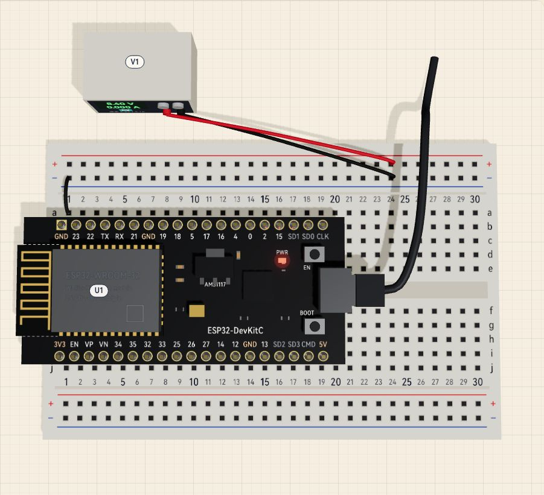
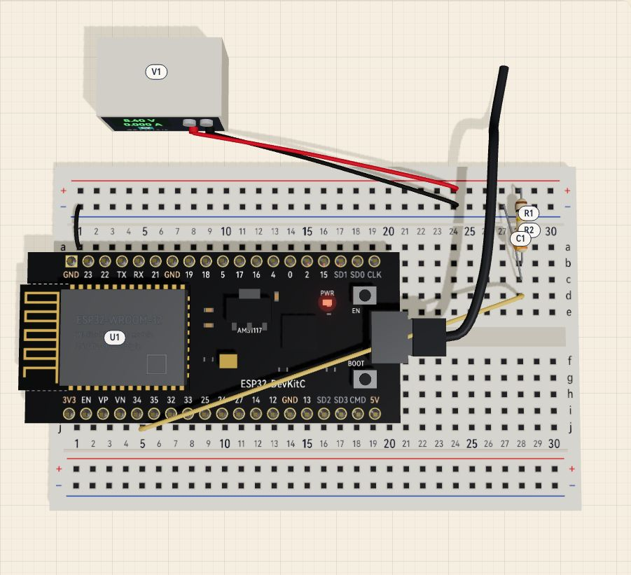
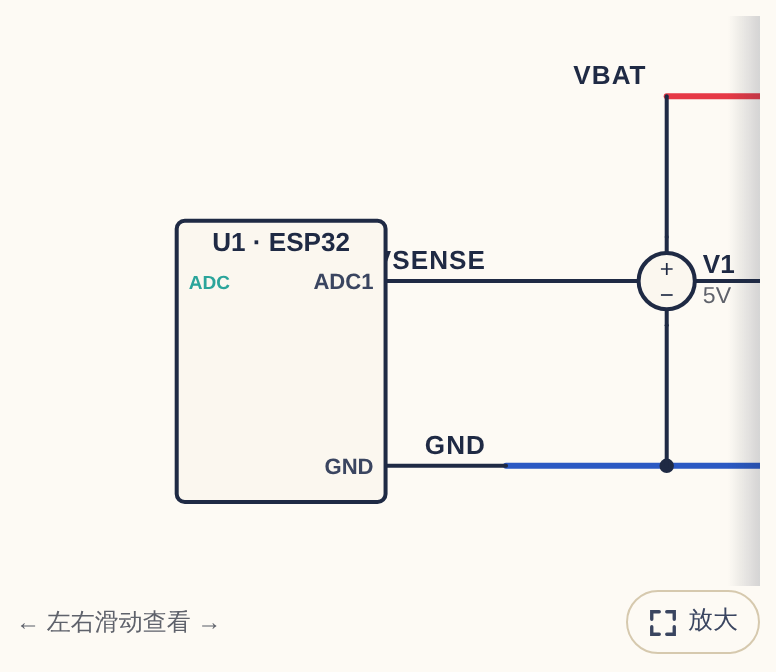
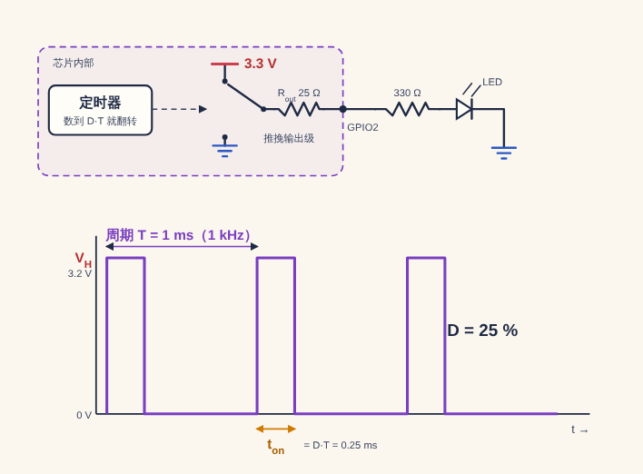
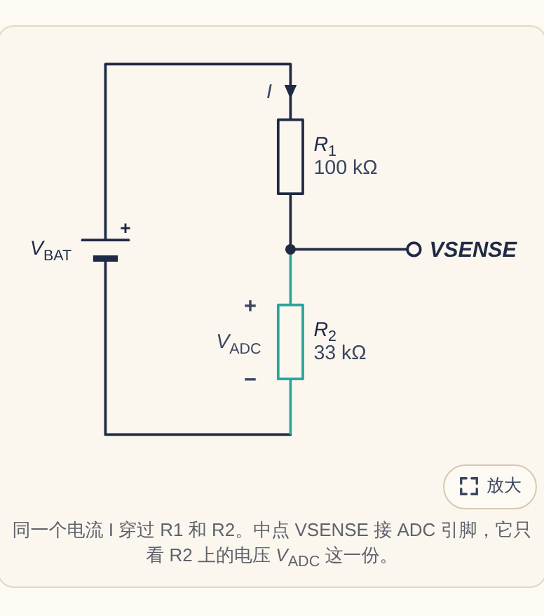
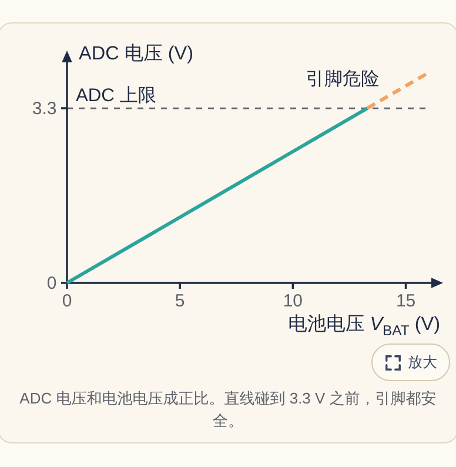

# 8.7 · 电池电压监测：用分压器把 8.4 V 缩小

| 项目 | 内容 |
|---|---|
| id | `exp5-adc-battery-divider` |
| 文件 | `challenges/283-adc-battery-divider.json` |
| 类型 | 实验 / 挑战（没有分步，照目标电路图搭） · 难度 3/5 |
| 位置 | World 8 · 数字逻辑、MCU 与传感器实战 → 8.7 ADC 与模拟传感器（本节第 2 项） |
| 右侧面板 | 轨道由旧的四张卡片自动生成（还没手工精排） |
| 前后 | 上一项 [8.7 lesson-mcu-pwm-adc](../w8/8.07-1-lesson-mcu-pwm-adc.md) · 下一项 [8.7 exp5-ldr-light-sensor](../w8/8.07-3-exp5-ldr-light-sensor.md) |
| 先修 | lesson-mcu-pwm-adc |
| 概念 | 分压器 voltage divider、ADC 模数转换 analog-to-digital conversion、满量程与分辨率 full scale & resolution、源阻抗 source impedance、静态电流 quiescent drain |

**一句话概要**：ADC 只能测 0–3.3 V，两节锂电池却有 8.4 V。先故意直接接一次，再用 100 kΩ + 33 kΩ 分压器把电压按比例缩小。

## 1. 左侧工作台（3D 面包板 → 2D 俯视截图）

截图是程序里真实的 3D 面包板换成俯视角拍的；表格是同一块板的文字版（元件、参数、每只脚插在哪个孔）。

### 1.1 起点：打开这一课时板上已经有的

右侧显示的「起点」说明：

> **半成品**：ESP32（GPIO34 已设成 ADC）、GND 线和模拟电池的稳压电源（8.4 V）已经接好。**为什么**：板子和电源的接法是重复技能；这个实验要设计的是分压器。**你要做**：搭 R1（100kΩ，+ 轨 → 中点）、R2（33kΩ，中点 → GND）、C1（100nF，中点 → GND），再把中点接到 GPIO34（j5）。

| 元件 | 类型 | 参数 | 引脚 → 孔 |
|---|---|---|---|
| U1 | esp32_devkit | usb=true, pins={"GPIO34":{"mode":"adc"}} | GND→b1 GPIO23→b2 GPIO22→b3 GPIO1→b4 GPIO3→b5 GPIO21→b6 GND_2→b7 GPIO19→b8 GPIO18→b9 GPIO5→b10 GPIO17→b11 GPIO16→b12 GPIO4→b13 GPIO0→b14 GPIO2→b15 GPIO15→b16 GPIO8→b17 GPIO7→b18 GPIO6→b19 3V3→i1 EN→i2 GPIO36→i3 GPIO39→i4 GPIO34→i5 GPIO35→i6 GPIO32→i7 GPIO33→i8 GPIO25→i9 GPIO26→i10 GPIO27→i11 GPIO14→i12 GPIO12→i13 GND_3→i14 GPIO13→i15 GPIO9→i16 GPIO10→i17 GPIO11→i18 5V→i19 |
| W1 | wire |  | a→a1 b→tn1 |
| V1 | bench_supply | voltage=8.4, currentLimit=0.1 | +→tp24 -→tn24 |

### 1.3 参考答案（「看答案」载入的板子）

| 元件 | 类型 | 参数 | 引脚 → 孔 |
|---|---|---|---|
| U1 | esp32_devkit | usb=true, pins={"GPIO34":{"mode":"adc"}} | GND→b1 GPIO23→b2 GPIO22→b3 GPIO1→b4 GPIO3→b5 GPIO21→b6 GND_2→b7 GPIO19→b8 GPIO18→b9 GPIO5→b10 GPIO17→b11 GPIO16→b12 GPIO4→b13 GPIO0→b14 GPIO2→b15 GPIO15→b16 GPIO8→b17 GPIO7→b18 GPIO6→b19 3V3→i1 EN→i2 GPIO36→i3 GPIO39→i4 GPIO34→i5 GPIO35→i6 GPIO32→i7 GPIO33→i8 GPIO25→i9 GPIO26→i10 GPIO27→i11 GPIO14→i12 GPIO12→i13 GND_3→i14 GPIO13→i15 GPIO9→i16 GPIO10→i17 GPIO11→i18 5V→i19 |
| W1 | wire |  | a→a1 b→tn1 |
| V1 | bench_supply | voltage=8.4, currentLimit=0.1 | +→tp24 -→tn24 |
| R1 | resistor | resistance=100000 | 1→tp28 2→a28 |
| R2 | resistor | resistance=33000 | 1→b28 2→tn28 |
| C1 | capacitor | capacitance=1.0000000000000001e-7 | 1→c28 2→tn27 |
| W2 | wire |  | a→d28 b→j5 |

### 1.4 目标原理图（右侧「目标原理图」抽屉）

| 元件 | 类型 | 参数 |
|---|---|---|
| U1 | esp32_devkit | pins={"ADC1":{"mode":"adc"}} |
| V1 | bench_supply |  |
| R1 | resistor | resistance=100000 |
| R2 | resistor | resistance=33000 |
| C1 | capacitor | capacitance=1.0000000000000001e-7 |

连接（每个结点上的引脚）：

- **VBAT**：V1.+、R1.1
- **VSENSE**：R1.2、R2.1、C1.1、U1.ADC1
- **GND**：V1.-、R2.2、C1.2、U1.GND

## 2. 右侧面板：学生从上往下看到的内容（单轨流）

### 第 1 步 · 🔍 先看一眼：先认识它：PWM 与 ADC

**拆解「PWM 与 ADC：数字引脚怎么“输出”和“读入”模拟量」第 1 / 8 层：① PWM：同一个输出级，开开关关**

PWM 不是新的硬件，就是上一个拆解里那个 推挽输出级，只不过由芯片里的 定时器 timer 自动地、很快地在 HIGH 和 LOW 之间切换：
- 每个 周期 T 开始时引脚变 HIGH；
- 定时器数到 $t_on$ 就把它变 LOW，等下一个周期。

高电平占整个周期的比例叫 **duty cycle（占空比）**：
$$D = \frac{t_{on}}{T}$$
第 16 课：GPIO2 设成 PWM，1 kHz（T = 1 ms），D = 25 %，所以 $t_{on}$ = 0.25 ms。

注意 高电平 不是 3.3 V 而是 3.2 V：高电平期间引脚就是“3.3 V 串 25 Ω”，LED 和 330 Ω 上的电流 $I = \frac{3.3 - 1.8}{25 + 330 + 12} = 4.1 mA$ 在 $R_{out}$ 上压掉 $25 × 4.1 mA ≈ 0.1 V$。示波器上量到的 Vpp ≈ 3.2 V。

**PWM 没有改变“每一刻”的电流**：亮的那 25 % 时间里 LED 照样流 4.1 mA。它不能绕过引脚的电流上限。

| 量 | 符号 | 第 16 课的值 |
|---|---|---|
| 频率 | $f = \frac{1}{T}$ | 1 kHz |
| 周期 | T | 1 ms |
| 占空比 | $D = \frac{t_{on}}{T}$ | 25 % |
| 高电平时间 | $t_{on}$ | 0.25 ms |
| 高电平 | $V_H$ | 3.3 − 25 Ω × 4.1 mA ≈ 3.2 V |
| 高电平期间的 LED 电流 | $I_{on}$ | 4.1 mA |

### 第 2 步 · 🔧 动手搭：把 8.4 V 直接接上去

**稳压电源**设成 **`8.4 V`**，代表一块充满的两节锂电池。它的 **−** 接开发板的 **GND**。
**故意接错一次**：电源 **+** 直接连到 ESP32 的 **GPIO34**，把这个引脚设成 **ADC**。看**诊断**说了什么。
ADC 只能测 0–3.3 V。怎样才能让它“看见”一块 8.4 V 的电池？

### 第 3 步 · 💡 想明白：分压器：按比例缩小

- 两个电阻串联，中点只拿到总电压的**一部分**。这个比例只由两个电阻决定：
$$V_{ADC} = V_{BAT} × \frac{R_2}{R_1 + R_2}$$

*图 `div`（schematic）：同一个电流 I 穿过 R1 和 R2。中点 VSENSE 接 ADC 引脚，它只看 R2 上的电压 V_ADC 这一份。*

- 代入数字：$R_1$ = 100 kΩ，$R_2$ = 33 kΩ。电池放空到 6.0 V 时，$V_{ADC} = 6.0 × \frac{33}{133} ≈ 1.49$ V。
- 比例是固定的，所以 ADC 电压跟电池电压成正比：一条直线，一直到 3.3 V 的上限。

*图 `line`（plot）：ADC 电压和电池电压成正比。直线碰到 3.3 V 之前，引脚都安全。*

（这一步下面列着这节课的计算卡片，点开就地展开：`voltage-divider`、`thevenin-resistance`、`rc-time-constant`、`adc-code`、`adc-divider`，全文见第 6 节）

### 第 4 步 · 🔧 动手搭：换成分压器

- **拆掉**那根直连的线。**`100 kΩ`** 从电源 + 到中点，**`33 kΩ`** 从中点到 GND，中点接 ADC 引脚（GPIO32–39 都行）。
- 中点再并一个 **`100 nF`** 到 GND。ADC 采样的一瞬间从这个小“水库”取电荷，读数更稳。
- 点**「检查我的电路」**。通过后，按题目把电源调到不同电压，用万用表测中点。

### 第 5 步 · 📏 测一测：测一测：读你自己的仪表

**测量题 1 · `v84`**（读数题）

> 电源 8.4 V（充满）：万用表测 ADC 引脚（VSENSE）对 GND

- 单位 V · 先写预测 · 状态：V1 设为 8.4 V · 参考答案的读数 **2.084 V** · 合理范围 [1.98, 2.19]

答对后显示：

> k = 33 / 133 ≈ 0.248，V_ADC = 0.248 × 8.4 ≈ 2.08 V。

**测量题 2 · `k`**（计算题（用自己的读数算））

> 用你的读数算分压比 k = V_ADC / V_BAT

- 先写预测 · 参考答案的读数 **0.2481** · 合理范围 [0.236, 0.261] · 公式 `v84 / 8.4`

答对后显示：

> k = R2 / (R1 + R2) = 0.248。固件里反过来算：V_BAT = V_ADC / k。

**测量题 3 · `raw`**（计算题（用自己的读数算））

> 这个电压对应的 12 位 ADC 读数 raw = V_ADC / 3.3 V × 4095

- 先写预测 · 参考答案的读数 **2586** · 合理范围 [2460, 2720] · 公式 `v84 / 3.3 * 4095`

答对后显示：

> ≈ 2586。每一个计数对应电池电压 3.3 / 4095 / 0.248 ≈ 3.25 mV。满电只用到约 2.1 V，是因为 ESP32 的 ADC 在 0.15–2.45 V 最线性。

**测量题 4 · `v12`**（读数题）

> 电源调到 12 V（接错充电器）：ADC 引脚对 GND

- 单位 V · 先写预测 · 状态：V1 设为 12 V · 参考答案的读数 **2.977 V** · 合理范围 [2.83, 3.13]

答对后显示：

> 0.248 × 12 ≈ 2.98 V，仍低于 3.3 V，引脚安全；分压器最多能承受 3.3 / 0.248 ≈ 13.3 V。

**测量题 5 · `idiv`**（读数题）

> 电源 8.4 V：分压器从电池吸走的电流（电流表串进 R1）

- 单位 µA · 先写预测 · 状态：V1 设为 8.4 V · 参考答案的读数 **63.16 µA** · 合理范围 [0.00006, 0.0000663]

答对后显示：

> 8.4 V / 133 kΩ ≈ 63 µA，一年约 550 mAh。深度睡眠的设备要用更大的电阻，或用 MOSFET 在测量时才接通分压器。

### 第 6 步 · 🎒 带走：带走

- **分压器把高电压缩进 ADC 的量程**，比例 R2 / (R1 + R2) 只看电阻。
- 比例要留余量：满电时只用 ADC 量程的大约 2/3。ESP32 的 ADC 在中间段最准；充电器接错时，引脚也还安全。
- 坑：分压器一直在耗电。深度睡眠的设备要用更大的电阻（例如 1 MΩ + 330 kΩ），或者只在测量时才接通它。
- 只用 ADC1（GPIO32–39）；电源的 − 必须和开发板 GND 接在一起，否则读数没有意义。

趁热练理论题：`equivalence`

## 3. 测量题一览

| # | id | 题目 | 类型 | 单位 | 状态 | 参考读数 |
|---|---|---|---|---|---|---|
| 1 | v84 | 电源 8.4 V（充满）：万用表测 ADC 引脚（VSENSE）对 GND | voltage | V | V1 设为 8.4 V | 2.084 V |
| 2 | k | 用你的读数算分压比 k = V_ADC / V_BAT | formula |  |  | 0.2481 |
| 3 | raw | 这个电压对应的 12 位 ADC 读数 raw = V_ADC / 3.3 V × 4095 | formula |  |  | 2586 |
| 4 | v12 | 电源调到 12 V（接错充电器）：ADC 引脚对 GND | voltage | V | V1 设为 12 V | 2.977 V |
| 5 | idiv | 电源 8.4 V：分压器从电池吸走的电流（电流表串进 R1） | current | µA | V1 设为 8.4 V | 63.16 µA |

### 全部答完后显示的「对比」

**对比**：每个电压下的 ADC 原始读数（0–4095）和 ADC 电压，以及分压器从电池吸走的电流。读数始终是 0 或乱跳时，先检查稳压电源的 − 有没有接开发板 GND、引脚是不是设成了模拟输入。计算过程：

**分压比**：k = R2 / (R1 + R2) = 33 / 133 = **0.248**，V_ADC = k × V_BAT。12 位 ADC：raw = V_ADC / 3.3 V × 4095（本模拟器的满量程）。
- **8.4 V（充满）**：2.084 V → **2586**
- **7.4 V（标称）**：1.836 V → **2278**
- **6.0 V（放空）**：1.489 V → **1847**
- **12 V（接错充电器）**：2.977 V → **3695**，仍低于 3.3 V，引脚安全。分压器能承受的最高电压 ≈ 3.3 / 0.248 ≈ 13.3 V。
固件里反过来算：V_BAT = raw × (3.3 / 4095) / 0.248 ≈ raw × **3.25 mV**——每一个计数对应电池电压约 3.25 mV。

**为什么不选 27k/10k、22k/10k 让满量程更接近 3.3 V**：ESP32 的 ADC（11 dB 衰减）在约 **0.15–2.45 V** 最线性，接近 3.1 V 以上明显弯曲、最后饱和。所以让满电时的电压落在约 2.1 V，留出余量给充电器过压和电阻误差，宁可少用一点分辨率（1847–2586，约 740 个计数覆盖 2.4 V 电池范围，足够显示电量）。

**分压器本身也在耗电**：I = 8.4 V / 133 kΩ ≈ **63 µA**（仿真 63.2 µA）。一节 2000 mAh 的电池一年会被它耗掉 0.063 mA × 8760 h ≈ 550 mAh——深度睡眠的设备要用更大的电阻（如 1 MΩ + 330 kΩ）或者用 MOSFET 在测量时才接通分压器。

### 提示按钮（依次显示）

1. 先把稳压电源的 − 端接到开发板 GND：没有共地，ADC 测不出有意义的电压。
2. 分压器：电源 + → 100 kΩ → 中点 → 33 kΩ → GND；中点接 GPIO32–39 之一，再并 100 nF 到 GND。
3. 在引脚表里把这个引脚设成“模拟输入 ADC”。

### 功能测试（「检查我的电路」时跑）

- 8.4 V（充满）：ADC 读数和分压电流合理
- 7.4 V（标称）：ADC 读数合理
- 6.0 V（放空）：ADC 读数合理
- 12 V（接错充电器）：ADC 电压仍低于 3.3 V

## 4. 用到的拆解（全部层的文字，供改写参考）

### 拆解 `pwm-adc`：PWM 与 ADC：数字引脚怎么“输出”和“读入”模拟量

*PWM = Pulse-Width Modulation（脉冲宽度调制），ADC = Analog-to-Digital Converter（模数转换器）。芯片只会输出 0 和 3.3 V、只会处理数字——我们拆开看它怎样用“快速开关 + 平均”假装输出模拟电压，又怎样用“采样 + 二分查找”把电压变成数字。*

**拆解「PWM 与 ADC：数字引脚怎么“输出”和“读入”模拟量」第 1 / 8 层：① PWM：同一个输出级，开开关关**

PWM 不是新的硬件，就是上一个拆解里那个 推挽输出级，只不过由芯片里的 定时器 timer 自动地、很快地在 HIGH 和 LOW 之间切换：
- 每个 周期 T 开始时引脚变 HIGH；
- 定时器数到 $t_on$ 就把它变 LOW，等下一个周期。

高电平占整个周期的比例叫 **duty cycle（占空比）**：
$$D = \frac{t_{on}}{T}$$
第 16 课：GPIO2 设成 PWM，1 kHz（T = 1 ms），D = 25 %，所以 $t_{on}$ = 0.25 ms。

注意 高电平 不是 3.3 V 而是 3.2 V：高电平期间引脚就是“3.3 V 串 25 Ω”，LED 和 330 Ω 上的电流 $I = \frac{3.3 - 1.8}{25 + 330 + 12} = 4.1 mA$ 在 $R_{out}$ 上压掉 $25 × 4.1 mA ≈ 0.1 V$。示波器上量到的 Vpp ≈ 3.2 V。

**PWM 没有改变“每一刻”的电流**：亮的那 25 % 时间里 LED 照样流 4.1 mA。它不能绕过引脚的电流上限。

| 量 | 符号 | 第 16 课的值 |
|---|---|---|
| 频率 | $f = \frac{1}{T}$ | 1 kHz |
| 周期 | T | 1 ms |
| 占空比 | $D = \frac{t_{on}}{T}$ | 25 % |
| 高电平时间 | $t_{on}$ | 0.25 ms |
| 高电平 | $V_H$ | 3.3 − 25 Ω × 4.1 mA ≈ 3.2 V |
| 高电平期间的 LED 电流 | $I_{on}$ | 4.1 mA |

**拆解「PWM 与 ADC：数字引脚怎么“输出”和“读入”模拟量」第 2 / 8 层：② 平均值 = 占空比 × 高电平：面积除以时间**

万用表的直流档很“慢”，它显示的是一段时间里的 **平均值**。平均值的定义：一个周期内电压对时间的积分（阴影面积）除以周期：
$$V̄ = \frac{1}{T}∫_{0}^{T} v(t) dt$$
PWM 的 $v(t)$ 只有两段：$t_{on}$ 内是 $V_H$，其余时间是 0，所以积分就是一个矩形：
$$V̄ = \frac{V_H·t_{on} + 0·(T - t_{on})}{T} = D·V_H$$
代数字（第 16 课）：
- D = 25 %：V̄ = 0.25 × 3.2 V = **0.80 V**（万用表读数）；
- D = 75 %：V̄ = 0.75 × 3.2 V = **2.40 V**，正好是 25 % 时的 3 倍；
- LED 的平均电流同理：0.25 × 4.1 mA ≈ **1.0 mA**。

眼睛也是“慢”的：几百 Hz 以上看不出闪，只感觉到平均亮度。所以 PWM 能调光、调速——改变的是 **平均** 功率，而不是瞬时电压。

| 仪器 | 它看到什么 | D = 25 % 时读数 |
|---|---|---|
| 示波器 | 真实方波：0 和 3.2 V | Vpp ≈ 3.2 V |
| 万用表直流档 | 平均值 | ≈ 0.80 V |
| 万用表电流档（串在 LED 上） | 平均电流 | ≈ 1.0 mA |
| 眼睛 | 平均亮度 | 约全亮的 1/4 |

- 公式 `V̄ = \frac{1}{T}∫_{0}^{T} v dt = D·V_H`：任何 PWM 波形的直流分量

**拆解「PWM 与 ADC：数字引脚怎么“输出”和“读入”模拟量」第 3 / 8 层：③ 加一个 RC：把方波变成直流（PWM DAC）**

实验 5-14：引脚 → R = 10 kΩ → 结点 VDAC → C = 1 µF → GND，VDAC 再接回一个 ADC 引脚 自己读。

**为什么能得到直流**：方波 = 直流分量 $D·V_H$ + 频率为 f、2f、3f… 的交流分量。RC 低通对直流是开路（电容不通直流），直流全部通过；对交流的衰减约为 $\frac{f_c}{f}$：
$$f_c = \frac{1}{2πRC} = \frac{1}{2π × 10 kΩ × 1 µF} ≈ 16 Hz$$
1 kHz 的基波只剩 16/1000 ≈ 1.6 %。

**剩下的纹波（ripple）有多大**：τ = RC = 10 ms ≫ T = 1 ms，电容电压几乎不变，约等于 V̄。高电平期间流进电容的电流 $\frac{V_H - V̄}{R}$ 近似恒定，持续 $D·T$，电容电压升高
$$ΔV = \frac{I·t_{on}}{C} = \frac{(V_H - D V_H)·D T}{RC} = \frac{V_H·D(1 - D)}{f·R·C}$$
- 1 kHz、50 %：$\frac{3.3 × 0.25}{1000 × 10 ms}$ ≈ **82 mV**（仿真 82 mV）；
- 25 % 或 75 %：D(1 − D) = 0.1875 → **62 mV**——50 % 时纹波最大；
- 10 kHz：频率 ×10，纹波 ÷10 → **8.2 mV**；
- 100 Hz：T = τ，近似不再成立，精确值 $3.3·tanh(\frac{T}{4τ})$ ≈ **0.81 V**——这已经不是“直流”了。

**代价**：RC 越大纹波越小，但改占空比后 VDAC 要等 4.6τ ≈ 46 ms 才稳定到 1 % 以内。想又小又快，就提高 PWM 频率。

| 频率 | D | 平均 VDAC | ADC 读数 | 纹波 Vpp |
|---|---|---|---|---|
| 1 kHz | 25 % | 0.824 V | 1023 | 62 mV |
| 1 kHz | 50 % | 1.649 V | 2045 | 82 mV |
| 1 kHz | 75 % | 2.473 V | 3068 | 62 mV |
| 100 Hz | 50 % | 1.649 V | 2045 | 0.81 V |
| 10 kHz | 50 % | 1.649 V | 2045 | 8.2 mV |

- 公式 `f_c = \frac{1}{2πRC} ≈ 16 Hz`：截止频率要远低于 PWM 频率
- 公式 `ΔV ≈ \frac{V_H·D(1 - D)}{f·R·C}`：τ ≫ T 时的纹波（峰峰值）

**拆解「PWM 与 ADC：数字引脚怎么“输出”和“读入”模拟量」第 4 / 8 层：④ 反过来：ADC 里面是采样保持 + 比较器 + DAC**

ADC 把电压变成数字，ESP32 和 STM32 用的都是 **SAR ADC（逐次逼近型，Successive Approximation Register）**。它由四块组成：
1. 采样保持 sample-and-hold：一个开关 + 一个几 pF 的电容 $C_{SH}$。开关闭合一小段时间（采样），电容充到输入电压；然后开关断开（保持），后面怎么比较输入都不会变；
2. DAC（数模转换器）：把一个试探码变回电压，满量程等于 参考电压 $V_ref$ = 3.3 V；
3. 比较器 comparator：只回答一个问题——采样到的电压比 DAC 的电压高还是低？
4. SAR 逻辑：根据比较结果一位一位地定下数字码。

**源阻抗**：采样时 $C_{SH}$ 要经过外部电路的电阻 $R_src$ 充电。要在采样时间内充到误差小于半个 LSB，需要大约 $(N + 1)·ln2 ≈ 9$ 个时间常数（12 位）。$R_{src}$ 太大，读数偏低、发抖。实验 5-4 的分压器源阻抗 = 100 kΩ ∥ 33 kΩ ≈ 24.8 kΩ，所以在引脚上并一个 100 nF 电容做“小水库”：采样那一下从电容取电荷，而不是从 24.8 kΩ 后面取。

| 块 | 作用 | 数值 / 注意 |
|---|---|---|
| 采样保持 | 冻结输入电压 | $C_{SH}$ 几 pF；采样时间 µs 级 |
| DAC | 试探码 → 电压 | $V = \frac{code}{4095}·V_{ref}$ |
| 比较器 | 高还是低 | 每一步 1 位 |
| SAR 逻辑 | 二分查找 | 12 位 = 12 步 |
| 源阻抗 | 给 $C_{SH}$ 充电的路径 | ESP32 宜 < 10 kΩ，或加电容 |

**拆解「PWM 与 ADC：数字引脚怎么“输出”和“读入”模拟量」第 5 / 8 层：⑤ SAR：一次比一位的二分查找**

用一个 4 位 ADC（16 个台阶，每个台阶 $\frac{3.3}{16}$ = 0.206 V）演示，输入是实验 5-4 满电时的 $V_in$ = 2.084 V。SAR 从最高位开始猜：
1. 试 1000₂ = 8 → 1.650 V：V_in 更高 → 这一位 **保留 1**；
2. 试 1100₂ = 12 → 2.475 V：V_in 更低 → 这一位 **改回 0**；
3. 试 1010₂ = 10 → 2.063 V：V_in 更高 → **保留 1**；
4. 试 1011₂ = 11 → 2.269 V：V_in 更低 → **改回 0**。

结果 1010₂ = 10，代表 10 × 0.206 = 2.06 V，和真实值差不到一个台阶。

每一步把可能的范围砍掉一半，所以 N 位只要 N 次比较：12 位的 ESP32 / STM32 是 12 步，加上采样，一次转换只要几微秒。这和你猜 1–100 之间的数“先猜 50”是同一个道理。

| 步 | 试探码 | DAC 电压 | 比较 | 这一位 |
|---|---|---|---|---|
| 1 | 1000₂ = 8 | 1.650 V | 2.084 > 1.650 | b3 = 1 |
| 2 | 1100₂ = 12 | 2.475 V | 2.084 < 2.475 | b2 = 0 |
| 3 | 1010₂ = 10 | 2.063 V | 2.084 > 2.063 | b1 = 1 |
| 4 | 1011₂ = 11 | 2.269 V | 2.084 < 2.269 | b0 = 0 |

**拆解「PWM 与 ADC：数字引脚怎么“输出”和“读入”模拟量」第 6 / 8 层：⑥ 量化：台阶有多细（分辨率）**

ADC 的输出只能是整数，所以输入和输出之间是一条 台阶，而不是 直线。一个台阶叫 **1 LSB**（Least Significant Bit，最低有效位），它就是分辨率：
$$1 LSB = \frac{V_{ref}}{2^{N}} = \frac{3.3 V}{4096} = 0.806 mV$$
本仿真器的读数规则（和第 16 课一样）：
$$code = round(\frac{V}{V_{ref}}·(2^{N} - 1)) = round(\frac{V}{3.3}·4095)$$
- 第 16 课，电位器中点 1.65 V：$\frac{1.65}{3.3} × 4095 = 2047.5$ → **2048**；
- 实验 5-4 满电 2.084 V：$\frac{2.084}{3.3} × 4095$ → **2586**。

（教材有的写 $2^{N}$、有的写 $2^{N} - 1$，差 1/4096 = 0.02 %，远小于真实 ADC 的误差。）

四舍五入意味着 量化误差 最多 ±½ LSB——这是 ADC 再理想也去不掉的误差。位数每多 1 位，台阶细一倍。

| 位数 N | 台阶数 2^N | 1 LSB（V_ref = 3.3 V） | 例子 |
|---|---|---|---|
| 8 | 256 | 12.9 mV | ESP32 的 DAC（GPIO25 / 26） |
| 10 | 1024 | 3.22 mV | Arduino Uno（5 V：4.9 mV） |
| 12 | 4096 | 0.806 mV | ESP32 / STM32F103 ADC |
| 16 | 65536 | 50 µV | 外置 ADC（ADS1115） |

- 公式 `code = round(\frac{V}{V_{ref}}·(2^{N} - 1))`：仿真器的读数公式
- 公式 `1 LSB = \frac{V_{ref}}{2^{N}} = 0.806 mV`：12 位、3.3 V

**拆解「PWM 与 ADC：数字引脚怎么“输出”和“读入”模拟量」第 7 / 8 层：⑦ 量一个比 3.3 V 高的电压：先分压，再读，再乘回去**

实验 5-4：2S 锂电池 6.0–8.4 V，比 ADC 的 3.3 V 满量程高，直接接会烧引脚。用 R1 = 100 kΩ 和 R2 = 33 kΩ 分压，VSENSE 接 GPIO34：
$$k = \frac{R_2}{R_1 + R_2} = \frac{33}{133} = 0.248$$
**第 1 步 · 电池 → ADC 电压**：$V_{ADC} = k·V_{BAT}$，8.4 V → 2.084 V。
**第 2 步 · ADC 电压 → 读数**：$code = round(\frac{2.084}{3.3} × 4095)$ = **2586**。
**第 3 步 · 固件反算**：
$$V_{BAT} = \frac{code·3.3 / 4095}{k} ≈ code × 3.25 mV$$
每一个读数代表电池上的 3.25 mV。

右边两根刻度尺 就是这个乘以 k 的映射：电池 0–13.3 V 对应 ADC 0–3.3 V。所以充电器接错成 12 V 时，ADC 只看到 2.98 V，引脚安全。

为什么不选 22 k / 10 k 让满电更接近 3.3 V？真实 ESP32 的 ADC 在 2.45 V 以上开始弯曲（见下一层），把满电放在 2.1 V 左右留了余量。

C1 = 100 nF 是上一层说的“小水库”。分压器还一直从电池取电：$I = \frac{8.4 V}{133 kΩ} ≈ 63 µA$，一年约 550 mAh——深度睡眠的设备要用更大的电阻或用 MOSFET 只在测量时接通。

| 电池 | $V_{ADC} = 0.248·V_{BAT}$ | 12 位读数 | 说明 |
|---|---|---|---|
| 8.4 V | 2.084 V | 2586 | 满电 |
| 7.4 V | 1.836 V | 2278 | 标称 |
| 6.0 V | 1.489 V | 1847 | 没电 |
| 12 V | 2.977 V | 3695 | 接错充电器，仍 < 3.3 V |

- 公式 `V_{ADC} = \frac{R_2}{R_1 + R_2}·V_{BAT}`：无负载分压（ADC 输入不取电流）
- 公式 `R_{src} = R_1 ∥ R_2 = 24.8 kΩ`：ADC 看进去的源阻抗

**拆解「PWM 与 ADC：数字引脚怎么“输出”和“读入”模拟量」第 8 / 8 层：⑧ 局限：真实 ADC 不是直线，PWM 也不是万能**

仿真器里的 ADC 是 理想直线。真实的 ESP32 ADC（11 dB 衰减档）是 红色那条：
- 低于约 0.1 V 读 0；
- 0.15–2.45 V 比较线性，但不同芯片之间偏差可达 ±6 %，要用 ESP-IDF 的校准（eFuse 里的出厂 V_ref）；
- 高于约 2.45 V 开始弯，约 3.1 V 饱和。

所以设计时把有用的电压放在中间，多次采样取平均。STM32 的 ADC 线性好得多，满量程 = VDDA（3.3 V）。

**ADC 的硬性规则**：
- 输入不能超过 3.3 V（会经钳位二极管注入，见“开发板”拆解），STM32 的 FT 脚设成模拟输入后也 **不** 耐 5 V；
- ESP32 只用 ADC1（GPIO32–39）：ADC2 在开 Wi-Fi 时不能用；
- 测量地必须和被测电路共地。

**PWM 的限制**：
- 不能突破引脚的电流上限（每个高电平期间都是满电流）；
- ESP32 的 PWM（LEDC）频率和分辨率互相牵制：$f × 2^{bits} ≤ 80 MHz$，例如 10 位最高约 78 kHz，12 位只到 19.5 kHz；
- 驱动电机、灯带这样的大电流负载要接 MOSFET（见 MOSFET 拆解）。

|  | 仿真 | ESP32 | STM32F103 |
|---|---|---|---|
| 分辨率 | 12 位 | 12 位 | 12 位 |
| 满量程 | 3.3 V | ≈ 3.1 V（11 dB） | VDDA = 3.3 V |
| 线性 | 理想 | 0.15–2.45 V 较好，需校准 | 好 |
| ADC 引脚 | ADC1 / ADC | GPIO32–39（ADC1） | PA0–PA7, PB0, PB1 |
| PWM | 任意频率 | $f × 2^{bits} ≤ 80 MHz$ | 定时器通道 |

**一句话记住**：PWM：输出级快速开关，平均值 $V̄ = D·V_H$，RC 低通把它变成直流，纹波 $ΔV ≈ \frac{V_H·D(1 - D)}{fRC}$。ADC：采样保持 + 比较器 + DAC 做二分查找，$code = round(\frac{V}{3.3}·4095)$，1 LSB = 0.806 mV；高于 3.3 V 的电压先分压，固件再乘回去。

## 5. 这一课的计算卡片

**计算卡片 `voltage-divider`：分压器 Voltage divider**

- 公式 `V_{out} = V_s \frac{R_2}{R_1 + R_2}`
- 用途：用两个串联电阻从一个大电压里取出一个小电压。
- 输入：Vs（电源电压，V）；R1（上面的电阻 R₁，Ω）；R2（下面的电阻 R₂，Ω） → V_out（R₂ 上的电压，V）

三步推出来：
1. 串联：$I = \frac{V_s{R_1 + R_2}$
2. 欧姆定律用在 R₂ 上：$V_{out} = I R_2$
3. 代入：$V_{out} = V_s \frac{R_2}{R_1 + R_2}$

**前提**：R₁ 和 R₂ 流过 **同一个电流**——输出端不接负载（或负载电流远小于 I）。接了负载 R_L，下面的电阻就变成 $R_2 ∥ R_L$，输出会 **降低**（实验 1-3、2-5）。

例子：9 V，R₁ = 20 kΩ，R₂ = 10 kΩ：$V_{out} = 9 × \frac{10}{30} = 3 V$（挑战 2）。

- ⚠ 分子是 **输出所在的那个** 电阻（R₂），不是 R₁。
- ⚠ 接了负载以后公式里的 R₂ 要换成 R₂ ∥ R_L。

**计算卡片 `thevenin-resistance`：戴维宁等效电阻（置零法）**

- 公式 `R_{eq} = R_3 + R_1 ∥ R_2`
- 用途：电源置零后从端口往里看的电阻——等效电路的内阻，也是电容 / 电感“看到”的电阻。
- 输入：R_1（电源和结点 A 之间的 R₁（含电源内阻），Ω）；R_2（A 到地的 R₂，Ω）；R_3（A 到端口的 R₃（没有就填 0），Ω） → R_eq（从端口看进去的电阻，Ω）

1. 把独立源置零：电压源换成 **导线**，电流源换成 **开路**。
2. 电压源变成导线以后，R₁ 的上端也接到了 GND，所以从 A 往下看，R₁ 和 R₂ **并联**。
3. 再串上 A 到端口的 R₃：$R_{eq} = R_3 + R_1 ∥ R_2$。
4. 开路电压另算：R₃ 里没有电流，$V_{oc} = V_s \frac{R_2}{R_1 + R_2}$。
5. 一阶电路里，电容 / 电感就是“端口”：$τ = R_{eq}C$ 或 $τ = \frac{L}{R_{eq}}$。

例子：- 实验 2-2：$470 + 1k ∥ 2.2k = 470 + 687.5 = 1157.5 Ω$。
- 实验 3-7：电容看到 $(10k + 50) ∥ 10k ≈ 5.01 kΩ$（R₃ = 0），$τ ≈ 0.50 ms$——只有单纯串联 RC 的一半。
- 实验 3-5 充电：$(220 + 50) ∥ (470 + 12) ≈ 173 Ω$，$τ ≈ 0.17 s$。
- 实验 5-4：ADC 看到 $100k ∥ 33k ≈ 24.8 kΩ$。

- ⚠ 信号发生器的 50 Ω 是电源的内阻：电源置零后它还在，串在 R₁ 里。
- ⚠ 电流源置零是开路，不是短路。

**计算卡片 `rc-time-constant`：RC 时间常数 τ = RC**

- 公式 `τ = R C`
- 用途：电容经电阻充放电有多快：过 1τ 走完 63 %，5τ 基本到头。
- 输入：R（电容看到的电阻（含发生器 50 Ω），Ω）；C（电容，F） → τ（时间常数，s）

1. 电容：$i = C\frac{dv_C}{dt}$，电压不能突变。
2. 充电回路的 KVL：$V_s = Ri + v_C = RC\frac{dv_C}{dt} + v_C$。
3. 这个一阶微分方程的解是指数：$v_C = V_s(1 - e^{-t/τ})$，其中 $τ = RC$（Ω × F = s）。
4. 经验值：1τ → 63 %，2τ → 86 %，3τ → 95 %，5τ → 99.3 %。
5. **R 是从电容两端看进去的戴维宁电阻**（电源置零）：要把信号发生器的 50 Ω、并联的电阻都算进去。

例子：- 实验 3-1：$(10k + 50) × 100 nF ≈ 1.0 ms$。
- 实验 3-2：微分 $10k × 10 nF = 0.1 ms$，积分 $10k × 1 µF = 10 ms$。
- 实验 3-5：充电 $1000 µF × 173 Ω ≈ 0.17 s$，放电 $1000 µF × 482 Ω ≈ 0.48 s$。
- 实验 5-14：$10k × 1 µF = 10 ms$；实验 5-16：$2.2k × 200 pF = 440 ns$。

- ⚠ 只用串联的那个 R：电容旁边还并着电阻时，τ 用的是 $R_1 ∥ R_2$（实验 3-7 只有一半）。
- ⚠ 单位：kΩ × µF = ms，kΩ × nF = µs。

**计算卡片 `adc-code`：ADC 读数 raw = V/Vref × 4095**

- 公式 `raw = \frac{V}{V_{ref}} × (2^{N} - 1)`
- 用途：一个电压在 N 位 ADC 上读出多少（0 … 4095）。
- 输入：V（ADC 引脚电压，V）；V_ref（满量程（参考电压），V）；N（位数，） → raw（读数，）

1. N 位 ADC 把 0 … $V_{ref}$ 分成 $2^{N}$ 个台阶：12 位就是 4096 个，读数 0 … 4095。
2. 线性换算：$raw = \frac{V}{V_{ref}} × 4095$，四舍五入成整数。
3. 一个 LSB（最低位）= $\frac{V_{ref}}{4095} ≈ 0.81 mV$：这是分辨率。
4. 固件反过来：$V = raw × \frac{V_{ref}}{4095}$。
5. 引脚电压超过 $V_{ref}$ 读数就停在 4095；超过 3.3 V（加二极管压降）引脚会坏——先分压。

例子：第 16 课：1.65 V → 2048。实验 5-4：8.4 V 电池分压后 2.084 V → 2586。实验 5-6：25 °C 1.649 V → 2046，80 °C 0.372 V → 461。实验 5-10：3.13 V → 3879。

- ⚠ ESP32 的 ADC 在 0.15 V 以下和 2.45 V 以上不线性，要校准；用 ADC1（GPIO32–39），ADC2 开 Wi-Fi 时不能用。

**计算卡片 `adc-divider`：电池电压监测：从 ADC 读数算回电池电压**

- 公式 `V_{bat} = raw × \frac{V_{ref}}{4095} × \frac{R_1 + R_2}{R_2}`
- 用途：电池经分压电阻接 ADC：固件怎样把读数换成电池电压。
- 输入：raw（ADC 读数，）；R_1（上电阻（接电池），Ω）；R_2（下电阻（接地），Ω）；V_ref（ADC 满量程，V） → V_bat（电池电压，V）

1. 分压比 $k = \frac{R_2}{R_1 + R_2}$，ADC 看到 $V_{ADC} = kV_{bat}$。
2. ADC：$V_{ADC} = raw × \frac{V_{ref}}{4095}$。
3. 合起来：$V_{bat} = \frac{raw × V_{ref}}{4095 k}$——每个读数对应 $\frac{V_{ref}}{4095k}$ 伏。
4. 选电阻：最高电池电压 × k 要低于 ADC 的线性区上限（ESP32 约 2.45 V），还要给错误的充电器留余量：能承受到 $\frac{V_{ref}}{k}$。
5. 代价：分压器一直从电池取 $\frac{V_{bat}}{R_1 + R_2}$；ADC 看到的源阻抗是 $R_1 ∥ R_2$，所以引脚上并一个 100 nF。

例子：实验 5-4：$k = \frac{33}{133} ≈ 0.248$；2586 → $2586 × \frac{3.3}{4095} ÷ 0.248 ≈ 8.40 V$，每个读数 ≈ 3.25 mV。最高能测 $\frac{3.3}{0.248} ≈ 13.3 V$；分压电流 $\frac{8.4}{133k} ≈ 63 µA$（一年约 550 mAh）。

- ⚠ 电池负极（电源 −）必须和开发板 GND 相连，否则 ADC 量到的是悬空电压。
- ⚠ 分压比写反成 $\frac{R_1}{R_1 + R_2}$。

## 6. English（界面英文版的同一份内容）

展开英文

### Node 1 · 🔍 Look first：Meet it first: PWM and ADC

**Teardown「PWM and ADC: how a digital chip puts out and reads in analog」layer 1 of 8：① PWM: the same output stage, switched on and off**

PWM is not new hardware. It is the push-pull output stage of the last teardown, switched automatically and quickly between HIGH and LOW by a timer inside the chip:
- at the start of every period T the pin goes HIGH;
- when the timer has counted to $t_on$ it goes LOW until the next period.

The fraction of the period spent high is the **duty cycle**:
$$D = \frac{t_{on}}{T}$$
Lesson 16: GPIO2 in PWM mode, 1 kHz (T = 1 ms), D = 25 %, so $t_{on}$ = 0.25 ms.

Note that the high level is 3.2 V, not 3.3 V: while high, the pin is "3.3 V behind 25 Ω", and the current through the LED and 330 Ω, $I = \frac{3.3 - 1.8}{25 + 330 + 12} = 4.1 mA$, drops $25 × 4.1 mA ≈ 0.1 V$ in $R_{out}$. The scope shows Vpp ≈ 3.2 V.

**PWM does not change the current at any instant**: during the 25 % on-time the LED still carries 4.1 mA. It is no way around a pin's current limit.

| Quantity | Symbol | Lesson 16 |
|---|---|---|
| frequency | $f = \frac{1}{T}$ | 1 kHz |
| period | T | 1 ms |
| duty cycle | $D = \frac{t_{on}}{T}$ | 25 % |
| on-time | $t_{on}$ | 0.25 ms |
| high level | $V_H$ | 3.3 − 25 Ω × 4.1 mA ≈ 3.2 V |
| LED current while high | $I_{on}$ | 4.1 mA |

### Node 2 · 🔧 Build：Connect 8.4 V straight in

Set the **bench supply** to **`8.4 V`**: a fully charged pack of two lithium cells. Connect its **−** to the board's **GND**.
**Get it wrong once on purpose**: wire the supply's **+** straight to the ESP32's **GPIO34** and set that pin to **ADC**. What do the **diagnostics** say?
An ADC measures 0–3.3 V only. How can it "see" an 8.4 V battery?

### Node 3 · 💡 Why：A divider scales the voltage down

- Two resistors in series: the middle node gets only a **fraction** of the total voltage. The fraction depends on the two resistors alone:
$$V_{ADC} = V_{BAT} × \frac{R_2}{R_1 + R_2}$$

[figure `div`]

*Figure `div`（schematic）：同一个电流 I 穿过 R1 和 R2。中点 VSENSE 接 ADC 引脚，它只看 R2 上的电压 V_ADC 这一份。*

- With numbers: $R_1$ = 100 kΩ, $R_2$ = 33 kΩ. With the battery run down to 6.0 V, $V_{ADC} = 6.0 × \frac{33}{133} ≈ 1.49$ V.
- The fraction is fixed, so the ADC voltage is proportional to the battery voltage: a straight line, all the way up to the 3.3 V limit.

[figure `line`]

*Figure `line`（plot）：ADC 电压和电池电压成正比。直线碰到 3.3 V 之前，引脚都安全。*

(This node lists the lesson’s calculation cards: `voltage-divider`、`thevenin-resistance`、`rc-time-constant`、`adc-code`、`adc-divider`; full text in section 6)

### Node 4 · 🔧 Build：Switch to the divider

- **Remove** the direct wire. **`100 kΩ`** from the supply's + to a middle node, **`33 kΩ`** from the middle node to GND, the middle node to an ADC pin (any of GPIO32–39).
- Add **`100 nF`** from the middle node to GND. At the instant the ADC samples, it draws charge from this small "reservoir", so readings are steadier.
- Press **Check my circuit**. Once it passes, set the supply to the voltages the questions ask for and measure the middle node.

### Node 5 · 📏 Measure：Measure: read your own instruments

**Question 1 · `v84`**（reading）

> Supply at 8.4 V (full): multimeter on the ADC pin (VSENSE) to GND

- unit V · predict first · state：V1 is set to 8.4 V · range [1.98, 2.19]

Shown once right:

> k = 33 / 133 ≈ 0.248, V_ADC = 0.248 × 8.4 ≈ 2.08 V.

**Question 2 · `k`**（calculation from own readings）

> From your reading, the divider ratio k = V_ADC / V_BAT

- predict first · range [0.236, 0.261] · formula `v84 / 8.4`

Shown once right:

> k = R2 / (R1 + R2) = 0.248. Firmware goes the other way: V_BAT = V_ADC / k.

**Question 3 · `raw`**（calculation from own readings）

> The 12-bit ADC reading for that voltage, raw = V_ADC / 3.3 V × 4095

- predict first · range [2460, 2720] · formula `v84 / 3.3 * 4095`

Shown once right:

> ≈ 2586. Each count is 3.3 / 4095 / 0.248 ≈ 3.25 mV of battery voltage. Full charge only reaches about 2.1 V because the ESP32 ADC is most linear from 0.15 to 2.45 V.

**Question 4 · `v12`**（reading）

> Supply at 12 V (wrong charger): the ADC pin to GND

- unit V · predict first · state：V1 is set to 12 V · range [2.83, 3.13]

Shown once right:

> 0.248 × 12 ≈ 2.98 V, still below 3.3 V, so the pin is safe; the divider tolerates up to 3.3 / 0.248 ≈ 13.3 V.

**Question 5 · `idiv`**（reading）

> Supply at 8.4 V: the current the divider draws from the battery (ammeter in series with R1)

- unit µA · predict first · state：V1 is set to 8.4 V · range [0.00006, 0.0000663]

Shown once right:

> 8.4 V / 133 kΩ ≈ 63 µA, about 550 mAh a year. Deep-sleep devices use larger resistors or switch the divider in with a MOSFET only while measuring.

### Node 6 · 🎒 Take away：Take away

- **A divider brings a high voltage into the ADC's range**; the ratio R2 / (R1 + R2) depends only on the resistors.
- Leave headroom: a full battery uses only about 2/3 of the ADC's range. The ESP32's ADC is most accurate in the middle, and the pin is still safe if the wrong charger is plugged in.
- The catch: a divider draws current all the time. Deep-sleep devices use larger resistors (say 1 MΩ + 330 kΩ) or connect the divider only while measuring.
- Use ADC1 only (GPIO32–39); the supply's − must be tied to the board's GND, or the reading means nothing.

Practise：`equivalence`

**Compare**

**Compare**: the raw ADC reading (0–4095) and ADC voltage at each battery voltage, and the current the divider steals from the battery. If the reading stays at 0 or jumps around, first check that the supply's − is tied to the board GND and that the pin is set to analog input. The working:

**Divider ratio**: k = R2 / (R1 + R2) = 33 / 133 = **0.248**, V_ADC = k × V_BAT. 12-bit ADC: raw = V_ADC / 3.3 V × 4095 (this simulator's full scale).
- **8.4 V (full)**: 2.084 V → **2586**
- **7.4 V (nominal)**: 1.836 V → **2278**
- **6.0 V (empty)**: 1.489 V → **1847**
- **12 V (wrong charger)**: 2.977 V → **3695**, still below 3.3 V, so the pin is safe. The divider tolerates up to ≈ 3.3 / 0.248 ≈ 13.3 V.
Firmware goes the other way: V_BAT = raw × (3.3 / 4095) / 0.248 ≈ raw × **3.25 mV** — each count is about 3.25 mV of battery voltage.

**Why not 27k/10k or 22k/10k to get closer to 3.3 V**: the ESP32 ADC (11 dB attenuation) is most linear from about **0.15 to 2.45 V**; above about 3.1 V it bends and then saturates. So the full battery lands at about 2.1 V, leaving headroom for an over-voltage charger and resistor tolerance. You give up a little resolution (1847–2586, about 740 counts over the 2.4 V battery range — plenty for a fuel gauge).

**The divider drains the battery too**: I = 8.4 V / 133 kΩ ≈ **63 µA** (simulated 63.2 µA). Over a year that's 0.063 mA × 8760 h ≈ 550 mAh from a 2000 mAh pack — a deep-sleep device needs bigger resistors (e.g. 1 MΩ + 330 kΩ) or a MOSFET that connects the divider only while measuring.

**Hints**

1. Connect the bench supply's − to the board's GND first: without a common ground the ADC measures nothing useful.
2. Divider: supply + → 100 kΩ → middle node → 33 kΩ → GND; the middle node goes to GPIO32–39, with 100 nF to GND.
3. Set that pin to analog input (ADC) in the pin table.

