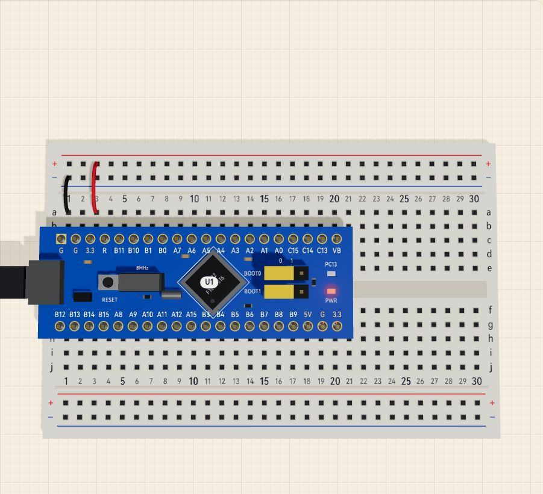
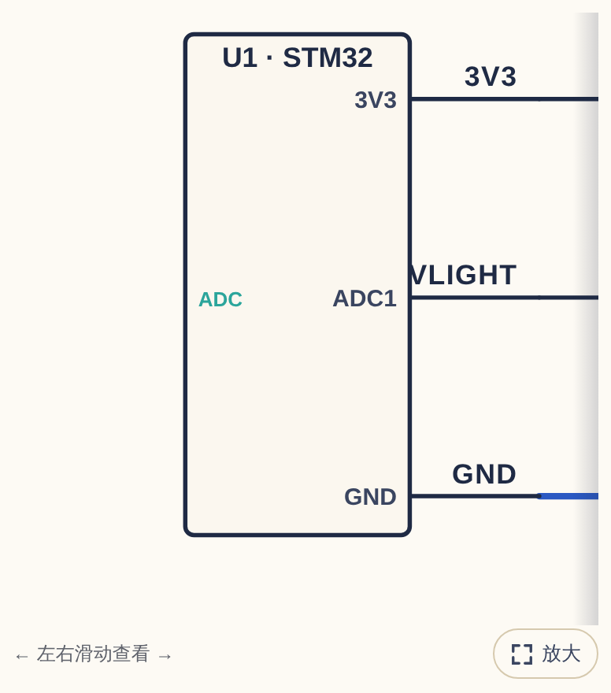
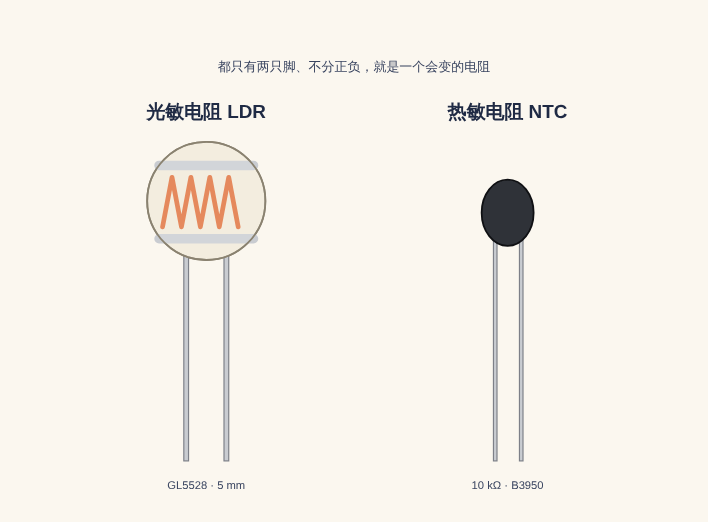
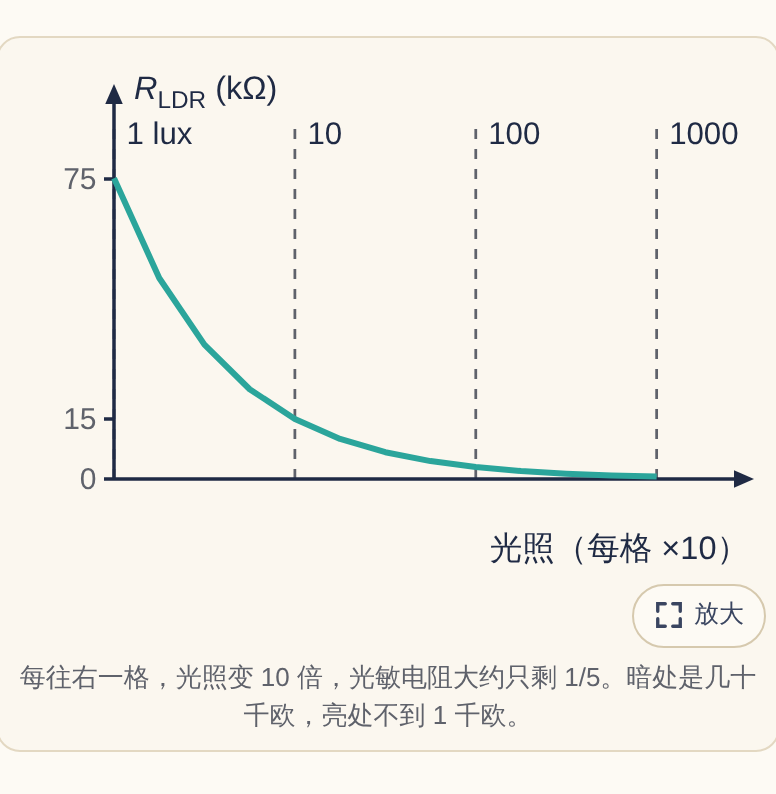
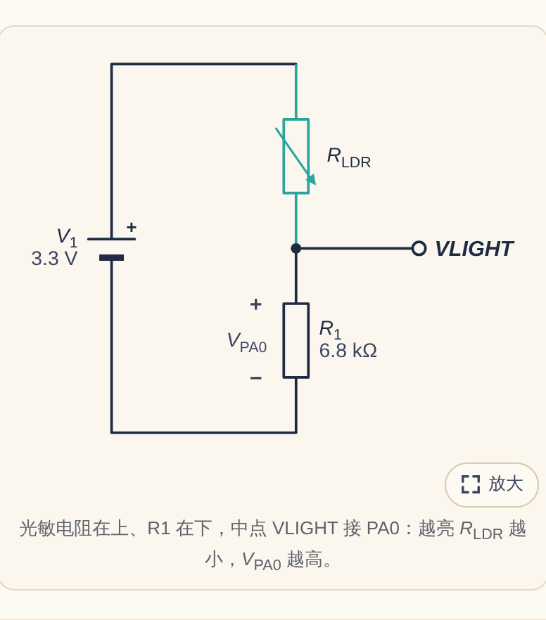

# 8.7 · 光敏电阻测光：固定电阻该选多大

| 项目 | 内容 |
|---|---|
| id | `exp5-ldr-light-sensor` |
| 文件 | `challenges/284-ldr-light-sensor.json` |
| 类型 | 实验 / 挑战（没有分步，照目标电路图搭） · 难度 3/5 |
| 位置 | World 8 · 数字逻辑、MCU 与传感器实战 → 8.7 ADC 与模拟传感器（本节第 3 项） |
| 右侧面板 | 轨道由旧的四张卡片自动生成（还没手工精排） |
| 前后 | 上一项 [8.7 exp5-adc-battery-divider](../w8/8.07-2-exp5-adc-battery-divider.md) · 下一项 [8.7 exp5-ntc-thermometer](../w8/8.07-4-exp5-ntc-thermometer.md) |
| 先修 | lesson-mcu-pwm-adc |
| 概念 | 光敏电阻 LDR / photoresistor、分压器 voltage divider、灵敏度与几何平均 sensitivity & geometric mean、对数响应 logarithmic response、ADC 模拟输入 analog input |

**一句话概要**：光敏电阻 + 固定电阻分压接到 Blue Pill 的 PA0（ADC）。先用一个太大的电阻，看亮处的读数挤成一团；再算出该用多大的。

## 1. 左侧工作台（3D 面包板 → 2D 俯视截图）

截图是程序里真实的 3D 面包板换成俯视角拍的；表格是同一块板的文字版（元件、参数、每只脚插在哪个孔）。

### 1.1 起点：打开这一课时板上已经有的

右侧显示的「起点」说明：

> **半成品**：Blue Pill（PA0 已设成 ADC）、GND 和 3V3 电源轨已经接好。**为什么**：板子的供电是重复技能；这里要学的是传感器分压。**你要做**：光敏电阻从 3V3 轨接到第 22 列，R1（6.8kΩ）从第 22 列接到 GND，再把第 22 列接到 PA0（a16）。

| 元件 | 类型 | 参数 | 引脚 → 孔 |
|---|---|---|---|
| U1 | stm32_bluepill | usb=true, pins={"PA0":{"mode":"adc"}} | GND→c1 GND_2→c2 3V3→c3 NRST→c4 PB11→c5 PB10→c6 PB1→c7 PB0→c8 PA7→c9 PA6→c10 PA5→c11 PA4→c12 PA3→c13 PA2→c14 PA1→c15 PA0→c16 PC15→c17 PC14→c18 PC13→c19 VBAT→c20 PB12→g1 PB13→g2 PB14→g3 PB15→g4 PA8→g5 PA9→g6 PA10→g7 PA11→g8 PA12→g9 PA15→g10 PB3→g11 PB4→g12 PB5→g13 PB6→g14 PB7→g15 PB8→g16 PB9→g17 5V→g18 GND_3→g19 3V3_2→g20 |
| W1 | wire |  | a→a1 b→tn1 |
| W2 | wire |  | a→a3 b→tp3 |

### 1.3 参考答案（「看答案」载入的板子）

| 元件 | 类型 | 参数 | 引脚 → 孔 |
|---|---|---|---|
| U1 | stm32_bluepill | usb=true, pins={"PA0":{"mode":"adc"}} | GND→c1 GND_2→c2 3V3→c3 NRST→c4 PB11→c5 PB10→c6 PB1→c7 PB0→c8 PA7→c9 PA6→c10 PA5→c11 PA4→c12 PA3→c13 PA2→c14 PA1→c15 PA0→c16 PC15→c17 PC14→c18 PC13→c19 VBAT→c20 PB12→g1 PB13→g2 PB14→g3 PB15→g4 PA8→g5 PA9→g6 PA10→g7 PA11→g8 PA12→g9 PA15→g10 PB3→g11 PB4→g12 PB5→g13 PB6→g14 PB7→g15 PB8→g16 PB9→g17 5V→g18 GND_3→g19 3V3_2→g20 |
| W1 | wire |  | a→a1 b→tn1 |
| W2 | wire |  | a→a3 b→tp3 |
| LDR1 | ldr | lux=100 | 1→tp22 2→a22 |
| R1 | resistor | resistance=6800 | 1→b22 2→tn22 |
| W3 | wire |  | a→c22 b→a16 |

### 1.4 目标原理图（右侧「目标原理图」抽屉）

| 元件 | 类型 | 参数 |
|---|---|---|
| U1 | stm32_bluepill | pins={"ADC1":{"mode":"adc"}} |
| LDR1 | ldr |  |
| R1 | resistor | resistance=6800 |

连接（每个结点上的引脚）：

- **3V3**：U1.3V3、LDR1.1
- **VLIGHT**：LDR1.2、R1.1、U1.ADC1
- **GND**：R1.2、U1.GND

## 2. 右侧面板：学生从上往下看到的内容（单轨流）

### 第 1 步 · 🔍 先看一眼：先认识它：光敏电阻与热敏电阻

**拆解「光敏电阻和热敏电阻：会变的电阻怎么变成数字」第 1 / 8 层：① 外形：两个两只脚、不分极性的电阻**

- 光敏电阻 LDR（实验 5-5 的 GL5528）：一个 5 mm 的小圆片，透明涂层下面能看到一条弯弯曲曲的橙红色细线——那就是会感光的材料；
- NTC 热敏电阻（实验 5-6，10 kΩ，B = 3950）：一个小小的环氧“珠子”，两根细腿。

它们都 **没有正负极**，在电路里就是一个电阻，只不过阻值不是固定的：
- LDR：**越亮电阻越小**；
- NTC：**越热电阻越小**（Negative Temperature Coefficient = 负温度系数）。

单片机不会直接“量电阻”，它只会用 ADC 量电压。所以下面的路线是：先拆开看电阻为什么变 → 写出变化的公式 → 接成分压器把电阻变成电压 → ADC 把电压变成数字 → 固件再把数字换回光照 / 温度。

|  | LDR（GL5528） | NTC（10 kΩ B3950） |
|---|---|---|
| 感受 | 光照（lux） | 温度（°C） |
| 材料 | 硫化镉 CdS 薄膜 | Mn / Ni / Co 氧化物陶瓷 |
| 规律 | $R = 15 kΩ·(\frac{lux}{10})^{-0.7}$ | $R = R_0·e^{B(\frac{1}{T} - \frac{1}{T_0})}$ |
| 范围 | 100 Ω（强光）… 1 MΩ（全黑） | 0 °C 33.6 kΩ … 80 °C 1.27 kΩ |
| 速度 | 慢：几十–几百 ms | 取决于珠子的热容：秒级 |
| 实验 | 5-5（Blue Pill PA0） | 5-6（ESP32 GPIO32） |

### 第 2 步 · 🔧 动手搭：先用一个太大的电阻

**Blue Pill** 的 **3V3** 接上方 + 轨，**GND** 接 − 轨。
搭一个分压器：+ 轨 → **光敏电阻** → 中点 → **`100 kΩ`** → GND。中点接 **PA0**，把 PA0 设成 **ADC**。
单击光敏电阻，在「属性」里把光照从 **`100 lux`** 拖到 **`1000 lux`**，看引脚列表里的 ADC 读数。
亮度变了 10 倍，读数为什么几乎不动？

### 第 3 步 · 💡 想明白：两个电阻差不多大时最灵敏

- 光敏电阻**越亮，电阻越小**：亮度每变 10 倍，电阻大约变 5 倍。

*图 `ldr`（plot）：每往右一格，光照变 10 倍，光敏电阻大约只剩 1/5。暗处是几十千欧，亮处不到 1 千欧。*

- 分压器的输出在 **$R_1 = R_{LDR}$** 时变化最快，那一点正好是电源的一半。R1 太大，亮处的读数就全挤在 3.3 V 附近。

*图 `div`（schematic）：光敏电阻在上、R1 在下，中点 VLIGHT 接 PA0：越亮 R_LDR 越小，V_PA0 越高。*

- 要照顾 1–1000 lux 整段，就取两端阻值的**几何平均**：
$$R_1 = \sqrt{R_{dark} × R_{bright}}$$
- 代入数字：1 lux 时约 75 kΩ，1000 lux 时约 0.6 kΩ，$R_1 = \sqrt{75 × 0.6} ≈ 6.7$ kΩ，取标准值 **6.8 kΩ**。

（这一步下面列着这节课的计算卡片，点开就地展开：`adc-code`、`sensor-best-resistor`、`ldr-divider`，全文见第 6 节）

### 第 4 步 · 🔧 动手搭：换成 6.8 kΩ

- 把 `100 kΩ` **换成** **`6.8 kΩ`**，其他不动。
- 点**「检查我的电路」**。通过后，按题目把光照设成不同的值，用万用表测中点对 GND。
- 先预测：用 $R_{LDR} = 15 kΩ × (lux / 10)^{-0.7}$ 算出光敏电阻，再用分压公式。

### 第 5 步 · 📏 测一测：测一测：读你自己的仪表

**测量题 1 · `v1`**（读数题）

> 1 lux（很暗）：万用表测 ADC 引脚（VLIGHT）对 GND

- 单位 V · 先写预测 · 状态：LDR1 的光照为 1 lux · 参考答案的读数 **0.2737 V** · 合理范围 [0.26, 0.287]

答对后显示：

> R_LDR ≈ 75 kΩ：3.3 × 6.8 / (6.8 + 75) ≈ 0.27 V。

**测量题 2 · `v100`**（读数题）

> 100 lux（室内）：ADC 引脚对 GND

- 单位 V · 先写预测 · 状态：LDR1 的光照为 100 lux · 参考答案的读数 **2.291 V** · 合理范围 [2.18, 2.41]

答对后显示：

> R_LDR ≈ 3.0 kΩ：3.3 × 6.8 / 9.8 ≈ 2.29 V。光敏电阻在上，越亮电压越高。

**测量题 3 · `rldr`**（计算题（用自己的读数算））

> 用你的 100 lux 读数反算光敏电阻的阻值 R_LDR = R1 × (3.3 − V) / V

- 单位 kΩ · 先写预测 · 参考答案的读数 **2.996 kΩ** · 合理范围 [2850, 3150] · 公式 `6800 * (3.3 - v100) / v100`

答对后显示：

> ≈ 3.0 kΩ = 15 kΩ × 10^−0.7。固件就是这样从读数算出电阻、再换成照度的。

**测量题 4 · `v1000`**（读数题）

> 1000 lux（窗边）：ADC 引脚对 GND

- 单位 V · 先写预测 · 状态：LDR1 的光照为 1000 lux · 参考答案的读数 **3.033 V** · 合理范围 [2.88, 3.18]

答对后显示：

> R_LDR ≈ 600 Ω：3.3 × 6.8 / 7.4 ≈ 3.03 V。1、10、100、1000 lux 之间读数都差几百上千个计数，3 个数量级都分得开。

**测量题 5 · `r1k`**（选择题）

> 如果把 R1 换成 1 kΩ，会怎样？（可以在面包板上换一下试试）

- A. 暗处的读数全挤在 0 V 附近，1 lux 和 10 lux 几乎分不开 ✅（正确）
- B. 亮处的读数全挤在 3.3 V 附近
- C. 读数整体按比例变小，分辨能力一样

答对后显示：

> 1 kΩ 时四个亮度分别约 0.04 / 0.21 / 0.83 / 2.07 V：暗处挤在 0 V 附近。和 100 kΩ 正好相反——R1 太大挤在顶上，太小挤在底下，几何平均 6.8 kΩ 两头都照顾到。

### 第 6 步 · 🎒 带走：带走

- **固定电阻 ≈ 你关心的亮度下的 $R_{LDR}$ 时最灵敏**；要覆盖一大段亮度，就取两端阻值的几何平均。
- 光敏电阻在上：越亮电压越高。换到下面就反过来，固件的判断也要跟着反过来。
- 坑：光敏电阻慢、个体差异大（±50 % 很常见），还随温度漂移，只适合分“亮 / 暗”。做“天黑开灯”要用两个阈值，否则灯在阈值附近会闪。
- STM32 的模拟引脚不耐 5 V：分压器接 3V3，不要接 5V。

趁热练理论题：`equivalence`

## 3. 测量题一览

| # | id | 题目 | 类型 | 单位 | 状态 | 参考读数 |
|---|---|---|---|---|---|---|
| 1 | v1 | 1 lux（很暗）：万用表测 ADC 引脚（VLIGHT）对 GND | voltage | V | LDR1 的光照为 1 lux | 0.2737 V |
| 2 | v100 | 100 lux（室内）：ADC 引脚对 GND | voltage | V | LDR1 的光照为 100 lux | 2.291 V |
| 3 | rldr | 用你的 100 lux 读数反算光敏电阻的阻值 R_LDR = R1 × (3.3 − V) / V | formula | kΩ |  | 2.996 kΩ |
| 4 | v1000 | 1000 lux（窗边）：ADC 引脚对 GND | voltage | V | LDR1 的光照为 1000 lux | 3.033 V |
| 5 | r1k | 如果把 R1 换成 1 kΩ，会怎样？（可以在面包板上换一下试试） | 选择 |  |  | 正确：A |

### 全部答完后显示的「对比」

**对比**：读数随光照变化的方向和预期相反时，检查光敏电阻和 R1 的位置。计算过程：

**光敏电阻模型**（GL5528 类）：R_LDR = 15 kΩ × (lux / 10)^−0.7。亮度每变 10 倍，电阻变 10^0.7 ≈ 5 倍：
- 1 lux（很暗）≈ 75 kΩ；10 lux ≈ 15 kΩ；100 lux（室内）≈ 3.0 kΩ；1000 lux（窗边 / 阴天户外）≈ 600 Ω。

**分压结果**：V = 3.3 × R1 / (R1 + R_LDR)。光敏电阻在上，**越亮电压越高**：
- 1 lux：0.274 V → **340**
- 10 lux：1.029 V → **1277**
- 100 lux：2.291 V → **2843**
- 1000 lux：3.033 V → **3763**
每 10 倍亮度读数差约 940、1570、920 个计数——整个 3 个数量级都分得很清楚。

**为什么选 6.8 kΩ**：分压器输出对 ln(R_LDR) 的灵敏度在 **R1 = R_LDR** 时最大（那一点 V = Vcc/2，曲线最陡）。要覆盖 1–1000 lux，就取两端阻值的**几何平均**：√(75 kΩ × 0.6 kΩ) ≈ 6.7 kΩ → 标准值 **6.8 kΩ**。如果只关心某一个亮度附近（比如“天黑开灯”的 10 lux），就选那个亮度下的 R_LDR（≈ 15 kΩ）。对比：
- R1 = **100 kΩ**：1.88 V / 2.87 V / 3.20 V / 3.28 V——亮处全挤在顶部，100 lux 和 1000 lux 只差 0.08 V。
- R1 = **1 kΩ**：0.04 V / 0.21 V / 0.83 V / 2.07 V——暗处全挤在 0 V 附近。

**换个位置**：把光敏电阻放到下面（3V3 → R1 → VLIGHT → LDR → GND），就变成**越亮电压越低**；灵敏度规律一样，只是方向反过来。固件里怎么判断“亮 / 暗”要和接法对应。

**电流**：最亮时 3.3 V / (6.8 k + 0.6 k) ≈ **0.45 mA**，最暗时约 40 µA。

### 提示按钮（依次显示）

1. 先把开发板的 3V3 接到上方 + 轨、GND 接到 − 轨。
2. 光敏电阻从 3V3 接到中点，6.8 kΩ 从中点接到 GND；中点接 PA0（或别的 ADC 引脚）。
3. 在引脚表里把这个引脚设成“模拟输入 ADC”。

### 功能测试（「检查我的电路」时跑）

- 1 lux：ADC 读数和光敏电阻电流合理
- 10 lux：ADC 读数合理
- 100 lux：ADC 读数合理
- 1000 lux：ADC 读数和光敏电阻电流合理

## 4. 用到的拆解（全部层的文字，供改写参考）

### 拆解 `sensors`：光敏电阻和热敏电阻：会变的电阻怎么变成数字

*LDR = Light-Dependent Resistor（光敏电阻），NTC = Negative Temperature Coefficient thermistor（负温度系数热敏电阻）。两者都是“电阻随外界变化”。我们拆开看它们为什么会变、变化规律的公式，再把它们接成分压器送进 ADC，算出固定电阻该取多大、读数怎么换回光照和温度。*

**拆解「光敏电阻和热敏电阻：会变的电阻怎么变成数字」第 1 / 8 层：① 外形：两个两只脚、不分极性的电阻**

- 光敏电阻 LDR（实验 5-5 的 GL5528）：一个 5 mm 的小圆片，透明涂层下面能看到一条弯弯曲曲的橙红色细线——那就是会感光的材料；
- NTC 热敏电阻（实验 5-6，10 kΩ，B = 3950）：一个小小的环氧“珠子”，两根细腿。

它们都 **没有正负极**，在电路里就是一个电阻，只不过阻值不是固定的：
- LDR：**越亮电阻越小**；
- NTC：**越热电阻越小**（Negative Temperature Coefficient = 负温度系数）。

单片机不会直接“量电阻”，它只会用 ADC 量电压。所以下面的路线是：先拆开看电阻为什么变 → 写出变化的公式 → 接成分压器把电阻变成电压 → ADC 把电压变成数字 → 固件再把数字换回光照 / 温度。

|  | LDR（GL5528） | NTC（10 kΩ B3950） |
|---|---|---|
| 感受 | 光照（lux） | 温度（°C） |
| 材料 | 硫化镉 CdS 薄膜 | Mn / Ni / Co 氧化物陶瓷 |
| 规律 | $R = 15 kΩ·(\frac{lux}{10})^{-0.7}$ | $R = R_0·e^{B(\frac{1}{T} - \frac{1}{T_0})}$ |
| 范围 | 100 Ω（强光）… 1 MΩ（全黑） | 0 °C 33.6 kΩ … 80 °C 1.27 kΩ |
| 速度 | 慢：几十–几百 ms | 取决于珠子的热容：秒级 |
| 实验 | 5-5（Blue Pill PA0） | 5-6（ESP32 GPIO32） |

**拆解「光敏电阻和热敏电阻：会变的电阻怎么变成数字」第 2 / 8 层：② LDR 内部：两把梳子中间夹一条之字形 CdS**

放大看那条橙线：瓷片上镀了两块 **梳子形** 的金属电极 电极 1 和 电极 2，梳齿互相插在一起，它们之间留下的那条弯来弯去的缝里是 硫化镉 CdS——一种半导体。

**为什么光能让电阻变小**：CdS 的禁带宽度约 2.4 eV。黑暗中几乎没有自由载流子，电阻很大（≈ 1 MΩ）。光子 能量够大时，把价带里的电子打到导带，产生 电子–空穴对——载流子越多，电导越大。光越强，产生的载流子越多，电阻越小。

**为什么要做成之字形**：一条导体的电阻是
$$R = ρ·\frac{L}{W·t}$$
这里电流是“横着”穿过缝的：路程 L = 缝的宽度（很窄），截面宽 W = 缝的总长度（弯来弯去，很长）。之字形让 L 很小、W 很大，CdS 本身电阻率很高也能得到 kΩ 量级的电阻，而且整个缝都对着光。

- 公式 `R = ρ·\frac{L}{W·t}`：L = 缝宽（短），W = 缝的总长（长），t = 膜厚

**拆解「光敏电阻和热敏电阻：会变的电阻怎么变成数字」第 3 / 8 层：③ LDR 的规律：对数坐标下是一条直线**

把电阻对照度画在 **两个对数轴** 上，GL5528 是一条直线（仿真模型，和实验 5-5 一致）：
$$R_{LDR} = 15 kΩ·(\frac{lux}{10})^{-0.7}$$
两边取对数：$log R = log 15 k - 0.7·log\frac{lux}{10}$——斜率 −0.7 的直线。含义：
- 光照 ×10 → 电阻 ÷ $10^{0.7}$ ≈ ÷5；
- 10 lux 时 15 kΩ（这就是 15 kΩ 这个数的来历）。

代入四个测试点：

| 场景 | 照度 | $R_{LDR}$ |
|---|---|---|
| 很暗（月光） | 1 lux | $15 k × 10^{0.7}$ ≈ 75 kΩ |
| 昏暗 | 10 lux | 15 kΩ |
| 室内 | 100 lux | 15 k ÷ 5 ≈ 3.0 kΩ |
| 窗边 / 阴天户外 | 1000 lux | ≈ 600 Ω |

- 公式 `R_{LDR} = 15 kΩ·(\frac{lux}{10})^{-0.7}`：仿真模型（夹在 100 Ω … 1 MΩ）

**拆解「光敏电阻和热敏电阻：会变的电阻怎么变成数字」第 4 / 8 层：④ NTC 内部和 B 方程：越热电阻越小**

NTC 的 珠子 是锰、镍、钴等金属氧化物烧结成的陶瓷半导体，两根 引线 埋在里面，外面包一层环氧或玻璃。

**为什么越热电阻越小**：和金属相反。半导体里的载流子要靠热能“激发”出来，温度越高，激发出的载流子按指数增加，电阻按指数下降。描述它的是 **B 参数方程**（T 用开尔文）：
$$R(T) = R_0·e^{B(\frac{1}{T} - \frac{1}{T_0})}$$
$R_0$ = 10 kΩ 是 $T_0$ = 25 °C = 298.15 K 时的阻值，B = 3950 K 描述它有多“陡”。

**一步步算 50 °C**：
1. T = 50 + 273.15 = 323.15 K；
2. $\frac{1}{T} - \frac{1}{T_0} = 0.0030945 - 0.0033540 = -0.0002595$ /K；
3. 乘 B：3950 × (−0.0002595) = −1.025；
4. $R = 10 kΩ × e^{-1.025}$ = 10 kΩ × 0.359 = 3.59 kΩ。

同理 0 °C 是 33.6 kΩ，80 °C 是 1.27 kΩ——曲线 明显不是直线：低温段很陡，高温段很平。

| T | T (K) | $\frac{1}{T} - \frac{1}{T_0}$ | $R_{NTC}$ |
|---|---|---|---|
| 0 °C | 273.15 | +0.0003070 | 33.6 kΩ |
| 25 °C | 298.15 | 0 | 10.0 kΩ |
| 50 °C | 323.15 | −0.0002595 | 3.59 kΩ |
| 80 °C | 353.15 | −0.0005222 | 1.27 kΩ |

- 公式 `R(T) = R_0·e^{B(\frac{1}{T} - \frac{1}{T_0})}`：R₀ = 10 kΩ，T₀ = 298.15 K，B = 3950 K

**拆解「光敏电阻和热敏电阻：会变的电阻怎么变成数字」第 5 / 8 层：⑤ 接成分压器：电阻 → 电压 → 数字**

ADC 只量电压，所以给传感器串一个固定电阻 R1，接成 **分压器**（voltage divider），中间结点送进 ADC。ADC 输入几乎不取电流，所以就是最简单的无负载分压。

**实验 5-5**（Blue Pill）：3V3 → LDR → VLIGHT → R1 = 6.8 kΩ → GND，VLIGHT 接 PA0：
$$V = 3.3·\frac{R_1}{R_1 + R_{LDR}}$$
LDR 在上面：越亮 → $R_{LDR}$ 越小 → 电压越高。

**实验 5-6**（ESP32）：3V3 → R1 = 10 kΩ → VTEMP → NTC → GND，VTEMP 接 GPIO32：
$$V = 3.3·\frac{R_{NTC}}{R_1 + R_{NTC}}$$
NTC 在下面：越热 → 电压越低。

两种接法交换上下位置，规律就反过来——固件里“亮 / 暗”“热 / 冷”的判断方向必须和接线一致。

**比例测量（ratiometric）**：分压器的顶端接 ADC 的参考电压（3V3），读数 $\frac{V}{3.3} × 4095 = \frac{R_1}{R_1 + R} × 4095$ 里 3.3 被约掉了——3V3 有点漂也不影响结果。

| 实验 5-5（LDR，6.8 kΩ） | 电压 | 读数 | 实验 5-6（NTC，10 kΩ） | 电压 | 读数 |
|---|---|---|---|---|---|
| 1 lux | 0.274 V | 340 | 0 °C | 2.541 V | 3154 |
| 10 lux | 1.029 V | 1277 | 25 °C | 1.649 V | 2046 |
| 100 lux | 2.291 V | 2843 | 50 °C | 0.871 V | 1081 |
| 1000 lux | 3.033 V | 3763 | 80 °C | 0.372 V | 461 |

- 公式 `code = round(\frac{R_{bottom}}{R_{top} + R_{bottom}} × 4095)`：比例测量：与 3V3 的准确值无关

**拆解「光敏电阻和热敏电阻：会变的电阻怎么变成数字」第 6 / 8 层：⑥ 固定电阻取多大：R1 = 传感器在量程中间的电阻**

R1 取错了，分压器会把有用的变化“挤扁”：
- R1 = 100 kΩ：1/10/100/1000 lux 得到 1.88 / 2.87 / 3.20 / 3.28 V——亮的一端全挤在 3.3 V 附近，100 lux 和 1000 lux 只差 0.08 V；
- R1 = 1 kΩ：0.04 / 0.21 / 0.83 / 2.07 V——暗的一端全挤在 0 V；
- R1 = 6.8 kΩ：0.27 / 1.03 / 2.29 / 3.03 V，每十倍光照差 0.9–1.6 V，三个十倍都分得清。

**推导**：传感器电阻按比例变（LDR 每十倍光照 ÷5，NTC 是指数），所以要看电压对 $ln R$ 的灵敏度。设传感器在上，$V = V_{cc}\frac{R_1}{R_1 + R}$：
$$\frac{dV}{d(ln R)} = R·\frac{dV}{dR} = -V_{cc}·\frac{R_1·R}{(R_1 + R)^{2}}$$
令 $x = \frac{R_1}{R}$，大小是 $V_{cc}\frac{x}{(1 + x)^{2}}$，在 **x = 1，即 R1 = R** 时最大，等于 $\frac{V_{cc}}{4}$——此时 V 正好是 $\frac{V_{cc}}{2}$，曲线最陡 的地方。

**规则**：R1 = 你最关心的那一点的传感器电阻；要覆盖一个范围，取两端电阻的 **几何平均**：
$$R_1 = \sqrt{R_{min}·R_{max}} = \sqrt{75 kΩ × 0.6 kΩ} ≈ 6.7 kΩ → 6.8 kΩ$$
NTC 同理：R1 = $R_{25}$ = 10 kΩ 把最灵敏点放在室温，适合 0–50 °C；要测 100 °C 左右的 3D 打印机热床，就用 100 °C 时的阻值（≈ 0.7 kΩ）附近的 680 Ω–1 kΩ。

| R1 | 1 lux | 10 lux | 100 lux | 1000 lux | 评价 |
|---|---|---|---|---|---|
| 1 kΩ | 0.04 V | 0.21 V | 0.83 V | 2.07 V | 暗端挤在 0 V |
| 6.8 kΩ | 0.27 V | 1.03 V | 2.29 V | 3.03 V | 最好：几何平均 |
| 100 kΩ | 1.88 V | 2.87 V | 3.20 V | 3.28 V | 亮端挤在 3.3 V |

- 公式 `\frac{dV}{d(ln R)} 最大 ⇔ R_1 = R`：最大值 = Vcc / 4，此时 V = Vcc / 2
- 公式 `R_1 = \sqrt{R_{min}·R_{max}}`：覆盖一个范围时

**拆解「光敏电阻和热敏电阻：会变的电阻怎么变成数字」第 7 / 8 层：⑦ 从读数换回温度，以及为什么不是直线**

固件拿到的只是一个 0–4095 的数，要倒着走三步（实验 5-6）：
1. **读数 → 电阻**：分压公式反过来（NTC 在下）：
$$R_{NTC} = R_1·\frac{raw}{4095 - raw}$$
2. **电阻 → 温度**：B 方程取对数解出 T：
$$\frac{1}{T} = \frac{1}{T_0} + \frac{1}{B}ln\frac{R_{NTC}}{R_0}$$
3. **开尔文 → 摄氏**：减 273.15。

例：raw = 1081 → $R_{NTC}$ = 10 k × 1081 / 3014 ≈ 3.59 kΩ → ln 0.359 = −1.025 → $\frac{1}{T}$ = 0.003354 − 0.000260 = 0.003094 → T ≈ 323.2 K = **50.0 °C**。

**非线性**：读数–温度曲线 不是直线。相同的 25 °C 间隔：
- 0 → 25 °C 降 1108 码（约 44 码/°C）；
- 25 → 50 °C 降 965 码（约 39 码/°C）；
- 50 → 80 °C 只降 620 码（约 21 码/°C）。

所以 用直线插值 会在中间差好几度；一个码在 25 °C 附近代表 0.025 °C，在 80 °C 附近是 0.05 °C。要 ±0.1 °C 的精度，用三项的 Steinhart–Hart 方程 $\frac{1}{T} = A + Bln R + C(ln R)^{3}$，按厂家的 R–T 表拟合。

| T | $R_{NTC}$ | V | 读数 | 每 °C 几个码 |
|---|---|---|---|---|
| 0 °C | 33.6 kΩ | 2.541 V | 3154 | ≈ 44（0–25 °C） |
| 25 °C | 10.0 kΩ | 1.649 V | 2046 | ≈ 39（25–50 °C） |
| 50 °C | 3.59 kΩ | 0.871 V | 1081 | ≈ 21（50–80 °C） |
| 80 °C | 1.27 kΩ | 0.372 V | 461 | — |

- 公式 `R_{NTC} = R_1·\frac{raw}{4095 - raw}`：NTC 在下的分压器反算
- 公式 `\frac{1}{T} = \frac{1}{T_0} + \frac{1}{B}ln\frac{R_{NTC}}{R_0}`：B 方程解出 T（开尔文）

**拆解「光敏电阻和热敏电阻：会变的电阻怎么变成数字」第 8 / 8 层：⑧ 局限：自热、速度、个体差异**

**NTC 自热**：测量电流流过 NTC 会让它自己发热，测到的温度偏高。NTC 上的功率
$$P = \frac{V_{NTC}^{2}}{R_{NTC}}$$
在 $R_{NTC}$ = R1 时最大：$\frac{1.65^{2}}{10 kΩ}$ ≈ 0.27 mW（25 °C，电流 165 µA）。小珠子 NTC 的耗散常数约 1–2 mW/°C，所以自热 0.1–0.3 °C。要更准：用更大的阻值（100 kΩ NTC + 100 kΩ），或者只在测量时给分压器上电。

**LDR 很慢**：光照突变后，电阻要几十到几百 ms 才跟上（变暗时更慢），不适合测快速闪烁的光。做“天黑开灯”要加 **回差**（两个阈值），否则在阈值附近灯会闪。

**个体差异**：LDR 同型号之间 ±50 % 很常见，还随温度漂移——适合判断亮 / 暗、粗略亮度；要真实 lux 用数字传感器（BH1750、VEML7700）。NTC 电阻公差 ±1–5 %、B 值约 ±1 %，要算进误差预算。CdS 含镉，受 RoHS 限制，新设计多用光电二极管 / 光电三极管。

**接线**：STM32 的模拟引脚（PA0–PA7、PB0、PB1）**不耐 5 V**，分压器顶端只能接 3V3；ADC 引脚到 GND 并一个 100 nF 降噪（NTC 分压器的源阻抗 R1 ∥ $R_{NTC}$ 约 5 kΩ）。

| 问题 | LDR | NTC | 对策 |
|---|---|---|---|
| 速度 | 几十–几百 ms | 秒级（热容） | 软件滤波，回差 |
| 个体差异 | ±50 % | R ±1–5 %，B ±1 % | 校准 / 用数字传感器 |
| 自热 | 可忽略 | ≤ 0.27 mW → 0.1–0.3 °C | 大阻值，只在测量时上电 |
| 非线性 | 幂律 | 指数 | 用公式，不要直线 |

- 公式 `P_{NTC} = \frac{V_{NTC}^{2}}{R_{NTC}} ≤ \frac{V_{cc}^{2}}{4 R_1} = 0.27 mW`：R_NTC = R1 时最大

**一句话记住**：LDR：CdS 被光激发出载流子，$R = 15 kΩ·(\frac{lux}{10})^{-0.7}$；NTC：氧化物陶瓷被热激发，$R = R_0·e^{B(\frac{1}{T} - \frac{1}{T_0})}$。两者都接成分压器给 ADC，R1 取传感器在关心范围中间（几何平均）的阻值，读数用分压公式和 B 方程倒推回光照 / 温度。

## 5. 这一课的计算卡片

**计算卡片 `adc-code`：ADC 读数 raw = V/Vref × 4095**

- 公式 `raw = \frac{V}{V_{ref}} × (2^{N} - 1)`
- 用途：一个电压在 N 位 ADC 上读出多少（0 … 4095）。
- 输入：V（ADC 引脚电压，V）；V_ref（满量程（参考电压），V）；N（位数，） → raw（读数，）

1. N 位 ADC 把 0 … $V_{ref}$ 分成 $2^{N}$ 个台阶：12 位就是 4096 个，读数 0 … 4095。
2. 线性换算：$raw = \frac{V}{V_{ref}} × 4095$，四舍五入成整数。
3. 一个 LSB（最低位）= $\frac{V_{ref}}{4095} ≈ 0.81 mV$：这是分辨率。
4. 固件反过来：$V = raw × \frac{V_{ref}}{4095}$。
5. 引脚电压超过 $V_{ref}$ 读数就停在 4095；超过 3.3 V（加二极管压降）引脚会坏——先分压。

例子：第 16 课：1.65 V → 2048。实验 5-4：8.4 V 电池分压后 2.084 V → 2586。实验 5-6：25 °C 1.649 V → 2046，80 °C 0.372 V → 461。实验 5-10：3.13 V → 3879。

- ⚠ ESP32 的 ADC 在 0.15 V 以下和 2.45 V 以上不线性，要校准；用 ADC1（GPIO32–39），ADC2 开 Wi-Fi 时不能用。

**计算卡片 `sensor-best-resistor`：传感器分压：固定电阻取几何平均**

- 公式 `R_1 = \sqrt{R_{a} R_{b}}`
- 用途：光敏 / 热敏电阻要在 Rₐ … R_b 范围内都分得开：固定电阻选多大。
- 输入：R_a（传感器一端的阻值（如最暗），Ω）；R_b（另一端的阻值（如最亮），Ω） → R_1（最合适的固定电阻，Ω）

1. 分压输出 $V = V_{cc}\frac{R_1}{R_1 + R_s}$（传感器在上）。
2. 传感器的阻值按倍数变（光每 ×10，电阻 ÷5），所以要看 V 对 $ln R_s$ 的灵敏度：$|\frac{dV}{d ln R_s}| = V_{cc}\frac{R_1R_s}{(R_1 + R_s)^{2}}$。
3. 这个式子在 $R_1 = R_s$ 时最大（V = Vcc/2，曲线最陡）。
4. 要覆盖一个范围，就让范围的“对数中点”落在最陡处：$R_1 = \sqrt{R_aR_b}$，两端也对称地分开。
5. 只关心一个点（比如 10 lux 开灯）就取那一点的阻值。

例子：实验 5-5：1–1000 lux，$\sqrt{75k × 0.6k} ≈ 6.7 kΩ$ → 6.8 kΩ。换成 100 kΩ：亮处挤在 3.2–3.3 V；1 kΩ：暗处挤在 0 V 附近。实验 5-6：0–50 °C 的 NTC $\sqrt{33.6k × 3.59k} ≈ 11 kΩ$，所以用 10 kΩ = R₂₅。

**计算卡片 `ldr-divider`：光敏电阻分压 LDR divider**

- 公式 `R_{LDR} = 15 kΩ × (\frac{lux}{10})^{-0.7}, V = V_{cc}\frac{R_1}{R_1 + R_{LDR}}`
- 用途：某个光照下光敏电阻多大、ADC 引脚上是多少伏（LDR 在上、固定电阻在下）。
- 输入：lux（光照，lx）；R_1（下面的固定电阻，Ω）；V_cc（分压器电源，V） → V（ADC 引脚电压，V）

1. 模型（类似 GL5528）：$R_{LDR} = 15 kΩ × (\frac{lux}{10})^{-0.7}$——光每强 10 倍，电阻变成 $10^{-0.7} ≈ \frac{1}{5}$。
2. LDR 在上、R₁ 在下：$V = V_{cc}\frac{R_1}{R_1 + R_{LDR}}$，**越亮电压越高**。
3. 固件反算阻值：$R_{LDR} = R_1\frac{V_{cc} - V}{V}$，再换成 lux。
4. 位置对调（R₁ 在上）就是越亮越低，固件判断要跟着改。

例子：实验 5-5（6.8 kΩ）：1 lux 75 kΩ → 0.27 V；10 lux 15 kΩ → 1.03 V；100 lux 3.0 kΩ → 2.29 V；1000 lux 600 Ω → 3.03 V。读数 340 / 1277 / 2843 / 3763。

- ⚠ STM32 的模拟引脚不耐 5 V：分压器顶端接 3V3，不要接 5V。
- ⚠ 真实 LDR 个体差 ±50 %、反应慢：只适合判断亮暗。

## 6. English（界面英文版的同一份内容）

展开英文

### Node 1 · 🔍 Look first：Meet it first: LDR and NTC

**Teardown「LDR and NTC: turning a changing resistance into a number」layer 1 of 8：① Outside: two two-legged resistors with no polarity**

- the LDR (GL5528, lab 5-5): a 5 mm disc; under its clear coat you can see a wiggly orange-red line — the light-sensitive material;
- the NTC thermistor (lab 5-6, 10 kΩ, B = 3950): a tiny epoxy bead on two thin legs.

Neither has **polarity**; in a circuit each is just a resistor whose value isn't fixed:
- LDR: **brighter → lower resistance**;
- NTC: **hotter → lower resistance** (Negative Temperature Coefficient).

A microcontroller can't measure resistance directly — its ADC measures voltage. So the route is: take them apart to see why the resistance changes → write the formula → wire a divider to turn resistance into voltage → the ADC turns voltage into a number → firmware turns the number back into light / temperature.

|  | LDR (GL5528) | NTC (10 kΩ B3950) |
|---|---|---|
| senses | light (lux) | temperature (°C) |
| material | cadmium sulphide (CdS) film | Mn / Ni / Co oxide ceramic |
| law | $R = 15 kΩ·(\frac{lux}{10})^{-0.7}$ | $R = R_0·e^{B(\frac{1}{T} - \frac{1}{T_0})}$ |
| range | 100 Ω (bright) … 1 MΩ (dark) | 33.6 kΩ at 0 °C … 1.27 kΩ at 80 °C |
| speed | slow: tens–hundreds of ms | set by the bead’s heat capacity: seconds |
| lab | 5-5 (Blue Pill PA0) | 5-6 (ESP32 GPIO32) |

### Node 2 · 🔧 Build：Start with a resistor that is too big

Connect the **Blue Pill**'s **3V3** to the top + rail and **GND** to the − rail.
Build a divider: + rail → **LDR** → middle node → **`100 kΩ`** → GND. Wire the middle node to **PA0** and set PA0 to **ADC**.
Click the LDR and, under Properties, drag the light from **`100 lux`** to **`1000 lux`** while you watch the ADC reading in the pin list.
Ten times the light — why does the reading hardly move?

### Node 3 · 💡 Why：Most sensitive when the two are about equal

- An LDR's resistance **falls as the light rises**: ten times the light, about a fifth of the resistance.

[figure `ldr`]

*Figure `ldr`（plot）：每往右一格，光照变 10 倍，光敏电阻大约只剩 1/5。暗处是几十千欧，亮处不到 1 千欧。*

- A divider's output changes fastest when **$R_1 = R_{LDR}$**; at that point it sits at half the supply. With R1 too big, all the bright readings bunch up near 3.3 V.

[figure `div`]

*Figure `div`（schematic）：光敏电阻在上、R1 在下，中点 VLIGHT 接 PA0：越亮 R_LDR 越小，V_PA0 越高。*

- To cover the whole 1–1000 lux, take the **geometric mean** of the resistances at the two ends:
$$R_1 = \sqrt{R_{dark} × R_{bright}}$$
- With numbers: about 75 kΩ at 1 lux and about 0.6 kΩ at 1000 lux, $R_1 = \sqrt{75 × 0.6} ≈ 6.7$ kΩ; take the standard value **6.8 kΩ**.

(This node lists the lesson’s calculation cards: `adc-code`、`sensor-best-resistor`、`ldr-divider`; full text in section 6)

### Node 4 · 🔧 Build：Swap in 6.8 kΩ

- **Replace** the `100 kΩ` with **`6.8 kΩ`** and leave the rest.
- Press **Check my circuit**. Once it passes, set the light to the values the questions ask for and measure the middle node to GND.
- Predict first: get the LDR's resistance from $R_{LDR} = 15 kΩ × (lux / 10)^{-0.7}$, then use the divider formula.

### Node 5 · 📏 Measure：Measure: read your own instruments

**Question 1 · `v1`**（reading）

> 1 lux (very dark): multimeter on the ADC pin (VLIGHT) to GND

- unit V · predict first · state：LDR1 sees 1 lux · range [0.26, 0.287]

Shown once right:

> R_LDR ≈ 75 kΩ: 3.3 × 6.8 / (6.8 + 75) ≈ 0.27 V.

**Question 2 · `v100`**（reading）

> 100 lux (indoors): the ADC pin to GND

- unit V · predict first · state：LDR1 sees 100 lux · range [2.18, 2.41]

Shown once right:

> R_LDR ≈ 3.0 kΩ: 3.3 × 6.8 / 9.8 ≈ 2.29 V. With the LDR on top, brighter means higher.

**Question 3 · `rldr`**（calculation from own readings）

> From your 100 lux reading, work back to the LDR's resistance R_LDR = R1 × (3.3 − V) / V

- unit kΩ · predict first · range [2850, 3150] · formula `6800 * (3.3 - v100) / v100`

Shown once right:

> ≈ 3.0 kΩ = 15 kΩ × 10^−0.7. Firmware does exactly this to get the resistance, then converts it to lux.

**Question 4 · `v1000`**（reading）

> 1000 lux (by a window): the ADC pin to GND

- unit V · predict first · state：LDR1 sees 1000 lux · range [2.88, 3.18]

Shown once right:

> R_LDR ≈ 600 Ω: 3.3 × 6.8 / 7.4 ≈ 3.03 V. 1, 10, 100 and 1000 lux are hundreds to over a thousand counts apart: all three decades are resolved.

**Question 5 · `r1k`**（multiple choice）

> What happens if R1 is changed to 1 kΩ? (Try swapping it on the board.)

- A. the dark readings all crowd near 0 V, and 1 lux and 10 lux become almost indistinguishable ✅ (right)
- B. the bright readings all crowd near 3.3 V
- C. all readings scale down and resolve just as well

Shown once right:

> With 1 kΩ the four light levels give about 0.04 / 0.21 / 0.83 / 2.07 V: the dark end crowds near 0 V. The opposite of 100 kΩ — too big crowds the top, too small the bottom; the geometric mean, 6.8 kΩ, serves both ends.

### Node 6 · 🎒 Take away：Take away

- **The divider is most sensitive when the fixed resistor ≈ $R_{LDR}$ at the light level you care about**; to cover a wide range, take the geometric mean of the two ends.
- LDR on top: brighter means a higher voltage. Put it at the bottom and it reverses — and the firmware's test must reverse with it.
- The catch: LDRs are slow, vary a lot from part to part (±50 % is common) and drift with temperature; they are good for "light / dark" only. A "lights on at dusk" circuit needs two thresholds, or the lamp flickers around the switching point.
- The STM32's analog pins are not 5 V tolerant: feed the divider from 3V3, never from 5V.

Practise：`equivalence`

**Compare**

**Compare**: If the reading moves the wrong way with light, check which of the LDR and R1 is on top. The working:

**LDR model** (GL5528-like): R_LDR = 15 kΩ × (lux / 10)^−0.7. Every 10× in light changes the resistance by 10^0.7 ≈ 5×:
- 1 lux (very dark) ≈ 75 kΩ; 10 lux ≈ 15 kΩ; 100 lux (indoors) ≈ 3.0 kΩ; 1000 lux (by a window / overcast outdoors) ≈ 600 Ω.

**Divider output**: V = 3.3 × R1 / (R1 + R_LDR). With the LDR on top, **brighter means higher voltage**:
- 1 lux: 0.274 V → **340**
- 10 lux: 1.029 V → **1277**
- 100 lux: 2.291 V → **2843**
- 1000 lux: 3.033 V → **3763**
Each 10× step in light moves the reading by about 940, 1570 and 920 counts — all three decades are clearly resolved.

**Why 6.8 kΩ**: the divider's sensitivity to ln(R_LDR) is greatest when **R1 = R_LDR** (V = Vcc/2 there, the steepest part of the curve). To cover 1–1000 lux, take the **geometric mean** of the two end resistances: √(75 kΩ × 0.6 kΩ) ≈ 6.7 kΩ → standard **6.8 kΩ**. If you only care about one light level (say 10 lux for "turn the lights on at dusk"), use the LDR's resistance there (≈ 15 kΩ). Compare:
- R1 = **100 kΩ**: 1.88 V / 2.87 V / 3.20 V / 3.28 V — the bright end is crammed at the top; 100 lux and 1000 lux differ by only 0.08 V.
- R1 = **1 kΩ**: 0.04 V / 0.21 V / 0.83 V / 2.07 V — the dark end is crammed near 0 V.

**Swap the positions**: put the LDR at the bottom (3V3 → R1 → VLIGHT → LDR → GND) and **brighter means lower voltage**; same sensitivity rule, opposite direction. Your firmware's bright/dark test must match the wiring.

**Current**: brightest 3.3 V / (6.8 k + 0.6 k) ≈ **0.45 mA**, darkest about 40 µA.

**Hints**

1. Wire a board 3V3 pin to the top + rail and a GND pin to the − rail first.
2. LDR from 3V3 to the middle node, 6.8 kΩ from the middle node to GND; the middle node goes to PA0 (or another ADC pin).
3. Set that pin to analog input (ADC) in the pin table.

