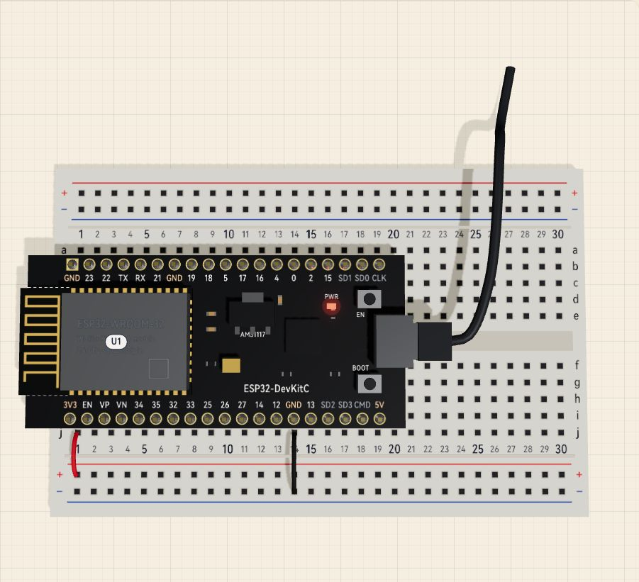
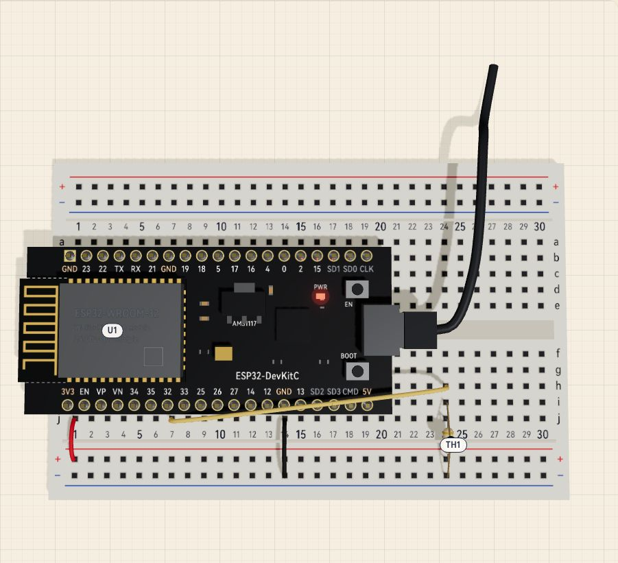
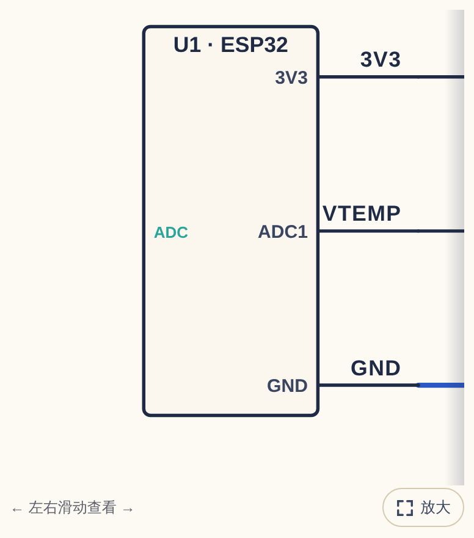
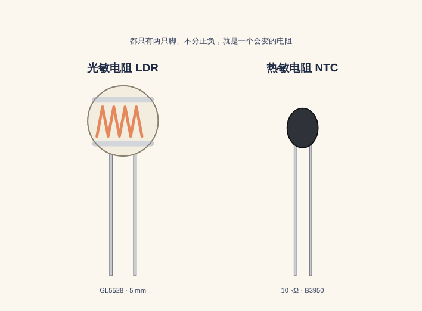
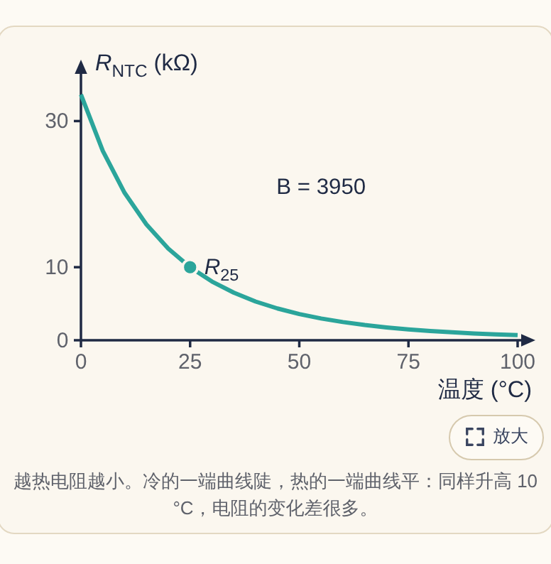
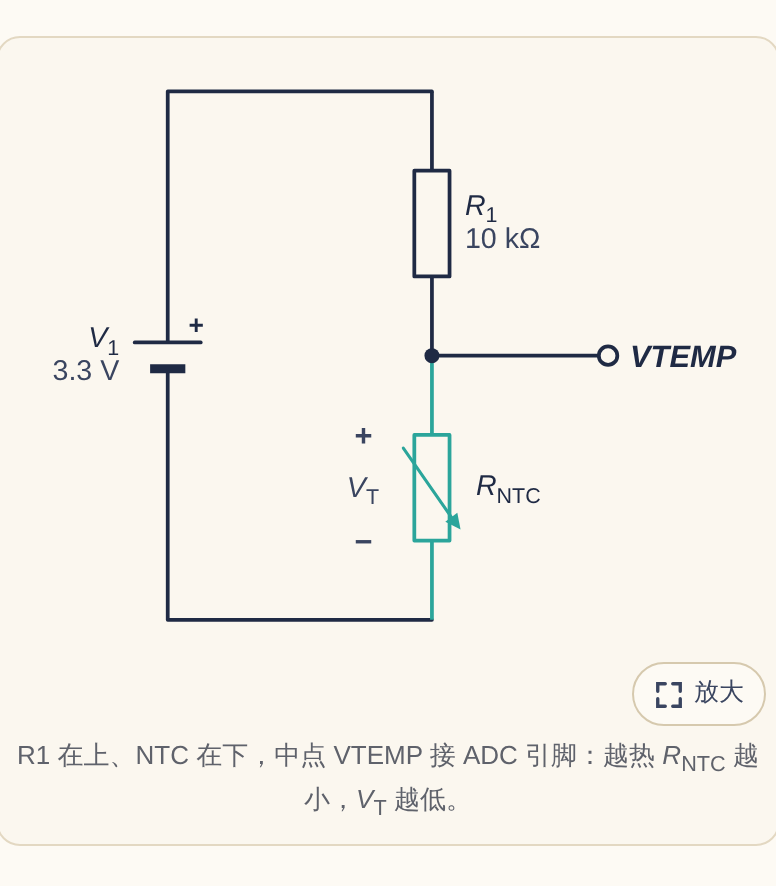

# 8.7 · NTC 热敏电阻温度计：读数不走直线

| 项目 | 内容 |
|---|---|
| id | `exp5-ntc-thermometer` |
| 文件 | `challenges/285-ntc-thermometer.json` |
| 类型 | 实验 / 挑战（没有分步，照目标电路图搭） · 难度 3/5 |
| 位置 | World 8 · 数字逻辑、MCU 与传感器实战 → 8.7 ADC 与模拟传感器（本节第 4 项） |
| 右侧面板 | 轨道由旧的四张卡片自动生成（还没手工精排） |
| 前后 | 上一项 [8.7 exp5-ldr-light-sensor](../w8/8.07-3-exp5-ldr-light-sensor.md) · 下一项 [8.8 exp5-pwm-rc-dac](../w8/8.08-1-exp5-pwm-rc-dac.md) |
| 先修 | lesson-mcu-pwm-adc |
| 概念 | NTC 热敏电阻 NTC thermistor、B 值方程 / Steinhart–Hart B-parameter equation、非线性 nonlinearity、分压器灵敏度 divider sensitivity、自热 self-heating |

**一句话概要**：10 kΩ 固定电阻 + 10 kΩ NTC 分压接到 ESP32 的 ADC。温度一步步升高，读数的变化却一步比一步小；固件用 B 值公式换算回温度。

## 1. 左侧工作台（3D 面包板 → 2D 俯视截图）

截图是程序里真实的 3D 面包板换成俯视角拍的；表格是同一块板的文字版（元件、参数、每只脚插在哪个孔）。

### 1.1 起点：打开这一课时板上已经有的

右侧显示的「起点」说明：

> **半成品**：ESP32（GPIO32 已设成 ADC）、下方电源轨的 3V3 和 GND 已经接好。**为什么**：板子的供电是重复技能；这里要学的是 NTC 分压。**你要做**：R1（10kΩ）从 3V3 轨接到第 24 列，NTC 从第 24 列接到 GND，再把第 24 列接到 GPIO32（j7）。

| 元件 | 类型 | 参数 | 引脚 → 孔 |
|---|---|---|---|
| U1 | esp32_devkit | usb=true, pins={"GPIO32":{"mode":"adc"}} | GND→b1 GPIO23→b2 GPIO22→b3 GPIO1→b4 GPIO3→b5 GPIO21→b6 GND_2→b7 GPIO19→b8 GPIO18→b9 GPIO5→b10 GPIO17→b11 GPIO16→b12 GPIO4→b13 GPIO0→b14 GPIO2→b15 GPIO15→b16 GPIO8→b17 GPIO7→b18 GPIO6→b19 3V3→i1 EN→i2 GPIO36→i3 GPIO39→i4 GPIO34→i5 GPIO35→i6 GPIO32→i7 GPIO33→i8 GPIO25→i9 GPIO26→i10 GPIO27→i11 GPIO14→i12 GPIO12→i13 GND_3→i14 GPIO13→i15 GPIO9→i16 GPIO10→i17 GPIO11→i18 5V→i19 |
| W1 | wire |  | a→j1 b→bp1 |
| W2 | wire |  | a→j14 b→bn14 |

### 1.3 参考答案（「看答案」载入的板子）

| 元件 | 类型 | 参数 | 引脚 → 孔 |
|---|---|---|---|
| U1 | esp32_devkit | usb=true, pins={"GPIO32":{"mode":"adc"}} | GND→b1 GPIO23→b2 GPIO22→b3 GPIO1→b4 GPIO3→b5 GPIO21→b6 GND_2→b7 GPIO19→b8 GPIO18→b9 GPIO5→b10 GPIO17→b11 GPIO16→b12 GPIO4→b13 GPIO0→b14 GPIO2→b15 GPIO15→b16 GPIO8→b17 GPIO7→b18 GPIO6→b19 3V3→i1 EN→i2 GPIO36→i3 GPIO39→i4 GPIO34→i5 GPIO35→i6 GPIO32→i7 GPIO33→i8 GPIO25→i9 GPIO26→i10 GPIO27→i11 GPIO14→i12 GPIO12→i13 GND_3→i14 GPIO13→i15 GPIO9→i16 GPIO10→i17 GPIO11→i18 5V→i19 |
| W1 | wire |  | a→j1 b→bp1 |
| W2 | wire |  | a→j14 b→bn14 |
| R1 | resistor | resistance=10000 | 1→bp24 2→j24 |
| TH1 | ntc | temperature=25 | 1→i24 2→bn24 |
| W3 | wire |  | a→h24 b→j7 |

### 1.4 目标原理图（右侧「目标原理图」抽屉）

| 元件 | 类型 | 参数 |
|---|---|---|
| U1 | esp32_devkit | pins={"ADC1":{"mode":"adc"}} |
| R1 | resistor | resistance=10000 |
| TH1 | ntc |  |

连接（每个结点上的引脚）：

- **3V3**：U1.3V3、R1.1
- **VTEMP**：R1.2、TH1.1、U1.ADC1
- **GND**：TH1.2、U1.GND

## 2. 右侧面板：学生从上往下看到的内容（单轨流）

### 第 1 步 · 🔍 先看一眼：先认识它：光敏电阻与热敏电阻

**拆解「光敏电阻和热敏电阻：会变的电阻怎么变成数字」第 1 / 8 层：① 外形：两个两只脚、不分极性的电阻**

- 光敏电阻 LDR（实验 5-5 的 GL5528）：一个 5 mm 的小圆片，透明涂层下面能看到一条弯弯曲曲的橙红色细线——那就是会感光的材料；
- NTC 热敏电阻（实验 5-6，10 kΩ，B = 3950）：一个小小的环氧“珠子”，两根细腿。

它们都 **没有正负极**，在电路里就是一个电阻，只不过阻值不是固定的：
- LDR：**越亮电阻越小**；
- NTC：**越热电阻越小**（Negative Temperature Coefficient = 负温度系数）。

单片机不会直接“量电阻”，它只会用 ADC 量电压。所以下面的路线是：先拆开看电阻为什么变 → 写出变化的公式 → 接成分压器把电阻变成电压 → ADC 把电压变成数字 → 固件再把数字换回光照 / 温度。

|  | LDR（GL5528） | NTC（10 kΩ B3950） |
|---|---|---|
| 感受 | 光照（lux） | 温度（°C） |
| 材料 | 硫化镉 CdS 薄膜 | Mn / Ni / Co 氧化物陶瓷 |
| 规律 | $R = 15 kΩ·(\frac{lux}{10})^{-0.7}$ | $R = R_0·e^{B(\frac{1}{T} - \frac{1}{T_0})}$ |
| 范围 | 100 Ω（强光）… 1 MΩ（全黑） | 0 °C 33.6 kΩ … 80 °C 1.27 kΩ |
| 速度 | 慢：几十–几百 ms | 取决于珠子的热容：秒级 |
| 实验 | 5-5（Blue Pill PA0） | 5-6（ESP32 GPIO32） |

### 第 2 步 · 🔧 动手搭：温度等步长，读数呢？

**ESP32** 的 **3V3** 接下方 + 轨，**GND** 接 − 轨。
搭一个分压器：+ 轨 → **`10 kΩ`** → 中点 → **NTC 热敏电阻** → GND。中点接 **GPIO32**，把它设成 **ADC**。
单击 NTC，在「属性」里把温度依次设成 **`0`**、**`25`**、**`50`**、**`80 °C`**，每次记下引脚列表里的 ADC 读数。
越热，读数变大还是变小？每升高一样多的度数，读数变得一样多吗？

### 第 3 步 · 💡 想明白：NTC：越热电阻越小，而且是指数地变

- NTC 的意思是**负温度系数**：越热，电阻越小。它不走直线：冷的时候掉得快，热了以后掉得慢。

*图 `rt`（plot）：越热电阻越小。冷的一端曲线陡，热的一端曲线平：同样升高 10 °C，电阻的变化差很多。*

- 厂家用两个数描述它：25 °C 时的电阻 $R_{25}$ 和 B 值。温度 T 用开尔文（°C + 273.15）：
$$R = R_{25} × e^{B(1/T - 1/298.15)}$$
- 代入 50 °C（T = 323.15 K）：$R = 10 × e^{3950 × (1/323.15 - 1/298.15)} = 10 × e^{-1.025} ≈ 3.59$ kΩ。

*图 `div`（schematic）：R1 在上、NTC 在下，中点 VTEMP 接 ADC 引脚：越热 R_NTC 越小，V_T 越低。*

- 固定电阻选 $R_1 = R_{25}$：室温时两个电阻一样大，中点正好在电源的一半，那里最灵敏。

（这一步下面列着这节课的计算卡片，点开就地展开：`adc-code`、`sensor-best-resistor`、`ntc-beta`、`ntc-temperature`，全文见第 6 节）

### 第 4 步 · 🔧 动手搭：测三个温度，再像固件那样反算

- 电路就是刚才那个。点**「检查我的电路」**。
- 通过后，按题目把温度设成 0、25、80 °C，用万用表测中点对 GND。
- 最后一题像固件那样：从电压算出 NTC 的电阻，再用 B 值公式反算温度。

### 第 5 步 · 📏 测一测：测一测：读你自己的仪表

**测量题 1 · `v0`**（读数题）

> 0 °C：万用表测 ADC 引脚（VTEMP）对 GND

- 单位 V · 先写预测 · 状态：TH1 的温度为 0 °C · 参考答案的读数 **2.541 V** · 合理范围 [2.41, 2.67]

答对后显示：

> R_NTC ≈ 33.6 kΩ：3.3 × 33.6 / 43.6 ≈ 2.54 V。

**测量题 2 · `v25`**（读数题）

> 25 °C：ADC 引脚对 GND

- 单位 V · 先写预测 · 状态：TH1 的温度为 25 °C · 参考答案的读数 **1.649 V** · 合理范围 [1.57, 1.73]

答对后显示：

> R_NTC = R1 = 10 kΩ，正好一半：1.65 V。这一点灵敏度最高。

**测量题 3 · `v80`**（读数题）

> 80 °C：ADC 引脚对 GND

- 单位 V · 先写预测 · 状态：TH1 的温度为 80 °C · 参考答案的读数 **0.3717 V** · 合理范围 [0.353, 0.39]

答对后显示：

> R_NTC ≈ 1.27 kΩ：3.3 × 1.27 / 11.27 ≈ 0.37 V。

**测量题 4 · `nonlin`**（选择题）

> 用你的三个读数比较每度的电压变化：(V₀ − V₂₅)/25 和 (V₂₅ − V₈₀)/55

- A. 越热，每升高 1 °C 电压变化越小：0→25 °C 约 36 mV/°C，25→80 °C 只有约 23 mV/°C ✅（正确）
- B. 每升高 1 °C 电压变化都一样（线性）
- C. 越热，每升高 1 °C 电压变化越大

答对后显示：

> NTC 的电阻按指数变化，分压又是非线性的，所以不能用一条直线把读数换成温度。80 °C 附近一个 ADC 计数约 0.05 °C，25 °C 附近约 0.025 °C。

**测量题 5 · `temp`**（计算题（用自己的读数算））

> 像固件那样，用你的 80 °C 读数反算温度（°C）：R_NTC = R1 × V / (3.3 − V)，1/T = 1/298.15 + ln(R_NTC / 10 kΩ) / 3950，T 单位 K，再减 273.15

- 单位 °C · 先写预测 · 参考答案的读数 **80.03 °C** · 合理范围 [76, 84] · 公式 `1 / (1/298.15 + ln(v80 / (3.3 - v80)) / 3950) - 273.15`

答对后显示：

> R_NTC ≈ 1.27 kΩ → ln(0.127) ≈ −2.06 → T ≈ 353 K = 80 °C。这就是 B 值公式（Steinhart–Hart 的简化版）。

### 第 6 步 · 🎒 带走：带走

- **NTC 按指数变，分压又不是直线**，所以固件不能用一条直线换算温度，要用 B 值公式（更准就用三参数的 Steinhart–Hart 公式）。
- 固定电阻 ≈ 你最关心的温度下的 $R_{NTC}$。测 3D 打印机热床那样的 100 °C 左右，就换成 1 kΩ 上下。
- 分压器的上端接 ADC 的参考电压（这里是 3V3）：3V3 漂一点，比例不变，结果也不变。
- 坑：电流会让 NTC 自己发热，读数偏高零点几度。引脚上并一个 100 nF 到 GND 能减小噪声；只用 ADC1（GPIO32–39）。

趁热练理论题：`equivalence`

## 3. 测量题一览

| # | id | 题目 | 类型 | 单位 | 状态 | 参考读数 |
|---|---|---|---|---|---|---|
| 1 | v0 | 0 °C：万用表测 ADC 引脚（VTEMP）对 GND | voltage | V | TH1 的温度为 0 °C | 2.541 V |
| 2 | v25 | 25 °C：ADC 引脚对 GND | voltage | V | TH1 的温度为 25 °C | 1.649 V |
| 3 | v80 | 80 °C：ADC 引脚对 GND | voltage | V | TH1 的温度为 80 °C | 0.3717 V |
| 4 | nonlin | 用你的三个读数比较每度的电压变化：(V₀ − V₂₅)/25 和 (V₂₅ − V₈₀)/55 | 选择 |  |  | 正确：A |
| 5 | temp | 像固件那样，用你的 80 °C 读数反算温度（°C）：R_NTC = R1 × V / (3.3 − V)，1/T = 1/298.15 + ln(R_NTC / 10 kΩ) / 3950，T 单位 K，再减 273.15 | formula | °C |  | 80.03 °C |

### 全部答完后显示的「对比」

**对比**：重点看：**温度每次升高相同的度数，读数的变化却不一样**。越热读数反而越大时，检查 NTC 是不是接在了下面（中间结点 → NTC → GND）。计算过程：

**NTC 模型**：R(T) = R25 × exp[B × (1/T − 1/298.15 K)]，T 用开尔文。NTC = 负温度系数：越热电阻越小。
- 0 °C ≈ 33.6 kΩ；25 °C = 10.0 kΩ；50 °C ≈ 3.59 kΩ；80 °C ≈ 1.27 kΩ。

**分压结果**：V = 3.3 × R_NTC / (R1 + R_NTC)。NTC 在下，**越热电压越低**：
- 0 °C：2.541 V → **3154**
- 25 °C：1.649 V → **2046**（正好一半）
- 50 °C：0.871 V → **1081**
- 80 °C：0.372 V → **461**

**非线性**：0→25 °C 读数降 1108（约 44 计数/°C），25→50 °C 降 965（约 39 计数/°C），50→80 °C 只降 620（约 21 计数/°C）。同一个“1 个计数”在 25 °C 附近约 0.025 °C，在 80 °C 附近约 0.05 °C。所以不能用一条直线把读数换成温度。

### 提示按钮（依次显示）

1. 先把开发板的 3V3 接到下方 + 轨、GND 接到下方 − 轨。
2. 3V3 → 10 kΩ → 中点 → NTC → GND；中点接 GPIO32–39 之一。
3. 在引脚表里把这个引脚设成“模拟输入 ADC”。

### 功能测试（「检查我的电路」时跑）

- 0 °C：ADC 读数和电流合理
- 25 °C：ADC 读数和电流合理
- 50 °C：ADC 读数和电流合理
- 80 °C：ADC 读数和电流合理

## 4. 用到的拆解（全部层的文字，供改写参考）

### 拆解 `sensors`：光敏电阻和热敏电阻：会变的电阻怎么变成数字

*LDR = Light-Dependent Resistor（光敏电阻），NTC = Negative Temperature Coefficient thermistor（负温度系数热敏电阻）。两者都是“电阻随外界变化”。我们拆开看它们为什么会变、变化规律的公式，再把它们接成分压器送进 ADC，算出固定电阻该取多大、读数怎么换回光照和温度。*

**拆解「光敏电阻和热敏电阻：会变的电阻怎么变成数字」第 1 / 8 层：① 外形：两个两只脚、不分极性的电阻**

- 光敏电阻 LDR（实验 5-5 的 GL5528）：一个 5 mm 的小圆片，透明涂层下面能看到一条弯弯曲曲的橙红色细线——那就是会感光的材料；
- NTC 热敏电阻（实验 5-6，10 kΩ，B = 3950）：一个小小的环氧“珠子”，两根细腿。

它们都 **没有正负极**，在电路里就是一个电阻，只不过阻值不是固定的：
- LDR：**越亮电阻越小**；
- NTC：**越热电阻越小**（Negative Temperature Coefficient = 负温度系数）。

单片机不会直接“量电阻”，它只会用 ADC 量电压。所以下面的路线是：先拆开看电阻为什么变 → 写出变化的公式 → 接成分压器把电阻变成电压 → ADC 把电压变成数字 → 固件再把数字换回光照 / 温度。

|  | LDR（GL5528） | NTC（10 kΩ B3950） |
|---|---|---|
| 感受 | 光照（lux） | 温度（°C） |
| 材料 | 硫化镉 CdS 薄膜 | Mn / Ni / Co 氧化物陶瓷 |
| 规律 | $R = 15 kΩ·(\frac{lux}{10})^{-0.7}$ | $R = R_0·e^{B(\frac{1}{T} - \frac{1}{T_0})}$ |
| 范围 | 100 Ω（强光）… 1 MΩ（全黑） | 0 °C 33.6 kΩ … 80 °C 1.27 kΩ |
| 速度 | 慢：几十–几百 ms | 取决于珠子的热容：秒级 |
| 实验 | 5-5（Blue Pill PA0） | 5-6（ESP32 GPIO32） |

**拆解「光敏电阻和热敏电阻：会变的电阻怎么变成数字」第 2 / 8 层：② LDR 内部：两把梳子中间夹一条之字形 CdS**

放大看那条橙线：瓷片上镀了两块 **梳子形** 的金属电极 电极 1 和 电极 2，梳齿互相插在一起，它们之间留下的那条弯来弯去的缝里是 硫化镉 CdS——一种半导体。

**为什么光能让电阻变小**：CdS 的禁带宽度约 2.4 eV。黑暗中几乎没有自由载流子，电阻很大（≈ 1 MΩ）。光子 能量够大时，把价带里的电子打到导带，产生 电子–空穴对——载流子越多，电导越大。光越强，产生的载流子越多，电阻越小。

**为什么要做成之字形**：一条导体的电阻是
$$R = ρ·\frac{L}{W·t}$$
这里电流是“横着”穿过缝的：路程 L = 缝的宽度（很窄），截面宽 W = 缝的总长度（弯来弯去，很长）。之字形让 L 很小、W 很大，CdS 本身电阻率很高也能得到 kΩ 量级的电阻，而且整个缝都对着光。

- 公式 `R = ρ·\frac{L}{W·t}`：L = 缝宽（短），W = 缝的总长（长），t = 膜厚

**拆解「光敏电阻和热敏电阻：会变的电阻怎么变成数字」第 3 / 8 层：③ LDR 的规律：对数坐标下是一条直线**

把电阻对照度画在 **两个对数轴** 上，GL5528 是一条直线（仿真模型，和实验 5-5 一致）：
$$R_{LDR} = 15 kΩ·(\frac{lux}{10})^{-0.7}$$
两边取对数：$log R = log 15 k - 0.7·log\frac{lux}{10}$——斜率 −0.7 的直线。含义：
- 光照 ×10 → 电阻 ÷ $10^{0.7}$ ≈ ÷5；
- 10 lux 时 15 kΩ（这就是 15 kΩ 这个数的来历）。

代入四个测试点：

| 场景 | 照度 | $R_{LDR}$ |
|---|---|---|
| 很暗（月光） | 1 lux | $15 k × 10^{0.7}$ ≈ 75 kΩ |
| 昏暗 | 10 lux | 15 kΩ |
| 室内 | 100 lux | 15 k ÷ 5 ≈ 3.0 kΩ |
| 窗边 / 阴天户外 | 1000 lux | ≈ 600 Ω |

- 公式 `R_{LDR} = 15 kΩ·(\frac{lux}{10})^{-0.7}`：仿真模型（夹在 100 Ω … 1 MΩ）

**拆解「光敏电阻和热敏电阻：会变的电阻怎么变成数字」第 4 / 8 层：④ NTC 内部和 B 方程：越热电阻越小**

NTC 的 珠子 是锰、镍、钴等金属氧化物烧结成的陶瓷半导体，两根 引线 埋在里面，外面包一层环氧或玻璃。

**为什么越热电阻越小**：和金属相反。半导体里的载流子要靠热能“激发”出来，温度越高，激发出的载流子按指数增加，电阻按指数下降。描述它的是 **B 参数方程**（T 用开尔文）：
$$R(T) = R_0·e^{B(\frac{1}{T} - \frac{1}{T_0})}$$
$R_0$ = 10 kΩ 是 $T_0$ = 25 °C = 298.15 K 时的阻值，B = 3950 K 描述它有多“陡”。

**一步步算 50 °C**：
1. T = 50 + 273.15 = 323.15 K；
2. $\frac{1}{T} - \frac{1}{T_0} = 0.0030945 - 0.0033540 = -0.0002595$ /K；
3. 乘 B：3950 × (−0.0002595) = −1.025；
4. $R = 10 kΩ × e^{-1.025}$ = 10 kΩ × 0.359 = 3.59 kΩ。

同理 0 °C 是 33.6 kΩ，80 °C 是 1.27 kΩ——曲线 明显不是直线：低温段很陡，高温段很平。

| T | T (K) | $\frac{1}{T} - \frac{1}{T_0}$ | $R_{NTC}$ |
|---|---|---|---|
| 0 °C | 273.15 | +0.0003070 | 33.6 kΩ |
| 25 °C | 298.15 | 0 | 10.0 kΩ |
| 50 °C | 323.15 | −0.0002595 | 3.59 kΩ |
| 80 °C | 353.15 | −0.0005222 | 1.27 kΩ |

- 公式 `R(T) = R_0·e^{B(\frac{1}{T} - \frac{1}{T_0})}`：R₀ = 10 kΩ，T₀ = 298.15 K，B = 3950 K

**拆解「光敏电阻和热敏电阻：会变的电阻怎么变成数字」第 5 / 8 层：⑤ 接成分压器：电阻 → 电压 → 数字**

ADC 只量电压，所以给传感器串一个固定电阻 R1，接成 **分压器**（voltage divider），中间结点送进 ADC。ADC 输入几乎不取电流，所以就是最简单的无负载分压。

**实验 5-5**（Blue Pill）：3V3 → LDR → VLIGHT → R1 = 6.8 kΩ → GND，VLIGHT 接 PA0：
$$V = 3.3·\frac{R_1}{R_1 + R_{LDR}}$$
LDR 在上面：越亮 → $R_{LDR}$ 越小 → 电压越高。

**实验 5-6**（ESP32）：3V3 → R1 = 10 kΩ → VTEMP → NTC → GND，VTEMP 接 GPIO32：
$$V = 3.3·\frac{R_{NTC}}{R_1 + R_{NTC}}$$
NTC 在下面：越热 → 电压越低。

两种接法交换上下位置，规律就反过来——固件里“亮 / 暗”“热 / 冷”的判断方向必须和接线一致。

**比例测量（ratiometric）**：分压器的顶端接 ADC 的参考电压（3V3），读数 $\frac{V}{3.3} × 4095 = \frac{R_1}{R_1 + R} × 4095$ 里 3.3 被约掉了——3V3 有点漂也不影响结果。

| 实验 5-5（LDR，6.8 kΩ） | 电压 | 读数 | 实验 5-6（NTC，10 kΩ） | 电压 | 读数 |
|---|---|---|---|---|---|
| 1 lux | 0.274 V | 340 | 0 °C | 2.541 V | 3154 |
| 10 lux | 1.029 V | 1277 | 25 °C | 1.649 V | 2046 |
| 100 lux | 2.291 V | 2843 | 50 °C | 0.871 V | 1081 |
| 1000 lux | 3.033 V | 3763 | 80 °C | 0.372 V | 461 |

- 公式 `code = round(\frac{R_{bottom}}{R_{top} + R_{bottom}} × 4095)`：比例测量：与 3V3 的准确值无关

**拆解「光敏电阻和热敏电阻：会变的电阻怎么变成数字」第 6 / 8 层：⑥ 固定电阻取多大：R1 = 传感器在量程中间的电阻**

R1 取错了，分压器会把有用的变化“挤扁”：
- R1 = 100 kΩ：1/10/100/1000 lux 得到 1.88 / 2.87 / 3.20 / 3.28 V——亮的一端全挤在 3.3 V 附近，100 lux 和 1000 lux 只差 0.08 V；
- R1 = 1 kΩ：0.04 / 0.21 / 0.83 / 2.07 V——暗的一端全挤在 0 V；
- R1 = 6.8 kΩ：0.27 / 1.03 / 2.29 / 3.03 V，每十倍光照差 0.9–1.6 V，三个十倍都分得清。

**推导**：传感器电阻按比例变（LDR 每十倍光照 ÷5，NTC 是指数），所以要看电压对 $ln R$ 的灵敏度。设传感器在上，$V = V_{cc}\frac{R_1}{R_1 + R}$：
$$\frac{dV}{d(ln R)} = R·\frac{dV}{dR} = -V_{cc}·\frac{R_1·R}{(R_1 + R)^{2}}$$
令 $x = \frac{R_1}{R}$，大小是 $V_{cc}\frac{x}{(1 + x)^{2}}$，在 **x = 1，即 R1 = R** 时最大，等于 $\frac{V_{cc}}{4}$——此时 V 正好是 $\frac{V_{cc}}{2}$，曲线最陡 的地方。

**规则**：R1 = 你最关心的那一点的传感器电阻；要覆盖一个范围，取两端电阻的 **几何平均**：
$$R_1 = \sqrt{R_{min}·R_{max}} = \sqrt{75 kΩ × 0.6 kΩ} ≈ 6.7 kΩ → 6.8 kΩ$$
NTC 同理：R1 = $R_{25}$ = 10 kΩ 把最灵敏点放在室温，适合 0–50 °C；要测 100 °C 左右的 3D 打印机热床，就用 100 °C 时的阻值（≈ 0.7 kΩ）附近的 680 Ω–1 kΩ。

| R1 | 1 lux | 10 lux | 100 lux | 1000 lux | 评价 |
|---|---|---|---|---|---|
| 1 kΩ | 0.04 V | 0.21 V | 0.83 V | 2.07 V | 暗端挤在 0 V |
| 6.8 kΩ | 0.27 V | 1.03 V | 2.29 V | 3.03 V | 最好：几何平均 |
| 100 kΩ | 1.88 V | 2.87 V | 3.20 V | 3.28 V | 亮端挤在 3.3 V |

- 公式 `\frac{dV}{d(ln R)} 最大 ⇔ R_1 = R`：最大值 = Vcc / 4，此时 V = Vcc / 2
- 公式 `R_1 = \sqrt{R_{min}·R_{max}}`：覆盖一个范围时

**拆解「光敏电阻和热敏电阻：会变的电阻怎么变成数字」第 7 / 8 层：⑦ 从读数换回温度，以及为什么不是直线**

固件拿到的只是一个 0–4095 的数，要倒着走三步（实验 5-6）：
1. **读数 → 电阻**：分压公式反过来（NTC 在下）：
$$R_{NTC} = R_1·\frac{raw}{4095 - raw}$$
2. **电阻 → 温度**：B 方程取对数解出 T：
$$\frac{1}{T} = \frac{1}{T_0} + \frac{1}{B}ln\frac{R_{NTC}}{R_0}$$
3. **开尔文 → 摄氏**：减 273.15。

例：raw = 1081 → $R_{NTC}$ = 10 k × 1081 / 3014 ≈ 3.59 kΩ → ln 0.359 = −1.025 → $\frac{1}{T}$ = 0.003354 − 0.000260 = 0.003094 → T ≈ 323.2 K = **50.0 °C**。

**非线性**：读数–温度曲线 不是直线。相同的 25 °C 间隔：
- 0 → 25 °C 降 1108 码（约 44 码/°C）；
- 25 → 50 °C 降 965 码（约 39 码/°C）；
- 50 → 80 °C 只降 620 码（约 21 码/°C）。

所以 用直线插值 会在中间差好几度；一个码在 25 °C 附近代表 0.025 °C，在 80 °C 附近是 0.05 °C。要 ±0.1 °C 的精度，用三项的 Steinhart–Hart 方程 $\frac{1}{T} = A + Bln R + C(ln R)^{3}$，按厂家的 R–T 表拟合。

| T | $R_{NTC}$ | V | 读数 | 每 °C 几个码 |
|---|---|---|---|---|
| 0 °C | 33.6 kΩ | 2.541 V | 3154 | ≈ 44（0–25 °C） |
| 25 °C | 10.0 kΩ | 1.649 V | 2046 | ≈ 39（25–50 °C） |
| 50 °C | 3.59 kΩ | 0.871 V | 1081 | ≈ 21（50–80 °C） |
| 80 °C | 1.27 kΩ | 0.372 V | 461 | — |

- 公式 `R_{NTC} = R_1·\frac{raw}{4095 - raw}`：NTC 在下的分压器反算
- 公式 `\frac{1}{T} = \frac{1}{T_0} + \frac{1}{B}ln\frac{R_{NTC}}{R_0}`：B 方程解出 T（开尔文）

**拆解「光敏电阻和热敏电阻：会变的电阻怎么变成数字」第 8 / 8 层：⑧ 局限：自热、速度、个体差异**

**NTC 自热**：测量电流流过 NTC 会让它自己发热，测到的温度偏高。NTC 上的功率
$$P = \frac{V_{NTC}^{2}}{R_{NTC}}$$
在 $R_{NTC}$ = R1 时最大：$\frac{1.65^{2}}{10 kΩ}$ ≈ 0.27 mW（25 °C，电流 165 µA）。小珠子 NTC 的耗散常数约 1–2 mW/°C，所以自热 0.1–0.3 °C。要更准：用更大的阻值（100 kΩ NTC + 100 kΩ），或者只在测量时给分压器上电。

**LDR 很慢**：光照突变后，电阻要几十到几百 ms 才跟上（变暗时更慢），不适合测快速闪烁的光。做“天黑开灯”要加 **回差**（两个阈值），否则在阈值附近灯会闪。

**个体差异**：LDR 同型号之间 ±50 % 很常见，还随温度漂移——适合判断亮 / 暗、粗略亮度；要真实 lux 用数字传感器（BH1750、VEML7700）。NTC 电阻公差 ±1–5 %、B 值约 ±1 %，要算进误差预算。CdS 含镉，受 RoHS 限制，新设计多用光电二极管 / 光电三极管。

**接线**：STM32 的模拟引脚（PA0–PA7、PB0、PB1）**不耐 5 V**，分压器顶端只能接 3V3；ADC 引脚到 GND 并一个 100 nF 降噪（NTC 分压器的源阻抗 R1 ∥ $R_{NTC}$ 约 5 kΩ）。

| 问题 | LDR | NTC | 对策 |
|---|---|---|---|
| 速度 | 几十–几百 ms | 秒级（热容） | 软件滤波，回差 |
| 个体差异 | ±50 % | R ±1–5 %，B ±1 % | 校准 / 用数字传感器 |
| 自热 | 可忽略 | ≤ 0.27 mW → 0.1–0.3 °C | 大阻值，只在测量时上电 |
| 非线性 | 幂律 | 指数 | 用公式，不要直线 |

- 公式 `P_{NTC} = \frac{V_{NTC}^{2}}{R_{NTC}} ≤ \frac{V_{cc}^{2}}{4 R_1} = 0.27 mW`：R_NTC = R1 时最大

**一句话记住**：LDR：CdS 被光激发出载流子，$R = 15 kΩ·(\frac{lux}{10})^{-0.7}$；NTC：氧化物陶瓷被热激发，$R = R_0·e^{B(\frac{1}{T} - \frac{1}{T_0})}$。两者都接成分压器给 ADC，R1 取传感器在关心范围中间（几何平均）的阻值，读数用分压公式和 B 方程倒推回光照 / 温度。

## 5. 这一课的计算卡片

**计算卡片 `adc-code`：ADC 读数 raw = V/Vref × 4095**

- 公式 `raw = \frac{V}{V_{ref}} × (2^{N} - 1)`
- 用途：一个电压在 N 位 ADC 上读出多少（0 … 4095）。
- 输入：V（ADC 引脚电压，V）；V_ref（满量程（参考电压），V）；N（位数，） → raw（读数，）

1. N 位 ADC 把 0 … $V_{ref}$ 分成 $2^{N}$ 个台阶：12 位就是 4096 个，读数 0 … 4095。
2. 线性换算：$raw = \frac{V}{V_{ref}} × 4095$，四舍五入成整数。
3. 一个 LSB（最低位）= $\frac{V_{ref}}{4095} ≈ 0.81 mV$：这是分辨率。
4. 固件反过来：$V = raw × \frac{V_{ref}}{4095}$。
5. 引脚电压超过 $V_{ref}$ 读数就停在 4095；超过 3.3 V（加二极管压降）引脚会坏——先分压。

例子：第 16 课：1.65 V → 2048。实验 5-4：8.4 V 电池分压后 2.084 V → 2586。实验 5-6：25 °C 1.649 V → 2046，80 °C 0.372 V → 461。实验 5-10：3.13 V → 3879。

- ⚠ ESP32 的 ADC 在 0.15 V 以下和 2.45 V 以上不线性，要校准；用 ADC1（GPIO32–39），ADC2 开 Wi-Fi 时不能用。

**计算卡片 `sensor-best-resistor`：传感器分压：固定电阻取几何平均**

- 公式 `R_1 = \sqrt{R_{a} R_{b}}`
- 用途：光敏 / 热敏电阻要在 Rₐ … R_b 范围内都分得开：固定电阻选多大。
- 输入：R_a（传感器一端的阻值（如最暗），Ω）；R_b（另一端的阻值（如最亮），Ω） → R_1（最合适的固定电阻，Ω）

1. 分压输出 $V = V_{cc}\frac{R_1}{R_1 + R_s}$（传感器在上）。
2. 传感器的阻值按倍数变（光每 ×10，电阻 ÷5），所以要看 V 对 $ln R_s$ 的灵敏度：$|\frac{dV}{d ln R_s}| = V_{cc}\frac{R_1R_s}{(R_1 + R_s)^{2}}$。
3. 这个式子在 $R_1 = R_s$ 时最大（V = Vcc/2，曲线最陡）。
4. 要覆盖一个范围，就让范围的“对数中点”落在最陡处：$R_1 = \sqrt{R_aR_b}$，两端也对称地分开。
5. 只关心一个点（比如 10 lux 开灯）就取那一点的阻值。

例子：实验 5-5：1–1000 lux，$\sqrt{75k × 0.6k} ≈ 6.7 kΩ$ → 6.8 kΩ。换成 100 kΩ：亮处挤在 3.2–3.3 V；1 kΩ：暗处挤在 0 V 附近。实验 5-6：0–50 °C 的 NTC $\sqrt{33.6k × 3.59k} ≈ 11 kΩ$，所以用 10 kΩ = R₂₅。

**计算卡片 `ntc-beta`：NTC 热敏电阻：B 值公式**

- 公式 `R(T) = R_{25} e^{B(\frac{1}{T} - \frac{1}{298.15 K})}`
- 用途：某个温度下 NTC 的阻值（T 用开尔文）。
- 输入：T（温度，°C）；R_25（25 °C 时的阻值，Ω）；B（B 值，K） → R（阻值，Ω）

1. 半导体里的载流子数随温度按指数增加，所以电阻按指数下降（NTC = 负温度系数）。
2. 近似：$R = A e^{B/T}$。用 25 °C（298.15 K）时 $R = R_{25}$ 消去 A，得到上面的 B 值公式。
3. **T 一定用开尔文**：$T = t + 273.15$。
4. 接成分压器（R₁ 在上、NTC 在下）：$V = V_{cc}\frac{R_{NTC}}{R_1 + R_{NTC}}$，越热电压越低。
5. 指数 + 分压都是非线性：同样 1 °C，低温端读数变化大，高温端变化小。

例子：10 kΩ、B = 3950：0 °C ≈ 33.6 kΩ；25 °C = 10.0 kΩ；40 °C ≈ 5.3 kΩ；50 °C ≈ 3.59 kΩ；60 °C ≈ 2.49 kΩ；80 °C ≈ 1.27 kΩ。实验 5-6（10 kΩ 在上）：2.54 / 1.65 / 0.87 / 0.37 V。

- ⚠ 把摄氏度直接代进 1/T。

**计算卡片 `ntc-temperature`：从 ADC 电压算温度（固件做的事）**

- 公式 `R_{NTC} = R_1 \frac{V}{V_{cc} - V}, \frac{1}{T} = \frac{1}{298.15} + \frac{ln(R_{NTC}/R_{25})}{B}`
- 用途：NTC 在下、R₁ 在上的分压器：读到电压，算回摄氏度。
- 输入：V（ADC 引脚电压，V）；R_1（上面的固定电阻，Ω）；V_cc（分压器电源（= ADC 参考最好），V）；R_25（R₂₅，Ω）；B（B 值，K） → T（温度（°C），）

1. 分压器反解：$V = V_{cc}\frac{R_{NTC}}{R_1 + R_{NTC}}$ ⇒ $R_{NTC} = R_1\frac{V}{V_{cc} - V}$。用读数写：$R_{NTC} = R_1\frac{raw}{4095 - raw}$。
2. B 值公式取对数：$ln\frac{R}{R_{25}} = B(\frac{1}{T} - \frac{1}{298.15})$。
3. 解出 $\frac{1}{T}$，取倒数得开尔文，再减 273.15。
4. 分压器顶端接 ADC 的参考电压（比值测量）：$V_{cc}$ 稍微漂一点也会在公式里消掉。
5. 要 ±0.1 °C 就用三项的 Steinhart–Hart 公式 $\frac{1}{T} = A + B ln R + C(ln R)^{3}$，按厂家 R–T 表拟合。

例子：实验 5-6：0.372 V → $R = 10k × \frac{0.372}{2.928} ≈ 1.27 kΩ$ → $ln 0.127 ≈ -2.06$ → T ≈ 353 K = 80 °C。读数 1081 → 3.59 kΩ → 50.0 °C。

- ⚠ 实验 5-17 里 NTC 在上：公式变成 $R_{NTC} = R_1\frac{V_{cc} - V}{V}$，而且越热电压越高。
- ⚠ NTC 自热：25 °C 时约 0.27 mW，小珠状 NTC 会自己升温 0.1–0.3 °C。

## 6. English（界面英文版的同一份内容）

展开英文

### Node 1 · 🔍 Look first：Meet it first: LDR and NTC

**Teardown「LDR and NTC: turning a changing resistance into a number」layer 1 of 8：① Outside: two two-legged resistors with no polarity**

- the LDR (GL5528, lab 5-5): a 5 mm disc; under its clear coat you can see a wiggly orange-red line — the light-sensitive material;
- the NTC thermistor (lab 5-6, 10 kΩ, B = 3950): a tiny epoxy bead on two thin legs.

Neither has **polarity**; in a circuit each is just a resistor whose value isn't fixed:
- LDR: **brighter → lower resistance**;
- NTC: **hotter → lower resistance** (Negative Temperature Coefficient).

A microcontroller can't measure resistance directly — its ADC measures voltage. So the route is: take them apart to see why the resistance changes → write the formula → wire a divider to turn resistance into voltage → the ADC turns voltage into a number → firmware turns the number back into light / temperature.

|  | LDR (GL5528) | NTC (10 kΩ B3950) |
|---|---|---|
| senses | light (lux) | temperature (°C) |
| material | cadmium sulphide (CdS) film | Mn / Ni / Co oxide ceramic |
| law | $R = 15 kΩ·(\frac{lux}{10})^{-0.7}$ | $R = R_0·e^{B(\frac{1}{T} - \frac{1}{T_0})}$ |
| range | 100 Ω (bright) … 1 MΩ (dark) | 33.6 kΩ at 0 °C … 1.27 kΩ at 80 °C |
| speed | slow: tens–hundreds of ms | set by the bead’s heat capacity: seconds |
| lab | 5-5 (Blue Pill PA0) | 5-6 (ESP32 GPIO32) |

### Node 2 · 🔧 Build：Equal temperature steps — and the readings?

Connect the **ESP32**'s **3V3** to the bottom + rail and **GND** to the − rail.
Build a divider: + rail → **`10 kΩ`** → middle node → **NTC thermistor** → GND. Wire the middle node to **GPIO32** and set it to **ADC**.
Click the NTC and, under Properties, set the temperature to **`0`**, **`25`**, **`50`** and **`80 °C`** in turn; each time note the ADC reading in the pin list.
Hotter: does the reading go up or down? Does every equal rise in temperature change the reading by the same amount?

### Node 3 · 💡 Why：An NTC: hotter means less resistance, exponentially

- NTC means **negative temperature coefficient**: the hotter, the lower the resistance. Not along a straight line: it falls fast when cold and slowly when hot.

[figure `rt`]

*Figure `rt`（plot）：越热电阻越小。冷的一端曲线陡，热的一端曲线平：同样升高 10 °C，电阻的变化差很多。*

- The maker describes it with two numbers: the resistance at 25 °C, $R_{25}$, and the B value. The temperature T is in kelvin (°C + 273.15):
$$R = R_{25} × e^{B(1/T - 1/298.15)}$$
- At 50 °C (T = 323.15 K): $R = 10 × e^{3950 × (1/323.15 - 1/298.15)} = 10 × e^{-1.025} ≈ 3.59$ kΩ.

[figure `div`]

*Figure `div`（schematic）：R1 在上、NTC 在下，中点 VTEMP 接 ADC 引脚：越热 R_NTC 越小，V_T 越低。*

- Choose the fixed resistor $R_1 = R_{25}$: at room temperature both are equal, the middle node sits at half the supply, and that is where the divider is most sensitive.

(This node lists the lesson’s calculation cards: `adc-code`、`sensor-best-resistor`、`ntc-beta`、`ntc-temperature`; full text in section 6)

### Node 4 · 🔧 Build：Measure three temperatures, then work back like firmware

- The circuit is the one you just built. Press **Check my circuit**.
- Once it passes, set the temperature to 0, 25 and 80 °C as the questions ask and measure the middle node to GND.
- The last question does what firmware does: from the voltage, get the NTC's resistance, then the temperature from the B equation.

### Node 5 · 📏 Measure：Measure: read your own instruments

**Question 1 · `v0`**（reading）

> 0 °C: multimeter on the ADC pin (VTEMP) to GND

- unit V · predict first · state：TH1 is at 0 °C · range [2.41, 2.67]

Shown once right:

> R_NTC ≈ 33.6 kΩ: 3.3 × 33.6 / 43.6 ≈ 2.54 V.

**Question 2 · `v25`**（reading）

> 25 °C: the ADC pin to GND

- unit V · predict first · state：TH1 is at 25 °C · range [1.57, 1.73]

Shown once right:

> R_NTC = R1 = 10 kΩ, exactly half: 1.65 V. This is the most sensitive point.

**Question 3 · `v80`**（reading）

> 80 °C: the ADC pin to GND

- unit V · predict first · state：TH1 is at 80 °C · range [0.353, 0.39]

Shown once right:

> R_NTC ≈ 1.27 kΩ: 3.3 × 1.27 / 11.27 ≈ 0.37 V.

**Question 4 · `nonlin`**（multiple choice）

> Compare the change per degree from your three readings: (V₀ − V₂₅)/25 and (V₂₅ − V₈₀)/55

- A. the hotter, the smaller the change per °C: about 36 mV/°C from 0 to 25 °C, only about 23 mV/°C from 25 to 80 °C ✅ (right)
- B. the same per °C (linear)
- C. the hotter, the larger the change per °C

Shown once right:

> The NTC resistance changes exponentially and the divider is nonlinear too, so a straight line cannot turn readings into temperature. Near 80 °C one ADC count is about 0.05 °C; near 25 °C about 0.025 °C.

**Question 5 · `temp`**（calculation from own readings）

> As firmware does, convert your 80 °C reading back to a temperature (°C): R_NTC = R1 × V / (3.3 − V), 1/T = 1/298.15 + ln(R_NTC / 10 kΩ) / 3950 with T in K, then subtract 273.15

- unit °C · predict first · range [76, 84] · formula `1 / (1/298.15 + ln(v80 / (3.3 - v80)) / 3950) - 273.15`

Shown once right:

> R_NTC ≈ 1.27 kΩ → ln(0.127) ≈ −2.06 → T ≈ 353 K = 80 °C. That is the B-parameter equation (a simplified Steinhart–Hart).

### Node 6 · 🎒 Take away：Take away

- **An NTC changes exponentially and a divider is not a straight line either**, so firmware cannot convert with a straight line: it uses the B equation (or the three-term Steinhart–Hart equation for more accuracy).
- Fixed resistor ≈ $R_{NTC}$ at the temperature you care about most. For around 100 °C, like a 3D printer's heated bed, use about 1 kΩ.
- Feed the top of the divider from the ADC's reference (here 3V3): if 3V3 drifts a little, the ratio — and the result — stays the same.
- The catch: the current warms the NTC itself, so it reads a few tenths of a degree high. 100 nF from the pin to GND reduces noise; use ADC1 only (GPIO32–39).

Practise：`equivalence`

**Compare**

**Compare**: The point: **equal temperature steps do not give equal changes in the reading**. If the reading rises with temperature, check that the NTC is at the bottom (middle node → NTC → GND). The working:

**NTC model**: R(T) = R25 × exp[B × (1/T − 1/298.15 K)], T in kelvin. NTC = negative temperature coefficient: hotter means lower resistance.
- 0 °C ≈ 33.6 kΩ; 25 °C = 10.0 kΩ; 50 °C ≈ 3.59 kΩ; 80 °C ≈ 1.27 kΩ.

**Divider output**: V = 3.3 × R_NTC / (R1 + R_NTC). With the NTC at the bottom, **hotter means lower voltage**:
- 0 °C: 2.541 V → **3154**
- 25 °C: 1.649 V → **2046** (exactly half)
- 50 °C: 0.871 V → **1081**
- 80 °C: 0.372 V → **461**

**Nonlinearity**: 0→25 °C drops 1108 counts (about 44 counts/°C), 25→50 °C drops 965 (about 39 counts/°C), 50→80 °C only 620 (about 21 counts/°C). One count is about 0.025 °C near 25 °C but about 0.05 °C near 80 °C. A straight line cannot turn readings into temperature.

**Hints**

1. Wire the board's 3V3 to the bottom + rail and a GND pin to the bottom − rail.
2. 3V3 → 10 kΩ → middle node → NTC → GND; the middle node goes to GPIO32–39.
3. Set that pin to analog input (ADC) in the pin table.

