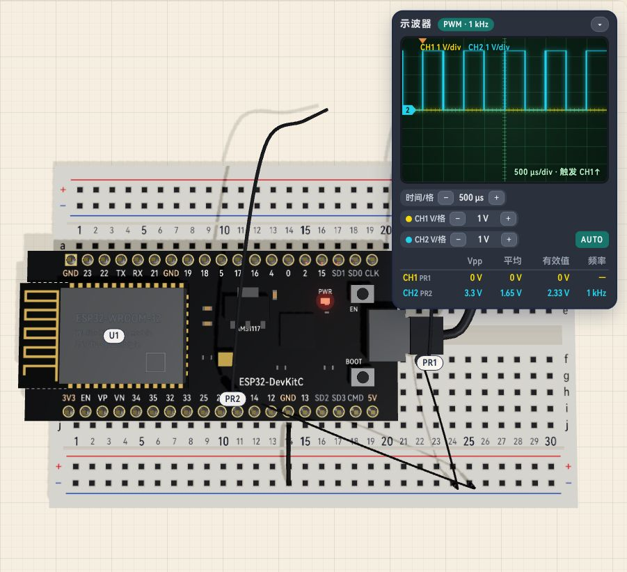
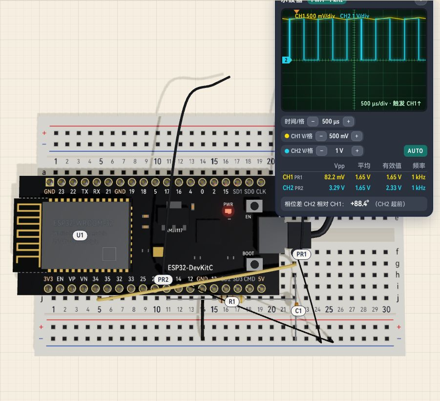
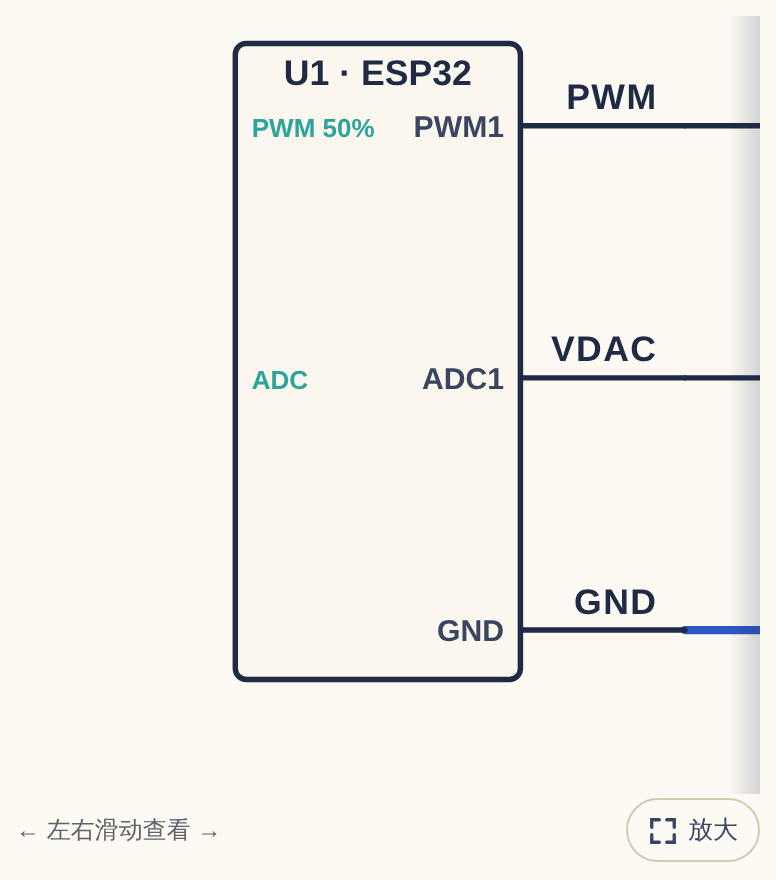
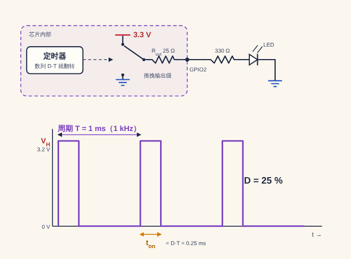
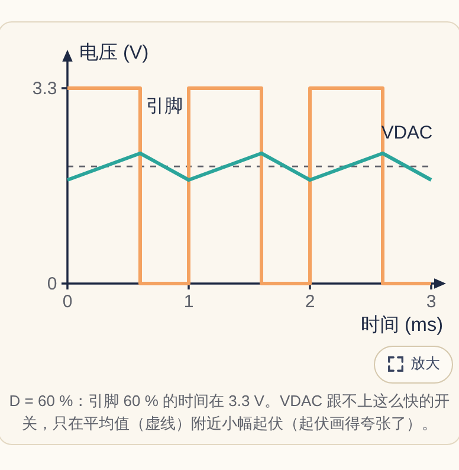
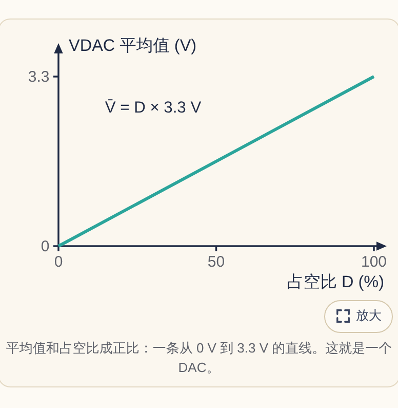

# 8.8 · PWM + RC：最便宜的 DAC

| 项目 | 内容 |
|---|---|
| id | `exp5-pwm-rc-dac` |
| 文件 | `challenges/293-pwm-rc-dac.json` |
| 类型 | 实验 / 挑战（没有分步，照目标电路图搭） · 难度 4/5 |
| 位置 | World 8 · 数字逻辑、MCU 与传感器实战 → 8.8 PWM：调光、DAC 与调速（本节第 1 项） |
| 右侧面板 | 轨道由旧的四张卡片自动生成（还没手工精排） |
| 前后 | 上一项 [8.7 exp5-ntc-thermometer](../w8/8.07-4-exp5-ntc-thermometer.md) · 下一项 [8.8 exp5-pwm-mosfet-motor](../w8/8.08-2-exp5-pwm-mosfet-motor.md) |
| 先修 | lesson-mcu-pwm-adc |
| 概念 | PWM 平均值 PWM average、RC 低通 RC low-pass、纹波 ripple、建立时间 settling time、DAC 数模转换 |

**一句话概要**：PWM 引脚只会 0 V 和 3.3 V。串一个电阻、并一个电容，就得到一个随占空比连续变化的直流电压，再让 ADC 自己读回来。

## 1. 左侧工作台（3D 面包板 → 2D 俯视截图）

截图是程序里真实的 3D 面包板换成俯视角拍的；表格是同一块板的文字版（元件、参数、每只脚插在哪个孔）。

### 1.1 起点：打开这一课时板上已经有的

右侧显示的「起点」说明：

> **半成品**：ESP32（GPIO27 设成 50 % PWM、GPIO34 设成 ADC）、GND 线和两个探头已经接好。**为什么**：板子是重复技能；RC 低通才是这个“DAC”。**你要做**：R1（10kΩ，GPIO27 → 第 22 列）、C1（1µF，第 22 列 → GND），再把第 22 列接到 GPIO34（j5）。

| 元件 | 类型 | 参数 | 引脚 → 孔 |
|---|---|---|---|
| U1 | esp32_devkit | usb=true, pins={"GPIO27":{"mode":"pwm","duty":50,"frequency":1000},"GPIO34":{"mode":"adc"}} | GND→b1 GPIO23→b2 GPIO22→b3 GPIO1→b4 GPIO3→b5 GPIO21→b6 GND_2→b7 GPIO19→b8 GPIO18→b9 GPIO5→b10 GPIO17→b11 GPIO16→b12 GPIO4→b13 GPIO0→b14 GPIO2→b15 GPIO15→b16 GPIO8→b17 GPIO7→b18 GPIO6→b19 3V3→i1 EN→i2 GPIO36→i3 GPIO39→i4 GPIO34→i5 GPIO35→i6 GPIO32→i7 GPIO33→i8 GPIO25→i9 GPIO26→i10 GPIO27→i11 GPIO14→i12 GPIO12→i13 GND_3→i14 GPIO13→i15 GPIO9→i16 GPIO10→i17 GPIO11→i18 5V→i19 |
| W1 | wire |  | a→j14 b→bn14 |
| PR1 | scope_probe | channel=1 | tip→f22 gnd→bn24 |
| PR2 | scope_probe | channel=2 | tip→h11 gnd→bn25 |

### 1.3 参考答案（「看答案」载入的板子）

| 元件 | 类型 | 参数 | 引脚 → 孔 |
|---|---|---|---|
| U1 | esp32_devkit | usb=true, pins={"GPIO27":{"mode":"pwm","duty":50,"frequency":1000},"GPIO34":{"mode":"adc"}} | GND→b1 GPIO23→b2 GPIO22→b3 GPIO1→b4 GPIO3→b5 GPIO21→b6 GND_2→b7 GPIO19→b8 GPIO18→b9 GPIO5→b10 GPIO17→b11 GPIO16→b12 GPIO4→b13 GPIO0→b14 GPIO2→b15 GPIO15→b16 GPIO8→b17 GPIO7→b18 GPIO6→b19 3V3→i1 EN→i2 GPIO36→i3 GPIO39→i4 GPIO34→i5 GPIO35→i6 GPIO32→i7 GPIO33→i8 GPIO25→i9 GPIO26→i10 GPIO27→i11 GPIO14→i12 GPIO12→i13 GND_3→i14 GPIO13→i15 GPIO9→i16 GPIO10→i17 GPIO11→i18 5V→i19 |
| W1 | wire |  | a→j14 b→bn14 |
| R1 | resistor | resistance=10000 | 1→j11 2→j22 |
| C1 | capacitor | capacitance=0.000001 | 1→h22 2→bn22 |
| W2 | wire |  | a→j5 b→g22 |
| PR1 | scope_probe | channel=1 | tip→f22 gnd→bn24 |
| PR2 | scope_probe | channel=2 | tip→h11 gnd→bn25 |

### 1.4 目标原理图（右侧「目标原理图」抽屉）

| 元件 | 类型 | 参数 |
|---|---|---|
| U1 | esp32_devkit |  |
| R1 | resistor | resistance=10000 |
| C1 | capacitor | capacitance=0.000001 |

连接（每个结点上的引脚）：

- **PWM**：U1.PWM1、R1.1
- **VDAC**：R1.2、C1.1、U1.ADC1
- **GND**：C1.2、U1.GND

## 2. 右侧面板：学生从上往下看到的内容（单轨流）

### 第 1 步 · 🔍 先看一眼：先认识它：PWM 与 ADC

**拆解「PWM 与 ADC：数字引脚怎么“输出”和“读入”模拟量」第 1 / 8 层：① PWM：同一个输出级，开开关关**

PWM 不是新的硬件，就是上一个拆解里那个 推挽输出级，只不过由芯片里的 定时器 timer 自动地、很快地在 HIGH 和 LOW 之间切换：
- 每个 周期 T 开始时引脚变 HIGH；
- 定时器数到 $t_on$ 就把它变 LOW，等下一个周期。

高电平占整个周期的比例叫 **duty cycle（占空比）**：
$$D = \frac{t_{on}}{T}$$
第 16 课：GPIO2 设成 PWM，1 kHz（T = 1 ms），D = 25 %，所以 $t_{on}$ = 0.25 ms。

注意 高电平 不是 3.3 V 而是 3.2 V：高电平期间引脚就是“3.3 V 串 25 Ω”，LED 和 330 Ω 上的电流 $I = \frac{3.3 - 1.8}{25 + 330 + 12} = 4.1 mA$ 在 $R_{out}$ 上压掉 $25 × 4.1 mA ≈ 0.1 V$。示波器上量到的 Vpp ≈ 3.2 V。

**PWM 没有改变“每一刻”的电流**：亮的那 25 % 时间里 LED 照样流 4.1 mA。它不能绕过引脚的电流上限。

| 量 | 符号 | 第 16 课的值 |
|---|---|---|
| 频率 | $f = \frac{1}{T}$ | 1 kHz |
| 周期 | T | 1 ms |
| 占空比 | $D = \frac{t_{on}}{T}$ | 25 % |
| 高电平时间 | $t_{on}$ | 0.25 ms |
| 高电平 | $V_H$ | 3.3 − 25 Ω × 4.1 mA ≈ 3.2 V |
| 高电平期间的 LED 电流 | $I_{on}$ | 4.1 mA |

### 第 2 步 · 🔧 动手搭：方波去哪了？

**PWM 引脚**（任意一个能输出的引脚）→ **`10 kΩ`** → 一列空孔，把这一列叫 **VDAC**。在「属性」里把引脚设成 **PWM**，**`1 kHz`**、**`50 %`**。
示波器 **CH1** 和**万用表**都接 VDAC。示波器上是方波，万用表显示什么？
再从 VDAC 到 GND 加一个 **`1 µF`** 电容，看 CH1：方波去哪了？

### 第 3 步 · 💡 想明白：电容是一个慢慢装水的桶

- PWM 引脚要么是 3.3 V，要么是 0 V，从来不停在中间。能调的只是每个周期里 3.3 V 占多少时间：**占空比 D**。

*图 `pwm`（plot）：D = 60 %：引脚 60 % 的时间在 3.3 V。VDAC 跟不上这么快的开关，只在平均值（虚线）附近小幅起伏（起伏画得夸张了）。*

- 电容是一个慢慢装水的桶：经过 10 kΩ 充电，它要 τ = RC = 10 ms 左右才装满，而引脚不到 1 ms 就翻一次。它跟不上，只好停在**平均值**附近。
- 平均值就是 3.3 V 占的时间比例：
$$\bar V = D × 3.3$$
- 代入 D = 60 %：$\bar V = 0.6 × 3.3 = 1.98$ V。D 怎么变，电压就沿一条直线跟着变——一个电阻加一个电容，就是一个**数模转换器（DAC）**。

*图 `line`（plot）：平均值和占空比成正比：一条从 0 V 到 3.3 V 的直线。这就是一个 DAC。*

- 剩下的小起伏叫**纹波**：引脚高时电容多充一点，低时多放一点。每个周期越短，它来不及动得越少。

（这一步下面列着这节课的计算卡片，点开就地展开：`period-frequency`、`rc-time-constant`、`rc-charging`、`square-rc-vpp`、`rc-cutoff`、`adc-code`、`pwm-average`、`pwm-rc-ripple`，全文见第 6 节）

### 第 4 步 · 🔧 动手搭：让芯片自己读回来

- 保留电路，再加一根**跳线**：VDAC → 一个 **ADC1** 引脚（GPIO32–39），这个引脚设成 **ADC** 模式。芯片就能读回自己的输出。
- 点**「检查我的电路」**。检查会自己改占空比（25 / 50 / 75 %）和频率（100 Hz / 1 kHz / 10 kHz）。
- 回答测量题时，按题目在「属性」里设好占空比和频率：平均值用万用表读，纹波（Vpp）用示波器读。先预测，再读。

### 第 5 步 · 📏 测一测：测一测：读你自己的仪表

**测量题 1 · `v25`**（读数题）

> 1 kHz、25 %：万用表直流档测 VDAC 对 GND（平均值）

- 单位 V · 先写预测 · 状态：U1 PWM1 设为PWM 输出 25% · 参考答案的读数 **0.8244 V** · 合理范围 [0.783, 0.866]

答对后显示：

> V̄ = D × 3.3 V ≈ 0.82 V（ADC 读数约 1023）。

**测量题 2 · `duty`**（计算题（用自己的读数算））

> 用你的读数反算占空比 D = V̄ / 3.3 V

- 先写预测 · 参考答案的读数 **0.2498** · 合理范围 [0.237, 0.262] · 公式 `v25 / 3.3`

答对后显示：

> ≈ 0.25：RC 低通只留下 PWM 的直流分量（平均值），PWM + RC 就是一个 DAC。

**测量题 3 · `r50`**（读数题）

> 1 kHz、50 %：示波器测 VDAC 的纹波 Vpp

- 单位 mV · 先写预测 · 状态：U1 PWM1 设为PWM 输出 50% · 参考答案的读数 **82.21 mV** · 合理范围 [0.0781, 0.0863]

答对后显示：

> τ ≫ T 时纹波 ≈ 3.3 × D(1 − D) / (f·RC) = 3.3 × 0.25 / (1000 × 10 ms) ≈ 82 mV，50 % 时最大。

**测量题 4 · `r100`**（读数题）

> 100 Hz、50 %：VDAC 的纹波 Vpp

- 单位 V · 先写预测 · 状态：U1 PWM1 设为PWM 输出 50% · 参考答案的读数 **0.8057 V** · 合理范围 [0.765, 0.846]

答对后显示：

> τ 只等于一个周期，近似公式不再适用：3.3 × tanh(T/4τ) ≈ 0.81 V，VDAC 在约 1.25 V 和 2.05 V 之间摆——已经不是直流了。

**测量题 5 · `r10k`**（读数题）

> 10 kHz、50 %：VDAC 的纹波 Vpp

- 单位 mV · 先写预测 · 状态：U1 PWM1 设为PWM 输出 50% · 参考答案的读数 **8.223 mV** · 合理范围 [0.00781, 0.00863]

答对后显示：

> 纹波 ∝ 1/f：约 8 mV，是 1 kHz 时的 1/10，平均值不变。提高 PWM 频率能减小纹波，又不会让输出变慢（τ 不变）。

### 第 6 步 · 🎒 带走：带走

- **PWM + RC = 便宜的 DAC**：平均值是 D × 3.3 V，RC 留下平均值、滤掉跳变。
- **纹波和速度要取舍**：RC 越大越平，但占空比一变，输出要约 5τ 才跟上。更好的办法是**提高 PWM 频率**：纹波变小，速度不变。
- 真实电路里的坑：VDAC 后面接负载，负载会和 10 kΩ 分压，电压被拉低——中间加一个 2.5 的电压跟随器。ESP32 还有两个真正的 8 位 DAC 引脚（GPIO25、GPIO26）；Blue Pill 的 STM32F103C8 一个都没有。

趁热练理论题：`first-order`

## 3. 测量题一览

| # | id | 题目 | 类型 | 单位 | 状态 | 参考读数 |
|---|---|---|---|---|---|---|
| 1 | v25 | 1 kHz、25 %：万用表直流档测 VDAC 对 GND（平均值） | voltage | V | U1 PWM1 设为PWM 输出 25% | 0.8244 V |
| 2 | duty | 用你的读数反算占空比 D = V̄ / 3.3 V | formula |  |  | 0.2498 |
| 3 | r50 | 1 kHz、50 %：示波器测 VDAC 的纹波 Vpp | scope | mV | U1 PWM1 设为PWM 输出 50% | 82.21 mV |
| 4 | r100 | 100 Hz、50 %：VDAC 的纹波 Vpp | scope | V | U1 PWM1 设为PWM 输出 50% | 0.8057 V |
| 5 | r10k | 10 kHz、50 %：VDAC 的纹波 Vpp | scope | mV | U1 PWM1 设为PWM 输出 50% | 8.223 mV |

### 全部答完后显示的「对比」

**对比**（仿真）：
- fc = 1/(2π × 10 kΩ × 1 µF) ≈ **16 Hz**，远低于 1 kHz 的 PWM 频率。
- 平均值：25 % → **0.824 V**（ADC 1023），50 % → **1.649 V**（2045），75 % → **2.473 V**（3068）。
- 1 kHz、50 %：3.3 × 0.25 / (1000 × 10 ms) ≈ 82 mV（仿真 **82 mV**）；1 kHz、25 % 和 75 %：D(1 − D) = 0.1875，≈ 62 mV（仿真 **62 mV**）——50 % 时纹波最大。
- 100 Hz、50 %：τ 只等于一个周期，近似公式给 0.83 V，精确值 3.3 × tanh(T/4τ) ≈ 0.81 V（仿真 **0.81 Vpp**，VDAC 在 1.25 V 和 2.05 V 之间摆）——这已经不是“直流”了。
- 10 kHz、50 %：≈ 8 mV（仿真 **8.2 mV**），比 12 位 ADC 的 1 LSB（0.8 mV）大，但已经很平了。
- ESP32 的 ADC 引脚不取电流，所以没有负载误差；如果 VDAC 后面接一个 10 kΩ 的负载，它和 R1 会组成分压，平均值会掉一半——要接负载就加一个 op-amp（运算放大器）跟随器。

### 提示按钮（依次显示）

1. PWM 引脚 → 10 kΩ → VDAC；VDAC 到 GND 接 1 µF；再用跳线把 VDAC 接到一个 ADC1 引脚（GPIO32–39）。
2. ADC 引脚设成 ADC 模式，另一个引脚设成 PWM。
3. 平均值 = 占空比 × 3.3 V；PWM 频率越高、RC 越大，纹波越小。

### 功能测试（「检查我的电路」时跑）

- 1 kHz、25 %：平均值和纹波合理
- 1 kHz、50 %：平均值合理，纹波最大
- 1 kHz、75 %：平均值和纹波合理
- 100 Hz、50 %：τ = T，纹波很大，已经不是直流了
- 10 kHz、50 %：纹波很小，平均值不变

## 4. 用到的拆解（全部层的文字，供改写参考）

### 拆解 `pwm-adc`：PWM 与 ADC：数字引脚怎么“输出”和“读入”模拟量

*PWM = Pulse-Width Modulation（脉冲宽度调制），ADC = Analog-to-Digital Converter（模数转换器）。芯片只会输出 0 和 3.3 V、只会处理数字——我们拆开看它怎样用“快速开关 + 平均”假装输出模拟电压，又怎样用“采样 + 二分查找”把电压变成数字。*

**拆解「PWM 与 ADC：数字引脚怎么“输出”和“读入”模拟量」第 1 / 8 层：① PWM：同一个输出级，开开关关**

PWM 不是新的硬件，就是上一个拆解里那个 推挽输出级，只不过由芯片里的 定时器 timer 自动地、很快地在 HIGH 和 LOW 之间切换：
- 每个 周期 T 开始时引脚变 HIGH；
- 定时器数到 $t_on$ 就把它变 LOW，等下一个周期。

高电平占整个周期的比例叫 **duty cycle（占空比）**：
$$D = \frac{t_{on}}{T}$$
第 16 课：GPIO2 设成 PWM，1 kHz（T = 1 ms），D = 25 %，所以 $t_{on}$ = 0.25 ms。

注意 高电平 不是 3.3 V 而是 3.2 V：高电平期间引脚就是“3.3 V 串 25 Ω”，LED 和 330 Ω 上的电流 $I = \frac{3.3 - 1.8}{25 + 330 + 12} = 4.1 mA$ 在 $R_{out}$ 上压掉 $25 × 4.1 mA ≈ 0.1 V$。示波器上量到的 Vpp ≈ 3.2 V。

**PWM 没有改变“每一刻”的电流**：亮的那 25 % 时间里 LED 照样流 4.1 mA。它不能绕过引脚的电流上限。

| 量 | 符号 | 第 16 课的值 |
|---|---|---|
| 频率 | $f = \frac{1}{T}$ | 1 kHz |
| 周期 | T | 1 ms |
| 占空比 | $D = \frac{t_{on}}{T}$ | 25 % |
| 高电平时间 | $t_{on}$ | 0.25 ms |
| 高电平 | $V_H$ | 3.3 − 25 Ω × 4.1 mA ≈ 3.2 V |
| 高电平期间的 LED 电流 | $I_{on}$ | 4.1 mA |

**拆解「PWM 与 ADC：数字引脚怎么“输出”和“读入”模拟量」第 2 / 8 层：② 平均值 = 占空比 × 高电平：面积除以时间**

万用表的直流档很“慢”，它显示的是一段时间里的 **平均值**。平均值的定义：一个周期内电压对时间的积分（阴影面积）除以周期：
$$V̄ = \frac{1}{T}∫_{0}^{T} v(t) dt$$
PWM 的 $v(t)$ 只有两段：$t_{on}$ 内是 $V_H$，其余时间是 0，所以积分就是一个矩形：
$$V̄ = \frac{V_H·t_{on} + 0·(T - t_{on})}{T} = D·V_H$$
代数字（第 16 课）：
- D = 25 %：V̄ = 0.25 × 3.2 V = **0.80 V**（万用表读数）；
- D = 75 %：V̄ = 0.75 × 3.2 V = **2.40 V**，正好是 25 % 时的 3 倍；
- LED 的平均电流同理：0.25 × 4.1 mA ≈ **1.0 mA**。

眼睛也是“慢”的：几百 Hz 以上看不出闪，只感觉到平均亮度。所以 PWM 能调光、调速——改变的是 **平均** 功率，而不是瞬时电压。

| 仪器 | 它看到什么 | D = 25 % 时读数 |
|---|---|---|
| 示波器 | 真实方波：0 和 3.2 V | Vpp ≈ 3.2 V |
| 万用表直流档 | 平均值 | ≈ 0.80 V |
| 万用表电流档（串在 LED 上） | 平均电流 | ≈ 1.0 mA |
| 眼睛 | 平均亮度 | 约全亮的 1/4 |

- 公式 `V̄ = \frac{1}{T}∫_{0}^{T} v dt = D·V_H`：任何 PWM 波形的直流分量

**拆解「PWM 与 ADC：数字引脚怎么“输出”和“读入”模拟量」第 3 / 8 层：③ 加一个 RC：把方波变成直流（PWM DAC）**

实验 5-14：引脚 → R = 10 kΩ → 结点 VDAC → C = 1 µF → GND，VDAC 再接回一个 ADC 引脚 自己读。

**为什么能得到直流**：方波 = 直流分量 $D·V_H$ + 频率为 f、2f、3f… 的交流分量。RC 低通对直流是开路（电容不通直流），直流全部通过；对交流的衰减约为 $\frac{f_c}{f}$：
$$f_c = \frac{1}{2πRC} = \frac{1}{2π × 10 kΩ × 1 µF} ≈ 16 Hz$$
1 kHz 的基波只剩 16/1000 ≈ 1.6 %。

**剩下的纹波（ripple）有多大**：τ = RC = 10 ms ≫ T = 1 ms，电容电压几乎不变，约等于 V̄。高电平期间流进电容的电流 $\frac{V_H - V̄}{R}$ 近似恒定，持续 $D·T$，电容电压升高
$$ΔV = \frac{I·t_{on}}{C} = \frac{(V_H - D V_H)·D T}{RC} = \frac{V_H·D(1 - D)}{f·R·C}$$
- 1 kHz、50 %：$\frac{3.3 × 0.25}{1000 × 10 ms}$ ≈ **82 mV**（仿真 82 mV）；
- 25 % 或 75 %：D(1 − D) = 0.1875 → **62 mV**——50 % 时纹波最大；
- 10 kHz：频率 ×10，纹波 ÷10 → **8.2 mV**；
- 100 Hz：T = τ，近似不再成立，精确值 $3.3·tanh(\frac{T}{4τ})$ ≈ **0.81 V**——这已经不是“直流”了。

**代价**：RC 越大纹波越小，但改占空比后 VDAC 要等 4.6τ ≈ 46 ms 才稳定到 1 % 以内。想又小又快，就提高 PWM 频率。

| 频率 | D | 平均 VDAC | ADC 读数 | 纹波 Vpp |
|---|---|---|---|---|
| 1 kHz | 25 % | 0.824 V | 1023 | 62 mV |
| 1 kHz | 50 % | 1.649 V | 2045 | 82 mV |
| 1 kHz | 75 % | 2.473 V | 3068 | 62 mV |
| 100 Hz | 50 % | 1.649 V | 2045 | 0.81 V |
| 10 kHz | 50 % | 1.649 V | 2045 | 8.2 mV |

- 公式 `f_c = \frac{1}{2πRC} ≈ 16 Hz`：截止频率要远低于 PWM 频率
- 公式 `ΔV ≈ \frac{V_H·D(1 - D)}{f·R·C}`：τ ≫ T 时的纹波（峰峰值）

**拆解「PWM 与 ADC：数字引脚怎么“输出”和“读入”模拟量」第 4 / 8 层：④ 反过来：ADC 里面是采样保持 + 比较器 + DAC**

ADC 把电压变成数字，ESP32 和 STM32 用的都是 **SAR ADC（逐次逼近型，Successive Approximation Register）**。它由四块组成：
1. 采样保持 sample-and-hold：一个开关 + 一个几 pF 的电容 $C_{SH}$。开关闭合一小段时间（采样），电容充到输入电压；然后开关断开（保持），后面怎么比较输入都不会变；
2. DAC（数模转换器）：把一个试探码变回电压，满量程等于 参考电压 $V_ref$ = 3.3 V；
3. 比较器 comparator：只回答一个问题——采样到的电压比 DAC 的电压高还是低？
4. SAR 逻辑：根据比较结果一位一位地定下数字码。

**源阻抗**：采样时 $C_{SH}$ 要经过外部电路的电阻 $R_src$ 充电。要在采样时间内充到误差小于半个 LSB，需要大约 $(N + 1)·ln2 ≈ 9$ 个时间常数（12 位）。$R_{src}$ 太大，读数偏低、发抖。实验 5-4 的分压器源阻抗 = 100 kΩ ∥ 33 kΩ ≈ 24.8 kΩ，所以在引脚上并一个 100 nF 电容做“小水库”：采样那一下从电容取电荷，而不是从 24.8 kΩ 后面取。

| 块 | 作用 | 数值 / 注意 |
|---|---|---|
| 采样保持 | 冻结输入电压 | $C_{SH}$ 几 pF；采样时间 µs 级 |
| DAC | 试探码 → 电压 | $V = \frac{code}{4095}·V_{ref}$ |
| 比较器 | 高还是低 | 每一步 1 位 |
| SAR 逻辑 | 二分查找 | 12 位 = 12 步 |
| 源阻抗 | 给 $C_{SH}$ 充电的路径 | ESP32 宜 < 10 kΩ，或加电容 |

**拆解「PWM 与 ADC：数字引脚怎么“输出”和“读入”模拟量」第 5 / 8 层：⑤ SAR：一次比一位的二分查找**

用一个 4 位 ADC（16 个台阶，每个台阶 $\frac{3.3}{16}$ = 0.206 V）演示，输入是实验 5-4 满电时的 $V_in$ = 2.084 V。SAR 从最高位开始猜：
1. 试 1000₂ = 8 → 1.650 V：V_in 更高 → 这一位 **保留 1**；
2. 试 1100₂ = 12 → 2.475 V：V_in 更低 → 这一位 **改回 0**；
3. 试 1010₂ = 10 → 2.063 V：V_in 更高 → **保留 1**；
4. 试 1011₂ = 11 → 2.269 V：V_in 更低 → **改回 0**。

结果 1010₂ = 10，代表 10 × 0.206 = 2.06 V，和真实值差不到一个台阶。

每一步把可能的范围砍掉一半，所以 N 位只要 N 次比较：12 位的 ESP32 / STM32 是 12 步，加上采样，一次转换只要几微秒。这和你猜 1–100 之间的数“先猜 50”是同一个道理。

| 步 | 试探码 | DAC 电压 | 比较 | 这一位 |
|---|---|---|---|---|
| 1 | 1000₂ = 8 | 1.650 V | 2.084 > 1.650 | b3 = 1 |
| 2 | 1100₂ = 12 | 2.475 V | 2.084 < 2.475 | b2 = 0 |
| 3 | 1010₂ = 10 | 2.063 V | 2.084 > 2.063 | b1 = 1 |
| 4 | 1011₂ = 11 | 2.269 V | 2.084 < 2.269 | b0 = 0 |

**拆解「PWM 与 ADC：数字引脚怎么“输出”和“读入”模拟量」第 6 / 8 层：⑥ 量化：台阶有多细（分辨率）**

ADC 的输出只能是整数，所以输入和输出之间是一条 台阶，而不是 直线。一个台阶叫 **1 LSB**（Least Significant Bit，最低有效位），它就是分辨率：
$$1 LSB = \frac{V_{ref}}{2^{N}} = \frac{3.3 V}{4096} = 0.806 mV$$
本仿真器的读数规则（和第 16 课一样）：
$$code = round(\frac{V}{V_{ref}}·(2^{N} - 1)) = round(\frac{V}{3.3}·4095)$$
- 第 16 课，电位器中点 1.65 V：$\frac{1.65}{3.3} × 4095 = 2047.5$ → **2048**；
- 实验 5-4 满电 2.084 V：$\frac{2.084}{3.3} × 4095$ → **2586**。

（教材有的写 $2^{N}$、有的写 $2^{N} - 1$，差 1/4096 = 0.02 %，远小于真实 ADC 的误差。）

四舍五入意味着 量化误差 最多 ±½ LSB——这是 ADC 再理想也去不掉的误差。位数每多 1 位，台阶细一倍。

| 位数 N | 台阶数 2^N | 1 LSB（V_ref = 3.3 V） | 例子 |
|---|---|---|---|
| 8 | 256 | 12.9 mV | ESP32 的 DAC（GPIO25 / 26） |
| 10 | 1024 | 3.22 mV | Arduino Uno（5 V：4.9 mV） |
| 12 | 4096 | 0.806 mV | ESP32 / STM32F103 ADC |
| 16 | 65536 | 50 µV | 外置 ADC（ADS1115） |

- 公式 `code = round(\frac{V}{V_{ref}}·(2^{N} - 1))`：仿真器的读数公式
- 公式 `1 LSB = \frac{V_{ref}}{2^{N}} = 0.806 mV`：12 位、3.3 V

**拆解「PWM 与 ADC：数字引脚怎么“输出”和“读入”模拟量」第 7 / 8 层：⑦ 量一个比 3.3 V 高的电压：先分压，再读，再乘回去**

实验 5-4：2S 锂电池 6.0–8.4 V，比 ADC 的 3.3 V 满量程高，直接接会烧引脚。用 R1 = 100 kΩ 和 R2 = 33 kΩ 分压，VSENSE 接 GPIO34：
$$k = \frac{R_2}{R_1 + R_2} = \frac{33}{133} = 0.248$$
**第 1 步 · 电池 → ADC 电压**：$V_{ADC} = k·V_{BAT}$，8.4 V → 2.084 V。
**第 2 步 · ADC 电压 → 读数**：$code = round(\frac{2.084}{3.3} × 4095)$ = **2586**。
**第 3 步 · 固件反算**：
$$V_{BAT} = \frac{code·3.3 / 4095}{k} ≈ code × 3.25 mV$$
每一个读数代表电池上的 3.25 mV。

右边两根刻度尺 就是这个乘以 k 的映射：电池 0–13.3 V 对应 ADC 0–3.3 V。所以充电器接错成 12 V 时，ADC 只看到 2.98 V，引脚安全。

为什么不选 22 k / 10 k 让满电更接近 3.3 V？真实 ESP32 的 ADC 在 2.45 V 以上开始弯曲（见下一层），把满电放在 2.1 V 左右留了余量。

C1 = 100 nF 是上一层说的“小水库”。分压器还一直从电池取电：$I = \frac{8.4 V}{133 kΩ} ≈ 63 µA$，一年约 550 mAh——深度睡眠的设备要用更大的电阻或用 MOSFET 只在测量时接通。

| 电池 | $V_{ADC} = 0.248·V_{BAT}$ | 12 位读数 | 说明 |
|---|---|---|---|
| 8.4 V | 2.084 V | 2586 | 满电 |
| 7.4 V | 1.836 V | 2278 | 标称 |
| 6.0 V | 1.489 V | 1847 | 没电 |
| 12 V | 2.977 V | 3695 | 接错充电器，仍 < 3.3 V |

- 公式 `V_{ADC} = \frac{R_2}{R_1 + R_2}·V_{BAT}`：无负载分压（ADC 输入不取电流）
- 公式 `R_{src} = R_1 ∥ R_2 = 24.8 kΩ`：ADC 看进去的源阻抗

**拆解「PWM 与 ADC：数字引脚怎么“输出”和“读入”模拟量」第 8 / 8 层：⑧ 局限：真实 ADC 不是直线，PWM 也不是万能**

仿真器里的 ADC 是 理想直线。真实的 ESP32 ADC（11 dB 衰减档）是 红色那条：
- 低于约 0.1 V 读 0；
- 0.15–2.45 V 比较线性，但不同芯片之间偏差可达 ±6 %，要用 ESP-IDF 的校准（eFuse 里的出厂 V_ref）；
- 高于约 2.45 V 开始弯，约 3.1 V 饱和。

所以设计时把有用的电压放在中间，多次采样取平均。STM32 的 ADC 线性好得多，满量程 = VDDA（3.3 V）。

**ADC 的硬性规则**：
- 输入不能超过 3.3 V（会经钳位二极管注入，见“开发板”拆解），STM32 的 FT 脚设成模拟输入后也 **不** 耐 5 V；
- ESP32 只用 ADC1（GPIO32–39）：ADC2 在开 Wi-Fi 时不能用；
- 测量地必须和被测电路共地。

**PWM 的限制**：
- 不能突破引脚的电流上限（每个高电平期间都是满电流）；
- ESP32 的 PWM（LEDC）频率和分辨率互相牵制：$f × 2^{bits} ≤ 80 MHz$，例如 10 位最高约 78 kHz，12 位只到 19.5 kHz；
- 驱动电机、灯带这样的大电流负载要接 MOSFET（见 MOSFET 拆解）。

|  | 仿真 | ESP32 | STM32F103 |
|---|---|---|---|
| 分辨率 | 12 位 | 12 位 | 12 位 |
| 满量程 | 3.3 V | ≈ 3.1 V（11 dB） | VDDA = 3.3 V |
| 线性 | 理想 | 0.15–2.45 V 较好，需校准 | 好 |
| ADC 引脚 | ADC1 / ADC | GPIO32–39（ADC1） | PA0–PA7, PB0, PB1 |
| PWM | 任意频率 | $f × 2^{bits} ≤ 80 MHz$ | 定时器通道 |

**一句话记住**：PWM：输出级快速开关，平均值 $V̄ = D·V_H$，RC 低通把它变成直流，纹波 $ΔV ≈ \frac{V_H·D(1 - D)}{fRC}$。ADC：采样保持 + 比较器 + DAC 做二分查找，$code = round(\frac{V}{3.3}·4095)$，1 LSB = 0.806 mV；高于 3.3 V 的电压先分压，固件再乘回去。

## 5. 这一课的计算卡片

**计算卡片 `period-frequency`：周期与频率 Period and frequency**

- 公式 `T = \frac{1}{f}, T = n_{div} × t_{div}`
- 用途：频率换周期（反过来也一样），以及从示波器屏幕上数格读周期。
- 输入：f（频率，Hz） → T（周期，s）

1. 频率 f 是每秒重复多少次，周期 T 是重复一次要多久：$T = \frac{1}{f}$。
2. 示波器上：一个周期占的横向格数 × 每格时间（time/div）= T。
3. 半个周期 $\frac{T}{2} = \frac{1}{2f}$ 是方波高（或低）电平持续的时间——一阶电路实验里要拿它和 τ 比。
4. 角频率 $ω = 2πf$（rad/s），算容抗、感抗用它。

例子：第 12 课：1 kHz → 1 ms = 100 µs/div 下正好 10 格。实验 3-1：500 Hz 的半周期 1 ms ≈ τ；5 kHz 的半周期 0.1 ms = 0.1τ。

- ⚠ 拿“半周期”当周期，或把 ω 和 f 混用（差 2π ≈ 6.28 倍）。

**计算卡片 `rc-time-constant`：RC 时间常数 τ = RC**

- 公式 `τ = R C`
- 用途：电容经电阻充放电有多快：过 1τ 走完 63 %，5τ 基本到头。
- 输入：R（电容看到的电阻（含发生器 50 Ω），Ω）；C（电容，F） → τ（时间常数，s）

1. 电容：$i = C\frac{dv_C}{dt}$，电压不能突变。
2. 充电回路的 KVL：$V_s = Ri + v_C = RC\frac{dv_C}{dt} + v_C$。
3. 这个一阶微分方程的解是指数：$v_C = V_s(1 - e^{-t/τ})$，其中 $τ = RC$（Ω × F = s）。
4. 经验值：1τ → 63 %，2τ → 86 %，3τ → 95 %，5τ → 99.3 %。
5. **R 是从电容两端看进去的戴维宁电阻**（电源置零）：要把信号发生器的 50 Ω、并联的电阻都算进去。

例子：- 实验 3-1：$(10k + 50) × 100 nF ≈ 1.0 ms$。
- 实验 3-2：微分 $10k × 10 nF = 0.1 ms$，积分 $10k × 1 µF = 10 ms$。
- 实验 3-5：充电 $1000 µF × 173 Ω ≈ 0.17 s$，放电 $1000 µF × 482 Ω ≈ 0.48 s$。
- 实验 5-14：$10k × 1 µF = 10 ms$；实验 5-16：$2.2k × 200 pF = 440 ns$。

- ⚠ 只用串联的那个 R：电容旁边还并着电阻时，τ 用的是 $R_1 ∥ R_2$（实验 3-7 只有一半）。
- ⚠ 单位：kΩ × µF = ms，kΩ × nF = µs。

**计算卡片 `rc-charging`：一阶电路的三要素法**

- 公式 `v(t) = v(∞) + [v(0_+) - v(∞)] e^{-t/τ}`
- 用途：任何一阶电路的任何电压 / 电流：知道初值、终值、τ，算出任意时刻的值。
- 输入：v_0（初值 v(0+)，V）；v_∞（终值 v(∞)，V）；τ（时间常数，s）；t（经过的时间，s） → v(t)（这一时刻的值，V）

1. 一阶电路里任何量 x 都满足 $τ\frac{dx}{dt} + x = x(∞)$，解就是“从初值指数地走向终值”。
2. **初值 v(0+)**：电容电压、电感电流不能突变，等于开关动作前一刻的值（方波：上半个周期结束时的值）。
3. **终值 v(∞)**：直流稳态，电容当 **开路**、电感当 **短路** 算出来。
4. **时间常数**：$τ = R_{eq}C$ 或 $τ = \frac{L}{R_{eq}}$，$R_eq$ 是从储能元件两端看进去的电阻。
5. 代进公式。反过来求“到某个值要多久”：$t = τ ln\frac{v(0_+) - v(∞)}{v(t) - v(∞)}$。

例子：- 实验 3-1 充电 1τ：$5 + (0 - 5)e^{-1} ≈ 3.16 V$（走完 63 %）。500 Hz 稳态放电：从 3.65 V 走向 0，1 ms 后 $3.65e^{-1} ≈ 1.34 V$。
- 实验 3-7：终值不是 5 V 而是 $5 × \frac{10}{20.05} ≈ 2.49 V$，τ ≈ 0.50 ms。
- 实验 5-14：占空比一变，VDAC 走向新值，4.6τ ≈ 46 ms 后误差小于 1 %。

- ⚠ 只有电容电压和电感电流连续；电阻电压、电容电流在 0+ 时刻可以跳变（微分电路的尖峰就是这样来的）。
- ⚠ 终值要用“电容开路”的电路算，别直接写电源电压。

**计算卡片 `square-rc-vpp`：方波下的稳态摆幅 ΔV·tanh(T/4τ)**

- 公式 `V_{pp} = ΔV tanh\frac{T}{4τ}`
- 用途：方波反复充放电，一阶电路稳态时来回摆多大（RC 电容电压、RL 电流、PWM 纹波）。
- 输入：ΔV（方波每次跳变的高度，V）；f（方波频率，Hz）；τ（时间常数，s） → V_pp（稳态峰峰值，V）

1. 稳态时电容在 $V_L$ 和 $V_H$ 之间来回（50 % 占空比，以 0 和 ΔV 为例）。
2. 充电半周期：$V_H = ΔV - (ΔV - V_L)e^{-T/(2τ)}$。
3. 放电半周期：$V_L = V_He^{-T/(2τ)}$。
4. 两式联立：$V_H - V_L = ΔV\frac{1 - e^{-T/2τ}}{1 + e^{-T/2τ}} = ΔV tanh\frac{T}{4τ}$。
5. 两头：$T ≫ τ$ 时 tanh → 1，摆满 ΔV；$T ≪ τ$ 时 $tanh x ≈ x$，摆幅 ≈ $\frac{ΔV T}{4τ}$，波形变成三角波（积分）。

例子：- 实验 3-1：500 Hz、τ ≈ 1 ms：$5 tanh(0.5) ≈ 2.3 V$；5 kHz：≈ 0.25 V 三角波。
- 实验 3-2：积分支路 τ = 10 ms、500 Hz：$5 tanh(0.05) ≈ 0.25 V$。
- 实验 3-3：电阻电压的满幅 1.32 V，10 kHz：$1.32 tanh(0.38) ≈ 0.48 V$。
- 实验 5-14：100 Hz、τ = 10 ms、3.3 V：$3.3 tanh(0.25) ≈ 0.81 V$。

- ⚠ ΔV 是一次跳变的高度：±2.5 V 的方波跳 5 V，不是 2.5 V。
- ⚠ 只适用于 50 % 占空比；其它占空比的 PWM 纹波见“PWM + RC 的纹波”。

**计算卡片 `rc-cutoff`：RC 截止频率 Cut-off frequency**

- 公式 `f_c = \frac{1}{2π R C}`
- 用途：一阶 RC 滤波器的“拐点”：低通从这里开始往下掉，高通从这里开始通过。
- 输入：R（电阻，Ω）；C（电容，F） → f_c（截止频率（−3 dB），Hz）

1. 低通（输出取电容电压）用分压公式：$H = \frac{1/(jωC)}{R + 1/(jωC)} = \frac{1}{1 + jωRC}$。
2. 当 $ωRC = 1$，即 $X_C = R$ 时，$H = \frac{1}{1 + j}$：$|H| = \frac{1}{\sqrt{2}} ≈ 0.707$（−3 dB），相位 −45°。
3. 这一点就是截止频率：$f_c = \frac{1}{2πRC} = \frac{1}{2πτ}$。
4. 伯德图两条渐近线：$f ≪ f_c$ 时 0 dB 的平线；$f ≫ f_c$ 时每十倍频下降 20 dB，两条线交在 $f_c$。
5. 高通（输出取电阻电压）的 $f_c$ 一样，只是方向反过来。

例子：实验 4-1：$\frac{1}{2π × 1.5k × 100n} ≈ 1061 Hz$。实验 4-2：$15k × 10n$ 一样是 1061 Hz。实验 4-6：$R_F C_F = 10k × 15n$ → 1061 Hz。实验 5-14：$10k × 1µ$ → 16 Hz，远低于 1 kHz 的 PWM。

- ⚠ 信号源内阻（50 Ω）和后级负载都会挪动 $f_c$：前者加到 R 上，后者并在输出上。
- ⚠ 电容常有 ±10 %–20 % 误差，$f_c$ 跟着偏同样的比例：实测找 0.707、−45° 的点。

**计算卡片 `adc-code`：ADC 读数 raw = V/Vref × 4095**

- 公式 `raw = \frac{V}{V_{ref}} × (2^{N} - 1)`
- 用途：一个电压在 N 位 ADC 上读出多少（0 … 4095）。
- 输入：V（ADC 引脚电压，V）；V_ref（满量程（参考电压），V）；N（位数，） → raw（读数，）

1. N 位 ADC 把 0 … $V_{ref}$ 分成 $2^{N}$ 个台阶：12 位就是 4096 个，读数 0 … 4095。
2. 线性换算：$raw = \frac{V}{V_{ref}} × 4095$，四舍五入成整数。
3. 一个 LSB（最低位）= $\frac{V_{ref}}{4095} ≈ 0.81 mV$：这是分辨率。
4. 固件反过来：$V = raw × \frac{V_{ref}}{4095}$。
5. 引脚电压超过 $V_{ref}$ 读数就停在 4095；超过 3.3 V（加二极管压降）引脚会坏——先分压。

例子：第 16 课：1.65 V → 2048。实验 5-4：8.4 V 电池分压后 2.084 V → 2586。实验 5-6：25 °C 1.649 V → 2046，80 °C 0.372 V → 461。实验 5-10：3.13 V → 3879。

- ⚠ ESP32 的 ADC 在 0.15 V 以下和 2.45 V 以上不线性，要校准；用 ADC1（GPIO32–39），ADC2 开 Wi-Fi 时不能用。

**计算卡片 `pwm-average`：PWM 的平均值 = 占空比 × 高电平**

- 公式 `V̄ = D × V_H, Ī = D × I_{on}`
- 用途：占空比 D 的 PWM：万用表（直流档）读到的平均电压，LED 的平均电流。
- 输入：D（占空比，%）；V_H（高电平（带载时），V） → V̄（平均电压，V）

1. 一个周期 T 里，高电平 $V_H$ 持续 $DT$，低电平 0 持续 $(1 - D)T$。
2. 平均值 = 面积 ÷ 周期：$V̄ = \frac{V_H × DT}{T} = DV_H$。这是 PWM 的直流分量。
3. 万用表直流档、RC 低通、人眼看 LED 亮度，都只“看到”平均值。
4. 但每个高电平期间电流仍是全开时的值：$Ī = DI_{on}$，峰值不变——PWM 绕不过引脚的电流限制。
5. 有效值 $V_H\sqrt{D}$ 比平均值大（决定电阻、线圈发热）。

例子：第 16 课：25 %、高电平 3.2 V → 0.80 V；LED 4.1 mA × 0.25 ≈ 1.0 mA。实验 5-14：25 / 50 / 75 % × 3.3 V → 0.82 / 1.65 / 2.47 V。

- ⚠ 示波器看到的高电平仍是 3.2 V：PWM 只改时间比例，不改电平。

**计算卡片 `pwm-rc-ripple`：PWM + RC 的纹波**

- 公式 `ΔV ≈ \frac{V_H D(1 - D)}{f R C}`
- 用途：PWM 经过 RC 低通变成“DAC”：剩下的纹波有多大（τ ≫ T 时）。
- 输入：V_H（PWM 高电平，V）；D（占空比，%）；f（PWM 频率，Hz）；R（滤波电阻，Ω）；C（滤波电容，F） → ΔV（纹波峰峰值，V）

1. τ = RC ≫ T 时电容电压几乎不动，约等于平均值 $V̄ = DV_H$。
2. 高电平期间，电阻两端约 $V_H - V̄ = V_H(1 - D)$，充电电流 $\frac{V_H(1 - D)}{R}$，持续 $DT$。
3. 电容电压上升 $ΔV = \frac{I × DT}{C} = \frac{V_H D(1 - D)}{fRC}$；低电平期间同样多地降回来。
4. D(1 − D) 在 50 % 时最大（0.25）。纹波 ∝ $\frac{1}{f}$：提高 PWM 频率可以减小纹波而不变慢（τ 没变）。
5. τ 和 T 差不多时近似失效，50 % 时用精确值 $V_H tanh\frac{T}{4τ}$。

例子：实验 5-14（10 kΩ、1 µF、τ = 10 ms）：1 kHz、50 % → $\frac{3.3 × 0.25}{1000 × 0.01} ≈ 82 mV$；25 % → 62 mV；10 kHz → 8.2 mV；100 Hz 近似给 0.83 V，精确值 0.81 V。

- ⚠ RC 越大纹波越小，但改占空比后输出要 4.6τ 才稳定到 1 % 以内——别只顾纹波。

## 6. English（界面英文版的同一份内容）

展开英文

### Node 1 · 🔍 Look first：Meet it first: PWM and ADC

**Teardown「PWM and ADC: how a digital chip puts out and reads in analog」layer 1 of 8：① PWM: the same output stage, switched on and off**

PWM is not new hardware. It is the push-pull output stage of the last teardown, switched automatically and quickly between HIGH and LOW by a timer inside the chip:
- at the start of every period T the pin goes HIGH;
- when the timer has counted to $t_on$ it goes LOW until the next period.

The fraction of the period spent high is the **duty cycle**:
$$D = \frac{t_{on}}{T}$$
Lesson 16: GPIO2 in PWM mode, 1 kHz (T = 1 ms), D = 25 %, so $t_{on}$ = 0.25 ms.

Note that the high level is 3.2 V, not 3.3 V: while high, the pin is "3.3 V behind 25 Ω", and the current through the LED and 330 Ω, $I = \frac{3.3 - 1.8}{25 + 330 + 12} = 4.1 mA$, drops $25 × 4.1 mA ≈ 0.1 V$ in $R_{out}$. The scope shows Vpp ≈ 3.2 V.

**PWM does not change the current at any instant**: during the 25 % on-time the LED still carries 4.1 mA. It is no way around a pin's current limit.

| Quantity | Symbol | Lesson 16 |
|---|---|---|
| frequency | $f = \frac{1}{T}$ | 1 kHz |
| period | T | 1 ms |
| duty cycle | $D = \frac{t_{on}}{T}$ | 25 % |
| on-time | $t_{on}$ | 0.25 ms |
| high level | $V_H$ | 3.3 − 25 Ω × 4.1 mA ≈ 3.2 V |
| LED current while high | $I_{on}$ | 4.1 mA |

### Node 2 · 🔧 Build：Where did the square wave go?

**PWM pin** (any output pin) → **`10 kΩ`** → a free column; call that column **VDAC**. In **Properties** set the pin to **PWM**, **`1 kHz`**, **`50 %`**.
Put scope **CH1** and the **multimeter** on VDAC. The scope shows a square wave; what does the multimeter show?
Now add a **`1 µF`** capacitor from VDAC to GND and look at CH1: where did the square wave go?

### Node 3 · 💡 Why：A capacitor is a slowly filling bucket

- A PWM pin is either at 3.3 V or at 0 V; it never stops in between. All you can set is how much of each period it spends at 3.3 V: the **duty cycle D**.

[figure `pwm`]

*Figure `pwm`（plot）：D = 60 %：引脚 60 % 的时间在 3.3 V。VDAC 跟不上这么快的开关，只在平均值（虚线）附近小幅起伏（起伏画得夸张了）。*

- A capacitor is a slowly filling bucket: charging through 10 kΩ it needs about τ = RC = 10 ms to fill, while the pin flips in under 1 ms. It cannot keep up, so it settles near the **average**.
- The average is just the share of time at 3.3 V:
$$\bar V = D × 3.3$$
- With D = 60 %: $\bar V = 0.6 × 3.3 = 1.98$ V. As D changes, the voltage follows along a straight line — one resistor and one capacitor make a **digital-to-analog converter (DAC)**.

[figure `line`]

*Figure `line`（plot）：平均值和占空比成正比：一条从 0 V 到 3.3 V 的直线。这就是一个 DAC。*

- The small wobble left over is the **ripple**: the capacitor charges a little while the pin is high and drains a little while it is low. The shorter each period, the less it can move.

(This node lists the lesson’s calculation cards: `period-frequency`、`rc-time-constant`、`rc-charging`、`square-rc-vpp`、`rc-cutoff`、`adc-code`、`pwm-average`、`pwm-rc-ripple`; full text in section 6)

### Node 4 · 🔧 Build：Let the chip read it back

- Keep the circuit and add one **jumper**: VDAC → an **ADC1** pin (GPIO32–39), set to **ADC** mode. Now the chip can read its own output.
- Press **Check my circuit**. The check changes the duty (25 / 50 / 75 %) and the frequency (100 Hz / 1 kHz / 10 kHz) by itself.
- For each measurement question, set the duty and frequency in Properties as it says: read the average on the multimeter and the ripple (Vpp) on the scope. Predict first, then read.

### Node 5 · 📏 Measure：Measure: read your own instruments

**Question 1 · `v25`**（reading）

> 1 kHz, 25 %: multimeter DC range on VDAC to GND (the average)

- unit V · predict first · state：U1 PWM1 is PWM output 25% · range [0.783, 0.866]

Shown once right:

> V̄ = D × 3.3 V ≈ 0.82 V (an ADC reading of about 1023).

**Question 2 · `duty`**（calculation from own readings）

> From your reading, the duty cycle D = V̄ / 3.3 V

- predict first · range [0.237, 0.262] · formula `v25 / 3.3`

Shown once right:

> ≈ 0.25: the RC low-pass keeps only the PWM's DC component (its average), so PWM + RC is a DAC.

**Question 3 · `r50`**（reading）

> 1 kHz, 50 %: VDAC's ripple Vpp on the scope

- unit mV · predict first · state：U1 PWM1 is PWM output 50% · range [0.0781, 0.0863]

Shown once right:

> For τ ≫ T the ripple ≈ 3.3 × D(1 − D) / (f·RC) = 3.3 × 0.25 / (1000 × 10 ms) ≈ 82 mV, largest at 50 %.

**Question 4 · `r100`**（reading）

> 100 Hz, 50 %: VDAC's ripple Vpp

- unit V · predict first · state：U1 PWM1 is PWM output 50% · range [0.765, 0.846]

Shown once right:

> τ is only one period, so the approximation breaks down: 3.3 × tanh(T/4τ) ≈ 0.81 V, VDAC swings between about 1.25 V and 2.05 V — no longer DC.

**Question 5 · `r10k`**（reading）

> 10 kHz, 50 %: VDAC's ripple Vpp

- unit mV · predict first · state：U1 PWM1 is PWM output 50% · range [0.00781, 0.00863]

Shown once right:

> Ripple ∝ 1/f: about 8 mV, a tenth of the 1 kHz value, with the same average. Raising the PWM frequency cuts ripple without slowing the output (τ is unchanged).

### Node 6 · 🎒 Take away：Take away

- **PWM + RC = a cheap DAC**: the average is D × 3.3 V; the RC keeps the average and filters out the jumps.
- **Ripple trades against speed**: a bigger RC is smoother, but after a duty change the output needs about 5τ to catch up. The better fix is a **higher PWM frequency**: less ripple, same speed.
- A real-world catch: a load on VDAC forms a divider with the 10 kΩ and pulls the voltage down — put the voltage follower from 2.5 in between. The ESP32 also has two true 8-bit DAC pins (GPIO25, GPIO26); the Blue Pill's STM32F103C8 has none.

Practise：`first-order`

**Compare**

**Compare** (simulated):
- fc = 1/(2π × 10 kΩ × 1 µF) ≈ **16 Hz**, far below the 1 kHz PWM.
- Averages: 25 % → **0.824 V** (ADC 1023), 50 % → **1.649 V** (2045), 75 % → **2.473 V** (3068).
- 1 kHz, 50 %: 3.3 × 0.25 / (1000 × 10 ms) ≈ 82 mV (simulated **82 mV**); 1 kHz, 25 % and 75 %: D(1 − D) = 0.1875, ≈ 62 mV (simulated **62 mV**) — the ripple is largest at 50 %.
- 100 Hz, 50 %: τ is only one period; the approximation gives 0.83 V, the exact value 3.3 × tanh(T/4τ) ≈ 0.81 V (simulated **0.81 Vpp**, VDAC swings between 1.25 V and 2.05 V) — that is no longer "DC".
- 10 kHz, 50 %: ≈ 8 mV (simulated **8.2 mV**), more than one 12-bit ADC LSB (0.8 mV) but already quite flat.
- The ESP32 ADC pin draws no current, so there is no loading error; a 10 kΩ load on VDAC would form a divider with R1 and halve the average — buffer it with an op-amp follower if you need to drive something.

**Hints**

1. PWM pin → 10 kΩ → VDAC; 1 µF from VDAC to GND; then a jumper from VDAC to an ADC1 pin (GPIO32–39).
2. Set the ADC pin to ADC mode and the other pin to PWM.
3. Average = duty × 3.3 V; a higher PWM frequency or a larger RC gives less ripple.

