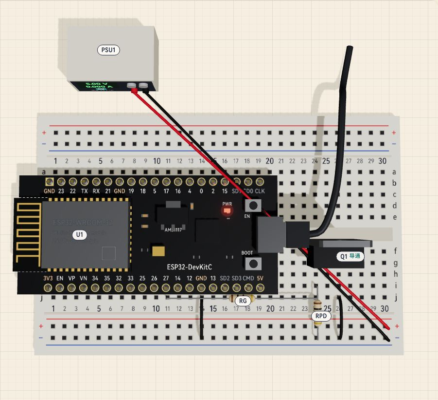
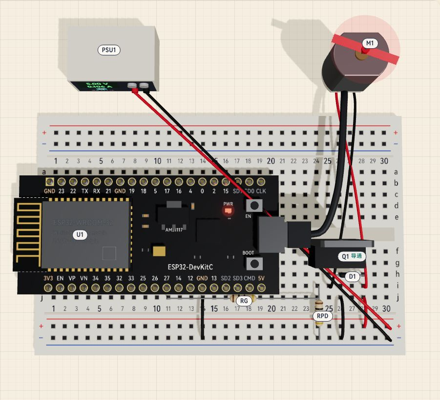
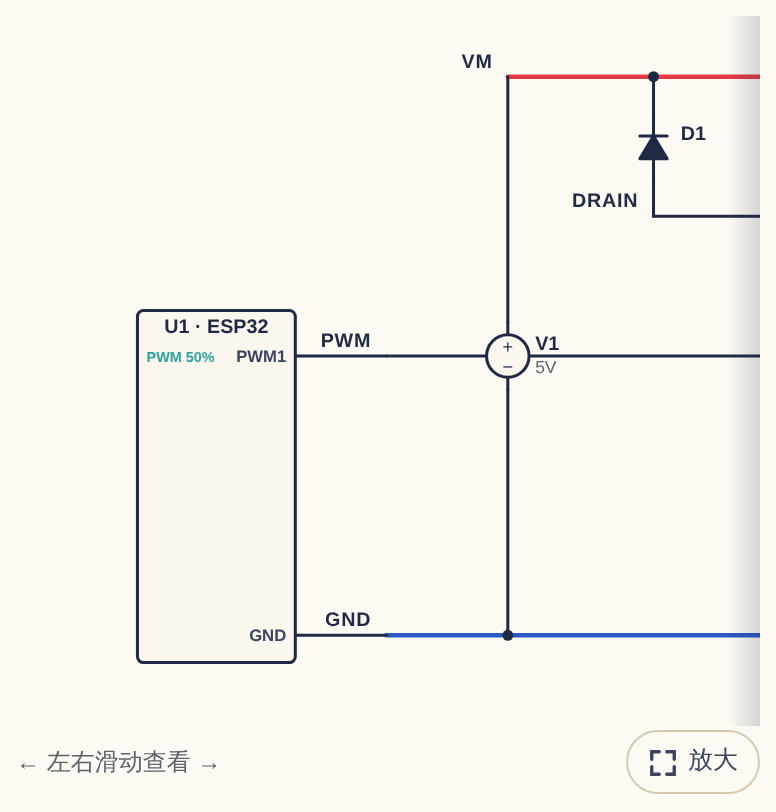
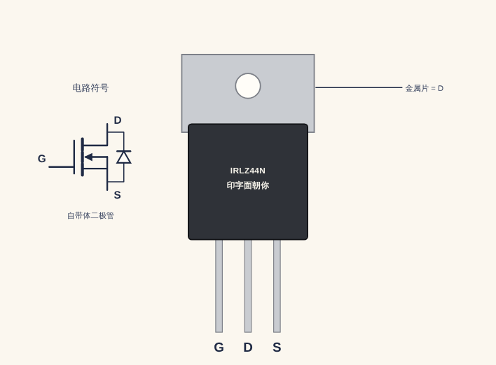
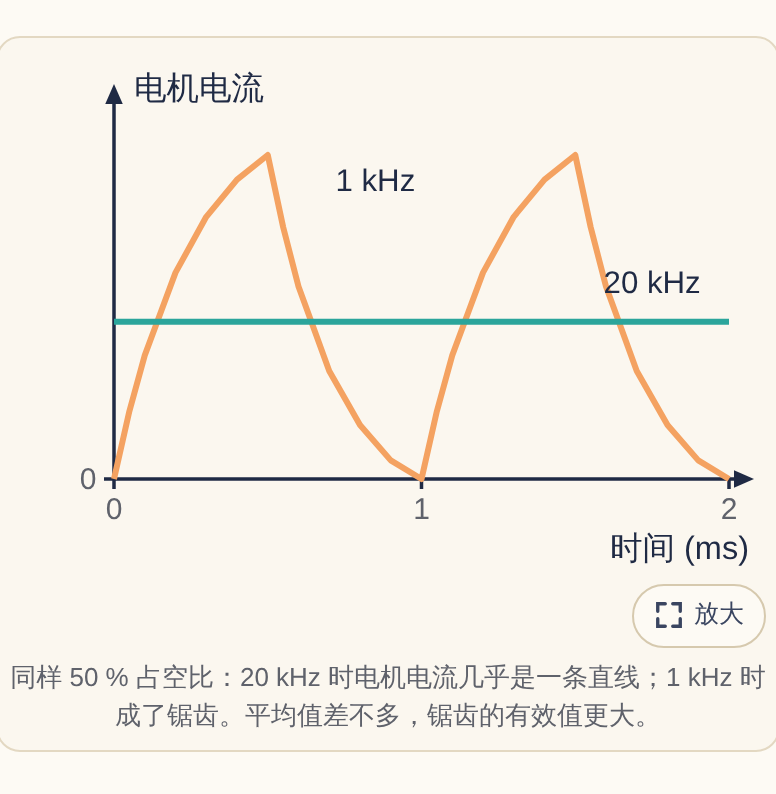
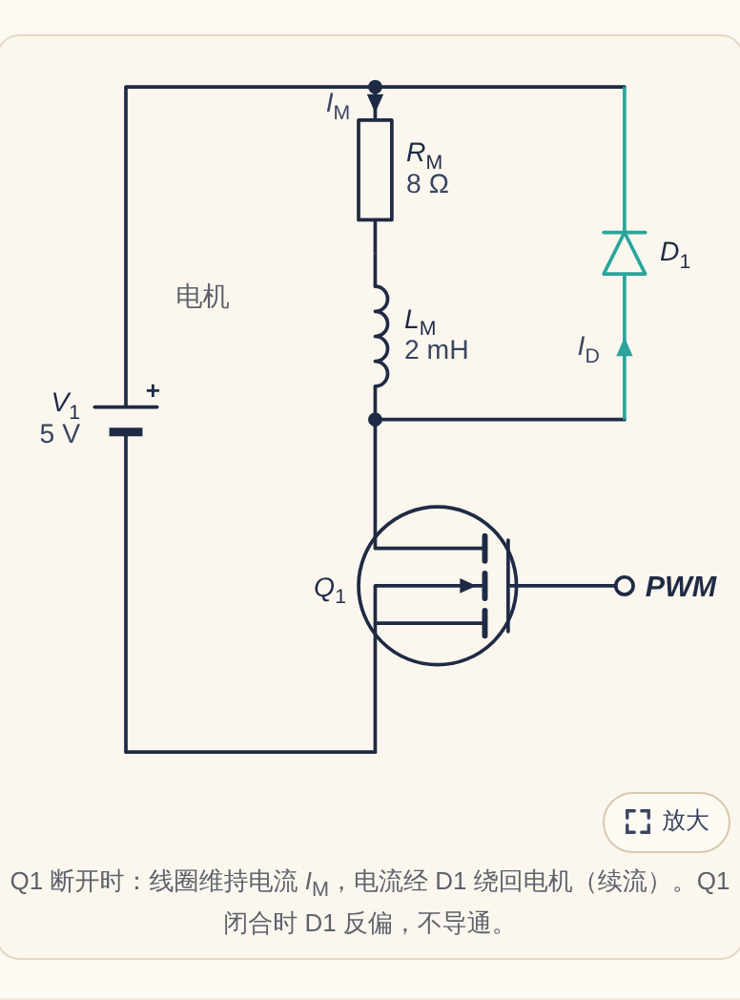

# 8.8 · PWM 调速：电机电流跟着占空比走

| 项目 | 内容 |
|---|---|
| id | `exp5-pwm-mosfet-motor` |
| 文件 | `challenges/294-pwm-mosfet-dimming.json` |
| 类型 | 实验 / 挑战（没有分步，照目标电路图搭） · 难度 4/5 |
| 位置 | World 8 · 数字逻辑、MCU 与传感器实战 → 8.8 PWM：调光、DAC 与调速（本节第 2 项） |
| 右侧面板 | 轨道由旧的四张卡片自动生成（还没手工精排） |
| 前后 | 上一项 [8.8 exp5-pwm-rc-dac](../w8/8.08-1-exp5-pwm-rc-dac.md) · 下一项 [8.8 exp5-i2c-pullup-rise-time](../w8/8.08-3-exp5-i2c-pullup-rise-time.md) |
| 先修 | lesson-mcu-pwm-adc |
| 概念 | PWM 调速 PWM speed control、低边 MOSFET 开关 low-side MOSFET switch、续流二极管 flyback diode、平均值与有效值 average and RMS、PWM 频率选择 PWM frequency choice |

**一句话概要**：把 5.4 的 MOSFET 低边开关换成 PWM 来开关：线圈把电流抹平，电机只“看见”平均值。测不同占空比下的平均电流、续流二极管里的电流，再比较 1 kHz 和 20 kHz。

## 1. 左侧工作台（3D 面包板 → 2D 俯视截图）

截图是程序里真实的 3D 面包板换成俯视角拍的；表格是同一块板的文字版（元件、参数、每只脚插在哪个孔）。

### 1.1 起点：打开这一课时板上已经有的

右侧显示的「起点」说明：

> **半成品**：ESP32（GPIO27 设成 PWM）、5 V 电机电源和完整的 MOSFET 栅极驱动（RG、RPD、IRLZ44N，实验 5-8 练过）都已接好。**为什么**：这个实验看的是 PWM 下电机和续流二极管里的电流。**你要做**：接上电机（+ 接 5 V，− 接漏极那一列）和反并的续流二极管 D1（负极朝 +5V），再把 5 V 轨接到电机那一列。

| 元件 | 类型 | 参数 | 引脚 → 孔 |
|---|---|---|---|
| U1 | esp32_devkit | usb=true, pins={"GPIO27":{"mode":"pwm","duty":50,"frequency":20000}} | GND→b1 GPIO23→b2 GPIO22→b3 GPIO1→b4 GPIO3→b5 GPIO21→b6 GND_2→b7 GPIO19→b8 GPIO18→b9 GPIO5→b10 GPIO17→b11 GPIO16→b12 GPIO4→b13 GPIO0→b14 GPIO2→b15 GPIO15→b16 GPIO8→b17 GPIO7→b18 GPIO6→b19 3V3→i1 EN→i2 GPIO36→i3 GPIO39→i4 GPIO34→i5 GPIO35→i6 GPIO32→i7 GPIO33→i8 GPIO25→i9 GPIO26→i10 GPIO27→i11 GPIO14→i12 GPIO12→i13 GND_3→i14 GPIO13→i15 GPIO9→i16 GPIO10→i17 GPIO11→i18 5V→i19 |
| W1 | wire |  | a→j14 b→bn14 |
| PSU1 | bench_supply | voltage=5, currentLimit=1 | +→bp30 -→bn30 |
| RG | resistor | resistance=100 | 1→j11 2→j24 |
| Q1 | nmos | model=IRLZ44N | g→f24 d→f25 s→f26 |
| RPD | resistor | resistance=10000 | 1→i24 2→bn24 |
| W2 | wire |  | a→j26 b→bn26 |

### 1.3 参考答案（「看答案」载入的板子）

| 元件 | 类型 | 参数 | 引脚 → 孔 |
|---|---|---|---|
| U1 | esp32_devkit | usb=true, pins={"GPIO27":{"mode":"pwm","duty":50,"frequency":20000}} | GND→b1 GPIO23→b2 GPIO22→b3 GPIO1→b4 GPIO3→b5 GPIO21→b6 GND_2→b7 GPIO19→b8 GPIO18→b9 GPIO5→b10 GPIO17→b11 GPIO16→b12 GPIO4→b13 GPIO0→b14 GPIO2→b15 GPIO15→b16 GPIO8→b17 GPIO7→b18 GPIO6→b19 3V3→i1 EN→i2 GPIO36→i3 GPIO39→i4 GPIO34→i5 GPIO35→i6 GPIO32→i7 GPIO33→i8 GPIO25→i9 GPIO26→i10 GPIO27→i11 GPIO14→i12 GPIO12→i13 GND_3→i14 GPIO13→i15 GPIO9→i16 GPIO10→i17 GPIO11→i18 5V→i19 |
| W1 | wire |  | a→j14 b→bn14 |
| PSU1 | bench_supply | voltage=5, currentLimit=1 | +→bp30 -→bn30 |
| RG | resistor | resistance=100 | 1→j11 2→j24 |
| Q1 | nmos | model=IRLZ44N | g→f24 d→f25 s→f26 |
| RPD | resistor | resistance=10000 | 1→i24 2→bn24 |
| W2 | wire |  | a→j26 b→bn26 |
| M1 | motor |  | +→i28 -→i25 |
| D1 | diode |  | anode→h25 cathode→h28 |
| W3 | wire |  | a→j28 b→bp28 |

### 1.4 目标原理图（右侧「目标原理图」抽屉）

| 元件 | 类型 | 参数 |
|---|---|---|
| U1 | esp32_devkit |  |
| V1 | dc_source | voltage=5 |
| RG | resistor | resistance=100 |
| RPD | resistor | resistance=10000 |
| Q1 | nmos | model=IRLZ44N |
| M1 | motor |  |
| D1 | diode |  |

连接（每个结点上的引脚）：

- **PWM**：U1.PWM1、RG.1
- **GATE**：RG.2、Q1.g、RPD.1
- **DRAIN**：Q1.d、M1.-、D1.anode
- **VM**：V1.+、M1.+、D1.cathode
- **GND**：Q1.s、RPD.2、V1.-、U1.GND

## 2. 右侧面板：学生从上往下看到的内容（单轨流）

### 第 1 步 · 🔍 先看一眼：先认识它：N-MOSFET

**拆解「N-MOSFET：用电压（电场）开关大电流」第 1 / 9 层：① 外形：TO-220，三只脚 G D S，金属片是 D**

实验 5-8 和 5-15 用的 IRLZ44N 装在 **TO-220** 封装里：黑色塑料体 + 一块带螺丝孔的 金属片（用来拧到散热片上）+ 三只脚。

印字面朝自己、脚朝下，从左到右是 G、D、S。**金属片和中间的 D 脚是连通的**——拧到散热片上时散热片也带着漏极电压，多个 MOSFET 共用散热片要加绝缘垫。

电路符号：
- 栅极 G 是一根和沟道 **隔开** 的竖线——表示栅极和沟道之间有绝缘层，不导电；
- 沟道画成三段虚线：增强型（enhancement），平时是断开的，要加栅极电压才“连起来”；
- 箭头指向沟道 = N 沟道；
- 旁边的 体二极管 body diode 不是额外加的，是结构里天生就有的（下一层能看到）。

| 脚 | 名字 | 作用 | 低边开关里接 |
|---|---|---|---|
| G | 栅极 gate | 控制端：电压控制，几乎不取电流 | 经 RG 接 GPIO，RPD 下拉到 GND |
| D | 漏极 drain（= 金属片） | 大电流从这里流进 | 负载的下端 |
| S | 源极 source | 电子的来源，电流从这里流出 | GND |

### 第 2 步 · 🔧 动手搭：占空比调到多低，电机还转？

搭回 5.4 的低边开关：引脚 → **`100 Ω`** → **IRLZ44N** 的栅极，栅极再接 **`10 kΩ`** 到 GND；**5 V 稳压电源** → 电机 → 漏极，源极接 GND；**续流二极管**并在电机两端，色环朝 5 V。稳压电源的 − 接开发板 GND。
这次把引脚设成 **PWM**，**`20 kHz`**、**`50 %`**。电机转起来了。
在「属性」里把占空比降到 **`25 %`**。电机还转吗？MOSFET 每次照样把整整 5 V 接上又断开——到底什么变了？

### 第 3 步 · 💡 想明白：线圈把电流抹平

- 电机里有一个线圈。线圈的电流不能突变：它像一个沉重的飞轮，推一下、松一下，转速只是慢慢变。
- 20 kHz 时开关每 50 µs 一次，比线圈“反应”快得多，电流几乎是一条直线，停在**平均值**。1 kHz 时周期变长，电流来得及涨落，成了锯齿。

*图 `current`（plot）：同样 50 % 占空比：20 kHz 时电机电流几乎是一条直线；1 kHz 时成了锯齿。平均值差不多，锯齿的有效值更大。*

- MOSFET 断开的那一段，线圈还要维持电流。电流改走**续流二极管**，绕电机一圈回来；没有它，漏极会冲出很高的电压。

*图 `freewheel`（schematic）：Q1 断开时：线圈维持电流 I_M，电流经 D1 绕回电机（续流）。Q1 闭合时 D1 反偏，不导通。*

- 所以电机只“看见”平均电压 D × 5 V，平均电流就是它除以电机的 8 Ω：
$$\bar I_M ≈ \frac{D × 5}{8}$$
- 代入 D = 80 %：$\bar I_M ≈ \frac{0.8 × 5}{8} = 0.5$ A。续流时二极管的压降也落在电机上，所以实际还要小一点；占空比越低，这一点越显眼。

（这一步下面列着这节课的计算卡片，点开就地展开：`rms-sine`、`rl-time-constant`、`flyback-spike`、`pwm-average`、`pwm-motor-current`、`mosfet-power`，全文见第 6 节）

### 第 4 步 · 🔧 动手搭：测平均电流和续流电流

- 占空比调回 **`50 %`**，点**「检查我的电路」**。检查会自己换占空比（25 / 50 / 100 %）和频率（1 kHz）。
- 电流表**串在电机支路**里，直流档读到的就是**平均值**。二极管的电流可以单击二极管在「属性」里看。
- 最后一题换成 **`1 kHz`**，在电流表的「属性」里把**档位**换成 **AC 有效值**——这是真有效值档，屏幕写着 “AC+DC RMS”：电机电流里直流和交流一起算。先预测，再读。

### 第 5 步 · 📏 测一测：测一测：读你自己的仪表

**测量题 1 · `i25`**（读数题）

> 20 kHz、25 %：电机的平均电流（万用表直流档串在电机支路里）

- 单位 mA · 先写预测 · 状态：U1 PWM1 设为PWM 输出 25% · 参考答案的读数 **88.51 mA** · 合理范围 [0.0841, 0.0929]

答对后显示：

> 电机平均只有约 0.71 V，≈ 89 mA，低于模型的 0.1 A 起转电流：转不起来，只会嗡嗡响。

**测量题 2 · `i50`**（读数题）

> 20 kHz、50 %：电机的平均电流

- 单位 mA · 先写预测 · 状态：U1 PWM1 设为PWM 输出 50% · 参考答案的读数 **258 mA** · 合理范围 [0.245, 0.271]

答对后显示：

> ≈ 258 mA。平均电流不严格 ∝ 占空比：续流时二极管的压降也落在电机上。

**测量题 3 · `id50`**（读数题）

> 同一状态：续流二极管 D1 的平均电流

- 单位 mA · 先写预测 · 状态：U1 PWM1 设为PWM 输出 50% · 参考答案的读数 **128.7 mA** · 合理范围 [0.122, 0.135]

答对后显示：

> MOSFET 关断的那一半时间里，电机电流全部经 D1 流回 +5 V：≈ 129 mA。

**测量题 4 · `frac`**（计算题（用自己的读数算））

> 用你的两个读数算电机电流里走二极管的比例 I_D1 / I_M1

- 先写预测 · 参考答案的读数 **0.4991** · 合理范围 [0.474, 0.524] · 公式 `id50 / i50`

答对后显示：

> ≈ 0.5 = 1 − D：20 kHz 的周期 50 µs ≪ τ = L/R，电流几乎不变，只是一半时间走 MOSFET、一半时间走 D1。

**测量题 5 · `rms1k`**（读数题）

> 改成 1 kHz、50 %：电机电流的有效值（电流表档位选 AC 有效值）

- 单位 mA · 先写预测 · 状态：U1 PWM1 设为PWM 输出 50% · 参考答案的读数 **316.5 mA** · 合理范围 [0.301, 0.332]

答对后显示：

> 周期 1 ms 是 τ 的 4 倍，关断时电流衰减很多：平均 263 mA 差不多，但 RMS ≈ 317 mA，线圈发热 ∝ I_rms²，多约 45%；而且 1 kHz 能听见啸叫。电机用 ≥ 20 kHz。

### 第 6 步 · 🎒 带走：带走

- **PWM 调的是平均值**：线圈把电流抹平，转速跟着平均电流走，不跟峰值走。
- **低占空比有死区**：电机要一定的电流才能克服静摩擦（这里的模型是 0.1 A），不够就只会嗡嗡响。
- **电机用 ≥ 20 kHz**：1 kHz 时电流锯齿状涨落，平均差不多，有效值却更大——线圈更热，还能听见啸叫。LED 没有线圈，≥ 1 kHz 就不闪。
- 真实电路里的坑：续流二极管用快速或肖特基的（1N5819），1N4007 在 20 kHz 下太慢；电机电源和开发板**共地**；别用 GPIO0 / 2 / 5 / 12 / 15 驱动栅极——它们上电时会抖一下，电机跟着抽一下。

趁热练理论题：`first-order`

## 3. 测量题一览

| # | id | 题目 | 类型 | 单位 | 状态 | 参考读数 |
|---|---|---|---|---|---|---|
| 1 | i25 | 20 kHz、25 %：电机的平均电流（万用表直流档串在电机支路里） | current | mA | U1 PWM1 设为PWM 输出 25% | 88.51 mA |
| 2 | i50 | 20 kHz、50 %：电机的平均电流 | current | mA | U1 PWM1 设为PWM 输出 50% | 258 mA |
| 3 | id50 | 同一状态：续流二极管 D1 的平均电流 | current | mA | U1 PWM1 设为PWM 输出 50% | 128.7 mA |
| 4 | frac | 用你的两个读数算电机电流里走二极管的比例 I_D1 / I_M1 | formula |  |  | 0.4991 |
| 5 | rms1k | 改成 1 kHz、50 %：电机电流的有效值（电流表档位选 AC 有效值） | current | mA | U1 PWM1 设为PWM 输出 50% | 316.5 mA |

### 全部答完后显示的「对比」

**对比**（仿真，20 kHz）：
- **25 %**：引脚平均 0.82 V；电机平均 0.71 V、**89 mA**，其中 66 mA（75 %）在续流二极管里；89 mA 低于模型的 0.1 A 起转电流——**电机转不起来**。真实电机也有“死区”：静摩擦要靠一定的电流才能克服，低占空比只会嗡嗡响。
- **50 %**：平均 2.06 V、**258 mA**，二极管里 129 mA（一半时间在续流）；RMS 也是 258 mA——电流几乎没有纹波（50 µs 的周期 ≪ τ）。
- **100 %**：MOSFET 一直导通（Vgs = 3.26 V，在可变电阻区，Rds ≈ 44 mΩ），电机 **620 mA**，二极管不导通。
- 平均电流不是严格 ∝ 占空比：续流期间二极管的压降（这个电流下约 0.85 V）也落在电机上，低占空比时这部分比例更大。
- 关断瞬间漏极只到 **5.7 V**（二极管把它钳在 5 V 再加一个二极管压降）。把 D1 拿掉，漏极会冲到 IRLZ44N 的 55 V 雪崩电压。
- **1 kHz、50 %**：周期 1 ms 是 τ 的 4 倍，关断期间电流衰减很多。平均电流 263 mA 和 20 kHz 差不多，但 **RMS 317 mA**——线圈发热 ∝ I_rms²，多了约 45 %；而且 1 kHz 正好在人耳最敏感的频段，电机会“吱吱”叫。

### 提示按钮（依次显示）

1. 栅极：PWM 引脚 → 100 Ω → G，G 再接 10 kΩ 到 GND。S 接 GND，D 接电机的 − 端。
2. 二极管的色环（阴极）朝电机的 5 V 端，阳极接漏极：MOSFET 导通时它是反着的。
3. 稳压电源的 − 必须和开发板的 GND 接在一起。
4. PWM 引脚设成 20 kHz。

### 功能测试（「检查我的电路」时跑）

- 20 kHz、25 %：平均电流太小，电机转不起来
- 20 kHz、50 %：电机转，RMS ≈ 平均，一部分电流走续流二极管
- 20 kHz、100 %：MOSFET 完全导通（可变电阻区），二极管不导通
- 1 kHz、50 %：平均差不多，但 RMS 更大（更热、能听见啸叫）
- 输出低电平：MOSFET 截止，电机停

## 4. 用到的拆解（全部层的文字，供改写参考）

### 拆解 `mosfet`：N-MOSFET：用电压（电场）开关大电流

*MOSFET = Metal-Oxide-Semiconductor Field-Effect Transistor（金属-氧化物-半导体场效应晶体管）。三极管用电流控制，MOSFET 用栅极电压在硅里“画”出一条导电沟道。我们从 TO-220 封装拆到截面，看沟道怎么形成，再推出导通电阻、功耗、栅极电容和续流二极管。*

**拆解「N-MOSFET：用电压（电场）开关大电流」第 1 / 9 层：① 外形：TO-220，三只脚 G D S，金属片是 D**

实验 5-8 和 5-15 用的 IRLZ44N 装在 **TO-220** 封装里：黑色塑料体 + 一块带螺丝孔的 金属片（用来拧到散热片上）+ 三只脚。

印字面朝自己、脚朝下，从左到右是 G、D、S。**金属片和中间的 D 脚是连通的**——拧到散热片上时散热片也带着漏极电压，多个 MOSFET 共用散热片要加绝缘垫。

电路符号：
- 栅极 G 是一根和沟道 **隔开** 的竖线——表示栅极和沟道之间有绝缘层，不导电；
- 沟道画成三段虚线：增强型（enhancement），平时是断开的，要加栅极电压才“连起来”；
- 箭头指向沟道 = N 沟道；
- 旁边的 体二极管 body diode 不是额外加的，是结构里天生就有的（下一层能看到）。

| 脚 | 名字 | 作用 | 低边开关里接 |
|---|---|---|---|
| G | 栅极 gate | 控制端：电压控制，几乎不取电流 | 经 RG 接 GPIO，RPD 下拉到 GND |
| D | 漏极 drain（= 金属片） | 大电流从这里流进 | 负载的下端 |
| S | 源极 source | 电子的来源，电流从这里流出 | GND |

**拆解「N-MOSFET：用电压（电场）开关大电流」第 2 / 9 层：② X 光：硅片焊在漏极金属片上**

透视：硅片 背面就是漏极，直接焊在 金属片 上——热量从这里走，所以 TO-220 能散几瓦。正面两块金属：细的 金线连 G，粗的（或好几根）连 S，因为几十安的电流都从 S 出来。

功率 MOSFET 的硅片上其实是 **几千到几百万个小 MOSFET 单元并联**，每个单元的沟道电阻并联起来，才有 22 mΩ 这么小的导通电阻。但每个单元的原理和下一层画的教科书截面一模一样。

**拆解「N-MOSFET：用电压（电场）开关大电流」第 3 / 9 层：③ 截面：p 型衬底里两个 n⁺ 区，上面一层氧化物和栅极**

把一个单元切开：
- p 型衬底 body：大部分是 p 型硅，空穴多、自由电子少；
- 源极 S 和 漏极 D：两个浓掺杂的 n⁺ 区；
- 氧化层 SiO₂：只有几十 nm 厚的绝缘玻璃；
- 栅极 G：氧化层上面的导体（多晶硅）。

**没加栅压时**：从 S 走到 D 要经过 n⁺ → p → n⁺，就是两个 **背靠背的 PN 结**，不管 D–S 加哪个方向，总有一个结反偏——断开。

**体二极管**：衬底在内部接到 S 上（为了让衬底电位固定），于是 p 衬底和 n⁺ 漏极之间形成一个从 S 指向 D 的 二极管。D 比 S 低时它就导通，所以 MOSFET **只能单向阻断**。

**栅极和下面的硅之间是绝缘的**：G、氧化层、硅构成一个 **平行板电容**。这就是“栅极不取直流电流”的原因。

| 层 | 材料 | 作用 |
|---|---|---|
| 栅极 G | 多晶硅 / 金属 | 电容的上极板 |
| 氧化层 | SiO₂，几十 nm | 绝缘介质；太高的 V_GS 会击穿它（±16–20 V） |
| 源 / 漏 | n⁺ | 电子的入口和出口 |
| 衬底 body | p 型，接 S | 沟道在它的表面形成；和 D 构成体二极管 |

**拆解「N-MOSFET：用电压（电场）开关大电流」第 4 / 9 层：④ 栅极电场“画”出一条沟道：阈值电压**

给栅极加正电压（相对 S）：
1. 栅极这块“极板”带上 正电荷；
2. 电场穿过氧化层，把 p 衬底表面的空穴推开，再把少量自由电子吸到氧化层正下方；
3. 电压够大时，表面的电子多到让这一薄层 **反型**（inversion）成 n 型——一条连接 S 和 D 的 n 沟道 就出现了，电流 $I_D$ 可以从 D 流到 S。

刚好出现沟道的栅压叫 **阈值电压** $V_{GS(th)}$（手册里定义为 $I_D$ = 250 µA 时的 $V_{GS}$——只是“刚开始导通”）。超过阈值的部分叫 **过驱动电压**：
$$V_{ov} = V_{GS} - V_{th}$$
过驱动越大，沟道里电子越多，沟道越“宽”，电阻越小。IRLZ44N 的 $V_{th}$ = 1.5 V，GPIO 给 3.3 V，$V_{ov}$ = 1.8 V。

和三极管对比：三极管要 **持续的基极电流** 才能导通；MOSFET 只要把栅极这个电容 **充上电**，之后不再需要电流。

- 公式 `V_{ov} = V_{GS} - V_{th} = 3.3 - 1.5 = 1.8 V`：IRLZ44N 由 GPIO 驱动

**拆解「N-MOSFET：用电压（电场）开关大电流」第 5 / 9 层：⑤ 等效电路：截止、欧姆区、饱和区**

仿真器用的是电路课里的 **平方律模型**（square-law model）。K 是由器件决定的常数（单位 A/V²）：
$$I_D = min(K·V_{ov}·V_{DS},  \frac{K·V_{ov}^{2}}{2})$$
- 截止：$V_{GS}$ < $V_{th}$，没有沟道，D–S 开路（只剩体二极管）；
- 欧姆区 ohmic：$V_{DS}$ 小（< $\frac{V_{ov}}{2}$），沟道像一个电阻，$I_D$ 和 $V_{DS}$ 成正比：
$$R_{DS} = \frac{V_{DS}}{I_D} = \frac{1}{K·V_{ov}}$$
**开关就要工作在这里**；
- 饱和区 saturation：$V_{DS}$ 大，沟道在漏极一端被“夹断”，电流不再随 $V_{DS}$ 增加，变成恒流 $\frac{K V_{ov}^{2}}{2}$——开关只开了一半，$V_{DS}$ 很大，发热。

⚠ **名字陷阱**：MOSFET 的“饱和区”是 **恒流区**，对应三极管的“放大区”；MOSFET 当开关要在 **欧姆区**，而三极管当开关要在“饱和区”。名字相同，意思相反。

K 从手册算：IRLZ44N 在 $V_{GS}$ = 5 V 时 $R_{DS(on)}$ = 22 mΩ，
$$K = \frac{1}{R_{DS(on)}·(V_{GS} - V_{th})} = \frac{1}{0.022 × 3.5} = 13 A/V^{2}$$
GPIO 的 3.3 V 下：$R_{DS} = \frac{1}{13 × 1.8}$ ≈ **43 mΩ**。

栅极在三种状态里都只是一个电容 $C_{iss}$（约 1.7 nF），没有直流通路。

| 区 | 条件 | D–S 等效 | 对应三极管的 |
|---|---|---|---|
| 截止 | $V_{GS}$ < $V_{th}$ | 开路 | 截止 |
| 欧姆区 | $V_{DS}$ < $\frac{V_{ov}}{2}$ | $R_{DS} = \frac{1}{K V_{ov}}$ | 饱和（开关闭合） |
| 饱和区 | $V_{DS}$ > $\frac{V_{ov}}{2}$ | $I_D = \frac{K V_{ov}^{2}}{2}$ | 放大区（恒流） |

**拆解「N-MOSFET：用电压（电场）开关大电流」第 6 / 9 层：⑥ 逻辑电平 vs 标准：3.3 V 栅压够不够**

把 $R_{DS} = \frac{1}{K(V_{GS} - V_{th})}$ 对 $V_{GS}$ 画出来，两个型号差别一目了然：
- IRLZ44N（逻辑电平 logic-level）：$V_{th}$ = 1.5 V，手册在 $V_{GS}$ = 5 V（甚至 4.5 V）给出 $R_{DS(on)}$。在 GPIO 的 3.3 V 处已经降到 43 mΩ，完全导通；
- IRF540N（标准电平）：$V_{th}$ = 3.0 V，手册的 44 mΩ 是在 $V_{GS}$ = **10 V** 量的。3.3 V 时 $V_{ov}$ 只有 0.3 V：

实验 5-8 换成 IRF540N：电机想要 0.62 A，但饱和区最多 $\frac{K V_{ov}^{2}}{2} = \frac{3.25 × 0.3^{2}}{2}$ ≈ 0.14 A。它卡在恒流区，$V_{DS}$ = 3.9 V，电机只拿到 23 % 的电流，几乎不转，MOSFET 却在发热。

**手册陷阱**：IRF540N 的 $V_{th}$ 写着 “2–4 V”，看起来 3.3 V 够——但 $V_{th}$ 只是 250 µA 的“刚开始导通”。选型要看 **$R_{DS(on)}$ 是在哪个 $V_{GS}$ 下给的**：3.3 V 的 MCU 要选在 2.5 V 或 4.5 V 下给出 $R_{DS(on)}$ 的型号（IRLZ44N、IRLB8721、AO3400、Si2302）。

|  | IRLZ44N | IRF540N |
|---|---|---|
| 类型 | 逻辑电平 | 标准电平 |
| $V_{th}$ | 1.5 V | 3.0 V |
| 手册 $R_{DS(on)}$ | 22 mΩ @ 5 V | 44 mΩ @ 10 V |
| K | 13 A/V² | 3.25 A/V² |
| 3.3 V 栅压时 | 欧姆区，43 mΩ | 饱和区，0.14 A |
| 电机电流 / $V_{DS}$ | 620 mA / 27 mV | 140 mA / 3.9 V |
| 耐压 / 雪崩 | 55 V | 100 V |

- 公式 `K = \frac{1}{R_{DS(on)}·(V_{GS,spec} - V_{th})}`：从手册的一组数算 K
- 公式 `R_{DS}(V_{GS}) = \frac{1}{K(V_{GS} - V_{th})}`：欧姆区的导通电阻

**拆解「N-MOSFET：用电压（电场）开关大电流」第 7 / 9 层：⑦ 功耗：P = I²·R，为什么 MOSFET 几乎不发热**

实验 5-8：+5 V → 电机（8 Ω） → D，S 接地，GPIO 经 RG 100 Ω 接 G，RPD 100 kΩ 下拉。输出 HIGH 时：
1. $V_GS$ = 3.29 V → 欧姆区，$R_{DS}$ ≈ 43 mΩ；
2. 回路电流 $I_D = \frac{5 V}{8 Ω + 0.043 Ω}$ ≈ 620 mA；
3. $V_{DS} = I_D·R_{DS}$ = 0.62 × 0.043 ≈ 27 mV——“$V_{DS}$ < 50 mV 证明完全导通”；
4. 功耗：
$$P = I_D^{2}·R_{DS(on)} = 0.62^{2} × 0.043 ≈ 17 mW$$
TO-220 不加散热片的热阻 $R_{θJA}$ ≈ 62 °C/W，温升 $ΔT = P·R_{θJA}$ ≈ 1 °C。

同样的电路换 IRF540N：$P = V_{DS}·I_D$ = 3.9 V × 0.14 A ≈ 0.54 W，温升约 33 °C——**功耗增加 30 倍，电机反而停了**。

**为什么不用三极管**：2N2222 驱动 0.62 A 要按强制 β = 10 给 62 mA 基极电流，GPIO 给不出；而且 $V_{CE(sat)}$ ≈ 0.15 + 0.62 ≈ 0.77 V，功耗 0.48 W。MOSFET 的栅极 **不取直流电流**，导通电阻只有几十 mΩ。

|  | IRLZ44N | IRF540N | 2N2222（假设） |
|---|---|---|---|
| 控制端需要 | 3.3 V，直流 0 A | 3.3 V，直流 0 A | 62 mA 基极电流 ✗ |
| $V_{DS}$ / $V_{CE}$ | 27 mV | 3.9 V | ≈ 0.77 V |
| 电机电流 | 620 mA | 140 mA | ≈ 600 mA |
| 开关功耗 | 17 mW | 0.54 W | ≈ 0.48 W |
| 温升（无散热片） | ≈ 1 °C | ≈ 33 °C | TO-92：超额定 ✗ |

- 公式 `P = I_D^{2}·R_{DS(on)}`：欧姆区（完全导通）的功耗
- 公式 `ΔT = P·R_{θJA}`：结温升高；TO-220 无散热片约 62 °C/W

**拆解「N-MOSFET：用电压（电场）开关大电流」第 8 / 9 层：⑧ 栅极是一个电容：只在开关瞬间取电流**

从 GPIO 看进去，栅极就是一个 输入电容 $C_iss$（IRLZ44N 约 1.7 nF）。GPIO 从 0 跳到 3.3 V 时，就是一道一阶 RC 充电题：
$$v_G(t) = 3.3 V·(1 - e^{-t/τ}),   τ = (R_{out} + R_G)·C_{iss} = 125 Ω × 1.7 nF ≈ 0.21 µs$$
- 一开始电容相当于短路，电流峰值 $\frac{3.3 V}{125 Ω}$ ≈ 26 mA，然后指数衰减到 0；
- 栅压 过 $V_th$ 的时刻：$t = τ·ln\frac{3.3}{3.3 - 1.5}$ ≈ 0.13 µs；约 5τ ≈ 1 µs 后充满；
- 充满后 **直流电流为 0**——这就是“栅极不取电流”的准确含义。

RG（47–220 Ω） 的作用：限制充电峰值电流保护 GPIO，并阻尼导线电感引起的振荡；直流时上面没有压降。
RPD（10–100 kΩ）：MCU 复位、上电、下载程序时引脚是高阻输入，栅极电容上的电荷没地方放，悬空的栅极可能让电机自己转起来。RPD 把它放掉，时间常数 100 kΩ × 1.7 nF = 0.17 ms。

**PWM 时的平均栅极电流**：每个周期充一次电荷 $Q = C_{iss}·V$ ≈ 1.7 nF × 3.3 V ≈ 5.6 nC，20 kHz 时 $I = Q·f$ ≈ 0.11 mA。频率越高，开关过程占的比例越大、开关损耗越大，所以电机 PWM 一般用 20–25 kHz。（真实 MOSFET 还有米勒电容，栅极电荷手册给的是 $Q_g$。）

- 公式 `τ = (R_{out} + R_G)·C_{iss} ≈ 0.21 µs`：栅极充电时间常数
- 公式 `I_{G,avg} = Q·f = C_{iss}·V·f ≈ 0.11 mA`：20 kHz PWM 时

**拆解「N-MOSFET：用电压（电场）开关大电流」第 9 / 9 层：⑨ 续流二极管和 PWM 调速（实验 5-15）**

电机线圈是一个电感（模型 8 Ω + 2 mH）。MOSFET 关断的一瞬间，电感要维持电流（$v = L\frac{di}{dt}$）：
- 有 续流二极管 D1（反接在电机两端，阴极接 +5 V）：电流改走 电机 → D1 → 电机 这个小回路慢慢衰减，漏极被钳在 5 V + 0.7 V = 5.7 V；
- 没有 D1：电流无处可去，$\frac{di}{dt}$ 极大，漏极电压冲到 MOSFET 的雪崩电压 55 V，每个周期打一次，迟早击穿。

**PWM 调速**：导通期间 电机上是 5 V，关断期间是 −0.7 V（续流二极管）。电机电感的时间常数 $τ = \frac{L}{R}$ = 0.25 ms；20 kHz 时周期 50 µs ≪ τ，电流几乎是平的：
$$V̄_{motor} ≈ D·5 V - (1 - D)·0.7 V,   Ī = \frac{V̄_{motor}}{8 Ω}$$
- D = 25 %：0.71 V，**89 mA**（其中 66 mA 走二极管），低于 0.1 A 的起转电流——**电机不转**（真实电机也有这个“死区”）；
- D = 50 %：2.06 V，**258 mA**，一半时间在续流；
- D = 100 %：**620 mA**，二极管不工作。

**频率怎么选**：1 kHz、50 % 时平均电流差不多（263 mA），但周期 1 ms = 4τ，电流一涨一落，**有效值（RMS）**变成 317 mA——线圈发热 ∝ $I_{rms}^{2}$，多 45 %，而且 1 kHz 正是人耳最敏感的频率，电机会叫。所以电机 PWM 用 ≥ 20 kHz；LED 调光没有电感，≥ 1 kHz 不闪就行。

| PWM | 电机平均电流 | 二极管平均电流 | 电机 RMS | 结果 |
|---|---|---|---|---|
| 20 kHz, 25 % | 89 mA | 66 mA | ≈ 89 mA | 不转（< 0.1 A） |
| 20 kHz, 50 % | 258 mA | 129 mA | 258 mA | 平稳 |
| 20 kHz, 100 % | 620 mA | 0 | 620 mA | 全速 |
| 1 kHz, 50 % | 263 mA | — | 317 mA | 更热、啸叫 |

- 公式 `V̄_{motor} ≈ D·V_S - (1 - D)·V_D`：τ = L/R ≫ 周期时
- 公式 `V_{D,peak} = V_S + V_{D1} = 5.7 V`：续流二极管钳住的漏极电压

**一句话记住**：N-MOSFET = p 衬底里两个 n⁺ 区 + 氧化层上的栅极。$V_{GS}$ > $V_{th}$ 时电场画出 n 沟道；当开关要在欧姆区，$R_{DS} = \frac{1}{K(V_{GS} - V_{th})}$，功耗 $P = I^{2}·R_{DS}$。3.3 V 的 MCU 选逻辑电平型号；栅极是电容，串 RG、加 RPD 下拉；电感负载并续流二极管。

## 5. 这一课的计算卡片

**计算卡片 `rms-sine`：正弦波的有效值 RMS of a sine**

- 公式 `V_{rms} = \frac{V_p}{\sqrt{2}} ≈ 0.707 V_p`
- 用途：正弦信号的有效值：和多大的直流电压在电阻上产生同样的热。
- 输入：V_p（峰值（幅度），V） → V_rms（有效值，V）

1. 有效值的定义：在电阻上产生相同平均功率的直流值，$V_{rms} = \sqrt{\frac{1}{T}∫_{0}^{T} v^{2} dt}$（均方根）。
2. 正弦：$v^{2} = V_p^{2}sin^{2}(ωt) = \frac{V_p^{2}}{2}(1 - cos 2ωt)$，一个周期里 cos 项平均为 0。
3. 所以均方值是 $\frac{V_p^{2}}{2}$，开方得 $\frac{V_p}{\sqrt{2}}$。
4. **只对正弦成立**：方波（±A）的有效值就是 A；占空比 D 的 0/$V_H$ 方波是 $V_H\sqrt{D}$。
5. 直流 + 交流：$V_{rms} = \sqrt{V_{dc}^{2} + V_{ac,rms}^{2}}$。

例子：第 12 课：50 Ω 负载上 0.5 V 峰值 → $\frac{0.5}{1.414} ≈ 0.354 V$。实验 4-4：谐振时有效值电流 $\frac{1/\sqrt{2}}{101 + 50} ≈ 4.7 mA$。

- ⚠ 普通万用表交流档按正弦标定：测方波、PWM 读数不对，要用真有效值表。
- ⚠ 有效值、峰值、峰峰值别混着比：先统一成同一种。

**计算卡片 `rl-time-constant`：RL 时间常数 τ = L/R**

- 公式 `τ = \frac{L}{R}`
- 用途：电感电流建立 / 衰减有多快；R 是回路里所有电阻之和。
- 输入：L（电感，H）；R（回路总电阻（含 50 Ω、线圈电阻），Ω） → τ（时间常数，s）

1. 电感：$v_L = L\frac{di}{dt}$，**电流不能突变**（电压可以）。
2. KVL：$V_s = Ri + L\frac{di}{dt}$，和 RC 是同一类方程，$τ = \frac{L}{R}$（H / Ω = s）。
3. 稳态电流 $\frac{V_s}{R}$（电感当短路），从初值指数地走过去。
4. 和 RC 相反：**R 越大，τ 越小**（电流的“终点”变小了，走得更快）。
5. 跳变瞬间电流来不及变，整个跳变电压都落在电感上，然后按 τ 衰减。

例子：- 实验 3-3：$\frac{10 mH}{100 + 50 + 1} ≈ 66 µs$；稳态电流 $\frac{1 V}{151 Ω} ≈ 6.6 mA$。
- 实验 5-15：电机 $\frac{2 mH}{8 Ω} = 0.25 ms$：20 kHz 的 50 µs 周期 ≪ τ，电流几乎是平的。
- 实验 5-9：继电器线圈 $\frac{150 mH}{70 Ω} ≈ 2.1 ms$。

- ⚠ 忘了线圈自己的电阻：真实的小 10 mH 电感常有 10–30 Ω。
- ⚠ 把 RC 的习惯套过来写成 τ = LR。

**计算卡片 `flyback-spike`：电感断电的反冲 v = L·di/dt**

- 公式 `v = L \frac{di}{dt} ≈ L \frac{I}{Δt}`
- 用途：突然切断线圈的电流会产生多高的电压——以及为什么要并续流二极管。
- 输入：L（线圈电感，H）；I（断开前的电流，A）；Δt（开关断开用的时间，s） → v（“想要”的反冲电压，V）

1. 电感电流不能突变：三极管 / MOSFET 断开时，线圈“想”让电流按原方向继续流。
2. 没有路可走，$\frac{di}{dt}$ 极大，$v = L\frac{di}{dt}$ 就极高：集电极（漏极）冲到电源电压以上几十伏，直到三极管击穿或空气放电。
3. **续流二极管**反向并在线圈上：导通时它反偏不起作用；断开时集电极一超过 $V_s + 0.7 V$，它就导通，把电压钳住。
4. 电流改走“线圈 → 二极管 → 线圈”这个小回路，按 $τ = \frac{L}{R}$ 衰减，能量变成线圈电阻和二极管里的热。

例子：实验 5-9：150 mH、63 mA，如果 1 µs 内断开，“需要” $\frac{0.15 × 0.063}{10^{-6}} ≈ 9.5 kV$——实际在三极管 C–E 击穿（约 40 V）时就停住了（模拟器约 29 V）。并上 D1 后集电极最高只有 $4.65 + 0.7 ≈ 5.4 V$，电流按 $\frac{150 mH}{70 Ω} ≈ 2 ms$ 衰减。实验 5-8：电机漏极被钳在 $5 + 1.1 ≈ 6.1 V$。

- ⚠ 二极管接反：导通时它把线圈短路，三极管直接对电源短路。条纹（阴极）朝电源正端。
- ⚠ PWM 驱动电机时 1N4007 太慢，用肖特基（1N5819、SS34）。

**计算卡片 `pwm-average`：PWM 的平均值 = 占空比 × 高电平**

- 公式 `V̄ = D × V_H, Ī = D × I_{on}`
- 用途：占空比 D 的 PWM：万用表（直流档）读到的平均电压，LED 的平均电流。
- 输入：D（占空比，%）；V_H（高电平（带载时），V） → V̄（平均电压，V）

1. 一个周期 T 里，高电平 $V_H$ 持续 $DT$，低电平 0 持续 $(1 - D)T$。
2. 平均值 = 面积 ÷ 周期：$V̄ = \frac{V_H × DT}{T} = DV_H$。这是 PWM 的直流分量。
3. 万用表直流档、RC 低通、人眼看 LED 亮度，都只“看到”平均值。
4. 但每个高电平期间电流仍是全开时的值：$Ī = DI_{on}$，峰值不变——PWM 绕不过引脚的电流限制。
5. 有效值 $V_H\sqrt{D}$ 比平均值大（决定电阻、线圈发热）。

例子：第 16 课：25 %、高电平 3.2 V → 0.80 V；LED 4.1 mA × 0.25 ≈ 1.0 mA。实验 5-14：25 / 50 / 75 % × 3.3 V → 0.82 / 1.65 / 2.47 V。

- ⚠ 示波器看到的高电平仍是 3.2 V：PWM 只改时间比例，不改电平。

**计算卡片 `pwm-motor-current`：PWM 调速：电机的平均电流**

- 公式 `Ī = \frac{D V_s - (1 - D) V_D}{R_m}`
- 用途：低边 MOSFET + 续流二极管驱动电机：占空比 D 时电机的平均电流（PWM 周期 ≪ L/R）。
- 输入：V_s（电机电源，V）；D（占空比，%）；V_D（续流二极管压降（含内阻，≈ 0.7–0.9 V），V）；R_m（电机绕组电阻，Ω） → Ī（电机平均电流，A）

1. MOSFET 导通时电机两端是 $+V_s$，电流沿 5 V → 电机 → D → S → GND 上升。
2. 关断时电感让电流继续流，改走“电机 → 二极管 → 电机”（续流），电机两端约 $-V_D$。
3. 周期 ≪ τ = L/R 时电流几乎是平的，电机两端的平均电压 $V̄ = DU_s - (1 - D)V_D$。
4. 平均电流 $Ī = \frac{V̄}{R_m}$；其中 $(1 - D)$ 的那部分走二极管。
5. 频率低到和 τ 差不多时平均电流差不多，但电流起伏大，有效值（发热）变大，还会有啸叫。

例子：实验 5-15（20 kHz、8 Ω）：50 % → $\frac{2.5 - 0.43}{8} ≈ 0.26 A$（模拟 258 mA，二极管里 129 mA）；25 %（电流小，$V_D$ ≈ 0.72 V）→ ≈ 89 mA，低于 0.1 A 的启动电流，转不起来；100 % → $\frac{5}{8} ≈ 0.62 A$。1 kHz、50 %：平均 263 mA，有效值 317 mA。

- ⚠ 平均电流不是严格 ∝ D：续流时二极管的压降也加在电机上，低占空比时影响更大。
- ⚠ 真实电机转起来有反电动势，电流比这里小。

**计算卡片 `mosfet-power`：MOSFET 开关的发热 P = I²·R**

- 公式 `P = I^{2} R_{DS(on)} = V_{DS} I`
- 用途：完全导通的 MOSFET 自己耗多少功率；半导通时为什么会烫。
- 输入：I（漏极电流，A）；R_ds（导通电阻（IRLZ44N 在 3.3 V 栅压下 ≈ 43 mΩ），Ω） → P（MOSFET 发热，W）

1. 栅极电压足够时，MOSFET 工作在 **欧姆区**：D–S 像一个小电阻 $R_{DS(on)}$，$V_{DS} = IR_{DS(on)}$，只有几十 mV。
2. 发热 $P = V_{DS}I = I^{2}R_{DS(on)}$。
3. 数据手册的 $R_{DS(on)}$ 是在某个栅压下测的（IRLZ44N：5 V 时 22 mΩ）；3.3 V 栅压大约翻倍。
4. 栅压不够（普通 IRF540N，$V_{th}$ ≈ 3 V）：管子在 **恒流（饱和）区**，$V_{DS}$ 有几伏，$P = V_{DS}I$ 一下子到零点几瓦。
5. 所以 3.3 V 单片机要选“逻辑电平” MOSFET：$R_{DS(on)}$ 标在 2.5 V 或 4.5 V 栅压下。

例子：实验 5-8：$0.62^{2} × 0.043 ≈ 17 mW$，$V_{DS} ≈ 27 mV$。换 IRF540N：$3.9 V × 0.14 A ≈ 0.54 W$。实验 5-17：$0.356^{2} × 0.044 ≈ 6 mW$，不用散热片。（三极管同理：$P ≈ V_{CE}I_C + V_{BE}I_B$，实验 5-7 约 6 mW。）

- ⚠ $V_{th}$ 只是“开始导通”（250 µA）的栅压，不是“完全导通”。
- ⚠ 栅极要有下拉电阻（10–100 kΩ）：复位时引脚悬空，栅极电容上的电荷会让电机自己转起来。

## 6. English（界面英文版的同一份内容）

展开英文

### Node 1 · 🔍 Look first：Meet it first: N-MOSFET

**Teardown「The N-MOSFET: switching big currents with a voltage (a field)」layer 1 of 9：① Package: TO-220, three legs G D S, the tab is D**

The IRLZ44N of labs 5-8 and 5-15 comes in a **TO-220** package: a black plastic body, a metal tab with a screw hole (for a heatsink) and three legs.

Printed face toward you, legs down, left to right: G, D, S. **The tab is connected to the middle leg, D** — bolted to a heatsink, the heatsink sits at the drain voltage; MOSFETs sharing a heatsink need insulating pads.

The circuit symbol:
- the gate G is a line **separated** from the channel — there is an insulator between them, no conduction;
- the channel is drawn as three dashes: enhancement mode, normally off, "joined up" only by a gate voltage;
- the arrow points into the channel = N-channel;
- the body diode beside it is not an extra part; the structure has it built in (next layers).

| Pin | Name | Role | In a low-side switch |
|---|---|---|---|
| G | gate | the control: voltage-driven, takes almost no current | GPIO via RG, RPD to GND |
| D | drain (= the tab) | the big current enters here | the bottom of the load |
| S | source | source of electrons; current leaves here | GND |

### Node 2 · 🔧 Build：How low can the duty go before the motor stops?

Rebuild the low-side switch from 5.4: pin → **`100 Ω`** → the **IRLZ44N**'s gate, plus **`10 kΩ`** from the gate to GND; **5 V bench supply** → motor → drain, source to GND; a **flyback diode** across the motor, band towards 5 V. Connect the supply's − to the board's GND.
This time set the pin to **PWM**, **`20 kHz`**, **`50 %`**. The motor turns.
In **Properties**, lower the duty to **`25 %`**. Does the motor still turn? The MOSFET still connects and disconnects the full 5 V every time — so what changed?

### Node 3 · 💡 Why：The coil smooths the current

- A motor contains a coil. A coil's current cannot jump: like a heavy flywheel, push and release and its speed only changes slowly.
- At 20 kHz the switch flips every 50 µs, much faster than the coil can react, so the current is almost a straight line at the **average**. At 1 kHz the period is longer, the current has time to rise and fall, and it becomes a sawtooth.

[figure `current`]

*Figure `current`（plot）：同样 50 % 占空比：20 kHz 时电机电流几乎是一条直线；1 kHz 时成了锯齿。平均值差不多，锯齿的有效值更大。*

- While the MOSFET is off, the coil still pushes its current on. It goes through the **flyback diode** and round the motor; without the diode the drain would shoot up to a very high voltage.

[figure `freewheel`]

*Figure `freewheel`（schematic）：Q1 断开时：线圈维持电流 I_M，电流经 D1 绕回电机（续流）。Q1 闭合时 D1 反偏，不导通。*

- So the motor only "sees" the average voltage, D × 5 V, and the average current is that divided by the motor's 8 Ω:
$$\bar I_M ≈ \frac{D × 5}{8}$$
- With D = 80 %: $\bar I_M ≈ \frac{0.8 × 5}{8} = 0.5$ A. While freewheeling, the diode's drop also sits across the motor, so the real value is a little lower — more noticeably at low duty.

(This node lists the lesson’s calculation cards: `rms-sine`、`rl-time-constant`、`flyback-spike`、`pwm-average`、`pwm-motor-current`、`mosfet-power`; full text in section 6)

### Node 4 · 🔧 Build：Measure the average and the freewheeling current

- Set the duty back to **`50 %`** and press **Check my circuit**. The check changes the duty (25 / 50 / 100 %) and the frequency (1 kHz) by itself.
- Put the ammeter **in series with the motor**: on DC it reads the **average**. For the diode's current, click the diode and look in Properties.
- For the last question switch to **`1 kHz`**, and in the ammeter's Properties set the **Range** to **AC RMS** — the true RMS range; the screen says "AC+DC RMS", because the motor current's DC and AC parts both count. Predict first, then read.

### Node 5 · 📏 Measure：Measure: read your own instruments

**Question 1 · `i25`**（reading）

> 20 kHz, 25 %: the motor's average current (DMM on DC amps in series with the motor)

- unit mA · predict first · state：U1 PWM1 is PWM output 25% · range [0.0841, 0.0929]

Shown once right:

> The motor averages only about 0.71 V, ≈ 89 mA, below the model's 0.1 A starting current: it hums but does not turn.

**Question 2 · `i50`**（reading）

> 20 kHz, 50 %: the motor's average current

- unit mA · predict first · state：U1 PWM1 is PWM output 50% · range [0.245, 0.271]

Shown once right:

> ≈ 258 mA. The average is not strictly ∝ duty: the diode's drop is also across the motor while freewheeling.

**Question 3 · `id50`**（reading）

> Same state: the average current in the flyback diode D1

- unit mA · predict first · state：U1 PWM1 is PWM output 50% · range [0.122, 0.135]

Shown once right:

> During the half of each period the MOSFET is off, the motor current flows back through D1 to +5 V: ≈ 129 mA.

**Question 4 · `frac`**（calculation from own readings）

> From your two readings, the fraction of the motor current that goes through the diode, I_D1 / I_M1

- predict first · range [0.474, 0.524] · formula `id50 / i50`

Shown once right:

> ≈ 0.5 = 1 − D: the 50 µs period at 20 kHz ≪ τ = L/R, so the current barely changes; it just flows through the MOSFET half the time and through D1 the other half.

**Question 5 · `rms1k`**（reading）

> Now 1 kHz, 50 %: the RMS motor current (ammeter Range: AC RMS)

- unit mA · predict first · state：U1 PWM1 is PWM output 50% · range [0.301, 0.332]

Shown once right:

> A 1 ms period is 4τ, so the current sags a lot while off: the average (263 mA) is about the same, but RMS ≈ 317 mA and winding heat ∝ I_rms² rises by about 45%; 1 kHz also whines audibly. Motors use ≥ 20 kHz.

### Node 6 · 🎒 Take away：Take away

- **PWM sets the average**: the coil smooths the current, and the speed follows the average current, not the peak.
- **Low duty has a dead zone**: a motor needs some current to overcome static friction (0.1 A in this model); below that it only hums.
- **Use ≥ 20 kHz for motors**: at 1 kHz the current saws up and down — about the same average but a larger RMS, so a hotter coil and an audible whine. LEDs have no coil; ≥ 1 kHz is enough to stop flicker.
- Real-world catches: use a fast or Schottky flyback diode (1N5819) — a 1N4007 is too slow at 20 kHz; give the motor supply and the board a **common GND**; don't drive the gate from GPIO0 / 2 / 5 / 12 / 15 — they twitch at power-up and so does the motor.

Practise：`first-order`

**Compare**

**Compare** (simulated, 20 kHz):
- **25 %**: pin average 0.82 V; motor average 0.71 V, **89 mA**, of which 66 mA (75 %) flows in the diode. 89 mA is below the model's 0.1 A start current — **the motor doesn't turn**. Real motors have this dead band too: static friction needs a minimum current, and a low duty just hums.
- **50 %**: average 2.06 V, **258 mA**, 129 mA in the diode (it freewheels half the time); the RMS is also 258 mA — almost no ripple (the 50 µs period is ≪ τ).
- **100 %**: the MOSFET stays on (Vgs = 3.26 V, ohmic region, Rds ≈ 44 mΩ), the motor takes **620 mA** and the diode is idle.
- The average current is not exactly ∝ duty: during freewheeling the diode's drop (about 0.85 V at this current) also appears across the motor, and at low duty that part weighs more.
- At turn-off the drain only reaches **5.7 V** (the diode clamps it to 5 V plus one diode drop). Without D1 it would fly up to the IRLZ44N's 55 V avalanche voltage.
- **1 kHz, 50 %**: the 1 ms period is 4 τ, so the current decays a lot while off. The average (263 mA) is about the same as at 20 kHz, but the **RMS is 317 mA** — winding heat ∝ I_rms², about 45 % more — and 1 kHz is right where the ear is most sensitive: the motor whines.

**Hints**

1. Gate: PWM pin → 100 Ω → G, plus 10 kΩ from G to GND. S to GND, D to the motor's − end.
2. The diode's band (cathode) faces the motor's 5 V end, its anode goes to the drain: while the MOSFET is on, it is reversed.
3. The bench supply's − must be connected to the board's GND.
4. Set the PWM pin to 20 kHz.

