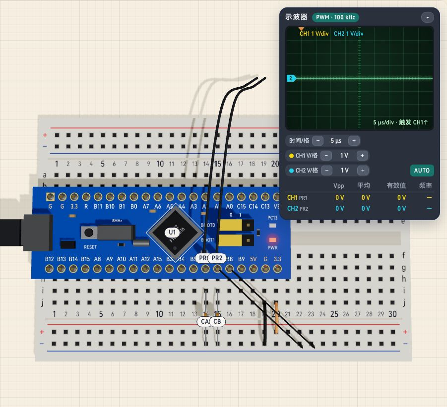
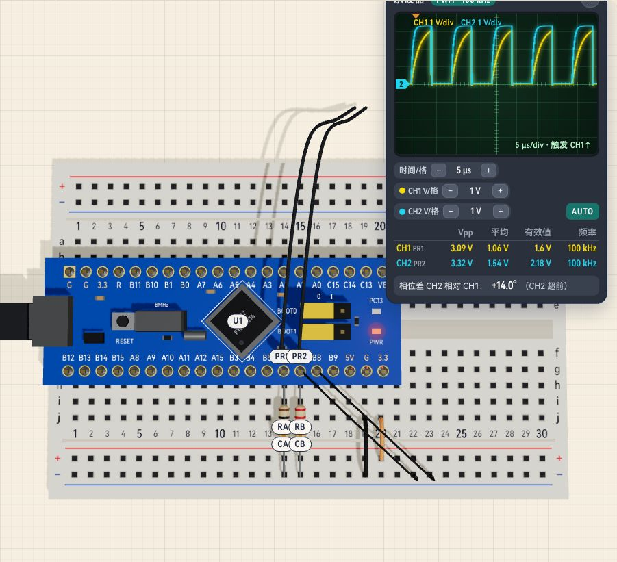
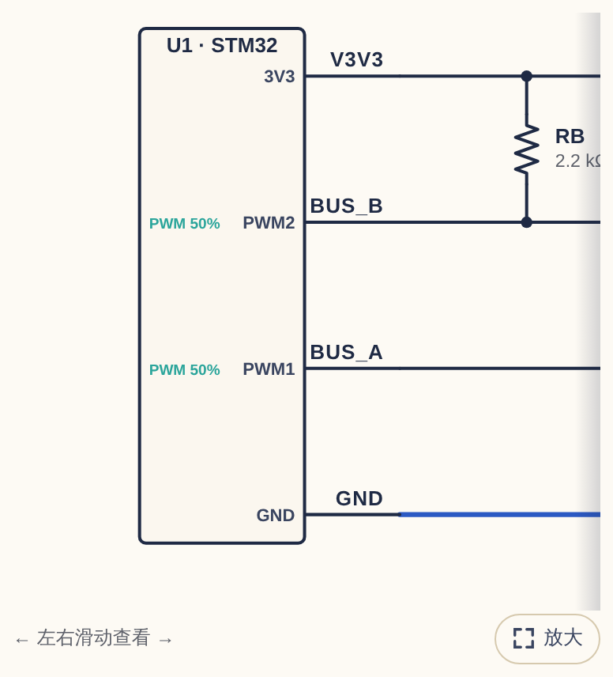
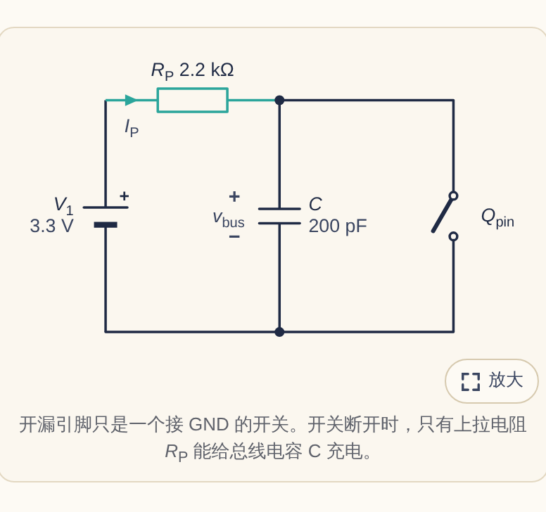
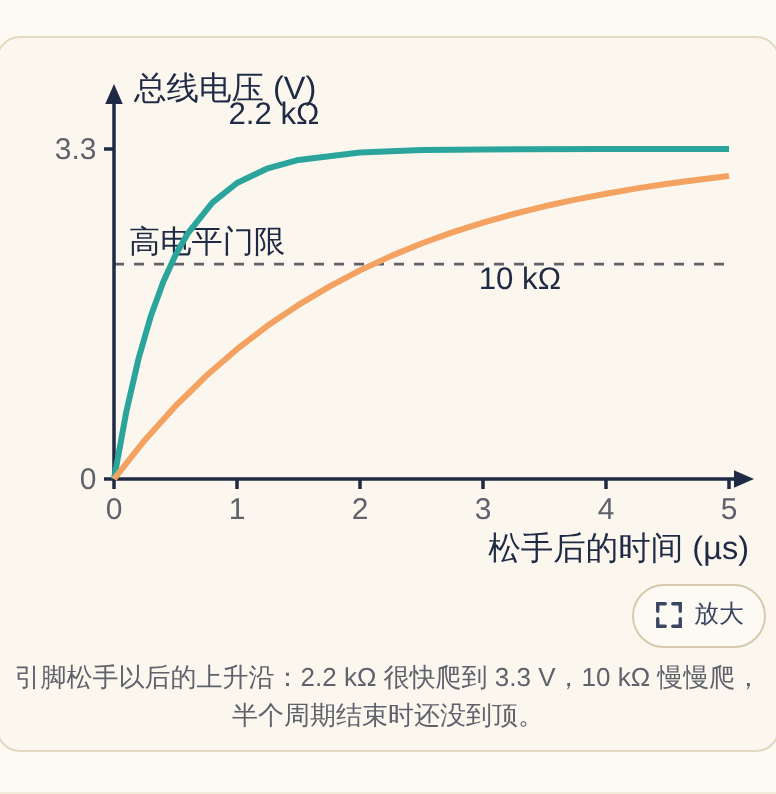

# 8.8 · I²C 上拉电阻：上升沿由 R × C 决定

| 项目 | 内容 |
|---|---|
| id | `exp5-i2c-pullup-rise-time` |
| 文件 | `challenges/295-i2c-pullup-rise-time.json` |
| 类型 | 实验 / 挑战（没有分步，照目标电路图搭） · 难度 4/5 |
| 位置 | World 8 · 数字逻辑、MCU 与传感器实战 → 8.8 PWM：调光、DAC 与调速（本节第 3 项） |
| 右侧面板 | 轨道由旧的四张卡片自动生成（还没手工精排） |
| 前后 | 上一项 [8.8 exp5-pwm-mosfet-motor](../w8/8.08-2-exp5-pwm-mosfet-motor.md) · 下一项 [8.9 exp5-capstone-ntc-fan](../w8/8.09-1-exp5-capstone-ntc-fan.md) |
| 先修 | lesson-mcu-pwm-adc |
| 概念 | 开漏输出 open-drain output、I²C 上拉电阻 I²C pull-up、上升时间 rise time、总线电容 bus capacitance、灌电流上限 sink-current limit |

**一句话概要**：Blue Pill 的两个开漏引脚以 100 kHz 模拟两条 I²C 线，各挂 200 pF，一条 10 kΩ 上拉、一条 2.2 kΩ。下降沿都很陡，上升沿却一慢一快。测上升时间、低电平，学会给上拉电阻定一个范围。

## 1. 左侧工作台（3D 面包板 → 2D 俯视截图）

截图是程序里真实的 3D 面包板换成俯视角拍的；表格是同一块板的文字版（元件、参数、每只脚插在哪个孔）。

### 1.1 起点：打开这一课时板上已经有的

右侧显示的「起点」说明：

> **半成品**：Blue Pill（PB6、PB7 设成 100 kHz 开漏 PWM）、电源轨、代表总线电容的 CA、CB（各 200pF）和两个探头都已接好。**为什么**：要选的只有上拉电阻。**你要做**：加上 RA（10kΩ，PB6 那条线 → 3V3）和 RB（2.2kΩ，PB7 那条线 → 3V3），比较两条线的上升时间。

| 元件 | 类型 | 参数 | 引脚 → 孔 |
|---|---|---|---|
| U1 | stm32_bluepill | usb=true, pins={"PB6":{"mode":"pwm","openDrain":true,"duty":50,"frequency":100000},"PB7":{"mode":"pwm","openDrain":true,"duty":50,"frequency":100000}} | GND→c1 GND_2→c2 3V3→c3 NRST→c4 PB11→c5 PB10→c6 PB1→c7 PB0→c8 PA7→c9 PA6→c10 PA5→c11 PA4→c12 PA3→c13 PA2→c14 PA1→c15 PA0→c16 PC15→c17 PC14→c18 PC13→c19 VBAT→c20 PB12→g1 PB13→g2 PB14→g3 PB15→g4 PA8→g5 PA9→g6 PA10→g7 PA11→g8 PA12→g9 PA15→g10 PB3→g11 PB4→g12 PB5→g13 PB6→g14 PB7→g15 PB8→g16 PB9→g17 5V→g18 GND_3→g19 3V3_2→g20 |
| W1 | wire |  | a→j19 b→bn19 |
| W2 | wire |  | a→j20 b→bp20 |
| CA | capacitor | capacitance=2e-10 | 1→i14 2→bn14 |
| CB | capacitor | capacitance=2e-10 | 1→i15 2→bn15 |
| PR1 | scope_probe | channel=1 | tip→f14 gnd→bn22 |
| PR2 | scope_probe | channel=2 | tip→f15 gnd→bn23 |

### 1.3 参考答案（「看答案」载入的板子）

| 元件 | 类型 | 参数 | 引脚 → 孔 |
|---|---|---|---|
| U1 | stm32_bluepill | usb=true, pins={"PB6":{"mode":"pwm","openDrain":true,"duty":50,"frequency":100000},"PB7":{"mode":"pwm","openDrain":true,"duty":50,"frequency":100000}} | GND→c1 GND_2→c2 3V3→c3 NRST→c4 PB11→c5 PB10→c6 PB1→c7 PB0→c8 PA7→c9 PA6→c10 PA5→c11 PA4→c12 PA3→c13 PA2→c14 PA1→c15 PA0→c16 PC15→c17 PC14→c18 PC13→c19 VBAT→c20 PB12→g1 PB13→g2 PB14→g3 PB15→g4 PA8→g5 PA9→g6 PA10→g7 PA11→g8 PA12→g9 PA15→g10 PB3→g11 PB4→g12 PB5→g13 PB6→g14 PB7→g15 PB8→g16 PB9→g17 5V→g18 GND_3→g19 3V3_2→g20 |
| W1 | wire |  | a→j19 b→bn19 |
| W2 | wire |  | a→j20 b→bp20 |
| RA | resistor | resistance=10000 | 1→h14 2→bp14 |
| CA | capacitor | capacitance=2e-10 | 1→i14 2→bn14 |
| RB | resistor | resistance=2200 | 1→h15 2→bp15 |
| CB | capacitor | capacitance=2e-10 | 1→i15 2→bn15 |
| PR1 | scope_probe | channel=1 | tip→f14 gnd→bn22 |
| PR2 | scope_probe | channel=2 | tip→f15 gnd→bn23 |

### 1.4 目标原理图（右侧「目标原理图」抽屉）

| 元件 | 类型 | 参数 |
|---|---|---|
| U1 | stm32_bluepill |  |
| RA | resistor | resistance=10000 |
| CA | capacitor | capacitance=2e-10 |
| RB | resistor | resistance=2200 |
| CB | capacitor | capacitance=2e-10 |

连接（每个结点上的引脚）：

- **BUS_A**：U1.PWM1、RA.1、CA.1
- **BUS_B**：U1.PWM2、RB.1、CB.1
- **V3V3**：U1.3V3、RA.2、RB.2
- **GND**：CA.2、CB.2、U1.GND

## 2. 右侧面板：学生从上往下看到的内容（单轨流）

### 第 1 步 · 🔧 动手搭：哪条线像鲨鱼鳍？

**Blue Pill** 下排的 **3V3** 和 **GND** 脚接到下方电源轨。选两个能输出 PWM 的引脚（例如 **PB6**、**PB7**）当两条“总线”。
总线 A：引脚 → **`10 kΩ`** 到 3V3，再接 **`200 pF`** 到 GND。总线 B 一样，但上拉用 **`2.2 kΩ`**。
两个引脚都设成 **PWM**、**`100 kHz`**、**`50 %`**，勾选**「开漏输出」**。示波器 CH1 看总线 A，CH2 看总线 B。
下降沿都很陡。上升沿呢？哪一条像鲨鱼鳍？

### 第 2 步 · 💡 想明白：往上只能靠电阻

- 开漏引脚（5.6 学过）只会**往下拉**：里面是一个约 40 Ω 的开关接到 GND。要输出高电平，它只是**松手**。

*图 `pullup`（schematic）：开漏引脚只是一个接 GND 的开关。开关断开时，只有上拉电阻 R_P 能给总线电容 C 充电。*

- 松手以后，只有上拉电阻能把线拉高，而且要先给**总线电容**充电：每个芯片引脚、每段导线都贡献几 pF。这是一次 RC 充电——慢，而且是弯的。往下拉时开关只有几十欧，所以下降沿很陡。

*图 `edges`（plot）：引脚松手以后的上升沿：2.2 kΩ 很快爬到 3.3 V，10 kΩ 慢慢爬，半个周期结束时还没到顶。*

- RC 充电从 10 % 到 90 % 的时间（示波器的“上升时间”）：
$$t_r ≈ 2.2 × R × C$$
- 代入 4.7 kΩ、200 pF：$t_r ≈ 2.2 × 4700 × 200$ pF ≈ 2.07 µs。半个时钟周期比这短得多时，线还没爬到高电平就又被拉下去了，对方永远读到 0。

（这一步下面列着这节课的计算卡片，点开就地展开：`rc-time-constant`、`rc-charging`、`rise-time`、`pullup-current`、`i2c-rise-time`、`i2c-pullup-range`，全文见第 6 节）

### 第 3 步 · 🔧 动手搭：量上升时间和低电平

- 点**「检查我的电路」**。检查还会试 **400 kHz**，以及两个引脚静止在**「输出 低」**和松开时的样子。
- 上升时间用示波器的 **rise** 读数；400 kHz 那题在「属性」里把两个引脚都改成 400 kHz，读总线 A 的最高电压。
- 低电平那两题：两个引脚都设成**「输出 低」**（仍勾选开漏），用万用表量总线 B 对 GND。先预测，再读。

### 第 4 步 · 📏 测一测：测一测：读你自己的仪表

**测量题 1 · `trb`**（读数题）

> 100 kHz：总线 B（2.2 kΩ）的上升时间 t_r（10% → 90%）

- 单位 µs · 先写预测 · 状态：U1 PWM1 设为PWM 输出 50%、U1 PWM2 设为PWM 输出 50% · 参考答案的读数 **0.9655 µs** · 合理范围 [9.2e-7, 0.00000101]

答对后显示：

> t_r = RC·ln 9 ≈ 2.2 × 2.2 kΩ × 200 pF ≈ 0.97 µs。

**测量题 2 · `vmaxa`**（读数题）

> 400 kHz：总线 A（10 kΩ）能爬到的最高电压

- 单位 V · 先写预测 · 状态：U1 PWM1 设为PWM 输出 50%、U1 PWM2 设为PWM 输出 50% · 参考答案的读数 **1.54 V** · 合理范围 [1.45, 1.62]

答对后显示：

> 半个周期 1.25 µs 只有约 0.6τ，只能爬到约 1.5 V——低于 STM32 的 VIH（2.15 V），对方永远读到 0。

**测量题 3 · `vol`**（读数题）

> 两个引脚都「输出 低」：万用表测总线 B（2.2 kΩ）对 GND 的低电平 V_OL

- 单位 mV · 先写预测 · 状态：U1 PWM1 设为输出低电平、U1 PWM2 设为输出低电平 · 参考答案的读数 **58.91 mV** · 合理范围 [0.05, 0.07]

答对后显示：

> 3.3 V 被 2.2 kΩ 和引脚里约 40 Ω 的开关分压：3.3 × 40 / 2240 ≈ 59 mV，远低于 0.4 V。

**测量题 4 · `isink`**（计算题（用自己的读数算））

> 用你的读数算引脚灌进去的电流：(3.3 V − V_OL) / 2.2 kΩ

- 单位 mA · 先写预测 · 参考答案的读数 **1.473 mA** · 合理范围 [0.0014, 0.00155] · 公式 `(3.3 - vol) / 2200`

答对后显示：

> ≈ 1.47 mA，在芯片保证的 3 mA 以内。上拉小到约 1 kΩ 时就碰到这个上限。

**测量题 5 · `fast`**（选择题）

> I²C 快速模式要求 t_r(30–70%) ≤ 300 ns（约等于 10–90% 时间 ≤ 0.78 µs）。按你测的读数：

- A. 两条都不满足 ✅（正确）
- B. 只有 2.2 kΩ 的总线 B 满足
- C. 两条都满足

答对后显示：

> 总线 B 的 0.97 µs 也超过了 0.78 µs；200 pF 时快速模式的上拉要 ≤ 1.77 kΩ（用 1.5 kΩ）。

### 第 5 步 · 🎒 带走：带走

- **上拉电阻有一个窗口**：太大，上升太慢（$R ≤ \frac{t_r}{0.85 × C}$，按规范的 30–70 % 时间算）；太小，引脚拉不下来——芯片只保证灌 3 mA 时低电平 ≤ 0.4 V，所以 3.3 V 总线 R ≥ (3.3 − 0.4) / 3 mA ≈ 1 kΩ。
- 经验值：3.3 V、100 kHz、几个模块用 **2.2–4.7 kΩ**；400 kHz 或线长用 **1–2.2 kΩ**。芯片内部约 40 kΩ 的上拉太弱，正式电路一定外接。
- 真实电路里的坑：很多 I²C 模块板上已经带了 4.7 kΩ 上拉，挂五个就等于约 940 Ω 并在一起，低于下限——拆掉多余的。上拉接 **3.3 V**，不要接 5 V。

趁热练理论题：`first-order`

## 3. 测量题一览

| # | id | 题目 | 类型 | 单位 | 状态 | 参考读数 |
|---|---|---|---|---|---|---|
| 1 | trb | 100 kHz：总线 B（2.2 kΩ）的上升时间 t_r（10% → 90%） | scope | µs | U1 PWM1 设为PWM 输出 50%、U1 PWM2 设为PWM 输出 50% | 0.9655 µs |
| 2 | vmaxa | 400 kHz：总线 A（10 kΩ）能爬到的最高电压 | scope | V | U1 PWM1 设为PWM 输出 50%、U1 PWM2 设为PWM 输出 50% | 1.54 V |
| 3 | vol | 两个引脚都「输出 低」：万用表测总线 B（2.2 kΩ）对 GND 的低电平 V_OL | voltage | mV | U1 PWM1 设为输出低电平、U1 PWM2 设为输出低电平 | 58.91 mV |
| 4 | isink | 用你的读数算引脚灌进去的电流：(3.3 V − V_OL) / 2.2 kΩ | formula | mA |  | 1.473 mA |
| 5 | fast | I²C 快速模式要求 t_r(30–70%) ≤ 300 ns（约等于 10–90% 时间 ≤ 0.78 µs）。按你测的读数： | 选择 |  |  | 正确：A |

### 全部答完后显示的「对比」

**对比**（仿真，200 pF）：
- **2.2 kΩ，100 kHz**：τ = 440 ns，rise（10–90 %）= **0.97 µs**（2.2 × 2.2 kΩ × 200 pF = 0.97 µs），对应 t_r(30–70 %) ≈ 373 ns：满足标准模式，**不满足**快速模式（> 300 ns）。高电平到 3.30 V。fall < 0.1 µs（仿真步长限制，实际约 2.2 × 40 Ω × 200 pF ≈ 18 ns）。
- **10 kΩ，100 kHz**：τ = 2 µs，半个周期 5 µs 只有 2.5τ，高电平只爬到 **3.03 V**；示波器测的 rise ≈ **3.3 µs**（按实际摆幅算；完整指数曲线是 4.4 µs），t_r(30–70 %) ≈ 1.7 µs —— **连标准模式都不满足**。
- **400 kHz**：半周期 1.25 µs，10 kΩ 的总线 A 只爬到 **1.54 V**，低于 STM32 的 VIH（2.15 V）和 I²C 的 0.7·VDD（2.31 V），对方读到的永远是 0——通信完全失败；2.2 kΩ 的总线 B 爬到 3.11 V，勉强能用但边沿不合规。
- **输出低电平**：2.2 kΩ 时灌电流 3.3 V / (2.2 kΩ + 40 Ω) ≈ **1.47 mA**，V_OL ≈ **59 mV**；10 kΩ 时只有 0.33 mA。

### 提示按钮（依次显示）

1. 每条总线：引脚 → 上拉电阻 → 3V3，同一个引脚再接 200 pF 电容到 GND。
2. 总线 A 用 10 kΩ，总线 B 用 2.2 kΩ。
3. 两个引脚都设成 PWM、100 kHz、50 %，并勾选「开漏输出」。

### 功能测试（「检查我的电路」时跑）

- 100 kHz、总线 B（2.2 kΩ）：上升时间满足标准模式，到 3.3 V，下降很快
- 100 kHz、总线 A（10 kΩ）：上升太慢，高电平到不了 3.3 V
- 400 kHz：总线 A 爬不到 VIH
- 开漏输出低电平：两条总线都被拉低，灌电流在 3 mA 以内
- 松开（开漏输出高）：上拉把两条线都拉到 3.3 V

## 5. 这一课的计算卡片

**计算卡片 `rc-time-constant`：RC 时间常数 τ = RC**

- 公式 `τ = R C`
- 用途：电容经电阻充放电有多快：过 1τ 走完 63 %，5τ 基本到头。
- 输入：R（电容看到的电阻（含发生器 50 Ω），Ω）；C（电容，F） → τ（时间常数，s）

1. 电容：$i = C\frac{dv_C}{dt}$，电压不能突变。
2. 充电回路的 KVL：$V_s = Ri + v_C = RC\frac{dv_C}{dt} + v_C$。
3. 这个一阶微分方程的解是指数：$v_C = V_s(1 - e^{-t/τ})$，其中 $τ = RC$（Ω × F = s）。
4. 经验值：1τ → 63 %，2τ → 86 %，3τ → 95 %，5τ → 99.3 %。
5. **R 是从电容两端看进去的戴维宁电阻**（电源置零）：要把信号发生器的 50 Ω、并联的电阻都算进去。

例子：- 实验 3-1：$(10k + 50) × 100 nF ≈ 1.0 ms$。
- 实验 3-2：微分 $10k × 10 nF = 0.1 ms$，积分 $10k × 1 µF = 10 ms$。
- 实验 3-5：充电 $1000 µF × 173 Ω ≈ 0.17 s$，放电 $1000 µF × 482 Ω ≈ 0.48 s$。
- 实验 5-14：$10k × 1 µF = 10 ms$；实验 5-16：$2.2k × 200 pF = 440 ns$。

- ⚠ 只用串联的那个 R：电容旁边还并着电阻时，τ 用的是 $R_1 ∥ R_2$（实验 3-7 只有一半）。
- ⚠ 单位：kΩ × µF = ms，kΩ × nF = µs。

**计算卡片 `rc-charging`：一阶电路的三要素法**

- 公式 `v(t) = v(∞) + [v(0_+) - v(∞)] e^{-t/τ}`
- 用途：任何一阶电路的任何电压 / 电流：知道初值、终值、τ，算出任意时刻的值。
- 输入：v_0（初值 v(0+)，V）；v_∞（终值 v(∞)，V）；τ（时间常数，s）；t（经过的时间，s） → v(t)（这一时刻的值，V）

1. 一阶电路里任何量 x 都满足 $τ\frac{dx}{dt} + x = x(∞)$，解就是“从初值指数地走向终值”。
2. **初值 v(0+)**：电容电压、电感电流不能突变，等于开关动作前一刻的值（方波：上半个周期结束时的值）。
3. **终值 v(∞)**：直流稳态，电容当 **开路**、电感当 **短路** 算出来。
4. **时间常数**：$τ = R_{eq}C$ 或 $τ = \frac{L}{R_{eq}}$，$R_eq$ 是从储能元件两端看进去的电阻。
5. 代进公式。反过来求“到某个值要多久”：$t = τ ln\frac{v(0_+) - v(∞)}{v(t) - v(∞)}$。

例子：- 实验 3-1 充电 1τ：$5 + (0 - 5)e^{-1} ≈ 3.16 V$（走完 63 %）。500 Hz 稳态放电：从 3.65 V 走向 0，1 ms 后 $3.65e^{-1} ≈ 1.34 V$。
- 实验 3-7：终值不是 5 V 而是 $5 × \frac{10}{20.05} ≈ 2.49 V$，τ ≈ 0.50 ms。
- 实验 5-14：占空比一变，VDAC 走向新值，4.6τ ≈ 46 ms 后误差小于 1 %。

- ⚠ 只有电容电压和电感电流连续；电阻电压、电容电流在 0+ 时刻可以跳变（微分电路的尖峰就是这样来的）。
- ⚠ 终值要用“电容开路”的电路算，别直接写电源电压。

**计算卡片 `rise-time`：上升时间 10 %→90 % = τ·ln 9**

- 公式 `t_r = τ ln 9 ≈ 2.2 τ`
- 用途：示波器量到的上升时间 tᵣ 反推时间常数 τ（或反过来）。
- 输入：t_r（10 %→90 % 上升时间，s） → τ（时间常数，s）

1. 从 0 充向终值：$\frac{v}{v(∞)} = 1 - e^{-t/τ}$。
2. 到 10 % 的时刻：$t_1 = τ ln\frac{1}{0.9}$；到 90 %：$t_2 = τ ln 10$。
3. 相减：$t_r = t_2 - t_1 = τ ln 9 ≈ 2.197τ$。
4. 所以 $τ = \frac{t_r}{ln 9}$——不用知道终值，也不用从 0 开始量。
5. I²C 规范的 $t_r$ 是 30 %→70 %：$τ ln\frac{7}{3} ≈ 0.847τ$。

例子：实验 3-1（50 Hz）：$t_r ≈ 2.2 ms$ → τ ≈ 1.0 ms。实验 3-3：电流（$v_R$）的 $t_r ≈ 146 µs$ → τ ≈ 66 µs = 10 mH / 151 Ω。实验 5-16：2.2 kΩ + 200 pF 的 $t_r ≈ 0.97 µs$。

- ⚠ 半个周期里没走完（τ 和半周期差不多）时，示波器按实际摆幅算 10 %/90 %，结果会比 2.2τ 小。

**计算卡片 `pullup-current`：上拉 / 下拉电阻的电流**

- 公式 `I = \frac{V}{R_{pull}}`
- 用途：按键按下（或开漏输出拉低）时，上拉 / 下拉电阻上流多少电流。
- 输入：V（电阻两端的电压，V）；R（上拉 / 下拉电阻（ESP32 内部 ≈ 45 kΩ），Ω） → I（按下时的电流，A）

1. CMOS 输入几乎不取电流（> 10 MΩ）：松开时上拉电阻上没有电流、没有压降，引脚就在 3.3 V（读 1）。
2. 按下时按键把引脚接到 GND（≈ 0 Ω 远小于 R），电阻两端是整个电源电压：$I = \frac{V}{R}$，引脚读 0。
3. 太小（比如 220 Ω）：按下时白白耗 15 mA；太大（1 MΩ）：抗干扰差、长线容易误触发。按键常用 4.7–10 kΩ。
4. 开漏输出拉低时同理：$I = \frac{V_{pull}}{R + R_{low}}$，引脚低电平 $V_{OL} = IR_{low}$。

例子：- 第 15 课、实验 5-3：内部上拉 $\frac{3.3}{45k} ≈ 73 µA$；外部 10 kΩ 下拉 $\frac{3.3}{10k} = 0.33 mA$。
- 实验 5-11：5 V 上拉 4.7 kΩ，开漏拉低：$\frac{4.69}{4.7k} ≈ 0.99 mA$，$V_{OL} = 40 × 0.99 mA ≈ 40 mV$。
- 实验 5-10：5 V 信号进 FT 引脚又开了内部上拉：$\frac{4.69 - 3.3}{40k} ≈ 35 µA$ 倒灌进 3V3。
- 实验 5-16：2.2 kΩ 的 I²C 线拉低：$\frac{3.3}{2.2k + 40} ≈ 1.47 mA$。

- ⚠ ESP32 的 GPIO34–39 没有内部上下拉：设成“输入 + 上拉”也是悬空。
- ⚠ 5 V 信号的 FT 引脚不要开内部上拉。

**计算卡片 `i2c-rise-time`：I²C 上升时间 ≈ 0.8473·R·C**

- 公式 `t_r(30 %→70 %) = R C ln\frac{7}{3} ≈ 0.8473 R C`
- 用途：开漏总线松开后只靠上拉电阻给总线电容充电：规范定义的上升时间是多少。
- 输入：R（上拉电阻，Ω）；C（总线电容（每个器件 ~10 pF，每 10 cm 线 5–10 pF），F） → t_r（30 %→70 % 上升时间，s）

1. 开漏输出只会“拉低”：松开时总线电压按 $V(t) = V_{DD}(1 - e^{-t/RC})$ 充上去。
2. 到 30 % 的时刻 $τ ln\frac{1}{0.7}$，到 70 % 的时刻 $τ ln\frac{1}{0.3}$，相减 $τ ln\frac{7}{3} ≈ 0.8473τ$。
3. 示波器的 rise 量的是 10 %→90 %：$τ ln 9 ≈ 2.197τ$，是 I²C $t_r$ 的约 2.6 倍。
4. 规范：标准模式（100 kHz）$t_r ≤ 1000 ns$，快速模式（400 kHz）$t_r ≤ 300 ns$。
5. 半个周期里还没爬到 $V_{IH}$（STM32 2.15 V、I²C 0.7·$V_DD$），对方读到的永远是 0。

例子：实验 5-16（200 pF）：2.2 kΩ：τ = 440 ns，$t_r ≈ 373 ns$（10–90 % 0.97 µs）——满足标准模式，不满足快速模式。10 kΩ：τ = 2 µs，$t_r ≈ 1.7 µs$，连标准模式都不行；400 kHz 时半周期 1.25 µs 只爬到 $3.3(1 - e^{-0.625}) ≈ 1.5 V$。

- ⚠ 内部上拉（40–45 kΩ）太弱：200 pF 时 τ ≈ 8–9 µs，比一个 100 kHz 周期还长。

**计算卡片 `i2c-pullup-range`：I²C 上拉电阻的范围**

- 公式 `R_{max} = \frac{t_r}{0.8473 C_{bus}}, R_{min} = \frac{V_{DD} - 0.4 V}{3 mA}`
- 用途：上拉不能太大（不够快），也不能太小（拉不低）：上限由上升时间决定，下限由 3 mA 灌电流决定。
- 输入：t_r（允许的上升时间（标准 1000 ns、快速 300 ns），s）；C（总线电容，F） → R_max（最大上拉电阻，Ω）

1. **上限**：$t_r = 0.8473RC ≤$ 规范值 ⇒ $R ≤ \frac{t_r}{0.8473C}$。
2. **下限**：规范只保证器件在灌 3 mA 时 $V_{OL} ≤ 0.4 V$。拉低时上拉电流 $\frac{V_{DD} - 0.4}{R} ≤ 3 mA$ ⇒ $R ≥ \frac{V_{DD} - 0.4}{3 mA}$。
3. 在两者之间选：3.3 V、100 kHz、几个模块用 2.2–4.7 kΩ；400 kHz 或长线用 1–2.2 kΩ。
4. 很多 I²C 模块板上自带上拉：几个模块并在一起，总上拉 = 它们并联，可能低于下限——拆掉多余的。

例子：200 pF：快速模式 $R_{max} = \frac{300 ns}{0.8473 × 200 pF} ≈ 1.77 kΩ$（用 1.5 kΩ）；标准模式 ≈ 5.9 kΩ。3.3 V 的下限 $\frac{2.9}{3 mA} ≈ 967 Ω$（5 V 时 1.53 kΩ）。五个各带 4.7 kΩ 的模块：$\frac{4.7k}{5} = 940 Ω$——已经低于下限。

- ⚠ 上拉接 3.3 V，不要接 5 V：ESP32 没有耐 5 V 的引脚。

## 6. English（界面英文版的同一份内容）

展开英文

### Node 1 · 🔧 Build：Which line looks like a shark fin?

Connect the **Blue Pill**'s bottom-row **3V3** and **GND** pins to the bottom rails. Pick two PWM-capable pins (e.g. **PB6**, **PB7**) as two "bus lines".
Bus A: pin → **`10 kΩ`** to 3V3, plus **`200 pF`** to GND. Bus B the same, but with a **`2.2 kΩ`** pull-up.
Set both pins to **PWM**, **`100 kHz`**, **`50 %`**, and tick **Open-drain output**. Scope CH1 on bus A, CH2 on bus B.
Both falling edges are steep. What about the rising edges? Which line looks like a shark fin?

### Node 2 · 💡 Why：Going up, only the resistor helps

- An open-drain pin (from 5.6) can only **pull down**: inside is a switch of about 40 Ω to GND. To output HIGH it simply **lets go**.

[figure `pullup`]

*Figure `pullup`（schematic）：开漏引脚只是一个接 GND 的开关。开关断开时，只有上拉电阻 R_P 能给总线电容 C 充电。*

- Once it lets go, only the pull-up can lift the line, and it must first charge the **bus capacitance**: every chip pin and every piece of wire adds a few pF. That is an RC charge — slow and curved. Pulling down goes through a few tens of ohms, so the falling edge is steep.

[figure `edges`]

*Figure `edges`（plot）：引脚松手以后的上升沿：2.2 kΩ 很快爬到 3.3 V，10 kΩ 慢慢爬，半个周期结束时还没到顶。*

- The 10 % → 90 % time of an RC charge (the scope's "rise time"):
$$t_r ≈ 2.2 × R × C$$
- With 4.7 kΩ and 200 pF: $t_r ≈ 2.2 × 4700 × 200$ pF ≈ 2.07 µs. When half a clock period is much shorter than that, the line is pulled down again before it reaches HIGH, and the other chip always reads 0.

(This node lists the lesson’s calculation cards: `rc-time-constant`、`rc-charging`、`rise-time`、`pullup-current`、`i2c-rise-time`、`i2c-pullup-range`; full text in section 6)

### Node 3 · 🔧 Build：Measure the rise time and the LOW level

- Press **Check my circuit**. The check also tries **400 kHz**, and both pins sitting still at **OUT LOW** and released.
- Read the rise time with the scope's **rise** measurement. For the 400 kHz question set both pins to 400 kHz in Properties and read bus A's highest voltage.
- For the two LOW-level questions set both pins to **OUT LOW** (open-drain still ticked) and measure bus B to GND with the multimeter. Predict first, then read.

### Node 4 · 📏 Measure：Measure: read your own instruments

**Question 1 · `trb`**（reading）

> 100 kHz: bus B's (2.2 kΩ) rise time t_r (10% → 90%)

- unit µs · predict first · state：U1 PWM1 is PWM output 50% and U1 PWM2 is PWM output 50% · range [9.2e-7, 0.00000101]

Shown once right:

> t_r = RC·ln 9 ≈ 2.2 × 2.2 kΩ × 200 pF ≈ 0.97 µs.

**Question 2 · `vmaxa`**（reading）

> 400 kHz: the highest voltage bus A (10 kΩ) reaches

- unit V · predict first · state：U1 PWM1 is PWM output 50% and U1 PWM2 is PWM output 50% · range [1.45, 1.62]

Shown once right:

> Half a period, 1.25 µs, is only about 0.6τ: it climbs to about 1.5 V — below the STM32's VIH (2.15 V), so the other side always reads 0.

**Question 3 · `vol`**（reading）

> Both pins OUT LOW: multimeter, bus B (2.2 kΩ) to GND — the LOW level V_OL

- unit mV · predict first · state：U1 PWM1 is output LOW and U1 PWM2 is output LOW · range [0.05, 0.07]

Shown once right:

> 3.3 V divided between 2.2 kΩ and the pin's switch of about 40 Ω: 3.3 × 40 / 2240 ≈ 59 mV, far below 0.4 V.

**Question 4 · `isink`**（calculation from own readings）

> From your reading, the current the pin sinks: (3.3 V − V_OL) / 2.2 kΩ

- unit mA · predict first · range [0.0014, 0.00155] · formula `(3.3 - vol) / 2200`

Shown once right:

> ≈ 1.47 mA, within the 3 mA the chip promises. A pull-up down near 1 kΩ reaches that limit.

**Question 5 · `fast`**（multiple choice）

> I²C Fast mode needs t_r(30–70%) ≤ 300 ns (about ≤ 0.78 µs for 10–90%). From your readings:

- A. Neither bus meets it ✅ (right)
- B. Only bus B (2.2 kΩ) meets it
- C. Both meet it

Shown once right:

> Bus B's 0.97 µs is above 0.78 µs too; at 200 pF Fast mode needs a pull-up ≤ 1.77 kΩ (use 1.5 kΩ).

### Node 5 · 🎒 Take away：Take away

- **A pull-up has a window**: too large and the rise is too slow ($R ≤ \frac{t_r}{0.85 × C}$, using the spec's 30–70 % time); too small and the pin cannot pull the line down — chips only promise a LOW ≤ 0.4 V while sinking 3 mA, so on a 3.3 V bus R ≥ (3.3 − 0.4) / 3 mA ≈ 1 kΩ.
- Rules of thumb: 3.3 V, 100 kHz, a few modules: **2.2–4.7 kΩ**; 400 kHz or long wires: **1–2.2 kΩ**. The chip's internal pull-ups (about 40 kΩ) are too weak; a real bus needs external ones.
- A real-world catch: many I²C modules already carry 4.7 kΩ pull-ups; five of them in parallel make about 940 Ω, below the lower limit — remove the extras. Pull up to **3.3 V**, not 5 V.

Practise：`first-order`

**Compare**

**Compare** (simulated, 200 pF):
- **2.2 kΩ, 100 kHz**: τ = 440 ns, rise (10–90 %) = **0.97 µs** (2.2 × 2.2 kΩ × 200 pF = 0.97 µs), i.e. t_r(30–70 %) ≈ 373 ns: meets Standard mode, **fails** Fast mode (> 300 ns). The high level reaches 3.30 V. fall < 0.1 µs (limited by the time step; really about 2.2 × 40 Ω × 200 pF ≈ 18 ns).
- **10 kΩ, 100 kHz**: τ = 2 µs; half a period (5 µs) is only 2.5τ, so the high level only climbs to **3.03 V**. The scope's rise ≈ **3.3 µs** (measured on the actual swing; the full exponential is 4.4 µs), t_r(30–70 %) ≈ 1.7 µs — **not even Standard mode**.
- **400 kHz**: the half period is 1.25 µs. Bus A (10 kΩ) only reaches **1.54 V**, below the STM32's VIH (2.15 V) and I²C's 0.7·VDD (2.31 V): the other side always reads 0 and communication fails completely. Bus B (2.2 kΩ) reaches 3.11 V — it limps along, but its edges are out of spec.
- **Output LOW**: with 2.2 kΩ the sink current is 3.3 V / (2.2 kΩ + 40 Ω) ≈ **1.47 mA** and V_OL ≈ **59 mV**; with 10 kΩ only 0.33 mA.

**Hints**

1. Each bus: pin → pull-up → 3V3, and the same pin → 200 pF → GND.
2. Bus A uses 10 kΩ, bus B 2.2 kΩ.
3. Set both pins to PWM, 100 kHz, 50 %, and tick Open-drain output.

