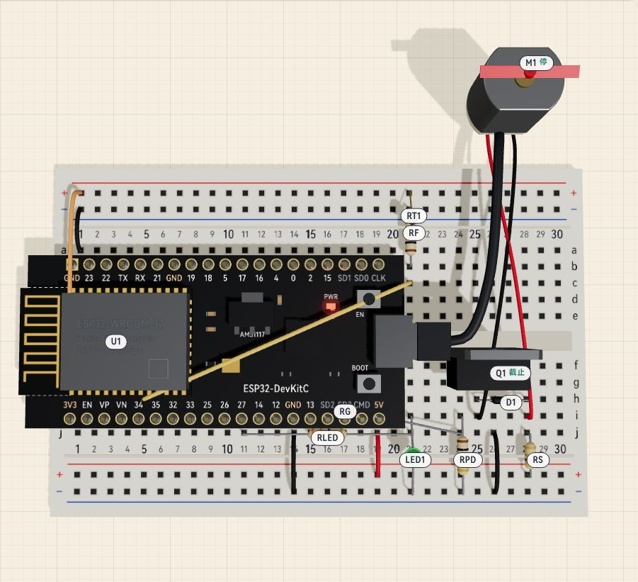
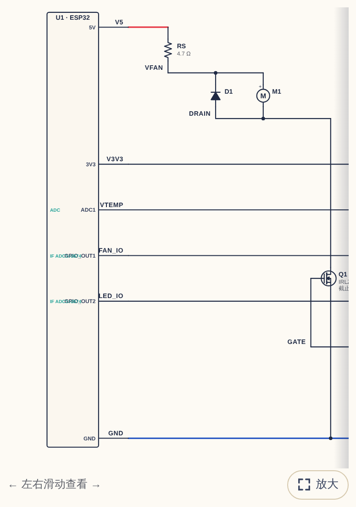
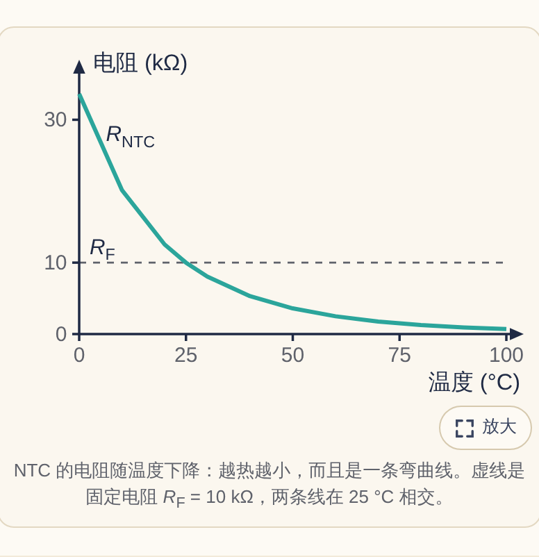
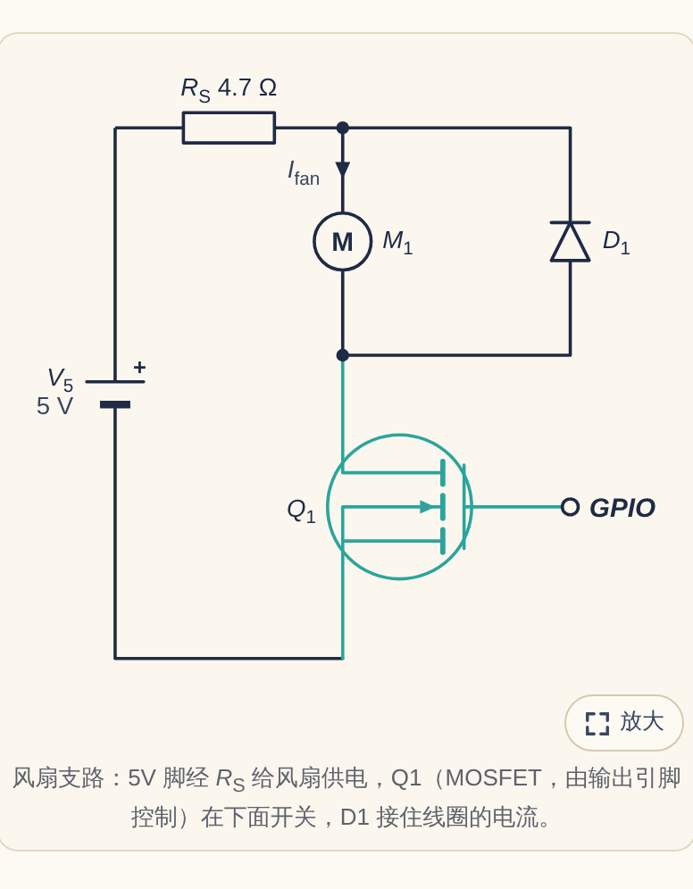

# 8.9 · 综合项目：温控风扇

| 项目 | 内容 |
|---|---|
| id | `exp5-capstone-ntc-fan` |
| 文件 | `challenges/296-capstone-ntc-fan.json` |
| 类型 | 实验 / 挑战（没有分步，照目标电路图搭） · 难度 5/5 |
| 位置 | World 8 · 数字逻辑、MCU 与传感器实战 → 8.9 综合项目（本节第 1 项） |
| 右侧面板 | 轨道由旧的四张卡片自动生成（还没手工精排） |
| 前后 | 上一项 [8.8 exp5-i2c-pullup-rise-time](../w8/8.08-3-exp5-i2c-pullup-rise-time.md) · 下一项 [8.9 exp5-design-night-light](../w8/8.09-2-exp5-design-night-light.md) |
| 先修 | lesson-mcu-pwm-adc |
| 概念 | 系统设计 system design、NTC 分压 + ADC NTC divider + ADC、低边 MOSFET 开关 low-side MOSFET switch、续流二极管 flyback diode、电源预算 power budget、接线检查 wiring checklist |

**一句话概要**：把第 5 世界放在一块 ESP32 上：NTC 分压接 ADC 测温，GPIO 经 MOSFET 开关一个风扇，另一个 GPIO 点状态灯。先由你扮演固件、看着 ADC 读数决定阈值，再用一条阈值规则让风扇和灯跟着温度自动开关。最后核对整块板的电源预算。

## 1. 左侧工作台（3D 面包板 → 2D 俯视截图）

截图是程序里真实的 3D 面包板换成俯视角拍的；表格是同一块板的文字版（元件、参数、每只脚插在哪个孔）。

### 1.1 起点：空面包板（学生从零开始搭）

### 1.3 参考答案（「看答案」载入的板子）

| 元件 | 类型 | 参数 | 引脚 → 孔 |
|---|---|---|---|
| U1 | esp32_devkit | usb=true, pins={"GPIO34":{"mode":"adc"},"GPIO26":{"mode":"rule","rule":{"adc":"GPIO34","above":2674,"hysteresis":150}},"GPIO27":{"mode":"rule","rule":{"adc":"GPIO34","above":2674,"hysteresis":150}}} | GND→b1 GPIO23→b2 GPIO22→b3 GPIO1→b4 GPIO3→b5 GPIO21→b6 GND_2→b7 GPIO19→b8 GPIO18→b9 GPIO5→b10 GPIO17→b11 GPIO16→b12 GPIO4→b13 GPIO0→b14 GPIO2→b15 GPIO15→b16 GPIO8→b17 GPIO7→b18 GPIO6→b19 3V3→i1 EN→i2 GPIO36→i3 GPIO39→i4 GPIO34→i5 GPIO35→i6 GPIO32→i7 GPIO33→i8 GPIO25→i9 GPIO26→i10 GPIO27→i11 GPIO14→i12 GPIO12→i13 GND_3→i14 GPIO13→i15 GPIO9→i16 GPIO10→i17 GPIO11→i18 5V→i19 |
| W1 | wire |  | a→a1 b→tn1 |
| W2 | wire |  | a→h1 b→tp1 |
| W3 | wire |  | a→j14 b→bn14 |
| W4 | wire |  | a→j19 b→bp19 |
| RT1 | ntc | temperature=25 | 1→tp21 2→a21 |
| RF | resistor | resistance=10000 | 1→b21 2→tn21 |
| W5 | wire |  | a→c21 b→h5 |
| RG | resistor | resistance=100 | 1→g10 2→j24 |
| Q1 | nmos | model=IRLZ44N | g→f24 d→f25 s→f26 |
| RPD | resistor | resistance=10000 | 1→i24 2→bn24 |
| W6 | wire |  | a→j26 b→bn26 |
| M1 | motor |  | +→i28 -→i25 |
| D1 | diode |  | anode→h25 cathode→h28 |
| RS | resistor | resistance=4.7 | 1→bp28 2→j28 |
| RLED | resistor | resistance=330 | 1→j11 2→j21 |
| LED1 | led | color=green | anode→i21 cathode→bn21 |

### 1.4 目标原理图（右侧「目标原理图」抽屉）

| 元件 | 类型 | 参数 |
|---|---|---|
| U1 | esp32_devkit | pins={"GPIO_OUT1":{"mode":"rule","rule":{"adc":"ADC1","above":2674,"hysteresis":150}},"GPIO_OUT2":{"mode":"rule","rule":{"adc":"ADC1","above":2674,"hysteresis":150}}} |
| RT1 | ntc |  |
| RF | resistor | resistance=10000 |
| RG | resistor | resistance=100 |
| RPD | resistor | resistance=10000 |
| Q1 | nmos | model=IRLZ44N |
| M1 | motor |  |
| D1 | diode |  |
| RS | resistor | resistance=4.7 |
| RLED | resistor | resistance=330 |
| LED1 | led | color=green |

连接（每个结点上的引脚）：

- **V3V3**：U1.3V3、RT1.1
- **VTEMP**：RT1.2、RF.1、U1.ADC1
- **FAN_IO**：U1.GPIO_OUT1、RG.1
- **GATE**：RG.2、Q1.g、RPD.1
- **DRAIN**：Q1.d、M1.-、D1.anode
- **VFAN**：M1.+、D1.cathode、RS.2
- **V5**：U1.5V、RS.1
- **LED_IO**：U1.GPIO_OUT2、RLED.1
- **LED_A**：RLED.2、LED1.anode
- **GND**：RF.2、RPD.2、Q1.s、LED1.cathode、U1.GND

## 2. 右侧面板：学生从上往下看到的内容（单轨流）

### 第 1 步 · 🔧 动手搭：你来当固件

这一个项目就是整个第 5 世界：一个温度计、一个风扇开关、一盏状态灯。先只搭温度计。
**3V3** → **NTC** → 一列空孔（叫它 **VTEMP**）→ **`10 kΩ`** → GND；VTEMP 再接一个 **ADC1** 引脚（GPIO32–39），设成 **ADC**。
单击 NTC，在「属性」里把温度从 **`25 °C`** 慢慢调到 **`60 °C`**。单击开发板，看引脚列表里这个引脚的 ADC 数字怎么变。
你就是固件：数字到多少时，你会打开风扇？

### 第 2 步 · 💡 想明白：三个学过的模块

- **测温（5.7）**：NTC 越热电阻越小，VTEMP 就越高。

*图 `rntc`（plot）：NTC 的电阻随温度下降：越热越小，而且是一条弯曲线。虚线是固定电阻 R_F = 10 kΩ，两条线在 25 °C 相交。*

$$V_{TEMP} = 3.3 × \frac{R_F}{R_{NTC} + R_F}$$
- 25 °C 时 NTC 是 10 kΩ：$V_{TEMP} = 3.3 × \frac{10}{10 + 10} = 1.65$ V，ADC 读数约 2048。R_F 取“最关心的温度”时 NTC 的阻值，那附近读数变化最快。
- **开关（5.4、5.8）**：输出引脚推 MOSFET 的栅极，风扇在漏极上，续流二极管接住线圈的电流。**供电（5.5）**：风扇吃的是 5V 脚，和 3.3 V 稳压器共用 USB 的 500 mA，所以串一个 4.7 Ω 把风扇电流限住。

*图 `fan`（schematic）：风扇支路：5V 脚经 R_S 给风扇供电，Q1（MOSFET，由输出引脚控制）在下面开关，D1 接住线圈的电流。*

- 固件要做的只有一次比较：ADC 读数超过阈值 → 风扇引脚和灯引脚输出高。开发板的引脚表里有一种**「阈值规则」**模式，它就是这一行固件：`if (analogRead(ADC) > 2674) 输出高; else 输出低;`

（这一步下面列着这节课的计算卡片，点开就地展开：`gpio-led-resistor`、`adc-code`、`sensor-best-resistor`、`ntc-beta`、`ntc-temperature`、`mosfet-power`、`usb-5v-pin`、`ldo-dropout`、`power-budget`，全文见第 6 节）

### 第 3 步 · 🔧 动手搭：按清单搭完整个系统

- **电源轨**：3V3 接上方 + 轨，5V 脚接下方 + 轨，两条 − 轨都接 GND。
- **风扇**：5V → **`4.7 Ω`** → 风扇 +；风扇 − → 漏极；源极 → GND；二极管色环朝风扇 +。**栅极**：输出引脚 → **`100 Ω`** → G，G 再接 **`10 kΩ`** 到 GND。**状态灯**：另一个输出引脚 → **`330 Ω`** → 绿色 LED → GND。
- **通电前核对**：NTC 上端接 **3V3** 不是 5V（ADC 最多 3.3 V）；ADC 用 **ADC1**；输出不用 GPIO34–39 和 6–11；二极管色环朝 5V。
- 两个输出引脚都设成**「阈值规则」**：读 ADC1 那个引脚，**读数 > `2674`** 时输出高（≈ 40 °C），**回差 `150`**。点**「检查我的电路」**。
- 拖 NTC 的温度：过了 40 °C，风扇和灯**自己**打开；降回约 36 °C 才关。“热态”的题：NTC 调到 **`60 °C`**。先预测，再读。

### 第 4 步 · 📏 测一测：测一测：读你自己的仪表

**测量题 1 · `vh`**（读数题）

> 热态（60 °C）：万用表测 V_TEMP（ADC 引脚）对 GND

- 单位 V · 先写预测 · 状态：RT1 的温度为 60 °C · 参考答案的读数 **2.641 V** · 合理范围 [2.51, 2.77]

答对后显示：

> R_NTC ≈ 2.49 kΩ：3.3 × 10 / 12.49 ≈ 2.64 V。

**测量题 2 · `raw`**（计算题（用自己的读数算））

> 这个电压对应的 12 位 ADC 读数（固件里拿来和阈值比较的数）

- 先写预测 · 参考答案的读数 **3277** · 合理范围 [3110, 3440] · 公式 `vh / 3.3 * 4095`

答对后显示：

> ≈ 3277。冷态 25 °C 是 2046，40 °C 约 2674——阈值取在中间，风扇在 40 °C 左右打开。

**测量题 3 · `ifan`**（读数题）

> 热态：风扇电流（电流表串在 5V 和 RS 之间）

- 单位 mA · 先写预测 · 状态：RT1 的温度为 60 °C · 参考答案的读数 **355.8 mA** · 合理范围 [0.338, 0.374]

答对后显示：

> (4.53 − 0.016) V / (4.7 + 8) Ω ≈ 356 mA；IRLZ44N 完全导通，Vds 只有约 16 mV。

**测量题 4 · `prs`**（计算题（用自己的读数算））

> 用你的电流读数算 RS（4.7 Ω）上的功耗 P = I²R

- 单位 W · 参考答案的读数 **0.5949 W** · 合理范围 [0.565, 0.625] · 公式 `ifan^2 * 4.7`

答对后显示：

> ≈ 0.6 W：要用 1 W 的电阻，1/4 W 的会烧。真实项目里直接选一个 5 V / 0.2 A 的小风扇更好。

**测量题 5 · `v5`**（读数题）

> 热态：5V 引脚对 GND（风扇全速时）

- 单位 V · 先写预测 · 状态：RT1 的温度为 60 °C · 参考答案的读数 **4.534 V** · 合理范围 [4.31, 4.76]

答对后显示：

> USB 约 415 mA（500 mA 的 83 %），5V 引脚从 4.68 V 掉到 ≈ 4.53 V，仍高于 AMS1117 需要的 3.3 + 1.1 = 4.4 V，3V3 还稳在 3.30 V。

### 第 5 步 · 🎒 带走：带走

- **一个系统 = 几个学过的模块，在几个结点上接起来**：分压器进 ADC，引脚推栅极，再给电源列一张预算。
- 阈值要带**回差**：这里高于 40 °C 开风扇、低于约 36 °C 才关（回差 150 个读数），否则温度在阈值附近时风扇会一开一关地抖——和 3.2 的施密特触发器是同一个主意，只是写在固件里。
- 真实电路里的坑：风扇电刷的噪声会顺着 5V 和 GND 窜进 ADC——多次取平均，ADC 引脚到 GND 并 100 nF，风扇的地线单独走回板子的 GND。4.7 Ω 会发热，按 P = I²R 选够功率的电阻；更好的办法是换一个 5 V 小风扇。
- 下一步：把风扇引脚改成 20 kHz PWM（5.8），就能调速。

趁热练理论题：`nonlinear`

## 3. 测量题一览

| # | id | 题目 | 类型 | 单位 | 状态 | 参考读数 |
|---|---|---|---|---|---|---|
| 1 | vh | 热态（60 °C）：万用表测 V_TEMP（ADC 引脚）对 GND | voltage | V | RT1 的温度为 60 °C | 2.641 V |
| 2 | raw | 这个电压对应的 12 位 ADC 读数（固件里拿来和阈值比较的数） | formula |  |  | 3277 |
| 3 | ifan | 热态：风扇电流（电流表串在 5V 和 RS 之间） | current | mA | RT1 的温度为 60 °C | 355.8 mA |
| 4 | prs | 用你的电流读数算 RS（4.7 Ω）上的功耗 P = I²R | formula | W |  | 0.5949 W |
| 5 | v5 | 热态：5V 引脚对 GND（风扇全速时） | voltage | V | RT1 的温度为 60 °C | 4.534 V |

### 全部答完后显示的「对比」

**对比：测温部分**：
- 0 °C：R_NTC ≈ 33.6 kΩ → 0.756 V → ADC **938**；
- 25 °C：10 kΩ → 1.649 V → ADC **2046**（冷态）；
- 40 °C：≈ 5.3 kΩ → 2.155 V → ADC **2674**（建议的开风扇阈值）；
- 60 °C：≈ 2.49 kΩ → 2.641 V → ADC **3277**（热态）；
- 90 °C：≈ 0.94 kΩ → 3.016 V → ADC **3742**，曲线越来越平，而且已经接近 ESP32 ADC 不准的上端。

把 RF 选成和“最关心的温度”时的 R_NTC 相等，那附近的灵敏度最高；这里 RF = 10 kΩ 让 25–60 °C 落在 ADC 的中段。

**对比：风扇部分**：GPIO 高电平 3.29 V → Vgs = 3.26 V，IRLZ44N 完全导通（Rds ≈ 44 mΩ），Vds ≈ **16 mV**，MOSFET 只耗 6 mW，不用散热片。风扇电流 = (4.53 − 0.016) V / (4.7 + 8) Ω ≈ **356 mA**；风扇两端 2.85 V，RS 上 1.67 V（0.6 W，要用 1 W 电阻）。栅极引脚只给 RPD 提供 **0.33 mA**；灯引脚 **3.3 mA**。

**对比：电源预算表**（热态，风扇全速）：
- 3V3（AMS1117，1 A）：芯片约 50 mA + 电源灯 1.5 mA + 状态灯 3.3 mA + 栅极 0.3 mA + NTC 分压 0.26 mA ≈ **55 mA** → 3V3 = **3.30 V**；
- 5V 引脚：风扇 356 mA + AMS1117 输入 ≈ 59 mA → **USB ≈ 415 mA**（500 mA 的 83 %）；5V 引脚从 4.68 V 掉到 **4.53 V**，仍高于 AMS1117 需要的 3.3 + 1.1 = 4.4 V。
- 为什么要 RS：130 电机直接接 5V 时约 0.55 A，加上板子就超过 500 mA 了。RS 4.7 Ω 把它限制在 0.36 A；真实项目里直接选一个 5 V / 0.2 A 的小风扇，或者从独立电源供电。

### 提示按钮（依次显示）

1. 先接电源轨：3V3 到上方 + 轨，5V 到下方 + 轨，两条 − 轨都接 GND。
2. NTC 从 3V3 到 VTEMP，10 kΩ 从 VTEMP 到 GND，VTEMP 接 GPIO32–39 中的一个。
3. 风扇回路：5V → 4.7 Ω → 风扇 +；风扇 − → MOSFET 漏极；源极 → GND。二极管色环朝风扇 + 端。
4. 栅极：输出引脚 → 100 Ω → G，G 再接 10 kΩ 到 GND。第二个输出引脚经 330 Ω 点 LED。
5. ADC 引脚设成 ADC，两个输出引脚设成「输出 低」。

### 功能测试（「检查我的电路」时跑）

- 冷态（25 °C）、输出低：ADC 读数合理，风扇停、MOSFET 截止、灯灭
- 热态（60 °C）、输出高：风扇转，MOSFET 完全导通，灯亮
- 风扇全速时的电源预算：3V3 和 5V 引脚都还够用，引脚电流很小
- 40 °C 阈值：ADC 读数合理
- 0 °C：ADC 读数合理
- 90 °C：ADC 读数合理（曲线在上端变平）

## 5. 这一课的计算卡片

**计算卡片 `gpio-led-resistor`：GPIO 点 LED 的电阻（含引脚内阻）**

- 公式 `R = \frac{V_{OH} - V_F}{I} - R_{out} - r_d`
- 用途：单片机引脚直接驱动 LED：串多大的电阻得到想要的电流。
- 输入：V_OH（引脚高电平（空载），V）；V_F（LED 正向压降（红 1.8 V），V）；I（想要的电流（≤ 20 mA），A）；R_out（引脚输出电阻（ESP32 25 Ω、Blue Pill 40 Ω），Ω）；r_d（LED 内阻，Ω） → R（串联电阻（再取一个标准值），Ω）

1. 输出高电平的引脚不是理想电压源：它像 3.3 V 串一个输出电阻 $R_{out}$（芯片里 MOS 管的导通电阻）。
2. LED 用折线模型：$V_F$ 串 $r_d$。
3. 回路 KVL：$V_{OH} = I(R_{out} + R + r_d) + V_F$。
4. 解出 $R = \frac{V_{OH} - V_F}{I} - R_{out} - r_d$，取最接近的标准值，再回算电流：$I = \frac{V_{OH} - V_F}{R + R_{out} + r_d}$。
5. 灌电流（LED 接 3V3、阴极接引脚、输出低电平点亮）公式一样，$R_{out}$ 换成下管的电阻。

例子：- 实验 5-1：10 mA：$\frac{1.5}{0.01} - 25 - 12 = 113 Ω$ → 120 Ω，$I = \frac{1.5}{157} ≈ 9.5 mA$。不串电阻：$\frac{1.5}{37} ≈ 40 mA$——到了绝对最大值。
- 第 15 课：330 Ω：$\frac{1.5}{330 + 25 + 12} ≈ 4.1 mA$。
- 实验 5-2（Blue Pill，40 Ω）：220 Ω：$\frac{1.5}{272} ≈ 5.5 mA$；板载 LED 510 Ω：≈ 2.7 mA。

- ⚠ 蓝 / 白 LED（$V_F$ ≈ 3 V）在 3.3 V 引脚上只剩 0.3 V 给电阻：亮度对一切都很敏感——用三极管从 5 V 驱动。
- ⚠ 每个引脚建议 ≤ 20 mA，所有引脚加起来也有上限（STM32F103 共 150 mA）。

**计算卡片 `adc-code`：ADC 读数 raw = V/Vref × 4095**

- 公式 `raw = \frac{V}{V_{ref}} × (2^{N} - 1)`
- 用途：一个电压在 N 位 ADC 上读出多少（0 … 4095）。
- 输入：V（ADC 引脚电压，V）；V_ref（满量程（参考电压），V）；N（位数，） → raw（读数，）

1. N 位 ADC 把 0 … $V_{ref}$ 分成 $2^{N}$ 个台阶：12 位就是 4096 个，读数 0 … 4095。
2. 线性换算：$raw = \frac{V}{V_{ref}} × 4095$，四舍五入成整数。
3. 一个 LSB（最低位）= $\frac{V_{ref}}{4095} ≈ 0.81 mV$：这是分辨率。
4. 固件反过来：$V = raw × \frac{V_{ref}}{4095}$。
5. 引脚电压超过 $V_{ref}$ 读数就停在 4095；超过 3.3 V（加二极管压降）引脚会坏——先分压。

例子：第 16 课：1.65 V → 2048。实验 5-4：8.4 V 电池分压后 2.084 V → 2586。实验 5-6：25 °C 1.649 V → 2046，80 °C 0.372 V → 461。实验 5-10：3.13 V → 3879。

- ⚠ ESP32 的 ADC 在 0.15 V 以下和 2.45 V 以上不线性，要校准；用 ADC1（GPIO32–39），ADC2 开 Wi-Fi 时不能用。

**计算卡片 `sensor-best-resistor`：传感器分压：固定电阻取几何平均**

- 公式 `R_1 = \sqrt{R_{a} R_{b}}`
- 用途：光敏 / 热敏电阻要在 Rₐ … R_b 范围内都分得开：固定电阻选多大。
- 输入：R_a（传感器一端的阻值（如最暗），Ω）；R_b（另一端的阻值（如最亮），Ω） → R_1（最合适的固定电阻，Ω）

1. 分压输出 $V = V_{cc}\frac{R_1}{R_1 + R_s}$（传感器在上）。
2. 传感器的阻值按倍数变（光每 ×10，电阻 ÷5），所以要看 V 对 $ln R_s$ 的灵敏度：$|\frac{dV}{d ln R_s}| = V_{cc}\frac{R_1R_s}{(R_1 + R_s)^{2}}$。
3. 这个式子在 $R_1 = R_s$ 时最大（V = Vcc/2，曲线最陡）。
4. 要覆盖一个范围，就让范围的“对数中点”落在最陡处：$R_1 = \sqrt{R_aR_b}$，两端也对称地分开。
5. 只关心一个点（比如 10 lux 开灯）就取那一点的阻值。

例子：实验 5-5：1–1000 lux，$\sqrt{75k × 0.6k} ≈ 6.7 kΩ$ → 6.8 kΩ。换成 100 kΩ：亮处挤在 3.2–3.3 V；1 kΩ：暗处挤在 0 V 附近。实验 5-6：0–50 °C 的 NTC $\sqrt{33.6k × 3.59k} ≈ 11 kΩ$，所以用 10 kΩ = R₂₅。

**计算卡片 `ntc-beta`：NTC 热敏电阻：B 值公式**

- 公式 `R(T) = R_{25} e^{B(\frac{1}{T} - \frac{1}{298.15 K})}`
- 用途：某个温度下 NTC 的阻值（T 用开尔文）。
- 输入：T（温度，°C）；R_25（25 °C 时的阻值，Ω）；B（B 值，K） → R（阻值，Ω）

1. 半导体里的载流子数随温度按指数增加，所以电阻按指数下降（NTC = 负温度系数）。
2. 近似：$R = A e^{B/T}$。用 25 °C（298.15 K）时 $R = R_{25}$ 消去 A，得到上面的 B 值公式。
3. **T 一定用开尔文**：$T = t + 273.15$。
4. 接成分压器（R₁ 在上、NTC 在下）：$V = V_{cc}\frac{R_{NTC}}{R_1 + R_{NTC}}$，越热电压越低。
5. 指数 + 分压都是非线性：同样 1 °C，低温端读数变化大，高温端变化小。

例子：10 kΩ、B = 3950：0 °C ≈ 33.6 kΩ；25 °C = 10.0 kΩ；40 °C ≈ 5.3 kΩ；50 °C ≈ 3.59 kΩ；60 °C ≈ 2.49 kΩ；80 °C ≈ 1.27 kΩ。实验 5-6（10 kΩ 在上）：2.54 / 1.65 / 0.87 / 0.37 V。

- ⚠ 把摄氏度直接代进 1/T。

**计算卡片 `ntc-temperature`：从 ADC 电压算温度（固件做的事）**

- 公式 `R_{NTC} = R_1 \frac{V}{V_{cc} - V}, \frac{1}{T} = \frac{1}{298.15} + \frac{ln(R_{NTC}/R_{25})}{B}`
- 用途：NTC 在下、R₁ 在上的分压器：读到电压，算回摄氏度。
- 输入：V（ADC 引脚电压，V）；R_1（上面的固定电阻，Ω）；V_cc（分压器电源（= ADC 参考最好），V）；R_25（R₂₅，Ω）；B（B 值，K） → T（温度（°C），）

1. 分压器反解：$V = V_{cc}\frac{R_{NTC}}{R_1 + R_{NTC}}$ ⇒ $R_{NTC} = R_1\frac{V}{V_{cc} - V}$。用读数写：$R_{NTC} = R_1\frac{raw}{4095 - raw}$。
2. B 值公式取对数：$ln\frac{R}{R_{25}} = B(\frac{1}{T} - \frac{1}{298.15})$。
3. 解出 $\frac{1}{T}$，取倒数得开尔文，再减 273.15。
4. 分压器顶端接 ADC 的参考电压（比值测量）：$V_{cc}$ 稍微漂一点也会在公式里消掉。
5. 要 ±0.1 °C 就用三项的 Steinhart–Hart 公式 $\frac{1}{T} = A + B ln R + C(ln R)^{3}$，按厂家 R–T 表拟合。

例子：实验 5-6：0.372 V → $R = 10k × \frac{0.372}{2.928} ≈ 1.27 kΩ$ → $ln 0.127 ≈ -2.06$ → T ≈ 353 K = 80 °C。读数 1081 → 3.59 kΩ → 50.0 °C。

- ⚠ 实验 5-17 里 NTC 在上：公式变成 $R_{NTC} = R_1\frac{V_{cc} - V}{V}$，而且越热电压越高。
- ⚠ NTC 自热：25 °C 时约 0.27 mW，小珠状 NTC 会自己升温 0.1–0.3 °C。

**计算卡片 `mosfet-power`：MOSFET 开关的发热 P = I²·R**

- 公式 `P = I^{2} R_{DS(on)} = V_{DS} I`
- 用途：完全导通的 MOSFET 自己耗多少功率；半导通时为什么会烫。
- 输入：I（漏极电流，A）；R_ds（导通电阻（IRLZ44N 在 3.3 V 栅压下 ≈ 43 mΩ），Ω） → P（MOSFET 发热，W）

1. 栅极电压足够时，MOSFET 工作在 **欧姆区**：D–S 像一个小电阻 $R_{DS(on)}$，$V_{DS} = IR_{DS(on)}$，只有几十 mV。
2. 发热 $P = V_{DS}I = I^{2}R_{DS(on)}$。
3. 数据手册的 $R_{DS(on)}$ 是在某个栅压下测的（IRLZ44N：5 V 时 22 mΩ）；3.3 V 栅压大约翻倍。
4. 栅压不够（普通 IRF540N，$V_{th}$ ≈ 3 V）：管子在 **恒流（饱和）区**，$V_{DS}$ 有几伏，$P = V_{DS}I$ 一下子到零点几瓦。
5. 所以 3.3 V 单片机要选“逻辑电平” MOSFET：$R_{DS(on)}$ 标在 2.5 V 或 4.5 V 栅压下。

例子：实验 5-8：$0.62^{2} × 0.043 ≈ 17 mW$，$V_{DS} ≈ 27 mV$。换 IRF540N：$3.9 V × 0.14 A ≈ 0.54 W$。实验 5-17：$0.356^{2} × 0.044 ≈ 6 mW$，不用散热片。（三极管同理：$P ≈ V_{CE}I_C + V_{BE}I_B$，实验 5-7 约 6 mW。）

- ⚠ $V_{th}$ 只是“开始导通”（250 µA）的栅压，不是“完全导通”。
- ⚠ 栅极要有下拉电阻（10–100 kΩ）：复位时引脚悬空，栅极电容上的电荷会让电机自己转起来。

**计算卡片 `usb-5v-pin`：开发板 5V 引脚的电压**

- 公式 `V_{5V} = V_{USB} - V_D - I R_s`
- 用途：USB 5 V 经线缆 / 保险丝和肖特基二极管到 5V 引脚：带载时掉到多少。
- 输入：V_USB（USB 电压，V）；V_D（肖特基二极管压降，V）；I（从 USB 取的总电流，A）；R_s（线缆 + 保险丝 + 二极管电阻（模型 0.25 + 0.15 Ω），Ω） → V_5V（5V 引脚电压，V）

1. 电源路径：USB 5 V →（线缆 + 自恢复保险丝 ≈ 0.25 Ω）→ 肖特基二极管（≈ 0.3 V + 0.15 Ω）→ **5V 引脚** → 板载 LDO → 3V3。
2. KVL：$V_{5V} = V_{USB} - V_D - IR_s$，空载约 4.7 V，电流越大越低。
3. 5V 引脚给 LDO 供电：它至少要比 3.3 V 高出 LDO 的压差（AMS1117 ≈ 1.1 V），否则 3V3 也会掉。
4. 电脑 USB 2.0 口只保证 500 mA。

例子：只有芯片和 LED（≈ 56 mA）：$5 - 0.3 - 0.056 × 0.4 ≈ 4.68 V$。实验 5-13：总 0.48 A → 4.51 V。实验 5-17：0.415 A → 4.53 V，仍高于 AMS1117 要的 4.4 V。

- ⚠ “5V 引脚”不是 5.0 V：需要精确 5 V 的模块要单独供电。

**计算卡片 `ldo-dropout`：线性稳压器的压差 LDO dropout**

- 公式 `V_{out} = min(V_{set}, V_{in} - V_{drop} - R_d I)`
- 用途：输入电压不够高时，稳压器的输出掉到多少（LM1117 / AMS1117 需要约 1.1 V 压差）。
- 输入：V_in（输入电压，V）；V_set（额定输出，V）；V_drop（压差，V）；I（负载电流，A）；R_d（压差模型的电阻，Ω） → V_out（输出电压，V）

1. 线性稳压器 = 串在输入和输出之间、自己调节的“可变电阻”，把多出来的电压吃掉。
2. 输出只能比输入低：调整管至少要留 $V_{drop}$（LM1117 约 1.1 V），电流大时再多一点（模型里 $R_d I$）。
3. $V_{in} ≥ V_{set} + V_{drop}$：正常稳压，输出 = 额定值。
4. 不够时进入 **压差区**：输出跟着输入走，$V_{out} = V_{in} - V_{drop} - R_dI$。
5. 低到单片机的掉电复位阈值（模拟的 ESP32 是 2.5 V）就复位，所有引脚变高阻。

例子：实验 5-12（≈ 56 mA）：5 V → 3.30 V；4.0 V → 2.89 V；3.7 V（锂电池标称）→ 2.59 V；3.4 V → 2.29 V，ESP32 掉电复位。锂电池 + AMS1117 不行，要用 ME6211、HT7333 这类 0.1–0.25 V 压差的 LDO。

- ⚠ LM1117 / AMS1117 的输出电容不能省（≥ 10 µF），否则可能振荡。

**计算卡片 `power-budget`：电流预算：用掉了百分之几**

- 公式 `\frac{ΣI}{I_{max}} × 100 %`
- 用途：3V3（板载 LDO）或 5V（USB 500 mA）上所有负载加起来，占了上限的多少。
- 输入：I_1（负载 1（芯片：Blue Pill 20 mA、ESP32 50 mA），A）；I_2（负载 2，A）；I_3（负载 3，A）；I_4（负载 4（没有就填 0），A）；I_max（上限（RT9193 300 mA、AMS1117 1 A、USB 500 mA），A） → use（占用，%）

1. 把每个负载的 **最坏情况** 电流列出来：舵机堵转、电机启动、Wi-Fi 发射、LED 全亮。
2. 按电源分开加：3V3 上的走板载 LDO；5V 上的直接走 USB（还要加上 LDO 自己的输入电流）。
3. 经验：3V3 总和 < LDO 额定的 70 %，5V 总和 < USB 的 80 %。
4. 超了：大电流负载（电机、舵机、LED 灯带、继电器）挪到 5V 或单独电源，**GND 一定要连在一起**。

例子：实验 5-13：3V3 = 20 + 1.5 + 3.9 + 1.2 ≈ 27 mA，占 300 mA 的 9 %；10 Ω 负载错放在 3V3 上要 330 mA，超过 LDO 上限，3V3 掉到 2.79 V。5V = 31 + 451 ≈ 482 mA，占 USB 的 96 %。实验 5-17：USB ≈ 415 mA，83 %。

- ⚠ 超过 500 mA 时电脑的 USB 口会断电或掉线——“电机一启动串口就断”。

## 6. English（界面英文版的同一份内容）

展开英文

### Node 1 · 🔧 Build：You are the firmware

This one project is all of World 5: a thermometer, a fan switch and a status light. Start with the thermometer only.
**3V3** → **NTC** → a free column (call it **VTEMP**) → **`10 kΩ`** → GND; VTEMP also goes to an **ADC1** pin (GPIO32–39), set to **ADC**.
Click the NTC and in **Properties** turn its temperature slowly from **`25 °C`** up to **`60 °C`**. Click the board and watch that pin's ADC number in the pin list.
You are the firmware: at which number would you switch the fan on?

### Node 2 · 💡 Why：Three blocks you already know

- **Sensing (5.7)**: the warmer the NTC, the lower its resistance, so VTEMP rises.

[figure `rntc`]

*Figure `rntc`（plot）：NTC 的电阻随温度下降：越热越小，而且是一条弯曲线。虚线是固定电阻 R_F = 10 kΩ，两条线在 25 °C 相交。*

$$V_{TEMP} = 3.3 × \frac{R_F}{R_{NTC} + R_F}$$
- At 25 °C the NTC is 10 kΩ: $V_{TEMP} = 3.3 × \frac{10}{10 + 10} = 1.65$ V, an ADC number of about 2048. Choose R_F equal to the NTC at the temperature you care about most: the reading changes fastest there.
- **Switching (5.4, 5.8)**: an output pin drives the MOSFET's gate, the fan sits on the drain, and a flyback diode catches the coil's current. **Power (5.5)**: the fan draws from the 5V pin and shares USB's 500 mA with the 3.3 V regulator, so a 4.7 Ω in series limits the fan current.

[figure `fan`]

*Figure `fan`（schematic）：风扇支路：5V 脚经 R_S 给风扇供电，Q1（MOSFET，由输出引脚控制）在下面开关，D1 接住线圈的电流。*

- All the firmware does is one comparison: ADC number above the threshold → fan pin and LED pin HIGH. The board's pin list has a **Threshold rule** mode that is exactly this line of firmware: `if (analogRead(ADC) > 2674) HIGH; else LOW;`

(This node lists the lesson’s calculation cards: `gpio-led-resistor`、`adc-code`、`sensor-best-resistor`、`ntc-beta`、`ntc-temperature`、`mosfet-power`、`usb-5v-pin`、`ldo-dropout`、`power-budget`; full text in section 6)

### Node 3 · 🔧 Build：Build the whole system from a checklist

- **Rails**: 3V3 to the top + rail, the 5V pin to the bottom + rail, both − rails to GND.
- **Fan**: 5V → **`4.7 Ω`** → fan +; fan − → drain; source → GND; diode band towards fan +. **Gate**: output pin → **`100 Ω`** → G, plus **`10 kΩ`** from G to GND. **Status light**: a second output pin → **`330 Ω`** → green LED → GND.
- **Before powering up**: the NTC's top goes to **3V3**, not 5V (the ADC takes at most 3.3 V); the ADC pin is on **ADC1**; no outputs on GPIO34–39 or 6–11; the diode's band faces 5V.
- Set both output pins to **Threshold rule**: read the ADC1 pin, HIGH when the **reading > `2674`** (≈ 40 °C), **hysteresis `150`**. Press **Check my circuit**.
- Drag the NTC's temperature: past 40 °C the fan and the light come on **by themselves**, and go off again only below about 36 °C. For the "hot" questions turn the NTC to **`60 °C`**. Predict first, then read.

### Node 4 · 📏 Measure：Measure: read your own instruments

**Question 1 · `vh`**（reading）

> Hot (60 °C): multimeter on V_TEMP (the ADC pin) to GND

- unit V · predict first · state：RT1 is at 60 °C · range [2.51, 2.77]

Shown once right:

> R_NTC ≈ 2.49 kΩ: 3.3 × 10 / 12.49 ≈ 2.64 V.

**Question 2 · `raw`**（calculation from own readings）

> The 12-bit ADC reading for that voltage (the number firmware compares with its threshold)

- predict first · range [3110, 3440] · formula `vh / 3.3 * 4095`

Shown once right:

> ≈ 3277. Cold (25 °C) is 2046 and 40 °C about 2674, so a threshold in between turns the fan on around 40 °C.

**Question 3 · `ifan`**（reading）

> Hot: the fan current (ammeter between 5V and RS)

- unit mA · predict first · state：RT1 is at 60 °C · range [0.338, 0.374]

Shown once right:

> (4.53 − 0.016) V / (4.7 + 8) Ω ≈ 356 mA; the IRLZ44N is fully on with Vds only about 16 mV.

**Question 4 · `prs`**（calculation from own readings）

> From your current reading, the power in RS (4.7 Ω), P = I²R

- unit W · range [0.565, 0.625] · formula `ifan^2 * 4.7`

Shown once right:

> ≈ 0.6 W: use a 1 W resistor; a 1/4 W one would burn. In a real project a small 5 V / 0.2 A fan is the better choice.

**Question 5 · `v5`**（reading）

> Hot: the 5V pin to GND (fan at full speed)

- unit V · predict first · state：RT1 is at 60 °C · range [4.31, 4.76]

Shown once right:

> USB carries about 415 mA (83 % of 500 mA); the 5V pin drops from 4.68 V to ≈ 4.53 V, still above the 3.3 + 1.1 = 4.4 V the AMS1117 needs, so 3V3 holds at 3.30 V.

### Node 5 · 🎒 Take away：Take away

- **A system is a few blocks you know, joined at a few nodes**: a divider into an ADC, a pin into a gate, and a budget for the supply.
- A threshold wants **hysteresis**: here the fan comes on above 40 °C and goes off only below about 36 °C (150 counts); otherwise near the threshold it chatters on and off — the same idea as the Schmitt trigger in 3.2, written in firmware.
- Real-world catches: brush noise from the fan rides on 5V and GND into the ADC — average several readings, put 100 nF from the ADC pin to GND, and run the fan's ground wire back to the board's GND on its own. The 4.7 Ω gets warm: rate it from P = I²R, or better, use a small 5 V fan.
- Next step: make the fan pin a 20 kHz PWM (5.8) and you have speed control.

Practise：`nonlinear`

**Compare**

**Compare: temperature part**:
- 0 °C: R_NTC ≈ 33.6 kΩ → 0.756 V → ADC **938**;
- 25 °C: 10 kΩ → 1.649 V → ADC **2046** (cold);
- 40 °C: ≈ 5.3 kΩ → 2.155 V → ADC **2674** (a sensible fan-on threshold);
- 60 °C: ≈ 2.49 kΩ → 2.641 V → ADC **3277** (hot);
- 90 °C: ≈ 0.94 kΩ → 3.016 V → ADC **3742** — the curve flattens and is already near the inaccurate top end of the ESP32 ADC.

Choosing RF equal to R_NTC at the temperature you care about most gives the best sensitivity there; RF = 10 kΩ puts 25–60 °C in the middle of the ADC range.

**Compare: fan part**: GPIO HIGH is 3.29 V → Vgs = 3.26 V and the IRLZ44N is fully on (Rds ≈ 44 mΩ), Vds ≈ **16 mV**, only 6 mW in the MOSFET — no heatsink needed. Fan current = (4.53 − 0.016) V / (4.7 + 8) Ω ≈ **356 mA**; 2.85 V across the fan, 1.67 V across RS (0.6 W — use a 1 W resistor). The gate pin only supplies **0.33 mA** (into RPD); the LED pin **3.3 mA**.

**Compare: power budget table** (hot, fan at full speed):
- 3V3 (AMS1117, 1 A): chip ≈ 50 mA + power LED 1.5 mA + status LED 3.3 mA + gate 0.3 mA + NTC divider 0.26 mA ≈ **55 mA** → 3V3 = **3.30 V**;
- 5V pin: fan 356 mA + AMS1117 input ≈ 59 mA → **USB ≈ 415 mA** (83 % of 500 mA); the 5V pin drops from 4.68 V to **4.53 V**, still above the 3.3 + 1.1 = 4.4 V the AMS1117 needs.
- Why RS: a 130 motor straight on 5V draws about 0.55 A, which with the board is over 500 mA. RS = 4.7 Ω limits it to 0.36 A. In a real project just pick a 5 V / 0.2 A fan, or power it separately.

**Hints**

1. Start with the rails: 3V3 on the top + rail, 5V on the bottom + rail, both − rails to GND.
2. NTC from 3V3 to VTEMP, 10 kΩ from VTEMP to GND, VTEMP to one of GPIO32–39.
3. Fan path: 5V → 4.7 Ω → fan +; fan − → MOSFET drain; source → GND. Diode band towards the fan's + end.
4. Gate: output pin → 100 Ω → G, and 10 kΩ from G to GND. A second output pin lights the LED through 330 Ω.
5. Set the ADC pin to ADC and both output pins to OUT LOW.

