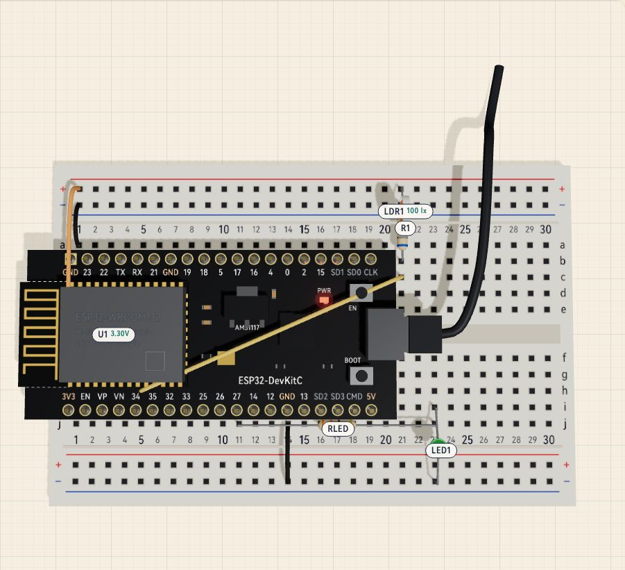
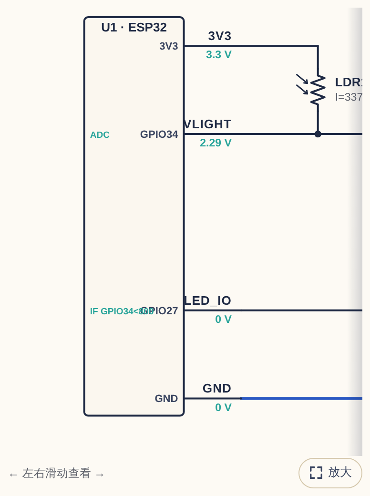
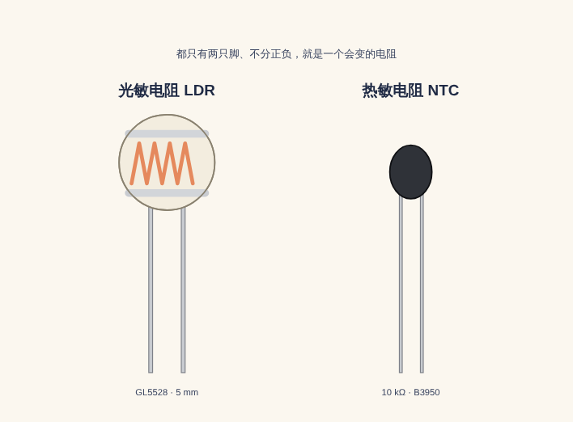
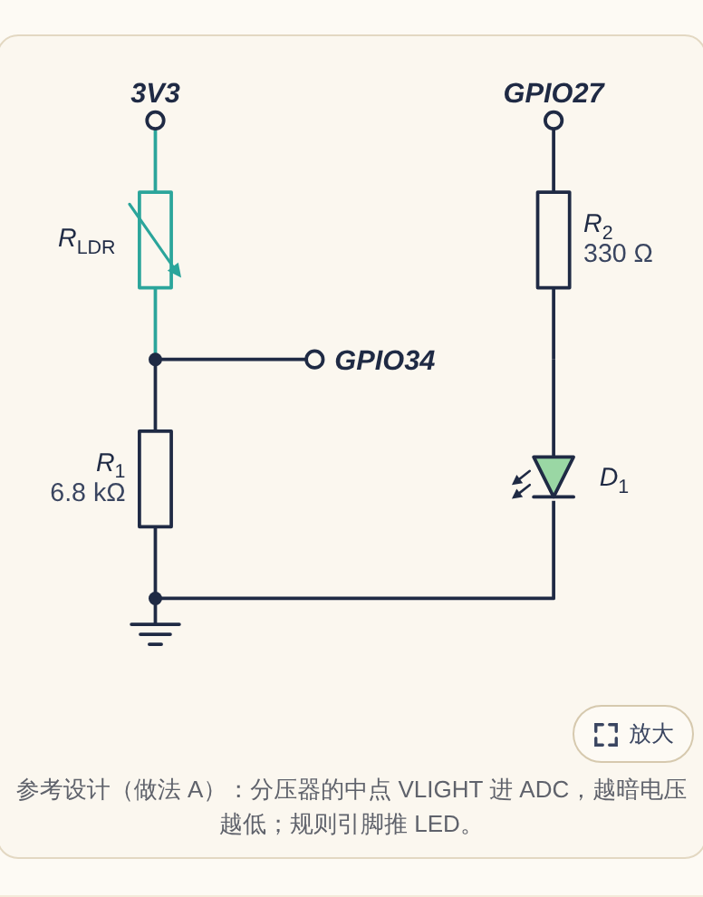

# 8.9 · 开放设计：天黑自动亮灯

| 项目 | 内容 |
|---|---|
| id | `exp5-design-night-light` |
| 文件 | `challenges/298-design-night-light.json` |
| 类型 | 实验 / 挑战（没有分步，照目标电路图搭） · 难度 4/5 |
| 位置 | World 8 · 数字逻辑、MCU 与传感器实战 → 8.9 综合项目（本节第 2 项） |
| 右侧面板 | 轨道由旧的四张卡片自动生成（还没手工精排） |
| 前后 | 上一项 [8.9 exp5-capstone-ntc-fan](../w8/8.09-1-exp5-capstone-ntc-fan.md) · — |
| 先修 | lesson-mcu-pwm-adc |
| 概念 | 开放式设计 open-ended design、光敏电阻分压 LDR divider、阈值与回差 threshold & hysteresis、只看表现判分 behaviour-only grading |

**一句话概要**：第一道开放式设计题：只规定电路要做什么——天黑时灯亮、屋里开着灯时灯灭——怎么做由你定。用 ESP32 的阈值规则可以，用一个三极管也可以。

## 1. 左侧工作台（3D 面包板 → 2D 俯视截图）

截图是程序里真实的 3D 面包板换成俯视角拍的；表格是同一块板的文字版（元件、参数、每只脚插在哪个孔）。

### 1.1 起点：空面包板（学生从零开始搭）

### 1.3 参考答案（「看答案」载入的板子）

| 元件 | 类型 | 参数 | 引脚 → 孔 |
|---|---|---|---|
| U1 | esp32_devkit | usb=true, pins={"GPIO34":{"mode":"adc"},"GPIO27":{"mode":"rule","rule":{"adc":"GPIO34","below":800,"hysteresis":100}}} | GND→b1 GPIO23→b2 GPIO22→b3 GPIO1→b4 GPIO3→b5 GPIO21→b6 GND_2→b7 GPIO19→b8 GPIO18→b9 GPIO5→b10 GPIO17→b11 GPIO16→b12 GPIO4→b13 GPIO0→b14 GPIO2→b15 GPIO15→b16 GPIO8→b17 GPIO7→b18 GPIO6→b19 3V3→i1 EN→i2 GPIO36→i3 GPIO39→i4 GPIO34→i5 GPIO35→i6 GPIO32→i7 GPIO33→i8 GPIO25→i9 GPIO26→i10 GPIO27→i11 GPIO14→i12 GPIO12→i13 GND_3→i14 GPIO13→i15 GPIO9→i16 GPIO10→i17 GPIO11→i18 5V→i19 |
| W1 | wire |  | a→a1 b→tn1 |
| W2 | wire |  | a→h1 b→tp1 |
| W3 | wire |  | a→j14 b→bn14 |
| LDR1 | ldr | lux=100 | 1→tp21 2→a21 |
| R1 | resistor | resistance=6800 | 1→b21 2→tn21 |
| W4 | wire |  | a→c21 b→h5 |
| RLED | resistor | resistance=330 | 1→j11 2→j23 |
| LED1 | led | color=green | anode→i23 cathode→bn23 |

### 1.4 目标原理图（右侧「目标原理图」抽屉）

| 元件 | 类型 | 参数 |
|---|---|---|
| U1 | esp32_devkit | pins={"GPIO34":{"mode":"adc"},"GPIO27":{"mode":"rule","rule":{"adc":"GPIO34","below":800,"hysteresis":100}}} |
| LDR1 | ldr |  |
| R1 | resistor | resistance=6800 |
| RLED | resistor | resistance=330 |
| LED1 | led | color=green |

连接（每个结点上的引脚）：

- **3V3**：U1.3V3、LDR1.1
- **VLIGHT**：LDR1.2、R1.1、U1.GPIO34
- **LED_IO**：U1.GPIO27、RLED.1
- **LED_A**：RLED.2、LED1.anode
- **GND**：R1.2、LED1.cathode、U1.GND

> 开放式设计题：只看电路表现判分，上图只是一种做法。

## 2. 右侧面板：学生从上往下看到的内容（单轨流）

### 第 1 步 · 🔍 先看一眼：先认识它：光敏电阻与热敏电阻

**拆解「光敏电阻和热敏电阻：会变的电阻怎么变成数字」第 1 / 8 层：① 外形：两个两只脚、不分极性的电阻**

- 光敏电阻 LDR（实验 5-5 的 GL5528）：一个 5 mm 的小圆片，透明涂层下面能看到一条弯弯曲曲的橙红色细线——那就是会感光的材料；
- NTC 热敏电阻（实验 5-6，10 kΩ，B = 3950）：一个小小的环氧“珠子”，两根细腿。

它们都 **没有正负极**，在电路里就是一个电阻，只不过阻值不是固定的：
- LDR：**越亮电阻越小**；
- NTC：**越热电阻越小**（Negative Temperature Coefficient = 负温度系数）。

单片机不会直接“量电阻”，它只会用 ADC 量电压。所以下面的路线是：先拆开看电阻为什么变 → 写出变化的公式 → 接成分压器把电阻变成电压 → ADC 把电压变成数字 → 固件再把数字换回光照 / 温度。

|  | LDR（GL5528） | NTC（10 kΩ B3950） |
|---|---|---|
| 感受 | 光照（lux） | 温度（°C） |
| 材料 | 硫化镉 CdS 薄膜 | Mn / Ni / Co 氧化物陶瓷 |
| 规律 | $R = 15 kΩ·(\frac{lux}{10})^{-0.7}$ | $R = R_0·e^{B(\frac{1}{T} - \frac{1}{T_0})}$ |
| 范围 | 100 Ω（强光）… 1 MΩ（全黑） | 0 °C 33.6 kΩ … 80 °C 1.27 kΩ |
| 速度 | 慢：几十–几百 ms | 取决于珠子的热容：秒级 |
| 实验 | 5-5（Blue Pill PA0） | 5-6（ESP32 GPIO32） |

### 第 2 步 · 🔧 动手搭：这次没有标准答案

前面每个实验都给你一张电路图。这一题只给**要求**：
- 屋里亮着灯（**`100 lux`**）时，LED **灭**；
- 天黑（**`1 lux`**）时，LED **亮**；
- LED 的电流在 **1–20 mA** 之间。
先别动手。用你学过的东西，能想出几种做法？

### 第 3 步 · 💡 想明白：两种做法都对

- **测光**（5.7）：光敏电阻在上、固定电阻在下，越暗中点电压越低。

*图 `ref`（schematic）：参考设计（做法 A）：分压器的中点 VLIGHT 进 ADC，越暗电压越低；规则引脚推 LED。*

- **做法 A · 单片机**：中点接一个 ADC 引脚；另一个引脚设成**「阈值规则」**，选「读数 < 阈值 → 高」。1 lux 时读数约 340，100 lux 时约 2840——阈值取在中间偏暗的地方，比如 800。
- **做法 B · 三极管**（5.3）：把分压器上下对调（光敏电阻在下），中点接 NPN 的基极，LED 和限流电阻接在集电极上。天黑时光敏电阻变大，基极电压升过约 0.7 V，三极管导通，灯亮。
- 检查**只看表现**：测试把光照设成 100 lux 和 1 lux，看灯亮不亮、电流多大。用什么元件、插在哪里都不管。

（这一步下面列着这节课的计算卡片，点开就地展开：`schmitt-thresholds`、`gpio-led-resistor`、`adc-code`、`sensor-best-resistor`、`ldr-divider`、`npn-base-resistor`，全文见第 6 节）

### 第 4 步 · 🔧 动手搭：搭一个，再改进它

- 选一种做法搭出来。点**「检查我的电路」**：哪条要求没达到，它就告诉你哪条。
- 通过以后，单击光敏电阻，把光照从 **`100 lux`** 慢慢拖到 **`1 lux`**：灯在多少 lux 时亮？
- 做法 A 再试试**回差**：设成 `100`，来回拖光照，灯打开和关掉的位置不一样了。

### 第 5 步 · 🎒 带走：带走

- **设计题先写要求**，再选做法：要求能测（几 lux、几 mA），检查就能写成测试。
- 同一个要求可以有很多电路。单片机的阈值可以随时改，三极管的阈值靠电阻比；三极管更省事，单片机更灵活。
- 回差让灯不会在黄昏时一闪一闪：打开和关掉用两个阈值——和 3.2 的施密特触发器、296 的风扇是同一个主意。

## 3. 测量题一览

_没有测量题。_

### 提示按钮（依次显示）

1. 先搭 5.7 的测光分压器：光敏电阻从 3V3 接到中点，6.8 kΩ 从中点接到 GND。
2. 做法 A：中点接 GPIO34，再把另一个引脚（GPIO27）设成「阈值规则」，读 GPIO34，「读数 < 阈值 → 高」，阈值 800。LED 经 330 Ω 从这个引脚接到 GND。
3. 做法 B：把光敏电阻放到分压器下面，中点经约 1 kΩ 接 NPN 的基极，LED 和电阻接在电源和集电极之间。

### 功能测试（「检查我的电路」时跑）

- 屋里亮着（100 lux）：LED 灭
- 天黑（1 lux）：LED 亮，电流 1–20 mA

## 4. 用到的拆解（全部层的文字，供改写参考）

### 拆解 `sensors`：光敏电阻和热敏电阻：会变的电阻怎么变成数字

*LDR = Light-Dependent Resistor（光敏电阻），NTC = Negative Temperature Coefficient thermistor（负温度系数热敏电阻）。两者都是“电阻随外界变化”。我们拆开看它们为什么会变、变化规律的公式，再把它们接成分压器送进 ADC，算出固定电阻该取多大、读数怎么换回光照和温度。*

**拆解「光敏电阻和热敏电阻：会变的电阻怎么变成数字」第 1 / 8 层：① 外形：两个两只脚、不分极性的电阻**

- 光敏电阻 LDR（实验 5-5 的 GL5528）：一个 5 mm 的小圆片，透明涂层下面能看到一条弯弯曲曲的橙红色细线——那就是会感光的材料；
- NTC 热敏电阻（实验 5-6，10 kΩ，B = 3950）：一个小小的环氧“珠子”，两根细腿。

它们都 **没有正负极**，在电路里就是一个电阻，只不过阻值不是固定的：
- LDR：**越亮电阻越小**；
- NTC：**越热电阻越小**（Negative Temperature Coefficient = 负温度系数）。

单片机不会直接“量电阻”，它只会用 ADC 量电压。所以下面的路线是：先拆开看电阻为什么变 → 写出变化的公式 → 接成分压器把电阻变成电压 → ADC 把电压变成数字 → 固件再把数字换回光照 / 温度。

|  | LDR（GL5528） | NTC（10 kΩ B3950） |
|---|---|---|
| 感受 | 光照（lux） | 温度（°C） |
| 材料 | 硫化镉 CdS 薄膜 | Mn / Ni / Co 氧化物陶瓷 |
| 规律 | $R = 15 kΩ·(\frac{lux}{10})^{-0.7}$ | $R = R_0·e^{B(\frac{1}{T} - \frac{1}{T_0})}$ |
| 范围 | 100 Ω（强光）… 1 MΩ（全黑） | 0 °C 33.6 kΩ … 80 °C 1.27 kΩ |
| 速度 | 慢：几十–几百 ms | 取决于珠子的热容：秒级 |
| 实验 | 5-5（Blue Pill PA0） | 5-6（ESP32 GPIO32） |

**拆解「光敏电阻和热敏电阻：会变的电阻怎么变成数字」第 2 / 8 层：② LDR 内部：两把梳子中间夹一条之字形 CdS**

放大看那条橙线：瓷片上镀了两块 **梳子形** 的金属电极 电极 1 和 电极 2，梳齿互相插在一起，它们之间留下的那条弯来弯去的缝里是 硫化镉 CdS——一种半导体。

**为什么光能让电阻变小**：CdS 的禁带宽度约 2.4 eV。黑暗中几乎没有自由载流子，电阻很大（≈ 1 MΩ）。光子 能量够大时，把价带里的电子打到导带，产生 电子–空穴对——载流子越多，电导越大。光越强，产生的载流子越多，电阻越小。

**为什么要做成之字形**：一条导体的电阻是
$$R = ρ·\frac{L}{W·t}$$
这里电流是“横着”穿过缝的：路程 L = 缝的宽度（很窄），截面宽 W = 缝的总长度（弯来弯去，很长）。之字形让 L 很小、W 很大，CdS 本身电阻率很高也能得到 kΩ 量级的电阻，而且整个缝都对着光。

- 公式 `R = ρ·\frac{L}{W·t}`：L = 缝宽（短），W = 缝的总长（长），t = 膜厚

**拆解「光敏电阻和热敏电阻：会变的电阻怎么变成数字」第 3 / 8 层：③ LDR 的规律：对数坐标下是一条直线**

把电阻对照度画在 **两个对数轴** 上，GL5528 是一条直线（仿真模型，和实验 5-5 一致）：
$$R_{LDR} = 15 kΩ·(\frac{lux}{10})^{-0.7}$$
两边取对数：$log R = log 15 k - 0.7·log\frac{lux}{10}$——斜率 −0.7 的直线。含义：
- 光照 ×10 → 电阻 ÷ $10^{0.7}$ ≈ ÷5；
- 10 lux 时 15 kΩ（这就是 15 kΩ 这个数的来历）。

代入四个测试点：

| 场景 | 照度 | $R_{LDR}$ |
|---|---|---|
| 很暗（月光） | 1 lux | $15 k × 10^{0.7}$ ≈ 75 kΩ |
| 昏暗 | 10 lux | 15 kΩ |
| 室内 | 100 lux | 15 k ÷ 5 ≈ 3.0 kΩ |
| 窗边 / 阴天户外 | 1000 lux | ≈ 600 Ω |

- 公式 `R_{LDR} = 15 kΩ·(\frac{lux}{10})^{-0.7}`：仿真模型（夹在 100 Ω … 1 MΩ）

**拆解「光敏电阻和热敏电阻：会变的电阻怎么变成数字」第 4 / 8 层：④ NTC 内部和 B 方程：越热电阻越小**

NTC 的 珠子 是锰、镍、钴等金属氧化物烧结成的陶瓷半导体，两根 引线 埋在里面，外面包一层环氧或玻璃。

**为什么越热电阻越小**：和金属相反。半导体里的载流子要靠热能“激发”出来，温度越高，激发出的载流子按指数增加，电阻按指数下降。描述它的是 **B 参数方程**（T 用开尔文）：
$$R(T) = R_0·e^{B(\frac{1}{T} - \frac{1}{T_0})}$$
$R_0$ = 10 kΩ 是 $T_0$ = 25 °C = 298.15 K 时的阻值，B = 3950 K 描述它有多“陡”。

**一步步算 50 °C**：
1. T = 50 + 273.15 = 323.15 K；
2. $\frac{1}{T} - \frac{1}{T_0} = 0.0030945 - 0.0033540 = -0.0002595$ /K；
3. 乘 B：3950 × (−0.0002595) = −1.025；
4. $R = 10 kΩ × e^{-1.025}$ = 10 kΩ × 0.359 = 3.59 kΩ。

同理 0 °C 是 33.6 kΩ，80 °C 是 1.27 kΩ——曲线 明显不是直线：低温段很陡，高温段很平。

| T | T (K) | $\frac{1}{T} - \frac{1}{T_0}$ | $R_{NTC}$ |
|---|---|---|---|
| 0 °C | 273.15 | +0.0003070 | 33.6 kΩ |
| 25 °C | 298.15 | 0 | 10.0 kΩ |
| 50 °C | 323.15 | −0.0002595 | 3.59 kΩ |
| 80 °C | 353.15 | −0.0005222 | 1.27 kΩ |

- 公式 `R(T) = R_0·e^{B(\frac{1}{T} - \frac{1}{T_0})}`：R₀ = 10 kΩ，T₀ = 298.15 K，B = 3950 K

**拆解「光敏电阻和热敏电阻：会变的电阻怎么变成数字」第 5 / 8 层：⑤ 接成分压器：电阻 → 电压 → 数字**

ADC 只量电压，所以给传感器串一个固定电阻 R1，接成 **分压器**（voltage divider），中间结点送进 ADC。ADC 输入几乎不取电流，所以就是最简单的无负载分压。

**实验 5-5**（Blue Pill）：3V3 → LDR → VLIGHT → R1 = 6.8 kΩ → GND，VLIGHT 接 PA0：
$$V = 3.3·\frac{R_1}{R_1 + R_{LDR}}$$
LDR 在上面：越亮 → $R_{LDR}$ 越小 → 电压越高。

**实验 5-6**（ESP32）：3V3 → R1 = 10 kΩ → VTEMP → NTC → GND，VTEMP 接 GPIO32：
$$V = 3.3·\frac{R_{NTC}}{R_1 + R_{NTC}}$$
NTC 在下面：越热 → 电压越低。

两种接法交换上下位置，规律就反过来——固件里“亮 / 暗”“热 / 冷”的判断方向必须和接线一致。

**比例测量（ratiometric）**：分压器的顶端接 ADC 的参考电压（3V3），读数 $\frac{V}{3.3} × 4095 = \frac{R_1}{R_1 + R} × 4095$ 里 3.3 被约掉了——3V3 有点漂也不影响结果。

| 实验 5-5（LDR，6.8 kΩ） | 电压 | 读数 | 实验 5-6（NTC，10 kΩ） | 电压 | 读数 |
|---|---|---|---|---|---|
| 1 lux | 0.274 V | 340 | 0 °C | 2.541 V | 3154 |
| 10 lux | 1.029 V | 1277 | 25 °C | 1.649 V | 2046 |
| 100 lux | 2.291 V | 2843 | 50 °C | 0.871 V | 1081 |
| 1000 lux | 3.033 V | 3763 | 80 °C | 0.372 V | 461 |

- 公式 `code = round(\frac{R_{bottom}}{R_{top} + R_{bottom}} × 4095)`：比例测量：与 3V3 的准确值无关

**拆解「光敏电阻和热敏电阻：会变的电阻怎么变成数字」第 6 / 8 层：⑥ 固定电阻取多大：R1 = 传感器在量程中间的电阻**

R1 取错了，分压器会把有用的变化“挤扁”：
- R1 = 100 kΩ：1/10/100/1000 lux 得到 1.88 / 2.87 / 3.20 / 3.28 V——亮的一端全挤在 3.3 V 附近，100 lux 和 1000 lux 只差 0.08 V；
- R1 = 1 kΩ：0.04 / 0.21 / 0.83 / 2.07 V——暗的一端全挤在 0 V；
- R1 = 6.8 kΩ：0.27 / 1.03 / 2.29 / 3.03 V，每十倍光照差 0.9–1.6 V，三个十倍都分得清。

**推导**：传感器电阻按比例变（LDR 每十倍光照 ÷5，NTC 是指数），所以要看电压对 $ln R$ 的灵敏度。设传感器在上，$V = V_{cc}\frac{R_1}{R_1 + R}$：
$$\frac{dV}{d(ln R)} = R·\frac{dV}{dR} = -V_{cc}·\frac{R_1·R}{(R_1 + R)^{2}}$$
令 $x = \frac{R_1}{R}$，大小是 $V_{cc}\frac{x}{(1 + x)^{2}}$，在 **x = 1，即 R1 = R** 时最大，等于 $\frac{V_{cc}}{4}$——此时 V 正好是 $\frac{V_{cc}}{2}$，曲线最陡 的地方。

**规则**：R1 = 你最关心的那一点的传感器电阻；要覆盖一个范围，取两端电阻的 **几何平均**：
$$R_1 = \sqrt{R_{min}·R_{max}} = \sqrt{75 kΩ × 0.6 kΩ} ≈ 6.7 kΩ → 6.8 kΩ$$
NTC 同理：R1 = $R_{25}$ = 10 kΩ 把最灵敏点放在室温，适合 0–50 °C；要测 100 °C 左右的 3D 打印机热床，就用 100 °C 时的阻值（≈ 0.7 kΩ）附近的 680 Ω–1 kΩ。

| R1 | 1 lux | 10 lux | 100 lux | 1000 lux | 评价 |
|---|---|---|---|---|---|
| 1 kΩ | 0.04 V | 0.21 V | 0.83 V | 2.07 V | 暗端挤在 0 V |
| 6.8 kΩ | 0.27 V | 1.03 V | 2.29 V | 3.03 V | 最好：几何平均 |
| 100 kΩ | 1.88 V | 2.87 V | 3.20 V | 3.28 V | 亮端挤在 3.3 V |

- 公式 `\frac{dV}{d(ln R)} 最大 ⇔ R_1 = R`：最大值 = Vcc / 4，此时 V = Vcc / 2
- 公式 `R_1 = \sqrt{R_{min}·R_{max}}`：覆盖一个范围时

**拆解「光敏电阻和热敏电阻：会变的电阻怎么变成数字」第 7 / 8 层：⑦ 从读数换回温度，以及为什么不是直线**

固件拿到的只是一个 0–4095 的数，要倒着走三步（实验 5-6）：
1. **读数 → 电阻**：分压公式反过来（NTC 在下）：
$$R_{NTC} = R_1·\frac{raw}{4095 - raw}$$
2. **电阻 → 温度**：B 方程取对数解出 T：
$$\frac{1}{T} = \frac{1}{T_0} + \frac{1}{B}ln\frac{R_{NTC}}{R_0}$$
3. **开尔文 → 摄氏**：减 273.15。

例：raw = 1081 → $R_{NTC}$ = 10 k × 1081 / 3014 ≈ 3.59 kΩ → ln 0.359 = −1.025 → $\frac{1}{T}$ = 0.003354 − 0.000260 = 0.003094 → T ≈ 323.2 K = **50.0 °C**。

**非线性**：读数–温度曲线 不是直线。相同的 25 °C 间隔：
- 0 → 25 °C 降 1108 码（约 44 码/°C）；
- 25 → 50 °C 降 965 码（约 39 码/°C）；
- 50 → 80 °C 只降 620 码（约 21 码/°C）。

所以 用直线插值 会在中间差好几度；一个码在 25 °C 附近代表 0.025 °C，在 80 °C 附近是 0.05 °C。要 ±0.1 °C 的精度，用三项的 Steinhart–Hart 方程 $\frac{1}{T} = A + Bln R + C(ln R)^{3}$，按厂家的 R–T 表拟合。

| T | $R_{NTC}$ | V | 读数 | 每 °C 几个码 |
|---|---|---|---|---|
| 0 °C | 33.6 kΩ | 2.541 V | 3154 | ≈ 44（0–25 °C） |
| 25 °C | 10.0 kΩ | 1.649 V | 2046 | ≈ 39（25–50 °C） |
| 50 °C | 3.59 kΩ | 0.871 V | 1081 | ≈ 21（50–80 °C） |
| 80 °C | 1.27 kΩ | 0.372 V | 461 | — |

- 公式 `R_{NTC} = R_1·\frac{raw}{4095 - raw}`：NTC 在下的分压器反算
- 公式 `\frac{1}{T} = \frac{1}{T_0} + \frac{1}{B}ln\frac{R_{NTC}}{R_0}`：B 方程解出 T（开尔文）

**拆解「光敏电阻和热敏电阻：会变的电阻怎么变成数字」第 8 / 8 层：⑧ 局限：自热、速度、个体差异**

**NTC 自热**：测量电流流过 NTC 会让它自己发热，测到的温度偏高。NTC 上的功率
$$P = \frac{V_{NTC}^{2}}{R_{NTC}}$$
在 $R_{NTC}$ = R1 时最大：$\frac{1.65^{2}}{10 kΩ}$ ≈ 0.27 mW（25 °C，电流 165 µA）。小珠子 NTC 的耗散常数约 1–2 mW/°C，所以自热 0.1–0.3 °C。要更准：用更大的阻值（100 kΩ NTC + 100 kΩ），或者只在测量时给分压器上电。

**LDR 很慢**：光照突变后，电阻要几十到几百 ms 才跟上（变暗时更慢），不适合测快速闪烁的光。做“天黑开灯”要加 **回差**（两个阈值），否则在阈值附近灯会闪。

**个体差异**：LDR 同型号之间 ±50 % 很常见，还随温度漂移——适合判断亮 / 暗、粗略亮度；要真实 lux 用数字传感器（BH1750、VEML7700）。NTC 电阻公差 ±1–5 %、B 值约 ±1 %，要算进误差预算。CdS 含镉，受 RoHS 限制，新设计多用光电二极管 / 光电三极管。

**接线**：STM32 的模拟引脚（PA0–PA7、PB0、PB1）**不耐 5 V**，分压器顶端只能接 3V3；ADC 引脚到 GND 并一个 100 nF 降噪（NTC 分压器的源阻抗 R1 ∥ $R_{NTC}$ 约 5 kΩ）。

| 问题 | LDR | NTC | 对策 |
|---|---|---|---|
| 速度 | 几十–几百 ms | 秒级（热容） | 软件滤波，回差 |
| 个体差异 | ±50 % | R ±1–5 %，B ±1 % | 校准 / 用数字传感器 |
| 自热 | 可忽略 | ≤ 0.27 mW → 0.1–0.3 °C | 大阻值，只在测量时上电 |
| 非线性 | 幂律 | 指数 | 用公式，不要直线 |

- 公式 `P_{NTC} = \frac{V_{NTC}^{2}}{R_{NTC}} ≤ \frac{V_{cc}^{2}}{4 R_1} = 0.27 mW`：R_NTC = R1 时最大

**一句话记住**：LDR：CdS 被光激发出载流子，$R = 15 kΩ·(\frac{lux}{10})^{-0.7}$；NTC：氧化物陶瓷被热激发，$R = R_0·e^{B(\frac{1}{T} - \frac{1}{T_0})}$。两者都接成分压器给 ADC，R1 取传感器在关心范围中间（几何平均）的阻值，读数用分压公式和 B 方程倒推回光照 / 温度。

## 5. 这一课的计算卡片

**计算卡片 `schmitt-thresholds`：施密特触发器的两个阈值**

- 公式 `V_T = \frac{V_{CC}/R_A + V_o/R_F}{1/R_A + 1/R_B + 1/R_F}`
- 用途：正反馈比较器：输出高时 IN+ 在上阈值 V_TH，输出低时在下阈值 V_TL，两者之差是回差。
- 输入：V_CC（电源，V）；R_A（电源到 IN+ 的 R_A，Ω）；R_B（IN+ 到地的 R_B，Ω）；R_F（OUT 到 IN+ 的反馈 R_F，Ω）；V_o（输出电平（LM358 高 ≈ 7.5 V，低 ≈ 0 V），V） → V_T（这时的阈值（IN+ 的电压），V）

1. 反馈接到 **IN+**（正反馈）：输出一动，IN+ 被推着往同一个方向走，输出就一直走到头——只有高、低两个状态。
2. IN+ 是一个结点，接着三条支路：$R_A$ 到电源、$R_B$ 到地、$R_F$ 到输出。把输出当成又一个电压源，用结点电压法：$V_T = \frac{V_{CC}/R_A + V_o/R_F}{1/R_A + 1/R_B + 1/R_F}$。
3. 输出高（$V_o ≈ 7.5 V$）时得到上阈值 $V_{TH}$；输出低（0 V）时得到下阈值 $V_{TL}$。
4. 输入（接 IN−）要升过 $V_{TH}$ 输出才翻低，要降到 $V_{TL}$ 以下才翻回高。
5. 回差 $V_{TH} - V_{TL} = ΔV_o\frac{1/R_F}{1/R_A + 1/R_B + 1/R_F}$：比它小的噪声不会让输出来回抖。

例子：本实验（9 V、10 k / 10 k、$R_F$ = 47 k）：分母 0.1 + 0.1 + 0.0213 = 0.2213 mS；$V_{TH} = \frac{0.9 + 7.5/47}{0.2213} ≈ 4.79 V$，$V_{TL} = \frac{0.9}{0.2213} ≈ 4.07 V$，回差 ≈ 0.72 V。幅度 0.25 V 的三角波（4.25–4.75 V）碰不到阈值，输出不翻转。

- ⚠ 把反馈接到 IN−：那是负反馈放大器，不是比较器。
- ⚠ 输出高电平用 V+ − 1.5 V（LM358），不是 9 V。

**计算卡片 `gpio-led-resistor`：GPIO 点 LED 的电阻（含引脚内阻）**

- 公式 `R = \frac{V_{OH} - V_F}{I} - R_{out} - r_d`
- 用途：单片机引脚直接驱动 LED：串多大的电阻得到想要的电流。
- 输入：V_OH（引脚高电平（空载），V）；V_F（LED 正向压降（红 1.8 V），V）；I（想要的电流（≤ 20 mA），A）；R_out（引脚输出电阻（ESP32 25 Ω、Blue Pill 40 Ω），Ω）；r_d（LED 内阻，Ω） → R（串联电阻（再取一个标准值），Ω）

1. 输出高电平的引脚不是理想电压源：它像 3.3 V 串一个输出电阻 $R_{out}$（芯片里 MOS 管的导通电阻）。
2. LED 用折线模型：$V_F$ 串 $r_d$。
3. 回路 KVL：$V_{OH} = I(R_{out} + R + r_d) + V_F$。
4. 解出 $R = \frac{V_{OH} - V_F}{I} - R_{out} - r_d$，取最接近的标准值，再回算电流：$I = \frac{V_{OH} - V_F}{R + R_{out} + r_d}$。
5. 灌电流（LED 接 3V3、阴极接引脚、输出低电平点亮）公式一样，$R_{out}$ 换成下管的电阻。

例子：- 实验 5-1：10 mA：$\frac{1.5}{0.01} - 25 - 12 = 113 Ω$ → 120 Ω，$I = \frac{1.5}{157} ≈ 9.5 mA$。不串电阻：$\frac{1.5}{37} ≈ 40 mA$——到了绝对最大值。
- 第 15 课：330 Ω：$\frac{1.5}{330 + 25 + 12} ≈ 4.1 mA$。
- 实验 5-2（Blue Pill，40 Ω）：220 Ω：$\frac{1.5}{272} ≈ 5.5 mA$；板载 LED 510 Ω：≈ 2.7 mA。

- ⚠ 蓝 / 白 LED（$V_F$ ≈ 3 V）在 3.3 V 引脚上只剩 0.3 V 给电阻：亮度对一切都很敏感——用三极管从 5 V 驱动。
- ⚠ 每个引脚建议 ≤ 20 mA，所有引脚加起来也有上限（STM32F103 共 150 mA）。

**计算卡片 `adc-code`：ADC 读数 raw = V/Vref × 4095**

- 公式 `raw = \frac{V}{V_{ref}} × (2^{N} - 1)`
- 用途：一个电压在 N 位 ADC 上读出多少（0 … 4095）。
- 输入：V（ADC 引脚电压，V）；V_ref（满量程（参考电压），V）；N（位数，） → raw（读数，）

1. N 位 ADC 把 0 … $V_{ref}$ 分成 $2^{N}$ 个台阶：12 位就是 4096 个，读数 0 … 4095。
2. 线性换算：$raw = \frac{V}{V_{ref}} × 4095$，四舍五入成整数。
3. 一个 LSB（最低位）= $\frac{V_{ref}}{4095} ≈ 0.81 mV$：这是分辨率。
4. 固件反过来：$V = raw × \frac{V_{ref}}{4095}$。
5. 引脚电压超过 $V_{ref}$ 读数就停在 4095；超过 3.3 V（加二极管压降）引脚会坏——先分压。

例子：第 16 课：1.65 V → 2048。实验 5-4：8.4 V 电池分压后 2.084 V → 2586。实验 5-6：25 °C 1.649 V → 2046，80 °C 0.372 V → 461。实验 5-10：3.13 V → 3879。

- ⚠ ESP32 的 ADC 在 0.15 V 以下和 2.45 V 以上不线性，要校准；用 ADC1（GPIO32–39），ADC2 开 Wi-Fi 时不能用。

**计算卡片 `sensor-best-resistor`：传感器分压：固定电阻取几何平均**

- 公式 `R_1 = \sqrt{R_{a} R_{b}}`
- 用途：光敏 / 热敏电阻要在 Rₐ … R_b 范围内都分得开：固定电阻选多大。
- 输入：R_a（传感器一端的阻值（如最暗），Ω）；R_b（另一端的阻值（如最亮），Ω） → R_1（最合适的固定电阻，Ω）

1. 分压输出 $V = V_{cc}\frac{R_1}{R_1 + R_s}$（传感器在上）。
2. 传感器的阻值按倍数变（光每 ×10，电阻 ÷5），所以要看 V 对 $ln R_s$ 的灵敏度：$|\frac{dV}{d ln R_s}| = V_{cc}\frac{R_1R_s}{(R_1 + R_s)^{2}}$。
3. 这个式子在 $R_1 = R_s$ 时最大（V = Vcc/2，曲线最陡）。
4. 要覆盖一个范围，就让范围的“对数中点”落在最陡处：$R_1 = \sqrt{R_aR_b}$，两端也对称地分开。
5. 只关心一个点（比如 10 lux 开灯）就取那一点的阻值。

例子：实验 5-5：1–1000 lux，$\sqrt{75k × 0.6k} ≈ 6.7 kΩ$ → 6.8 kΩ。换成 100 kΩ：亮处挤在 3.2–3.3 V；1 kΩ：暗处挤在 0 V 附近。实验 5-6：0–50 °C 的 NTC $\sqrt{33.6k × 3.59k} ≈ 11 kΩ$，所以用 10 kΩ = R₂₅。

**计算卡片 `ldr-divider`：光敏电阻分压 LDR divider**

- 公式 `R_{LDR} = 15 kΩ × (\frac{lux}{10})^{-0.7}, V = V_{cc}\frac{R_1}{R_1 + R_{LDR}}`
- 用途：某个光照下光敏电阻多大、ADC 引脚上是多少伏（LDR 在上、固定电阻在下）。
- 输入：lux（光照，lx）；R_1（下面的固定电阻，Ω）；V_cc（分压器电源，V） → V（ADC 引脚电压，V）

1. 模型（类似 GL5528）：$R_{LDR} = 15 kΩ × (\frac{lux}{10})^{-0.7}$——光每强 10 倍，电阻变成 $10^{-0.7} ≈ \frac{1}{5}$。
2. LDR 在上、R₁ 在下：$V = V_{cc}\frac{R_1}{R_1 + R_{LDR}}$，**越亮电压越高**。
3. 固件反算阻值：$R_{LDR} = R_1\frac{V_{cc} - V}{V}$，再换成 lux。
4. 位置对调（R₁ 在上）就是越亮越低，固件判断要跟着改。

例子：实验 5-5（6.8 kΩ）：1 lux 75 kΩ → 0.27 V；10 lux 15 kΩ → 1.03 V；100 lux 3.0 kΩ → 2.29 V；1000 lux 600 Ω → 3.03 V。读数 340 / 1277 / 2843 / 3763。

- ⚠ STM32 的模拟引脚不耐 5 V：分压器顶端接 3V3，不要接 5V。
- ⚠ 真实 LDR 个体差 ±50 %、反应慢：只适合判断亮暗。

**计算卡片 `npn-base-resistor`：NPN 开关的基极电阻**

- 公式 `R_B = \frac{V_{OH} - V_{BE}}{I_C / β_{forced}}`
- 用途：用 3.3 V 引脚让 NPN 三极管饱和导通（低边开关），基极电阻取多大。
- 输入：V_OH（引脚高电平，V）；V_BE（B–E 压降，V）；I_C（负载需要的电流，A）；β_F（强制 β（取 10 留余量），） → R_B（基极电阻（取不大于它的标准值），Ω）

1. 先算负载电流 $I_C$：负载接在 5 V 和集电极之间，饱和时 $V_{CE}$ 只有 0.1–0.2 V，$I_C$ 由负载决定，不由 β 决定。
2. 想让它 **饱和**，基极电流要比放大区需要的 $\frac{I_C}{β}$ 多得多。经验：$I_B ≥ \frac{I_C}{10}$（强制 β ≈ 10）。β 随温度和批次变化很大（2N2222 是 35–300），按 10 设计有余量。
3. B–E 结是一个二极管（≈ 0.65–0.7 V）：$I_B = \frac{V_{OH} - V_{BE}}{R_B}$。
4. 解出 $R_B$，取不大于它的标准值。
5. 不串 $R_B$：3.3 V 直接加在 B–E 二极管上，只有引脚内阻限流，约 60 mA——引脚烧坏。

例子：实验 5-7：蜂鸣器 $I_C ≈ 24.9 mA$ → $I_B ≥ 2.5 mA$ → $R_B ≤ \frac{2.6}{2.5 mA} ≈ 1.04 kΩ$ → 1 kΩ。实验 5-9：线圈 63 mA，1 kΩ 给 2.53 mA，强制 β ≈ 25，仍远低于 150，照样饱和。

- ⚠ 用 β = 150 直接算 $I_B = I_C/β$：刚好在放大区边缘，温度一变就不饱和。
- ⚠ 基极到地加 10–100 kΩ 下拉，单片机复位时引脚悬空也能保证关断。

## 6. English（界面英文版的同一份内容）

展开英文

### Node 1 · 🔍 Look first：Meet it first: LDR and NTC

**Teardown「LDR and NTC: turning a changing resistance into a number」layer 1 of 8：① Outside: two two-legged resistors with no polarity**

- the LDR (GL5528, lab 5-5): a 5 mm disc; under its clear coat you can see a wiggly orange-red line — the light-sensitive material;
- the NTC thermistor (lab 5-6, 10 kΩ, B = 3950): a tiny epoxy bead on two thin legs.

Neither has **polarity**; in a circuit each is just a resistor whose value isn't fixed:
- LDR: **brighter → lower resistance**;
- NTC: **hotter → lower resistance** (Negative Temperature Coefficient).

A microcontroller can't measure resistance directly — its ADC measures voltage. So the route is: take them apart to see why the resistance changes → write the formula → wire a divider to turn resistance into voltage → the ADC turns voltage into a number → firmware turns the number back into light / temperature.

|  | LDR (GL5528) | NTC (10 kΩ B3950) |
|---|---|---|
| senses | light (lux) | temperature (°C) |
| material | cadmium sulphide (CdS) film | Mn / Ni / Co oxide ceramic |
| law | $R = 15 kΩ·(\frac{lux}{10})^{-0.7}$ | $R = R_0·e^{B(\frac{1}{T} - \frac{1}{T_0})}$ |
| range | 100 Ω (bright) … 1 MΩ (dark) | 33.6 kΩ at 0 °C … 1.27 kΩ at 80 °C |
| speed | slow: tens–hundreds of ms | set by the bead’s heat capacity: seconds |
| lab | 5-5 (Blue Pill PA0) | 5-6 (ESP32 GPIO32) |

### Node 2 · 🔧 Build：No set answer this time

Every lab so far gave you a schematic. This one gives you only the **requirements**:
- with the room lit (**`100 lux`**) the LED is **off**;
- in the dark (**`1 lux`**) the LED is **on**;
- the LED current is between **1 and 20 mA**.
Hands off for now. With what you have learned, how many ways can you think of?

### Node 3 · 💡 Why：Both ways are right

- **Sensing light** (5.7): LDR on top, fixed resistor below, and the darker it is, the lower the middle node.

[figure `ref`]

*Figure `ref`（schematic）：参考设计（做法 A）：分压器的中点 VLIGHT 进 ADC，越暗电压越低；规则引脚推 LED。*

- **Way A · microcontroller**: the middle node goes to an ADC pin; set another pin to **Threshold rule**, "reading < threshold → HIGH". At 1 lux the reading is about 340, at 100 lux about 2840 — put the threshold in between, on the dark side, say 800.
- **Way B · transistor** (5.3): swap the divider (LDR at the bottom) and feed its middle node to an NPN's base, with the LED and its resistor on the collector. In the dark the LDR grows, the base rises past about 0.7 V, the transistor turns on and the light comes on.
- The check looks **only at behaviour**: the tests set the light to 100 lux and to 1 lux and look at whether the LED is lit and how much current it takes. Which parts you use and where they sit does not matter.

(This node lists the lesson’s calculation cards: `schmitt-thresholds`、`gpio-led-resistor`、`adc-code`、`sensor-best-resistor`、`ldr-divider`、`npn-base-resistor`; full text in section 6)

### Node 4 · 🔧 Build：Build one, then improve it

- Build one of the ways. Press **Check my circuit**: it tells you which requirement is not met.
- Once it passes, click the LDR and drag the light slowly from **`100 lux`** down to **`1 lux`**: at how many lux does the light come on?
- With way A, try **hysteresis**: set it to `100` and drag the light back and forth — the light now turns on and off at different places.

### Node 5 · 🎒 Take away：Take away

- **A design task starts with requirements**, then a way to meet them: when the requirements can be measured (so many lux, so many mA), the check can be written as tests.
- One requirement fits many circuits. A microcontroller's threshold changes with a setting; a transistor's is set by a resistor ratio. The transistor is simpler, the microcontroller more flexible.
- Hysteresis keeps the light from flickering at dusk: one threshold to turn on, another to turn off — the same idea as the Schmitt trigger in 3.2 and the fan in 296.

**Hints**

1. Start with the light meter from 5.7: LDR from 3V3 to a middle node, 6.8 kΩ from there to GND.
2. Way A: wire the middle node to GPIO34, then set another pin (GPIO27) to Threshold rule, reading GPIO34, "reading < threshold → HIGH", threshold 800. LED through 330 Ω from that pin to GND.
3. Way B: put the LDR at the bottom of the divider, feed the middle node to an NPN's base through about 1 kΩ, and hang the LED and a resistor between the supply and the collector.

